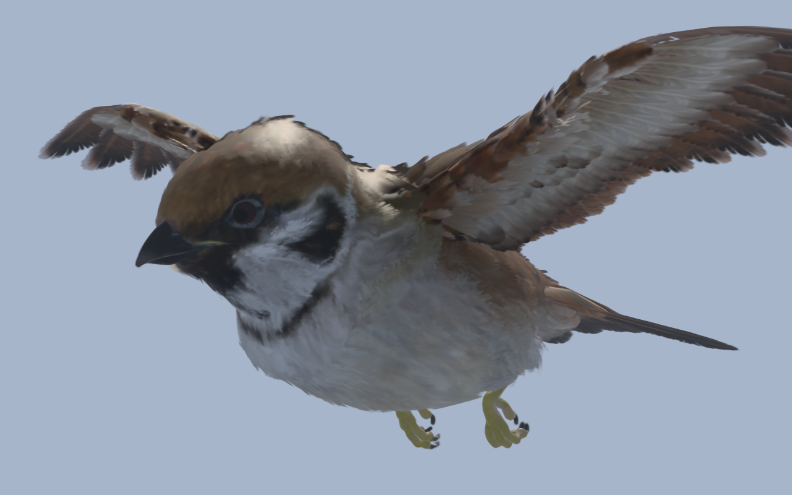

# athenea

[](https://github.com/jesusluque/athenea/actions/workflows/build.yml)
[](https://jesusluque.github.io/athenea/)
[](LICENSE)

**Relightable Gaussian splats from production USD.** athenea is a Slang
renderer with a Hydra 2.0 delegate. It converts USD assets (meshes with real
materials) into Gaussian splats that keep how the asset responds to light: a
path tracer records it once, and the splats are drawn in milliseconds under
any sky.

Every step over scene data runs on the GPU (Metal, Vulkan, CUDA), including
reference renders and test oracles.



## Two products from one bake

| | Production master | Web format |
|---|---|---|
| Goal | fidelity | size and speed |
| File | USDC: `ParticleField3DGaussianSplat` plus `athenea:splat:*` primvars, at full precision | `.athc`: derived from the master, compressed, streamed by pages |
| Read by | the engine, Nuke and Natron (OFX), Blender | a browser, desktop or phone |
| Made by | `athenea mesh2splat --transfer` (the bake) | a separate conversion of the master |

Improvements are made in the master, and the web format is derived again. The
[architecture page](https://jesusluque.github.io/athenea/architecture/) and the
[paper](https://jesusluque.github.io/athenea/paper/) describe both processes.

## Integrations

| Where | What | Folder |
|---|---|---|
| Command line | `athenea`: render, stage, view, mesh2splat, convert, compare, aofx, … | `apps/athenea` |
| Any USD application | `hdAthenea`, the Hydra render delegate (`PXR_PLUGINPATH_NAME=<build>/plugin/usd`) | `modules/usd` |
| Blender 5.3 | an add-on: athenea as a render engine, mesh2splat and export operators | `integrations/blender` |
| Nuke, Natron | an OpenFX node: the relit asset through the shot camera, with RGBA, depth, P and Cryptomatte | `integrations/ofx` |
| AI agents | `athenea-mcp`, an MCP server over a warm stage | `apps/athenea-mcp` |
| AOFX hosts | effect bundles (mesh2splat, measure, …) at ABI 25 | `plugins/` |

## Platforms

| | macOS (Apple silicon) | Linux (x86_64) | Windows (x64) |
|---|---|---|---|
| Engine and CLI | Metal | CUDA, Vulkan | CUDA, Vulkan (native MSVC build) |
| Blender add-on | yes | in progress | in progress |
| OpenFX node | yes | builds | in progress |

The status per platform, with the test counts, is in [CHANGELOG.md](CHANGELOG.md)
and `docs/decisions.md`.

## Building

```sh
git clone --recursive https://github.com/jesusluque/athenea
cmake --preset macos-arm64-release        # or linux-x86_64-*, windows-x64-*
cmake --build --preset macos-arm64-release
ctest --preset macos-arm64-debug          # GPU tests skip on a machine without a device
```

The toolchain (Slang, OpenUSD 26.08 with MaterialX and OpenVDB, Open Image
Denoise, OpenColorIO) is built once per machine by `scripts/build-*.sh`, or
`scripts\build-*.ps1` on Windows. The
[installation page](https://jesusluque.github.io/athenea/install/) covers each
system. The `genlock` submodule is private and is skipped by a clone; without it
everything builds except `athenea live`.

Releases carry installers for the three systems:
[releases](https://github.com/jesusluque/athenea/releases).

## Using it

```sh
athenea info                                               # device, capabilities, Slang, shader path
athenea mesh2splat pawn.usda --transfer -o pawn_gs.usdc    # the bake: meshes into relightable gaussians
athenea stage pawn_gs.usdc --camera /World/Camera -o out.exr
athenea stage shot.usda --technique rt --path-total 96 --denoise -o pt.exr   # the path traced reference
athenea compare out.exr pt.exr                             # measured on the GPU
athenea view  pawn_gs.usdc                                 # a window on it
```

## Documentation

- [Site](https://jesusluque.github.io/athenea/) (English and Spanish):
  installation, architecture, tutorials, the OpenFX node, the paper,
  presentations.
- [`docs/operations.md`](docs/operations.md): every subcommand, option,
  `athenea:*` setting, schema and error.
- [`docs/development.md`](docs/development.md): how the engine is made and
  changed, and the bake end to end.
- [`docs/decisions.md`](docs/decisions.md): why each subsystem is the way it
  is, with the measurements and what is not done.
- [`docs/background.md`](docs/background.md): what athenea owes to Falcor and
  mesh2splat, where the USD specification ends and the engine begins, and the
  assets it is shown with.

The manuals are also in Spanish (`*.es.md`).

## Contributing

See [CONTRIBUTING.md](CONTRIBUTING.md). Work is tracked in the
[athenea project](https://github.com/users/jesusluque/projects) by area.

## Licence

Apache License 2.0 ([LICENSE](LICENSE), [NOTICE](NOTICE)). The third-party code
it holds, compiles in or links is listed with each licence in
[THIRD_PARTY_NOTICES.md](THIRD_PARTY_NOTICES.md). `athenea mesh2splat` and
`plugins/mesh2splat` derive from Electronic Arts'
[mesh2splat](https://github.com/electronicarts/mesh2splat) (BSD 3-Clause with a
clause on EA's marks); EA does not endorse this project.
