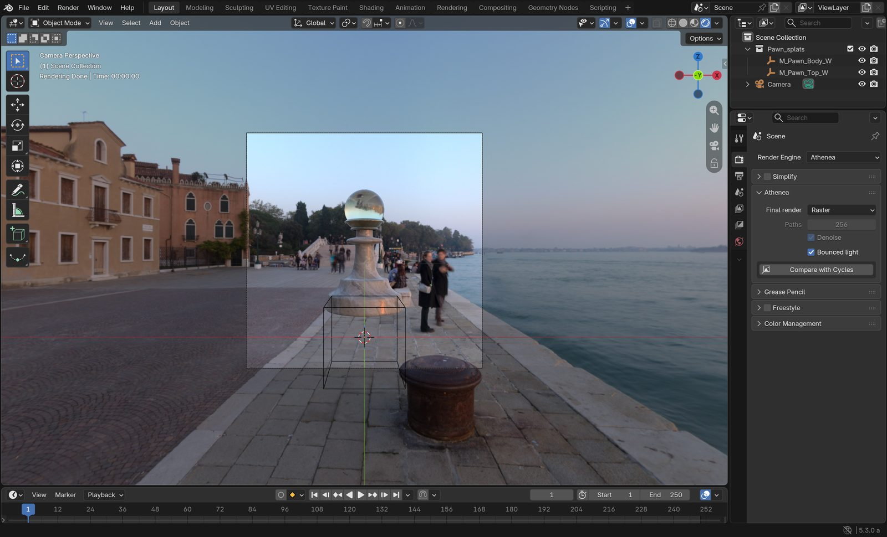
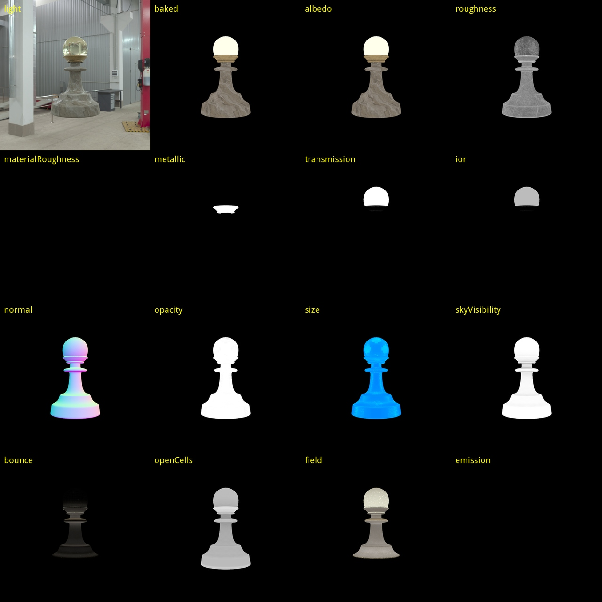
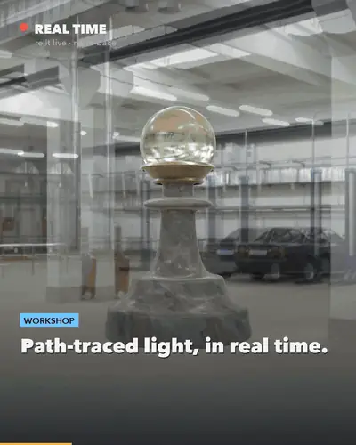

# athenea

[](https://jesusluque.github.io/athenea/)
[](LICENSE)

**Relightable Gaussian splats from production USD.** athenea is a Slang
renderer with a Hydra 2.0 delegate. It converts USD assets (meshes with real
materials) into Gaussian splats that keep how the asset responds to light: a
path tracer records it once, and the splats are drawn in milliseconds under
any sky. Every step over scene data runs on the GPU (Metal, Vulkan, CUDA).

## Where athenea comes from

athenea comes from NVIDIA's [Falcor](https://github.com/NVIDIAGameWorks/Falcor).
It follows Falcor's design: one Slang shader source compiled for whichever GPU
the machine has, a frame drawn as techniques over a visibility buffer that every
route fills alike, and a reference renderer the fast paths are tested against.
It was written anew on that shape, not built from Falcor's code, with its scene
coming from OpenUSD through a Hydra 2.0 render delegate.

It started as the render engine of **openFXplayer**, a GPU compositor, under
the name lucabRTrender, and still shares that compositor's plugin SDK,
[AOFX](https://github.com/jesusluque/aopenfx). From a splat renderer it has
grown into a relight baker: the light transport path traced into every
Gaussian, levels of detail, a compressed web format, and the Blender and
OpenFX integrations. What a stage means it takes from the
[OpenUSD specification](https://openusd.org/release/spec.html); the
mesh-to-Gaussian conversion comes from Electronic Arts'
[mesh2splat](https://github.com/electronicarts/mesh2splat).
[docs/background.md](docs/background.md) details what it owes to each.

## A render engine for Blender



*Blender 5.3 with the athenea add-on: the pawn's Gaussians relit by the World's
HDRI (Venice sunset, Poly Haven, CC0) in the viewport, the glass head carrying the city upside
down. Render Engine: Athenea.*

- **athenea as Blender's render engine**: the viewport and F12 draw the
  Gaussians, relit by the World's sky.
- **Meshes into relightable Gaussians** inside Blender (mesh2splat with the
  path traced transfer), a shadow catcher for the ground, and export to SPZ,
  PLY, glTF and USD.
- **Compare with Cycles** from the panel, measured on the GPU.
- **Download** for macOS (Apple silicon, Blender 5.3): [athenea-blender-addon-macos-arm64.zip](https://github.com/jesusluque/athenea/releases/download/v0.3.0/athenea-blender-addon-macos-arm64.zip), installed from *Edit > Preferences > Get Extensions > Install from Disk*.
- **macOS, Linux and Windows** (Blender 5.3): [install](https://jesusluque.github.io/athenea/install/),
  [tutorial](https://jesusluque.github.io/athenea/tutorials/blender/).

<p align="center"></p>

## A node for Nuke and Natron


*Natron with the Athenea 3DGS OpenFX node: Athenea3DGS into the Viewer, its
parameters (cloud, camera, sky and its rotation, output) and the pawn relit by
the Venice sunset.*


*One render, every layer compositing needs: RGBA relit and premultiplied,
depth, P (world position) and Cryptomatte (the body and the glass head).
The engine runs out of process, so a GPU fault never takes the compositor
down. [OpenFX node](https://jesusluque.github.io/athenea/ofx/).*

### Every parameter a Gaussian carries, seen from the camera



*`athenea:splatView` draws one parameter in place of the light, blended by
opacity as the light is, so every view is aligned with the lit frame: the
material (albedo, roughness, metallic, transmission, ior, normal, opacity,
size) and the baked transfer (sky visibility, bounce, open cells, reflected
field). The pawn has no emission, and its material roughness reads as zero.*

## Seen moving

Click a clip for the full video.

| | |
|:---:|:---:|
| [](https://github.com/jesusluque/athenea/releases/download/docs-2026-10-19/relight-reel.mp4) | [](https://github.com/jesusluque/athenea/releases/download/docs-2026-10-19/corvette-iphone.mp4) |
| **The path trace's light, in real time.** The pawn's Gaussians beside the path traced meshes. | **The whole Corvette on an iPhone**, 149 M Gaussians streamed by pages, relit. |
| [](https://github.com/jesusluque/athenea/releases/download/docs-2026-10-19/corvette-sky-turns.mp4) | [](https://github.com/jesusluque/athenea/releases/download/docs-2026-10-19/sparrow-flight.mp4) |
| **The sky turns, the same file follows.** The Corvette relit at draw time. | **A skinned sparrow in flight** (by Nestaeric, [Fab](https://www.fab.com/listings/63e05d9a-2421-4c79-98f0-bf577b55403f)), motion blur and a shadow caught on an invisible ground. |

## Example and test material: the pawn

[athenea-example-pawn.zip](https://github.com/jesusluque/athenea/releases/download/v0.3.0/athenea-example-pawn.zip) (411 MB) holds the pawn of the ASWF Open Chess Set
as source meshes and as the relightable cloud athenea baked from them, with a
camera and two skies, ready to render, compare, and open in Blender, Nuke or
Natron:

```sh
athenea stage pawn_gs.usda   --camera /World/Cam -o gs.exr                                 # the cloud
athenea stage pawn_mesh.usda --camera /World/Cam --technique rt --path-total 64 -o pt.exr  # the meshes, path traced
athenea compare gs.exr pt.exr                                                              # relMSE 0.014, PSNR 30.2 dB
athenea stage pawn_gs_venice.usda --camera /World/Cam -o venice.exr                        # relit under another sky
```

## Two products from one bake

| | Production master | Web format |
|---|---|---|
| Goal | fidelity | size and speed |
| File | USDC: `ParticleField3DGaussianSplat` plus `athenea:splat:*` primvars, at full precision | `.athc`: derived from the master, compressed, streamed by pages |
| Read by | the engine, Nuke and Natron (OFX), Blender | a browser, desktop or phone |
| Made by | `athenea mesh2splat --transfer` (the bake) | a separate conversion of the master |

Improvements are made in the master, and the web format is derived again. The
[architecture page](https://jesusluque.github.io/athenea/architecture/) and the
[paper](https://jesusluque.github.io/athenea/paper/) describe both processes.

## Integrations

| Where | What | Folder |
|---|---|---|
| Command line | `athenea`: render, stage, view, mesh2splat, convert, compare, aofx, … | `apps/athenea` |
| Any USD application | `hdAthenea`, the Hydra render delegate (`PXR_PLUGINPATH_NAME=<build>/plugin/usd`) | `modules/usd` |
| Blender 5.3 | an add-on: athenea as a render engine, mesh2splat and export operators | `integrations/blender` |
| Nuke, Natron | an OpenFX node: the relit asset through the shot camera, with RGBA, depth, P and Cryptomatte | `integrations/ofx` |
| AI agents | `athenea-mcp`, an MCP server over a warm stage | `apps/athenea-mcp` |
| AOFX hosts | effect bundles (mesh2splat, measure, …) at ABI 25 | `plugins/` |

## Platforms

| | macOS (Apple silicon) | Linux (x86_64) | Windows (x64) |
|---|---|---|---|
| Engine and CLI | Metal | CUDA, Vulkan | CUDA, Vulkan (native MSVC build) |
| Blender add-on | yes | yes (no bake under WSL, [#42](https://github.com/jesusluque/athenea/issues/42)) | yes ([#40](https://github.com/jesusluque/athenea/issues/40), [#42](https://github.com/jesusluque/athenea/issues/42)) |
| OpenFX node | yes | yes ([#43](https://github.com/jesusluque/athenea/issues/43)) | in progress |

The status per platform, with the test counts, is in [CHANGELOG.md](CHANGELOG.md)
and `docs/decisions.md`.

## Building

```sh
git clone --recursive https://github.com/jesusluque/athenea
cmake --preset macos-arm64-release        # or linux-x86_64-*, windows-x64-*
cmake --build --preset macos-arm64-release
ctest --preset macos-arm64-debug          # GPU tests skip on a machine without a device
```

The toolchain (Slang, OpenUSD 26.08 with MaterialX and OpenVDB, Open Image
Denoise, OpenColorIO) is built once per machine by `scripts/build-*.sh`, or
`scripts\build-*.ps1` on Windows. The
[installation page](https://jesusluque.github.io/athenea/install/) covers each
system. The `genlock` submodule is private and is skipped by a clone; without it
everything builds except `athenea live`.

Releases carry installers for the three systems:
[releases](https://github.com/jesusluque/athenea/releases).

## Using it

```sh
athenea info                                               # device, capabilities, Slang, shader path
athenea mesh2splat pawn.usda --transfer -o pawn_gs.usdc    # the bake: meshes into relightable gaussians
athenea stage pawn_gs.usdc --camera /World/Camera -o out.exr
athenea stage shot.usda --technique rt --path-total 96 --denoise -o pt.exr   # the path traced reference
athenea compare out.exr pt.exr                             # measured on the GPU
athenea view  pawn_gs.usdc                                 # a window on it
```

## Documentation

- [Site](https://jesusluque.github.io/athenea/) (English and Spanish):
  installation, architecture, tutorials, the OpenFX node, the paper,
  presentations.
- [`docs/operations.md`](docs/operations.md): every subcommand, option,
  `athenea:*` setting, schema and error.
- [`docs/development.md`](docs/development.md): how the engine is made and
  changed, and the bake end to end.
- [`docs/decisions.md`](docs/decisions.md): why each subsystem is the way it
  is, with the measurements and what is not done.
- [`docs/background.md`](docs/background.md): what athenea owes to Falcor and
  mesh2splat, where the USD specification ends and the engine begins, and the
  assets it is shown with.

The manuals are also in Spanish (`*.es.md`).

## Contributing

See [CONTRIBUTING.md](CONTRIBUTING.md). Work is tracked in the
[athenea project](https://github.com/users/jesusluque/projects/3) by area.

## Licence

Apache License 2.0 ([LICENSE](LICENSE), [NOTICE](NOTICE)). The third-party code
it holds, compiles in or links is listed with each licence in
[THIRD_PARTY_NOTICES.md](THIRD_PARTY_NOTICES.md). `athenea mesh2splat` and
`plugins/mesh2splat` derive from Electronic Arts'
[mesh2splat](https://github.com/electronicarts/mesh2splat) (BSD 3-Clause with a
clause on EA's marks); EA does not endorse this project.
