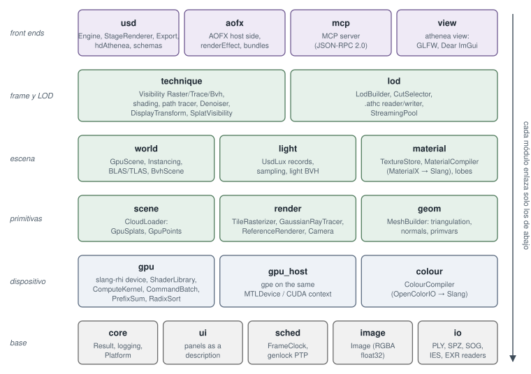
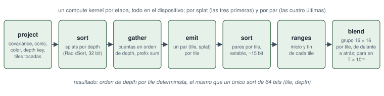

<!-- Copyright (c) 2026 jesus luque. -->

# Parte I. El bake: de un USD de producción a un master USDC reiluminable {.unnumbered}

El primer proceso convierte un asset USD de producción en una nube de Gaussians que admite relight, y la escribe como
un fichero USD: el **master**. Su objetivo es la fidelidad. El master se juzga con un solo criterio, su imagen con
relight frente a un path trace del mesh de origen bajo el mismo cielo y las mismas luces, y cada decisión que contiene
-- el tamaño de cell, los samples del bake, los bits por dirección, el coste de merge -- la toma esa medida, no su
tamaño.

::: {.nota}
**Bake** — en render, "hornear" un resultado es calcularlo una vez, con un método caro, y guardarlo para leerlo después barato. Aquí el bake es todo el proceso de la Parte I: de un stage USD se obtiene una nube de Gaussians que lleva, además de su geometría y su color, datos precalculados de cómo le llega la luz (el transfer, §4). Lo caro (path tracing del hemisferio de cada Gaussian) se paga una vez por asset; lo barato (el relight al dibujar) se paga en cada frame.

**Relight / reiluminable** — una nube de 3DGS entrenada a partir de fotos [1] lleva la luz "pintada": su color es radiancia saliente bajo la iluminación de la captura y no se puede cambiar. Una nube reiluminable lleva, en lugar de (o además de) esa radiancia, los parámetros de material y el transporte de luz necesarios para recalcular la radiancia bajo un cielo y unas luces nuevos. Es la idea del Precomputed Radiance Transfer [14] aplicada por Gaussian.

**Master** — la copia de máxima fidelidad, en el sentido de la postproducción (el *master* de un film del que salen todas las copias de distribución). Las decisiones de compresión (Parte II, §7) se toman después y sobre él; el master no se optimiza por tamaño.

**El criterio único** — juzgar el master por su imagen frente a un path trace del mesh de origen bajo la misma iluminación convierte cada parámetro (tamaño de cell, samples, bits, coste de merge) en una pregunta medible: ¿mejora o empeora el error frente a la verdad de referencia? Es la alternativa a juzgar por métricas intrínsecas de la nube (número de Gaussians, PSNR sobre las vistas de entrenamiento) que no dicen nada de cómo se verá bajo otra luz. El riesgo de este criterio es que una métrica global (PSNR, relMSE) puede premiar una imagen ligeramente oscura o borrosa; por eso el artículo usa métricas por clase y juzga frames completos (§8).

*Referencias:* [1], [14], [43] del §10; código: `apps/athenea/src/CmdMesh2Splat.cpp`, `apps/athenea/src/CmdDecimate.cpp`; `docs/decisions.md` (sección "Path traced into gaussians: the bake").
:::

**Entrada.** Un stage USD tal como lo entrega producción: meshes con sus materiales MaterialX u OpenPBR, luces UsdLux y
domos, cámaras y, para un asset animado, su skeleton y sus clips.

::: {.nota}
**Stage USD** — en OpenUSD [43], un *stage* es la vista compuesta de una escena: la raíz de una jerarquía de *prims* resultante de componer capas (layers) mediante sublayers, references, payloads, variants e inherits. "Tal como lo entrega producción" significa con toda esa composición, no un fichero aplanado ad hoc.

**MaterialX y OpenPBR** — MaterialX [31] es el estándar de la ASF para describir grafos de materiales independientes del renderer (nodos de textura, matemática y BSDFs). OpenPBR Surface [30] es un modelo de superficie "uber-shader" estandarizado (sucesor conjunto de Autodesk Standard Surface y Adobe Standard Material), expresado como un grafo MaterialX. En USD llegan como redes `UsdShade`.

**UsdLux y domos** — UsdLux es el esquema de luces de USD: `SphereLight`, `DiskLight`, `RectLight`, `CylinderLight`, `DistantLight` y `DomeLight` (un entorno en imagen lat-long que rodea la escena). Un domo es lo que en otras herramientas se llama HDRI o environment light.

**Skeleton y clips** — UsdSkel define un `Skeleton` (jerarquía de joints con su bind pose), las influencias por punto (`skel:jointIndices`, `skel:jointWeights`) y `SkelAnimation` con las transformaciones por tiempo. Los *value clips* de USD permiten que la animación viva en ficheros separados que se secuencian en el tiempo (el gorrión tiene 71 clips, §5).

*Referencias:* [30], [31], [43] del §10; especificación OpenUSD (openusd.org, "UsdSkel", "UsdLux", "Value Clips"); código: `modules/usd/src/Light.cpp`, `modules/usd/src/Material.cpp`, `modules/usd/src/SkelSplat.cpp`.
:::

**El proceso**, en el orden en que corre, cada paso un conjunto de kernels de GPU sobre el motor de la sección 2:

1. **Conversión** (sección 3). Cada mesh se convierte en Gaussians anisótropas, una por cell de una lattice cuyo tamaño
   sale del footprint de píxel de una cámara, con la coverage de la superficie como opacidad, bordes sujetos donde
   termina o forma un fold, el material por capas capturado por Gaussian, el vidrio clasificado como sólido o pared
   fina, y la roughness ensanchada por la dispersión de las normales.
2. **El bake del transfer** (sección 4). El path tracer del motor traza el hemisferio de cada Gaussian y guarda cómo le
   llega cualquier cielo: harmonics de grado 3 de la luz directa e indirecta, un reflected field, 256 bits de open
   directions y la curvatura de la superficie. Con ellos la nube hace relight al dibujar bajo cielos y luces con los
   que nunca se hizo su bake.
3. **El rig y la visibilidad** de un asset animado (sección 5): influencias y sus gradientes por Gaussian, lobes
   zonales de transfer que giran con un miembro, y campos de visibilidad por parte.
4. **LOD** (sección 6): merge trees por pieza cuyo cut por error de pantalla está acotado, culls de caras traseras y de
   oclusión compartida, y pages ordenadas por error, escritos junto a las leaves en el mismo formato de fichero.

::: {.nota}
**Gaussian anisótropa** — una Gaussian 3D con covarianza $\Sigma$ no proporcional a la identidad: tiene tres ejes con escalas distintas $s_1, s_2, s_3$ y una orientación $R$, de modo que su isosuperficie es un elipsoide y no una esfera. Para representar una superficie, dos ejes se alinean con el plano tangente y el tercero (la "normal") es muy fino; en el límite $s_3 = 0$ es un disco, el surfel de §2.5.2 [5][6].

**Lattice, cell y footprint de píxel** — la conversión coloca una Gaussian por celda (cell) de una rejilla regular (lattice) sobre la superficie. El tamaño de cell sale de cuánto mide un píxel de una cámara de referencia a la distancia del objeto (el *footprint* del píxel en la superficie): si la cell es menor que el footprint, se gastan Gaussians en detalle invisible; si es mayor, la nube se ve borrosa. Es la misma lógica que la elección de nivel de mip [13].

**Coverage como opacidad** — una Gaussian no "es" opaca o transparente: su opacidad $\alpha$ multiplica su perfil y varias Gaussians vecinas se solapan. Para que una superficie que en el mesh cubre una fracción $F$ de lo que hay detrás (p. ej. una máscara 0.5) cubra lo mismo convertida, la opacidad de cada Gaussian se resuelve de modo que el producto de transmitancias del apilamiento dé $1-F$ (ver la nota de §2.5.3 y `docs/decisions.md`, "A converted surface covers what its opacity says").

**Transfer, harmonics de grado 3** — los spherical harmonics (SH) son una base ortonormal de funciones sobre la esfera; hasta grado $\ell = 3$ hay $(3+1)^2 = 16$ funciones. Guardar el transfer en SH permite que el relight sea un producto escalar entre los coeficientes del transfer y los del cielo [14][17]. 16 coeficientes para la luz directa (monocromo: visibilidad × coseno) y 48 = 16 × 3 RGB para la indirecta (con interreflexiones coloreadas).

**Open directions** — 256 bits por Gaussian, uno por dirección de una partición fija del hemisferio/esfera: 1 si desde la Gaussian se ve el cielo en esa dirección. Permiten sombrear luces puntuales y soles (que SH de grado 3 no pueden representar por ser de alta frecuencia) con un lookup de bit.

**Merge tree y cut** — el LOD agrupa Gaussians por pares en un árbol binario cuyas hojas son las originales y cuyos nodos internos son Gaussians fusionadas que aproximan a sus hijas [2][9][34]. Un *cut* es un conjunto de nodos que cubre todas las hojas exactamente una vez; elegirlo por error en pantalla es la técnica de Nanite [35] y de 3DGS jerárquico [2].

*Referencias:* [2], [5], [6], [9], [12], [13], [14], [17], [34], [35] del §10; código: `plugins/mesh2splat/` (el efecto AOFX), `shaders/athenea/usd/mesh2splat_cells.slang`, `shaders/athenea/usd/mesh2splat_bake.slang`, `modules/lod/include/athenea/lod/Lod.h`.
:::

**Salida: el master USDC.** Un `ParticleField3DGaussianSplat` por nube (o por merge tree), cuyos atributos estándar
(posiciones, orientaciones, escalas, opacidades, harmonics de radiancia) los lee cualquier aplicación USD, y cuyos
primvars de athenea llevan el resto a precisión completa:

| parámetro | primvar (`primvars:athenea:splat:`) | por Gaussian | § |
|---|---|---|---|
| material | `normal`, `metallic`, `roughness`, `materialRoughness`, `transmission`, `specularWeight`, `coatWeight`, `sheenColor`, `emission`, `schlickMetal`, `thinWalled`, `closed`; `ior` por nube | un valor por propiedad | 3.6–3.8, 6.6 |
| transfer (TX) | `transferDirect` (16), `transferIndirect` (48 rgb), `transferReflected` (48 rgb) | 112 valores | 4.2, 4.4 |
| open directions | `shadowBits` | 256 bits | 4.4.2 |
| curvatura | `curvature` | $(S_{uu}, S_{uv}, S_{vv})$, 3 floats | 4.8 |
| transfer y visibilidad, juntos | | 480 B en el fichero, 256 B en el device | 4.2 |
| rig | `skel:jointIndices`, `skel:jointWeights` (4 cada uno), `jointWeightGradients` (half, 6), `transferZonal` (10), `skinningXforms` por joint | | 5.3, 5.5, 5.7 |
| LOD | `lodTree`, `lodParent`, `lodStart`, `lodSize`, `lodCost`, `lodSpill`, `coverage`, `coverageMass`, `occlusionIndex`; `occlusionCodebook` por tree; los merges escritos tras las leaves | por nodo | 6.2–6.8 |
| ids | `cryptoObject`, el id Cryptomatte del prim de la Gaussian; `cryptoManifest` por nube | 1 palabra | 2.5.2, 3.10 |

::: {.nota}
**`ParticleField3DGaussianSplat`** — el esquema de OpenUSD (introducido en la serie 25.x/26.x) para nubes de Gaussian splats: un prim con atributos estándar `positions`, `orientations` (cuaterniones), `scales`, `opacities` y coeficientes de radiancia SH. Usar el esquema estándar garantiza que cualquier aplicación que lea USD vea al menos la nube con su color de captura, aunque ignore los datos de athenea.

**Primvars con espacio de nombres** — en USD, un *primvar* es un atributo interpolable sobre la geometría (constant, uniform, vertex, varying, faceVarying). El prefijo `primvars:athenea:splat:` los aísla: una aplicación que no los conoce los ignora sin error. Su precisión es completa (float32) en el master; la cuantización se deja a los formatos derivados.

**Cómo leer la tabla** — "por Gaussian" es el coste por elemento. El transfer son $16 + 48 + 48 = 112$ valores; con los 256 bits (32 B) de open directions forman el bloque de 480 B en fichero (112 floats × 4 B = 448 B + 32 B). En device se empaqueta a 256 B (halfs y cuantización), lo que fija el presupuesto de memoria al dibujar. `jointWeightGradients` (6 halfs) es la derivada espacial de los pesos de skinning a lo largo de los dos ejes tangentes de la Gaussian, que permite deformar su covarianza y no solo su centro (§5.5). `transferZonal` (10 valores) son lobes de *zonal harmonics*, SH con simetría de rotación alrededor de un eje, que se pueden girar baratos con el miembro [16].

**Cryptomatte** — `cryptoObject` es el id de 32 bits (hash del nombre del prim) que el estándar Cryptomatte [47] usa para generar mattes por objeto en composición; `cryptoManifest` mapea hash → nombre.

*Referencias:* [16], [43], [47] del §10; código: `modules/usd/include/athenea/usd/Export.h`, `modules/usd/src/Export.cpp`, `modules/usd/src/ParticleField.cpp`, `shaders/athenea/common/transfer_layout.slang`; `docs/decisions.md` (secciones "Step 4: the ParticleField, read against `schema.usda`" y "A transfer right under any sky and any light (task TX)", subsección "What a file costs").
:::

Tamaños medidos en los assets de este paper: las dos nubes del peón, 489 MB; el gorrión, con skinning, transfer y
visibilidad, 216 MB; la nube reiluminable del Corvette de 3 M de Gaussians, 2.9 GB; el close-up level del Corvette como
24 merge trees de 74.5 M de leaves y 148.9 M de nodos, 87.4 GB.

::: {.nota}
**Cómo juzgar los tamaños** — son master a precisión completa, no formatos de distribución. La nube del Corvette (3 M Gaussians, 2.9 GB) da ≈ 970 B por Gaussian: los 480 B de transfer + visibilidad, más geometría, SH de radiancia, material y LOD. El close-up level (74.5 M leaves, 148.9 M nodos ≈ 2 nodos por leaf, como corresponde a un árbol binario completo con $2n-1$ nodos) ocupa 87.4 GB, ≈ 590 B por nodo. Estos tamaños justifican la Parte II: el objetivo de distribución del Corvette en iPhone era del orden de 60–90 MB, tres órdenes de magnitud menos.

*Referencias:* §7 del artículo; `docs/decisions.md` (secciones "The Corvette on an iPhone (11-12 Oct)" y "Decimation: the levels of detail, cut once by what a merge loses").
:::

**Quién lee el master.** El propio motor, a través de Hydra, tanto en su raster como en su path tracer; la comparación
frente al path trace (sección 8); el nodo OpenFX en un compositor y el add-on de Blender (§2.14); los canales de imagen
de §4.11. Y cada formato derivado, de los que la Parte II describe uno. El master es la fuente: un formato derivado se
hace a partir de él y no se puede volver a convertir en él.

::: {.nota}
**Hydra** — la arquitectura de render de OpenUSD [43]: un *scene delegate* (o una cadena de *scene indices*) traduce el stage a primitivas de render, y un *render delegate* (aquí `hdAthenea`) las dibuja. Así el mismo renderer funciona en `usdview`, Houdini, Blender y cualquier host Hydra sin código específico.

**OpenFX** — estándar abierto de plugins de efectos de imagen para compositores (Nuke, Natron, Resolve, Flame). Un nodo OpenFX recibe parámetros y tiempo y escribe un frame.

**Formato derivado irreversible** — la dirección única master → derivado es deliberada: un derivado cuantiza, poda y recorta (p. ej. SH de menor grado, transfer comprimido por k-means [23]), y la información perdida no se recupera. Esto obliga a mantener el master como fuente y a regenerar los derivados cuando cambia el compresor.

*Referencias:* [23], [43] del §10; código: `modules/usd/src/RenderDelegate.cpp`, `integrations/ofx/src/AtheneaOfx.cpp`; add-on de Blender en `integrations/blender/athenea_hydra/`.
:::

# 2. El motor y el renderer athenea

athenea es un renderer de USD construido para que todo paso que toca datos de la escena se ejecute en la GPU.
Dibuja tres clases de primitiva: meshes, con materiales MaterialX y luces UsdLux; puntos; y Gaussian splats 3D.
Ofrece dos técnicas, un raster interactivo y un path tracer que sirve de verdad de referencia. Hydra alimenta
ambas a través del delegado de render `hdAthenea`. Esta sección cubre la arquitectura del motor, los algoritmos que
ejecuta cada subsistema, cómo se establece la corrección sin un CPU oracle y lo que se ha medido. Salvo que se
indique otra cosa, cada número se cita de `docs/decisions.md`, con su unidad y sus condiciones, y se midió en un
Apple M5 Pro con Metal.

::: {.nota}
**Renderer "GPU-first"** — todo dato de la escena (vértices, splats, texturas, luces) se transforma en kernels de cómputo y el CPU solo hace E/S y contabilidad. Es una restricción más fuerte que la habitual en renderers de producción, que preparan geometría en CPU y solo trazan en GPU.

**Raster vs path tracer** — el raster resuelve la visibilidad primaria (qué se ve en cada píxel) y aproxima la iluminación (luz directa, sin interreflexiones completas). El path tracer resuelve la ecuación de render de Kajiya (1986)
$$L_o(x,\omega_o) = L_e(x,\omega_o) + \int_{\Omega} f(x,\omega_i,\omega_o)\,L_i(x,\omega_i)\,|\cos\theta_i|\,d\omega_i$$
por Monte Carlo, recursivamente; converge al valor físicamente correcto (dado el modelo de materiales) al aumentar las muestras, de ahí que sirva de *verdad de referencia*.

**CPU oracle** — en testing, un *oracle* es la implementación independiente que dice cuál es la respuesta correcta. Lo habitual en renderers GPU es un renderer CPU de referencia. Aquí está prohibido (§2.1) y se sustituye por formas cerradas, por un segundo kernel independiente (p. ej. `ReferenceRenderer`) y por Storm (el renderer OpenGL/Metal de OpenUSD) como oracle externo (§2.8).

**Apple M5 Pro con Metal** — GPU de memoria unificada: CPU y GPU comparten la misma DRAM. Esto afecta a las cifras de memoria (§2.3) y hace que el coste de "subir" datos sea una copia en la misma memoria, no una transferencia por PCIe.

*Referencias:* Kajiya, J. T. (1986), "The Rendering Equation", SIGGRAPH; [43] del §10; `docs/decisions.md` (todas las secciones "Measured (M5 Pro, ...)").
:::

## 2.1 Reglas de diseño

El código se atiene a un número reducido de reglas. Donde es posible, una prueba hace cumplir cada una.

1. **Ninguna aritmética de CPU sobre los datos.** athenea no tiene renderer de referencia en CPU, ni alternativa
   en CPU, ni CPU test oracle. El host lee ficheros, analiza cabeceras, descomprime y lleva las cuentas:
   recuentos, ranuras y colas. La decodificación, el sort, la fusión, el descarte, la generación de mips, los
   prefijos de potencia de las luces y la comparación de imágenes son todos kernels de cómputo. Los pasos que se
   ejecutaban en el host se llevaron al device; son ejemplos el entrelazado
   por elemento de los arrays de `ParticleField`, la conversión de half a float, la conversión por píxel de los
   buffers de render de Hydra y la parte acumulada de cada luz en la potencia del frame (`light_prefix.slang`). La
   única excepción documentada es la teselación de Dear ImGui, que procesa la interfaz del viewer y ningún dato de la
   escena.
2. **Enlace por nombre.** Todo parámetro de shader se enlaza por reflexión (`cursor["name"].setBinding(...)`,
   `ComputeKernel::dispatch`) y nunca por ranura, lo que elimina la clase de errores en que un recuento de
   ranuras se aparta de la declaración del shader.
3. **Errores como valores.** Los errores se devuelven como `Result<T>` con `ATHENEA_TRY`, y nada lanza excepciones.
   Las llamadas al sistema operativo viven solo en `modules/core/Platform`, que es también donde empezaría un port a
   Windows.
4. **Un Slang, un slang-rhi, un TBB por proceso.** OpenUSD, OIDN y el motor comparten un único TBB, y la prueba
   `single_tbb` comprueba el recuento. Por la misma razón OIDN se compila desde el código fuente: sus binarios
   publicados traen un segundo `libtbb.12`.
5. **Solo devices GPU, en todas partes.** OIDN se compila solo para devices GPU, porque un denoiser que recurre a la CPU es una alternativa en CPU. Una prueba cuya capacidad falta en un device se omite y
   nombra la capacidad que falta.

::: {.nota}
**Regla 1, sin aritmética de CPU** — la motivación es doble. (a) Rendimiento y escalabilidad: decenas de millones de Gaussians no caben en un bucle de CPU por frame, y cualquier paso en CPU obliga a ida y vuelta de datos. (b) Una sola implementación: si existiera un camino CPU, habría dos versiones de cada algoritmo divergiendo en silencio. Los ejemplos citados son pasos que estaban en host y se migraron: el *interleave* de los arrays separados de `ParticleField` (USD guarda posiciones, escalas, etc. como arrays independientes; el device los quiere entrelazados en `GpuSplats`), la conversión half → float, la conversión por píxel de los buffers de render (`shaders/athenea/usd/aov_convert.slang`) y el prefijo de potencias de luces (`shaders/athenea/light/light_prefix.slang`), que es una suma prefija (scan) de la potencia de cada luz para elegir una luz con probabilidad proporcional a su potencia mediante búsqueda binaria en la CDF.

**Regla 2, enlace por nombre (reflexión)** — Slang [44] expone la reflexión del programa compilado: el layout de cada parámetro. slang-rhi ofrece un `ShaderCursor` que navega ese layout por nombre (`cursor["positions"]`). La alternativa clásica, indicar *slots* numéricos (registros `t0`, `u3`, índices de descriptor set), rompe en silencio cuando se añade un parámetro y se desplazan los índices; además cada backend (Metal argument buffers, Vulkan descriptor sets, CUDA parámetros de kernel) numera distinto.

**Regla 3, errores como valores** — `Result<T>` es un tipo suma "valor o error" (como `std::expected` de C++23 o `Result` de Rust). `ATHENEA_TRY(expr)` evalúa, y si hay error lo devuelve al llamador; si no, extrae el valor. Ventaja: el control de flujo del error es explícito y no hay excepciones cruzando fronteras de bibliotecas C (slang-rhi, OIDN, plugins AOFX). `Platform` concentra `mmap`, memoria física libre, rutas, procesos, etc., lo que delimita el trabajo de un port a Windows.

**Regla 4, un TBB por proceso** — Intel oneTBB mantiene un *scheduler* global; dos copias de la biblioteca en un proceso (p. ej. una de OpenUSD y otra empaquetada con OIDN) duplican el pool de hilos y pueden producir sobresuscripción o fallos sutiles por estado global duplicado. Por eso OIDN se compila desde fuente contra el TBB de USD. La prueba `single_tbb` cuenta las imágenes `libtbb` cargadas.

**Regla 5, solo devices GPU** — OIDN [45] puede ejecutar en CPU; compilarlo solo con backends GPU impide que una configuración sin GPU compatible caiga silenciosamente al CPU, lo que violaría la regla 1. Las pruebas que requieren una capacidad (ray tracing por hardware, rasterización) se marcan como *skipped* nombrando la capacidad, en lugar de pasar o fallar engañosamente.

**La excepción de Dear ImGui** — la librería de UI genera en CPU las listas de triángulos de la interfaz. No toca datos de la escena, por eso se acepta.

*Referencias:* [44], [45] del §10; código: `modules/core/include/athenea/core/Platform.h`, `modules/core/src/Platform.cpp`, `modules/gpu/src/ComputeKernel.cpp`, `tests/CMakeLists.txt` (prueba `single_tbb`), `cmake/Usd.cmake`; `CLAUDE.md` del repositorio ("Rules this codebase holds to").
:::

Los backends son los de slang-rhi: Metal (macOS, iOS), Vulkan y CUDA (Linux, NVIDIA L4). Todos los kernels están
escritos en Slang.

::: {.nota}
**slang-rhi** — la capa de abstracción de hardware de render del proyecto Slang (shader-slang/slang-rhi en GitHub): una API única para crear devices, buffers, texturas, pipelines y command encoders sobre Metal, Vulkan, D3D12, CUDA (y WebGPU experimental). El motor no llama a ninguna API gráfica nativa directamente salvo en los puntos de interoperabilidad (gpe, OIDN).

**Backends** — *Metal* (Apple), *Vulkan* (Khronos, multiplataforma) y *CUDA* (NVIDIA, cómputo puro, sin rasterizador; el ray tracing va por OptiX). La NVIDIA L4 es una GPU de centro de datos (Ada Lovelace, 24 GB) usada para las pruebas en Linux y Windows.

**Slang** — lenguaje de shaders derivado de HLSL con módulos, genéricos, interfaces y diferenciación automática, que compila a MSL, SPIR-V, CUDA/PTX, HLSL y WGSL [44]. Escribir todo en Slang da un único código fuente por kernel para todos los backends.

*Referencias:* [44] del §10; github.com/shader-slang/slang-rhi; shader-slang.org (documentación del lenguaje); código: `modules/gpu/src/Device.cpp`.
:::

## 2.2 Arquitectura de módulos

Cada módulo bajo `modules/<name>` es una biblioteca estática, `athenea::<name>`. Los módulos se listan en orden de
dependencia y cada uno enlaza solo con los anteriores (`modules/CMakeLists.txt`) (figura 2).

| Módulo | Contenido |
|---|---|
| core | `Result`, registro, `Platform` (todas las llamadas al SO) |
| ui | los paneles del viewer como descripción (`Controls.h`, `GaussianPanel.h`), traversals por `athenea view` y la app de iOS |
| sched | `FrameClock`: genlock PTP y alineación ST 2059-1, timecode |
| image | `Image`: float32 RGBA premultiplicado, origen abajo a la izquierda; el tipo que intercambian gpe y AOFX |
| io | lectores de ficheros en CPU (cabecera PLY, SPZ, SOG zip/WebP, IES), EXR con atributos |
| gpu | device slang-rhi, `ShaderLibrary`, `ComputeKernel`, `CommandBatch`, `Buffer`, `AsyncReadback`; `gpu/algo` (PrefixSum, RadixSort) |
| gpu_host | gpe adoptando el device de slang-rhi: un `MTLDevice` o contexto CUDA, buffers compartidos sin copias |
| colour | `ColourCompiler` (OpenColorIO como compilador a Slang), `ColourNames` |
| scene | `CloudLoader`: registros en bruto subidos y decodificados en la GPU en `GpuSplats` / `GpuPoints` |
| render | `TileRasterizer`, `GaussianRayTracer`, `PointRasterizer`, `ReferenceRenderer`, `Camera`/`Projection`, `SplatEdit` |
| geom | `MeshBuilder`: meshes de Hydra trianguladas, con normales suaves y primvars expandidos en la GPU |
| material | `TextureStore`, `MaterialCompiler` (MaterialX → Slang), la biblioteca de lobes |
| light | luces UsdLux en el device: un registro por luz, muestreo, densidades, BVH de luces |
| world | `GpuScene`, `Instancing`, `RayTracingScene` (BLAS/TLAS), `BvhScene` (LBVH de cómputo en dos niveles) |
| technique | `VisibilityRaster/Trace/Bvh`, shading, `AovShading`, path tracer, `Denoiser`, `DisplayTransform`, `SplatVisibility` |
| lod | `LodBuilder`, `CutSelector`, el lector/escritor de `.athc` y `StreamingPool` (Sección 6) |
| usd | `Engine`, `StageRenderer`, `Export`, el plugin `hdAthenea`, esquemas sin código |
| mcp | el motor como servidor MCP (JSON-RPC 2.0) |
| aofx | el lado de este motor del host AOFX (`host/` de aopenfx), `renderEffect`, los bundles |
| view | `athenea view`: ventana GLFW, Dear ImGui en el device del motor |

::: {.nota}
**Orden de dependencia** — cada módulo solo enlaza con los anteriores de la tabla: un grafo acíclico impuesto por construcción. Así no hay dependencias circulares y se puede extraer un prefijo (por ejemplo `core`…`render` para un player solo de splats) sin arrastrar USD.

**Términos de la tabla** — *genlock PTP / ST 2059-1*: sincronización de frames con relojes de estudio broadcast (Precision Time Protocol, IEEE 1588, y su perfil SMPTE ST 2059 para alinear señales de vídeo), usado por `athenea live`. *gpe*: biblioteca de procesamiento GPU (submódulo `third_party/gpe`) que adopta el mismo `MTLDevice`/contexto CUDA para compartir buffers sin copias. *BLAS/TLAS*: bottom/top level acceleration structures del ray tracing por hardware (una por mesh / una por escena de instancias). *LBVH*: linear BVH de Karras [32], construida ordenando por códigos de Morton. *MCP*: Model Context Protocol, protocolo JSON-RPC para que agentes de IA llamen herramientas. *AOFX*: la interfaz de plugins de efectos de aopenfx (`third_party/aopenfx`).

**`.athc`** — el contenedor de chunks del motor para nubes con LOD y streaming (§6), leído por `StreamingPool`.

*Referencias:* [32] del §10; IEEE 1588-2019; SMPTE ST 2059-1/2; modelcontextprotocol.io; código: `modules/CMakeLists.txt`, `modules/sched/include/athenea/sched/FrameClock.h`, `modules/lod/include/athenea/lod/Athc.h`, `modules/world/src/BvhScene.cpp`.
:::

El tree de shaders `shaders/athenea/` refleja los módulos (common, algo, scene, splat, rt, points, reference, lod,
geom, world, material, light, technique, usd, volume, view). Los shaders se copian al tree de compilación y se
compilan en tiempo de ejecución.

::: {.nota}
**Compilación en tiempo de ejecución** — los `.slang` no se compilan en el build del C++; se copian a `build/<preset>/shaders` y `ShaderLibrary` los compila al cargarlos. Ventajas: un cambio solo de shader no requiere recompilar C++; los módulos generados (materiales, OCIO) usan el mismo camino; las constantes de enlace se especializan por valor. Coste: la primera ejecución paga la compilación, mitigada por la `DiskShaderCache` (§2.3).

*Referencias:* código: `modules/gpu/src/ShaderLibrary.cpp`, `cmake/Shaders.cmake`; `CLAUDE.md` del repositorio ("Checking a shader compiles").
:::

## 2.3 Fundamentos de GPU

**Device y kernels.** `gpu::Device` envuelve un device slang-rhi. `ComputeKernel` es un punto de entrada de
cómputo compilado como pipeline. Se despacha en hilos, no en grupos: el número de grupos se redondea hacia arriba en
todos los backends y cada kernel comprueba sus propios límites. `RasterKernel` es un pipeline de vértices y
fragmentos que toma sus datos de `StructuredBuffer`s, sin buffers de vértices ni layouts de entrada.
`RayTracingKernel` cubre los pipelines de OptiX y de Vulkan RT. En Metal, slang-rhi no ofrece pipelines de ray
tracing, así que el trazado usa `RayQuery` en línea dentro de kernels de cómputo.

::: {.nota}
**Device, pipeline y dispatch** — un *compute pipeline* es un punto de entrada compilado y enlazado con su layout de parámetros. *Despachar* es lanzarlo sobre una rejilla de grupos de hilos (threadgroups en Metal, blocks en CUDA, workgroups en Vulkan). `ComputeKernel::dispatch` recibe el número de *hilos* y calcula $\lceil N / \text{groupSize}\rceil$ grupos; como el último grupo sobra, cada kernel empieza con `if (tid >= count) return;`. Esto unifica los backends: Metal tiene `dispatchThreads` (con grupos parciales) pero Vulkan y CUDA no.

**`RasterKernel` sin vertex buffers** — el vertex shader lee de `StructuredBuffer`s indexados por `SV_VertexID`/`SV_InstanceID` (*vertex pulling*). Evita declarar *input layouts* por formato y permite que los mismos buffers de `GpuScene` sirvan a raster, rayos y cómputo.

**`RayTracingKernel` y `RayQuery` en línea** — hay dos estilos de ray tracing por hardware. El *pipeline* (DXR/Vulkan RT/OptiX) usa shaders separados (raygen, closest-hit, any-hit, miss) y una shader binding table. El *inline* (`RayQuery`, DXR 1.1 / `VK_KHR_ray_query` / Metal `intersection_query`) recorre la estructura desde cualquier shader, incluido uno de cómputo, con un bucle explícito sobre candidatos. slang-rhi en Metal solo expone la segunda forma, por eso en Metal todo trazado es inline.

*Referencias:* documentación de slang-rhi; Khronos, `VK_KHR_ray_query` y `VK_KHR_ray_tracing_pipeline`; NVIDIA OptiX 9 Programming Guide; Apple, Metal Shading Language Specification (ray tracing); código: `modules/gpu/src/ComputeKernel.cpp`, `modules/gpu/include/athenea/gpu/RasterKernel.h`, `modules/gpu/include/athenea/gpu/RayTracingKernel.h`.
:::

**ShaderLibrary.** La biblioteca carga módulos Slang. Un módulo puede declarar constantes de enlace
(`extern static const uint kName;`), y entonces se enlaza contra un módulo de exportaciones generado, lo que da un
programa por cada conjunto distinto de valores. También compila módulos que solo existen como código generado, como
los materiales y las funciones de color; se rechaza cargar un nombre existente con otro código. Una
`DiskShaderCache` persistente escribe un fichero por programa compilado, con la clave del hash que slang-rhi da al
programa enlazado. Con la caché caliente, la batería de pruebas completa pasó de 89 s a 26 s.

::: {.nota}
**Constantes de enlace** — `extern static const uint kName;` declara una constante cuyo valor no está en el módulo: se proporciona al enlazar, con un módulo de "exports" generado que la define. El compilador ve entonces un valor concreto y puede desenrollar bucles y eliminar ramas (especialización), como las *specialization constants* de Vulkan o las *function constants* de Metal, pero portable. Cada combinación de valores da un programa distinto, lo que multiplica variantes y compilaciones: la caché importa.

**Rechazar un nombre existente con otro código** — un módulo Slang se identifica por nombre; si dos materiales distintos generaran el mismo nombre, el segundo recibiría el programa del primero. Detectarlo convierte un error silencioso en un error explícito. Por eso los módulos generados llevan un hash de su código en el nombre (`athenea_cs_<hash>`, §2.12).

**`DiskShaderCache` y la cifra 89 s → 26 s** — compilar Slang a MSL/SPIR-V y después el compilador del driver es caro (cientos de ms por kernel grande). La caché guarda el binario por hash del programa enlazado; con ella caliente la batería entera bajó a menos de un tercio, lo que indica que ~70 % del tiempo de pruebas era compilación de shaders y no ejecución.

*Referencias:* [44] del §10; documentación de Slang ("Link-time specialization"); código: `modules/gpu/src/ShaderLibrary.cpp` (`ShaderLibrary::link`), `modules/gpu/src/ShaderCache.h`, `modules/gpu/src/ShaderCache.cpp`; `docs/decisions.md` (sección "Complete USD: GPU foundations (M1)").
:::

**Primitivas paralelas.** `PrefixSum` y `RadixSort` son las únicas ordenaciones y barridos del motor. La ruta radix
por bloques (`radix_block.slang`) es una forma reducir-y-luego-barrer de la pasada LSD estable. Un grupo de 256 hilos
cuenta un bloque de 1024 claves en memoria de grupo, una suma prefija ordenada por dígito sitúa la parte de cada
bloque en cada dígito, y el grupo ordena su bloque con ocho divisiones de un bit. Ordena 10 M de pares de 32 bits en
**12.4 ms**, frente a 39.9 ms de las pasadas por trozos a las que sustituyó a partir de 65 536 elementos. No usa
operaciones de onda ni atómicas de device.

::: {.nota}
**Prefix sum (scan)** — dada una secuencia $x_0, x_1, \dots$, la suma prefija exclusiva es $y_i = \sum_{j<i} x_j$. Es la primitiva que convierte "cuántos elementos produce cada hilo" en "dónde escribe cada hilo" (compactación, emisión de pares, histogramas). En GPU se hace por bloques: scan local en memoria compartida, scan de los totales de bloque, y suma del offset (Blelloch 1990; Harris et al., GPU Gems 3 cap. 39).

**Radix sort LSD estable** — ordena claves enteras dígito a dígito empezando por el menos significativo (*least significant digit*); cada pasada debe ser estable (conserva el orden relativo de claves con igual dígito) para que el resultado final quede ordenado por la clave completa. Con dígitos de $b$ bits y claves de $k$ bits hay $k/b$ pasadas, cada una: histograma de dígitos, scan del histograma (posición de salida de cada dígito) y scatter.

**Reducir-y-luego-barrer por bloques** (`radix_block.slang`) — variante (Merrill y Grimshaw 2011, "High Performance and Scalable Radix Sorting") en que cada grupo de 256 hilos procesa un bloque de 1024 claves (4 por hilo): cuenta el histograma de su bloque en memoria de grupo (*reduce*), un scan global ordenado por dígito (todos los bloques del dígito 0, luego del 1…) da el offset de cada (bloque, dígito), y el grupo ordena localmente su bloque con ocho *splits* de un bit (cada split es un scan de 1 bit, estable) antes de escribir. Ordenar localmente antes del scatter hace que las escrituras a memoria global sean contiguas por dígito (coalescidas), que es de donde sale la ganancia.

**Sin operaciones de onda ni atómicas** — las *wave/subgroup ops* (ballot, prefix dentro del warp) y los atómicos de device aceleran los radix sort más rápidos (Onesweep, Adinets y Merrill 2022) pero su semántica varía entre backends (ancho de wave 32 en NVIDIA/Apple, 64 en AMD; orden de atómicos no determinista). Prescindir de ellas da un sort portable y **determinista**: mismo resultado bit a bit en Metal, Vulkan y CUDA.

**Cómo leer 12.4 ms para 10 M pares** — 10 M × 8 B = 80 MB por pasada de lectura y otro tanto de escritura, ×4 pasadas de 8 bits → ~640 MB movidos, ≈ 50 GB/s efectivos. El ancho de banda del M5 Pro está en el orden de cientos de GB/s, así que hay margen; la mejora 3.2× sobre la versión por trozos es la medida relevante. El umbral de 65 536 elementos indica que para tamaños pequeños la versión anterior sigue siendo mejor (menos lanzamientos).

*Referencias:* Blelloch, G. (1990), "Prefix Sums and Their Applications"; Merrill, D., Grimshaw, A. (2011), "High Performance and Scalable Radix Sorting", Parallel Processing Letters; Adinets, A., Merrill, D. (2022), "Onesweep"; código: `modules/gpu/src/algo/RadixSort.cpp`, `modules/gpu/src/algo/PrefixSum.cpp`, `shaders/athenea/algo/radix_block.slang`, `shaders/athenea/algo/radix_histogram.slang`, `shaders/athenea/algo/radix_scatter.slang`; `docs/decisions.md` (subsección "Where a rasterised frame of splats went, and what came off it").
:::

**Mips.** slang-rhi no genera cadenas de mips, así que `MipGenerator` es un kernel. Cada texel de un nivel es la media
ponderada por área de los texels de encima. Un borde impar $2n+1$ se pliega en $n$ con pesos
$(n-x,\,n,\,x+1)/(2n+1)$, de modo que cada texel de origen da exactamente $n/(2n+1)$ de sí al nivel inferior y la
cadena conserva la media del nivel 0. En tamaños 64², 37×23, 1×9 y 128×5, las medias coinciden a 2·10⁻⁶.

::: {.nota}
**Cadena de mips** — una textura con mipmaps guarda versiones sucesivas a mitad de resolución (Williams 1983, "Pyramidal Parametrics") para filtrar al minificar sin aliasing. Cada nivel se obtiene promediando el anterior.

**El problema del borde impar** — si un nivel tiene $2n+1$ texels, el siguiente tiene $n$ (redondeo hacia abajo). El box filter 2×2 ingenuo descarta un texel o lo pesa mal, y la media de la imagen deriva de nivel en nivel. Con el filtro de tres taps $(n-x,\ n,\ x+1)/(2n+1)$ para el texel destino $x$, cada destino cubre exactamente $(2n+1)/n$ texels de origen y cada texel de origen reparte en total $n/(2n+1)$ de sí mismo. Suma de pesos por destino: $(n - x + n + x + 1)/(2n+1) = 1$. Sumando sobre todos los destinos, el total de la imagen se conserva escalado por $n/(2n+1)$, que es exactamente el cociente de áreas: la **media** se conserva exactamente.

**Por qué importa la media** — el dome se muestrea por importancia usando el nivel 1×1 como media $\bar L$ (§2.10); si la cadena no conserva la media, la pdf no integra 1 y el estimador queda sesgado. El test con tamaños no potencia de dos (37×23, 1×9, 128×5) y la concordancia a $2\cdot10^{-6}$ (precisión float32 relativa ≈ $10^{-7}$ acumulada en varios niveles) valida exactamente ese invariante.

*Referencias:* Williams, L. (1983), "Pyramidal Parametrics", SIGGRAPH; código: `modules/gpu/src/algo/Mips.cpp`, `modules/gpu/include/athenea/gpu/algo/Mips.h`, `shaders/athenea/algo/mips.slang`; `docs/decisions.md` (subsección "A dome's mips keep its solid-angle mean (research 087, step 1)").
:::

**La memoria como error de primera clase.** Un command buffer de Metal que se quedaba sin memoria provocaba una
aserción dentro de slang-rhi en el hilo de finalización de Metal, que terminaba el proceso. Un parche registra ahora
el error en la cola (`SLANG_E_OUT_OF_MEMORY`) y lo devuelve en el siguiente `submit()` o `waitOnHost()`.
`Device::admit` rechaza toda reserva que exceda el budget: `ATHENEA_GPU_BUDGET` o, en su defecto, el
`recommendedMaxWorkingSetSize` de Metal, que es 18 186 MiB en el M5 Pro. Una reserva debe caber además en la memoria
física libre menos 1.5 GiB. En memoria unificada, varios procesos, cada uno dentro de la cifra de Metal, pueden agotar
juntos la memoria física y obligar al sistema a paginar. Cuando un frame se queda
sin memoria, `Engine::relieveMemory` baja escalones: primero suelta las sombras de splats, después pasa hasta cuatro
niveles de LOD más gruesos y por último reabre los streams a la mitad de su budget.

::: {.nota}
**Command buffer y finalización** — en Metal, el trabajo de GPU se graba en un `MTLCommandBuffer` y se envía; un *completion handler* corre en un hilo del sistema cuando termina. Si la GPU no pudo reservar memoria, el error aparece allí. slang-rhi hacía `assert` en ese hilo, lo que mataba el proceso sin posibilidad de recuperación. El parche (en el slang-rhi del proyecto) convierte el fallo en `SLANG_E_OUT_OF_MEMORY` devuelto en la siguiente llamada síncrona.

**Budget y `recommendedMaxWorkingSetSize`** — `MTLDevice.recommendedMaxWorkingSetSize` es la cifra que Metal recomienda como memoria máxima que la GPU puede tener residente sin degradar rendimiento (en el M5 Pro, 18 186 MiB ≈ 17.8 GiB, una fracción de la RAM total). `Device::admit` rechaza antes de reservar cualquier buffer que haga superarla (o `ATHENEA_GPU_BUDGET` si está definida).

**Memoria física libre menos 1.5 GiB** — la cifra de Metal es por proceso; en memoria unificada, dos procesos que cumplen cada uno su límite pueden agotar la RAM conjunta y forzar paginación (swap a SSD), que en GPU equivale a un bloqueo del sistema (el WindowServer de macOS puede caer). La segunda condición consulta la memoria libre real del sistema (vía `Platform`) y deja 1.5 GiB de reserva.

**`Engine::relieveMemory`, degradación escalonada** — ante un fallo de memoria en un frame, en vez de abortar se baja calidad en escalones de mayor a menor prescindibilidad: (1) se libera el trazador de sombras de splats, (2) se sube el *LOD bias* hasta cuatro niveles más gruesos, (3) se reabren los streams `.athc` con la mitad de budget. Es el patrón de *graceful degradation* de los motores de juego.

*Referencias:* Apple Developer, `MTLDevice.recommendedMaxWorkingSetSize`; código: `modules/gpu/src/Device.cpp` (`Device::admit`, `kSystemReserve`), `modules/gpu/include/athenea/gpu/Device.h`, `modules/core/src/Platform.cpp`, `modules/usd/src/Engine.cpp` (`relieveMemory`), `tests/gpu/test_memory.cpp`; `docs/decisions.md` (sección "Out of device memory is an error, and the engine steps down").
:::

## 2.4 La representación en Gaussians

Todos los renderers, los cargadores y el LOD comparten un único layout en GPU, `GpuSplats`. Cada splat ocupa
**32 bytes antes de sus SH**, definidos en `common/packing.slang`:

| Campo | Codificación | Razón |
|---|---|---|
| posición, opacidad | 4 × float32 | posiciones en fp16 saltarían dos píxeles a 4K de cerca |
| rotación | cuaternión smallest-three, 3 × 10 bits + índice omitido | dentro de una décima de grado |
| escala | f16 de $\log s$ por eje | 0.1 % de precisión relativa a cualquier tamaño |
| color base | 3 × f16 | puede salir de [0, 1] |
| resto de SH | `shWords` × u32, f16 por coeficiente | con signo |
| normal (opcional) | octaédrica 2 × 16 bits | shading normal separada del marco |
| emisión (opcional) | RGB9E5 | radiancia que emite la superficie |

::: {.nota}
**Layout de 32 bytes** — 16 B de `positions` (xyz + opacidad, float32) + 16 B de `shape` (4 × uint32 con rotación, escala, color base empaquetados). Frente a los 59 floats (236 B) del PLY de 3DGS [1] con SH de grado 3, reduce la memoria y, sobre todo, el ancho de banda de la proyección, que lee cada splat en cada frame.

**Posición en float32** — un half (fp16) tiene 10 bits de mantisa: precisión relativa $2^{-11} \approx 4.9\cdot10^{-4}$. Para un objeto a 2 m del origen, el paso es ~1 mm, que de cerca a 4K son ~2 píxeles. Las posiciones no admiten esa cuantización.

**Cuaternión smallest-three** — un cuaternión unitario $(x,y,z,w)$ tiene 3 grados de libertad. Se omite la componente de mayor magnitud (se guarda su índice, 2 bits) y se reconstruye como $\sqrt{1 - a^2 - b^2 - c^2}$ con signo positivo (posible porque $q$ y $-q$ representan la misma rotación). Las otras tres están en $[-1/\sqrt2, 1/\sqrt2]$, rango que se cuantiza a 10 bits cada una: 32 bits en total. El error angular resultante es del orden de una décima de grado. Técnica estándar en networking de juegos (Glenn Fiedler, "Snapshot Compression") y en SPZ/SOG.

**Escala como f16 de $\log s$** — guardar el logaritmo convierte precisión relativa en absoluta: el error de un half en $\log s$ (~$10^{-3}$) da un error relativo en $s$ de ~0.1 % sea cual sea su magnitud, del micrómetro al kilómetro. 3DGS ya optimiza en espacio log.

**Color base en f16** — el término DC de los SH; puede salir de [0,1] (los SH se suman y recortan después; además una nube escrita por athenea guarda radiancia lineal HDR).

**Normal octaédrica** — mapeo de la esfera unitaria al cuadrado $[-1,1]^2$ proyectando sobre el octaedro $|x|+|y|+|z| = 1$ y doblando el hemisferio inferior (Cigolle et al. 2014, "A Survey of Efficient Representations for Independent Unit Vectors", JCGT). 2 × 16 bits dan error < 0.01°. Se separa del marco de la Gaussian porque la normal de shading (con normal map, suavizado) no coincide con el eje fino de la elipse.

**RGB9E5** — formato de color HDR compartido: tres mantisas de 9 bits y un exponente común de 5 bits (32 bits). Es el formato `GL_RGB9_E5`/`MTLPixelFormatRGB9E5Float`: rango hasta 65 408 con precisión relativa ~1/512 respecto al canal mayor.

*Referencias:* [1] del §10; Cigolle, Z. et al. (2014), JCGT 3(2); especificación de `EXT_texture_shared_exponent`; código: `shaders/athenea/common/packing.slang` (`encodeQuaternion`, `packNormal`, `packRgb9e5`), `shaders/athenea/common/octahedral.slang`, `modules/scene/include/athenea/scene/GpuClouds.h` (`struct GpuSplats`).
:::

`CloudLoader` lee PLY, SPZ, SOG, `.splat` y prims `ParticleField` de USD. Sube los registros en bruto y los decodifica
en la GPU. Para SOG, el único trabajo del host es descomprimir el zip y decodificar las imágenes WebP.

::: {.nota}
**Formatos de nube** — *PLY*: el formato de salida del 3DGS original [1], una tabla binaria de floats por splat. *SPZ*: formato comprimido de Niantic (gzip de campos cuantizados, ~10× menor). *SOG*: el formato de PlayCanvas (Self-Organizing Gaussians, Morgenstern et al. 2024): los atributos se ordenan en una rejilla 2D y se guardan como imágenes WebP dentro de un zip, aprovechando la compresión de imagen. *`.splat`*: formato de 32 B/splat del visor web de antimatter15.

**Subir en bruto y decodificar en GPU** — el host solo hace lo que es inherentemente secuencial o de biblioteca (inflate del zip, decodificador WebP); toda la descuantización, el cálculo de exponentes, la normalización de cuaterniones y el empaquetado van en `splat_decode.slang`/`sog_decode.slang`. Es la regla 1 aplicada a la carga.

*Referencias:* [1] del §10; Morgenstern, W. et al. (2024), "Compact 3D Scene Representation via Self-Organizing Gaussian Grids", ECCV; github.com/nianticlabs/spz; código: `modules/scene/include/athenea/scene/GpuClouds.h` (`CloudLoader`), `modules/io/src/SplatReaders.cpp`, `shaders/athenea/scene/splat_decode.slang`, `shaders/athenea/scene/sog_decode.slang`; `docs/decisions.md` (secciones "SPZ" y "SOG").
:::

**Luz lineal.** Toda Gaussian se mezcla en Rec.709 lineal, y el sRGB solo aparece donde se muestra una imagen. Una
captura conserva los SH sRGB con los que se entrenó: cada proyección los evalúa, los recorta en cero y los
convierte a lineal (`cloudLight`) antes de mezclar. Una nube escrita por athenea declara que contiene luz
(`primvars:athenea:splat:linear`) y se usa tal como está almacenada. Sobre dos discos semiopacos solapados, el
rasterizer, la referencia y el ray tracer coinciden cada uno con el operador over analítico a p99 0. Con la
mezcla codificada anterior, los tres leían p99 26.

::: {.nota}
**Mezclar en luz lineal** — el operador *over* (Porter y Duff 1984) $C = c_1\alpha_1 + (1-\alpha_1)C_2$ es una suma ponderada de radiancias, y la radiancia es aditiva solo en espacio lineal. Mezclar valores codificados en sRGB (con su curva ~gamma 2.2) da bordes oscuros y semitransparencias erróneas. El 3DGS original entrena y mezcla en sRGB, y sus SH aprendieron a compensar ese error; por eso una captura se evalúa en sRGB, se recorta a $\ge 0$ y se convierte a lineal antes de mezclar (`cloudLight`). Esto no reproduce exactamente la imagen de entrenamiento, pero hace que splats y meshes (que están en lineal) se compongan correctamente.

**Rec.709 lineal** — los primarios y el blanco D65 de sRGB/BT.709 sin la función de transferencia; es el espacio de trabajo de escena del motor.

**p99 0 frente a p99 26** — p99 es el percentil 99 del error por píxel en códigos sRGB de 8 bits (§2.15). p99 0 significa que el 99 % de los píxeles coinciden exactamente con el over analítico; p99 26 (≈10 % del rango) era el error sistemático de mezclar en el espacio codificado.

*Referencias:* Porter, T., Duff, T. (1984), "Compositing Digital Images", SIGGRAPH; ITU-R BT.709; IEC 61966-2-1 (sRGB); código: `shaders/athenea/common/color.slang` (`cloudLight`), `modules/usd/src/ParticleField.cpp`, `shaders/athenea/test/linear_blend.slang`; `docs/decisions.md` (sección "Every gaussian is blended in linear light").
:::

## 2.5 El tile rasterizer

`render::TileRasterizer` es la ruta interactiva para splats. Es un tile rasterizer determinista, basado en
sort, de la familia de 3DGS. Siete etapas se ejecutan en el device (figura 3):

| Etapa | Trabajo |
|---|---|
| project | por splat: covarianza, cónica, color, clave de profundidad de 24 bits, footprint, número exacto de tiles tocadas |
| sort | splats por profundidad (RadixSort) |
| gather | recuentos de tiles tocadas en orden de profundidad, suma prefija |
| emit | un par (tile, splat) por tile tocada, en orden de profundidad |
| sort | pares por tile, de forma estable, solo con los bits de tile |
| ranges | inicio y fin de los pares de cada tile |
| blend | por píxel: los pares de su tile, de delante hacia atrás |

::: {.nota}
**Tile rasterizer de 3DGS** — el algoritmo de Kerbl et al. [1] para dibujar millones de Gaussians: dividir la pantalla en tiles, asignar a cada tile la lista de splats que la tocan ordenada por profundidad, y que cada tile la recorra de delante hacia atrás con *early termination*. Es un rasterizador "por software" en cómputo: no usa el rasterizador de triángulos del hardware.

**Las siete etapas** — *project* calcula por splat su elipse 2D y cuántas tiles toca; *sort* ordena splats por profundidad; *gather* hace el scan de los recuentos para saber dónde escribe cada splat sus pares; *emit* escribe un par (tile, splat) por tile tocada; el segundo *sort* agrupa pares por tile; *ranges* encuentra inicio y fin de cada tile en la lista ordenada (detectando cambios de clave entre vecinos); *blend* compone por píxel.

**Determinista** — el mismo input produce el mismo frame bit a bit, en cualquier ejecución. Los rasterizadores que usan atómicos para reservar posiciones de pares no lo son (el orden de los atómicos varía), lo que produce parpadeo entre splats de igual profundidad y hace imposible comparar a 0.

*Referencias:* [1] del §10; código: `modules/render/src/TileRasterizer.cpp`, `shaders/athenea/splat/splat_project.slang`, `shaders/athenea/splat/splat_gather_counts.slang`, `shaders/athenea/splat/splat_emit.slang`, `shaders/athenea/splat/splat_ranges.slang`, `shaders/athenea/splat/splat_blend.slang`.
:::

El motor ordena los splats por profundidad una sola vez (N claves de 32 bits) y después ordena los pares de forma
estable por tile (P claves de unos 15 bits). Así cada tile recibe sus splats en orden de profundidad, con los
empates resueltos por índice de splat, exactamente como lo haría una única sort de 64 bits por
(tile, profundidad). La construcción es determinista. Las tiles son de 16 × 16 píxeles.

::: {.nota}
**Dos sorts en lugar de uno de 64 bits** — 3DGS original forma una clave de 64 bits `(tile << 32) | depth` por par y la ordena con CUB. Aquí: (1) ordenar los $N$ splats por profundidad (claves de 24–32 bits), (2) emitir los pares en ese orden, (3) ordenar los $P$ pares solo por tile con un sort **estable**. Por la estabilidad, dentro de cada tile los pares quedan en el orden de emisión, que es el de profundidad. Ventaja: el sort grande ($P$, típicamente varias veces $N$; 8.8 M pares para 5.9 M splats en §2.5.3) usa claves de ~15 bits (bits necesarios para indexar las tiles: 1920×1080/256 ≈ 8100 tiles → 13 bits), es decir 2 pasadas de 8 bits en vez de 8.

**Empates por índice** — si dos splats tienen la misma clave, el radix sort estable conserva el orden de entrada (índice), regla de desempate que `ReferenceRenderer` replica exactamente (§2.15).

**Tiles de 16 × 16** — 256 píxeles = un grupo de 256 hilos, cada uno un píxel; es el compromiso estándar de 3DGS entre pocas tiles por splat (menos pares) y poco trabajo desperdiciado por píxel.

*Referencias:* [1] del §10; código: `modules/render/src/TileRasterizer.cpp` (`kTile = 16`).
:::

### 2.5.1 Proyección

Un splat con rotación $R$ y escalas $S=\mathrm{diag}(s)$ tiene la covarianza 3D $\Sigma = R S S^\top R^\top$,
construida en el espacio propio de la nube. Con $W$ la parte lineal de objeto a vista y $J$ el Jacobian de la
aplicación perspectiva en el centro en espacio de vista $t$, la covarianza en pantalla es la aproximación afín local
EWA

$$\Sigma_{2D} = (J W M)(J W M)^\top,\qquad M = R S,\qquad
J=\begin{pmatrix} f_x/t_z & 0 & -f_x t_x/t_z^2\\ 0 & f_y/t_z & -f_y t_y/t_z^2\end{pmatrix}.$$

::: {.nota}
**Covarianza 3D** — $\Sigma = R S S^\top R^\top$ con $R$ la matriz de rotación del cuaternión y $S = \mathrm{diag}(s_1,s_2,s_3)$. Esta factorización garantiza que $\Sigma$ sea simétrica semidefinida positiva y separa orientación y tamaño; es la parametrización de 3DGS [1].

**EWA splatting** — Zwicker et al. [3] mostraron que una Gaussian 3D proyectada por una transformación afín sigue siendo Gaussian, con covarianza $A\Sigma A^\top$. La proyección perspectiva no es afín, así que se linealiza en el centro del splat: su Jacobiano $J$ (derivadas de las coordenadas de pantalla respecto a las de vista). Con $u = f_x t_x/t_z$, $\partial u/\partial t_x = f_x/t_z$ y $\partial u/\partial t_z = -f_x t_x/t_z^2$, que son las filas de $J$. Escribir $\Sigma_{2D} = (JWM)(JWM)^\top$ en vez de $JW\Sigma W^\top J^\top$ es equivalente pero evita formar $\Sigma$ y es numéricamente mejor (el producto de un factor por su traspuesta es SPD por construcción).

**Pitfall: la aproximación afín** — la linealización es exacta solo en el centro; para splats grandes cerca de la cámara o en los bordes del campo de visión la elipse real está deformada. Es la razón principal de las diferencias entre rasterizer y ray tracer en escenas en perspectiva (§2.15), y la motivación de 3DGRT [7] y del ray tracer de §2.6.

*Referencias:* [1], [3], [7] del §10; código: `shaders/athenea/splat/splat_project.slang`.
:::

Antes de construir $J$, $t_x/t_z$ y $t_y/t_z$ se acotan al frustum ensanchado a $[-0.15, 1.15]$ de la imagen. Un
splat muy fuera de pantalla se extendería si no por todo el frame, y 3DGS acota de la misma manera. Las cámaras
ortográficas usan $J=\mathrm{diag}(f_x,f_y)$.

::: {.nota}
**Clamp al frustum ensanchado** — $J$ crece como $1/t_z$ y como $t_x/t_z^2$: un splat muy fuera del campo de visión (o casi detrás de la cámara) tendría un Jacobiano enorme y una elipse en pantalla que cubre toda la imagen, con coste y artefactos. Acotar $t_x/t_z$ al rango de la imagen ampliado un 15 % por cada lado (1.3 veces el FOV) limita la linealización a una zona razonable. 3DGS original usa el mismo factor 1.3 (`limx = 1.3 * tan_fovx`).

**Ortográfica** — sin división por $z$, $J$ es la escala constante $\mathrm{diag}(f_x,f_y)$ y la proyección de EWA es exacta (por eso los tests ortográficos admiten la tolerancia más estricta, §2.15).

*Referencias:* [1] del §10; código: `shaders/athenea/splat/splat_project.slang` (los límites `-0.15` y `1.15`).
:::

**Shutter y lente, como convoluciones.** Una Gaussian arrastrada a lo largo de un camino recto en pantalla $d$ bajo
un shutter uniforme es esa Gaussian convolucionada con un segmento. Igualar segundos momentos convierte esto en una
actualización de rango uno. Una lente delgada convoluciona con el disco del círculo de confusión:

$$\Sigma' = \Sigma + \tfrac{1}{12} d\,d^\top,\qquad
\Sigma' = \Sigma + \tfrac{R^2}{4} I,\quad R = f\,A\,\left|\tfrac1z - \tfrac1{z_f}\right|.$$

::: {.nota}
**Motion blur como convolución** — la imagen durante el shutter es la integral temporal de la Gaussian que se mueve. Si en pantalla se desplaza a velocidad constante a lo largo del vector $d$ (de inicio a fin del shutter), la imagen es la Gaussian convolucionada con un segmento uniforme. Una distribución uniforme en $[-\tfrac12, \tfrac12]$ a lo largo de $d$ tiene covarianza $\tfrac{1}{12}dd^\top$ (varianza de una uniforme de longitud 1 = $1/12$). Sustituir el segmento por una Gaussian con los mismos segundos momentos (*moment matching*) da $\Sigma' = \Sigma + \tfrac1{12}dd^\top$, una actualización de rango uno. Es una aproximación: el resultado sigue siendo una Gaussian, no una "estela" con meseta, de ahí la limitación de §2.16 (hasta 38 % demasiado picuda).

**Profundidad de campo** — con una lente delgada, un punto a profundidad $z$ enfocado a $z_f$ se ve como un disco (círculo de confusión) de radio $R = f A |1/z - 1/z_f|$ en el sensor (aquí $f$ es la focal en píxeles y $A$ el radio de apertura). Un disco uniforme de radio $R$ tiene covarianza $\tfrac{R^2}{4}I$ (para un disco, $\mathbb E[x^2] = R^2/4$). De nuevo moment matching: el bokeh se representa por una Gaussian, no por un disco de borde duro.

**Alternativa** — *Gaussian Splatting on the Move* (Seiskari et al., ECCV 2024) promedia varios sub-instantes; aquí una sola pasada basta. Un path tracer haría ambos efectos exactos muestreando tiempo y lente.

*Referencias:* [3] del §10; Seiskari, O. et al. (2024), "Gaussian Splatting on the Move", ECCV; Potmesil, M., Chakravarty, I. (1981), "A Lens and Aperture Camera Model for Synthetic Image Generation", SIGGRAPH; código: `shaders/athenea/splat/splat_project.slang`; `docs/decisions.md` (secciones "A splat under a shutter: one rank-one term, not five passes" y "Depth of field in the rasteriser: the other convolution").
:::

El desplazamiento $d$ tiene dos fuentes: lo que un rig movió el splat durante el shutter (un buffer por
splat) y un paso en espacio de vista que combina el movimiento de la cámara y el del prim (`viewStep`). Ambos se
proyectan con las mismas filas $JW$ que la covarianza. La actualización se comprueba frente al mismo rasterizer
ejecutado en N instantes y promediado en el device (§2.5.3).

::: {.nota}
**Dos fuentes de desplazamiento** — (a) un buffer por splat con lo que el skinning movió cada Gaussian durante el shutter (en espacio de la nube, dos halfs empaquetados), y (b) `viewStep`, la diferencia de la matriz objeto→vista entre apertura y cierre del shutter, que combina en una 3×4 el movimiento de cámara y el del prim. Proyectar con las mismas filas $JW$ hace que la forma y el blur vivan en una única linealización.

**Verificación por fuerza bruta en GPU** — la verdad es el mismo rasterizer ejecutado en N instantes del shutter y promediado en un kernel. Es un oracle independiente de la fórmula de convolución (no la usa), aunque comparta el resto del pipeline.

*Referencias:* código: `modules/render/include/athenea/render/TileRasterizer.h` (`viewStep`), `modules/render/src/FrameParams.h`, `tests/render/test_splat_motion.cpp`, `tests/render/test_splat_lens.cpp`.
:::

**Filtro antialiasing y la opacidad que devuelve.** A continuación la covarianza se dilata en 0.3 px², como en el
filtro 2D de Mip-Splatting. Cada convolución ensancha el splat, así que su pico debe bajar en
$k = \sqrt{\det\Sigma_{\text{still}}/\det\Sigma'}$ para conservar su energía. Una sola raíz cuadrada cubre a la vez el
filtro, el shutter y la lente. Escalar sin más pierde masa, sin embargo, porque un splat solo se dibuja hasta donde
cae por debajo de 1/255, y el ensanchamiento agrandó esa área en $1/k$. Un plano convertido que debía cubrir 0.25
cubría 0.18 a una vigésima de la pantalla. Por eso la opacidad se devuelve como

$$\alpha' = \begin{cases} k\alpha + (1-k)/255 & k\alpha \ge 1/255\\ k\alpha & \text{en otro caso.}\end{cases}$$

::: {.nota}
**Filtro de Mip-Splatting** — una Gaussian más fina que un píxel produce aliasing (aparece y desaparece al moverse). Mip-Splatting [4] convoluciona la Gaussian 2D con un filtro de pantalla (una Gaussian de varianza ~0.3 px² en cada eje, sumando 0.3 a la diagonal de $\Sigma_{2D}$) y **compensa** la opacidad para conservar la energía. 3DGS original sumaba 0.3 sin compensar, lo que engorda los splats finos al alejarse.

**Conservar energía** — la integral de $\alpha\,\exp(-\tfrac12 x^\top\Sigma^{-1}x)$ es $\alpha \cdot 2\pi\sqrt{\det\Sigma}$. Si $\Sigma \to \Sigma'$, para mantener la integral el pico debe escalar por $k = \sqrt{\det\Sigma/\det\Sigma'} \le 1$. Como filtro, shutter y lente son convoluciones sucesivas, el producto de sus factores es el cociente de determinantes entre el estado inicial y el final: una sola raíz.

**El problema del corte (paidOpacity)** — el splat se dibuja solo donde su alfa supera 1/255. Al ensanchar y bajar el pico, una fracción mayor de su masa queda bajo ese umbral y se pierde; además el área dibujada no crece en proporción. Resultado medido: un plano que debía cubrir 0.25 cubría 0.18 visto pequeño (1/20 de pantalla). La corrección $\alpha' = k\alpha + (1-k)/255$ devuelve, aproximadamente, la parte perdida bajo el umbral: interpola entre $k\alpha$ (energía conservada) y añadir el umbral de corte en la proporción en que el filtro ensanchó el splat. Solo se aplica si el splat sigue siendo visible ($k\alpha \ge 1/255$), para no resucitar splats que el filtro volvió despreciables.

*Referencias:* [1], [4] del §10; código: `shaders/athenea/splat/frame.slang` (`paidOpacity`), `shaders/athenea/splat/splat_project.slang`, `shaders/athenea/reference/reference_project.slang`; `docs/decisions.md` (sección "A converted surface covers what its opacity says").
:::

Esto conserva el área cubierta del splat nítido (`paidOpacity`). Devolverla a todos los splats dibujaría también los
que el filtro había dejado demasiado tenues para conservarse. Eso subía un peón convertido lejano de 8.7 a 29.8 ms
(compilación debug), y la regla de arriba cuesta allí 11.0 ms.

::: {.nota}
**Por qué no a todos** — aplicar la devolución también a los splats con $k\alpha < 1/255$ los subiría por encima del corte: decenas de miles de splats lejanos y tenues pasarían a dibujarse, multiplicando pares y coste (8.7 → 29.8 ms en el peón lejano). La regla condicional cuesta 11.0 ms, +26 % frente a no compensar, a cambio de la coverage correcta. Las cifras son de compilación debug: valen como comparación relativa, no como tiempos absolutos.

*Referencias:* `docs/decisions.md` (sección "A converted surface covers what its opacity says").
:::

**Footprint y tiles.** Un splat se corta en el radio de Mahalanobis al cuadrado

$$r^2_{\max}(\alpha) = \min\big(2\ln(255\,\alpha),\ 9\big),$$

que es donde su propia contribución cae por debajo de 1/255, y nunca más allá de 3σ. El recuento de tiles es exacto
en lugar de tomarse de una caja envolvente. Para cada tile de la extensión alineada con los ejes, el mínimo de la
forma cuadrática $q(\delta)=\delta^\top \Sigma'^{-1}\delta$ sobre la caja de los centros de píxel de la tile se
calcula en forma cerrada: como $q$ es convexa, es 0 o está en una arista, donde es una cuadrática 1D acotada. La
etapa emit repite la misma prueba. Como la mezcla corta en el mismo radio, ningún píxel fuera de una tile contada
pudo ser tocado, así que los bordes de las tiles no dejan costuras. Una ranura descartada escribe el motivo del
descarte en su palabra de clave de profundidad sin usar (edit, profundidad, sin área, tenue, fuera de pantalla, sin
tile), y el panel Gaussians del viewer cuenta esos motivos sin añadir un contador a la proyección.

::: {.nota}
**Distancia de Mahalanobis** — $q(\delta) = \delta^\top\Sigma^{-1}\delta$ mide la distancia al centro en unidades de la propia Gaussian (en "sigmas" al cuadrado). El perfil es $\alpha\,e^{-q/2}$; cae por debajo de 1/255 cuando $q > 2\ln(255\alpha)$. Limitar a 9 corresponde a 3σ (donde el perfil vale $e^{-4.5} \approx 1.1\%$). 3DGS original usa un radio fijo de 3σ del autovalor mayor, lo que sobreestima mucho el área de splats tenues.

**Recuento exacto de tiles** — en lugar de contar todas las tiles de la caja envolvente de la elipse (que para una elipse diagonal y alargada incluye muchas tiles vacías), se calcula para cada tile el mínimo de $q$ sobre el rectángulo de centros de píxel. Como $q$ es una forma cuadrática convexa, su mínimo sobre una caja está en el interior (y vale 0 si el centro está dentro) o en una arista, donde $q$ restringida es una parábola 1D cuyo mínimo acotado se calcula analíticamente. Si ese mínimo supera $r^2_{\max}$, la tile no se toca. Es el mismo principio que "StopThePop" (Radl et al. 2024) y la "tile-based culling" de trabajos posteriores a 3DGS: menos pares, menos sort y mezcla.

**Sin costuras** — como emit y blend usan exactamente la misma prueba y el mismo radio, ningún píxel que el splat afecte queda en una tile que no lo recibió.

**Motivo de descarte en la clave libre** — un splat descartado no necesita clave de profundidad; esa palabra se reutiliza para codificar por qué (edit, profundidad, sin área, tenue, fuera de pantalla, sin tile). El panel del viewer hace un histograma de esos códigos sin contadores atómicos extra en la proyección.

*Referencias:* [1] del §10; Radl, L. et al. (2024), "StopThePop: Sorted Gaussian Splatting for View-Consistent Real-time Rendering", SIGGRAPH; código: `shaders/athenea/splat/splat_project.slang`, `shaders/athenea/splat/splat_emit.slang`, `shaders/athenea/splat/splat_frame_counters.slang`, `modules/ui/include/athenea/ui/GaussianPanel.h`; `docs/decisions.md` (sección "The Gaussians panel: what is on screen, counted where it happened").
:::

**Clave de profundidad.** La clave es `bit_cast<uint>(z) >> 7`, que conserva el orden para floats positivos y tiene
24 bits.

::: {.nota}
**`bit_cast<uint>(z) >> 7`** — para floats IEEE 754 positivos, el patrón de bits interpretado como entero sin signo es monótono con el valor (exponente en los bits altos, mantisa en los bajos). Desplazar 7 bits descarta precisión de mantisa (de 23 a 16 bits) y deja una clave de 32 − 7 = 25 bits; como el bit de signo es siempre 0 para $z > 0$, quedan 24 bits útiles, que se ordenan con tres pasadas de 8 bits del radix. La pérdida de precisión solo afecta a splats a profundidades relativas casi iguales (≈ $2^{-16}$), cuyo orden lo resuelve el índice.

*Referencias:* IEEE 754-2019; código: `shaders/athenea/splat/splat_project.slang` (`depthKeys[slot] = bit_cast<uint>(t.z) >> 7`).
:::

### 2.5.2 Mezcla

Un grupo de 16 × 16 hilos por tile carga los registros de la tile en tandas de 256 en memoria de grupo, y cada
píxel los recorre desde ahí. Para el píxel $p$ y el splat $i$ con cónica $Q_i=\Sigma_i'^{-1}$, centro $\mu_i$ y color
$c_i$:

$$\alpha_i(p) = \min\!\Big(0.99,\ \alpha_i' \exp\!\big(-\tfrac12 (p-\mu_i)^\top Q_i (p-\mu_i)\big)\Big),\qquad
C = \sum_i c_i\,\alpha_i \prod_{j<i}(1-\alpha_j) + T\,C_{\text{behind}}.$$

::: {.nota}
**Memoria de grupo (threadgroup/shared memory)** — memoria on-chip compartida por los hilos de un grupo, mucho más rápida que la memoria global. Los 256 hilos de la tile cargan cooperativamente 256 registros de splat por tanda y luego cada uno los recorre: cada registro se lee de memoria global una vez por tile, no una vez por píxel (256× menos tráfico). Es la técnica del rasterizer CUDA de 3DGS.

**Cónica** — $Q = \Sigma'^{-1}$, la matriz de la forma cuadrática (una cónica en el sentido geométrico: la isolínea $q = c$ es una elipse). Se guarda la inversa (3 valores, simétrica) para evaluar $\exp(-\tfrac12 \delta^\top Q\delta)$ sin invertir por píxel.

**Ecuación de composición** — front-to-back: $T_i = \prod_{j<i}(1-\alpha_j)$ es la transmitancia acumulada antes del splat $i$; su contribución es $c_i\alpha_iT_i$. Es la cuadratura discreta de la ecuación de render volumétrico (Max 1995) que usan NeRF y 3DGS. $T\,C_{\text{behind}}$ añade lo que se ve a través: el fondo o la capa opaca.

**El min con 0.99** — evita que un solo splat haga $T = 0$ exactamente (de 3DGS: mantiene gradientes en entrenamiento y aquí evita divisiones por $T$ en recuperaciones posteriores).

*Referencias:* [1] del §10; Max, N. (1995), "Optical Models for Direct Volume Rendering", IEEE TVCG; código: `shaders/athenea/splat/splat_blend.slang` (`kBatch = kTile * kTile`).
:::

Las contribuciones por debajo de 1/255 se saltan. Un píxel se detiene en cuanto $T=\prod(1-\alpha_j) < 10^{-4}$, y el
grupo deja de cargar cuando sus 256 píxeles han terminado. $C_{\text{behind}}$ es el fondo o la capa opaca *under* de
meshes y puntos, compuesta por z de vista: la traversal termina en el primer registro detrás de la profundidad de la
capa. La profundidad se escribe como la media ponderada por alfa o como el primer cruce de un umbral de coverage. El
misma traversal acumula también un Cryptomatte de seis rangos, por coverage de id, y, para la poda, la contribución
por splat $T\alpha$ o el error cuadrático que dejaría quitar el splat (la puntuación de GaussianPOP). Puntos de entrada
especializados eliminan en compilación las ramas de composición y de mate, porque dejarlas vivas en un frame que
no tiene ninguna de las dos costaba a la mezcla la mitad más.

::: {.nota}
**Terminación temprana** — cuando $T < 10^{-4}$ lo que queda detrás aporta como mucho $10^{-4}$ del valor, invisible en 8 bits; el píxel se detiene. El grupo deja de cargar tandas cuando todos sus píxeles han terminado (sincronización por barrera y un recuento de terminados).

**Capa *under*** — meshes y puntos se dibujan antes en un buffer opaco con color y profundidad de vista; el blend de splats recibe esa capa y deja de recorrer splats en cuanto pasa la profundidad de la capa (oclusión exacta por píxel, no por splat). Es la forma de componer splats con geometría sin meterlos en el mismo z-buffer.

**Profundidad de un píxel de splats** — no existe una profundidad única en un medio semitransparente. Dos convenciones: media ponderada por $\alpha_iT_i$ (suave, buena para DOF) o el primer cruce de un umbral de opacidad acumulada (p. ej. 0.5, la "mediana", buena para posición/picking).

**Cryptomatte de seis rangos** — Cryptomatte [47] guarda por píxel los $k$ ids con más coverage y su fracción; seis rangos = tres capas RGBA con (id, coverage) × 2. Coverage de un id = suma de $\alpha_iT_i$ de sus splats.

**Puntuación de poda** — $T\alpha$ es la contribución visible del splat al píxel; sumada sobre píxeles y vistas da la importancia que usan las podas tipo LightGaussian. La alternativa de GaussianPOP [10] mide el error cuadrático que dejaría quitarlo (el color que aparecería detrás frente al actual), más fiel.

**Especialización por punto de entrada** — compilar variantes sin las ramas de composición y mate elimina registros y saltos del bucle interior: dejar ramas muertas pero presentes aumentaba la presión de registros y bajaba la ocupación de la GPU (+50 % de tiempo de mezcla).

*Referencias:* [10], [47] del §10; Fan, Z. et al. (2024), "LightGaussian", NeurIPS; código: `shaders/athenea/splat/splat_blend.slang` (`kCryptoSlots = 6`), `modules/usd/src/Decimate.cpp`; `docs/decisions.md` (secciones "A pixel says which prims it saw: Cryptomatte" y "What no camera sees, and merges no wider than the screen holds (9 Oct)").
:::

**Surfels y núcleos más duros**. Una Gaussian con una escala exactamente 0 es un *surfel*.
El rasterizer lo dibuja intersecando el rayo de cada píxel con el plano del disco (Huang et al. 2024): los ejes del
disco se guardan en coordenadas homogéneas de pantalla y se llevan de vuelta a través de los dos planos del píxel. El
filtro de pantalla es un máximo, no una convolución: el mayor entre el disco y una Gaussian redonda de varianza
½ px². Su opacidad se devuelve por área,

$$\alpha' = \alpha\cdot\min\!\Big(1,\ \frac{\sqrt{\lambda_1\lambda_2}}{\sqrt{\lambda_1\lambda_2}+\tfrac12-\sqrt{\min(\lambda_1,\tfrac12)\min(\lambda_2,\tfrac12)}}\Big),$$

donde $\lambda_{1,2}$ son los autovalores de la covarianza en pantalla sin dilatar. Una Gaussian merged puede
llevar una opacidad $D>1$. Ese valor selecciona el núcleo más duro de Spark, $1-(1-g)^A$ con $A=\exp((D^2-1)/e)$ y
$D$ limitado a 5. Es la composición de $A$ Gaussians coincidentes, y su corte se ensancha en $0.7(D-1)\sigma$. Un
*surfel duro* usa $\exp(-(|u|^p+|v|^p)/2)$, con $p$ ajustado a la curtosis de sus miembros. La Sección 6 cubre ambos,
junto con los merges que los producen.

::: {.nota}
**Surfel** — *surface element* [6]: un disco orientado con color. 2D Gaussian Splatting [5] usa Gaussians 2D (escala normal 0) y las rasteriza intersecando el rayo de cada píxel con el plano del disco, en vez de proyectar una covarianza: así la Gaussian es exacta en perspectiva (no hay aproximación afín) y su profundidad es geométricamente bien definida. El método: el plano del disco se describe por sus dos ejes tangentes en coordenadas homogéneas de pantalla; el píxel define dos planos (x = const, y = const) cuya intersección es el rayo; resolver el sistema da las coordenadas $(u,v)$ del punto del disco que ve el píxel.

**Filtro de pantalla como máximo** — un disco visto de canto colapsa a un segmento sin área. 2DGS lo arregla tomando $\max$ entre la Gaussian del disco y una Gaussian redonda de pantalla (varianza ½ px²), en vez de convolucionar. La opacidad se devuelve por área: la fórmula compara el área del disco proyectado ($\propto\sqrt{\lambda_1\lambda_2}$) con el área efectiva tras el máximo, para que un surfel menor que medio píxel no se vuelva más opaco (de lo contrario los bordes finos, como molduras, se oscurecen).

**Núcleo más duro de Spark** — una Gaussian *merged* que representa a varias puede llevar una "opacidad" $D>1$ que no es una opacidad sino un parámetro de dureza. $1-(1-g)^A$ con $g$ el perfil Gaussian es la opacidad de $A$ Gaussians idénticas apiladas: con $A$ grande el centro satura a 1 y el borde cae más abrupto, aproximando un disco opaco con borde suave. $A = \exp((D^2-1)/e)$ hace $A = 1$ en $D = 1$. Su borde se extiende ($0.7(D-1)\sigma$ más de radio de corte) porque la cola es más pesada.

**Surfel duro y curtosis** — $\exp(-(|u|^p + |v|^p)/2)$ es una Gaussian generalizada (super-elipse): $p = 2$ es la Gaussian, $p \to \infty$ un cuadrado de borde duro. La curtosis (cuarto momento normalizado) de la distribución de los miembros fusionados fija $p$: miembros uniformemente repartidos en un parche tienen curtosis menor que una Gaussian, lo que pide $p > 2$.

*Referencias:* [5], [6], [9], [11] del §10; código: `shaders/athenea/splat/splat_blend.slang` (`surfelPower`), `shaders/athenea/splat/frame.slang` (núcleo duro), `shaders/athenea/splat/splat_project.slang`; `docs/decisions.md` (secciones "Simplify: fewer gaussians by pairs, and surfels" y "Harder kernels where a merge covers a patch (9 Oct, evening)").
:::

### 2.5.3 Medidas

**Coverage de superficies convertidas** (`athenea_coverage_tests`, 256 × 256, alfa de planos convertidos por
mesh2splat, frente al alfa del mesh; los tamaños son fracciones de la pantalla completa):

| Plano | Mesh | Raster 1× / 0.25× / 0.05× | Ray tracer 1× / 0.25× / 0.05× |
|---|---|---|---|
| constante 0.25 | 0.250 | 0.251 / 0.250 / 0.248 | 0.251 / 0.251 / 0.251 |
| constante 0.5 | 0.500 | 0.501 / 0.499 / 0.493 | 0.501 / 0.501 / 0.500 |
| constante 0.75 | 0.750 | 0.752 / 0.749 / 0.736 | 0.752 / 0.752 / 0.752 |
| opaco | 1.000 | 1.000 / 1.000 / 0.999 | 1.000 / 1.000 / 1.000 |

::: {.nota}
**Cómo leer la tabla de coverage** — se convierten planos con opacidad constante (0.25, 0.5, 0.75, 1) con mesh2splat y se mide el alfa medio que dibuja la nube en tres tamaños de pantalla (el plano llena la pantalla, 1/4, 1/20). El valor ideal es el del mesh. Errores de milésimas a 1× y 0.25× son la precisión del ajuste de coverage de segundo orden de la conversión. A 0.05× (Gaussians de pocos píxeles o subpíxel) el raster pierde un 1–2 % (0.248, 0.493, 0.736): residuo del filtro antialiasing y del corte en 1/255. El ray tracer no tiene filtro de pantalla ni dilatación y queda exacto a todos los tamaños: confirma que la pérdida es del raster, no de la nube.

**La línea de contraste** — sin `paidOpacity`, a 0.05× el plano 0.25 cubría 0.18 (−28 %): el error que motivó la corrección.

*Referencias:* código: `tests/usd/test_coverage.cpp` (prueba `athenea_coverage_tests`), `tests/data/coverage/planes.usda`; `docs/decisions.md` (sección "A converted surface covers what its opacity says").
:::

Sin `paidOpacity`, el raster leía 0.18 / 0.455 / 0.73 a 0.05×.

**Blur de movimiento y lente** (`[motion]`, `[lens]`; verdad = el mismo rasterizer en N instantes, o en 64
posiciones de lente, promediado en el device):

| Caso | Resultado |
|---|---|
| paso de shutter 0.10 (muchos anchos de splat) | p99 8, máx 24 |
| paso de shutter 0.03 | p99 2, máx 9; razón de energía 1.0000 |
| paso de shutter 0.9 | razón de energía 0.9030 (colas bajo el corte de 1/255) |
| shutter nulo frente a still frame | máx 0, bit a bit |
| f/2, 12.7 px de confusión | p99 17 (sin desenfocar: p99 113) |
| f/11, 2.3 px de confusión | p99 9 (sin desenfocar: p99 33) |
| a la distancia de enfoque | máx 0, bit a bit |

::: {.nota}
**Cómo leer la tabla de motion/lens** — p99 y máx son errores en códigos sRGB de 8 bits frente al promedio de N renders instantáneos. Un shutter corto (0.03) da p99 2: la Gaussian de momentos igualados reproduce bien un segmento corto. Uno largo (0.10, la estela recorre muchos anchos de splat) da p99 8: la estela real tiene meseta y la aproximación Gaussian es más picuda. La razón de energía 1.0000 confirma la compensación $k$; a 0.9 cae a 0.903 porque las colas ensanchadas pasan bajo 1/255 y se cortan. Los casos "nulo" y "en el plano de foco" a máx 0 confirman que con $d = 0$ o $R = 0$ el código no altera nada bit a bit (la ruta degenerada es exacta). En lente, "sin desenfocar" es la línea base de error si no se hiciera nada: el modelo reduce p99 de 113 a 17 (f/2) y de 33 a 9 (f/11).

*Referencias:* código: `tests/render/test_splat_motion.cpp`, `tests/render/test_splat_lens.cpp`; `docs/decisions.md` (secciones "A splat under a shutter..." subsección "Measured", y "Depth of field in the rasteriser: the other convolution").
:::

**Coste del frame por etapa** (`ATHENEA_STAGES=1`, esperando a cada etapa; los clips del gorrión, 5 887 323
Gaussians a 1600 × 1000, en reproducción):

| Etapa | Antes | Después | Cambio |
|---|---|---|---|
| depth sort (24 bits) | 11.3 ms | 6.6 ms | radix por bloques |
| tile sort (8.8 M pares) | 8.4 ms | 6.0 ms | radix por bloques |
| mezcla | 13–25 ms | 8–13 ms | registros de la tile compartidos en memoria de grupo |
| proyección, emisión, recuentos, commit | 13.6 ms | 13.4 ms | – |
| frame, en reproducción | 102 ms | 49 ms | la nube ya no se resube en cada paso |

::: {.nota}
**`ATHENEA_STAGES=1`** — variable de entorno que inserta una espera (sincronización GPU) tras cada etapa para cronometrarla aislada. Esto **serializa** el frame y lo hace más lento que en producción; las cifras por etapa son comparables entre sí, no sumables al tiempo real del frame.

**Lectura** — el depth sort (5.9 M claves de 24 bits) bajó 1.7× y el tile sort (8.8 M pares) 1.4× con el radix por bloques; la mezcla 1.6–1.9× al cargar los registros de la tile en memoria de grupo. El salto mayor del frame (102 → 49 ms) no es de ningún kernel sino de no volver a subir la nube en cada paso de reproducción (un cambio de tiempo no es una nube nueva, §2.13). Lección general: en reproducción, el coste de E/S de datos suele dominar al de cómputo.

*Referencias:* código: `modules/usd/src/Engine.cpp` (`ATHENEA_STAGES`), `modules/technique/src/MaterialShading.cpp`; `docs/decisions.md` (subsecciones "Where a rasterised frame of splats went, and what came off it" y "A slower engine, measured: a time step was a new cloud", y sección "A time change is not a new cloud").
:::

Un frame de seis millones de Gaussians gasta su tiempo en las Gaussians y no en los píxeles: cambiar la escala
de render de 800 × 500 a 3200 × 2000 deja el tiempo igual.

::: {.nota}
**Limitado por Gaussians, no por píxeles** — el coste se reparte entre trabajo por splat (proyección, sort, emisión) y por píxel (mezcla). Si multiplicar por 16 los píxeles (800×500 → 3200×2000) no cambia el tiempo, el frame está dominado por el trabajo por splat. Implicación de diseño: el LOD (§6), que reduce el número de Gaussians, es la palanca de rendimiento; reducir la resolución no lo es.
:::

## 2.6 El ray tracer de Gaussians

`render::GaussianRayTracer` evalúa cada partícula en 3D en su respuesta máxima a lo largo del rayo, sin aproximación
EWA y sin la dilatación de 0.3 px. Las partículas se mezclan de delante hacia atrás en el orden de su pico a lo largo
del rayo. En el marco blanqueado de la partícula (origen $o$, dirección $d$, con $\Sigma^{-1/2}$ aplicado), el pico y
la entrada en el elipsoide de corte son

$$t^\ast = -\frac{o\cdot d}{d\cdot d},\qquad \rho = \lVert o + t^\ast d\rVert^2,\qquad
t_{\text{entry}} = t^\ast - \sqrt{(r^2_{\max}-\rho)/(d\cdot d)}.$$

::: {.nota}
**Ray tracing de Gaussians** — en lugar de proyectar cada Gaussian a pantalla (EWA, aproximado en perspectiva), se lanza un rayo por píxel y se evalúa cada partícula en el punto del rayo donde su densidad es máxima. Es el planteamiento de 3DGRT [7]: exacto en cualquier cámara (fisheye, distorsión), compatible con rayos secundarios (sombras, reflexiones) y sin filtro de pantalla.

**Marco blanqueado** — aplicando $\Sigma^{-1/2}$ (en la práctica $S^{-1}R^\top$ tras restar el centro) la Gaussian se vuelve isótropa unitaria: su densidad a lo largo del rayo $o + td$ es $\exp(-\tfrac12\|o+td\|^2)$. Minimizar $\|o+td\|^2$ da $t^\ast = -(o\cdot d)/(d\cdot d)$ (proyección ortogonal del centro sobre el rayo) y el valor mínimo $\rho$. El rayo entra en el elipsoide de corte $\|x\|^2 = r^2_{\max}$ en $t_{\text{entry}} = t^\ast - \sqrt{(r^2_{\max}-\rho)/(d\cdot d)}$ (si $\rho < r^2_{\max}$).

**Orden por pico** — las partículas se componen según $t^\ast$, no según la profundidad del centro: dos Gaussians alargadas pueden tener los centros en un orden y los picos a lo largo del rayo en el contrario. Es más correcto por píxel, y por eso el raster y el ray tracer difieren en escenas densas (§2.15).

*Referencias:* [7] del §10; código: `modules/render/src/GaussianRayTracer.cpp`, `shaders/athenea/rt/rt_integrate.slang`, `shaders/athenea/rt/rt_render.slang`; `docs/decisions.md` (sección "Ray tracing Gaussians", subsecciones "What is drawn" y "Ground truth").
:::

El discriminante de libro $b^2-ac$ se cancela catastróficamente en partículas planas y perdía 176 de 400 capas finas,
por eso se usa la forma del pico. El color es el del rasterizer: los SH evaluados una vez por frame en
la dirección del ojo al centro.

::: {.nota}
**Cancelación catastrófica** — la intersección rayo–cuádrica de libro resuelve $at^2 + 2bt + c = 0$ con discriminante $b^2 - ac$. Para una partícula muy plana (una escala ~0), en el marco blanqueado $d$ y $o$ tienen componentes enormes en el eje fino; $b^2$ y $ac$ son números grandes casi iguales y su diferencia pierde todos los dígitos significativos en float32. La forma por el pico calcula primero $\rho$ (una suma de cuadrados, sin restas de grandes) y solo después la raíz de una cantidad pequeña: estable. Perdía 176 de 400 capas finas en una prueba de láminas.

**Color por dirección ojo→centro** — los SH de radiancia se evalúan una vez por splat y frame con la dirección de la cámara al centro, igual que el raster, no por rayo. Así raster y ray tracer usan el mismo color y solo difieren en geometría/orden; el coste de evaluar SH por rayo se ahorra.

*Referencias:* Goldberg, D. (1991), "What Every Computer Scientist Should Know About Floating-Point Arithmetic"; código: `shaders/athenea/rt/rt_integrate.slang`; `docs/decisions.md` (subsección "Bugs found on the way" de "Ray tracing Gaussians").
:::

**Dos rutas, un integrador.** Ambas rutas alimentan el mismo `Integrator` (`rt_integrate.slang`). La ruta *Hardware*
da a cada partícula un proxy de icosaedro estirado (el de 3DGRT) en una BVH del device consultada con `RayQuery`
en línea. La ruta *ComputeBvh* es una LBVH de Karras construida en la GPU (códigos de Morton, radix sort, jerarquía,
reajuste hasta que una pasada no cambia nada) y recorrida en cómputo. Cada traversal registra hasta 256 entradas sin
ordenar, que se evalúan y ordenan tras la traversal con una counting sort en 128 cubetas y después una
sort por inserción sobre una permutación de índices. Cuando un rayo encuentra más proxies que esos, el segmento
se cierra en la entrada descartada más cercana y la siguiente traversal se reanuda un relativo 10⁻⁵ antes de ella.
Las partículas cuyo pico cae más allá del límite se arrastran al siguiente segmento; solo cuando se arrastran más de
64 se mezclan antes las más cercanas, que es la única aproximación de la ruta.

::: {.nota}
**Ruta Hardware (proxy icosaedro)** — las BVH de hardware solo intersecan triángulos (o AABBs con shader de intersección). 3DGRT [7] envuelve cada Gaussian en un icosaedro estirado por $RS$ y escalado al radio de corte: 20 triángulos que la contienen. Un rayo que toca el proxy es candidato; la partícula se evalúa analíticamente. Con `RayQuery` en línea se enumeran todos los candidatos no opacos.

**Ruta ComputeBvh (LBVH de Karras)** — construcción paralela de una BVH (Karras 2012 [32]): (1) código de Morton de 30 bits de cada centro (entrelazando bits de x, y, z cuantizados; ordena por curva Z, agrupando partículas cercanas), (2) radix sort de los códigos, (3) construir el árbol binario radix en paralelo (cada nodo interno determina su rango por el prefijo común más largo con sus vecinos), (4) cajas de abajo arriba (*refit*); aquí se repite el refit "hasta que una pasada no cambia nada" porque no se usan atómicos para la propagación hacia arriba. La traversal es una pila en cómputo.

**Registros sin ordenar + counting sort + insertion sort** — 3DGRT mantiene un *k-buffer* ordenado de los $k$ impactos más cercanos durante la traversal (inserción por candidato, cara). Aquí la traversal solo apila hasta 256 candidatos sin ordenar; después se evalúan (pico $t^\ast$, alfa) y se ordenan con un counting sort en 128 cubetas por $t^\ast$ (O(n), reparte en rangos) seguido de una insertion sort dentro de cada cubeta (casi ordenada, O(n) práctica), sobre una permutación de índices para no mover registros.

**Segmentos y arrastre (*carry*)** — si hay más de 256 candidatos, se cierra el segmento en el candidato descartado más cercano y la traversal siguiente empieza un poco antes de él ($10^{-5}$ relativo, para no perderlo por redondeo). Partículas cuyo pico cae más allá del cierre se guardan (hasta 64) para el segmento siguiente; solo si hay más se compone alguna fuera de orden: la única aproximación.

*Referencias:* [7], [32] del §10; Morton, G. M. (1966), IBM; código: `shaders/athenea/rt/rt_proxy.slang`, `shaders/athenea/rt/rt_integrate.slang` (`kRecord = 256`, `kCarry = 64`, `kOverlap = 1e-5`, `kBuckets = 128`), `shaders/athenea/rt/bvh_hierarchy.slang`, `shaders/athenea/rt/bvh_refit.slang`, `shaders/athenea/rt/rt_bvh_render.slang`; `docs/decisions.md` (subsecciones "Two routes, one integrator" y "Segments, order and carry").
:::

| train_7k (742 k splats), 1080p | Frame | Construcción |
|---|---|---|
| Hardware (Metal) | 435 ms | 731 ms |
| ComputeBvh (Metal) | 343 ms | 168 ms |
| tile rasterizer, mismo frame | 13 ms | – |

::: {.nota}
**Cómo leer la tabla** — train_7k es la escena "train" de Tanks and Temples entrenada 7000 iteraciones (742 k splats), referencia habitual de 3DGS. El ray tracer tarda 25–35× más que el tile rasterizer en el mismo frame: es una herramienta de verdad de referencia y de efectos secundarios, no la ruta interactiva. La construcción de la LBVH en cómputo (168 ms) es 4× más rápida que la BVH de hardware con 15 M de triángulos proxy (731 ms), relevante para nubes animadas que reconstruyen o reajustan cada frame.

*Referencias:* Knapitsch, A. et al. (2017), "Tanks and Temples", ACM TOG; `docs/decisions.md` (subsección "What made it fast").
:::

En Metal, cada candidato no opaco cuesta un viaje de ida y vuelta fuera de la traversal por hardware. Una consulta
opaca de impacto más cercano sobre los mismos 15 M de triángulos proxy tarda 6 ms, pero enumerar todos los candidatos
tarda 255 ms, así que `Auto` elige ComputeBvh en Metal. La historia de optimización de este frame fue de 2.52 s
(un k-buffer de 16 entradas al estilo de 3DGRT) a 343 ms. Los pasos mayores fueron registrar entradas sin ordenar y
evaluar tras la traversal (1.94 s → 658 ms) y el sort por cubetas (−85 ms); el tamaño de registro de 256 se
eligió de un barrido de 64 a 512.

::: {.nota}
**Por qué el hardware pierde en Metal** — en ray tracing por hardware, un candidato *no opaco* obliga a salir de la unidad de traversal fija al shader (any-hit o el bucle de `RayQuery`) para decidir; con miles de candidatos semitransparentes por rayo, ese viaje de ida y vuelta domina. La prueba: la misma BVH con consulta opaca de impacto más cercano (sin salir por candidato) tarda 6 ms; enumerar todos, 255 ms. Por eso `Auto` elige ComputeBvh en Metal. En OptiX/NVIDIA el balance puede ser distinto.

**Historia de optimización** — 2.52 s → 343 ms (7.3×). Los dos pasos dominantes fueron dejar de ordenar durante la traversal (1.94 s → 658 ms) y la counting sort (−85 ms). El tamaño 256 sale de un barrido: 64 → 845 ms, 128 → 657, 256 → 530, 512 → 553 (con la versión de entonces): demasiado pequeño fuerza muchos segmentos; demasiado grande gasta registros/memoria local y baja la ocupación.

*Referencias:* código: `shaders/athenea/rt/rt_integrate.slang` (comentario del barrido de `kRecord`); `docs/decisions.md` (subsección "What made it fast").
:::

**Consultas de sombra y secundarias.** La transmitancia es un producto, así que `rt_shadow.slang` toma los proxies en
el orden en que llegan, sin k-buffer, y se detiene cuando el producto cae por debajo de su corte. No descarta caras
traseras, porque un rayo de sombra nacido dentro de un proxy debe seguir viendo la partícula en la que empieza. Tres
formas cerradas lo comprueban: $1-\alpha$ a través de un centro, medido 0.50000; $(1-\alpha)^4$ a través de cuatro,
medido 0.06250; y la terminación temprana tras tres de cuatro. El integrador responde a una consulta
`rtTraceSegment(ray, [a, b))` en lugar de escribir un píxel, y `segmentOver` compone dos segmentos: una nube dispersa
partida a cualquier profundidad es exacta bit a bit con la consulta única.

::: {.nota}
**Transmitancia de sombra sin orden** — para una sombra solo importa $T = \prod_i (1-\alpha_i)$, y el producto es conmutativo: no hace falta ordenar los candidatos ni k-buffer. El rayo se detiene cuando $T$ cae bajo un corte (la sombra ya es total). No descarta caras traseras porque el rayo de sombra nace sobre una Gaussian, dentro de su proxy, y debe seguir viendo esa partícula si la luz la atraviesa.

**Tres formas cerradas** — por un centro con $\alpha = 0.5$: $T = 0.5$ (medido 0.50000); por cuatro: $0.5^4 = 0.0625$ (medido 0.06250); y la parada temprana tras tres. Precisión de cinco cifras: el cálculo es exacto salvo redondeo.

**Segmentos componibles** — `rtTraceSegment(ray, [a,b))` devuelve el color premultiplicado y la transmitancia del tramo; `segmentOver` aplica over entre tramos consecutivos: $C = C_1 + T_1C_2$, $T = T_1T_2$. Partir una consulta en dos y componer da el mismo resultado bit a bit, propiedad que permite trazar a trozos (p. ej. entre superficies de meshes) sin error.

*Referencias:* código: `shaders/athenea/rt/rt_shadow.slang` (`shadowDone`), `shaders/athenea/rt/rt_render.slang` (`rtTraceSegment`), `shaders/athenea/rt/rt_integrate.slang` (`segmentOver`); `docs/decisions.md` (sección "Splats shadow meshes in the path tracer").
:::

## 2.7 Puntos

`PointRasterizer` dibuja nubes de puntos con un pipeline raster con z-buffer y sin sort, seguido opcionalmente
de surface splatting y de eye-dome lighting. En devices sin rasterización (CUDA), los puntos se dibujan como
discos en el pipeline de splats. En ese caso un `colour.w > 0.5` en un registro lo marca como disco opaco, que termina
la traversal exactamente como lo hace la capa under.

::: {.nota}
**Point rasterizer** — los puntos (nubes LiDAR, `UsdGeomPoints`) se dibujan como primitivas con z-buffer: no requieren orden porque son opacos. *Surface splatting* (Zwicker et al. 2001 [3]) dibuja cada punto como un disco con perfil y normaliza por la suma de pesos, para obtener superficies continuas a partir de puntos dispersos. *Eye-dome lighting* (Boucheny 2009) es un sombreado en espacio de pantalla basado solo en la profundidad (compara el log de la profundidad con la de los vecinos) que da percepción de forma a nubes sin normales; es el sombreado típico de CloudCompare/Potree.

**Sin rasterizador (CUDA)** — CUDA no tiene pipeline gráfico, así que los puntos se convierten en registros de splat marcados como discos opacos (`colour.w > 0.5`), y el blend los trata como la capa under: detiene la traversal.

*Referencias:* [3] del §10; Boucheny, C. (2009), "Interactive Scientific Visualization of Large Datasets" (tesis, EDF/INRIA); código: `modules/render/src/PointRasterizer.cpp`, `shaders/athenea/points/points_raster.slang`, `shaders/athenea/points/points_edl.slang`, `shaders/athenea/splat/points_project.slang`.
:::

## 2.8 Meshes: geometría, escena y visibilidad

**En el device, en el orden de Hydra.** `geom::MeshBuilder` triangula la topología de Hydra en el orden de
abanico de `HdMeshUtil`, con agujeros y orientación levógira incluidos. Calcula normales suaves con la fórmula de
`Hd_SmoothNormals`, como productos vectoriales por esquina dispersados a los puntos mediante un radix sort, y expande
primvars de toda interpolación por esquina, resolviendo los primvars indexados y decodificando los dobles en el
device. Las normales de un campo de alturas quedan a 1.1·10⁻⁷ rad de una suma por fuerza bruta.
`world::GpuScene` agrupa posiciones, índices, esquinas, caras y valores de primvars, con un registro de 64 bytes por
mesh y un `InstanceRecord` de 176 bytes por copia dibujada. `world::Instancing` compone las cadenas de instanciadores
exactamente como Storm, $\text{instancer}\cdot T\cdot R\cdot S\cdot\text{instanceTransform}$, anidadas como
$\text{parent}[i]\cdot\text{level}[j]$, con un único dispatch para todos los conjuntos instanciados. En los 1462
conjuntos de Kitchen_set_instanced esto llevó la grabación de comandos de 32 ms a 0.4 ms.

::: {.nota}
**Triangulación en el orden de `HdMeshUtil`** — Hydra describe meshes con polígonos arbitrarios (`faceVertexCounts`, `faceVertexIndices`, `holeIndices`, `orientation`). `HdMeshUtil::ComputeTriangleIndices` los triangula en abanico (fan) desde el primer vértice. Reproducir exactamente ese orden hace que `primitive id`/`elementId` coincidan con Storm, y que los primvars *faceVarying* (por esquina) se expandan igual. *Levógira* (`leftHanded`) invierte el orden de los vértices.

**Normales suaves de `Hd_SmoothNormals`** — la normal de un vértice es la suma (no normalizada hasta el final) de los productos vectoriales de las aristas adyacentes en cada esquina de cada cara, lo que pondera por ángulo/área implícitamente. En GPU, la suma "dispersar a los puntos" es una reducción por clave: se ordenan las contribuciones por índice de punto (radix sort) y se suman segmentos, evitando atómicos float (no deterministas).

**Primvars y dobles** — un primvar *indexado* tiene `values` + `indices`; se resuelve en GPU. Los `double` de USD (p. ej. puntos en `double3`) se suben como pares de uint32 y se convierten en kernel (Metal no tiene fp64).

**1.1·10⁻⁷ rad** — es la precisión de float32 (épsilon ≈ $1.2\cdot10^{-7}$): las normales son exactas salvo redondeo.

**`InstanceRecord` y composición de instanciadores** — `UsdGeomPointInstancer` aplica por instancia $\text{instancer}\cdot T\cdot R\cdot S\cdot\text{instanceTransform}$ (traslación, orientación, escala del array y transformación adicional); anidados, el padre multiplica a cada nivel. Hacerlo en un único dispatch para los 1462 conjuntos de Kitchen_set_instanced bajó la grabación de comandos de 32 ms a 0.4 ms: el cuello era el número de llamadas, no el cálculo.

*Referencias:* OpenUSD, `pxr/imaging/hd/meshUtil.h` y `smoothNormals.h`; documentación de `UsdGeomPointInstancer`; código: `modules/geom/src/Mesh.cpp`, `modules/geom/include/athenea/geom/Mesh.h`, `shaders/athenea/geom/mesh_topology.slang`, `shaders/athenea/geom/mesh_normals.slang`, `shaders/athenea/geom/primvar_expand.slang`, `modules/world/src/GpuScene.cpp`, `modules/world/src/Instancing.cpp`, `shaders/athenea/world/instancing.slang`, `shaders/athenea/world/scene_types.slang`; `docs/decisions.md` (subsección "On the device, in Hydra's order" de M2).
:::

**Tres rutas, un buffer de visibilidad.** Cada ruta escribe (instancia + 1, triángulo) por píxel. El shading y los
AOVs reconstruyen el impacto a partir de esos dos números con Möller–Trumbore en espacio de vista
(`technique/surface.slang`), así que todas las rutas sombrean igual.

::: {.nota}
**Visibility buffer** — en vez de un G-buffer (normal, albedo, posición… por píxel, muchos bytes), se guarda solo qué triángulo de qué instancia se ve (Burns y Hunt 2013, "The Visibility Buffer"). El shading reconstruye todo lo demás: lanza el rayo primario del píxel, lo interseca con ese triángulo (Möller–Trumbore [33]) para obtener baricéntricas, e interpola posiciones, normales y primvars. Ventajas: poco ancho de banda, shading desacoplado de la visibilidad, y que las tres rutas (raster, RT por hardware, BVH en cómputo) produzcan el mismo formato y por tanto sombreen idéntico. `instancia + 1` reserva 0 para "nada".

**Möller–Trumbore** — intersección rayo–triángulo que resuelve $o + td = (1-u-v)v_0 + uv_1 + vv_2$ por la regla de Cramer con productos vectoriales, sin precalcular el plano. En espacio de vista (cámara en el origen) para máxima precisión cerca de la cámara.

*Referencias:* [33] del §10; Burns, C. A., Hunt, W. A. (2013), "The Visibility Buffer: A Cache-Friendly Approach to Deferred Shading", JCGT 2(2); código: `shaders/athenea/technique/surface.slang`; `docs/decisions.md` (subsección "Three routes, one visibility buffer" de M2).
:::

- `VisibilityRaster` usa Z infinita invertida (profundidad $= \text{near}/z$, D32Float), un draw por mesh con
  `instanceCount` y un único objeto raíz compartido.
- `VisibilityTrace` construye una BLAS por mesh y una TLAS por frame. Un kernel escribe los descriptores de
  instancia en el layout de cada backend (64 B genérico, 80 B OptiX, 68 B Metal).
- `VisibilityBvh` construye una LBVH de Karras por mesh y otra sobre las instancias, para devices sin hardware
  de RT.

El descarte de cara única coincide con Storm en las tres rutas.

::: {.nota}
**Z infinita invertida** — se guarda $\text{near}/z$ en lugar de la profundidad proyectiva habitual: 1 en el plano cercano, 0 en el infinito (sin plano lejano). Con un buffer float32 esto distribuye la precisión casi uniformemente en log de distancia, porque la densidad de floats cerca de 0 compensa la compresión $1/z$ (Reed 2015, "Depth Precision Visualized"; Lapidous y Jiao 1999). Elimina el z-fighting a distancia.

**Un draw por mesh con `instanceCount`** — instancing de hardware: un draw dibuja todas las copias de un mesh.

**BLAS/TLAS y descriptores de instancia** — BLAS por mesh (geometría), TLAS por frame (instancias con transformación). Cada API tiene su layout de descriptor: `VkAccelerationStructureInstanceKHR` 64 B, `OptixInstance` 80 B, `MTLAccelerationStructureUserIDInstanceDescriptor` 68 B; un kernel los escribe directamente en GPU desde los `InstanceRecord`.

**Descarte de cara única** — `doubleSided = false` en USD: las caras traseras no se ven. Debe coincidir con Storm en las tres rutas (en raster por el *cull mode*; en rayos, comprobando el signo de $d\cdot n$).

*Referencias:* Reed, N. (2015), "Depth Precision Visualized" (NVIDIA blog); Khronos `VK_KHR_acceleration_structure`; NVIDIA OptiX 9 API; Apple Metal `MTLAccelerationStructure`; código: `modules/technique/src/Visibility.cpp`, `shaders/athenea/technique/visibility_raster.slang`, `shaders/athenea/technique/visibility_trace.slang`, `shaders/athenea/technique/visibility_bvh.slang`, `shaders/athenea/world/instance_descs.slang`, `modules/world/src/RayTracingScene.cpp`, `modules/world/src/BvhScene.cpp`.
:::

**Storm como oracle** (Kitchen_set, 480 × 270; ids comparados como segmentación, porque Storm numera los prims de
otra forma):

| Ruta | Coverage | Segmentación | Profundidad, peor | Neye > 6/255 |
|---|---|---|---|---|
| raster | 0 difieren | 18 de 57 219 | 1.2·10⁻⁶ | 17 |
| rays | 4 difieren | 41 de 57 236 | 6.3·10⁻⁶ | 17 |
| bvh | 4 difieren | 36 de 57 233 | 6.3·10⁻⁶ | 17 |

::: {.nota}
**Storm como oracle** — Storm es el renderer rasterizador de referencia de OpenUSD (HdSt). Compararse con él valida la interpretación de USD (triangulación, instanciado, descarte, transformaciones), no la calidad de imagen. Los ids se comparan como segmentación (¿los mismos píxeles pertenecen al mismo objeto?) porque las numeraciones difieren.

**Cómo leer la tabla** — *Coverage*: píxeles donde uno ve algo y el otro no (0 en raster, 4 en las rutas de rayos: bordes de silueta donde el muestreo del centro de píxel decide distinto). *Segmentación*: 18–41 de ~57 000 píxeles cubiertos (≤ 0.07 %), en aristas. *Profundidad*: error relativo máximo $10^{-6}$ (precisión float32). *Neye > 6/255*: 17 píxeles con normal en espacio de ojo diferente más de 6 códigos; idéntico en las tres rutas, luego es diferencia de convención con Storm, no de ruta.

*Referencias:* código: `tests/usd/test_storm_oracle.cpp` (prueba `athenea_storm_oracle_tests` en `tests/CMakeLists.txt`; Storm se ejecuta sin MSAA, `HDX_MSAA_SAMPLE_COUNT=1`, para que sus ids por píxel sean comparables); `docs/decisions.md` (subsección "How it is checked" de M2).
:::

**Tiempos de visibilidad** (`athenea stage --frames 40`, mediana de los frames tras el primero, shading con luz
de cámara, lectura incluida):

| Escena | Tamaño | raster | rays | bvh |
|---|---|---|---|---|
| Kitchen_set (1788 meshes) | 480 × 270 | 18.0 ms | 4.8 ms | 8.9 ms |
| Kitchen_set | 1920 × 1080 | 31.7 ms | 19.2 ms | 29.2 ms |
| Kitchen_set_instanced (1462 conjuntos) | 1920 × 1080 | 29.1 ms | 19.2 ms | 28.6 ms |

::: {.nota}
**Mediana de frames tras el primero** — el primer frame incluye compilación y subida; la mediana es robusta a picos ocasionales. "Lectura incluida" significa que se copia el resultado al host (como hace un host Hydra al mapear el buffer).

**Lectura** — en Kitchen_set a 480×270, rays (4.8 ms) es 3.7× más rápido que raster (18 ms): con pocos píxeles domina el coste fijo de grabar ~1800 draws. A 1080p las diferencias se acortan (19.2 vs 31.7 ms) porque crece el trabajo por píxel. La ruta bvh en cómputo queda cerca del raster sin necesitar hardware de RT. Instanciar no cambia el coste de rays (las instancias ya eran entradas de TLAS).

*Referencias:* `docs/decisions.md` (subsección "Measured (M5 Pro, release)" de M2).
:::

El raster pierde sobre todo en el lado del host: grabar unos 1800 draws cuesta unos 8 ms, porque slang-rhi escribe el
render state por draw. Por eso el ajuste automático prefiere rayos dondequiera que el device tenga consultas
de rayos.

::: {.nota}
**Coste de host por draw** — slang-rhi reescribe el estado de render (pipeline, bindings) en cada draw; 1800 draws × ~4.4 µs ≈ 8 ms de CPU por frame. Soluciones habituales serían *multi-draw indirect* o un único draw de todos los meshes por *vertex pulling* con un buffer de comandos generado en GPU (GPU-driven rendering); no está hecho (§2.16). Mientras tanto la ruta de rayos (sin draws: un dispatch) es la preferida donde hay ray queries.

*Referencias:* Wihlidal, G. (2016), "Optimizing the Graphics Pipeline with Compute", GDC; código: `modules/technique/src/Visibility.cpp`.
:::

## 2.9 Materiales

**Texturas.** El `TextureStore` usa Hio solo para leer los bytes de un fichero. Los bytes se suben en bruto y un
kernel los decodifica al espacio de trabajo. Los mips son un kernel que decodifica el sRGB, filtra en luz y vuelve a
codificar. UDIM es una tabla de indirección. Todas las texturas están en un único `ParameterBlock` de 1024 ranuras,
que Metal toma como argument buffer. El filtrado se elige por destino con `__target_switch`: `SampleGrad` donde el
cómputo lo permite, y un nivel explícito a partir del lado mayor del footprint en otro caso (CUDA). En Metal, donde
existen ambos, eligen los mismos niveles. Una textura decodificada es el fichero hasta el último bit (0 de 3404
componentes difieren). Los espacios de color de entrada se resuelven con `colour::ColourNames`, y las
transformaciones las genera OpenColorIO (§2.12).

::: {.nota}
**Hio y decodificación en GPU** — Hio es la capa de E/S de imágenes de OpenUSD (lee PNG, JPEG, EXR, TIFF, HDR mediante plugins). Aquí se usa solo para obtener bytes; la conversión de formato (8/16 bits, half, float, canales) al espacio de trabajo es un kernel (regla 1).

**Mips en luz** — promediar valores sRGB codificados oscurece las texturas al alejarse (la media de la curva no es la curva de la media); por eso se decodifica a lineal, se filtra y se vuelve a codificar.

**UDIM** — convención de tiles de textura: las UVs en $[u, u+1)\times[v, v+1)$ se leen de la imagen número $1001 + u + 10v$. La tabla de indirección mapea tile → slot.

**`ParameterBlock` de 1024 ranuras y argument buffers** — *bindless*: todas las texturas en un array indexable desde el shader, sin rebinding por material. En Metal es un *argument buffer* (Tier 2).

**`__target_switch`, `SampleGrad` y CUDA** — `__target_switch` de Slang selecciona código por backend en compilación. `SampleGrad` elige el nivel de mip a partir de las derivadas de la UV dadas explícitamente (en cómputo no hay derivadas automáticas). En CUDA no hay equivalente con gradientes anisótropos, así que se calcula $\lambda = \log_2(\max(|\partial uv/\partial x|, |\partial uv/\partial y|)\cdot\text{tamaño})$ y se usa `SampleLevel`.

**0 de 3404 componentes** — la decodificación es bit-exacta frente al fichero.

*Referencias:* Williams (1983); OpenUSD `pxr/imaging/hio`; Slang User's Guide ("Target switch"); Apple, "Argument buffers"; código: `modules/material/src/TextureStore.cpp`, `shaders/athenea/material/texture_decode.slang`, `shaders/athenea/material/texture_table.slang`, `modules/colour/src/ColourNames.cpp`; `docs/decisions.md` (subsección "Textures" de M4, y sección "A texture's colour space, which a material network drops").
:::

**De MaterialX a Slang.** El generador deriva del `SlangShaderGenerator` de MaterialX 1.39.5. Cada nodo conserva su
implementación genglsl o genslang salvo cuatro clases cuyo significado de rasterizer no puede valer aquí:

- el nodo de superficie, que aquí no tiene bucle de luces: su grafo de BSDF se ejecuta una vez, empujando lobes;
- los nodos BSDF y EDF, que empujan lobes en lugar de responder a una luz;
- los nodos de imagen, que muestrean la tabla de texturas;
- `heighttonormal`, que necesita derivadas de pantalla.

::: {.nota}
**ShaderGen de MaterialX** — MaterialX [31] trae generadores de código (`GenGlsl`, `GenMsl`, `GenOsl`, y desde 1.39 `GenSlang`) que convierten un grafo en un shader: cada nodo tiene una implementación por lenguaje y el generador las encadena. Su modelo de superficie es el de un rasterizer: el nodo de superficie contiene un bucle sobre luces y cada BSDF devuelve la respuesta a una dirección de luz dada.

**Las cuatro clases sustituidas** — en un path tracer el material no se evalúa "contra una luz" sino que se convierte en una pila de lobes (con `eval`/`sample`/`pdf`) que el integrador consulta. Por eso: el nodo de superficie ejecuta su grafo de BSDF una vez empujando lobes; los nodos BSDF/EDF empujan lobes y emisión; los nodos de imagen leen la tabla bindless; `heighttonormal` (bump desde un mapa de alturas) necesita derivadas de pantalla, que en cómputo se obtienen del quad de hilos (ver nota siguiente).

*Referencias:* [31] del §10; MaterialX Shader Generation documentation (materialx.org); código: `modules/material/src/MaterialCompiler.cpp` (deriva de `SlangShaderGenerator`), `shaders/athenea/material/mx/athenea_heighttonormal_vector3.slang`; `docs/decisions.md` (subsección "MaterialX into Slang" de M4 y sección "A material compiler with MaterialX libraries of its own").
:::

Un valor de BSDF es un *peso por lobe construido*, así que `mix`, `layer`, `add` y `multiply` combinan pesos. Los
uniforms no se fijan en el código: cada entrada se lee de un blob de floats, y el módulo se nombra por un hash de su
código, de modo que los materiales que solo difieren en valores comparten un módulo compilado. Entre los tamaños
generados están UsdPreviewSurface con 580 líneas y 23 palabras de blob, standard_surface con 821 y 59, y OpenPBR con
945 y 55. `technique::MaterialPrograms` genera un módulo que importa todos los materiales compilados y despacha según
la fila de material. Un kernel que evalúa materiales recorre sus píxeles en orden de quad (`atheneaQuadPixel`),
porque en Metal los lanes van a lo largo de las filas, y en orden de filas todas las derivadas verticales son
erróneas (15 939 de 15 939 hilos).

::: {.nota}
**Peso por lobe** — un valor de tipo BSDF no es un color sino una lista de lobes con pesos. `mix(a, b, t)` multiplica los pesos de $a$ por $1-t$ y los de $b$ por $t$; `layer` aplica la atenuación de la capa superior a la inferior; `add` concatena; `multiply` escala. Así el grafo de MaterialX se traduce en la lobe stack sin evaluar luces.

**Uniforms desde un blob y hash** — si los valores de entrada se escribieran como literales, cada material distinto sería un programa distinto (cientos de compilaciones). Leyéndolos de un buffer de floats, solo la *estructura* del grafo define el código; el nombre del módulo es el hash del código, así que dos materiales iguales en estructura comparten compilación. Las cifras (UsdPreviewSurface 580 líneas/23 palabras, standard_surface 821/59, OpenPBR 945/55) dan idea del tamaño de cada modelo.

**`MaterialPrograms`** — genera un módulo que importa todos los materiales y despacha con un `switch` sobre la fila de material: un único kernel de shading para toda la escena (*uber-kernel*).

**Orden de quad** — las derivadas de pantalla ($\partial/\partial x$, $\partial/\partial y$) se obtienen en raster por diferencias entre los 4 píxeles de un quad 2×2 que la GPU ejecuta juntos. En cómputo hay que organizar los hilos para que cada grupo de 4 lanes consecutivos sea un quad (`atheneaQuadPixel`) y usar las operaciones de quad (`QuadReadAcrossX/Y`). En orden de filas, los 4 lanes están en la misma fila y la derivada vertical sale cero o basura: 15 939 de 15 939 hilos erróneos en la prueba.

*Referencias:* Slang, "Wave and quad intrinsics"; código: `modules/technique/src/MaterialPrograms.cpp`, `modules/technique/include/athenea/technique/MaterialPrograms.h`, `shaders/athenea/material/material_inputs.slang` (`atheneaQuadPixel`), `shaders/athenea/test/quad_derivatives.slang`; `docs/decisions.md` (subsecciones "Shading a frame, and who else evaluates a material" y "Bump" de M4).
:::

**La biblioteca de lobes.** Contiene Oren–Nayar y EON con compensación de energía, Burley, translúcido, dieléctrico
(reflexión, transmisión, ambas), conductor, Schlick generalizado con tinte F82, y sheen en sus formas de Imageworks y
de Zeltner. Cada lobe tiene `eval`, `sample` y `pdf`. Los lobes de microfacetas muestrean la distribución de
normales visibles y la transmisión sigue a Walter. Los lobes de un material forman una `LobeStack`, que se muestrea
con MIS de una muestra según los albedos direccionales ponderados de los lobes.

::: {.nota}
**Lobes** — un *lobe* es una BRDF/BTDF elemental. *Oren–Nayar* [26]: difuso rugoso por microfacetas lambertianas en V; *EON* (Portsmouth et al. 2025, la variante de OpenPBR): Oren–Nayar con compensación de energía para no perder luz con rugosidad alta. *Burley* [27]: el difuso de Disney, con retro-reflexión rasante. *Dieléctrico*: reflexión y transmisión de Fresnel con microfacetas GGX (Walter et al. [24]). *Conductor*: metal con Fresnel complejo. *Schlick generalizado con tinte F82*: Fresnel de Schlick $F_0 + (1-F_0)(1-\cos\theta)^5$ con un término adicional que fija el color a 82° (Hoffman 2019, el modelo de metal de OpenPBR/Adobe). *Sheen*: terciopelo/fibras, en las formas de Imageworks (Estevez y Kulla 2017) y Zeltner et al. 2022 (LTC) [28].

**`eval`, `sample`, `pdf`** — la interfaz mínima de Monte Carlo: evaluar $f(\omega_i,\omega_o)$, generar una dirección con densidad $p$, y dar $p$ de cualquier dirección (para MIS).

**Muestreo de normales visibles (VNDF)** — en microfacetas GGX se muestrea la normal de microfaceta según la distribución de normales *visibles* desde $\omega_o$ (Heitz 2018 [25]), lo que reduce mucho la varianza a ángulos rasantes. En el código se usa la variante de casquetes esféricos de Dupuy y Benyoub (2023).

**Walter** — la BTDF de microfacetas para refracción y su jacobiano de half-vector [24].

**MIS de una muestra por albedo** — para muestrear una pila de lobes se elige un lobe con probabilidad proporcional a su albedo direccional ponderado (cuánta energía devuelve desde $\omega_o$) y la pdf total es la mezcla $p = \sum_k P_k p_k$ (*one-sample MIS* con heurística de balance, Veach 1997 cap. 9).

*Referencias:* [24], [25], [26], [27], [28], [30] del §10; Dupuy, J., Benyoub, A. (2023), "Sampling Visible GGX Normals with Spherical Caps", HPG; Hoffman, N. (2019), "Generalization of Adobe's Fresnel Model"; Veach, E. (1997), tesis doctoral, Stanford; código: `shaders/athenea/material/lobes.slang` (`struct Lobe`, `struct LobeSample`, `struct LobeStack`), `shaders/athenea/material/microfacet.slang`, `shaders/athenea/material/material_sample.slang`; `docs/decisions.md` (subsección "The lobe library" de M4).
:::

**Comprobaciones contra el propio MaterialX.** Los mismos grafos se compilan una segunda vez en una variante de
referencia cuyos closures son las propias respuestas genglsl de MaterialX, y un kernel evalúa ambas para 65 536
direcciones de luz. La peor diferencia por componente sobre once grafos es **3.2·10⁻⁵**. En el device, los
lobes pasan una prueba χ² de las direcciones muestreadas frente a la pdf (393.2 con 399 grados de libertad para los
lobes difusos) y un horno blanco que coincide dentro del 3 %.

::: {.nota}
**Variante de referencia** — los mismos grafos se compilan con los closures genglsl originales de MaterialX (lo que haría un renderer GLSL de referencia) y un kernel compara ambas evaluaciones en 65 536 direcciones. $3.2\cdot10^{-5}$ por componente es error de float32 en expresiones largas: las dos implementaciones son la misma función.

**Prueba χ²** — comprueba que las direcciones que produce `sample` siguen la densidad que declara `pdf`. Se divide la esfera en $K$ celdas, se cuentan $O_k$ muestras por celda y se comparan con las esperadas $E_k = N\int_k p$: $\chi^2 = \sum_k (O_k-E_k)^2/E_k$. Si el muestreo es correcto, $\chi^2$ sigue una distribución chi-cuadrado con $K-1$ grados de libertad, de media $K-1$ y desviación $\sqrt{2(K-1)}$. 393.2 con 399 g.l. está a $-0.2\sigma$ de la media: ningún indicio de error. (Método de Jakob, Mitsuba.)

**Horno blanco (*white furnace*)** — iluminar con un entorno uniforme de radiancia 1 un material sin absorción: la radiancia reflejada debe ser 1 (conservación de energía). Desviarse más del 3 % indicaría pérdida o creación de energía; los lobes de microfacetas de una sola dispersión pierden algo de energía a alta rugosidad, de ahí la tolerancia.

*Referencias:* Jakob, W., Mitsuba renderer (`chi2test`); Pearson, K. (1900); código: `tests/material/test_lobes.cpp`, `tests/material/test_material_compiler.cpp`; `docs/decisions.md` (subsecciones "MaterialX into Slang", "The lobe library" y "How it is checked" de M4).
:::

**Recortes y bump.** La visibilidad evalúa `opacityThreshold`: el raster usa un fragment shader generado que
descarta, y las rutas de rayos llevan el rayo más allá de una muestra recortada hasta dieciséis veces. Solo las filas
marcadas como recortes pagan por ello. Un cuadrado recortado muestra exactamente lo que hay detrás (8464 píxeles,
0 discrepancias) en las tres rutas.

::: {.nota}
**Recortes (cutouts)** — `opacityThreshold` de UsdPreviewSurface: si la opacidad del material en un punto es menor que el umbral, la superficie no está ahí (hojas, rejillas). En raster se usa un fragment shader generado con `discard`; en rayos, al encontrar un hit recortado se continúa el rayo desde ese punto (hasta 16 veces), equivalente a un *any-hit* que ignora. Solo las filas de material marcadas pagan este coste. 8464 píxeles detrás de un cuadrado recortado, 0 discrepancias: las tres rutas ven exactamente lo mismo.

*Referencias:* OpenUSD, "UsdPreviewSurface Specification"; código: `shaders/athenea/technique/visibility_raster.slang`, `shaders/athenea/technique/visibility_trace_common.slang`, `modules/material/src/MaterialCompiler.cpp`; `docs/decisions.md` (subsección "Cutouts" de M4).
:::

## 2.10 Luces

**Registros y unidades.** Cada luz UsdLux se convierte en un registro en espacio de mundo, en las unidades que el
stage escribió. La exposición, el cuerpo negro de una temperatura de color (ajuste de Krystek, normalizado a luminancia
1) y `normalize` se derivan en el shader. Las clases admitidas son esfera, disco, rectángulo, distante con ángulo,
dome y cilindro, además de conos de shaping y perfiles IES. Un perfil IES se lee tal como está escrito, se muestrea
bilinealmente con la simetría que declara y modula la radiancia pero nunca la densidad. Las luces bajo instanciadores
se componen en el device como los meshes.

::: {.nota}
**Unidades de UsdLux** — una luz UsdLux tiene `intensity`, `exposure` (multiplica por $2^{\text{exposure}}$), `color`, `enableColorTemperature`/`colorTemperature`, y `normalize` (divide por el área para que el tamaño no cambie la potencia total). Mantener las unidades del stage y derivar en el shader evita una conversión en CPU y respeta lo que el stage escribió.

**Cuerpo negro de Krystek** — la temperatura de color se convierte a RGB con el ajuste racional de Krystek [39] del locus planckiano en coordenadas CIE 1960 $(u,v)$, después a XYZ y a sRGB lineal, normalizado a luminancia 1 (para que la temperatura cambie el tono y no el brillo). Es el ajuste que usan los renderers de USD.

**Shaping e IES** — `ShapingAPI` añade un cono (ángulo y suavizado) y un perfil IES (fichero fotométrico IESNA LM-63 con la intensidad por ángulo de una luminaria real). Leerlo "tal como está escrito" y con su simetría declarada (axial, cuadrantal, bilateral) evita reinterpretaciones; modula la radiancia, no la pdf (se muestrea la luz sin perfil y se pondera).

*Referencias:* [39] del §10; OpenUSD, documentación de UsdLux (`UsdLuxLightAPI`, `UsdLuxShapingAPI`); IESNA LM-63-2019; código: `shaders/athenea/light/lights.slang` (`blackbody`), `modules/light/src/LightTable.cpp`, `shaders/athenea/light/ies_prepare.slang`, `shaders/athenea/light/light_instances.slang`; `docs/decisions.md` (subsecciones "What a light is", "IES profiles, added with M6" y "Light instancing, added with M6" de M5).
:::

**Muestreo donde está la luz.** Una esfera o un sol se muestrean uniformemente sobre el cono que subtienden. Un disco,
un rectángulo o un cilindro se muestrean uniformemente por área y se pasan a ángulo sólido con
$p_\omega = d^2/(\cos\theta_l\,A)$. Un dome se muestrea con peso coseno alrededor de la shading normal o
deformando su cadena de mips por luminancia. La densidad de la deformación no necesita tablas:

$$p(\omega) = \frac{L(u,v)}{\bar L\; 2\pi^2 \sin\theta},$$

donde $\bar L$ es la media del nivel de mip de 1 × 1. La variación de la imagen elige entre las dos estrategias: con
un cielo plano la deformación se desvía un 20 % donde el coseno se desvía un 0.08 %. `lightPdf` devuelve la densidad
de cualquier dirección y `lightHit` responde a la pregunta inversa, qué luz encuentra un rayo y con qué radiancia.
Juntas son lo que necesita el MIS. Con `athenea:chooseLights`, una muestra toma una luz elegida mediante una **BVH de
luces** (`light_bvh.slang`). Cada nodo es una caja, un cono de orientación (Conty y Kulla 2018) y la potencia que hay
debajo, y la BVH se construye con los mismos kernels de LBVH de cómputo que la geometría.

::: {.nota}
**Muestreo por ángulo sólido subtendido** — una esfera de radio $r$ a distancia $D$ subtiende un cono de semiángulo $\theta_{\max} = \arcsin(r/D)$; muestrear uniformemente ese cono tiene pdf constante $1/(2\pi(1-\cos\theta_{\max}))$ y nunca desperdicia muestras en la cara oculta. Igual para un sol (DistantLight con `angle`).

**Muestreo por área y cambio de medida** — muestrear un punto uniforme en el área $A$ de un disco o rectángulo da pdf $1/A$ por área; en ángulo sólido $p_\omega = p_A\, d^2/\cos\theta_l$, con $d$ la distancia y $\theta_l$ el ángulo en la luz (el jacobiano $d\omega = \cos\theta_l\,dA/d^2$).

**Dome: coseno o deformación por luminancia** — un dome uniforme se muestrea mejor con peso coseno respecto a la normal (coincide con el integrando difuso). Uno con sol o detalle se muestrea proporcional a su luminancia. La deformación jerárquica de mips (*hierarchical sample warping*, Clarberg et al. 2005) desciende la cadena de mips eligiendo en cada nivel el cuadrante con probabilidad proporcional a su luminancia: no necesita tablas de CDF. La pdf en dirección es la de la imagen $L(u,v)/\bar L$ (por unidad de área de UV) dividida por el jacobiano de la lat-long, $d\omega = 2\pi\cdot\pi\sin\theta\,du\,dv$: de ahí $2\pi^2\sin\theta$.

**Elegir estrategia por variación** — si el dome es casi plano, la deformación (que sigue las pequeñas variaciones) introduce más varianza que el coseno (desvío 20 % frente a 0.08 %); se mide la variación de la imagen para escoger.

**`lightPdf` y `lightHit`** — para MIS (§2.11) se necesita, para una dirección muestreada por el material, la densidad con que la habría muestreado la luz (`lightPdf`), y saber si ese rayo encuentra una luz y con qué radiancia (`lightHit`).

**BVH de luces (Conty y Kulla)** — con muchas luces, elegir por potencia ignora la distancia y la orientación. Conty Estevez y Kulla [22] construyen una BVH donde cada nodo guarda caja, potencia y un *cono de orientación* (eje y ángulos que acotan hacia dónde emiten las luces del subárbol). Al muestrear, se desciende el árbol eligiendo hijo con probabilidad proporcional a una *importancia* (potencia × atenuación por distancia × coseno acotado), y la probabilidad de la luz elegida es el producto de las elecciones. Aquí se construye con los mismos kernels LBVH de la geometría.

*Referencias:* [22] del §10; Shirley, P., Wang, C., Zimmerman, K. (1996), "Monte Carlo Techniques for Direct Lighting Calculations", ACM TOG; Clarberg, P. et al. (2005), "Wavelet Importance Sampling"; Pharr, Jakob, Humphreys, *Physically Based Rendering* 4ª ed., cap. 12; código: `shaders/athenea/light/lights.slang`, `shaders/athenea/light/lights_image.slang` (`kTwoPiSquared`), `shaders/athenea/light/light_bvh.slang`, `shaders/athenea/light/light_bvh_build.slang`, `shaders/athenea/light/light_prefix.slang`; `docs/decisions.md` (subsecciones "How one is sampled" y "The dome" de M5, y "The light BVH" de M8).
:::

**Comprobaciones.** Cada luz se contrasta con una forma cerrada que no comparte código con el renderer: un plano
lambertiano bajo una esfera, un disco, un rectángulo (fórmula de aristas de Lambert), un sol y un dome. En cada
caso 0 de 8281 píxeles superan el 2 %; el peor es un 1.6 % para el disco. Cada luz ejecuta además una prueba χ² con
10⁶ muestras, agrupadas en el soporte propio de la luz, frente a `lightPdf` integrada por intervalo: esfera
z = −0.23, disco 0.14, rectángulo −0.27, sol −0.29, dome −1.61, y toda pdf integra 1.0000. La deformación del
dome necesitó dos correcciones, ambas halladas con χ² en espacio de imagen. El error llegó a z = 61 543 y después a
1 164 589, frente a 0.84 tras las correcciones. La comprobación de consistencia por muestra había pasado todo el
tiempo, porque compara una densidad consigo misma.

::: {.nota}
**Formas cerradas independientes** — la irradiancia sobre un plano lambertiano desde una esfera, un disco o un sol tiene expresión analítica; la de un polígono la da la fórmula de aristas de Lambert, $E = \frac{L}{2}\sum_i \gamma_i\,(\hat n\cdot\hat\Gamma_i)$ con $\gamma_i$ el ángulo que subtiende cada arista. Comparar contra ellas (0 de 8281 píxeles > 2 %) valida unidades, normalización y muestreo a la vez.

**χ² por luz y z** — se agrupan $10^6$ muestras en celdas del soporte de la luz y se comparan con `lightPdf` integrada por celda. El estadístico se reporta normalizado, $z = (\chi^2 - \nu)/\sqrt{2\nu}$: $|z| \lesssim 2$ es compatible con muestreo correcto. Los valores −0.23…−1.61 lo son. *Toda pdf integra 1.0000* comprueba la normalización.

**La lección del dome** — la deformación tenía dos errores con $z$ de 61 543 y 1.16 M; una prueba de consistencia "por muestra" (que comprueba que la pdf devuelta al muestrear coincide con `lightPdf` en esa dirección) pasaba porque ambas usaban la misma función equivocada: compara la densidad consigo misma. Solo un test que cuenta muestras frente a la integral detecta una pdf que no describe la distribución real.

*Referencias:* Lambert (1760), *Photometria*; Arvo, J. (1995), "Applications of Irradiance Tensors to the Simulation of Non-Lambertian Phenomena"; código: `tests/technique/test_lights.cpp`, `shaders/athenea/test/light_check.slang`, `shaders/athenea/test/light_bvh_check.slang`; `docs/decisions.md` (subsecciones "How it is checked" y "Bugs these found" de M5).
:::

**Medidas** (Kitchen_set con cuatro luces escritas, 1600 × 900, `athenea view --frames 200`, mediana de dibujo):

| Configuración | Dibujo |
|---|---|
| solo luz de cámara, rays | 10.61 ms |
| cuatro luces, 1 muestra, rays | 27.77 ms |
| lo mismo, BVH de cómputo | 35.14 ms |
| lo mismo, raster | 40.94 ms |
| cuatro luces, 16 muestras, rays | 275.40 ms |

::: {.nota}
**Cómo leer la tabla** — de luz de cámara a cuatro luces con 1 muestra, el coste pasa de 10.6 a 27.8 ms: cada luz cuesta un rayo de sombra y su evaluación de material por píxel (~4 ms). Con 16 muestras por luz el coste escala casi linealmente (275 ms ≈ 10×): el shading está dominado por los rayos de sombra. La ruta raster es la más lenta incluso con luces porque arrastra los ~8 ms de grabación de draws (§2.8) y sus sombras usan igualmente rayos.

*Referencias:* `docs/decisions.md` (subsección "Measured (M5 Pro, release)" de M5).
:::

## 2.11 El path tracer

El path tracer es la verdad de referencia del motor. Sus paths parten del mismo buffer de visibilidad que lee
el shading raster, así que las dos técnicas difieren exactamente en una cosa: los bounces. Con una lente, el
path tracer lanza además sus propios rayos primarios. Un impacto lo reconstruye `material_surface.slang`, su material se
evalúa en la misma pila de lobes, y la luz directa se recoge con estimación del siguiente evento (NEE). El bounce
muestrea la pila, y el throughput del camino se multiplica por `LobeSample.weight` $= f|\cos\theta|/p$ (figura 4).

::: {.nota}
**Mismo buffer de visibilidad** — que el path tracer parta del visibility buffer del raster garantiza que la primera intersección es idéntica: cualquier diferencia entre raster y path trace es solo iluminación (bounces), lo que facilita depurar. Con lente (desenfoque), los rayos primarios ya no salen del centro de proyección y el path tracer traza los suyos.

**NEE (next-event estimation)** — en cada vértice del camino se muestrea explícitamente una luz y se traza un rayo de sombra hacia ella, en vez de esperar a que el camino la encuentre por azar. Imprescindible para luces pequeñas.

**Throughput y `LobeSample.weight`** — el *throughput* $\beta$ es el producto acumulado de los factores $f|\cos\theta|/p$ de cada bounce; la contribución de una luz encontrada en el vértice $k$ es $\beta_k L_e$. Devolver el cociente ya calculado desde el lobe evita cancelaciones (p. ej. con muestreo perfecto de un lambertiano, $f\cos/p = \rho$ exactamente).

*Referencias:* Kajiya (1986); Veach (1997) cap. 8; Pharr, Jakob, Humphreys, *PBRT* 4ª ed., cap. 13; código: `modules/technique/src/PathTracer.cpp`, `shaders/athenea/technique/material_surface.slang`, `shaders/athenea/material/lobes.slang` (`LobeSample::weight`); `docs/decisions.md` (sección "Complete USD: the path tracer (M6)", subsecciones "What it does" y "Where it runs from").
:::

**MIS.** En cada vértice que continúa el camino muestreando su material, la muestra de NEE de la luz $k$ y los
impactos en luces de la muestra del material (`lightHit`, incluidos los rayos que escapan y encuentran domes y
soles) se ponderan con la heurística de potencia,

$$w_{\text{light}} = \frac{p_l^2}{p_l^2 + p_m^2},\qquad p_l = P(k\mid x)\; p_k(\omega),$$

donde $P(k\mid x)$ es la probabilidad de elección de la luz (por potencia, o mediante la BVH de luces) y $p_m$ es
`stackPdf`. Las luces delta, los lobes delta y el último vértice conservan peso 1. **Los triángulos emisores**
forman una tabla de luces (`technique::EmissiveTable`): la emisión de cada fila de material se sondea una vez, los
triángulos se ponderan por área en mundo por esa luminancia, y la elección entre luces y triángulos se hace por
potencia, con la densidad de cada lado llevando la parte del otro. Sobre un suelo de roughness 0.2 a 32 paths, el
MIS redujo el error frente a un frame profundo 4.5× bajo un rectángulo, 57.7× bajo un dome sin imagen y 2.4×
bajo una esfera. Un quad emisor y un rectángulo UsdLux equivalente coinciden a relMSE 4.1·10⁻⁷ con 8192 paths.

::: {.nota}
**MIS y heurística de potencia** — dos estrategias estiman la luz directa: muestrear la luz (buena para luces pequeñas y materiales difusos) y muestrear el material (buena para materiales especulares y luces grandes). Multiple importance sampling (Veach y Guibas [21]) suma ambas ponderando cada muestra por $w_s = p_s^\beta/\sum_t p_t^\beta$; con $\beta = 2$ (*power heuristic*) se reduce varianza respecto al balance ($\beta=1$). Para que sea insesgado, $\sum_s w_s = 1$ en cada dirección: ambas estrategias deben poder evaluar la pdf de la otra (`lightPdf`, `stackPdf`). $P(k\mid x)$ incluye la probabilidad de haber elegido esa luz entre todas.

**Deltas y último vértice con peso 1** — una luz puntual/sun sin ángulo o un lobe especular perfecto (delta) no pueden ser muestreados por la otra estrategia (pdf infinita/cero), así que su única estrategia lleva peso 1. En el último vértice no se muestrea material, luego NEE es la única estrategia.

**Triángulos emisores como luces** — un mesh con emisión (material con `emission`) es una luz de área arbitraria. `EmissiveTable` construye una tabla de triángulos emisores ponderados por área × luminancia de emisión, para muestrearlos con NEE como cualquier luz. La elección luz/triángulo se hace por potencia, y la densidad combinada incluye la probabilidad de cada lado (de lo contrario MIS estaría sesgado).

**Cómo leer las ganancias** — "4.5× menos error" frente a un frame de referencia profundo a igual número de paths: equivale a ~20× menos muestras para igual error (error ∝ $1/\sqrt N$). La mayor ganancia (57.7×) es bajo un dome uniforme sobre un suelo algo brillante (roughness 0.2), donde la luz sola o el material solo funcionan mal en partes complementarias. Quad emisor vs RectLight a relMSE $4.1\cdot10^{-7}$: la tabla de emisivos y UsdLux son el mismo emisor.

*Referencias:* [21] del §10; Veach (1997) cap. 9; código: `modules/technique/src/PathTracer.cpp` (campo `mis`, "power heuristic"), `modules/technique/src/EmissiveTable.cpp`, `modules/technique/include/athenea/technique/EmissiveTable.h`; `docs/decisions.md` (subsecciones "Multiple importance sampling" y "Emitting triangles as a light" de M6).
:::

**Acumulación, muestreador, adaptatividad.** Un frame es una media móvil de color × opacidad. Una implementación
anterior tomaba el producto de las medias, que solo es insesgado mientras toda muestra es opaca. El muestreador pliega
píxel, flujo, índice absoluto de camino, bounce y dimensión mediante un hash PCG, así que 256 paths en una pasada y
4 × 64 difieren en relMSE 3.9·10⁻¹⁵. Entre pasadas la cámara se desplaza dentro del píxel con un desplazamiento de
Halton (2, 3); la primera pasada no toma desplazamiento. Es antialiasing sin coste. El muestreo adaptativo detiene un
píxel en cuanto

$$\frac{\sqrt{(\mathbb E[l^2]-\mathbb E[l]^2)/N}}{\mathbb E[l]} < \varepsilon$$

tras un número mínimo de paths. La varianza usada es la mayor entre la del propio píxel y la media de la de sus
vecinos 3 × 3, lo que redujo los píxeles detenidos a más de tres de sus propias σ de 526 a 100 de 4212. **La lente
delgada y la distorsión radial** vienen de `UsdGeomCamera`: el radio de la lente es $f/(2N)$, y los rayos se escalan
por $1+k_1r^2+k_2r^4$.

::: {.nota}
**Media móvil de color × opacidad** — el acumulador guarda la media de $c\cdot\alpha$ (color premultiplicado) y de $\alpha$; en cada muestra nueva $\bar x_{n} = \bar x_{n-1} + (x_n - \bar x_{n-1})/n$. La versión anterior multiplicaba la media del color por la media de la opacidad, lo que es $\mathbb E[c]\mathbb E[\alpha] \neq \mathbb E[c\alpha]$ cuando hay píxeles parcialmente cubiertos (bordes con fondo transparente): sesgo.

**Hash PCG** — PCG [48] es una familia de generadores con permutación de salida de buena calidad estadística. Aquí se usa como función hash: la semilla de cada número aleatorio se deriva de (píxel, flujo, índice absoluto del camino, bounce, dimensión) y no de un estado que avanza. Consecuencia: el camino número 137 de un píxel usa los mismos números se calcule en la pasada 1 o en la 3, y 256 paths en una pasada = 4 × 64 a error $3.9\cdot10^{-15}$ (redondeo de doble). Esto hace el render reproducible y progresivo.

**Halton (2, 3)** — la secuencia de Halton en bases 2 y 3 [48] es de baja discrepancia: llena el píxel más uniformemente que puntos aleatorios. Desplazar la cámara subpíxel entre pasadas integra el píxel (antialiasing por *supersampling* temporal) sin coste extra de rayos.

**Muestreo adaptativo** — el criterio es el error estándar relativo de la media de luminancia, $\sqrt{\mathrm{Var}/N}/\mathbb E[l] < \varepsilon$. Estimar la varianza con pocas muestras es ruidoso: un píxel con suerte (todas las muestras iguales) se detendría con varianza 0 aunque no haya convergido. Tomar el máximo entre su varianza y la media de sus vecinos 3×3 regulariza: los píxeles detenidos con error > 3σ propio bajaron de 526 a 100 de 4212.

**Lente delgada y distorsión** — `UsdGeomCamera` da `focalLength`, `fStop`, `focusDistance`; el radio de apertura es $f/(2N)$ (diámetro $f/N$). La distorsión radial de Brown–Conrady escala la coordenada de imagen por $1 + k_1r^2 + k_2r^4$.

*Referencias:* [48] del §10; Brown, D. C. (1966), "Decentering Distortion of Lenses"; código: `modules/technique/src/PathTracer.cpp` (`pcgHash`, `adaptive`), `modules/usd/src/Engine.cpp` (offsets Halton), `modules/render/src/Camera.cpp` (`distortionK1`, `distortionK2`), `shaders/athenea/test/adaptive_check.slang`; `docs/decisions.md` (subsecciones "Gathering a frame over several passes", "Adaptive sampling" y "The camera's lens" de M6, y sección "Antialiasing: the camera moves inside the pixel between passes").
:::

**Verificación.** Cada comprobación es un kernel de GPU frente a una forma cerrada o frente a un segundo estimador
independiente:

| Comprobación | Resultado |
|---|---|
| esfera emisora cerrada, $E(1+\rho+\dots+\rho^N)$, N = 0, 1, 2, 3, 6 | 0 de 3072 píxeles por encima de 10⁻⁴, peor 1.7·10⁻⁷ |
| horno blanco bajo un dome sin imagen frente a NEE sin ponderar | p99 relativo 0.0000, máx 0.0003 |
| un bounce frente a la luz directa del raster (nada en que rebotar) | p99 1, máx 1 (códigos de 8 bits), 4096 paths |
| error frente a N, pares de estimaciones independientes, 64–1024 paths | exponente −0.499 (ventana −0.42 a −0.58) |
| enfocado frente a estenopeica (radio de lente 0.2) | relMSE 0, bit a bit |
| desenfocado frente al perfil de segmento circular | 0 de 4235 píxeles por encima del 4 % |
| OIDN, 16 paths frente a referencia de 4096 paths | relMSE 3.65·10⁻⁴ → 7.17·10⁻⁵ |

::: {.nota}
**Cómo leer la tabla de verificación** — *Esfera emisora cerrada*: dentro de una esfera de emisión $E$ y albedo $\rho$, la radiancia tras $N$ bounces es la serie geométrica $E(1+\rho+\dots+\rho^N)$, exacta; peor error $1.7\cdot10^{-7}$ = precisión float. *Horno blanco con MIS frente a NEE sin ponderar*: dos estimadores del mismo valor que solo coinciden si MIS es insesgado. *Un bounce sin nada en que rebotar = luz directa del raster*: consistencia entre técnicas a 1 código. *Exponente −0.499*: el error RMS de Monte Carlo debe caer como $N^{-1/2}$; ajustando en log-log los errores entre pares de estimaciones independientes de 64 a 1024 paths sale −0.499, señal de varianza finita (un exponente menor en valor absoluto delata varianza infinita, ver nota siguiente). *Lente enfocada vs estenopeica*: bit a bit. *Desenfocado frente al perfil de segmento circular*: la imagen de un borde desenfocado por un disco tiene un perfil analítico (área de un segmento circular). *OIDN*: con 16 paths el denoiser reduce relMSE 5× frente a la referencia de 4096.

*Referencias:* [45] del §10; código: `modules/technique/src/PathTracer.cpp`, `tests/technique/test_lights.cpp`, `tests/usd/test_lights.cpp`; `docs/decisions.md` (subsección "How it is checked" de M6).
:::

El horno destapó un peso de MIS de un solo lado. Con un dome frente a un lobe lambertiano las dos densidades son
la misma función, así que el peso valía exactamente ½, y el horno leía 0.5453 en lugar de 1. La esfera destapó una
doble división, $\rho\pi/\cos$ en lugar de $\rho$, cuyo segundo momento infinito había mantenido el exponente de
convergencia en −0.43 a −0.45.

::: {.nota}
**Los dos errores encontrados** — (1) *Peso de MIS de un solo lado*: si solo una de las dos estrategias se pondera (o se pondera con la pdf equivocada), $\sum w \neq 1$. Con un dome uniforme y un lambertiano, ambas pdf son la misma función ($\cos\theta/\pi$), cada peso vale ½ y faltaba la mitad de la otra estrategia: 0.5453 en lugar de 1. (2) *Doble división*: dividir dos veces por la pdf dio $\rho\pi/\cos\theta$ en lugar de $\rho$; como $1/\cos\theta$ diverge en rasante, el segundo momento $\int (1/\cos)^2\cos\,d\omega$ es infinito: el estimador seguía siendo de media razonable, pero con varianza infinita, que se manifiesta como convergencia más lenta que $N^{-1/2}$ (exponente −0.43…−0.45). Por eso el test del exponente es valioso: detecta errores que la media no detecta.

*Referencias:* `docs/decisions.md` (subsección "What was wrong, and what was not" de M6).
:::

**Denoiser.** `technique::Denoiser` ejecuta el filtro `RT` de OIDN 2.5.1 en la propia cola del motor,
guiado por el albedo y la normal del primer impacto. En Metal, OIDN solo comparte buffers con seguimiento de riesgos,
que slang-rhi prohíbe. Por eso el motor copia a través de buffers intermedios con seguimiento mediante un kernel, ya
que el blit de slang-rhi no hacía nada, en silencio, con un buffer envuelto (4095 de 4096 palabras intactas). En CUDA
los buffers del motor se comparten directamente. En Vulkan, OIDN se ejecuta a través de CUDA sobre memoria importada
(`oidnNewSharedBufferFromFD`).

::: {.nota}
**OIDN y filtro `RT`** — Open Image Denoise [45] es un denoiser por red neuronal (U-Net) de Intel. El filtro `RT` está entrenado para imágenes de path tracing con pocos samples, y usa como guías auxiliares el albedo y la normal del primer impacto (no ruidosos), que le permiten preservar texturas y bordes.

**En la propia cola del motor** — OIDN puede crear su device sobre la cola/contexto existente del motor (Metal command queue, CUDA stream), evitando sincronizar y copiar a otra cola.

**Seguimiento de riesgos (hazard tracking)** — en Metal, un recurso con *hazard tracking* deja que el driver inserte las dependencias entre encoders automáticamente; slang-rhi crea sus buffers sin seguimiento (gestiona las barreras él mismo) y OIDN solo acepta los que lo tienen. Solución: copiar a buffers intermedios con seguimiento mediante un kernel (el blit de slang-rhi era un no-op en silencio con buffers envueltos: 4095 de 4096 palabras sin copiar, detectado por una prueba).

**Vulkan vía CUDA** — OIDN no tiene backend Vulkan; se exporta la memoria Vulkan como descriptor de fichero (`VK_KHR_external_memory_fd`) y OIDN la importa con `oidnNewSharedBufferFromFD` en su device CUDA: interoperabilidad sin copia.

*Referencias:* [45] del §10; documentación de OIDN 2.x ("Devices", "Shared buffers"); Apple, `MTLHazardTrackingMode`; código: `modules/technique/src/Denoiser.cpp`, `modules/technique/include/athenea/technique/Denoiser.h`; `docs/decisions.md` (subsección "The denoiser, and what it took to hand OIDN a buffer" de M6).
:::

**Medidas** (Kitchen_set, 1920 × 1080, `athenea stage --frames 11`, mediana, release):

| Stage | raster | rt (1 camino, 1 bounce) |
|---|---|---|
| sin luces (luz de cámara) | 43.1 ms | 333.3 ms |
| iluminado (dome, rectángulo, dos esferas) | 96.0 ms | 358.9 ms |

A través de MCP, el OpenChessSet en path trace a 640 × 360 con 64 paths, un bounce y ACES 2.0 tarda 25.7 s.

::: {.nota}
**Cómo leer las medidas** — a 1080p con 1 camino y 1 bounce, el path tracer cuesta ~8× el raster sin luces y ~3.7× iluminado: el coste base del rayo de bounce y su shading domina, y las luces añaden poco al path tracer (ya traza rayos de sombra) mientras encarecen mucho el raster. Una pasada de path trace no es una imagen final: se acumulan cientos. Los 25.7 s del OpenChessSet por MCP (640×360, 64 paths) incluyen abrir el stage, compilar y subir.

*Referencias:* `docs/decisions.md` (subsección "Measured (release, Apple M5 Pro)" de "End to end: Kitchen_set lit..." y subsección "The engine as an MCP server").
:::

## 2.12 Visualización y color

`technique::DisplayTransform` escribe directamente la textura de superficie de la ventana. Admite Standard; AgX, en el
ajuste analítico de Wrensch (log2 sobre [−12.47, 4.03] pasos, una sigmoide de sexto orden); y ACES 2.0. La
transformación de salida ACES 2.0 (`aces2.slang`) está portada función a función desde el CTL de la Academia,
incluidos el modelo de apariencia de Hellwig 2022, la escala tonal y la compresión de gama. Las tablas que la
referencia calcula al iniciar (362 entradas por matiz) las construyen en el device tres kernels. Comprobaciones:
256 grises sobre dieciséis pasos permanecen neutros a 5·10⁻⁶; el gris del 18 % lee 0.10000 del blanco de referencia
a 100 nits; inversa y después directa sobre 8192 colores vuelven a 6·10⁻⁶ del pico. Las fórmulas de visualización,
derivadas de nuevo en un segundo kernel, coinciden a 3.5·10⁻⁶. OpenColorIO se usa **como compilador**:
`colour::ColourCompiler` pide a OCIO el HLSL, lo carga como un módulo Slang `athenea_cs_<hash>` y llena sus LUTs en el
device. El host calcula el texto del shader y los valores de las LUTs, pero nada por píxel.

::: {.nota}
**Display transform** — la imagen de escena es radiancia lineal HDR sin límite superior; un monitor muestra un rango acotado. La *view transform* comprime el rango (tone mapping), gestiona la gama y aplica la función de transferencia del display. *Standard* es el recorte sRGB clásico. *AgX* (Troy Sobotka, adoptado por Blender 4) comprime en log2 sobre un rango de ~16.5 pasos (de −12.47 a +4.03 EV respecto al gris medio) con una sigmoide; el ajuste analítico de Wrensch [38] reemplaza su LUT por un polinomio de sexto orden.

**ACES 2.0** — el Academy Color Encoding System [36]; las *Output Transforms* 2.0 se basan en un modelo de apariencia de color (Hellwig 2022 [37], revisión de CAM16) para comprimir tono y gama de forma perceptualmente uniforme (evitando los desplazamientos de tono de ACES 1.x). La referencia es código CTL de la Academia; portarlo función a función y construir sus tablas (362 entradas por matiz: límites de gama y de cúspide) en GPU sigue la regla 1.

**Cómo leer las comprobaciones** — neutros a $5\cdot10^{-6}$: un gris no adquiere tinte. 18 % → 0.10000 a 100 nits: el gris medio de escena se mapea a 10 nits, la convención de ACES 2.0 para SDR. Ida y vuelta (inversa y directa) a $6\cdot10^{-6}$: la transformada es invertible numéricamente en su dominio.

**OpenColorIO como compilador** — OCIO [40] puede generar código de shader (GLSL, HLSL, MSL) para una transformación de color, más sus LUTs. Aquí se pide HLSL (que Slang acepta casi tal cual), se carga como módulo `athenea_cs_<hash>` y sus LUTs se suben como texturas. El host calcula texto y valores de LUT (que es configuración, no datos por píxel), lo que respeta la regla 1. Alternativa evitada: llamar al procesador CPU de OCIO por píxel.

*Referencias:* [36], [37], [38], [40] del §10; Sobotka, T., AgX (github.com/sobotka/AgX); ACES 2.0 Output Transforms (github.com/aces-aswf/aces-output); OpenColorIO, "GPU processing" (`GpuShaderDesc`); código: `modules/technique/src/DisplayTransform.cpp`, `shaders/athenea/technique/display.slang` (`agx`), `shaders/athenea/technique/aces2.slang`, `shaders/athenea/technique/aces2_prepare.slang`, `modules/technique/src/Aces2.cpp`, `modules/colour/src/ColourCompiler.cpp`, `modules/technique/src/Ocio.cpp`; `docs/decisions.md` (subsecciones "Display transform" de M3, "ACES 2.0, on the device, tables and all" de M10 y "Phase 0: one compiler, below material and technique").
:::

## 2.13 USD e Hydra

El plugin `hdAthenea` implementa `HdRenderDelegate` con rprims para meshes, basis curves, puntos, `ParticleField`
(Gaussian splats) y volúmenes; sprims para cámaras, materiales, los seis tipos de luz UsdLux, ext computations y
sistemas de coordenadas; y bprims para buffers de render y render settings. Las superficies implícitas (esfera, cubo,
cono, cilindro, cápsula, plano) llegan al delegado como meshes, convertidas por los scene indices de hdsi. **Hilos:**
`Sync`, que Hydra puede ejecutar en cualquier hilo, solo entrega registros de CPU a `Engine` bajo un cerrojo. El hilo
del render pass sube los datos, abre los ficheros `.athc` y compila los materiales, y después renderiza, así que el
device tiene un solo llamador. Una nube con skinning cuyos arrays no llevan muestras de tiempo se conserva entre
pasos (`_held`) y no se resube; esto llevó el frame en reproducción del gorrión de 102.4 a 71.7 ms antes del
trabajo de sort y mezcla de §2.5.3. **Salidas:** color, profundidad, primId, instanceId, elementId, Neye,
normal, `primvars:*`, Cryptomatte y grupos de luces. Se convierten en el device (`usd/aov_convert.slang`) solo
cuando un host mapea un buffer, y se guardan con la fila inferior primero, como las guarda Storm. `StageRenderer` es el
punto de entrada programático y dibuja hasta que un frame de path trace alcanza su total.

::: {.nota}
**`HdRenderDelegate` y prims** — un render delegate de Hydra declara qué tipos de prim soporta: *rprims* (geometría que se dibuja: mesh, basisCurves, points, volume, y aquí `ParticleField`), *sprims* (estado: cámaras, materiales, luces, ext computations, sistemas de coordenadas) y *bprims* (buffers: render buffers, render settings). Hydra llama a `Sync` en cada prim sucio para que el delegado actualice sus datos.

**Scene indices de hdsi** — en la arquitectura moderna de Hydra 2.0, la escena pasa por una cadena de *scene index filters*; los de `hdsi` convierten implícitas (esfera, cubo…) en meshes antes de llegar al delegado, así el delegado no las implementa.

**Hilos y un único llamador** — Hydra puede ejecutar `Sync` en paralelo (TBB). Si cada `Sync` tocara la GPU, habría que sincronizar el device. Aquí `Sync` solo copia registros CPU bajo un mutex; el hilo del render pass hace todo el trabajo de GPU. Patrón *single-writer* que hace innecesarios los locks dentro del motor.

**`_held`** — una nube con skinning cuyos arrays no varían con el tiempo se retiene entre frames en vez de resubirse; la deformación la hace el skinning en GPU. 102.4 → 71.7 ms en el gorrión.

**AOVs** — *arbitrary output variables*: además del color, profundidad, ids (prim, instancia, elemento), Neye (normal en espacio de ojo, la convención de Storm), primvars, Cryptomatte y grupos de luces (la contribución separada de cada grupo, para reiluminar en composición). Se convierten al formato pedido solo cuando el host mapea el buffer (lazy), y se guardan con la fila inferior primero (convención OpenGL/Storm).

*Referencias:* [43], [47] del §10; OpenUSD, "Hydra 2.0" y `HdRenderDelegate` (openusd.org/dev/api/class_hd_render_delegate.html); código: `modules/usd/src/RenderDelegate.cpp`, `modules/usd/src/RenderPass.cpp`, `modules/usd/src/Engine.cpp`, `modules/usd/src/ParticleField.cpp` (`_held`), `shaders/athenea/usd/aov_convert.slang`, `modules/usd/src/RenderBuffer.cpp`, `modules/usd/src/StageRenderer.cpp`; `docs/decisions.md` (subsecciones "Hydra outputs" de M2, "hdsi's conversions ahead of the delegate" de M8 y "Light groups" de M10).
:::

El motor lee esquemas sin código propios (`AtheneaSplatLightingAPI`, `AtheneaStreamedAssetAPI` y otros). Los ajustes
de render llegan como ajustes `athenea:*`: técnica, ruta de visibilidad, muestras de camino, bounces, totales, MIS,
denoise, antialiasing y lente.

::: {.nota}
**Esquemas sin código (*codeless schemas*)** — esquemas USD definidos solo por `generatedSchema.usda` y `plugInfo.json`, sin clases C++ generadas: el registro de esquemas los conoce (y los valida) pero no hace falta compilar código. `AtheneaSplatLightingAPI` (cómo se ilumina una nube) y `AtheneaStreamedAssetAPI` (una nube que se lee por streaming de un `.athc`) son *API schemas* aplicados a prims.

**Ajustes `athenea:*`** — render settings del delegado, expuestos como `HdRenderSettings` y en prims `UsdRenderSettings` con el espacio de nombres del renderer.

*Referencias:* OpenUSD, "Generating New Schema Classes" (sección sobre codeless schemas); código: `modules/usd/schemas/generatedSchema.usda`, `modules/usd/schemas/plugInfo.json`, `modules/usd/src/RenderSettings.h`; `docs/decisions.md` (subsecciones "In USD: `AtheneaStreamedAssetAPI`" y "Step 6: what is the specification's and what is ours, said in one place").
:::

## 2.14 Hosts y front ends

- **`athenea view`** mantiene los frames en el device: `StageRenderer::draw`, después `DisplayTransform`
  escribe la textura de superficie y Dear ImGui dibuja en el mismo device. Medido con materiales a 1600 × 900,
  Kitchen_set se dibuja en 9.27 ms con rays. Los paneles se describen una vez en `modules/ui`, así que la app de iOS
  dibuja los mismos.
- **Host AOFX.** El SDK y el host de AOFX son los de aopenfx (`third_party/aopenfx`), y el motor solo declara lo que
  aporta (`Host.cpp`). Cambian solo de forma aditiva bajo la regla de la ABI, así que los bundles del compositor
  cargan sin cambios. `aofx_sdk_manifest` falla ante cualquier cambio de cabecera. Los pasos de procesamiento de datos
  como mesh2splat (Sección 3) y `athenea compare` son bundles AOFX.
- **Servidor MCP** (`athenea-mcp`): JSON-RPC 2.0 sobre stdio, con el device y el stage calientes. Las
  herramientas son `open_stage`, `render` (que devuelve un bloque de imagen PNG), `pick`, `bounds`, `convert`,
  `timings` y `settings`. Una batería de pruebas de protocolo comprueba el saludo inicial, las notificaciones y los
  códigos de error. Para un programa que compone el frame, `render` acepta una cámara tal como la guarda un compositor
  (de cámara a mundo y una lente en milímetros) y escribe los números del propio frame en un fichero: RGBA
  premultiplicado, la profundidad de vista y, si se piden, la posición en el mundo (hecha en el device a partir de
  la profundidad) y las tres capas del Cryptomatte, con el manifest del matte en la respuesta. `sky`, `skyRotation` y
  `skyVisible` ponen otra imagen en todos los domos del stage, la giran y ocultan el fondo mientras sigue iluminando.
- **Nodo OpenFX** (`Athenea.ofx.bundle`, construido sobre el OpenFX de Natron). Un generador que dibuja una nube a
  través de su cámara al formato del proyecto y en el tiempo del frame. No carga nada del motor: arranca `athenea-mcp`
  como proceso hijo, uno para el proceso del host, y lee cada frame de un fichero, así que el USD y el TBB del host nunca
  se cruzan con los del motor y un fallo del device termina el servidor, no el host. Sus knobs son los de un nodo
  Camera (translate, rotate en un orden, focal, aperturas), el cielo, su rotación y su visibilidad, y la capa que muestra
  en RGBA un host sin planos. A través de un host OpenFX mínimo, su frame es idéntico bit a bit al render del propio
  servidor con la misma cámara (relMSE 0). En Natron, que admite planos propios, un peón a 1920 × 1080 escribe un EXR de
  32 bits con 21 canales (color, `depth.Z`, `P`, `CryptoObject00`–`02`, figura 5) cuyos color y posición coinciden con los de ese
  host con un error menor de $10^{-6}$. La nube reiluminable del Corvette (3 M de Gaussians, 2.9 GB) a 1920 × 1080 con
  todos los planos tarda 7.5 s en el primer frame, que abre el stage y lo sube, y después 120–170 ms por frame con el
  cielo quieto y 190–220 ms con el cielo girando en cada frame. Nuke solo acepta de un nodo OpenFX sus propios planos,
  así que allí se ve una capa por nodo.
- **Add-on de Blender** (`athenea_hydra`). Un motor de render Hydra para Blender 5.3 sobre el delegado del motor: el
  viewport y el render final por athenea, la conversión de mesh a Gaussians de los objetos elegidos, las nubes
  referenciadas como Empties y el entorno del World como domo.

::: {.nota}
**`athenea view`** — viewer nativo: frames sin salir de la GPU (`DisplayTransform` escribe la textura del swapchain y ImGui dibuja encima en el mismo device). Paneles descritos como datos en `modules/ui` y recorridos por cada front end (escritorio, iOS): un solo código de interfaz.

**Host AOFX y estabilidad de ABI** — AOFX es la interfaz de plugins de efectos de aopenfx; sus *bundles* son bibliotecas dinámicas que un host carga. Una ABI (interfaz binaria) estable exige cambios solo aditivos (nuevos campos al final, nuevas funciones), para que bundles compilados contra una versión anterior sigan cargando. `aofx_sdk_manifest` compara un manifiesto de las cabeceras del SDK y falla ante cualquier cambio: obliga a revisar conscientemente cada modificación de la ABI.

**Servidor MCP** — Model Context Protocol: JSON-RPC 2.0 sobre stdio por el que un cliente (un agente de IA o un programa) llama "herramientas". Mantener device y stage calientes evita pagar apertura y compilación por llamada. La herramienta `render` puede recibir una cámara de compositor (matriz cámara→mundo y lente en mm) y escribir un fichero con RGBA premultiplicado, profundidad, posición en mundo y Cryptomatte: lo que necesita un compositor.

**Nodo OpenFX como proceso hijo** — el plugin no enlaza el motor: lanza `athenea-mcp` como proceso y le habla por MCP. Aislamiento: el host (Nuke, Natron) trae su propio USD y TBB, incompatibles con los del motor (regla 4); un crash del device mata al servidor, no al compositor. Coste: el frame cruza por fichero (lectura de disco), aceptable a 120–220 ms por frame del Corvette. Bit a bit idéntico al render directo del servidor (relMSE 0) a través de un host OpenFX mínimo de pruebas. *Planos*: OpenFX permite planos de imagen adicionales (multi-plane suite); Natron acepta planos propios y Nuke solo los suyos.

**Add-on de Blender** — un `RenderEngine` Hydra de Blender (Blender 4+ incluye Hydra/USD y permite engines Hydra externos) sobre `hdAthenea`: viewport y render final, conversión de meshes, Empties para nubes referenciadas y World como dome.

*Referencias:* [43], [47] del §10; modelcontextprotocol.io (especificación); OpenFX (openeffects.org, "Multiple Planes Suite"); Blender Python API, `bpy.types.HydraRenderEngine`; código: `modules/view/src/Viewer.cpp`, `modules/ui/include/athenea/ui/Controls.h`, `modules/aofx/host/src/Host.cpp`, `tests/aofx/CheckSdkManifest.cmake`, `tests/aofx/sdk_manifest.txt`, `modules/mcp/src/Tools.cpp`, `apps/athenea-mcp/`, `integrations/ofx/src/AtheneaOfx.cpp`, `integrations/ofx/src/RenderServer.cpp`, `tests/ofx/ofx_test_host.cpp`; `integrations/blender/athenea_hydra/__init__.py`; `docs/decisions.md` (secciones "aofx at ABI 25, from aopenfx", "One AOFX host, from aopenfx", "The engine as an MCP server", "The OpenFX plugin: athenea's gaussians in Nuke (18 Oct)" y su subsección "Layers and the sky (19 Oct)").
:::

::: {.nota}
**Cómo leer la figura** — `P` (posición en mundo, en metros) se muestra con un mapeo afín ($12x + \tfrac12$, …) para llevar el rango del peón a [0,1] visible. Los tres `CryptoObject` contienen pares (id, coverage) por rango; la vista previa colorea cada id. 21 canales = RGBA (4) + `depth.Z` (1) + `P` (4: Natron etiqueta los planos propios como XYZA) + 3 × RGBA Cryptomatte (12). El EXR debe escribirse en float de 32 bits: en half, un id de Cryptomatte (un hash de 32 bits reinterpretado como float) se redondearía a otro id.

*Referencias:* [47] del §10; OpenEXR (multi-part/multi-channel); `docs/decisions.md` (subsección "Layers and the sky (19 Oct)").
:::

## 2.15 Verificación sin CPU oracle

Toda comparación de imágenes es un kernel. `ReferenceRenderer` es la verdad de referencia para splats: cada píxel
considera cada splat, ordena exactamente lo que le llega (profundidad, luego índice, la regla de desempate del
rasterizer) y mezcla de delante hacia atrás, sin tiles, rangos ni pares. Una comparación solo es válida cuando
ningún píxel desborda sus 1024 contribuyentes. `renderPeaks` es la referencia del ray tracer, que ordena
exactamente por pico. Las métricas que se leen de vuelta en el host son `compareImages` (p99, máximo y número de
píxeles por encima de 2, en códigos sRGB de 8 bits), `compareHdr` (relMSE $=\overline{(a-b)^2/(b^2+10^{-2})}$ y el
p99 relativo) y `countDifferent` para buffers de ids. El ray tracer se mantiene frente a su referencia a
p99 ≤ 1 con como mucho un 0.05 % de píxeles por encima de 2. Frente al rasterizer, la tolerancia solo se cumple donde
las dos definiciones coinciden: p99 2 en escenas ortográficas dispersas, donde EWA es exacto, y 4 en escenas en
perspectiva con partículas de pocos píxeles. Las escenas densas difieren en decenas de códigos, lo que refleja el
orden y no un error.

::: {.nota}
**`ReferenceRenderer`** — el oracle de splats: por cada píxel recorre *todos* los splats, ordena los que lo tocan por (profundidad, índice) y mezcla. Es $O(\text{píxeles}\times\text{splats})$, inviable para producción pero sin ninguna de las estructuras del tile rasterizer (tiles, pares, rangos, sorts globales) cuyos errores quiere detectar. El límite de 1024 contribuyentes por píxel es su buffer local; si se desborda, la comparación no vale. `renderPeaks` hace lo mismo con el orden por pico del ray tracer.

**Métricas** — `compareImages`: p99, máximo y número de píxeles con error > 2 códigos sRGB de 8 bits (perceptibles). `compareHdr`: relMSE $=\overline{(a-b)^2/(b^2+10^{-2})}$; el $10^{-2}$ evita divisiones por valores oscuros (pesa los errores en negros como absolutos y en claros como relativos), es la métrica estándar de los papers de denoising. `countDifferent`: ids distintos.

**Tolerancias y su significado** — ray tracer vs su referencia: p99 ≤ 1, ≤ 0.05 % píxeles > 2: igualdad salvo redondeo. Raster vs ray tracer: solo comparable donde las definiciones coinciden (EWA exacto en ortográfica: p99 2; perspectiva con partículas pequeñas, donde la aproximación afín es buena: 4). En escenas densas difieren decenas de códigos por el **orden** (centro frente a pico), que no es un error de ninguno.

*Referencias:* [1], [7] del §10; Rousselle, F. et al. (2011), "Adaptive Sampling and Reconstruction using Greedy Error Minimization" (relMSE); código: `modules/render/src/ReferenceRenderer.cpp`, `modules/render/include/athenea/render/ReferenceRenderer.h`, `shaders/athenea/reference/reference_blend.slang`, `shaders/athenea/reference/reference_peak_blend.slang`, `shaders/athenea/reference/image_compare.slang`, `shaders/athenea/reference/image_compare_hdr.slang`; `docs/decisions.md` (subsección "Ground truth" de "Ray tracing Gaussians").
:::

**Tres devices** (cada máquina calcula ella misma la misma métrica de GPU, y ningún píxel viaja
entre máquinas):

| | Metal (M5 Pro) | Vulkan (L4) | CUDA (L4, OptiX 9, sin rayos en línea) |
|---|---|---|---|
| Casos | 188 | 188 | 188 |
| Superados | 188 | 180 | 96 |
| Fallidos | 0 | 0 | 1 |
| Omitidos (capacidad nombrada) | 0 | 8 | 91 |

::: {.nota}
**Cómo leer la tabla de tres devices** — la misma batería (188 casos) en tres backends; cada máquina calcula sus métricas en su GPU (no se transfieren imágenes). Metal pasa todo. Vulkan en L4 omite 8 por capacidades ausentes. CUDA omite 91 porque no tiene rasterizador ni rayos en línea (`RayQuery`) en esta configuración (OptiX solo por pipeline), y tiene 1 fallo abierto. "Omitido con capacidad nombrada" distingue "no aplica en este device" de "pasa": una prueba nunca pasa por no ejecutarse.

*Referencias:* `CLAUDE.md` del repositorio (`ctest --preset linux-x86_64-debug`); `docs/decisions.md` (la sección de Linux de M11, subsecciones "The three devices, at the end of this pass (commit 2e6e183)", "Vulkan on the L4" y "Open on this backend").
:::

## 2.16 Limitaciones

- Los splats aún no están dentro de los rayos secundarios del path tracer. Un stage solo de splats lo traza
  entero `GaussianRayTracer`. Con meshes, los splats se componen por profundidad sobre las superficies del path
  trace; proyectan sombras sobre los meshes, pero un rayo de bounce no los ve.
- El blur de movimiento y de lente del rasterizer son Gaussians con momentos igualados, no mesetas ni discos
  de bokeh: hasta un 38 % demasiado picudas en estelas largas.
- Las nubes cuyas Gaussians miden unas centésimas de píxel desaparecen del raster (5·10⁻⁶ del frame frente a
  3·10⁻⁴ del mesh y del ray tracer); el LOD es el remedio (Sección 6).
- La visibilidad raster de meshes paga unos 8 ms de tiempo de host por cada 1800 draws.
- La compilación de materiales es síncrona.
- La TLAS se reconstruye en cada frame.
- No se aplica la distorsión de lente más allá de $k_1, k_2$.

::: {.nota}
**Lectura de las limitaciones** — (1) *Splats fuera de los rayos secundarios*: el path tracer de meshes no ve splats en los bounces (los splats sí dan sombra a meshes). Un stage solo de splats sí se traza entero con `GaussianRayTracer`. Unificar requiere meter los proxies de splats en la misma TLAS/BVH que los triángulos. (2) *Blur Gaussian*: moment matching reproduce varianza, no forma: una estela larga es una meseta, la Gaussian es un pico (hasta 38 % más alta en el centro). (3) *Gaussians subpíxel*: el raster las pierde (el corte en 1/255 tras el filtro), el ray tracer no; la solución es no dibujar Gaussians de centésimas de píxel, sino sus merges del LOD. (4) *8 ms por 1800 draws*: el coste de host del raster de meshes (§2.8). (5) *Compilación síncrona*: un material nuevo bloquea el frame mientras compila. (6) *TLAS por frame*: correcta pero costosa en escenas con muchas instancias estáticas; se podría reajustar (refit) o reconstruir solo lo que cambia. (7) *Distorsión*: solo los términos radiales $k_1, k_2$; faltan tangenciales ($p_1, p_2$) y radiales de orden superior del modelo de Brown–Conrady.

*Referencias:* §6 del artículo; `docs/decisions.md` (secciones "Splats shadow meshes in the path tracer", "Depth of field in the rasteriser: the other convolution" y subsecciones "Not done" de M2, M4 y M6).
:::
