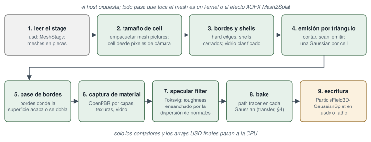
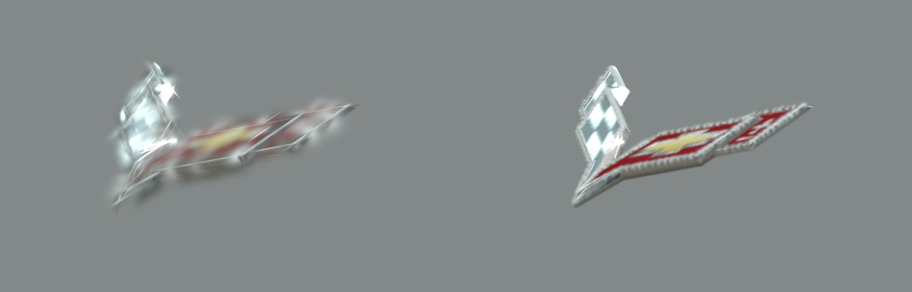

<!-- Copyright (c) 2026 jesus luque. -->

# 3. De meshes USD a Gaussians (mesh2splat)

La conversión es la primera etapa del baker de relight: transforma un stage USD de meshes poligonales y sus
materiales en una nube de Gaussians 3D anisótropas, y esa nube es la que el bake de transfer de la sección 4 llena
de luz. Se invoca como `athenea mesh2splat STAGE`; cada Gaussian que el resto del sistema dibuja, hace bake, diezma
y transmite por streaming fue antes un triángulo de un mesh. Esta sección describe cómo se lee el stage, qué tamaño tiene la cell de una Gaussian, cómo se
coloca, se da forma y se colorea cada Gaussian, cómo trata la conversión los lugares donde una superficie termina o
forma un fold, cómo captura un material físico por capas, cómo trata el vidrio y qué se midió sobre el asset del
Chevrolet Corvette C7 que guía la mayor parte del proyecto. El bake por path tracing que sigue a la emisión (el
*transfer*) es objeto de la sección 4 y aquí solo se toca donde condiciona la conversión.

::: {.nota}
**Conversión mesh → Gaussian** — Un mesh poligonal de USD (`UsdGeomMesh`) es una lista de puntos, una topología de caras (`faceVertexCounts`, `faceVertexIndices`) y unos primvars (normales, coordenadas de textura, colores) con una interpolación declarada (`vertex`, `faceVarying`, `uniform`, `constant`). Una Gaussian 3D anisótropa es una primitiva volumétrica con centro $\boldsymbol\mu$, covarianza $\Sigma$ (matriz $3\times3$ simétrica definida positiva), opacidad $\alpha$ y color (un término DC y, opcionalmente, armónicos esféricos). Su densidad no normalizada es

$$
G(\mathbf x) = \exp\!\left(-\tfrac12(\mathbf x-\boldsymbol\mu)^\top\Sigma^{-1}(\mathbf x-\boldsymbol\mu)\right),
$$

y la covarianza se guarda factorizada como $\Sigma = R\,S\,S^\top R^\top$, con $R$ una rotación (un cuaternión) y $S=\operatorname{diag}(s_1,s_2,s_3)$ tres desviaciones típicas, exactamente como en 3D Gaussian Splatting [1]. La diferencia de fondo con [1] es el origen de la nube: en 3DGS las Gaussians se optimizan contra fotografías (inverse rendering, con densificación y poda adaptativas); aquí se construyen de forma determinista a partir de una geometría conocida exactamente, sin pérdida fotométrica ni descenso de gradiente. El error de la nube no viene por tanto de un ajuste, sino de lo que una Gaussian no puede representar: una única normal, un footprint finito, ninguna refracción.

**Baker de relight** — El producto final no es una captura con la luz congelada, sino una nube cuyos registros guardan cómo responde cada Gaussian a la iluminación (el *transfer* de la §4, en la línea del precomputed radiance transfer de Sloan et al. [14]). La conversión fija la geometría y el material; el bake fija la respuesta a la luz.

**Stage USD** — Un stage es la vista compuesta de un conjunto de capas (`.usda`, `.usdc`, referencias, payloads, variantes) [43]. «Diezmar» y «streaming» remiten a los merge trees, cuts y pages de la §6; «dibujar» al rasterizer y al ray tracer de la §2.

*Referencias:* [1], [12], [14], [43]; código: `apps/athenea/src/CmdMesh2Splat.cpp` (clase `Converter`, que orquesta la conversión); manual: `docs/operations.md` §2.8 («`athenea mesh2splat` — a model into gaussians») y §3.1; `docs/decisions.md`, sección «mesh2splat: a mesh becomes a cloud, through the plugin interface».
:::

Las cifras de esta sección proceden de `docs/decisions.md` del repositorio y del código fuente
(`plugins/mesh2splat/mesh2splat.slang`, `apps/athenea/src/CmdMesh2Splat.cpp`,
`shaders/athenea/usd/mesh2splat_*.slang`). Todas las medidas se tomaron en un Apple M5 Pro (Metal) salvo que se
indique otra cosa.

::: {.nota}
**Dónde vive cada parte** — El reparto de ficheros refleja la regla del repositorio de que el procesador no hace aritmética sobre datos (`CLAUDE.md` del repositorio, «No CPU arithmetic on data»):

- `plugins/mesh2splat/mesh2splat.slang` es el kernel derivado del de Electronic Arts (su licencia BSD-3 se conserva literal en la cabecera del fichero) con los cambios que describe esta sección: entradas `m2sClear`, `m2sCount`, `m2sScan` y `m2sEmit`, y la función común `m2sTriangleOf`.
- `plugins/mesh2splat/Mesh2Splat.cpp` es la parte de host del efecto AOFX (clase `Mesh2Splat final : public aofx::Effect`): declara parámetros y entradas, reserva los buffers de trabajo (`scratch`) y lanza las tres pasadas.
- `apps/athenea/src/CmdMesh2Splat.cpp` es el comando: lee el stage, divide en piezas, decide las cells, reparte el budget, lanza el efecto pieza a pieza, hace el bake y escribe la salida.
- `shaders/athenea/usd/mesh2splat_*.slang` son los kernels que el comando ejecuta alrededor del efecto: `mesh2splat_cells` (cell por pieza), `mesh2splat_edges` (aristas duras), `mesh2splat_sheet` (clasificación del vidrio), `mesh2splat_subset` (triángulos de un GeomSubset), `mesh2splat_gather` (registros a los buffers de la nube), `mesh2splat_span` (caja y desplazamiento de rayos del bake) y `mesh2splat_bake` (respuesta del bake a los registros).

**Apple M5 Pro (Metal)** — Las cifras de tiempo y memoria son de una sola máquina con memoria unificada; los límites de memoria del device citados en la §3.11 (un tree de 5.01 M de leaves que no cabe) dependen de ella.

*Referencias:* `docs/development.md` (la sección «An aofx plugin»); `docs/decisions.md`, «mesh2splat's host side: on the device, by subset, and fair to every mesh».
:::

## 3.1 Origen, y dónde se ejecuta la conversión

El algoritmo de emisión es el de *mesh2splat* de Electronic Arts (BSD-3): cada triángulo se proyecta sobre el plano
de ejes hacia el que más apunta su normal, la proyección se rasteriza a una resolución fija y cada texel cubierto se
convierte en una Gaussian tendida en el plano del triángulo, tan ancha como un texel medido en el mundo. El
original es un par de shaders de geometría y de fragmentos en OpenGL; aquí es un único kernel de cómputo en el que
cada hilo posee un triángulo y recorre las cells de su caja proyectada.

::: {.nota}
**mesh2splat de Electronic Arts (SEED)** [12] — El original es una tubería OpenGL: un geometry shader recibe cada triángulo, elige el eje hacia el que más apunta su normal, proyecta el triángulo sobre el plano coordenado perpendicular a ese eje y calcula un Jacobian del paso de esas coordenadas al espacio del mundo; un fragment shader se ejecuta en cada texel cubierto, muestrea los mapas y añade una Gaussian a un buffer con un contador atómico.

**Proyección sobre el plano de eje dominante** — Es la misma elección que hacen el triplanar mapping y la voxelización por rasterizador (Crassin y Green, «Octree-Based Sparse Voxelization Using the GPU Hardware Rasterizer», *OpenGL Insights*, 2012): de los tres planos coordenados se toma aquel en el que el triángulo proyecta mayor área. Si $\hat{\mathbf n}$ es la normal unitaria y $k$ el eje con mayor $|n_k|$, el área proyectada es $A\,|n_k|$ con $|n_k| \ge 1/\sqrt3$, de modo que ningún triángulo se ve con un coseno peor que $0.577$ (unos $54.7^\circ$). Una rejilla regular en el plano proyectado induce sobre el triángulo una separación entre muestras que, en la dirección de máxima inclinación, es $h/|n_k| \le \sqrt3\,h$; el Jacobian de la §3.4 compensa ese estiramiento alargando la Gaussian en esa dirección.

**«Rasteriza a una resolución fija»** — La rejilla tiene $N$ cells (`--resolution`) a lo ancho del rango de referencia $R$; el texel del original es la cell de aquí.

**Un hilo por triángulo** — Sin rasterizador de función fija, cada hilo recorre las cells de la caja envolvente proyectada de su triángulo y prueba si el centro de cada una cae dentro (`m2sCellInside`, regla de centro de píxel, la misma que aplica un rasterizador). El conjunto de muestras es idéntico al del original a la misma densidad. Ventajas: un solo kernel portable (Slang a Metal y CUDA), control explícito del orden de salida (§3.4, «Orden determinista») y ninguna dependencia del pipeline gráfico. Inconveniente: el desequilibrio de carga, porque un triángulo grande ocupa a un hilo durante miles de cells mientras sus vecinos pequeños terminan enseguida; de ahí el tope `--max-cells` de la §3.3 y el recorrido por bloques `m2sWalkBlocks` (opción `--simplify`).

*Referencias:* [12]; código: `plugins/mesh2splat/mesh2splat.slang` (comentario de cabecera «WHAT THEIR PIPELINE DOES, AND WHAT THIS ONE DOES INSTEAD», funciones `projectionAxes`, `orthogonalUv`, `m2sTriangleOf`, `m2sCellInside`).
:::

El kernel no es un módulo del motor sino un efecto AOFX, el bundle `plugins/mesh2splat`, cargado mediante el mismo
registro de host que comparten todos los programas (la ABI de AOFX, sección 2.14). La conversión es un kernel sin estado
sobre triángulos, que es exactamente la forma de un efecto AOFX, y hacerla uno mantiene un conversor fuera de los
módulos del renderer y permite que el mismo bundle se ejecute en otros hosts AOFX. El coste es una frontera: a un
efecto se le entregan imágenes, de modo que un mesh viaja como una *imagen de números*, seis `float4` por
triángulo — $(\mathbf p, u)$ y $(\mathbf n, v)$ para cada vértice, en espacio de mundo (`mesh_pack.slang`) — y cada
textura que nombra un material viaja como filas de `float4` lineales muestreadas de la tabla de texturas del motor
(`texture_rows.slang`). Ninguna de las dos es una copia: las imágenes viven en el almacenamiento de imágenes de gpe,
que adopta el device Metal del motor, y `Context::renderView` da una vista de los mismos bytes, así que el kernel
de empaquetado escribe donde el efecto lee. Los registros que escribe el efecto se reúnen en los buffers de
device de la nube (`mesh2splat_gather`), los límites de la nube se pliegan en el device
(`mesh2splat_span`) y el bake los lee en su sitio. Solo los contadores y los arrays USD finales cruzan al
procesador.

::: {.nota}
**Efecto AOFX** — AOFX es la interfaz de plugins de efectos de aopenfx (`third_party/aopenfx`): un efecto declara entradas y parámetros (`describe`) y recibe imágenes en device con las que ejecuta kernels; el registro y el runner de host son compartidos por todos los programas que cargan bundles (§2.14). Que la conversión sea un efecto tiene dos consecuencias: el conversor queda fuera de los módulos del renderer (no enlaza contra `athenea::render` ni `athenea::technique`) y el mismo bundle puede ejecutarse en cualquier host AOFX (un compositor, por ejemplo). Las ABI de AOFX solo cambian de forma aditiva; por eso cada parámetro nuevo del efecto (`cellMin`, `cellMax`, `cellByLongest`, `edgeReach`, `normalSpread`…) tiene un valor por defecto que reproduce el comportamiento anterior.

**La imagen de números** — Un efecto recibe imágenes, no meshes, así que cada triángulo viaja como seis píxeles `float4`: para cada uno de sus tres vértices, $(\mathbf p, u)$ y $(\mathbf n, v)$ en espacio de mundo, 96 bytes por triángulo. El kernel `meshPack` de `mesh_pack.slang` lo escribe: un hilo por triángulo, posiciones leídas del buffer de puntos del mesh con los índices que triangula `geom::MeshBuilder`, la transformación a mundo aplicada en el kernel y normales y UV resueltas según su interpolación, como hace `world/primvars.slang` en el renderer.

**Texturas como filas de `float4`** — Un efecto no ve samplers ni mips. `texture_rows.slang` (`textureRows`, un hilo por texel) muestrea la textura a través de la misma tabla de texturas que usan todos los materiales del motor, de modo que el espacio de color, el wrap y el filtrado coinciden con los del renderer; el resultado es lineal y en orden de filas de abajo arriba ($v$ hacia arriba). Un texel en `float4` ocupa 16 bytes, de ahí el límite `--texture-size` de la §3.2.

**Sin copia (gpe)** — gpe es la capa de almacenamiento de imágenes que adopta el device de slang-rhi (un único `MTLDevice`, o un contexto CUDA). `Context::renderView` devuelve un `gpu::Buffer` que es una vista sobre los mismos bytes de una imagen de gpe, de modo que el kernel de empaquetado escribe en la memoria que luego lee el efecto, sin transferencia.

**Gather y span** — `mesh2splat_gather` (`m2sGather`) coloca los registros de cada ejecución en los buffers de la nube en su desplazamiento; `mesh2splat_span` reduce la caja de la nube en el device (`m2sRecordChunks` y `scene/bounds_reduce`) y escribe en cada rayo del bake un desplazamiento de $10^{-4}$ de la diagonal de esa caja (`m2sRaySpan`), una fracción del modelo y no de la unidad de la escena, para que el rayo no empiece dentro del triángulo que va a encontrar.

**«Solo los contadores y los arrays USD finales cruzan al procesador»** — Es la regla del repositorio: el procesador lee ficheros y lleva cuentas; el resto lo hacen kernels. Los arrays de USD cruzan porque la API de USD exige arrays en memoria de host para escribir atributos.

*Referencias:* §2.14 del artículo; código: `plugins/mesh2splat/Mesh2Splat.cpp`, `modules/aofx/host/src/Host.cpp`, `shaders/athenea/usd/mesh_pack.slang`, `shaders/athenea/usd/texture_rows.slang`, `modules/gpu_host/include/athenea/gpu_host/Context.h` (`renderView`), `modules/gpu_host/include/athenea/gpu_host/Views.h`, `shaders/athenea/usd/mesh2splat_gather.slang`, `shaders/athenea/usd/mesh2splat_span.slang`; `docs/decisions.md`, «One AOFX host, from aopenfx» y «mesh2splat's host side: on the device, by subset, and fair to every mesh».
:::

El comando es, por tanto, una cadena de pasadas en el device orquestada por el host (figura 6):

1. leer el stage (`usd::MeshStage`) y dividir los meshes en *piezas*;
2. empaquetar cada pieza en una imagen de mesh, plegar las cajas y elegir la cell de cada pieza (`mesh2splat_cells`);
3. marcar las aristas duras y las closed shells por mesh (`mesh2splat_edges`) y clasificar el vidrio (`mesh2splat_sheet`);
4. ejecutar el efecto Mesh2Splat por pieza — contar, explorar, emitir — hacia registros;
5. opcionalmente, hacer bake (radiancia, o un transfer) en cada Gaussian con el path tracer;
6. escribir un stage `ParticleField3DGaussianSplat` (o un `.athc`) de forma atómica.

::: {.nota}
**Las seis etapas** — (1) `usd::MeshStage::read` devuelve los `StageMesh` del stage y el comando los divide en piezas (`Converter::makePieces`). (2) `Converter::packMeshes` empaqueta cada pieza con `meshPack`, pliega las cajas por bloques (`streamBoundsChunks` y `bounds_reduce_slices`) y `Converter::deriveCells` ejecuta `m2sCells`. (3) `Converter::markEdges` (aristas duras y closed shells, §3.5) y `Converter::classifySheets` (vidrio, §3.8). (4) El efecto, en tres pasadas: contar las cells cubiertas por triángulo, la suma prefija exclusiva y la emisión (§3.4). (5) El bake (§4), opcional: radiancia horneada o transfer. (6) La escritura, de forma atómica: `platform::writeAtomically` escribe en un fichero temporal `.<nombre>.partial-<pid>.<ext>` del mismo directorio y lo renombra al terminar, de modo que una conversión interrumpida no deja una nube parcial con el nombre que lee el paso siguiente.

**`ParticleField3DGaussianSplat`** — Esquema de OpenUSD (familia `ParticleField`, a partir de USD 26.x) que describe una nube de Gaussians: posiciones, orientaciones, escalas, opacidades y coeficientes de radiancia; los canales propios de athenea van como primvars `primvars:athenea:splat:*`. `.athc` es el formato comprimido del player (§7).

**Correspondencia con la figura 6** — La figura descompone la lista en nueve cajas: la etapa 2 de la lista es su caja 2, la 3 su caja 3, la 4 se reparte en sus cajas 4 a 7 (emisión, pasada de aristas, captura de material y filtro especular, que en el código ocurren dentro de `m2sWrite`), la 5 es su caja 8 y la 6 su caja 9.

*Referencias:* código: `apps/athenea/src/CmdMesh2Splat.cpp` (`makePieces`, `packMeshes`, `deriveCells`, `markEdges`, `classifySheets`), `modules/core/include/athenea/core/Platform.h` (`writeAtomically`), `modules/usd/src/Export.cpp`; `docs/operations.md` §8.2 (formatos); `docs/decisions.md`, «mesh2splat's host side…» (apartado «Whole or not at all»).
:::

## 3.2 Lectura del stage

`usd::MeshStage` recorre el stage directamente con `UsdShade` en lugar de a través de Hydra: la conversión no quiere
ningún índice de render, y el lado de los materiales se apoya en los propios bindings del stage.

::: {.nota}
**UsdShade frente a Hydra** — Hydra es la arquitectura de render de OpenUSD: un scene delegate (UsdImaging) traduce el stage a un render index de prims de render (Rprims, Sprims, Bprims) que un render delegate consume. Es la vía del renderer (el delegado `hdAthenea`, §2). La conversión no necesita un índice de render, solo meshes, transformaciones y materiales, así que `MeshStage` recorre el stage directamente y resuelve los materiales con la API de UsdShade (`UsdShadeMaterialBindingAPI::ComputeBoundMaterial`, que aplica herencia, propósitos de binding y GeomSubsets).

**El riesgo de tener dos lectores** — El renderer (vía Hydra) y la conversión (vía `MeshStage`) deben coincidir en qué es visible, cómo se instancia y qué material lleva cada cara; cuando no coinciden, la nube no es lo que dibuja el renderer. Los apartados siguientes (visibilidad, instanciado, GeomSubsets) son en buena parte los puntos donde se alinearon.

*Referencias:* [43]; código: `modules/usd/src/MeshStage.cpp` (`MeshStage::read`), `modules/usd/include/athenea/usd/MeshStage.h`; `docs/decisions.md`, «mesh2splat converts what the renderer draws» y «An invisible PointInstancer hides its instances».
:::

**Selección.** `--prim P` restringe la conversión a los meshes en `P` o bajo él; `--hide P` (repetible) escribe
invisibilidad en `P` y en todo lo que cuelga de él, en una capa no persistente sobre el stage, antes de la lectura. Un
mesh que resulta invisible en el código de tiempo de la lectura se omite, de modo que la conversión convierte lo que
dibuja el renderer. `--hide` afecta solo a la conversión: el bake traza el stage entero, así que una parte convertida
con todas las demás ocultas sigue recibiendo sus sombras e interreflexiones. Esto es lo que permite convertir el
Corvette por grupos (sección 3.11).

::: {.nota}
**`--prim` y `--hide`** — `--prim P` es un filtro de recorrido. `--hide P` escribe `visibility = invisible` en `P` dentro de la *session layer* del stage, la capa más fuerte y no persistente que USD mantiene en memoria y nunca guarda junto al fichero (`UsdEditContext` sobre `GetSessionLayer()`). La visibilidad de USD es heredable: un prim invisible hace invisible a todo su subárbol, y la visibilidad efectiva se calcula en un código de tiempo (`ComputeVisibility`), lo que explica la frase «invisible en el código de tiempo de la lectura».

**Por qué el bake no respeta `--hide`** — El bake traza el stage original completo. Una parte convertida sola sigue recibiendo la sombra y las interreflexiones de las demás, lo que permite dividir un asset grande en grupos de conversión independientes (memoria del device, tiempo por grupo) sin que la iluminación de cada grupo dependa del reparto. Es la base de los ocho grupos a 1280 px y de los veinticuatro trees a 5120 px de la §3.11.

*Referencias:* código: `modules/usd/src/MeshStage.cpp` (bloque `--hide` dentro de `MeshStage::read`, que devuelve «no prim that can be seen there» si la ruta no existe), `apps/athenea/src/CmdMesh2Splat.cpp` (opción `--hide`); `docs/operations.md` §2.8.
:::

**Instanciado.** El mesh de un prototipo de `PointInstancer` se emite una vez por instancia del instanciador más
interno que lo contiene, en (mesh relativo a la raíz de su prototipo) × (transformación de la instancia, raíz del
prototipo incluida) × (instanciador a mundo); los buffers del mesh construido se comparten entre las copias. Sin esta
expansión, los dieciséis peones del ajedrez se convierten en dos. Los instanciadores anidados solo se expanden en el
nivel más interno.

::: {.nota}
**`PointInstancer`** — Prim de USD que dibuja muchas copias de un conjunto de prototipos: `prototypes` (relación a los subárboles prototipo), `protoIndices` (qué prototipo usa cada instancia) y `positions`, `orientations`, `scales` (la transformación de cada instancia). `UsdGeomPointInstancer::ComputeInstanceTransformsAtTime` devuelve una matriz por instancia; con la opción `IncludeProtoXform`, la transformación propia de la raíz del prototipo queda incluida.

**La composición de transformaciones** — USD usa vectores fila ($\mathbf v' = \mathbf v\,M$), así que la matriz se lee de izquierda a derecha en el orden en que se aplica:

$$
M_{\text{mundo}} = M_{\text{mesh}\to\text{raíz del prototipo}}\; M_{\text{instancia}}\; M_{\text{instanciador}\to\text{mundo}}.
$$

El mesh se toma relativo a la raíz de su prototipo precisamente porque la transformación de esa raíz ya está dentro de $M_{\text{instancia}}$; tomarlo en mundo la aplicaría dos veces.

**Buffers compartidos** — La triangulación, las normales y los primvars expandidos (`geom::MeshBuilder`) se calculan una vez por prototipo; solo cambia la matriz al empaquetar cada copia.

**Los peones** — En el ajedrez de prueba los dieciséis peones son instancias de dos prototipos (blanco y negro); sin la expansión, la conversión leía solo los prototipos en su posición de origen.

**Anidamiento** — Un instanciador dentro del prototipo de otro produciría el producto de ambos conjuntos de instancias; aquí solo se expande el más interno (limitación repetida en la §3.12).

*Referencias:* [43]; código: `modules/usd/src/MeshStage.cpp` (estructura `InstancedAt`, función `instancesOf`); `docs/decisions.md`, «mesh2splat converts what the renderer draws».
:::

**Tiempo y pose.** `--time T` fija el código de tiempo en que se leen posiciones, transformaciones y primvars (sus
índices incluidos) y en que traza el bake. Los `points` de un mesh con skinning no se animan en USD, así que el
stage se posa primero con `UsdSkelBakeSkinning` en una capa no persistente sobre $[T, T]$, lo que cuesta una pose y
deja el fichero intacto; un stage sin `SkelRoot` queda igual y se convierte idéntico byte a byte. Con `--skinned` las
Gaussians se construyen en la bind pose y cada una conserva cuatro joints y los gradientes de sus pesos; ese camino
se describe en la sección 5.

::: {.nota}
**`--time T`** — Fija el `UsdTimeCode` en el que se evalúan atributos con muestras temporales: posiciones, transformaciones y primvars, incluidos sus índices (un primvar indexado guarda valores e índices por separado, y ambos pueden variar en el tiempo). El bake traza en el mismo instante.

**Skinning en USD (UsdSkel)** — Los `points` de un mesh con skinning guardan la pose de bind; la deformación la describe un `Skeleton` animado por un `SkelAnimation` y la aplica quien lee. Es linear blend skinning: con pesos $w_j$ y matrices de joint $M_j$ en la pose actual y $B_j$ en la de bind,

$$
\mathbf p' = \sum_j w_j\,\mathbf p\,B_j^{-1} M_j \quad (\text{vectores fila}).
$$

**`UsdSkelBakeSkinning`** — Función de UsdSkel que evalúa esa deformación y escribe los puntos posados como atributos; aquí se ejecuta en la session layer sobre el intervalo $[T, T]$, lo que cuesta exactamente una pose y no modifica el fichero (`poseStage`). Un stage sin `SkelRoot` no tiene nada que posar y la conversión sale idéntica byte a byte, una comprobación de que la ruta nueva no altera la antigua.

**`--skinned`** — La alternativa: convertir en la pose de bind y guardar en cada Gaussian cuatro joints con sus pesos y los gradientes de esos pesos a lo largo de sus dos ejes (entradas 6 a 8 del registro: `blendInfluences` y `m2sPackHalves` empaquetan los gradientes en medias precisiones). La nube se deforma después en el device (§5). Las dos rutas son excluyentes: o se posa antes de convertir o se lleva el rig.

*Referencias:* [43]; código: `modules/usd/src/MeshStage.cpp` (`poseStage`, `resolveSkinning`, `skinningOf`), `plugins/mesh2splat/mesh2splat.slang` (`blendInfluences`); `docs/decisions.md`, «The conversion reads a pose, not a rest» y «A gaussian carries the joints its triangle carries».
:::

**Piezas.** Un mesh cuyos GeomSubsets `materialBind` enlazan materiales distintos se convierte como varias
*piezas*: los triángulos de cada subconjunto y los que ningún subconjunto reclama. Los triángulos de una pieza se
listan en el device en el orden del mesh (marca, suma prefija, dispersión) y se empaquetan como si fueran un
mesh, de modo que el efecto no cambia. Un mesh de prueba con dos caras enlazadas en rojo y azul por subconjuntos y
el mesh enlazado en verde se convierte en 272 Gaussians rojas y 272 azules y ninguna verde; leyendo solo el binding
propio del mesh sería todo verde.

::: {.nota}
**GeomSubset y la familia `materialBind`** — `UsdGeomSubset` es un prim hijo de un mesh que selecciona un subconjunto de sus caras (`elementType = face`, `indices`). Los subsets se agrupan en familias por `familyName`; la familia `materialBind` es la que USD usa para asignar materiales por grupos de caras: cada subset lleva su propio `material:binding`. Las caras que ningún subset reclama toman el binding del propio mesh, que es lo que responde `ComputeBoundMaterial` para ellas.

**Pieza** — La unidad de conversión: un mesh entero, los triángulos de un subset o los que no reclama ninguno. Cada pieza lleva un material, y por tanto unos parámetros del efecto propios.

**Listado en el device (stream compaction)** — `geom::MeshBuilder` ya sabe en qué subset está cada triángulo (`triangleSubsets`: 0 ninguno, $k+1$ el $k$-ésimo). Para extraer la lista de una pieza: (1) un kernel marca con 1 cada triángulo de la pieza (`m2sSubsetFlags`), (2) una suma prefija exclusiva de las marcas da a cada triángulo marcado su posición en la lista (`gpu::PrefixSum`), (3) un kernel escribe cada triángulo marcado en esa posición (`m2sSubsetScatter`). Es el patrón estándar de compactación en GPU; la suma prefija conserva el orden del mesh, de modo que la conversión es determinista. `mesh_pack` empaqueta esa lista como si fuera un mesh y el efecto no cambia.

**272** — Es el recuento que da un cuadrado unidad a resolución 16: $16\times16 = 256$ centros de cell, más los 16 que caen exactamente sobre la diagonal que comparten los dos triángulos y que la prueba de inclusión, cerrada ($\lambda_k \ge 0$), cuenta en ambos.

**El identificador de Cryptomatte** — Sigue siendo el del mesh: un GeomSubset no es un prim que Hydra dibuje por separado.

*Referencias:* [43]; código: `shaders/athenea/usd/mesh2splat_subset.slang`, `modules/gpu/include/athenea/gpu/algo/PrefixSum.h`, `modules/geom/include/athenea/geom/Mesh.h` (`MeshBuilder`); prueba: `tests/mesh2splat/test_outputs.cpp` («a mesh's GeomSubsets are converted each with its own material») sobre `tests/data/two_subsets.usda`; `docs/decisions.md`, «mesh2splat's host side…» (apartado «A mesh of several materials, converted as several»).
:::

**Los materiales en sus propios términos.** La superficie enlazada — MaterialX `standard_surface`, OpenPBR
`open_pbr_surface`, `gltf_pbr` o `UsdPreviewSurface` — se lee con sus propios nombres de entrada y sus propios valores
por defecto (standard_surface gris 0.8 a roughness 0.2, OpenPBR roughness 0.3, glTF un metal totalmente rugoso,
UsdPreviewSurface 0.18 a 0.5), siguiendo las conexiones a través de grafos de nodos y entradas de interfaz hasta el
nodo de imagen que produce un valor. Un valor calculado por un grafo (una mezcla, un ruido) no tiene respuesta sin
sombrear un punto, así que se mantiene el valor por defecto y se imprime un aviso; un bake TX lee después esos
campos desde el material compilado en el device. El espacio de color de una textura se toma del metadato
`colorSpace` de la entrada de fichero (o de `sourceColorSpace`), y los mapas se limitan a `--texture-size` (1024 por
defecto): un mapa es una imagen `float4` en el device, así que un mapa de 4k ocuparía 268 MB.

::: {.nota}
**Los cuatro vocabularios de superficie** — `standard_surface` es el modelo de Autodesk que MaterialX incluye en su biblioteca [31]; `open_pbr_surface` es OpenPBR Surface de la Academy Software Foundation [30], sucesor de aquel y de Adobe Standard Material; `gltf_pbr` es el modelo metal-roughness de glTF 2.0 tal como lo trae MaterialX; `UsdPreviewSurface` es el modelo mínimo de intercambio de USD. Cada uno nombra sus entradas a su manera y tiene sus propios valores por defecto, que son los que aplica cualquier renderer conforme cuando la entrada no está escrita:

- standard_surface: `base` 0.8 × `base_color` 1 (un gris 0.8), `specular_roughness` 0.2;
- OpenPBR: `base_weight` 1 × `base_color` 0.8, `specular_roughness` 0.3;
- glTF: `base_color` 1, `metallic` 1, `roughness` 1 (de ahí «un metal totalmente rugoso»);
- UsdPreviewSurface: `diffuseColor` 0.18, `roughness` 0.5, `metallic` 0.

Leer un material con los valores por defecto de otro vocabulario cambia su apariencia: un standard_surface sin entradas escritas leído con los defaults genéricos (blanco, roughness 0.5) salía blanco mate donde el mesh es un gris 0.8 casi brillante.

**Seguir las conexiones** — Una entrada puede estar conectada a la salida de un nodegraph, que a su vez lee una entrada de interfaz del material; se sigue la cadena hasta el nodo de imagen (`image`, `tiledimage`, `UsdUVTexture`) cuyo fichero da el valor. Un valor producido por un grafo (una mezcla, un ruido procedural) no se puede conocer sin evaluar el grafo en un punto de la superficie: la conversión mantiene el valor por defecto y avisa una vez (`warnOnce`); el bake TX evalúa después esos campos con el material compilado a Slang en el device.

**El espacio de color de una textura** — En MaterialX el atributo `colorspace` y en USD el metadato `colorSpace` de la entrada de fichero dicen en qué espacio están los valores codificados; `UsdUVTexture` tiene además `sourceColorSpace` (`auto`, `raw`, `sRGB`). Un mapa de albedo en sRGB debe decodificarse a lineal; un mapa de normales o de roughness es `raw` y no se toca.

**268 MB** — Un mapa de $4096\times4096$ texels en `float4` ocupa $4096^2 \times 16\,\text{B} = 268\,435\,456\,\text{B}$. Con el límite de 1024 por defecto, un mapa ocupa 16.8 MB.

*Referencias:* [30], [31], [43]; código: `modules/usd/src/MeshStage.cpp` (`colourDefault = preview ? 0.18F : gltf ? 1.0F : 0.8F`, lectura de `sourceColorSpace`, `warnOnce`), `apps/athenea/src/CmdMesh2Splat.cpp` (opción `--texture-size`); `docs/decisions.md`, «A material is read in its own words, at its own defaults», «A texture's colour space, which a material network drops» y «A material's fields read back from the material itself (matx)».
:::

## 3.3 El tamaño de una cell

Todo lo que viene después escala con la cell $h$, la longitud en el mundo que representa una Gaussian. La
conversión ofrece cuatro maneras de elegirla, en orden creciente de preferencia.

::: {.nota}
**La cell $h$** — Es la separación entre centros de Gaussians sobre la superficie y, salvo el factor $\sigma$, su anchura. La densidad superficial es $1/h^2$ Gaussians por unidad de área, así que todo coste escala con $h^{-2}$: número de Gaussians, memoria, tiempo de bake (un número fijo de paths por Gaussian) y tamaño del merge tree. Reducir $h$ a la mitad multiplica todo eso por cuatro allí donde la superficie está resuelta por cells, y por menos allí donde ya hay aproximadamente una Gaussian por triángulo (§3.11).

*Referencias:* `docs/operations.md` §2.8 (opciones `--resolution`, `--density`, `--cell-min`, `--cell-max`, `--cell-from-camera`, `--camera-pixels`, `--max-splats`).
:::

**Por modelo** (`--density per-model`, el valor por defecto cuando no se da una cámara). $h = R / N$, donde $N$ es
`--resolution` (512 por defecto) y $R$ el mayor de los dos rangos del plano de proyección de la caja del modelo — los
`orthogonalUvs` del original. De ello se siguen dos defectos: un suelo de 16 unidades diluye el coche apoyado en él,
y un panel orientado hacia delante recorre una cell 2.5 veces más fina que el capó, porque su plano de proyección
es el lado corto del coche.

::: {.nota}
**Por modelo** — $R$ es el mayor de los dos rangos de la caja del modelo en el plano de proyección del triángulo; es el `orthogonalUvs` del original, el lado del cuadrado unidad al que se normalizan las coordenadas proyectadas.

**Primer defecto: el suelo diluye el coche** — Con un suelo de 16 unidades en el stage, $R = 16$ y $h = 16/512 = 0.03125$; el coche solo, en el mismo modelo, tendría una cell de unos 0.0037. El suelo, que es lo que define la caja, se lleva $512^2 = 262\,144$ Gaussians de las 375 199 totales.

**Segundo defecto: la cell depende de la orientación** — En un coche de 0.77 de ancho, 1.92 de largo y 0.60 de alto (unidades del modelo), un panel orientado hacia delante proyecta sobre el plano ancho × alto, cuyo mayor rango es 0.77; el capó proyecta sobre ancho × largo, cuyo mayor rango es 1.92. Las cells están en razón $1.92/0.77 \approx 2.5$.

*Referencias:* código: `plugins/mesh2splat/mesh2splat.slang` (`m2sTriangleOf`, cálculo de `range`; el comentario cita el mismo 2.5); `docs/decisions.md`, «The density is a mesh's own, not the stage's».
:::

**Por mesh** (`--density per-mesh`). $h = L_m / N$ con $L_m$ el lado más largo de la caja propia del mesh, el
mismo para todos sus triángulos (`cellByLongest`), acotado a $[h_{\min}, h_{\max}]$ dados por
`--cell-min`/`--cell-max`; si se dejan a 0 se derivan de la cell del modelo $h_M$: $h_{\max} = h_M$,
$h_{\min} = h_M/8$, una razón de densidad de 64 entre la parte más fina y la más gruesa. Medido en
`MustangHero.usda` (el coche sobre un suelo de 16 unidades) a `--resolution 512`:

| modo | total | parachoques `Object_199` | capó `Kapoot` | suelo |
|---|---|---|---|---|
| por modelo | 375 199 | 762 (cell 0.0313) | 2 326 | 262 144 |
| por mesh, por defecto | 934 338 | 3 082 (cell 0.0039) | 20 279 | 262 144 |
| por mesh, `--cell-min` = `--cell-max` = 0.03125 | 375 157 | 764 | 2 339 | 262 144 |

La fila de control reproduce el modo por modelo al 0.01 %; la diferencia restante es solo el efecto de la orientación.

::: {.nota}
**Por mesh** — $h = L_m/N$ con $L_m$ el lado más largo de la caja del mesh. `cellByLongest` hace que todos los triángulos del mesh usen ese lado como rango, sea cual sea su plano de proyección: un mesh tiene una sola cell, lo que elimina el segundo defecto del modo por modelo.

**Las cotas derivadas** — Si no se dan, $h_{\max} = h_M$ (ningún mesh queda más grueso que en el modo por modelo) y $h_{\min} = h_M/8$ (un tornillo no recorre una rejilla mil veces más fina que la carrocería). La razón de densidades entre la parte más fina y la más gruesa es $(h_{\max}/h_{\min})^2 = 8^2 = 64$.

**Lectura de la tabla** — Con los valores por defecto el parachoques queda acotado por abajo: su cell propia sería 0.0014 y se lleva a $h_{\min} = 0.03125/8 = 0.0039$; pasa de 762 a 3 082 Gaussians y el capó de 2 326 a 20 279, mientras el suelo conserva exactamente sus 262 144 porque su cell propia ya es la del modelo. La fila de control fija $h_{\min} = h_{\max} = 0.03125$: todos los meshes recorren la cell del modelo y el total coincide con el del modo por modelo al 0.01 % (375 157 frente a 375 199). Lo que queda (764 frente a 762, 2 339 frente a 2 326) es el efecto de medir contra el lado más largo en lugar del rango del plano de proyección.

**Implementación** — Las cajas de cada mesh se pliegan en el device a partir de las cajas por bloques que ya escribe `streamBoundsChunks`; `m2sCells` deriva las cotas y la cell de cada pieza. En el efecto, la cell se acota en unidades de mundo y `perCell` solo se recalcula donde una cota actúa, de modo que una ejecución sin cotas conserva $1/N$ bit a bit.

*Referencias:* código: `shaders/athenea/usd/mesh2splat_cells.slang` (`m2sCells`: `cellMax` toma `modelCell` y `cellMin` toma `cellMax / 8.0`), `plugins/mesh2splat/mesh2splat.slang` (`cellByLongest`, bloque «Bounded in the world»); prueba: `tests/data/two_planes.usda`; `docs/decisions.md`, «The density is a mesh's own, not the stage's».
:::

**Desde una cámara** (`--cell-from-camera CAM --camera-pixels P`, a partir de Mesh2GS, arXiv 2606.21898). La cell de
cada pieza es lo que cubre un píxel de la cámara `CAM`, de `P` píxeles de ancho, donde la caja del mesh de la
pieza le queda más cerca:

$$
h = \frac{z\,(A/P)}{f}, \qquad z = \max\bigl(\lVert \operatorname{clamp}(\mathbf e, \mathbf b_{\min}, \mathbf b_{\max}) - \mathbf e \rVert,\; z_{\text{near}}\bigr),
$$

con $A$ la apertura horizontal de la cámara, $f$ su distancia focal, $\mathbf e$ el ojo, y el resultado acotado
solo por `--cell-min`/`--cell-max` explícitos. Mesh2GS toma $z_{\min}$ sobre la caja dentro del frustum y sobre las
muestras temporales de la cámara; la distancia euclídea en `--time` es la misma para una caja a la vista y más fina,
nunca más gruesa, para una al lado del frustum. Con dos tarjetas iguales a tres y siete unidades de una cámara de 64
píxeles, la tarjeta cercana recibió 930 Gaussians y la lejana 169: una razón de 5.5 frente a los $(7/3)^2 = 5.4$
esperados. Este es el modo usado en todos los bakes de producción del Corvette (`--cell-from-camera
/World/Camera --camera-pixels` 640, 1280 o hasta 5120).

::: {.nota}
**La cell desde una cámara** — Con una cámara pinhole, un píxel del sensor mide $A/P$ (apertura horizontal entre píxeles a lo ancho). Por triángulos semejantes, a una distancia $z$ del centro óptico ese píxel cubre en el mundo

$$
h = z\,\frac{A/P}{f}.
$$

En USD, `horizontalAperture` y `focalLength` se expresan en las mismas unidades (décimas de unidad de escena por convención, en la práctica milímetros), así que su cociente no tiene unidades y $h$ queda en unidades del mundo, las de $z$. Ejemplo ilustrativo: con $f = 50$ mm, $A = 36$ mm, $P = 1280$ y $z = 5$ m, $h = 5 \cdot (36/1280)/50 \approx 2.8$ mm, el orden de las leaves de 3–4 mm del capó a 640 px que cita la §3.11.

**La distancia $z$** — $\operatorname{clamp}(\mathbf e, \mathbf b_{\min}, \mathbf b_{\max})$ es el punto de la caja más cercano al ojo $\mathbf e$ (se acota cada coordenada por separado), así que $z$ es la distancia euclídea del ojo a la caja: cero si el ojo está dentro, y en ese caso se usa $z_{\text{near}}$, el plano cercano de la cámara. Tomar el punto más cercano es la elección conservadora: en ese punto la pieza recibe una cell por píxel, y en cualquier otro punto más alejado la cell resulta más fina que el píxel.

**Diferencias con Mesh2GS** [13] — Mesh2GS toma la profundidad mínima de la caja dentro del frustum y sobre las muestras temporales de la cámara. La distancia euclídea en el instante `--time` coincide con ella para una caja a la vista; para una caja fuera del frustum, la distancia euclídea es menor que la profundidad que tendría «dentro», lo que da una cell más fina, nunca más gruesa. La tercera escala que propone Mesh2GS, $r_z = D_w^2/(4 z_{\min})$, no se adoptó: la anchura de la Gaussian convertida se midió aparte (§3.4, «Anchura»).

**La prueba de las dos tarjetas** — El número de Gaussians de una superficie va como $A_{\text{sup}}/h^2 \propto 1/z^2$, así que dos tarjetas iguales a 3 y 7 unidades deben estar en razón $(7/3)^2 \approx 5.44$; la medida da $930/169 \approx 5.50$.

**`--camera-pixels`** — No tiene por qué ser la resolución de render: con 640 px de conversión y un frame de 1920 px, una cell cubre unos tres píxeles de pantalla; con 5120 px, menos de medio.

*Referencias:* [13]; código: `shaders/athenea/usd/mesh2splat_cells.slang` (comentario «FROM A CAMERA» y `const float3 nearest = clamp(eye, low, high)`), `apps/athenea/src/CmdMesh2Splat.cpp` (`deriveCells`); prueba: `tests/mesh2splat/test_outputs.cpp` («a camera's pixel decides each mesh's cell»); `docs/decisions.md`, «mesh2splat's host side…» (apartado «From a camera (Mesh2GS, arXiv 2606.21898)»).
:::

**El budget.** `--max-splats` (2 M por defecto) se reparte sobre todo el stage. Cada pieza se cuenta primero
(una ejecución del efecto con sitio para una Gaussian, cuyo recuento y exploración cubren todo lo que escribiría una
ejecución); donde el total $W$ supera el budget $B$, la pieza $i$ que quiere $w_i$ recibe
$s_i = \max(1, B w_i / W)$ y recorre una cell $\sqrt{w_i / s_i}$ veces más gruesa. Una cell $k$ veces más gruesa
cubre la superficie con $k^2$ Gaussians menos, así que las cuotas proporcionales y el engrosamiento uniforme son lo
mismo. Con dos tarjetas que quieren unas 1 300 bajo un budget de 800, las cuotas salieron 356 y 361; gastado en
el orden de los meshes, la segunda tarjeta tenía unas 145.

::: {.nota}
**El reparto del budget** — Primero se cuenta cada pieza: una ejecución del efecto con sitio para una sola Gaussian, cuyas pasadas de recuento y suma prefija ya calculan cuántas querría escribir ($w_i$). Si $W = \sum_i w_i \le B$ cada pieza recibe lo que quiere. Si no, la pieza $i$ recibe $s_i = \max(1, B\,w_i/W)$ y su cell se engrosa por el factor $f_i = \sqrt{w_i/s_i}$.

**Por qué cuotas proporcionales equivalen a un engrosamiento uniforme** — Una cell $f$ veces más gruesa cubre la misma superficie con $f^2$ veces menos Gaussians, así que $w_i/f_i^2 = s_i$. Y como $s_i/w_i = B/W$ para todas las piezas (salvo el mínimo de 1), $f_i = \sqrt{W/B}$ es el mismo factor para todas: repartir proporcionalmente es engrosar todo por igual, sin que ninguna pieza desaparezca.

**Lectura de la medida** — Dos tarjetas que quieren en total unas 1 300 con un budget de 800 tendrían idealmente 400 cada una; salen 356 y 361. La diferencia es de discretización: el recuento real de una rejilla sobre un triángulo no escala exactamente como $1/f^2$ (bordes, centros sobre aristas compartidas). Con el gasto antiguo en orden de meshes, la primera tarjeta se llevaba casi todo y la segunda unas 145.

*Referencias:* código: `apps/athenea/src/CmdMesh2Splat.cpp` (`wantedBy_`, `shareOf_`, aviso «the budget is shared in proportion»), `shaders/athenea/usd/mesh2splat_cells.slang` (entradas `cells[3 + P + p]`, el factor $\sqrt{w/s}$); prueba: `tests/mesh2splat/test_outputs.cpp` («a budget too small is shared between the meshes, not spent on the first»); `docs/decisions.md`, «mesh2splat's host side…» (apartado «The budget is shared, and a camera can decide the cell»).
:::

**Límites por triángulo y por ejecución.** Un triángulo recorre como mucho `--max-cells` cells de su caja proyectada
($2^{18}$ por defecto); las que sobran se cuentan y se avisan. A 4736 px, `Infinite_Black` del Corvette perdió así
359 628 cells (agujeros visibles) y se volvió a hacer su bake con `--max-cells 1048576`. La imagen de salida de una
ejecución está limitada a 2 M Gaussians (`kRunCeiling`, 192 MB); una pieza que quiere más se convierte por tramos —
el efecto informa del primer triángulo que el techo cortó y el host vuelve a ejecutar desde ahí con `firstTriangle` —,
lo que da el mismo array que habría escrito una sola ejecución.

::: {.nota}
**`--max-cells`** — Un hilo recorre las $n_x \times n_y$ cells de la caja proyectada de su triángulo (`t.span`), no solo las que están dentro. Un triángulo largo y diagonal tiene una caja enorme con pocas cells dentro; sin tope, un solo hilo podría recorrer millones de cells. Con $2^{18} = 262\,144$, las cells que sobran se cuentan (cuarto contador del efecto, `counters[3]`) y el comando avisa por stderr; la superficie que quedaba en esas cells sale sin Gaussians. Con `--max-cells 1048576` ($2^{20}$) el tope se cuadruplica.

**`kRunCeiling` y las 192 MB** — El techo es `2u << 20` $= 2^{21} = 2\,097\,152$ Gaussians por ejecución. Con registros de seis `float4` (96 bytes: las cuatro entradas base más normal-metálico y roughness-transmisión-UV), $2^{21} \times 96\,\text{B} = 192\,\text{MiB}$.

**Conversión por tramos** — La pasada de suma prefija conoce el desplazamiento de cada triángulo; el primero cuyo bloque no cabe bajo el techo se registra con un mínimo atómico (`InterlockedMin(counters[4], i)` en `m2sScan`) y no escribe nada. El host relanza el efecto con `firstTriangle` en ese índice; `m2sCount` pone a cero los triángulos anteriores. Como el orden de salida es el del mesh (§3.4), concatenar los tramos da el mismo array que una ejecución sin techo.

*Referencias:* código: `plugins/mesh2splat/mesh2splat.slang` (`m2sCount`, `m2sScan`, campo `firstTriangle`), `apps/athenea/src/CmdMesh2Splat.cpp` (`constexpr uint64_t kRunCeiling = 2u << 20`); `docs/decisions.md`, «A mesh past the ceiling is converted in slices, and a barb keeps its alpha».
:::

## 3.4 Una Gaussian por cell

**La proyección.** Para un triángulo $(\mathbf a, \mathbf b, \mathbf c)$ de normal geométrica $\hat{\mathbf n}_g$,
los dos ejes $(i, j)$ hacia los que menos apunta $\hat{\mathbf n}_g$ definen la proyección; un punto se lleva a
$\mathbf o(\mathbf x) = (x_i - b_{\min,i},\, x_j - b_{\min,j}) / R$, con $R$ el rango en uso (el del modelo, el lado
más largo del mesh o la caja derivada de la cámara). Una cell es $1/N$ de ese cuadrado unidad, es decir, $h = R/N$
en el mundo, acotada como en la sección 3.3. Se emite una Gaussian en cada cell cuyo centro cae dentro del
triángulo proyectado, localizada por sus coordenadas baricéntricas $\boldsymbol\lambda$, en el punto del mundo
$\boldsymbol\mu = \lambda_0 \mathbf a + \lambda_1 \mathbf b + \lambda_2 \mathbf c$.

::: {.nota}
**Ejes de proyección** — `projectionAxes` descarta el eje de mayor $|n_k|$ y conserva los otros dos, que son «los dos ejes hacia los que menos apunta» la normal. $\mathbf o(\mathbf x)$ son las coordenadas del punto en esos dos ejes, relativas a la esquina inferior de la caja y divididas por $R$, de modo que el modelo cabe en $[0,1]^2$.

**Cells y centros** — La cell $(c_x, c_y)$ tiene centro $((c_x + \tfrac12)/N,\, (c_y+\tfrac12)/N)$ en el cuadrado unidad (`m2sCellCentre`).

**Coordenadas baricéntricas** — Con $\mathbf e_1 = \mathbf o_b - \mathbf o_a$, $\mathbf e_2 = \mathbf o_c - \mathbf o_a$ y $\mathbf r = \mathbf o - \mathbf o_a$,

$$
\lambda_1 = \frac{\mathbf r \times \mathbf e_2}{\mathbf e_1 \times \mathbf e_2}, \qquad
\lambda_2 = \frac{\mathbf e_1 \times \mathbf r}{\mathbf e_1 \times \mathbf e_2}, \qquad
\lambda_0 = 1 - \lambda_1 - \lambda_2,
$$

con $\times$ el producto vectorial 2D (un escalar). El centro está dentro si los tres son $\ge 0$; la prueba es cerrada, así que un centro sobre una arista compartida cuenta en los dos triángulos.

**Por qué $\boldsymbol\mu = \sum_k \lambda_k \mathbf v_k$ es exacto** — La proyección restringida al plano del triángulo es afín y biyectiva (salvo que el triángulo esté de canto respecto a su plano de proyección, lo que la elección de eje dominante impide). Las coordenadas baricéntricas son invariantes por aplicaciones afines, así que las calculadas en 2D sirven para levantar el punto al triángulo 3D sin error.

*Referencias:* código: `plugins/mesh2splat/mesh2splat.slang` (`projectionAxes`, `orthogonalUv`, `m2sCellCentre`, `m2sCellInside`, `m2sFlatAt`).
:::

**Los tamaños.** Con $E = [\mathbf b - \mathbf a,\; \mathbf c - \mathbf a]$ y $O = [\mathbf o_b - \mathbf o_a,\;
\mathbf o_c - \mathbf o_a]$, el Jacobian de la inversa de la proyección es $J = E\,O^{-1} = [\mathbf j_u,
\mathbf j_v]$ (protegido con $|\det O| > 10^{-24}$). Las dos desviaciones típicas en el plano y la tercera son

$$
s_u = \min\!\left(\lVert \mathbf j_u \rVert\,\sigma\,\tfrac{1}{N},\; \ell_{\max}\right), \qquad
s_v = \min\!\left(\lVert \mathbf j_v \rVert\,\sigma\,\tfrac{1}{N},\; \ell_{\max}\right), \qquad
s_n = \varphi\,\min(s_u, s_v),
$$

donde $\sigma$ es `--sigma`, $\ell_{\max}$ la arista más larga del triángulo y $\varphi$ `--flatness`. Tres detalles
siguen el código original: el Jacobian es sobre las coordenadas triplanares, no sobre las coordenadas de textura; el
factor $1/N$ lo aplica el exportador del original, no ningún shader (sin él cada Gaussian tiene el tamaño del
modelo); y el frame local no son las columnas del Jacobian sino la arista más larga del triángulo $\hat{\mathbf t}$,
la shading normal interpolada $\hat{\mathbf n} = \operatorname{normalize}(\sum_k \lambda_k \mathbf n_k)$ y su
producto vectorial. La covarianza es, por tanto,

$$
\Sigma = R_{\text{frame}}\,\operatorname{diag}(s_u^2, s_v^2, s_n^2)\,R_{\text{frame}}^{\!\top}, \qquad
R_{\text{frame}} = [\hat{\mathbf t}_\perp,\; \hat{\mathbf n}\times\hat{\mathbf t}_\perp,\; \hat{\mathbf n}],
$$

con $\hat{\mathbf t}_\perp$ la arista hecha ortogonal a $\hat{\mathbf n}$. Sin la cota $\ell_{\max}$, 1 859 astillas
de un BMW, vistas casi de canto por su propia proyección, producen columnas del Jacobian veinte órdenes de magnitud
demasiado largas y dibujan púas blancas de metros de largo.

::: {.nota}
**El Jacobian** — Sobre el triángulo, la aplicación inversa de la proyección es afín: $\mathbf x = \mathbf a + J(\mathbf o - \mathbf o_a)$. Imponiendo que lleve $\mathbf o_b \mapsto \mathbf b$ y $\mathbf o_c \mapsto \mathbf c$ se obtiene $J\,O = E$, es decir $J = E\,O^{-1}$, con $E$ ($3\times2$) las aristas en el mundo y $O$ ($2\times2$) las aristas proyectadas. La columna $\mathbf j_u$ es el desplazamiento en el mundo por unidad de la coordenada proyectada $u$; un paso de una cell es $1/N$ de esa unidad y mide $\lVert \mathbf j_u\rVert/N$ en el mundo. Para un triángulo paralelo a su plano de proyección, $\lVert \mathbf j_u\rVert = R$ y $s_u = \sigma R/N = \sigma h$; inclinado un ángulo $\theta$ respecto a ese plano, la columna en la dirección de la inclinación se alarga por $1/\cos\theta$ y la Gaussian se estira lo mismo que se separan sus muestras.

**La protección $|\det O| > 10^{-24}$** — $O^{-1}$ lleva $1/\det O$; un triángulo casi de canto en su proyección tiene un determinante minúsculo y un Jacobian que explota.

**La cota $\ell_{\max}$** — Ninguna Gaussian puede ser más ancha que la arista más larga de su triángulo. Es una cota siempre cierta, independiente de lo que haya hecho la proyección; sin ella, 1 859 astillas de la escena `bmw27` de Blender producían columnas de longitud absurda y púas blancas de metros que cruzaban el frame.

**$s_n = \varphi \min(s_u, s_v)$** — El tercer eje, el espesor, es una fracción de la menor anchura (ver «Planitud y surfels»).

**El frame local** — Los ejes de la Gaussian son la arista más larga hecha ortogonal a la shading normal por Gram–Schmidt, $\hat{\mathbf t}_\perp = \operatorname{normalize}(\hat{\mathbf t} - (\hat{\mathbf n}\cdot\hat{\mathbf t})\hat{\mathbf n})$, el vector $\hat{\mathbf n} \times \hat{\mathbf t}_\perp$ y la normal. $R_{\text{frame}}$ tiene esos vectores como columnas y se convierte en cuaternión (`quaternionOfFrame`, el método de Shepperd: se elige la rama según la traza para evitar dividir por un número pequeño). Con $\Sigma = R\,\operatorname{diag}(s_u^2, s_v^2, s_n^2)\,R^\top$, la Gaussian es un disco elíptico tendido en el plano tangente.

**Lo que este frame aproxima** — Las anchuras $s_u, s_v$ salen de las columnas del Jacobian pero se colocan sobre la arista más larga y su perpendicular, no sobre $\mathbf j_u, \mathbf j_v$. La huella exacta de una Gaussian isótropa de la rejilla proyectada, llevada al plano del triángulo, sería $\Sigma_{\text{plano}} = (\sigma/N)^2\,J J^\top$, una elipse alineada con los vectores singulares de $J$. Ambas coinciden para un triángulo paralelo a su plano de proyección y difieren cuando la inclinación es grande; las Gaussians vecinas se solapan lo bastante como para que la diferencia no abra huecos en la práctica. Es el criterio del código original, conservado.

*Referencias:* [1], [12]; código: `plugins/mesh2splat/mesh2splat.slang` (`m2sTriangleOf`: `ju`, `jv`, `longestEdge`, `alongU`, `alongV`, `t.tangent`; `quaternionOfFrame`; `m2sWrite`, ortogonalización `alongU`); `docs/decisions.md`, «A gaussian cannot be bigger than the triangle it stands on» (dentro de «Two assets out of Blender, and the two bugs they found»).
:::

**Anchura.** El $\sigma = 0.65$ del original deja una superficie convertida transparente en torno a un 30 % para un
ray tracer. Medido en un cuadrado unidad iluminado de frente (píxel del mesh 0.5032):

| $\sigma$ | coverage | píxel |
|---|---|---|
| 0.65 | 0.702 | 0.351 |
| 0.85 | 0.848 | 0.425 |
| 1.0 | 0.911 | 0.456 |
| 1.2 | 0.957 | 0.479 |
| 1.5 | 0.986 | 0.493 |

El valor por defecto es, por tanto, $\sigma = 1.0$; `--sigma 0.65` recupera el original.

::: {.nota}
**$\sigma$, en cells** — La desviación típica de cada Gaussian en el plano es $\sigma$ veces la separación entre centros. Sobre una rejilla de paso 1, la suma de Gaussians de pico 1, $\sum_{i} e^{-\lVert\mathbf x - \mathbf c_i\rVert^2/2\sigma^2}$, es casi constante para $\sigma \gtrsim 0.5$: por la fórmula de sumación de Poisson vale $2\pi\sigma^2$ con un rizado relativo del orden de $e^{-2\pi^2\sigma^2}$, unos $2\cdot10^{-4}$ a $\sigma = 0.65$ y $3\cdot10^{-9}$ a $\sigma = 1$. Una superficie convertida es, por tanto, una «manta» de densidad casi uniforme.

**Por qué el ray tracer ve agujeros** — La medida «coverage» es la fracción del fondo que tapa la superficie convertida; «píxel» es el valor del cuadrado iluminado de frente, aproximadamente coverage × 0.5032 (el valor del mesh). Un ray tracer de Gaussians (3DGRT [7]) evalúa cada partícula en el punto de máxima respuesta a lo largo del rayo y compone la transmitancia producto; un rayo que pasa entre centros encuentra respuestas parciales de varias Gaussians y no llega a opacidad completa. El rasterizer, que proyecta elipses y compone por píxel, sale menos afectado (0.94 frente a 0.70 a $\sigma = 0.65$, según `docs/decisions.md`): son las dos integraciones las que difieren, no la nube.

**La elección de 1.0** — A $\sigma = 1$ la coverage es 0.911 y el píxel 0.456 (un 9 % por debajo del mesh); valores mayores cubren más pero difuminan los detalles de una cell y suman más solapamiento por punto, lo que encarece la composición. El original usa 0.65 porque su renderer compone a su manera; aquí una superficie que deja ver un 30 % del fondo no es la conversión de un mesh sólido.

*Referencias:* [1], [7], [12]; código: `apps/athenea/src/CmdMesh2Splat.cpp` (opción `--sigma`), `plugins/mesh2splat/mesh2splat.slang` (`sigmaX`, `sigmaY`); `docs/decisions.md`, «The width of a converted gaussian, and what it covers».
:::

**Planitud y surfels.** El original escribe $10^{-7}$ unidades del modelo como tercer tamaño, lo que hace depender
la delgadez de una Gaussian de la escala del modelo: un peón de 66 mm se traza bien mientras que un zorro de 100
unidades se convierte en un fantasma bajo el ray tracer. El tercer tamaño es aquí la fracción $\varphi$ (0.1
por defecto) del menor de los tamaños en el plano. `--flatness 0` escribe surfels — Gaussians con una escala
exactamente cero, el disco del Gaussian splatting 2D —, que el rasterizer dibuja mediante una intersección
rayo–plano por píxel y que el path tracer acota a $10^{-4}$ del eje más ancho.

::: {.nota}
**Planitud** — El original escribe $10^{-7}$ unidades como tercer tamaño (su parámetro es $\log(10^{-7})$, porque 3DGS guarda las escalas en logaritmo). Es una longitud absoluta, mientras que las otras dos escalas están en cells: la razón de aspecto depende del tamaño del modelo. Un zorro de 100 unidades frente a un peón de 0.066 es unas 1 500 veces más extremo. Para el rasterizer, que proyecta la covarianza a 2D (EWA splatting [3]), el espesor apenas importa; para el ray tracer, que integra la densidad a lo largo del rayo, una Gaussian demasiado delgada puede volverse numéricamente invisible: el zorro salía como un fantasma. La fracción $\varphi = 0.1$ hace el aspecto independiente de la escala.

**Surfels** — Con `--flatness 0` la tercera escala es exactamente cero y la covarianza tiene rango 2: es un disco gaussiano, el surfel de Pfister et al. [6] y la primitiva de 2D Gaussian Splatting [5]. $\Sigma^{-1}$ no existe, así que no se puede proyectar por EWA; el rasterizer lo dibuja como 2DGS, intersectando el rayo de cada píxel con el plano del disco y evaluando la Gaussian 2D en el punto de corte. El path tracer necesita un volumen para su estructura de aceleración y acota el eje nulo a $10^{-4}$ del eje más ancho.

*Referencias:* [3], [5], [6], [7]; código: `plugins/mesh2splat/mesh2splat.slang` (comentario «THE THIRD SIZE IS A FRACTION OF THE OTHER TWO, not a length»); `docs/decisions.md`, «Simplify: fewer gaussians by pairs, and surfels».
:::

**La opacidad como coverage.** Un punto de una superficie convertida queda bajo varias Gaussians a la vez, así que
una opacidad escrita directamente en cada una cubre de más: una máscara de 0.5 cubría el 96 % de lo que había detrás.
Toda opacidad que lee la conversión (`--opacity`, la constante del material, el valor de un mapa, lo que conserva un
vidrio) se trata como la *coverage* $F$ de la superficie y se convierte en el $\alpha$ de cada Gaussian
desarrollando la transmitancia de la pila hasta segundo orden: sobre la lattice de cells los footprints suman
$2\pi\sigma^2$ y sus cuadrados $\pi\sigma^2$, de modo que

$$
\tfrac{\pi\sigma^2}{2}\,\alpha^2 + 2\pi\sigma^2\,\alpha = -\ln(1 - F)
\;\;\Longrightarrow\;\;
\alpha = \frac{\sqrt{4S^2 + 2S\,L} - 2S}{S} + \tfrac{1}{255}, \quad S = \pi\sigma^2,\; L = -\ln(1-F),
$$

donde el $1/255$ devuelve el área que pierde una Gaussian al cortarse en $1/255$; $F \ge 0.999$ se lleva a 1 y 0 a
0. Medido en planos de coverage constante 0.25 / 0.5 / 0.75, el rasterizer da 0.251 / 0.501 / 0.752 y el ray
tracer lo mismo a tamaño completo, frente a 0.253 / 0.510 / 0.770 con solo el término de primer orden. Un mapa de
recorte por debajo de `--opacity-cut` (0.5) no escribe ninguna Gaussian, así que el budget va donde está la
superficie.

::: {.nota}
**Opacidad frente a coverage** — La *coverage* $F$ de una superficie es la fracción de lo que hay detrás que la superficie tapa (un vidrio al 60 %, una máscara al 50 %). La *opacidad* $\alpha$ de una Gaussian es su peso en el alpha blending: en un punto a distancia normalizada $d$ de su centro tapa $\alpha\,g$, con $g = e^{-d^2/2}$. Como sobre cada punto de la superficie hay varias Gaussians, la transmitancia es un producto, $T = \prod_i (1 - \alpha g_i)$, y escribir $\alpha = F$ en cada una cubre mucho más que $F$.

**La derivación** — Tomando logaritmos y desarrollando $-\ln(1-x) = x + x^2/2 + O(x^3)$:

$$
-\ln T = \sum_i -\ln(1 - \alpha g_i) \approx \alpha \sum_i g_i + \frac{\alpha^2}{2}\sum_i g_i^2.
$$

Sobre la rejilla de paso una cell, con $\sigma$ en cells, las sumas son las integrales: $\sum_i g_i \approx \int e^{-r^2/2\sigma^2}\,\mathrm dA = 2\pi\sigma^2$ y $\sum_i g_i^2 \approx \int e^{-r^2/\sigma^2}\,\mathrm dA = \pi\sigma^2$. Imponiendo $T = 1 - F$:

$$
\frac{\pi\sigma^2}{2}\alpha^2 + 2\pi\sigma^2\alpha - L = 0, \qquad L = -\ln(1-F),
$$

cuya raíz positiva es la fórmula del texto, $\alpha = \bigl(\sqrt{4S^2 + 2SL} - 2S\bigr)/S$ con $S = \pi\sigma^2$.

**Valores a $\sigma = 1$** — $F = 0.25 \to \alpha \approx 0.049$; $F = 0.5 \to \alpha \approx 0.112$; $F = 0.75 \to \alpha \approx 0.214$ (incluido el $+1/255$). En sentido contrario, escribir $\alpha = 0.5$ en cada Gaussian da al segundo orden $T \approx e^{-(2\pi\cdot0.5 + \pi\cdot0.25/2)} \approx 0.03$, una coverage de cerca del 97 %, en línea con el 96 % medido.

**El término $1/255$** — Los rasterizers de 3DGS descartan un fragmento cuando $\alpha g < 1/255$ (no cambiaría un valor de 8 bits) y por eso cortan la Gaussian a un radio finito; la masa más allá del corte se pierde. Sumar $1/255$ a $\alpha$ devuelve aproximadamente esa pérdida, que es despreciable para opacidades altas y dominante para las muy bajas (el vidrio fino de la §3.8).

**Extremos** — $F \ge 0.999$ se lleva a 1, de modo que una superficie opaca sigue siendo exactamente opaca; $F = 0$ da 0.

**Lectura de la medida** — Con solo el término de primer orden, $T = e^{-2\pi\sigma^2\alpha}$ sobreestima ligeramente la coverage para $F$ altas (0.770 en vez de 0.75); el término cuadrático la corrige a 0.752.

**`--opacity-cut`** — Una máscara de recorte (la silueta de una pluma, una hoja) por debajo de 0.5 significa «aquí no hay superficie»: la cell no se cuenta ni se escribe (`m2sCovered`), y el budget no se gasta en el rectángulo de la tarjeta. Si el material declara la máscara como umbral (`opacityThreshold` de UsdPreviewSurface, `alphaMode = MASK` de glTF), por encima del corte la coverage es 1 (`m2sMaskCoverage`).

*Referencias:* [1]; código: `plugins/mesh2splat/mesh2splat.slang` (`m2sCoverageAlpha`, `m2sCovered`, `m2sMaskCoverage`; el comentario de cabecera de `m2sCoverageAlpha` reproduce la derivación); `docs/decisions.md`, «A converted surface covers what its opacity says» y «Opacity is coverage, not glass»; limitación correspondiente en la §3.12.
:::

**Un triángulo que no atrapa ninguna cell.** Un triángulo más pequeño que una cell puede no contener ningún centro
de cell; rasterizado, desaparece. Sin un recurso alternativo, eso elimina la grille y las gomas de las ventanas del
Buick (80 137 triángulos se convierten en 34 011 Gaussians). Por ello, tal triángulo recibe una Gaussian en su
baricentro, dimensionada por sus propios segundos momentos (`m2sOwnSize`): la covarianza del triángulo uniforme
$\Sigma_\triangle = \tfrac{1}{12}\sum_k \mathbf d_k \mathbf d_k^\top$ (vértices respecto al baricentro, en el plano
tangente), ensanchada como se ensancha una cell, $\Sigma = 12\sigma^2 \Sigma_\triangle$, con el eje ancho acotado a
$[0.05\,s_{\max}, s_{\max}]$ del tamaño de la cell y el estrecho a al menos 0.02 del ancho. Sin ello, el labio
enrollado de un panel — una tira de triángulos menores que la cell — dibuja una banda de cuentas del ancho de una
cell, de tres píxeles de grosor, a lo largo de cada arista del Corvette donde el path tracer dibuja una línea
finísima. En los bakes del Corvette, el vidrio y los neumáticos salen a aproximadamente una Gaussian por triángulo
tanto a 640 como a 1280 px.

::: {.nota}
**El triángulo que no atrapa ninguna cell** — Con la regla de centro de cell, un triángulo menor que una cell puede no contener ningún centro: un rasterizador lo omite, y es lo correcto para un rasterizador (el píxel lo representa otro triángulo), pero aquí se perdería geometría. `m2sCount` le asigna una Gaussian en su baricentro salvo que la máscara diga que tampoco ahí hay superficie.

**Segundos momentos** — La covarianza de la distribución uniforme sobre un triángulo, con los vértices $\mathbf d_k$ medidos desde el baricentro, es $\Sigma_\triangle = \tfrac1{12}\sum_k \mathbf d_k\mathbf d_k^\top$ (en general $E[\mathbf x\mathbf x^\top] = \tfrac1{12}(\sum_k \mathbf v_k\mathbf v_k^\top + \mathbf s\mathbf s^\top)$ con $\mathbf s = \sum_k\mathbf v_k$, y $\mathbf s = 0$ en el baricentro).

**El ensanchamiento $12\sigma^2$** — Una cell cuadrada de lado $h$ tiene desviación $h/\sqrt{12}$ como distribución uniforme, y su Gaussian tiene $\sigma h$: la cell ensancha la desviación de su cuadrado en $\sigma\sqrt{12}$ (2.25 a $\sigma = 0.65$, 3.46 a $\sigma = 1$). El triángulo se ensancha igual, $\Sigma = 12\sigma^2\Sigma_\triangle$, para que una tira de triángulos pequeños cubra como una tira de cells.

**Las cotas** — La covarianza $2\times2$ en el plano se diagonaliza en forma cerrada: valores propios $m \pm \sqrt{\tfrac14(a-c)^2 + b^2}$ con $m = (a+c)/2$, ángulo $\tfrac12\operatorname{atan2}(2b, a-c)$. El eje ancho se acota a $[0.05\,s_{\max}, s_{\max}]$ (nunca más ancho que una cell; nunca menor que una vigésima, porque una astilla con dos vértices casi coincidentes daba Gaussians de $10^{-7}$ m que el merge tree fundía en nodos sin tamaño) y el estrecho a al menos 0.02 del ancho.

**La banda de cuentas** — El labio enrollado de un panel es una tira de triángulos menores que la cell; con una Gaussian de una cell entera por triángulo, la tira se convertía en una banda oscura de tres píxeles a lo largo de cada arista. Con el tamaño propio, la banda tiene la anchura del labio.

**Una Gaussian por triángulo** — Que el vidrio y los neumáticos salgan con una por triángulo tanto a 640 como a 1280 px indica que sus triángulos son menores que la cell en ambos casos: su número de Gaussians lo fija el mesh, no la resolución.

*Referencias:* código: `plugins/mesh2splat/mesh2splat.slang` (`m2sCount`, bloque «A TRIANGLE SMALLER THAN A CELL STILL EXISTS»; `m2sOwnSize`; `m2sCellEmit` con `caught = false`).
:::

**Orden determinista.** El original añade con un contador atómico, así que dos conversiones del peón producen las
mismas 729 073 Gaussians en órdenes distintos. La emisión son aquí tres pasadas — contar las cells cubiertas por
cada triángulo, una exploración exclusiva en un grupo de trabajo de 256 hilos, escribir las Gaussians de cada
triángulo en su desplazamiento — que comparten una función (`m2sTriangleOf`), de modo que contar y escribir no
pueden discrepar. Dos conversiones son idénticas byte a byte, un budget conserva las primeras Gaussians en el
orden del mesh y la Gaussian $i$ es la misma Gaussian de una pose a la siguiente. Un registro que se decodifica en
nada se escribe como una ranura vacía en lugar de descartarse, de modo que los índices de los arrays siguen
alineados.

::: {.nota}
**El problema del contador atómico** — Con `InterlockedAdd` cada hilo reserva su ranura cuando llega, y el orden de llegada depende de la planificación del GPU: dos conversiones dan las mismas Gaussians en órdenes distintos. Eso impide decir «la Gaussian $i$» de forma estable.

**Contar, explorar, escribir** — (1) `m2sCount`: cada triángulo cuenta sus cells cubiertas $c_t$. (2) `m2sScan`: suma prefija exclusiva, $o_t = \sum_{t' < t} c_{t'}$, el desplazamiento del triángulo. (3) `m2sEmit`: cada triángulo escribe sus Gaussians en $o_t, o_t + 1, \dots$. La suma prefija se hace en un solo grupo de 256 hilos en tres fases: cada hilo suma un tramo contiguo de triángulos, el hilo 0 recorre en serie los 256 parciales y cada hilo recorre de nuevo su tramo escribiendo su suma acumulada. No es un scan de trabajo óptimo (Blelloch), pero evita recorrer en serie decenas de miles de triángulos en un único hilo.

**`m2sTriangleOf` compartida** — Todo lo que un triángulo decide (plano, Jacobian, cell, caja, tope de cells) sale de una sola función que llaman la pasada que cuenta y la que escribe; si discreparan en un solo bit, un triángulo escribiría más o menos ranuras de las que se le reservaron.

**Consecuencias** — Dos conversiones idénticas byte a byte; un budget que conserva las primeras Gaussians en el orden del mesh (y no las que ganaron una carrera); y una identidad estable de cada Gaussian entre poses, que es lo que necesitan el skinning y el transfer por Gaussian de la §5. Un registro que no produce nada (máscara a cero, frame degenerado) se escribe como ranura vacía de opacidad cero en lugar de descartarse, para que los arrays paralelos (registros, rayos, joints) sigan alineados por índice.

*Referencias:* código: `plugins/mesh2splat/mesh2splat.slang` (comentario de `M2sTriangle`, `m2sCount`, `m2sScan` con `kScanThreads = 256`, `m2sEmit`); `docs/decisions.md`, «The conversion's order is the mesh's, and a slot with nothing in it is kept».
:::

## 3.5 Donde una superficie termina o forma un fold

Una Gaussian mide una cell de ancho, y en el Corvette una cell es un píxel de la cámara de conversión. Una parte
más estrecha que eso — la pestaña que un capó dobla hacia abajo dentro de su junta — seguía recibiendo Gaussians
del ancho de una cell en su propio plano; asomaban fuera de la junta sobre la pintura de al lado, llevando la
oscuridad del bake de la junta, y cada borde de panel se convertía en una línea negra gruesa y ondulada donde el
path tracer dibuja una fina.

::: {.nota}
**El defecto** — La pestaña (*flange*) es la tira que el borde de un panel dobla hacia dentro de la junta, de unos milímetros de profundidad. Sus Gaussians, de una cell de ancho en su propio plano, sobresalen de la junta hacia la pintura vecina; como en la junta casi no llega luz, el bake las deja oscuras, y el resultado es una línea negra gruesa y ondulada en cada borde de panel. El mismo exceso de alcance lleva pintura por encima del borde hacia la junta.

*Referencias:* código: `shaders/athenea/usd/mesh2splat_edges.slang` (comentario de cabecera, «WHERE A SURFACE STOPS OR FOLDS»); `docs/operations.md` §2.8 (opción `--edge-reach`).
:::

**Aristas duras** (`mesh2splat_edges.slang`). Por mesh, sobre todas sus piezas, cada arista y cada vértice se
indexan por la posición de sus puntos y se ordenan por radix en el device; cada tramo de claves de arista
iguales es una arista. Una arista es *dura* cuando está abierta (la usa un solo triángulo: la parte termina o empieza
otro mesh), cuando los dos triángulos que la comparten forman un fold de más de $40^\circ$ (`kCreaseDegrees`) o
cuando la comparten más de dos triángulos (no variedad). Como las claves son posiciones sobre todo el mesh, la
frontera entre dos materiales sobre una misma superficie suave no es una arista. Cada arista dura se convierte en una
recta con un interior, $(\hat{\mathbf m}, c)$ con interior $\hat{\mathbf m}\cdot\mathbf x \ge c$ — el plano que pasa
por la arista, ortogonal a su triángulo, orientado hacia el tercer vértice —, que su propio triángulo conoce como un
bit y que se comunica a cada triángulo que toca cualquiera de sus extremos (hasta cinco rectas cada uno), puesto que
una Gaussian cerca de un vértice puede quedar junto a la arista dura del triángulo vecino.

::: {.nota}
**Indexar por posición** — Cada vértice se identifica por los bits de sus tres coordenadas mezclados con el finalizador de MurmurHash3, no por su índice: un mesh con costuras de UV (vértices duplicados con la misma posición y distinto UV) se «suelda» por posición y sus costuras no cuentan como aristas abiertas. La clave de una arista combina las claves de sus dos extremos sin orden. Las claves se ordenan con un radix sort en el device; en la lista ordenada cada tramo de claves iguales es una arista, y la longitud del tramo es el número de triángulos que la usan.

**Criterios de arista dura** — *Abierta*: la usa un solo triángulo (borde de la superficie, o comienzo de otro mesh). *Fold*: los dos triángulos forman un ángulo diedro de más de $40^\circ$, es decir, sus normales cumplen $\hat{\mathbf n}_1\cdot\hat{\mathbf n}_2 < \cos 40^\circ \approx 0.766$. *No variedad* (non-manifold): la comparten tres o más triángulos. Como las claves se toman sobre todas las piezas del mesh, el borde entre dos materiales de una misma superficie suave tiene dos triángulos y no es arista dura.

**La recta con interior** — Cada arista dura se representa como un semiespacio $\hat{\mathbf m}\cdot\mathbf x \ge c$: $\hat{\mathbf m}$ es la componente de (tercer vértice − origen de la arista) perpendicular a la arista, normalizada, y $c = \hat{\mathbf m}\cdot\mathbf v_0$. Es el plano que contiene la arista y es perpendicular al triángulo, orientado hacia el interior del triángulo.

**Propagación a los vecinos** — Una Gaussian cerca de un vértice puede estar junto a la arista dura de un triángulo vecino que comparte ese vértice; por eso cada recta se comunica a todos los triángulos que tocan cualquiera de sus extremos (búsqueda binaria en la lista ordenada de esquinas), hasta cinco por triángulo (`kLines`). Para cada pieza se forma la «Edges clip», una imagen con la forma de la imagen de mesh: en la primera entrada de cada triángulo, cuántas rectas recibió y los bits de sus propias aristas duras; en las cinco siguientes, las rectas.

*Referencias:* código: `shaders/athenea/usd/mesh2splat_edges.slang` (`m2sEdgeKeys`, `m2sEdgeRuns`, `tellEnd`, `m2sEdgeWrite`, `m2sEdgeCopy`, `kLines = 5`), `apps/athenea/src/CmdMesh2Splat.cpp` (`markEdges`, `kCreaseDegrees = 40.0F`), `modules/gpu/include/athenea/gpu/algo/RadixSort.h`.
:::

**Contener el alcance** (`m2sHoldEdges`, `--edge-reach` $\rho$, 1.5 por defecto). Para cada recta contenida en el
plano de la Gaussian, sea $\mathbf m$ su normal en la base tangente, $C$ la covarianza en el plano,
$r^2 = \mathbf m^\top C\,\mathbf m$ la varianza a través de la recta y $d$ la distancia con signo del centro a ella.
El tamaño permitido a través de la recta es $a = \max(d/\rho,\; 0.05\,r)$, y donde $r > a$

$$
C \leftarrow C - \kappa\,(C\mathbf m)(C\mathbf m)^\top, \qquad \kappa = \frac{1 - a^2/r^2}{r^2},
$$

lo que hace $\mathbf m^\top C\,\mathbf m = a^2$ exactamente y conserva la varianza a lo largo de la dirección
conjugada de la recta, de modo que una tira de Gaussians sigue cubriendo la tira. Se ignoran las rectas que no están
en el plano de la Gaussian (la pestaña vista desde la pintura de la que se dobla) y aquellas tras las que el centro
queda a más de un cuarto de su tamaño; las rectas se aplican en un orden canónico, de modo que el resultado no
depende del orden en que se encontraron. La nueva covarianza se rediagonaliza en una tangente y dos tamaños. El
número de Gaussians no cambia; solo su forma.

::: {.nota}
**Las magnitudes** — En la base tangente $(\mathbf u, \mathbf v)$ de la Gaussian, $C$ es su covarianza $2\times2$ en el plano y $\mathbf m$ la normal de la recta proyectada al plano y normalizada. $r^2 = \mathbf m^\top C\mathbf m$ es la varianza de la Gaussian en la dirección perpendicular a la recta, y $d = \hat{\mathbf m}\cdot\boldsymbol\mu - c$ la distancia con signo del centro a la recta (positiva hacia el interior).

**El tamaño permitido** — $a = \max(d/\rho, 0.05\,r)$: la desviación perpendicular a la recta no puede pasar de $d/\rho$. Con $\rho = 1.5$, la arista queda a 1.5 desviaciones típicas del centro: el perfil de la Gaussian vale allí $e^{-1.5^2/2} \approx 0.32$ y la fracción de su masa más allá de la recta es $1 - \Phi(1.5) \approx 6.7\,\%$. El mínimo $0.05\,r$ evita que una Gaussian con el centro sobre la recta degenere en una aguja de anchura cero.

**La actualización de rango uno** — $C' = C - \kappa\,(C\mathbf m)(C\mathbf m)^\top$ con $\kappa = (1 - a^2/r^2)/r^2$. Comprobación: $\mathbf m^\top C'\mathbf m = r^2 - \kappa r^4 = a^2$. Para una dirección $\mathbf w$ conjugada de $\mathbf m$ respecto a $C$ ($\mathbf m^\top C\mathbf w = 0$), $C'\mathbf w = C\mathbf w$: la Gaussian conserva su extensión a lo largo de la recta, de modo que una fila de Gaussians junto a una arista sigue cubriendo la tira.

**Interpretación** — Es exactamente la actualización de un filtro de Kalman, o el producto de la Gaussian por una Gaussian 1D en la dirección $\mathbf m$: $C' = C - C\mathbf m\,(\mathbf m^\top C\mathbf m + \nu)^{-1}\mathbf m^\top C$ con varianza de «medida» $\nu = a^2 r^2/(r^2 - a^2)$; se comprueba que $1/(r^2 + \nu) = \kappa$. De ahí que $C'$ siga siendo simétrica definida positiva. A diferencia de un producto completo, el centro no se desplaza: solo cambia la forma.

**Rectas ignoradas** — Si la normal de la recta apenas está en el plano de la Gaussian ($\lVert\mathbf m\rVert^2 \le 0.25$ antes de normalizar, más de $60^\circ$ fuera del plano), la recta no la restringe: es el caso de la pestaña vista desde la pintura de la que se dobla. Si el centro queda detrás de la recta a más de $0.25\,r$, la recta pertenece al otro lado.

**Orden canónico** — Las actualizaciones sucesivas no conmutan exactamente; las rectas se ordenan por su desplazamiento $c$ y después por su dirección (inserción en `m2sHoldEdges`) para que el resultado no dependa del orden en que llegaron. Al final, $C'$ se diagonaliza en una tangente y dos escalas, y el tercer tamaño se recalcula con $\varphi$.

*Referencias:* código: `plugins/mesh2splat/mesh2splat.slang` (`m2sHoldEdges`, `kHeldLines = 8`, llamada al comienzo de `m2sWrite`); `docs/operations.md` §2.8 (`--edge-reach`, número de 0 a 8, por defecto 1.5).
:::

**Closed shells.** La misma pasada cuenta las aristas no compartidas exactamente por dos triángulos, un contador
leído por mesh. Un mesh se marca como cerrado cuando

$$
n_{\text{open}} < 2\sqrt{1.5\,T},
$$

con $T$ sus triángulos ($1.5T$ aproxima sus aristas soldadas), y sus Gaussians llevan
`primvars:athenea:splat:closed = 1`, lo que permite a un player o a un cut descartar nodos que miran hacia
atrás. Una proporción fija de aristas (2 %) no basta: el borde de una lámina abierta crece como la raíz cuadrada de
su área, así que un tubo lo bastante fino pasa por cerrado — con esa regla los cilindros de las llantas (1 %) se
descartan y se ve luz entre los radios. Frente a la raíz cuadrada, las puertas (ninguna arista
abierta), los logotipos (1.4) y las pinzas (1.5) siguen cerrados y las llantas (4.0), los neumáticos (3.1), el capó
(3.1) y el parachoques (4.4) no: 102 de los 192 meshes del Corvette. La puerta de un coche son dos pieles; dibujada
sin descarte, la piel interior se ordena delante de la exterior a parches, una red de grietas oscuras a tamaños
de pantalla pequeños.

::: {.nota}
**Closed shell** — Un mesh es una superficie cerrada (variedad sin borde, *watertight*) si cada arista la comparten exactamente dos triángulos. En una superficie cerrada y orientada, las caras traseras quedan siempre ocultas por las delanteras, así que se pueden descartar sin cambiar la imagen: es el back-face culling. La marca `primvars:athenea:splat:closed` permite a un player o a un cut (`--cut-cull-back`, §6) descartar nodos cuyo cono de normales mira entero hacia atrás.

**El criterio $n_{\text{open}} < 2\sqrt{1.5\,T}$** — $n_{\text{open}}$ cuenta las aristas que no comparten exactamente dos triángulos (abiertas o no variedad); un mesh triangulado soldado tiene unas $E \approx 1.5\,T$ aristas. Un mesh real casi nunca es perfectamente cerrado (pequeños agujeros, costuras), así que hace falta una tolerancia; lo importante es cómo escala. El borde de una lámina abierta crece como la raíz de su área: una lámina cuadrada de $n\times n$ cuadriláteros tiene $2n^2$ triángulos, unas $3n^2$ aristas y $4n$ de borde, una razón $4n/\sqrt{3n^2} = 4/\sqrt3 \approx 2.31 > 2$, y queda abierta. Un tubo de $n$ segmentos alrededor y $m$ a lo largo tiene $2n$ aristas de borde y unas $3nm$ aristas, razón $\tfrac{2}{\sqrt3}\sqrt{n/m}$: un tubo ancho y corto (el barril de una llanta) da una razón alta y queda abierto.

**Por qué no una proporción fija** — Con «menos del 2 % de aristas abiertas», el mismo tubo pasa por cerrado en cuanto $2n/(3nm) = 2/(3m) < 0.02$, es decir con más de unos 33 anillos, aunque esté abierto por ambos extremos. El barril de una llanta (1 %) se marcaba cerrado, se descartaba su cara interior y se veía luz entre los radios.

**Las cifras entre paréntesis** — Son la razón $n_{\text{open}}/\sqrt{1.5\,T}$ de cada mesh frente al umbral 2: puertas 0, logotipos 1.4 y pinzas 1.5 (cerrados); llantas 4.0, neumáticos 3.1, capó 3.1 y parachoques 4.4 (abiertos).

**Las dos pieles de la puerta** — La rasterización de 3DGS ordena las Gaussians por la profundidad de su centro, no por píxel; dos superficies muy próximas (la piel interior y la exterior de una puerta) se intercalan mal a parches y dejan grietas oscuras a tamaños de pantalla pequeños. Con la puerta marcada como cerrada, la piel que mira hacia atrás se descarta.

*Referencias:* código: `apps/athenea/src/CmdMesh2Splat.cpp` (`markEdges`, bloque «A COUNTER BACK»: `closed_[h.piece] = double(open) < 2.0 * std::sqrt(meshEdges)`), `modules/usd/include/athenea/usd/Export.h` (`primvars:athenea:splat:closed`); `docs/operations.md` §2.4.1 (`--cut-cull-back`, `--mark-closed`).
:::

**Medido.** La base TX del Corvette a 640 px de `/World/Camera`, con un nuevo bake con las aristas contenidas (1.5 por
defecto) y, como control, con `--edge-reach 0`, ambas de 5 380 804 Gaussians; frame diurno a 1920 × 1080 frente
al path trace del mesh:

| bake | relMSE (HDR) | PSNR (pantalla) | SSIM |
|---|---|---|---|
| base anterior (build anterior) | 0.0900 | 21.83 dB | 0.8555 |
| control, aristas sin contener | 0.0902 | 21.86 dB | 0.8554 |
| aristas contenidas, $\rho = 1.5$ | 0.0887 | 21.93 dB | 0.8567 |

La ganancia global es pequeña porque las aristas son una fracción pequeña del frame; el efecto visible está en
las juntas de los paneles.

::: {.nota}
**Las métricas** — *relMSE* (relative mean squared error, en HDR): media de $(x - y)^2/(y^2 + \epsilon)$ sobre los píxeles, con $y$ la referencia; pondera igual los errores en zonas oscuras y claras. *PSNR* (pantalla): $10\log_{10}(1/\text{MSE})$ sobre la imagen ya transformada a pantalla, en dB; +1 dB equivale a reducir el MSE un 21 %. *SSIM* (Wang, Bovik, Sheikh, Simoncelli, «Image Quality Assessment: From Error Visibility to Structural Similarity», IEEE TIP 2004): similitud estructural local de luminancia, contraste y estructura, entre 0 y 1.

**Lectura** — Entre el control y el bake con aristas contenidas, relMSE baja un 1.7 % (0.0902 → 0.0887), PSNR sube 0.07 dB y SSIM 0.0013. Ambos bakes tienen exactamente 5 380 804 Gaussians: la pasada cambia formas, no recuentos. La fila «build anterior» se diferencia del control en cambios ajenos a esta pasada.

*Referencias:* §2.15 del artículo (comparación de imágenes en el GPU); `docs/operations.md` §2.11 (`athenea compare`).
:::

## 3.6 Captura del material

Cada registro de Gaussian lleva la posición, la opacidad derivada de la coverage, tres tamaños, una rotación y un
color, seguidos — según lo que necesite la nube — de la shading normal y el metálico, la roughness, la
transmisión y las coordenadas de textura; cuatro joints y sus gradientes; tres entradas de relieve para el
desplazamiento; una entrada de emisión; cuatro entradas de capas; y el shape operator.

::: {.nota}
**El registro de una Gaussian** — En la imagen de salida del efecto, cada Gaussian ocupa varias entradas `float4` consecutivas (`recordPixels`): (0) posición y opacidad; (1) los tres tamaños; (2) la rotación en cuaternión; (3) el color; con los canales PBR, (4) shading normal y metálico y (5) roughness, transmisión y UV; con skinning, (6–8) joints, pesos y gradientes; con desplazamiento, tres más (punto plano, su normal, la del relieve); con emisión, una; con capas, cuatro (especular, coat, sheen, oscurecimiento del coat); y con curvatura, una con el shape operator. `mesh2splat_gather` reordena estas entradas al layout de la nube (los catorce floats canónicos, después metálico, roughness, transmisión, normal y emisión, los armónicos que escribirá el bake y, al final, los trece floats de las capas).

*Referencias:* código: `plugins/mesh2splat/mesh2splat.slang` (`m2sWrite`, cálculo de `own`), `shaders/athenea/usd/mesh2splat_gather.slang` (comentario de cabecera, `m2sGather`).
:::

**Base.** El color es el color base del material por su peso base, por el mapa de albedo donde lo haya (decodificado
a lineal). El metálico y la roughness son las constantes del material, multiplicadas por los canales del mapa
empaquetado donde lo haya (azul metálico, verde roughness), como glTF multiplica sus factores; un canal ausente es un
factor uno. El original toma por defecto $(0.1, 0.5)$ solo del mapa, así que todo material sin mapa se convierte
en el mismo plástico; pasando los valores propios del material, un cuadrado convertido bajo una luz de frente da
0.5009 frente a 0.5032 del mesh.

::: {.nota}
**Color base** — Es el producto del peso base (`base` o `base_weight`), el color base y el texel del mapa de albedo, decodificado a lineal por `texture_rows`. Es un albedo, no una radiancia: el bake (§4) lo convierte en luz.

**El mapa metallic-roughness** — glTF empaqueta oclusión, roughness y metálico en los canales R, G y B de una sola textura (el «ORM»); la especificación de glTF multiplica los factores del material por los canales del mapa, y la conversión hace lo mismo. Un canal ausente es un factor 1.

**El defecto del original** — Tomaba $(0.1, 0.5)$ de metálico y roughness del mapa e ignoraba los valores del material: todo material sin mapa salía como el mismo plástico. Con los valores propios, el cuadrado de prueba da 0.5009 frente a 0.5032 del mesh (un 0.46 % por debajo).

*Referencias:* especificación glTF 2.0 (Khronos, `pbrMetallicRoughness`); código: `plugins/mesh2splat/mesh2splat.slang` (`m2sWrite`: «Blue is metallic, green is roughness: their packing»).
:::

**Shading normal.** Un mapa de normales se lee en el frame local que dan sus UV — $\partial\mathbf p/\partial u$
a partir de las posiciones y las UV del triángulo, ortonormalizado frente a la normal, como hace el shader del mesh
— y el resultado se guarda como shading normal de la Gaussian (`primvars:athenea:splat:normal`) junto a su
frame geométrico. Leído respecto a la arista más larga, cada faceta del mármol del peón gira sus vetas según su
propio ángulo. El disco en sí no se gira salvo que se pase `--normal-map-turns`, lo que abriría la superficie donde
el relieve es pronunciado.

::: {.nota}
**El frame de un mapa de normales** — Un mapa de normales en espacio tangente codifica la normal como $(2t - 1)$ en la base $(\mathbf T, \mathbf B, \mathbf N)$, con $\mathbf T = \partial\mathbf p/\partial u$ la dirección en que crece la coordenada $u$ de la textura. Con aristas $\mathbf e_1, \mathbf e_2$ y diferencias de UV $(\Delta u_1, \Delta v_1)$, $(\Delta u_2, \Delta v_2)$:

$$
\mathbf T = \frac{\mathbf e_1\,\Delta v_2 - \mathbf e_2\,\Delta v_1}{\Delta u_1\Delta v_2 - \Delta u_2\Delta v_1},
$$

ortonormalizado frente a la normal interpolada. Si las UV son degeneradas, se usa la base ortonormal sin ramas de Duff et al. («Building an Orthonormal Basis, Revisited», JCGT 2017). La bitangente es $\mathbf N \times \mathbf T$, el mismo frame que construye el shader del mesh, de modo que la Gaussian y el mesh leen el relieve igual.

**El error que corrige** — Leído respecto a la arista más larga del triángulo (el eje propio de la Gaussian, sin relación con cómo se pintó el mapa), cada triángulo giraba el relieve según su propio ángulo: en el mármol del peón, cada faceta iluminaba sus vetas desde un lado distinto.

**Shading normal frente a frame geométrico** — La normal perturbada se guarda aparte (`primvars:athenea:splat:normal`) y el disco sigue tendido en el plano del triángulo. Girar el disco hacia la normal del mapa (`--normal-map-turns`) inclinaría discos vecinos en direcciones distintas y abriría rendijas donde el relieve es pronunciado.

**Un detalle a vigilar** — La bitangente se toma sin el signo de handedness que llevan los tangentes de MikkTSpace (`tangent.w`); en UV espejadas el canal verde del mapa se leería invertido. Es coherente con el shader del mesh, que hace lo mismo.

*Referencias:* código: `plugins/mesh2splat/mesh2splat.slang` (`m2sMapTangent`, `m2sWrite`), `modules/usd/src/Export.cpp` (`primvars:athenea:splat:normal`); `docs/decisions.md`, «A normal map is read in the frame its UVs give» y «A gaussian keeps its shading normal apart from its frame».
:::

**Capas.** Una Gaussian lleva el peso, el color y el índice especulares; el peso, la roughness y el índice del
clear coat; el color del sheen por su peso y su roughness; y el interruptor de oscurecimiento del coat — en las
unidades de OpenPBR, tres palabras por splat en el device. Hasta tres mapas sobre estas entradas se muestrean
por Gaussian (`m2sLayersAt`). Es necesario porque la pintura del Corvette (`Car_Paint_Main`) es OpenPBR de
metalicidad 1 sobre una base de aproximadamente 0.05 bajo un clear coat de peso 1: todo lo que el ojo ve de ella es
el coat, y sin el coat un coche convertido sale casi negro.

::: {.nota}
**El modelo por capas de OpenPBR** [30] — La superficie es una pila: una base (dieléctrica, metálica, subsurface, transmisiva), una capa especular dieléctrica sobre ella (peso, color, índice), un clear coat (una capa de barniz con su propio peso, roughness e índice; `coat_darkening` controla cuánto oscurece la base la reflexión interna bajo el coat) y un sheen (retrodispersión de fibras, con color, peso y roughness [28]). Cada capa atenúa lo que deja pasar a la de abajo según su Fresnel.

**Tres palabras por splat** — En el device (`GpuSplats::lobes`), los trece valores de las capas (peso, color e índice especulares; peso, roughness, índice y oscurecimiento del coat; color y roughness del sheen) se cuantizan en tres palabras de 32 bits por Gaussian, unos pocos bits por valor y en las unidades de las propias entradas de OpenPBR. El índice ocupa un byte en el que 1.5 es un paso exacto, de modo que una nube sin capas y una con las capas por defecto (`plainLobes`) dan la misma imagen. El oscurecimiento del coat es un interruptor: activo a partir de 0.5.

**`m2sLayersAt`** — Hasta tres mapas pueden sustituir a constantes de capa; cada uno lleva un destino (1 peso especular, 2 color especular, 3 peso del coat, 4 roughness del coat, 5 color del sheen, 6 peso del sheen, 7 roughness del sheen) y un canal.

**`Car_Paint_Main`** — Metalicidad 1 sobre una base de color casi negro (unos 0.05) bajo un coat de peso 1. Un metal de $F_0 \approx 0.05$ refleja muy poco a incidencia normal; lo que el ojo percibe es la reflexión del coat (un dieléctrico de índice 1.5–1.6, $F_0 \approx 0.04$–0.05, pero liso y con Fresnel creciente hacia el borde). Sin el coat, la pintura es un metal oscuro y rugoso y el coche sale casi negro.

*Referencias:* [28], [30]; código: `shaders/athenea/common/packing.slang` (`SplatLobes`, `plainLobes`), `plugins/mesh2splat/mesh2splat.slang` (`m2sLayersAt`, `m2sLayerTexel`, campos `specular`, `coat`, `sheen`, `coatDarkening` de `M2sParams`); `docs/decisions.md`, «A gaussian carries what its material layers over the base (proposal 026)» y «Maps on the layers».
:::

**Metales de Schlick.** Los metales de OpenPBR y glTF son el `generalized_schlick_bsdf` de MaterialX (el color de
frente, el color especular a $82^\circ$), no un conductor del índice artístico; para un metal oscuro ambos difieren
en un factor dos a ángulos rasantes (a $60^\circ$: 0.172 el conductor, 0.077 el Schlick desde $F_0 = 0.047$). El tipo
de material se escribe por Gaussian (`primvars:athenea:splat:schlickMetal`) y el renderer lo refleja con el
ajuste DFG de sus dos extremos. Tratar en el bake todo metal OpenPBR como polish dieléctrico tiene un coste medido:
el parachoques delantero de un Mustang guarda en sus 27 016 Gaussians la constante que se decodifica en negro;
conservando como cuerpo los lobes de Schlick con $F_0 > 0.2$, el color medio del parachoques es
(0.45, 0.51, 0.61).

::: {.nota}
**Dos modelos de metal** — `standard_surface` modela un metal como un conductor cuyo índice complejo $(n, k)$ se deriva del color de reflectancia y del color de borde (el «artistic IOR» de Gulbrandsen, «Artist Friendly Metallic Fresnel», JCGT 2014), con el Fresnel exacto de conductor. OpenPBR y glTF usan en cambio el `generalized_schlick_bsdf` de MaterialX: una interpolación de Schlick entre el color de frente $F_0$ y el blanco a $90^\circ$, con una corrección para que a $82^\circ$ valga el color especular (el modelo F82-tint de Hoffman, «Fresnel Equations Considered Harmful», 2019, adoptado por Adobe Standard Material y OpenPBR):

$$
F_{\text{Schlick}}(\theta) = F_0 + (1 - F_0)(1 - \cos\theta)^5 \;\;(\text{sin la corrección F82}).
$$

**Los números** — A $60^\circ$, $(1-\cos 60^\circ)^5 = 0.5^5 = 0.03125$ y $F = 0.047 + 0.953\cdot0.03125 \approx 0.077$. El conductor con $n = 0.91$, $k = 0.41$ (el que reproduce $F_0 \approx 0.046$) da 0.172: el doble. La diferencia crece hacia el borde (a $70^\circ$, 0.312 frente a 0.165); como la pintura se ve sobre todo en los flancos del coche a ángulos rasantes, un conductor la aclaraba un 40 %.

**Cómo lo usa el renderer** — Cada Gaussian lleva un bit `schlickMetal` y el renderer refleja su metal con un ajuste DFG propio de sus dos extremos. *DFG* es el término precalculado del split-sum de la iluminación por entorno (Karis, «Real Shading in Unreal Engine 4», SIGGRAPH 2013; Lagarde [19]): $\int f\cos\theta\,\mathrm d\omega \approx F_0\,A(r, \cos\theta) + F_{90}\,B(r,\cos\theta)$, con $A$ y $B$ tablas o ajustes analíticos en roughness y ángulo.

**El parachoques del Mustang** — Si el bake trata todo metal OpenPBR como un barniz dieléctrico, el cuerpo del metal no recibe luz y sus Gaussians guardan una constante que se decodifica en negro. Conservando como «cuerpo» los lobes de Schlick con $F_0 > 0.2$ (metales claros), el parachoques recupera su color medio (0.45, 0.51, 0.61).

*Referencias:* [19], [24], [30], [31]; código: `shaders/athenea/material/mx/athenea_generalized_schlick_bsdf.slang`, `shaders/athenea/splat/splat_relight.slang` (`schlickMetal`, `environmentBrdfOf`, `ggxEnvSchlickMetal`), `modules/usd/include/athenea/usd/Export.h` (`primvars:athenea:splat:schlickMetal`); `docs/decisions.md`, «A car's paint is a Schlick metal, not a conductor».
:::

**Emisión y transmisión.** La emisión es el color del material por su mapa, lineal y sin acotar, en una entrada
propia. La transmisión $T$ y el color de transmisión $\mathbf c_T$ son un canal que el original no tiene (el vidrio
sale blanco opaco). El color se lleva hacia el color de transmisión,

$$
\mathbf c \leftarrow \operatorname{lerp}\!\bigl(\mathbf c,\; \operatorname{lerp}(\mathbf 1, \mathbf c, w_T)\,\mathbf c_T,\; T\bigr),
$$

con $w_T = 1$ para glTF (transmisión teñida por el color base) y 0 para OpenPBR y standard_surface. La opacidad es la
correspondencia de coverage de la sección 3.4 aplicada a $o\cdot o_{\text{mat}}\cdot\text{máscara}\cdot
\operatorname{lerp}(1, g, T)$, siendo $g$ lo que aún cubre una superficie totalmente transmisora (sección 3.8).

::: {.nota}
**Emisión** — Radiancia lineal sin acotar (puede pasar de 1), en una entrada propia del registro (`m2sEmissionAt`): el color de emisión por el mapa, o un canal del mapa como gris.

**Transmisión** — $T \in [0,1]$ es la fracción de luz que la superficie deja pasar en lugar de reflejar o difundir, y $\mathbf c_T$ el color que tiñe esa luz. El original no tiene este canal: un material de vidrio sale como una Gaussian blanca opaca.

**La fórmula del color** — Con $T = 1$ el color pasa a ser $\operatorname{lerp}(\mathbf 1, \mathbf c, w_T)\,\mathbf c_T$: para glTF ($w_T = 1$) el producto $\mathbf c\,\mathbf c_T$, porque en `KHR_materials_transmission` la transmisión la tiñe el color base; para OpenPBR y standard_surface ($w_T = 0$) solo $\mathbf c_T$, porque su color base pertenece a la base opaca y no a la transmisión.

**La opacidad** — El producto $o\cdot o_{\text{mat}}\cdot\text{máscara}\cdot\operatorname{lerp}(1, g, T)$ es una coverage (`--opacity`, la opacidad del material, la máscara y lo que conserva un vidrio), que la correspondencia de la §3.4 convierte en $\alpha$. Para un vidrio sólido con $T = 1$ y $g = 0.6$, la superficie tapa el 60 % del fondo.

*Referencias:* código: `plugins/mesh2splat/mesh2splat.slang` (`m2sEmissionAt`, `m2sWrite`: `keptOpacity` y la interpolación con `transmissionColour.w`); `docs/decisions.md`, «A converted gaussian gives off what its material gave off» y «A glass gaussian's colour is its transmission's own».
:::

**La marca de roughness del material.** La roughness guardada puede ensancharse por el filtro especular (sección
3.7). La roughness propia del material antes del ensanchamiento se escribe aparte,
`primvars:athenea:splat:materialRoughness` (−1 bajo un mapa de roughness, que se lee como nítida). El player la
usa para decidir si el lobe de polish responde su parte ocluida desde el reflected field del bake (roughness del
material de al menos 0.3: pintura, 0.34) o la deja oscura (cromo 0, metal rugoso 0.22); en el tree diezmado se
empaqueta en la palabra `pbr` (bit 26 presente, bits 27–31 el valor en cinco bits).

::: {.nota}
**`materialRoughness`** — La roughness guardada en el registro puede estar ensanchada por el filtro especular (§3.7); el player necesita también la del material, porque decide con ella qué hace con la parte ocluida del lobe de polish: si el material es lo bastante rugoso (roughness $\ge$ 0.3, `kPolishFieldRoughness`), el lobe responde con el *reflected field* del bake (lo que ven las direcciones cerradas, §4); si es más liso (cromo 0, metal rugoso 0.22), lo deja oscuro. Bajo un mapa de roughness se escribe −1, que se lee como nítido.

**El empaquetado** — En el tree diezmado, la palabra `pbr` reserva el bit 26 para «presente» y los bits 27–31 para el valor en cinco bits (32 niveles).

*Referencias:* código: `modules/usd/include/athenea/usd/Export.h` (`materialRoughness`), `shaders/athenea/splat/splat_relight.slang` (`kPolishFieldRoughness = 0.3`), `shaders/athenea/splat/splat_project.slang` (uso de `surface.materialRoughness`); `docs/decisions.md`, «The polish sees its ground where its material is rough enough».
:::

## 3.7 El filtro especular (ensanchamiento de Toksvig)

Una Gaussian tiene una sola normal. Donde una tira de cromo se curva bajo ella, el píxel del path trace promedia un
reflejo que se desplaza por el footprint y muestra una línea fina; la Gaussian muestra la luz que encuentra su única
normal, a pleno brillo, sobre todo su footprint. En el Corvette, sin filtro, el embellecedor de la grille — de cuatro
píxeles de alto — sale como una fila de cuentas blancas, y el cromo da 1.6 veces el path trace mientras que una
bola de cromo se valida dentro del 1 %.

::: {.nota}
**El problema: una normal por Gaussian** — Un píxel del path trace integra la BRDF sobre todas las normales que caen dentro de su footprint; sobre una superficie curvada, el reflejo se desplaza a través del píxel y el resultado es una línea fina de brillo medio. Una Gaussian evalúa una sola normal, la de su centro, y muestra el reflejo a pleno brillo sobre todo su footprint: una tira de cromo de cuatro píxeles sale como una fila de cuentas blancas. Es el mismo fenómeno que el *specular aliasing* al reducir mapas de normales: la media de las normales no da la media del sombreado.

**La solución clásica** — Sustituir la normal única por una distribución de normales más ancha, es decir, aumentar la roughness según la dispersión de normales que se pierde al promediar: Toksvig [20] (estima la varianza a partir de la longitud de la normal media), LEAN mapping (Olano y Baker, I3D 2010), el filtrado en frecuencia de Han et al. (SIGGRAPH 2007) y el antialiasing especular geométrico de Kaplanyan et al. («Filtering Distributions of Normals for Shading Antialiasing», HPG 2016) y Tokuyoshi y Kaplanyan (I3D 2019). Un lobe más ancho conserva aproximadamente la energía del reflejo y la reparte sobre el footprint, como hace el path trace.

**La bola de cromo** — Se valida dentro del 1 % porque su curvatura es pequeña respecto a la cell: bajo cada Gaussian la normal apenas gira. El error es de la tira fina, no del material.

*Referencias:* [20]; `docs/decisions.md`, «A reflection off a curved strip is the mean over the gaussian (Toksvig)».
:::

La conversión ensancha por ello la roughness según la dispersión de normales bajo la Gaussian (`m2sSpread`,
`m2sWidened`). La tasa de giro es el mayor ángulo entre normales de vértice por unidad de distancia entre vértices,
sobre las tres aristas del triángulo, y la dispersión es esa tasa por el mayor tamaño de la Gaussian:

$$
s = k\,\max_{e}\frac{\angle(\mathbf n_{e_0}, \mathbf n_{e_1})}{\lVert \mathbf p_{e_1} - \mathbf p_{e_0} \rVert}\,\max(s_u, s_v),
$$

con $k$ = `--specular-filter` (1 con `--transfer`, 0 en otro caso). Con la roughness perceptual $r$ y el
$\alpha = r^2$ de GGX, la dispersión se suma a la varianza de las pendientes (Toksvig):

$$
\alpha'^2 = \alpha^2 + 2 s^2, \qquad r' = \operatorname{saturate}\!\left((r^4 + 2 s^2)^{1/4}\right).
$$

Un triángulo plano, o uno cuyos vértices comparten normal, queda igual. La roughness del coat se ensancha del mismo
modo salvo que la nube lleve el shape operator.

::: {.nota}
**La dispersión $s$** — $\angle(\mathbf n_{e_0}, \mathbf n_{e_1})/\lVert\mathbf p_{e_1} - \mathbf p_{e_0}\rVert$ es la tasa de giro de la normal (radianes por unidad de longitud, una curvatura) a lo largo de una arista; se toma la mayor de las tres. Multiplicada por el mayor tamaño de la Gaussian, da cuántos radianes gira la normal a lo ancho de una desviación típica: una desviación angular.

**Por qué $\alpha'^2 = \alpha^2 + 2s^2$** — En GGX con la parametrización de Burley [27], $\alpha = r^2$ (roughness perceptual al cuadrado). Para distribuciones de microfacetas de tipo Beckmann, la varianza de las pendientes por eje es $\alpha^2/2$ (GGX tiene varianza infinita y se usa la misma relación como aproximación). Una dispersión angular $s$ pequeña equivale a una pendiente $\tan s \approx s$, con varianza $s^2$ por eje. Las varianzas independientes se suman: $\alpha'^2/2 = \alpha^2/2 + s^2$. En términos de roughness perceptual, $r' = (r^4 + 2s^2)^{1/4}$, acotada a $[0,1]$.

**Ejemplos** — Un cromo liso ($r = 0$) con $s = 0.05$ rad (unos $3^\circ$) pasa a $r' = (0.005)^{1/4} \approx 0.27$; con $s = 0.1$ rad, a $0.38$. Un triángulo plano o con las tres normales iguales da $s = 0$ y no cambia.

**`--specular-filter`** — El factor $k$ es 1 con `--transfer` y 0 en otro caso, para que las conversiones de relight y de radiancia horneada sigan siendo las de antes.

**El coat** — Se ensancha igual, salvo que la nube lleve el shape operator, que resuelve el giro de otra forma (siguiente apartado).

*Referencias:* [20], [24], [25], [27]; código: `plugins/mesh2splat/mesh2splat.slang` (`m2sSpread`, `m2sWidened`, y en `m2sWrite` la condición `spread > 0.0 && params.curvatureEntry == 0` para el coat), `shaders/athenea/usd/mesh2splat_bake.slang` (misma fórmula en el bake).
:::

**El shape operator.** Para un transfer, la conversión escribe también, en los ejes propios de la Gaussian
$(\mathbf u, \mathbf v)$, el shape operator simétrico $S$ con $\mathrm d\mathbf n = S\,\mathrm d\mathbf x$,
resuelto a partir de las diferencias de normales de los vértices frente a sus diferencias de posición (`m2sShape`,
guardado como $(S_{uu}, S_{uv}, S_{vv})$). El renderer lo usa para girar el reflejo a través del footprint píxel a
píxel (el «sharp lobe» por píxel). Ensanchar también el coat difuminaría dos veces, así que donde se escribe $S$
el coat no se ensancha, y el player lee los sharp lobes con la roughness sin ensanchar
$r_0 = \max(r'^4 - 2s^2, 0)^{1/4}$ (`unwidened`), con $s$ guardada por Gaussian.

::: {.nota}
**El shape operator** — También llamado aplicación de Weingarten: la aplicación lineal del plano tangente en sí mismo que da cómo cambia la normal al moverse por la superficie, $\mathrm d\mathbf n = S\,\mathrm d\mathbf x$. Es simétrica; sus valores propios son las curvaturas principales $\kappa_1, \kappa_2$ y sus vectores propios las direcciones principales; $\operatorname{tr}S/2$ es la curvatura media y $\det S$ la curvatura de Gauss.

**Cómo se resuelve (`m2sShape`)** — Con $\mathbf d_1 = \mathbf n_1 - \mathbf n_0$, $\mathbf d_2 = \mathbf n_2 - \mathbf n_0$ (normales unitarias) y las aristas $\mathbf e_1, \mathbf e_2$, todo proyectado en los ejes $(\mathbf u, \mathbf v)$ de la Gaussian, se pide $S\,[\mathbf e_1\;\mathbf e_2] = [\mathbf d_1\;\mathbf d_2]$, es decir $S = D\,A^{-1}$ con $A$ y $D$ matrices $2\times2$. La solución no es simétrica en general (la interpolación lineal de normales no es una superficie exacta) y se simetriza promediando los términos cruzados: se guarda $(S_{uu}, \tfrac12(S_{uv}+S_{vu}), S_{vv})$. Es constante por triángulo.

**El «sharp lobe» por píxel** — Con $S$, el renderer evalúa en cada píxel del footprint la normal $\mathbf n(\Delta\mathbf x) \approx \mathbf n + S\,\Delta\mathbf x$, donde $\Delta\mathbf x$ es el desplazamiento del píxel respecto al centro en el plano de la Gaussian. El reflejo gira a través de la Gaussian como en un espejo curvo, y el resultado se parece a la línea fina del path trace en lugar de a una cuenta.

**Por qué no ensanchar también** — Ensanchar el coat y además girar el reflejo cuenta dos veces la misma curvatura: los reflejos del capó salían blandos donde el path tracer los dibuja nítidos. Donde se escribe $S$, el coat conserva su roughness, y el player recupera la roughness sin ensanchar de los sharp lobes invirtiendo la fórmula: $r_0 = \max(r'^4 - 2s^2, 0)^{1/4}$ (función `unwidened`), con $s$ guardada por Gaussian.

*Referencias:* do Carmo, *Differential Geometry of Curves and Surfaces* (1976), cap. 3 (aplicación de Gauss y operador de forma); código: `plugins/mesh2splat/mesh2splat.slang` (`m2sShape`, `curvatureEntry`), `shaders/athenea/splat/splat_relight.slang` (`unwidened`), `shaders/athenea/splat/splat_project.slang` (uso de `unwidened(coat, slope.bakeSpread)`); `docs/decisions.md`, «A TX transfer's reflection turns across the gaussian (proposals 044, 046, 049)» y «A sharp coat is read per pixel».
:::

**Medido.** A 640 px el coat salía con roughness 0.17–0.24 y un 5–14 % de paso alto en los folds; a 1280 px la
dispersión bajo cada Gaussian es menor y la roughness del coat sale exactamente 0, así que el ensanchamiento
importa menos cuanto más fino es el bake. Aun así, quitarlo es peor (sección 3.11): con `--specular-filter 0`
aparece una línea oscura discontinua en el fold del faldón y la tira de cromo centellea.

::: {.nota}
**Lectura de las cifras** — Para un coat liso ($r = 0$), $r' = (2s^2)^{1/4}$ y $s = r'^2/\sqrt2$: la roughness de 0.17–0.24 a 640 px corresponde a una dispersión de 0.020–0.041 rad (1.2°–2.3°) bajo cada Gaussian. Al duplicar la resolución, el tamaño de la Gaussian se reduce a la mitad y también $s$; por la fórmula, $r'$ bajaría solo en un factor $1/\sqrt2$ (a unos 0.12–0.17), no a cero.

**Una observación sobre «exactamente 0»** — En el código, el coat no se ensancha cuando la nube lleva el shape operator (`spread > 0.0 && params.curvatureEntry == 0` en `m2sWrite`). Que la roughness del coat salga exactamente 0 a 1280 px es coherente con que ese bake escribiera la curvatura: a esa resolución el bake ya no ensancha el coat. La menor dispersión explica que el ensanchamiento importe menos; el cero exacto lo explica la regla del shape operator.

**«Paso alto»** — Se refiere a la energía de alta frecuencia (el centelleo de un fold a otro) medida en los folds; la cifra de 5–14 % no se detalla más en el texto.

*Referencias:* §3.11 del artículo (variantes A/B/C); código: `plugins/mesh2splat/mesh2splat.slang` (`m2sWidened`, `m2sWrite`).
:::

## 3.8 Vidrio

Una Gaussian no puede refractar, pero puede dejar pasar lo que tiene detrás mediante su opacidad, reflejar con su
lobe especular y llevar un índice de refracción según el cual el renderer desvía
(`primvars:athenea:splat:ior`, uno por nube; con capas, cada Gaussian desvía según su propio índice especular). La
tarea de la conversión es decidir, para cada pieza transmisora, si el vidrio es un *sólido* (un cuerpo: una bola, una
lente) o una *pared fina* (una lámina o placa cuyas dos caras no desvían nada), porque ambos se dibujan de forma
distinta.

::: {.nota}
**Lo que una Gaussian puede hacer con el vidrio** — El alpha blending es transmisión en línea recta: lo que hay detrás se ve atenuado pero no desplazado. Refractar exige desviar el rayo, lo que el rasterizer no hace; el renderer lo aproxima leyendo el fondo en una dirección desviada según el índice (`primvars:athenea:splat:ior`, uno por nube; con capas, el índice especular propio de cada Gaussian).

**Sólido y pared fina** — Un *sólido* (una bola, una lente) refracta al entrar y al salir por caras no paralelas: desvía la imagen del fondo, la invierte o la concentra. Una *pared fina* (OpenPBR `geometry_thin_walled`, standard_surface `thin_walled`) modela una lámina cuyas dos caras son paralelas y muy próximas: el rayo sale paralelo al de entrada con un desplazamiento lateral despreciable, así que no hay desviación neta y lo que queda son las reflexiones de las dos caras. Las dos clases se dibujan con modelos distintos: el sólido con el modelo de lente del transfer (§4), la pared fina como una capa casi transparente que solo refleja.

*Referencias:* [24], [30]; código: `modules/usd/include/athenea/usd/Export.h` (`primvars:athenea:splat:ior`); `docs/decisions.md`, «Translucency: what a gaussian can do about glass» y «A converted glass bends, and its cloud says which schema it carries».
:::

**Clasificación** (`classifySheets`, `mesh2splat_sheet.slang`), para cada pieza transmisora cuyo material no se
declara ya de pared fina. En el device, las aristas de la pieza se indexan por posición, se ordenan y se cuentan
sus tramos; se suman el volumen con signo $V$ (tetraedros al origen) y el área $A$. Entonces

- *abierta*: más de $1/200$ de las aristas tienen un solo triángulo, o alguna arista tiene más de dos;
- *placa*: cerrada, y el grosor $2V/A$ está por debajo de cuatro cells del modelo o de $0.02\sqrt A$
  ($2V/A$ es la separación de una placa y dos tercios del radio de una bola).

Una pieza abierta o placa se lee como pared fina — salvo que esté *tintada* (luminancia del color de transmisión por
debajo de 0.9), que de momento sigue siendo sólida, ya que una pared fina deja pasar el fondo en gris. El vidrio del
Corvette consiste en placas cerradas de 3–4 mm de grosor, que la regla de aristas por sí sola llama sólidas; la regla
del grosor las reconoce. Cada decisión se imprime, p. ej. para la lente del piloto trasero: «tinted, kept solid
glass: 200 of its 17284 edges open, 0 shared by more than two; 1.199 thick (2V/A) against a cell of 0.007921».
`--thin-glass MAT` y `--solid-glass MAT` la anulan por material.

::: {.nota}
**Aristas** — Como en la §3.5, las aristas se indexan por la posición de sus puntos (finalizador de MurmurHash3), se ordenan y se cuentan sus tramos: así, una esfera con una costura de UV que repite puntos sigue siendo cerrada. *Abierta* si más de $1/200$ (0.5 %) de las aristas tienen un solo triángulo (una tolerancia para que un vidrio cerrado con un agujero accidental siga siendo sólido) o si alguna tiene más de dos.

**Volumen y área** — Por el teorema de la divergencia, el volumen encerrado por una superficie cerrada orientada es la suma de los volúmenes con signo de los tetraedros que cada triángulo forma con el origen, $V = \tfrac16\sum \mathbf a\cdot(\mathbf b\times\mathbf c)$, y el área $A = \tfrac12\sum\lVert(\mathbf b - \mathbf a)\times(\mathbf c - \mathbf a)\rVert$. Ambas sumas se reducen en un grupo del device.

**El grosor $2V/A$** — Para una placa de caras de área $A_c$ separadas $t$ (despreciando el canto), $V = A_c t$ y $A \approx 2A_c$, luego $2V/A = t$. Para una bola de radio $r$, $2V/A = 2\cdot\tfrac43\pi r^3/(4\pi r^2) = \tfrac23 r$. La misma medida da el espesor de una placa y una fracción del radio de un cuerpo grueso. *Placa* si $2V/A$ es menor que cuatro cells del modelo o que $0.02\sqrt A$ (una quincuagésima parte del tamaño propio del vidrio).

**Tintado** — Luminancia del color de transmisión con los coeficientes de Rec. 709, $0.2126R + 0.7152G + 0.0722B < 0.9$. Una pared fina deja pasar el fondo en gris (con su coverage, sin tinte), así que un vidrio tintado se conserva sólido, que lleva el tinte en el field del transfer. Los cristales tintados del Corvette tienen un color de transmisión de 0.52.

**El mensaje de ejemplo** — 200 de 17 284 aristas abiertas supera $1/200$ ($200\cdot200 = 40\,000 > 17\,284$): la lente se clasifica como abierta, pero está tintada y se conserva sólida. Su grosor, 1.199, es muy superior a la cell de 0.0079: por la regla del grosor sería sólida de todos modos.

**El vidrio del Corvette** — Placas cerradas de 3–4 mm de grosor con todas sus aristas soldadas: la regla de aristas las llama sólidas; la del grosor, placas.

*Referencias:* código: `apps/athenea/src/CmdMesh2Splat.cpp` (`classifySheets`, `thinGlassOf`, opciones `--thin-glass`, `--solid-glass`), `shaders/athenea/usd/mesh2splat_sheet.slang` (`m2sSheetEdges`, `m2sSheetRuns`, `m2sSheetSum`); `docs/decisions.md`, «A windscreen modelled as one surface is a sheet (`--thin-glass`)».
:::

**Coverage.** Un vidrio sólido cubre `--glass-opacity` de lo que tiene detrás (por defecto 1 en un stage iluminado
solo por cúpulas y 0.6 donde hay una lámpara o un sol: una lente TX responde su fondo solo a partir de las cúpulas, así
que bajo una lámpara un vidrio que cubriera por completo ocultaría la luz que lo atraviesa). Una pared fina cubre exactamente lo que la lámina refleja de frente, ambas caras con interreflexión:

$$
g_{\text{thin}} = \min\!\left(\frac{2R}{1+R},\; 0.998\right), \qquad R = \left(\frac{n-1}{n+1}\right)^2,
$$

y el frame escala su reflejo de vuelta por $1/R$. Con el índice del parabrisas, 1.16, eso es una opacidad de
0.0055, y el rasterizer dibuja estas láminas con una opacidad de al menos 0.1 y el color reducido en el mismo
factor, lo que mantiene intacto el producto $\alpha\,\mathbf c$ — el reflejo — (relMSE del parabrisas 2.26 → 0.89 bajo
el cielo del taller).

::: {.nota}
**La coverage del vidrio sólido** — En el bake TX, la imagen de una lente (el cielo visto a través de sus dos caras) se calcula solo a partir de las cúpulas de entorno. Bajo una lámpara o un sol, un vidrio que tapara todo su fondo ocultaría la luz directa que lo atraviesa (el suelo iluminado detrás de una bola de vidrio); con 0.6, el 40 % del fondo real pasa sin desviar. En un stage iluminado solo por cúpulas, la imagen de la lente es completa y se usa 1.

**La pared fina: $2R/(1+R)$** — Con reflectancia de Fresnel a incidencia normal $R = ((n-1)/(n+1))^2$ en cada cara y reflexiones múltiples incoherentes entre ambas, la reflectancia total de la lámina es la serie

$$
R + (1-R)^2 R + (1-R)^2 R^3 + \dots = R + \frac{(1-R)^2 R}{1 - R^2} = \frac{2R}{1+R}.
$$

Lo que la lámina no refleja lo transmite en línea recta, exactamente lo que hace el alpha blending de una Gaussian sobre su fondo; por eso la coverage de la pared fina es lo que refleja, y el frame escala el color por $1/R$ (`thinWallGain`) para que la Gaussian muestre esa reflexión. Para $n = 1.5$, $R = 0.04$ y $g = 0.0769$. El tope 0.998 evita una coverage total.

**Las cifras del parabrisas** — Con $n = 1.16$, $R = (0.16/2.16)^2 \approx 0.0055$ y $1/R \approx 182$; la coverage de la lámina es $2R/(1+R) \approx 0.0109$, y la correspondencia de coverage de la §3.4 a $\sigma = 1$ da $\alpha \approx L/(2S) + 1/255 \approx 0.0017 + 0.0039 \approx 0.0057$ por Gaussian. El 0.0055 del texto coincide con $R$ y, por redondeo, con ese $\alpha$; `docs/decisions.md` lo describe como «what it reflects head on, 0.0055».

**`kSheetAlpha`** — Con opacidades tan bajas, el descarte a $1/255$ y el corte del radio eliminaban la mayoría de las Gaussians antes de sombrearlas, y las supervivientes eran puntos sueltos con 182 veces su color. El rasterizer dibuja estas láminas con $\alpha' = \max(\alpha, 0.1)$ y color $\mathbf c' = \mathbf c\,\alpha/\alpha'$: el producto $\alpha\mathbf c$, que en blending premultiplicado es lo que la Gaussian añade (el reflejo), no cambia. El coste es que cada Gaussian tapa un 10 % de lo que hay detrás, lo que oscurece el interior visto a través del parabrisas. El relMSE del parabrisas pasa de 2.26 a 0.89 bajo el cielo del taller.

*Referencias:* código: `plugins/mesh2splat/mesh2splat.slang` (`m2sGlassCovers`), `apps/athenea/src/CmdMesh2Splat.cpp` (`glassOpacity`: `stageHasLamps() ? 0.6 : 1.0`), `shaders/athenea/splat/splat_project.slang` (`kSheetAlpha = 0.1`), `shaders/athenea/splat/splat_relight.slang` (`thinWallGain`); `docs/operations.md` §2.8 (`--glass-opacity`); `docs/decisions.md`, «A solid glass covers 0.6 again» y «A thin sheet of glass is drawn as a layer».
:::

## 3.9 Shadow catcher y light catcher

El suelo no se convierte como superficie; lo que se convierte es su interacción con el objeto, de modo que la
reproducción es solo de Gaussians.

::: {.nota}
**Shadow catcher** — Término de composición VFX: una superficie que no se dibuja a sí misma y solo recoge la sombra (y a veces los reflejos) de un objeto CG para integrarlo sobre una placa de fondo. Aquí el suelo no se convierte como superficie sino como su interacción con el objeto, de modo que la reproducción es solo de Gaussians, sin geometría de suelo en el player.

*Referencias:* `docs/decisions.md`, «The ground's shadow as gaussians: a shadow catcher (task PLAY-G)».
:::

**Shadow catcher** (`--shadow-catcher --prim OBJETO`). El suelo se encuentra automáticamente (el mayor mesh plano
fuera del objeto cuya parte superior está en la base del objeto; `--catcher-ground` nombra uno). Un parche de
cuadriláteros — el footprint del objeto ensanchado `--catcher-margin` alturas (1.5), dividido en una lattice para que
ningún triángulo supere `--max-cells` — se añade a una copia en memoria del stage y se convierte solo, con una cell de
una centésima de la altura del objeto, como un transfer TX cuyos rayos encuentran el objeto y el suelo. Al
dibujar, la opacidad de la Gaussian es $-\ln(\text{razón})/2\pi$, donde la razón es la luz que le llega con el objeto
frente a sin él, ya que una lattice de Gaussians de $\sigma = 1$ cell suma $2\pi$ y una capa de opacidad $a$ deja
pasar $e^{-2\pi a}$. El del Corvette: un parche de 5.9 × 8.3 m, 11 × 11 cuadriláteros, 309 k Gaussians con una cell
de 1.26 cm, con un bake de 79 s. Frente al path trace:

| | bajo el coche (GT 0.182) | contacto del parachoques (GT 0.043) | suelo abierto (GT 0.217) |
|---|---|---|---|
| mapa de sombras propio del suelo de mesh | 0.182 | 0.041 | 0.215 |
| shadow catcher, profundidad 2.4, dos triángulos | 0.144 | 0.002 | 0.206 |
| shadow catcher, profundidad $2\pi$, lattice | 0.192 | 0.030 | 0.220 |

::: {.nota}
**El suelo y el parche** — El suelo se localiza como el mayor mesh plano según el eje vertical, fuera del objeto, cuya cara superior está en la base del objeto y que se extiende bajo él. El parche cubre la huella del objeto ensanchada `--catcher-margin` alturas por cada lado. Con el Corvette (unos 1.26 m de alto, 2.0 m de ancho y 4.5 m de largo), $1.5 \times 1.26 \approx 1.9$ m por lado da aproximadamente $5.9 \times 8.3$ m.

**Por qué una lattice de cuadriláteros** — El parche entero en dos triángulos daría a cada uno una caja proyectada de unas $470 \times 660$ cells de 1.26 cm (más de 300 000), por encima de `--max-cells`; con dos triángulos quedó sin muestrear un tercio del parche. Con $11\times11$ cuadriláteros, cada triángulo recorre unos pocos miles de cells. El total, $5.9\times8.3\,\text{m}^2/(0.0126\,\text{m})^2 \approx 308\,000$, coincide con las 309 k Gaussians.

**La opacidad $-\ln(\text{razón})/2\pi$** — Cada Gaussian del catcher es un transfer TX: guarda cuánta luz le llega con el objeto presente para cualquier cielo. Al dibujar, la razón entre la luz con objeto y la luz sin él (la irradiancia del cielo en su normal más el sol) es lo que queda; la Gaussian se dibuja negra con una opacidad tal que una capa de ellas deje pasar exactamente esa razón. Por la §3.4, una lattice de Gaussians de $\sigma = 1$ cell suma $2\pi$ en todo punto y una capa de opacidad $a$ deja pasar $e^{-2\pi a}$ (al primer orden); igualando, $a = -\ln(\text{razón})/2\pi$.

**La tabla** — La primera estimación, una profundidad de 2.4 (la coverage que alcanza una superficie convertida) sobre dos triángulos, oscurecía 2–3 veces más que el path trace y perdía el contacto del parachoques (0.002 frente a 0.043). Con $2\pi$ y la lattice, las tres zonas quedan cerca de la referencia y del mapa de sombras propio del suelo de mesh.

**Lo que no hace** — Una capa negra solo puede quitar luz: la luz que el objeto rebota hacia el suelo, por encima de la que le quita, no se dibuja. Esa parte la cubre el light catcher.

*Referencias:* código: `modules/usd/src/ShadowCatcher.cpp` (`writeShadowCatcherStage`), `modules/usd/include/athenea/usd/ShadowCatcher.h`, `shaders/athenea/splat/splat_project.slang` (`splatProjectCatcher`, `kCatcherMark`), `shaders/athenea/splat/frame.slang`; `docs/operations.md` §2.8 (`--shadow-catcher`, `--catcher-ground`, `--catcher-margin`); `docs/decisions.md`, «The ground's shadow as gaussians: a shadow catcher (task PLAY-G)» y su apartado «Measured (M5 Pro, 1920 x 1080, the TX car and its catcher)».
:::

**Light catcher** (`--light-catcher`). El mismo parche, alcanzando `--light-reach` longitudes del objeto (3) por
delante y por detrás, con una cell de una treintava parte de la altura, convertido como un bake de radiancia por
grupo de luces con la cúpula en negro; dibujado de forma aditiva, lleva la mancha de la luz de cruce y el resplandor de
los pilotos traseros.

::: {.nota}
**Light catcher** — El complemento aditivo del shadow catcher: el mismo tipo de parche, más largo (`--light-reach` 3 longitudes del objeto por delante y por detrás, porque la luz de los faros llega lejos) y más grueso (cell de 1/30 de la altura, porque la mancha de luz varía más despacio que la sombra de contacto), convertido como un bake de radiancia por grupo de luces con la cúpula en negro: guarda solo la luz que las lámparas del objeto envían al suelo. Al dibujarse sumando, cada grupo (cruce, pilotos) se puede encender o apagar en tiempo de ejecución.

*Referencias:* código: `apps/athenea/src/CmdMesh2Splat.cpp` (opciones `--light-catcher`, `--light-reach`); `docs/decisions.md`, «A car's lamps switched at run time: light groups (proposals 062, 066)» y su apartado «The ground: a light catcher»; `docs/operations.md` §3.6 («A car's lamps»).
:::

## 3.10 Validación frente al path trace

`--validate DIR` mide una conversión material a material frente al path trace del stage, para cualquier stage.
Los grupos son los bindings de material del stage (un mesh de dos materiales está en ambos); la conversión es la
del propio comando, ejecutada una vez por grupo con todos los meshes ajenos a él ocultos, de modo que cada opción es
lo que se mide. La referencia se traza una vez (`--validate-paths` 512, `--validate-bounces` 6) y se conserva; el
stage se rasteriza una vez como meshes con su Cryptomatte, y la máscara de cada grupo es la coverage de cada rango
cuyo id es el hash de uno de sus meshes. Dentro de la caja de la máscara, el efecto Measure da relMSE, p99 y las
medias de la nube y del rasterizado del mesh a su lado, escritos en `validate.json`. `--validate-sky white` (o una
imagen) dibuja todo bajo otro cielo con las demás luces del stage apagadas, de modo que el error de un transfer
es solo el de su oclusión y su reflexión. Entre los defectos que mide: una bola de vidrio sólido trazada a la mitad
del brillo del path trace (0.096 frente a 0.195) cuando los rayos no se desvían hacia su interior, y una bola de
pintura bajo una cúpula blanca que da un 13 % por debajo a causa del Fresnel del coat.

::: {.nota}
**`--validate`** — Automatiza la medida por material que antes se hacía con scripts externos para un solo asset.

- **Grupos**: los bindings de material del stage (`usd::stageMaterialGroups`), incluidos los de GeomSubsets; un mesh de dos materiales está en ambos.
- **Conversión**: la del propio comando, una vez por grupo y con todo lo ajeno oculto (`--hide`), de modo que cualquier opción que se pase es la que se mide.
- **Referencia (GT)**: path trace del stage con 512 paths por píxel y 6 rebotes, calculado una vez y guardado.
- **Máscara**: el stage se rasteriza como meshes con su Cryptomatte [47], que guarda por píxel varios pares (id, coverage) ordenados por coverage («rangos»); el id es un hash del nombre del prim. La máscara de un grupo es la suma de las coverages de los rangos cuyo id es el de uno de sus meshes: una máscara con antialiasing, sin necesidad de un frame por material.
- **Medida**: el efecto Measure (el mismo de `athenea compare`) sobre la caja de la máscara: relMSE, p99 (el percentil 99 del error por píxel) y las medias de la nube y del mesh rasterizado, en `validate.json`.

**`--validate-sky white`** — Bajo un cielo blanco uniforme y con las demás luces apagadas (una prueba de tipo «furnace»), el error de un transfer es solo el de su oclusión y su reflexión: no hay estructura de iluminación que lo enmascare.

**Los defectos citados** — Una bola de vidrio sólido a la mitad del brillo (0.096 frente a 0.195) cuando los rayos del bake no se desvían hacia su interior y no ven lo que la lente concentra; una bola de pintura bajo una cúpula blanca un 13 % por debajo a causa del Fresnel del coat (el coat refleja hacia fuera parte de la luz que debía llegar a la base).

*Referencias:* [47]; código: `apps/athenea/src/Mesh2SplatValidate.cpp` (`validateConversion`), `shaders/athenea/usd/m2s_validate.slang`, `modules/usd/src/MeshStage.cpp` (`stageMaterialGroups`); `docs/operations.md` §7.1 («Measure»); `docs/decisions.md`, «A conversion measured by the engine itself» y «Measure: `athenea compare` as an AOFX effect».
:::

## 3.11 Resultados medidos sobre el Corvette

Todos los bakes siguientes son transfers TX, `--cell-from-camera /World/Camera`, 64 paths por Gaussian,
3 bounces, sin paths adaptativos extra, con el filtro especular y el alcance de aristas en sus valores por defecto
(1 y 1.5). «Car crop» es el PSNR de pantalla sobre el recorte de 900 × 420 del coche, y «frame» sobre el
frame completo de 1920 × 1080, ambos frente al path trace del mesh, tras el cut del merge tree a
0.25 px con back-face culling.

::: {.nota}
**Los ajustes comunes** — *TX* es el transfer de la §4; 64 paths por Gaussian y 3 rebotes fijan el ruido y el alcance de la luz indirecta del bake; los paths adaptativos (más paths donde el ruido es alto) están desactivados para que las comparaciones no dependan de ellos.

**«Car crop» y «frame»** — El PSNR de pantalla se calcula sobre la imagen transformada a pantalla, en el recorte de $900\times420$ píxeles del coche (que aísla la calidad del objeto) y en el frame completo de $1920\times1080$ (que incluye suelo y cielo, más fáciles, y por eso da PSNR más altos).

**El cut a 0.25 px** — La nube no se dibuja con sus leaves sino con un cut del merge tree (§6): la frontera de nodos cuyo error proyectado en pantalla es menor que 0.25 píxeles. Con back-face culling se descartan además los nodos de closed shells que miran hacia atrás (§3.5). Es la configuración que se usa al reproducir.

*Referencias:* §2.15 y §6 del artículo; `docs/operations.md` §2.4.1 (`--cut-bounds`, `--cut-cull-back`).
:::

**640 → 1280 px.** Las leaves del bake de 640 px medían 3–4 mm en el capó, y las rayas de la puerta y los pelos
del faldón — ausentes en el path trace — estaban en la nube. El coche se vuelve a hacer bake a 1280 px en 8 grupos
de partes de primer nivel equilibrados por recuento, cada uno convertido con todas las demás partes ocultas (nombres
de parte tomados del manifiesto de Cryptomatte). Los ocho bakes escribieron 891 387, 896 496, 809 073, 790 403,
1 631 765, 1 073 954, 1 302 878 y 1 307 473 Gaussians (8 703 429 en total) en 212–304 s de transfer cada uno,
unos 34 min en conjunto.

::: {.nota}
**Leaves** — Las Gaussians de la conversión son las hojas del merge tree; «leaves de 3–4 mm» es el tamaño de una cell sobre el capó con `--camera-pixels 640`.

**Rayas y pelos** — Artefactos de la nube ausentes en el path trace: rayas en la puerta y finos «pelos» (Gaussians alargadas visibles) en el faldón. La hipótesis de la §3.11 es que la resolución los reduce; las variantes A/B/C comprueban otras dos causas.

**Grupos equilibrados** — Ocho grupos de partes de primer nivel con un recuento parecido, para que cada uno quepa en la memoria del device y dure lo mismo. Los nombres de las partes salen del manifiesto de Cryptomatte, la tabla id → nombre que el renderer escribe con la imagen.

**Las sumas** — $891\,387 + 896\,496 + 809\,073 + 790\,403 + 1\,631\,765 + 1\,073\,954 + 1\,302\,878 + 1\,307\,473 = 8\,703\,429$. Ocho bakes de unos 255 s de media dan unos 34 min.

*Referencias:* [47]; §6 del artículo.
:::

| | 640 px | 1280 px |
|---|---|---|
| leaves | 5.38 M | 8.70 M |
| capó / puerta | 50 k / 79 k | 151 k / 266 k |
| vidrio, neumáticos | aprox. una por triángulo | aprox. una por triángulo |
| car crop / frame (PSNR) | 16.55 / 22.18 dB | 17.88 / 23.90 dB |

::: {.nota}
**Por qué no se cuadruplica** — Duplicar los píxeles de la cámara divide la cell por dos y multiplicaría por cuatro las Gaussians de una superficie resuelta por cells. El capó pasa de 50 k a 151 k (×3.0) y la puerta de 79 k a 266 k (×3.4), cerca de ese factor; el total solo crece ×1.62 (5.38 → 8.70 M) porque buena parte del coche (vidrio, neumáticos, piezas pequeñas) ya estaba a una Gaussian por triángulo y no gana nada.

**PSNR** — +1.33 dB en el car crop y +1.72 dB en el frame: el MSE baja un 26 % y un 33 % respectivamente.

*Referencias:* §2.15 del artículo (comparación de imágenes en el GPU).
:::

Análisis de la nube de 1280 px frente a la de 640 px: los reflejos del capó pasan de 3.2 a 2.0 px de su posición en el
path trace, el contraste de los reflejos abiertos de la puerta de 0.35/0.53 a 0.56/0.74 del path trace, los
agujeros de la grille en el cut grueso de 2.24 a 1.04, y los pelos del faldón de 987 a 459 px solo por la
resolución (figuras 6 y 7).

::: {.nota}
**Las medidas del análisis** — Desplazamiento de los reflejos del capó respecto a su posición en el path trace (3.2 → 2.0 px); contraste de los reflejos abiertos de la puerta frente al del path trace (0.35/0.53 → 0.56/0.74, el valor de la nube sobre el de la referencia); agujeros de la grille en el cut grueso (2.24 → 1.04); y píxeles cubiertos por los pelos del faldón (987 → 459 px).

**Sobre la referencia a figuras** — El paréntesis «(figuras 6 y 7)» remite a las imágenes de esta sección; la figura 6 es el diagrama de la conversión y las imágenes del coche son las figuras 7 y 8.

*Referencias:* §6 del artículo (el cut del merge tree).
:::

**Ajustes para 1280 px (variantes A/B/C).** Para elegir los ajustes de 1280 px se hizo bake de ocho partes (ambas
puertas, ambos paneles del faldón, la aleta delantera, la grille cromada, el marco de la grille y el capó) con todo el
coche proyectando sombra, 931 017 Gaussians en cada variante:

| variante | ajustes | resultado |
|---|---|---|
| **A** | como el bake de 640 px ($k = 1$, $\rho = 1.5$) | elegida: sin pelos, la puerta lisa |
| B | `--specular-filter 0` | línea oscura discontinua en el fold del faldón; la tira de cromo centellea |
| C | B + `--edge-reach 1.0` | alargamiento y pelos idénticos a B |

Las variantes comprueban si las rayas de la puerta son el ensanchamiento de Toksvig del coat saturándose en los
folds y si los pelos del faldón son las Gaussians alargadas de la pasada de aristas. Ninguna de las dos hipótesis se
sostiene a 1280 px: el ensanchamiento es necesario en los folds y un alcance de aristas más estricto no cambia nada,
así que se usan los ajustes de A (figura 9).

::: {.nota}
**Diseño de las variantes** — Ocho partes con todo el coche proyectando sombra (para que la iluminación sea la del coche completo), 931 017 Gaussians en cada variante: ni el filtro especular ni el alcance de aristas cambian el recuento, así que las diferencias son solo de forma y de roughness.

- **A** reproduce los ajustes de 640 px.
- **B** quita el filtro especular (hipótesis: las rayas de la puerta son el ensanchamiento de Toksvig del coat saturándose en los folds). Resultado: aparece una línea oscura discontinua en el fold del faldón y la tira de cromo centellea; el ensanchamiento era necesario.
- **C** añade a B un alcance de aristas más estricto (hipótesis: los pelos son Gaussians alargadas por la pasada de aristas). Resultado: idéntico a B; el alcance no era la causa.

La conclusión es que, a 1280 px, la resolución resuelve lo que las hipótesis atribuían a los ajustes.

*Referencias:* §3.5 y §3.7 del artículo (alcance de aristas y filtro especular).
:::

**El close-up level a 5120 px.** Una vista cercana está mucho más próxima que `/World/Camera`,
unos 0.5 mm por píxel de pantalla frente a leaves de 3–4 mm. Una conversión del logotipo y la grille desde una cámara
cercana pasa de 108 527 a 404 594 Gaussians entre 1280 y 5120 px y muestra nítidos la bandera a cuadros, la pajarita y
la malla de la grille. Las 66 partes a las que el bake de 1280 px ya había dado como mucho 1.5 Gaussians por
triángulo (insignias, grilles, faros, pinzas, retrovisores, ruedas, limpiaparabrisas, molduras) se vuelven a
hacer bake a 5120 px en siete grupos; los paneles, a 5120 px o tan finos como mantenga cada parte bajo un tope de
leaves (5 M, rebajado a 4.5 M después de que un tree de 5.01 M no cupiera en la memoria del device), con
`--max-cells 1048576` (figura 10):

| grupos | leaves | resolución (px) |
|---|---|---|
| fine0–6 (66 partes detalladas) | 18 610 627 | 5120 |
| puerta | 4 084 170 | 5120 |
| Bottom | 4 897 428 | 3392 |
| Part_3 | 4 370 459 | 4480 |
| Infinite_Black | 4 481 738 | 4736 |
| seis paneles grandes y el parabrisas | 15 994 566 | 5120 |
| pan0–4 (paneles pequeños) | 17 088 152 | 5120 |
| Front_Bumper_001 | 5 008 986 | 4480 |
| **24 trees** | **74 536 126** | |

::: {.nota}
**Close-up level** — Un nivel de detalle adicional para vistas cercanas: a unos 0.5 mm por píxel de pantalla, una leaf de 3–4 mm ocupa 6–8 píxeles y se ve como una mancha. 5120 px es cuatro veces 1280: cell cuatro veces más fina y hasta dieciséis veces más Gaussians en una superficie resuelta por cells. La prueba del logotipo crece ×3.7 (108 527 → 404 594) porque muchos de sus triángulos ya estaban por debajo de la cell.

**Qué partes se rehacen** — Las 66 partes con como mucho 1.5 Gaussians por triángulo a 1280 px son las de detalle fino (insignias, grilles, faros, pinzas…): sus triángulos son menores que la cell, la Gaussian por triángulo de la §3.4 lleva el tamaño del triángulo y el detalle interior del mesh se pierde; a 5120 px la cell baja por debajo del triángulo y lo recupera.

**El tope de leaves** — El merge tree de una parte se construye entero en el device; 5 M de leaves era el tope previsto, rebajado a 4.5 M cuando un tree de 5.01 M no cupo. Las partes que a 5120 px superarían el tope se convierten a la resolución más fina que lo respeta (3392, 4480 o 4736 px). Con `--max-cells 1048576` ($2^{20}$) se evitan los agujeros de la §3.3 a estas resoluciones.

**La tabla** — $18\,610\,627 + 4\,084\,170 + 4\,897\,428 + 4\,370\,459 + 4\,481\,738 + 15\,994\,566 + 17\,088\,152 + 5\,008\,986 = 74\,536\,126$. Los 24 trees son 7 (fine0–6) + 1 (puerta) + 1 (Bottom) + 1 (Part_3) + 1 (Infinite_Black) + 7 (seis paneles y el parabrisas) + 5 (pan0–4) + 1 (parachoques).

*Referencias:* §6 del artículo; `docs/decisions.md`, «The Corvette on an iPhone (11-12 Oct)» y «A merge's second moment about its own centre (13 Oct)».
:::

Los 24 merge trees contienen 74 328 031 merges, 208 095 raíces y 148 864 157 nodos en 49 634 pages (87.4 GB) y
comparten un codebook de oclusión de 8 182 entradas; la sección 6.9 da los detalles. (La conversión de
Front_Bumper_001 emite 5 009 059 Gaussians; su tree tiene 5 008 986 leaves, la cifra que usa la tabla.)

::: {.nota}
**Las identidades del merge tree** — Cada merge une dos nodos en uno, así que leaves − merges = raíces: $74\,536\,126 - 74\,328\,031 = 208\,095$. Los nodos totales son leaves + merges: $74\,536\,126 + 74\,328\,031 = 148\,864\,157$. Los 87.4 GB en 49 634 pages dan unos 1.76 MB por page y unos 590 bytes por nodo (posición, forma, armónicos, transfer y metadatos de LOD).

**El codebook de oclusión** — Un diccionario compartido de 8 182 máscaras de oclusión direccional obtenido por k-means [23]; cada nodo guarda un índice en lugar de su máscara (§6.9).

**5 009 059 frente a 5 008 986** — Las 73 Gaussians de diferencia entre la conversión y las leaves del tree son, con toda probabilidad, ranuras vacías (opacidad cero) que la construcción del tree no conserva como leaves; el texto no lo detalla.

*Referencias:* [23], [35]; §6 del artículo.
:::

## 3.12 Limitaciones

- Una Gaussian tiene una sola normal y el footprint de una cell: un tubo de cromo de pocos píxeles de ancho sigue
  siendo un 38 % más brillante que el path trace en el parachoques delantero, y el labio inferior del
  parachoques sale irregular.
- Los faros no llevan emisión en el bake de transfer; los faros delanteros salen oscuros frente al path trace.
- Un vidrio fino tintado se convierte como sólido, y una nube conserva un único índice salvo que lleve capas.
- La correspondencia de coverage supone el solapamiento $2\pi\sigma^2$ de la lattice de cells; los triángulos
  menores que una cell y las cells desplazadas y divididas se solapan de otra forma y no se corrigen.
- Los instanciadores de puntos anidados solo se expanden en el nivel más interno; el movimiento escrito como
  velocidades se lee en la muestra.
- La memoria del device limita una parte a unos 5 M de leaves para el merge tree que sigue; las partes
  mayores se convierten a una resolución de cámara más gruesa.

::: {.nota}
**Una normal y una cell** — Un tubo de cromo de pocos píxeles gira su normal casi $180^\circ$ a lo ancho; el ensanchamiento de Toksvig es isótropo y por triángulo, y el sharp lobe es lineal en el desplazamiento: ninguno reproduce un reflejo que recorre todo el tubo dentro de una sola Gaussian. El labio inferior del parachoques es una tira de triángulos menores que la cell (§3.4).

**Faros sin emisión** — El bake de transfer guarda la respuesta a la luz externa; la emisión propia de los faros no entra en ese bake (las lámparas del coche se tratan como grupos de luces, §3.9).

**Vidrio fino tintado** — Ver la §3.8: una pared fina deja pasar el fondo sin tinte; hasta que el blending lleve una transmitancia con color, el vidrio tintado se convierte como sólido. Un índice por nube salvo con capas, que dan a cada Gaussian su índice especular.

**La correspondencia de coverage** — Supone que la suma de footprints es $2\pi\sigma^2$, la de una lattice regular (§3.4). Las Gaussians de triángulos menores que una cell (tamaño propio), las que el desplazamiento divide (`m2sSplit`) y las desplazadas por el relieve se solapan de otra forma, así que su coverage no es exactamente la pedida.

**Instanciadores y velocidades** — Ver la §3.2. El atributo `velocities` de USD (velocidad por punto para extrapolar posiciones entre muestras y para el motion blur) no se usa: se lee la posición en la muestra de `--time`.

**Memoria del device** — Unos 5 M de leaves por tree (4.5 M en la práctica, §3.11) en el M5 Pro.

*Referencias:* `docs/decisions.md`, «A converted surface covers what its opacity says» (la nota «The overlap `2 pi sigma^2` is the grid's»).
:::
