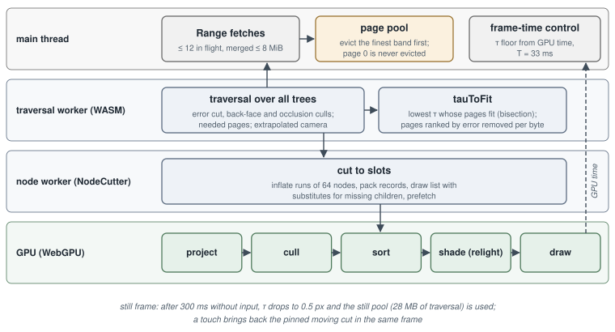

<!-- Copyright (c) 2026 jesus luque. -->

# Part II. The web format: a derived delivery format {.unnumbered}

The second process starts where the first ends. It takes the master of Part I and derives from it a format for one
purpose: delivering the relit asset to a web browser on a phone. Its goal is different, and so is its criterion. A
phone tab has a memory budget (about 50–60 MB of asset data while the camera moves, about 100 MB at rest), a download
that must start drawing within seconds, and a frame time; the format is made to meet those, and its fidelity is
measured as a loss against the master's own uncompressed relight and, through it, against the path trace. Nothing in
this process changes the master, and nothing in it is read back by the bake.

**Input.** The master's merge trees with their pages and occlusion codebook (Section 6); for the Corvette, the 24 trees
of the close-up level.

**The process**, in order, run by the player's tools rather than by the engine:

1. **Reading the master** (`usd-athc`, a reader built on the `openusd` crate): the USD cloud becomes an `.athc`
   version 3 container, laid out in sections and tiers so that one HTTP Range fetches what one tier of one block needs
   (§7.1). A skinned cloud adds its skin and its skeleton and clips (§5.12).
2. **Lossless packing** (§7.1): each array transposed into byte planes, or into planes of differences, whichever gzip
   compresses better, since gzip is what a browser decompresses.
3. **The transfer** (§7.2): either a clustered PCA of each block of the file (encoding 3), or a basis fitted over the
   whole asset (`fit-compact-basis`) that the phone keeps resident, each Gaussian then holding a cluster id and
   $3\times8$ int4 weights.
4. **The open directions** (§7.3): a Hamming-space dictionary of 4096 masks shared by the asset; each Gaussian holds a
   16-bit index.
5. **The compact record** (§7.4): every remaining parameter quantised into byte planes, 40 bytes a Gaussian on the GPU.
6. **Pages, tiers and traversal records** (§7.5): the tree's pages cut into error bands, traversal records of 5–11
   bytes, and an asset table (the bases, the dictionary, the materials) fetched once.
7. **At playback** (§7.6–§7.10): streaming by Range requests, a cut per frame within the memory budget, the draw and
   the relight on the phone, a contact shadow, and a still-frame policy that refines when the camera stops.

**What each parameter becomes.**

| parameter | master USDC | web format | measured loss | § |
|---|---|---|---|---|
| position | 3 floats | $3\times$u16 in the page's box | under $10^{-6}$ of image error (ablation) | 7.4 |
| scale, opacity | 3 + 1 floats | u8 logarithmic scale; u8 opacity in two ranges | under $10^{-6}$ (ablation) | 7.4 |
| orientation | quaternion | one 32-bit word: octahedral axis 10+10 bits, angle 12 | | 7.4 |
| albedo | float rgb | u8 sRGB | under $10^{-6}$ (ablation) | 7.4 |
| normal | float | octahedral, 12 bits an axis | relMSE $2.7\times10^{-4}$ (8+8 bits: $5.2\times10^{-2}$) | 7.4 |
| curvature | 3 floats | 3 × s8, signed logarithm in the page's range | under $10^{-6}$ (ablation) | 7.4 |
| material | packed words per Gaussian | u16 index into an exact table of the asset's materials | none (exact) | 7.4 |
| transfer | 112 f16 values | cluster id + 24 int4 weights on a shared basis | transfer relMSE 0.0054 over the car (v8.2b); image within relMSE $10^{-3}$ of the uncompressed transfer | 7.2, 7.12 |
| open directions | 256 bits | u16 index into a 4096-entry dictionary | 62.9–65.4 dB | 7.3 |
| rig | influences, gradients, zonal lobes | `SKIN` section: joint u16, weight unorm16, gradients in half; merged nodes without gradient | relMSE 0.0015–0.0053 against the engine's raster | 5.12 |
| merge tree | nodes, pages, occlusion | error-band pages, traversal records of 5–11 bytes, the occlusion codebook | the same cut | 7.5 |

The whole compact record is 40 bytes on the GPU (42.4 bytes resident with its tables, and 16 bytes per drawn splat),
against 256 bytes for the master's transfer and visibility alone on the device. The compact path's image is within
40.2–41.9 dB of the full relight of the same cloud. For the Corvette, the 87.4 GB of the close-up level's 24 trees
become 12.77 GB of web data (v8.2b, 149.0 M nodes), streamed by page so that a view loads a fraction of it.

**Why the two are kept apart.** Each step of this process discards information the bake produced: a basis fitted to
one asset, a dictionary that replaces each mask by its nearest, quantisation chosen for what the eye sees at a phone's
resolution. A web data set is therefore never a master: it cannot be relit beyond what its encodings keep, re-baked,
converted to another format or compared against the path trace without the master it came from. Every improvement to
the asset is made on the master and the web format is derived again.

# 7. The web format: compression, streaming and a WebGPU player

This section describes the web format of Part II and the player that draws it: the whole Corvette, with its full light transfer, drawn on an iPhone in a web page and judged against the mesh path trace, within about 50–60 MB of car data while moving and about 100 MB at rest, with small parts that look right. The player is a fork of Spark with a WebGPU backend (sparkwebGPU, branch `webgpu`); its input is the master of Part I -- the clouds, the merge trees, the pages and the occlusion that athenea writes. This section describes the formats, the streaming, the draw and the relight on the phone, and the measured results. The `.athc` v3 format is specified in the player repository (`spark/docs/docs/athc-v3.md`).

**Three kinds of measurement** appear, and they are not interchangeable:

- **Dawn / M5 Pro**: GPU timestamps from headless Dawn (Metal) on an Apple M5 Pro, at the phone's CSS resolution (393 × 852) or at 1920 × 1080. They are a proxy for the phone's GPU.
- **Emulated iPhone**: the live site in desktop Chrome on the same M5 Pro, with the page in its mobile mode at 393 × 852. The pool sizes, the cut and the memory are the phone's; the speed is not. The emulated frame rates are about twice the real iPhone's, so draw counts are judged on the device.
- **Real iPhone**: iOS 18.7, Safari 26.6.1, a 393 × 852 @3 screen (the iPhone 14 Pro–16 class), canvas 393 × 695 at pixel ratio 1. These are stress-page ramps and two whole-car runs on the device.

Image quality is given as PSNR in dB, or as relMSE ($\sum(x-y)^2/\sum y^2$; where PSNR is written $-10\log_{10}\mathrm{relMSE}$ it is stated). The reference is either the path trace at athenea's `/World/Camera` (1920 × 1080) or the player's own uncompressed path. The reference used is named in each case.

## 7.1 The container: `.athc` version 3

athenea's `.athc` v2 is a flat array of words per splat. The web player rewrites it as **version 3**, which is laid out by sections and tiers. Inside each block, the data a tier needs is a prefix, so each (block, tier) pair is one HTTP Range request:

| Tier | Sections | Contents |
|---|---|---|
| 1 | `CORE`, `SHRS`, and optionally `LODS`, `LODE`, `OCCL`, `LODM`, `TREE`, `SKIN` | splat geometry and colour; LoD metadata |
| 2 | `MATL` | normals, emission, pbr, lobes |
| 3 | `SHAD`, `CURV`, `TXDI`, `TXIN`, `TXFD` | open-direction bits, curvature, transfer (direct, indirect, reflected field) |
| 4 | `CMPC` | the compact record for the phone (§7.4) |

A browser offers gzip and nothing better (`DecompressionStream`), so the lossless lever is what gzip is given. **Encoding 1** transposes each array into byte planes: byte 0 of every element, then byte 1, and so on. The high byte of an f16 or f32 changes little from one splat to the next in Morton order, so it forms runs that gzip finds. **Encoding 2** does the same after replacing each 16-bit lane with its wrapped difference from the previous element. `athc-convert --gzip --planes` picks the smaller encoding per section. Measured on the published clouds: Corvette light 68.1 → 60.9 MB (−10.6 %), Corvette HD 288.7 → 248.6 MB (−13.9 %), its paint −23 %, pawn parts −17 to −33 %. The shadow bits are random, and they never gain.

## 7.2 Transfer compression by clustered PCA

The transfer is 30–70 % of a relit cloud's bytes, and neighbouring transfers are close. Two clustered-PCA codings are used: a lossy encoding of the file (encoding 3), and a joint basis that the phone keeps resident.

### 7.2.1 Encoding 3 (file level)

Following Sloan et al. (2003), a transfer section of one block is stored as up to $K$ clusters (k-means on a sample; $K \le n/128$). Each cluster $c$ has a mean $\mu_c$ and $m_c \le M$ principal directions $\mathbf{d}_{c,j}$ in f16. Each element $i$ has a cluster id and $m_c$ quantised coefficients:

$$
\hat{\mathbf{t}}_i = \mu_{c(i)} + \sum_{j<m_{c(i)}} \left(q_{ij}\,\Delta_{c(i)}\right)\mathbf{d}_{c(i),j},
\qquad q_{ij}\in\mathbb{Z},
$$

where every product and sum is rounded to f32 in that order and the result is rounded to the nearest half. This makes the Rust/WASM and TypeScript decoders bit-identical. The step $\Delta_c$ is proportional to the cluster's RMS, which gives the same relative error in dim clusters as in bright ones. The coefficients are zig-zag integers of 1–3 bytes, stored as byte planes. $m_c$ is the smallest count whose truncation takes at most 40 % of the error budget. The budget is relative per block:

$$
E_{\text{block}} = \frac{\sum_i \lVert \hat{\mathbf t}_i - \mathbf t_i\rVert^2}{\sum_i \lVert \mathbf t_i\rVert^2} \le E, \qquad E = 10^{-5}\ \text{by default},
$$

and the step shrinks until the budget holds. Because the SH transfer coefficients are orthonormal, $E$ is the $L^2$ error over the sphere. A block that cannot meet $E$, or that byte planes store smaller, keeps its values exactly. Measured: the transfer sections take 4–7× fewer bytes (the pawn top's TX 112 went from 157 to 28 MB); a relit splat moves by relMSE $4\times10^{-8}$ to $3\times10^{-5}$; the Corvette light set went from 67.9 to 49.5 MB and the pawn page from 281 to 84 MB.

### 7.2.2 The joint basis kept on the GPU

For the phone, the transfer is never expanded. athenea's joint CPCA splits the 112 TX values into three blocks $b \in \{\text{direct } (16), \text{indirect } (48), \text{reflected } (48)\}$. It uses $C$ clusters shared by the three blocks and $K = 8$ directions a block. A gaussian stores one cluster id $c$ and $3 \times 8$ weights:

$$
\mathbf t^{(b)}_i \;\approx\; \mu^{(b)}_{c} + \sum_{k=1}^{8} q^{(b)}_{ik}\,\frac{s^{(b)}_{c,k}}{127}\,\mathbf B^{(b)}_{c,k},
$$

where $\mathbf B$ are the per-cluster axes and $s$ their scales. On the GPU, each direction is stored premultiplied by $s/127$ in f16, 504 words a cluster. **Weights** are int8 or, on the phone, int4: encoded at 7 levels and decoded as $q_8 = \mathrm{round}(q_4 \cdot 127/7)$. On the phone, int4 costs $+0.7\times10^{-4}$ of per-splat colour relMSE and $0.1$–$4.6\times10^{-5}$ of image relMSE; the CPCA's own truncation dominates.

**The projected route.** Under one dome, only the reflected block depends on the eye. Each relight, a thread per cluster projects the cluster's mean and 8 axes of the direct and indirect blocks onto the light (the dome's 16 harmonics, the sun direction, the white-sky coupling): 144 words a cluster. The view-independent ("kept") terms of a gaussian are then dot products of its weights with those projections. Per frame, only the 48 reflected values are rebuilt, in registers. On real data this route reproduces the full rebuild to relMSE $3\times10^{-11}$.

**Basis evolution.**

| basis | clusters | fitted on | relMSE of the transfer | notes |
|---|---|---|---|---|
| athenea's basis | 256 | athenea's sample of `base_tx` | 1.69e-2 (whole car) | 1.17 MB f32 file; the player's cluster assignment matches athenea's 100 % |
| player fit, six parts | 256 | six parts of the car | direct 2.7e-4, indirect 2.5e-3, reflected 1.1e-3 | in-sample; held-out pieces 10–400× worse |
| player fit, whole car | 256 | every second node of the car | 1.03e-2 (direct 1.6e-3, indirect 8.0e-3, reflected 1.06e-2) | image within relMSE 1e-3 of the uncompressed transfer |
| player fit, 512 clusters (v8 data) | 512 | car1280 + car5120 | fine3_0: 0.0181 → 0.0136 | every 1280 panel group −20 to −30 % |

The fit (`fit-compact-basis`) normalises the energy per block, runs k-means (k-means++ seeds, Lloyd over every node) on the joint vectors, then a per-cluster PCA of each block, and chooses the scale per direction with the least error through the int4 code. The **512-cluster basis** keeps the record size: the 9th bit of the cluster id goes into the free bit 15 of the shadow-dictionary index, which caps the dictionary at 32 768 entries (the car's has 4096). Files with 256 clusters read as before. Cost: basis 516 KB → 1.03 MB (f16), projections 147 → 295 KB, tier 4 +1.6–1.8 %, and the same shade time on the M5 Pro (2.82–2.88 ms at 400k drawn). It has not been measured on the real phone.

## 7.3 The open-direction bits by vector quantisation

Each gaussian's 16 × 16 open-direction cells (256 bits) are replaced by an index into a dictionary (`athc-convert --shadow-vq`). The dictionary is k-means in Hamming space, each centroid the bitwise majority of its members with ties kept open, 12 rounds, seeded from member $\lfloor c\,n/C\rfloor$. With 1024 centroids a piece, the image error is 62.9–65.4 dB (athenea's figure: 62 dB), and the mean Hamming distance is 2.0–2.5 of 256 (p99 14–16). The raw masks as a dictionary would be 15.3 MB at 1M splats, against 1.51 MB for the VQ. Across six pieces, one asset dictionary of 4096 entries (131 KB, mean distance 1.07) beats six dictionaries of 1024 (197 KB, mean distance 1.00) on bytes for about the same error, so the shared dictionary is the default.

## 7.4 The compact record

The compact path holds a gaussian as byte planes in one storage buffer. Each plane is 64-byte aligned and read by `fieldAt(plane, width, i)`:

| plane | bytes | encoding |
|---|---:|---|
| position | 6 | $3\times$u16 in the page's box: $x = \ell + q\,(h-\ell)/65535$ |
| albedo | 3 | u8 sRGB |
| opacity | 1 | $q\le191$: $\alpha=(q/191)^2$; $q\ge192$: $\alpha = 1 + (q-192)/63$ (Spark's LoD opacity, $>1$) |
| scale | 3 | $s = \exp(\ell + (q-1)\,\delta)$, $\delta = (h-\ell)/254$; $q=0$ means exactly 0 (surfels) |
| rotation | 4 | quaternion word: octahedral axis 10+10 bits, angle 12 |
| normal | 3 | octahedral, 12 bits an axis |
| curvature | 3 | $s8$: $\kappa = \pm f\,(2^{|q|R/127}-1)$, signed log in the page's range |
| material | 2 | u16 into an exact table (pbr + lobes, 4 words) |
| cluster | 1 | u8 (9th bit in the shadow index) |
| weights | 12 | $3\times8$ int4 |
| shadow | 2 | u16 into the dictionary |
| **GPU total** | **40** | |

The planes are what the data forced. An 8+8-bit normal shifted the coat's reflections by relMSE $5.2\times10^{-2}$; at 12 bits the error is $2.7\times10^{-4}$. A linear opacity code destroyed the glass sheets' 0.01 alphas. The car has 17–22k distinct materials, so a u8 index could not hold them. In an ablation, position, opacity, albedo, scale and curvature each contribute under $10^{-6}$ of image error. Against the full relight on the same cloud, the compact path's per-splat colour is within relMSE $6.3$–$7.3\times10^{-4}$. The image is within 40.2–41.9 dB at 0.4–1.0M splats.

Against the earlier relight's 308 B a gaussian, this path keeps **42.4 B** resident (planes plus tables) and **16 B per drawn splat** (the sort buffers reused as draw records). The fixed cost drops from 29 MiB to about 3 MiB. At 1M splats that is 58.6 MiB, against 326 MiB before (Dawn, buffer sizes).

## 7.5 Error-band pages and the compact tier

### 7.5.1 The error cut

Each merged node $n$ carries the bounds $\varepsilon_n$ (error) and $\rho_n$ (sphere radius) in f16 (`LODE`). With $p$ the pixels per unit at unit distance, the traversal refines $n$ when

$$
P_n = \frac{\varepsilon_n\, p}{\max(d_n - \rho_n,\ \text{near})} > \tau .
$$

$\tau$ is in pixels. athenea pages its merge trees by **error bands**, as Nanite does. A node is needed exactly when its parent's projected error exceeds $\tau$, so each node goes into the band (an octave) of its parent's error. The bands are ordered coarse to fine, each in leaf order, and the order is cut into pages of $P = 3000$ nodes. A page-table row holds a box around the parents' spheres and the largest and smallest parent error. A page is needed when

$$
\frac{\varepsilon^{\max}_{\text{page}}\, p}{\max(\operatorname{dist}(\text{eye}, \text{box}),\ \text{near})} > \tau \quad(\text{page 0 always}).
$$

Because the box bounds the parents' spheres, this test is conservative against the traversal. On a set of car parts, the settled paged cut was identical to the fully resident cut; residency was 2.27–2.53× the cut.

Two culls are applied in the traversal:

- **Back faces.** A node of a closed part is pruned with its subtree when $\mathbf n\cdot\mathbf v < -\sin(\theta + \arcsin(\rho/d))$, with $\theta$ the half-angle of its normal cone.
- **Occlusion.** With the eye outside the asset's box, a node is pruned when the four bilinear cells toward the eye ($\mathrm{oct}(\mathbf v)\cdot16-0.5$) are all closed in its occlusion-codebook entry.

athenea's codebook for the car has 8192 entries (84 % of the ideal, with no false positives), and the v8 codebook has 8182. With quantised centres, occlusion is tested over the box of possible centres (split by orthant, where both octahedral coordinates are monotone). Over the car's 10.7M nodes, at athenea's cameras and 24 random eyes, this hid 0 nodes that the exact centre keeps, at a cost of at most 0.06 % of the hidden nodes being kept. With every cull on, the drawn count is −51 % against every cull off, at 36.9 dB between the two images.

### 7.5.2 The compact tier and its versions

The tier-4 section `CMPC` holds the 40 GPU bytes plus the traversal's bytes, so a phone reads none of tiers 1–3. The tables shared by a piece (`CMPT`: dictionary, materials, basis) and by an asset (`.cmpa`: basis, one dictionary, one material table, and the occlusion codebook with the asset's box; identified by FNV-1a 64) are read once.

| `CMPC` | bytes a node (file) | traversal | change |
|---|---|---|---|
| v1 | 64 = 40 + 24 | LoD tree's 4 words + `LODE`'s 2 | first compact pages; paged = resident bit for bit |
| v2 | 56 = 40 + 16 | 16 B file, 14 B WASM | `CMPT` v2 and the `.cmpa` asset table; same cut node for node; near-view download 23.7 → 16.8 MB, tables 3.62 → 0.97 MB |
| v3 | 64 = 40 + 24 | +cone word, 13-bit occlusion index; 30 B in, 20 B WASM | back-cull and occlusion on by default; only the pages the traversal asks for are planned |
| v4 | container `CMP4` | 12-byte quantised records | payload as **raw-deflate runs of 64 nodes**, plane after plane; node pool; tier 4 +10 % (314 → 344 MB) |

The **v4 page** is a container: a header, each run's end offset, the gzipped traversal planes, then each run of 64 nodes compressed by raw deflate. Runs can be fetched, kept and evicted one by one, so the CPU keeps a page's payload compressed and the GPU keeps records only for the **drawn** cut. The node pool's census motivated this: with whole pages resident, only about 26 % of each page's nodes were drawn, and smaller pages did not help (residency/cut 4.54× at $P=3000$, 4.46× at $P=500$) (Figure 18).

### 7.5.3 Traversal records

The WASM traversal's per-node cost went down in steps, each producing the same cut:

| stage | bytes a node | how |
|---|---:|---|
| Spark `LodSplat` | 24 | full tree |
| `CMPC` v2 / v3 in WASM | 14 / 20 | f16 centre as an f16-order step from the compact position (exact), $\varepsilon,\rho$ f16, children |
| v4 `QuantNode` | 12 | centre $3\times10$ bits in the page's box of centres; $\varepsilon$ 8 and $\rho$ 7 bits of log code over the page's range; $\theta$ 6; axis 5+5; occlusion 13; children as place + page delta |
| class records | 5, 7, 9 or 11 | 2 bits pick leaf/merge × cone/no cone; 9-bit centres; **9-bit index into the page's occlusion palette** (511: none); a byte offset every 32 nodes |

Rounding only refines more and culls less: $\varepsilon,\rho,\theta$ are rounded up, a merge's axis error is added to its $\theta$, and the page's largest centre error is added to every sphere. Across the whole car, 1.15M resident nodes take 10.4 MB as class records, against 13.8 MB as 12-byte words. The page budget assumes 8 B a node. A further lossless step pointed each page's merges to their children's page through a **per-page palette** of 9 bits. This kept 436 nodes in full form instead of 181k on the 1280 car, and removed a 2.5 MB WASM map.

### 7.5.4 Synthetic multi-level roots

A page-0 slot holds 3072 nodes, but athenea's car5120 forests keep thousands of lone roots on purpose (merges never cross parts or athenea's guards): fine5 has 29 213 and fine6 21 065. Past a fan-out (2048), the packer cuts the roots, in Morton order of their centres, into runs, each the children of a synthetic node, and repeats until page 0 can hold the rest. Each synthetic node has infinite error (always refined), a sphere around its children, no cone and no occlusion index, so the cut is the flat forest's (tested at 5 eyes × 5 values of $\tau$). fine5 went from 10 files to 3 and fine6 from 8 to 1.

## 7.6 Streaming and the per-frame cut

The reader (`CompactBandStreamer`) reads only the page tables at open. After each traversal:

1. The **needed set** comes from each tree's page table alone, with the eye in the tree's object space (the car's turn from athenea's Z-up stage) and foveated.
2. The **missing pages** are requested in order of the error a page removes per byte it costs; ties go to the nearer page. Consecutive pages are merged into one Range request (up to 8 MiB), within the pool's free room.
3. The pool **evicts** pages that are not needed from the finest band down. Page 0 and any page a resident page depends on are never evicted.
4. **$\tau$** rises until the needed set fits (`tauToFit`). The current version finds, by bisection, the lowest $\tau$ that fits, which stopped the near-view oscillation (4.61–5.76 → 5.16).

A node whose children are absent is drawn as a leaf, or as its parent or children while a run is being decoded. With v4 runs, the cut's own runs and those of its parents and children are always kept, and the rest are dropped first under a run budget. An extrapolated camera (2.5 updates ahead) is traversed too, so its runs are prefetched. Up to 12 Range requests are in flight.

The work is split across the main thread, the WASM traversal and two workers (Figure 19):

| where | what | measured |
|---|---|---|
| loader worker (WASM) | traversal over all trees, streaming the cut in chunks; stack instead of heap when the budget does not bind | Camera, $\tau=3$: 128 → 40 ms (same cut) |
| node worker (`NodeCutter`) | cut to slots, run inflation (~0.3 µs a node), record packing, draw list with substitutes, prefetch | JS packing 32.8 → ~9 ms; orbit max / p99 from 31–35 / 26–31 to 17.5–19.0 / 17.4–18.7 ms |
| main thread | Range fetches, writes of records and draw lists (adopted, no GC) | — |
| GPU compute | record moves when the pool shrinks (one dispatch, a thread a word) | first frame after a still frame 88–100 → 34 ms |

On a fast orbit of 120° at 1° a frame on the emulated phone, the share of the cut missing from a frame fell from 26 % with the first v4 streamer to 4.3–6.4 %, which is 0.24–0.30 % of the screen area. Frames stayed at 60 fps with a maximum of 17.3–19.6 ms. The cut settled 2.6–3.1 s after load.

## 7.7 The draw

The compact path (`CompactRelitPath`, `compact.slang`) runs five passes a frame:

1. **Project** (one thread a cluster, only when the light changes): the per-cluster projections of §7.2.2.
2. **Cull** (one thread a listed node): frustum test; a 24-bit radial-distance key and the index appended with an atomic.
3. **Sort**: GPU radix sort of the drawn keys, back to front (6 passes over 24 bits).
4. **Shade** (one thread a drawn slot, binned by cluster): decode, relight (§7.8), project. A 16-byte record is written into the sort's own buffers: centre as u16 at 1/16 px, $\sigma_1$ (half) with the major-axis angle, $\sigma_2$ (half) with $\alpha$ (half; a negative sign marks LoD opacity), and colour in RGB9E5.
5. **Draw**: instanced quads, premultiplied over an rgba16float target.

**Projection (EWA).** With $W$ the view rotation, $R,S$ the splat's rotation and scale, and $J$ the perspective Jacobian at the view-space centre $(x,y,z)$:

$$
J = \begin{pmatrix} f_x/z & 0 & -f_x x/z^2\\ 0 & f_y/z & -f_y y/z^2\end{pmatrix},\qquad
\Sigma_{2D} = J\,W R S\,(J W R S)^{\!\top} = \begin{pmatrix} a & b\\ b & d\end{pmatrix}.
$$

**Opacity compensation.** The anti-aliasing blur adds $\beta = 0.3\ \text{px}^2$ to the diagonal, and the opacity is scaled so the splat's mass is kept:

$$
\Sigma' = \Sigma_{2D} + \beta I,\qquad \alpha' = \alpha_0 \sqrt{\det\Sigma_{2D}/\det\Sigma'} .
$$

A merged node with LoD opacity $\alpha_0 > 1$ is drawn with $\alpha_0 \leftarrow \min(4\alpha_0 - 3, 5)$, and its quad is widened by $0.7(\alpha_0-1)$ deviations. A faint splat ($\alpha' < 4\,\alpha_{\min}$) keeps its mass $\alpha_0\sqrt{\det\Sigma_{2D}}$: its blur is chosen so its opacity reaches the faint target, or it is drawn at that target with probability $\alpha'/(4\alpha_{\min})$ by a stable hash dither. A thin glass sheet's floor of 0.1 is applied **after** the blur and faded by its area on screen. Applied before the blur, it had made the headlight cover 1.63× too bright. The fragment evaluates $\alpha = \alpha'\,e^{-z^2/2}$ inside the cut radius, discards under $\alpha_{\min}$, and adds the per-pixel sharp lobes (§7.8).

A thread per drawn slot reuses the sort buffers as records, so nothing else is per-splat. The compact path has no relit records (84 B), no pixel records (48 B), no accumulator (32 B) and no ext splats (32 B). On the phone it also has no depth texture: nothing reads it. A still view re-runs only the draw. Writing directly to 8 bits saved no GPU time (Apple blends in tile memory) and changed the image by up to about 100 codes in 1–3 % of channels, so the target stays rgba16float.

## 7.8 Relighting on the phone

The shade evaluates athenea's `relitByDome` (TX branch) for one dome. The code is a verbatim copy with the field reads taken from registers, because WebGPU cannot bind one buffer as both read and write in a dispatch. The kept terms come from the projections; the reflected field (16 coefficients × RGB) is read along the mirror. The following refinements were ported or added, and each was measured.

**The reflected field.** It is 42 % of the shade, and the cost is arithmetic, not memory. Two changes cut it: shading binned by cluster (a counting sort of the slots per cluster, with per-workgroup histograms), −6 to −9 %; and the field limited to degree 1 (4 coefficients) when a footprint is under 3 px, −23 % of the shade at 215k drawn. Against the path trace, the change in the door, sill, bumper and hood is under 0.01 dB.

**Sharp per-pixel lobes.** A coat or polish below the sharp roughness thresholds is not answered once at the centre. The shade subtracts the centre's sky reading and hands the draw a 5-word record: the mirror direction at the centre (unorm16 × 2), its steps one pixel right and one pixel down (f16 pairs), the coat weight and both roughnesses as square roots, and the polish weight in RGB9E5. The fragment then reads the sky along $\mathrm{oct}^{-1}(\mathbf a_0 + \mathbf s_x\,\delta x + \mathbf s_y\,\delta y)$. The roughness read is built in three steps:

- *Unwidening.* The bake widened the stored roughness by Toksvig, $r'^4 = r^4 + 2s^2$ with $s$ the normal spread. Since the per-pixel turn already accounts for that spread, the lobe reads $r = \max(r'^4 - 2s^2, 0)^{1/4}$.
- *Fold rule.* With $t = 2s$ the turn over $\pm2\sigma$ and $w = \mathrm{smoothstep}(0.7, 1.5, t)$, the pixel's turn is scaled by $1-w$ and the lobe widens, $\alpha' = \sqrt{\alpha^2 + w\,(t/2)^2}$, held under 0.5.
- *Pixel spread.* The normal turns by $\mathbf d_x,\mathbf d_y$ across a pixel. That box of slopes, doubled for the mirror, widens the GGX $\alpha = r^2$:
$$
\alpha^2 \leftarrow \alpha^2 + \frac{2\left(\lVert\mathbf d_x\rVert^2+\lVert\mathbf d_y\rVert^2\right)}{12} = \alpha^2 + \frac{\lVert\mathbf d_x\rVert^2+\lVert\mathbf d_y\rVert^2}{6}.
$$

Without the pixel spread, v7 showed bright specks on folds. At $\tau$ 1 / 3, the specks went from 24 / 27 to 6 / 2 on the sill and from 19 / 25 to 2 / 1 on the door crease; the door went from 34.21 to 35.53 dB. A lobe whose mirror stays within 2 texels of its sky level across $3\sigma$ is read once at the centre (the draw −10 to −12 % close up, with no change against the path trace within 0.001 dB).

**The environment as a filterable atlas.** At first the fragment decoded two levels of four texels each from a storage buffer. The dome's eight prefiltered levels are now copied into one rgba16float atlas: level 0 at the origin, the others down a column to its right (0.9 MB for a base side of 256, 3.1 MB at 512). The atlas is sampled with a hardware bilinear sampler, two samples a lobe. The image is 77 dB of the storage reads. The compact pass at 393 × 852, $\tau=3$ (M5 Pro, wall time) went from 11.8 to 4.0 ms with sharp lobes from 1 px; at 1920, $\tau=1$, from 75 to 17.2 ms. The shade reads its own env texels from the atlas as well, which freed the env buffer (−2.67 MB).

**polishField and coatFold.** Each material carries its own roughness in pbr bits 26–31, at no cost per node. Where that roughness is $\ge 0.3$, the polish asks its own lobe's cells, and the reflected field answers what they close (the door's ratio to the path trace went from 0.786 to 0.857). Where the surface turns fast, the coat is held: $r_{\text{coat}} = \max(\mathrm{unwidened}(c,s),\ \min(c, 0.3))$. This applies only where the material's roughness is $\ge 0.3$. Applied everywhere, it lit chrome, glass and rim spokes (wheels +63 % relMSE). On the 1280 bake the coat comes out at 0, so the term no longer changes the car.

## 7.9 The contact shadow

A compact set draws without Spark's renderer, so the contact shadow is a pass of its own (`ground-shadow.js`), and it uses gaussians only (no mesh, no AO). athenea's shadow catcher is black gaussians on the ground plane, each with its open-direction cells. They are splatted over the dome before the car: EWA with the same 0.3 px² blur and opacity compensation, black at opacity $\alpha_i = o_i\,\kappa_i$. Black over black needs no sort. The darkening is

$$
\kappa_i = \frac{-\ln r_i}{2\pi},\qquad
r_i = \frac{\displaystyle\sum_{\text{open cells } j} L_{\text{dome}}(\boldsymbol\omega_j)\cos\theta_j\,\Delta\Omega_j \;+\; \text{sun through the cells}}{\text{irradiance of the whole sky above the floor}},
$$

recomputed on the CPU from the dome's 16 harmonics whenever the dome changes. athenea's day catcher (309k gaussians at 1.26 cm) costs 9.9 MB of GPU drawn whole, and thinning it 1 in 4 shows a wavy grain. Instead, `floor_shadow --merge 2` moment-matches 2 × 2 neighbours (centre and covariance weighted by opacity × area, mass kept, cells by majority). The result is 78k gaussians, 0.65 MB gzipped, 2.5 MB of GPU, and the closest to the path trace in every region:

| region (shadow factor) | PT | thinned 1 in 4, 77k | full 309k | merge 2 × 2, 78k |
|---|---:|---:|---:|---:|
| front wheel | 0.607 | 0.565 | 0.568 | **0.594** |
| rear wheel | 0.713 | 0.617 | 0.618 | **0.638** |
| front floor | 0.211 | 0.168 | 0.164 | **0.224** |
| under sill | 0.437 | 0.390 | 0.387 | **0.430** |

Without the shadow the car floated, and the sill read 1.66× the path trace: it was the hall's floor at infinity seen past the car's edge. With the shadow the sill reads 1.08 (desktop: 1.07).

## 7.10 Frame-time control and the still frame

The draw target has had four designs:

1. **Draw target.** It started at 260k drawn and was cut at once when the GPU median frame passed 16.5 ms. It rose 6 % a second while under 14 ms.
2. **~227k drawn.** For a still eye, the $\tau$ floor was bisected until about 227k were drawn (v6's 60 fps cut).
3. **$\tau$ floor from frame time, plus a still frame**, with a 16.5 ms target.
4. **Quality first**: image quality takes precedence over frame rate, with a 33 ms target. This is the current version.

In the current version, the GPU time of a frame is measured from its start to `onSubmittedWorkDone`. Every 0.5 s, with $\bar t$ the median of at least 8 moving frames and $T = 33$ ms:

$$
\tau_{\text{floor}} \leftarrow
\begin{cases}
\tau_{\text{floor}}\cdot\min\!\left(1.6,\ \sqrt{\bar t / (0.91\,T)}\right) & \bar t > T,\\[2pt]
\tau_{\text{floor}}/1.04 & \bar t < 0.85\,T \text{ for two periods},\\
\tau_{\text{floor}} & \text{otherwise},
\end{cases}
\qquad \tau_{\text{floor}} \in [1.5,\ 8]\ \text{px}.
$$

The square root follows from the number drawn scaling about as $1/\tau^2$.

**The still frame.** After 300 ms with no input and no camera change, the moving cut is pinned in the node pool, $\tau$ drops to 0.5 px, and the page limit rises from the moving pool (14 MB of traversal) to the still pool (28 MB). One fine cut is drawn whatever it costs, and drawn again as more pages land. Then nothing is redrawn until a touch, which brings the pinned moving cut back in that same frame and evicts down to the moving budget at 32 pages an update. The budget is about 100 MB of car data at rest and about 55 MB while moving. Measured on the emulated phone, close up and still: 529k drawn at $\tau$ 1.23 with 95.6 MB of car data. A second measurement gave 531k at $\tau$ 1.22 in 118 ms, at a simulated 190 ms a million, with the first frame after a touch at 39–47 ms.

## 7.11 Memory accounting

The 50–60 MB budget applies to the **car data** only. Car data is the resident pages and runs, the WASM traversal, the node worker's heap and buffers, and the GPU records. The **render state** is counted apart: sharp records, atlas, shadow, targets, sort. It carries the image quality, and an iPhone 15 tab held about 1.2 GB in the stress probes. The **page** itself (JS heap, three.js, domes) is a third figure.

| state | data | car data | render state | page |
|---|---|---:|---:|---:|
| six parts, $\tau$ 1, emulated | CMPC v1 | — | GPU 53 MB total (peak 59.6): data 24.7, fx 9, target + dome 7.9, env 2.7, sort 4.6, canvas 3.8 | — |
| whole car, $\tau$ 3, first v4 streamer | v5 | ≈60 MB CPU + GPU (page pool at the same $\tau$: ≈87) | — | — |
| whole car, $\tau$ 3, class traversal records | v6 | Camera 55.1, close 59.0, far 49.1 (all together) | | |
| whole car, $\tau$ 3, after the atlas | v6 | Camera **39.0**, close **43.8**, far **33.0** | 24.1 / 26.0 / 21.7 | ~39 → 25 → ~17 (two reductions) |
| whole car, $\tau$ 3 | v7 | 31–36 | — | — |
| still frame, close up | v7 | **95.6** (529k, $\tau$ 1.23) | — | — |

Several reductions were each byte-identical in the image:

- the relight sky's floats rebuilt from RGBE on upload (1.6 MB held instead of 8 MB for a 1k dome);
- the visible dome in rg11b10ufloat on the phone;
- one shared occlusion codebook (4.3 MB of JS arrays before);
- sharp records sized to the drawn slots (−0.3 to −2.2 MB);
- the WASM shipped as a separate file, with the layout parsed in a worker.

The earlier per-gaussian accounting explains why the compact path was needed. The previous relight kept 308 B a gaussian plus 29 MiB fixed: 147 / 206 / 323 MiB at 0.4 / 0.6 / 1.0M. The compact path keeps 42.4 B + 16 B per drawn splat + about 3 MiB.

## 7.12 Measured results

### 7.12.1 The real iPhone

**Stress page, 10–11 October** (synthetic ramps over real Corvette splats; medians):

| path | 200k | 400k | 600k | 800k | ~1M | notes |
|---|---:|---:|---:|---:|---:|---|
| plain 3DGS, fps | 58.8 | 58.8 | 45.5 | 34.5 | 26.3–27 | cool phone; ~37 ms a million |
| transfer, earlier "by" path, fps | 38.5 | 12.3 | 7.2 | 5.2 | 3.7 | 362–469 MB GPU |
| compact, synthetic basis, ms (fps) | 30 (33.3) | 63 (15.9) | 101 (9.9) | 137 (7.3) | 154 (6.5) | 20.8–79.8 MB GPU |
| compact, basis fitted on car data, optimised shade, ms (fps) | 27 (37) | 47 (21.3) | 70 (14.3) | 95 (10.5) | 108 (9.3) | 35 MB GPU at 400k |

Model for the optimised shade: about 115 ms a million drawn + 4 ms, so 30 fps holds about 250k drawn and 60 fps about 110k. The first second of each step ran 2–3× faster than the sustained rate (clock or thermal state), and a run following four runs in 20 minutes was half as fast from 600k up. Sustained figures are used for planning.

**Whole-car runs on the device** (v7 data):

| run | view | drawn | $\tau$ | fps | observation |
|---|---|---:|---:|---:|---|
| first | default | 106k | 8.00 | 53 | fluid; the $\tau$ 8.00 was the old frame-time "breath" stuck at its ceiling (fixed) |
| first | close up | 160k | — | 32 | soft logo and grille |
| second | close up | — | — | — | still soft |

The estimated shade cost on that iPhone is about 190 ms a million. The softness close up comes from the cloud, not the player: the logo baked at 1280 px is blurred even with all its leaves, and crisp at 5120 px. The car5120 close-up level (v8) addresses it.

### 7.12.2 The emulated iPhone

| data | view | drawn / resident | $\tau$ | download | fps |
|---|---|---|---:|---:|---:|
| six parts, paged | default | 174k / 384k | 1.55 | 25 MB | 61 |
| six parts, CMPC v1 | default | 199k / 555k | 1 | 24.6 MB | 60 |
| same, CMPC v2 + `.cmpa` | default | 199k / 555k | 1 | 17 MB | 60 |
| whole car, v3 (24 MB pool, fov = h) | default | 147k / 580k | 6.75 | 20 MB | 60 |
| whole car, v5 (CMPC v4) | default | 226k / 1016k | 3 | 36 MB read | 60 |
| whole car, v7 | default | 216k / 1318k | 2.22 | — | 60 |
| whole car, v7, later streaming revisions | default | 234k | 1.95 | — | 60 |
| whole car, v7, still frame | close up | 529k | 1.23 | — | (one frame) |

### 7.12.3 Against the path trace, by data version

`car-compact-tx` data versions are distinct from the `CMPC` format versions:

| set | content |
|---|---|
| v3 | occl8k, CMPC v3 |
| v4 | athenea's closed2 trees |
| v5 | CMPC v4 runs |
| v6 | athenea's mrough trees, per-material roughness, 1.35 GB |
| v7 | car1280, 1.81 GB |
| v8 | car5120: 24 trees, 74.5M leaves, 148.9M nodes, shared 8182-entry occlusion (§6.9) |
| v8.2b (final) | car5120 rebuilt (§6.2.1): 149.0M nodes, 8181-entry occlusion, a shared 512-cluster basis refitted with the 5120 data and four bases of 256 of the asset's own (Part_2, Infinite_Black, two parts of Part_3 and Front_Bumper_001), 83 files, 12.77 GB; transfer relMSE 0.0054 over the car |

Unless noted, the figures below are PSNR at athenea's camera at 1920 × 1080, by the validate-corvette harness's regions.

| version | car | door | sill | bumper | hood | source / condition |
|---|---:|---:|---:|---:|---:|---|
| v6 | 19.33 | 33.77 | 31.87 | 20.21 | 14.16 | compact path |
| v6, Toksvig unwiden | 19.68 → 20.58 | +1.0 | — | — | +1.3 | per-pixel detail on |
| v7 (first conversion) | +0.5 vs v6 | −2.3 | −2.7 | — | +0.9 | specks on folds |
| v7 + pixel spread, $\tau$ 1 | — | **35.53** | **32.36** | relMSE 0.199 | 14.46 | pixel spread on |
| v7, current defaults | 19.03 | 35.52 | 32.36 | 22.28 | 14.68 | degree-1 field |
| v8.1 | 19.22 | 35.92 | — | — | — | pool 3000, $\tau$ 1; draws 4.0 M |
| v8.2b | 19.27 | 35.53 | — | — | — | pool 3000, $\tau$ 1; draws 2.26 M; logo from a close camera 18.12 dB (v8.1 17.75) |

The car crop metric of §1.6 (900 × 420 crop) is a different region. On it, the per-pixel sharp lobe in the compact path took the car from 16.49 to 17.46 dB (17.41 with lobes from 4 px), which is the desktop path's level. On the phone, $\tau$ 3 against $\tau$ 1 differs by 40 dB, so the remaining defects (hairs, streaks, blotches) come from the cloud, not from the cut. Lossless steps were checked against the previous image: the sharp records in 5 words, 60–80 dB; binned shading, 84 dB (run-to-run noise 78 dB); the glass-only terms, 188 dB.

## 7.13 Limitations and open work

- **v8.2b**, the final data set (car5120 rebuilt, §6.2.1), is published: against the path trace it gains on the car, the grille, the chrome and the bumper and on the close logo, and loses 0.39 dB on the door against v8.1 while drawing about half as many Gaussians. Its download and frame times on the real phone are not measured.
- Real-device timing exists only for the stress ramps and the two whole-car runs. The emulated phone's speed is not the phone's.
- The front bumper's chrome strip is 38 % brighter than the path trace. The lamps have no emission in the bake. The door's open reflections (1.13) come from 16 × 16 cells of 11°.
- The compact traversal does not keep a merge's LoD size, so the combined size/error cut has nothing to guard with. The error cut alone did not beat the size cut on these data in every view.
