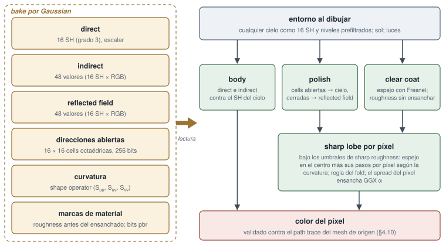

<!-- Copyright (c) 2026 jesus luque. -->

::: {#front}

# athenea: un baker de relight para Gaussian splatting a partir de assets USD de producción {.unnumbered .unlisted .paper-title}

jesus luque

19 de octubre de 2026

## Resumen {.unnumbered .unlisted}

Se describe athenea, un baker de relight para Gaussian splatting 3D: convierte meshes USD de producción y sus
materiales en Gaussians y hace el bake, en cada Gaussian, del transporte de luz necesario para su relight al dibujar,
siempre con un path trace del mesh de origen como referencia. Un mesh se convierte en el device en Gaussians
anisótropas, una por cell de una lattice derivada de una cámara, con opacidad que respeta la coverage, bordes sujetos
donde una superficie termina o forma un fold, materiales OpenPBR por capas, vidrio clasificado como sólido o como pared
fina, y roughness ensanchada por la dispersión de normales bajo cada Gaussian. El propio path tracer de GPU del
renderer hace después el bake de un transfer en cada Gaussian: spherical harmonics (SH) de grado 3 de la luz
directa e indirecta, un reflected field, 256 bits de open directions y las marcas del material. Al dibujar, estos
datos hacen el relight de la nube bajo cualquier cielo y cualquier luz, con reflejos nítidos girados por píxel mediante
un shape operator almacenado. En un Chevrolet Corvette C7 de 192 meshes, doblar la resolución del bake de 640 a
1280 px subió el PSNR del coche con relight frente al path trace de 16.55 a 17.88 dB en su recorte y de 22.18 a
23.90 dB en el frame, y para las vistas de cerca se hizo el bake de un close-up level a 5120 px de 74.5 millones de
leaves en 24 trees. El baker se apoya en un renderer de USD e Hydra en el que cada paso que toca datos de la escena
se ejecuta como un kernel de cómputo en la GPU. Los assets con rig conservan su esqueleto, con un Jacobian que incluye
los gradientes de los pesos, lobes zonales de transfer que giran con un miembro y campos de visibilidad por parte.
Merge trees por pieza con un error de pantalla monótono y acotado, culls de caras traseras y de oclusión, y pages
ordenadas por error dan el LOD con un coste de unos 0.1 dB. Un transfer se lee en el sistema de referencia de su propia
nube, con el cielo girado a él una vez por instancia, así que una nube que la escena gira hace el relight igual que sin
girar (relMSE $9\times10^{-6}$). Cada parámetro que lleva una Gaussian, desde su albedo y su normal hasta la visibilidad
del cielo, el bounce y el reflected field del transfer, se puede dibujar a través de una cámara como un canal de imagen
propio. Como aplicaciones, un PCA por clusters, la visibilidad cuantizada vectorialmente y un registro compacto de 40
bytes llevan el coche con relight a un player WebGPU en un iPhone, y un nodo OpenFX lleva la nube con relight a un
compositor con sus capas de profundidad, posición en el mundo y Cryptomatte y un cielo que elige el artista.

**Palabras clave:** relight baking; Gaussian splatting 3D; precomputed radiance transfer; spherical harmonics; USD;
Hydra; de mesh a Gaussians; path tracing; LOD; PCA por clusters; cadenas solo en GPU; WebGPU; OpenFX; composición;
canales de imagen.

## Índice {.unnumbered .unlisted}

::: {#contents}

| 1. Introducción
| 2. El motor y el renderer athenea
| 3. De meshes USD a Gaussians (mesh2splat)
| 4. Transporte de luz en el bake de las Gaussians (transfer) y relight
| 5. Assets animados: skeletons, skinning y visibilidad por partes (el peón y el gorrión)
| 6. LOD: merge trees, cuts por error, pages y oclusión
| 7. Aplicación: compresión y un player WebGPU en móvil
| 8. Evaluación
| 9. Limitaciones y trabajo futuro
| 10. Referencias
| Apéndice A. Repositorios y comandos

:::

:::

<!-- Copyright (c) 2026 jesus luque. -->

# 1. Introducción

## 1.1 El problema

Los assets 3D de producción se crean como meshes: polígonos, materiales físicos por capas, texturas, luces y, en los
personajes, esqueletos, todo compuesto en USD. Un path tracer los renderiza con fidelidad, pero es demasiado lento para
el uso interactivo; un rasterizer los renderiza de forma interactiva, pero necesita residentes toda la geometría y todas
las texturas del asset y aun así aproxima su transporte de luz. El Gaussian splatting 3D (3DGS) ofrece una tercera
vía: una nube de Gaussians anisótropas, ordenadas y mezcladas en el espacio de pantalla, dibuja detalle fotográfico a
ritmo interactivo en hardware modesto. Sin embargo, una nube de Gaussians normalmente se *entrena* a partir de
fotografías de una escena real. Contiene la luz de esa captura, no admite relight, y no tiene material, ni esqueleto,
ni relación con un asset creado por un artista.

Este artículo aborda el problema inverso: un **baker de relight** para Gaussian splatting. Dado un asset USD
fotorrealista (el caso que se sigue de principio a fin es un Chevrolet Corvette C7 de 192 meshes con pintura de coche
OpenPBR, cromo, vidrio, goma y faros), el baker produce una representación en Gaussians que

1. **admite relight**: cada Gaussian lleva el transporte de luz del asset en su bake, de modo que la nube responde al
   dibujar a cualquier cielo y cualquier luz, no solo a la iluminación con la que se hizo;
2. es **fiel a un path trace** del mesh de origen bajo esa iluminación, juzgada imagen contra imagen y región por
   región;
3. conserva el rig cuando el asset lo tiene, de modo que un asset animado siga moviéndose y su luz gire con él;
4. escala de las vistas lejanas a los primeros planos mediante LOD.

Ninguna de las vías evidentes cumple esto. Entrenar una nube a partir de vistas del asset con path tracing da una
iluminación fija y gasta horas de optimización por asset. Rasterizar el mesh con un shading model aproximado
renuncia al transporte de luz del path trace. La vía que se sigue aquí convierte el mesh directamente en Gaussians y
hace el bake del transporte de luz del asset en cada Gaussian con el propio path tracer de GPU del renderer; la
nube con relight se compara después con el path trace del mesh. Reducir, comprimir y hacer streaming de la nube con su
bake hasta un player WebGPU en un móvil es una aplicación paralela de los mismos datos (§7).

## 1.2 Objetivos y restricciones

El requisito central es la fidelidad de las Gaussians con relight a la referencia del path trace. Los requisitos de
diseño de abajo se mantienen en todo momento y determinan casi todas las decisiones de diseño de las secciones 2–7.

| requisito | enunciado | dónde actúa |
|---|---|---|
| Fidelidad al path trace | La referencia es el path trace del mesh de origen bajo la misma iluminación. Donde la calidad y el frame rate chocan, prevalece la calidad. | §3.10, §4.10, §8 |
| Aritmética solo en GPU | Ninguna aritmética sobre datos de la escena se ejecuta en la CPU: ni renderer, ni alternativa, ni CPU test oracle. El host lee ficheros y lleva las cuentas (recuentos, slots, colas). | Todas las secciones; §2.1 enuncia la regla |
| 3DGS puro al dibujar | Lo que se dibuja son solo Gaussians. El suelo no es un mesh: su interacción con el objeto se convierte en Gaussians (un shadow catcher). Un mesh solo es una entrada del bake. | §3.9, §7.9 |
| Automático, no manual | Las decisiones por asset se detectan a partir de los datos: el tamaño de cell a partir de una cámara, el vidrio sólido frente al fino, las closed shells, el suelo para el shadow catcher. Las opciones solo lo sobrescriben. | §3.3, §3.5, §3.8, §3.9 |
| Las piezas pequeñas, con el mismo criterio | Emblemas, grilles, molduras y faros se juzgan con el mismo cuidado que los paneles, tanto de cerca como de lejos. | §3.11, §6.9, §7.12 |

## 1.3 Contribuciones

Las contribuciones que describe este artículo son las siguientes.

1. **Un transfer con relight en el bake de cada Gaussian** (TX, sección 4), el núcleo del baker: spherical harmonics
   de grado 3 del transfer directo e indirecto, un reflected field normalizado sobre las direcciones cerradas y acoplado
   al cielo al dibujar, 256 bits de open directions que cada lobe de reflexión lee como conos, y las marcas del
   material; sharp lobes por píxel guiados por un shape operator almacenado, con el ensanche del bake deshecho y un
   tubo distinguido de un fold.
2. **Una conversión de mesh a Gaussians** (mesh2splat, sección 3) que prepara la entrada del baker, ejecutada como
   efecto AOFX en el device, con cells derivadas del footprint de un píxel de una cámara, una opacidad que
   reproduce la coverage de una superficie, bordes duros y closed shells detectados en el device, ensanche de
   Toksvig de la roughness por la dispersión de las normales, captura de OpenPBR por capas y clasificación automática
   del vidrio.
3. **Un renderer USD solo en GPU** (athenea, sección 2) sobre el que corre el baker, que dibuja meshes, puntos y
   splats de Gaussians a través de Hydra, con un rasterizer por tiles y un ray tracer de Gaussians que comparten una
   única disposición de Gaussians, un compilador de materiales de MaterialX a Slang comprobado frente al propio
   MaterialX, un path tracer con importance sampling múltiple usado como verdad de referencia y como integrador
   del bake, y una disciplina de verificación en la que toda comparación de imágenes es a su vez un kernel de GPU.
4. **Nubes de Gaussians con skinning** (sección 5) que llevan el rig y no los frames: un kernel de skinning que usa el
   Jacobian completo, incluidos los gradientes de los pesos, lobes zonales de transfer que giran con la Gaussian,
   campos de visibilidad por parte leídos como un producto de consultas a tablas, y una decimación que conserva el rig.
5. **Merge trees por pieza con un cut por error acotado** (sección 6): merge por pares bajo guardas que respetan piezas
   y materiales, una opacidad de coverage por mínimos cuadrados para los merges, un error hecho monótono con esferas
   envolventes para que una sola prueba paralela seleccione el cut, cull de caras traseras de closed shells, un
   codebook de oclusión compartido y conservador, y pages ordenadas por el error del padre.
6. **Un relato medido** (sección 8) de lo que aporta cada paso del bake frente al path trace, sobre un asset de
   producción, a través de las leaves con relight, los cuts y los bakes de 640, 1280 y 5120 px.
7. **Una aplicación a la reproducción en móvil** (sección 7): un contenedor `.athc` v3 con codificaciones por planos de
   bytes, PCA por clusters del transfer mantenido comprimido en la GPU, bits de open directions cuantizados
   vectorialmente, un registro compacto de 40 bytes, traversal records cuantizados de 5–11 bytes, y una política
   de tiempo de frame y de still frame para un player WebGPU en un iPhone.
8. **La nube con su bake como canales de imagen y en hosts de producción** (secciones 4.11 y 2.14): cada parámetro que
   lleva una Gaussian dibujado a través de una cámara como un canal propio, el material y la geometría junto al
   transporte de luz precalculado, como entradas y objetivos de un relight aprendido; un nodo OpenFX que hace el render
   de la nube con relight dentro de un compositor (Nuke, Natron) fuera de proceso, con la profundidad, la posición en el
   mundo y el Cryptomatte como planos y un cielo que el artista cambia; y un add-on de Blender que la dibuja como motor
   de render.

## 1.4 Organización

La sección 2 describe el motor y el renderer sobre los que corre el baker, y los hosts que lo manejan. La sección 3 describe la conversión de
meshes USD a Gaussians, y la sección 4 el transporte de luz en su bake y cómo se hace su relight. La sección 5 trata
los assets animados: el skinning, el gorrión y el peón. La sección 6 trata el LOD. La sección 7 describe la aplicación
a móvil: la compresión y un player WebGPU. La sección 8 consolida la evaluación de las secciones 2–7, la sección 9
reúne las limitaciones y el trabajo pendiente, y la sección 10 enumera las referencias, seguidas de un apéndice sobre
los repositorios y los comandos (figura 1).

## 1.5 Trabajo relacionado

**Gaussian splatting.** Kerbl et al. (2023) introdujeron el Gaussian splatting 3D: una escena como Gaussians
anisótropas con color en spherical harmonics, optimizadas a partir de fotografías y dibujadas por un rasterizer por
tiles ordenado en profundidad. Su proyección es el splatting EWA de Zwicker et al. (2001, 2002), una aproximación afín
local de la proyección perspectiva. Mip-Splatting (Yu et al., 2024) añade un filtro de suavizado 3D y un filtro de
pantalla 2D contra el aliasing; la dilatación de 0.3 px² de athenea, con su compensación de opacidad, pertenece a esa
familia (§2.5.1). El Gaussian splatting 2D (Huang et al., 2024) aplana cada Gaussian en un disco orientado que se
evalúa por intersección rayo–plano, en la línea de los surfels (Pfister et al., 2000); los surfels de athenea lo siguen
(§2.5.2). El ray tracing de Gaussians 3D (Moënne-Loccoz et al., 2024) traza partículas a través de proxies envolventes
en una BVH, y la ruta por hardware de athenea lo sigue (§2.6).

**De meshes a Gaussians.** El mesh2splat de Electronic Arts convierte un mesh en Gaussians rasterizando cada triángulo
en el plano de su eje dominante, una Gaussian por texel cubierto; la conversión de athenea parte de él (§3.1). Mesh2GS
(arXiv 2606.21898) deriva el tamaño de una Gaussian del footprint de un píxel de una cámara, y `--cell-from-camera` de
athenea lo sigue (§3.3).

**Transporte de luz precalculado.** El precomputed radiance transfer (Sloan, Kautz y Snyder, 2002) guarda, por punto,
la proyección de la visibilidad por el coseno sobre spherical harmonics, de modo que el relight es un producto escalar
con los coeficientes del entorno; Ramamoorthi y Hanrahan (2001) mostraron que nueve coeficientes representan bien la
irradiancia. El PCA por clusters (Sloan et al., 2003) comprime esos transfers agrupándolos y con una base principal por
cluster, y athenea lo usa tanto en el fichero como en la GPU del móvil (§7.2). Los harmonics zonales, que giran
girando un eje, se ajustan según Sloan (2008) (§4.4.5, §5.7). El filtered importance sampling (Křivánek y
Colbert, 2008) prefiltra el entorno (§4.3), y Lagarde y de Rousiers (2014) dan el ajuste de oclusión especular que
usaba el primer transfer (§4.6.1).

**Antialiasing especular.** Toksvig (2005) ensancha una distribución de microfacetas por la varianza de las normales
que promedia; athenea aplica la misma idea en la conversión, a la dispersión de normales bajo una Gaussian (§3.7,
§4.9).

**LOD para Gaussians.** Octree-GS (Ren et al., 2024) organiza anclas en un octree seleccionado por la distancia de la
vista. Las Gaussians 3D jerárquicas (Kerbl et al., 2024) construyen una jerarquía de merge a partir de los momentos de
las Gaussians y la cortan por tamaño en pantalla; el LOD original de athenea sigue sus momentos (§6.1). NanoGS (Xiong
et al., 2026) hace merge por pares de vecinos más cercanos mutuos, y los trees por pieza de athenea lo ejecutan en el
device (§6.2). El coste usa la cota de Runnalls (2007) para la reducción de mezclas de Gaussians, y las pages por
bandas de error siguen el uso que hace Nanite (Karis et al., 2021) de un error monótono para un cut paralelo (§6.3,
§6.8).

**Motores y formatos.** El motor está construido sobre OpenUSD e Hydra, materiales MaterialX y OpenPBR, shaders Slang
compilados mediante slang-rhi a Metal, Vulkan y CUDA, Intel Open Image Denoise y OpenColorIO. El player es un fork de
Spark con backend WebGPU.

## 1.6 Convenciones

Salvo que se diga otra cosa, las medidas se tomaron en un Apple M5 Pro con Metal. Las imágenes se comparan en la GPU
(§2.15). El **PSNR** está en dB sobre imágenes codificadas para pantalla; el **relMSE** es el error cuadrático medio
relativo sobre valores lineales. **El path trace** (PT) del Corvette es el path trace del mesh desde `/World/Camera` a
1920 × 1080 bajo el cielo `autoshop_01_4k`. El **recorte del coche** es el PSNR sobre el recorte de 900 × 420 del
coche, el **frame** sobre el frame entero; un **cociente por clase** es la media de una región sobre la del path trace.
El arnés validate-corvette del player mide otras regiones (coche, puerta, umbral, parachoques, capó), que no son el
recorte del coche (§7.12.3). Las palabras *Gaussian* y *splat* se usan indistintamente; una *leaf* es una Gaussian con
su bake, un *merge* un nodo de un merge tree, y un *cut* el conjunto de nodos que se dibujan para una vista.
*Transfer* es el transporte de luz del bake (§4), *TX* su forma actual.

<!-- Copyright (c) 2026 jesus luque. -->

# 2. El motor y el renderer athenea

athenea es un renderer de USD construido para que todo paso que toca datos de la escena se ejecute en la GPU.
Dibuja tres clases de primitiva: meshes, con materiales MaterialX y luces UsdLux; puntos; y Gaussian splats 3D.
Ofrece dos técnicas, un raster interactivo y un path tracer que sirve de verdad de referencia. Hydra alimenta
ambas a través del delegado de render `hdAthenea`. Esta sección cubre la arquitectura del motor, los algoritmos que
ejecuta cada subsistema, cómo se establece la corrección sin un CPU oracle y lo que se ha medido. Salvo que se
indique otra cosa, cada número se cita de `docs/decisions.md`, con su unidad y sus condiciones, y se midió en un
Apple M5 Pro con Metal.

## 2.1 Reglas de diseño

El código se atiene a un número reducido de reglas. Donde es posible, una prueba hace cumplir cada una.

1. **Ninguna aritmética de CPU sobre los datos.** athenea no tiene renderer de referencia en CPU, ni alternativa
   en CPU, ni CPU test oracle. El host lee ficheros, analiza cabeceras, descomprime y lleva las cuentas:
   recuentos, ranuras y colas. La decodificación, el sort, la fusión, el descarte, la generación de mips, los
   prefijos de potencia de las luces y la comparación de imágenes son todos kernels de cómputo. Los pasos que se
   ejecutaban en el host se llevaron al device; son ejemplos el entrelazado
   por elemento de los arrays de `ParticleField`, la conversión de half a float, la conversión por píxel de los
   buffers de render de Hydra y la parte acumulada de cada luz en la potencia del frame (`light_prefix.slang`). La
   única excepción documentada es la teselación de Dear ImGui, que procesa la interfaz del viewer y ningún dato de la
   escena.
2. **Enlace por nombre.** Todo parámetro de shader se enlaza por reflexión (`cursor["name"].setBinding(...)`,
   `ComputeKernel::dispatch`) y nunca por ranura, lo que elimina la clase de errores en que un recuento de
   ranuras se aparta de la declaración del shader.
3. **Errores como valores.** Los errores se devuelven como `Result<T>` con `ATHENEA_TRY`, y nada lanza excepciones.
   Las llamadas al sistema operativo viven solo en `modules/core/Platform`, que es también donde empezaría un port a
   Windows.
4. **Un Slang, un slang-rhi, un TBB por proceso.** OpenUSD, OIDN y el motor comparten un único TBB, y la prueba
   `single_tbb` comprueba el recuento. Por la misma razón OIDN se compila desde el código fuente: sus binarios
   publicados traen un segundo `libtbb.12`.
5. **Solo devices GPU, en todas partes.** OIDN se compila solo para devices GPU, porque un denoiser que recurre a la CPU es una alternativa en CPU. Una prueba cuya capacidad falta en un device se omite y
   nombra la capacidad que falta.

Los backends son los de slang-rhi: Metal (macOS, iOS), Vulkan y CUDA (Linux, NVIDIA L4). Todos los kernels están
escritos en Slang.

## 2.2 Arquitectura de módulos

Cada módulo bajo `modules/<name>` es una biblioteca estática, `athenea::<name>`. Los módulos se listan en orden de
dependencia y cada uno enlaza solo con los anteriores (`modules/CMakeLists.txt`) (figura 2).

| Módulo | Contenido |
|---|---|
| core | `Result`, registro, `Platform` (todas las llamadas al SO) |
| ui | los paneles del viewer como descripción (`Controls.h`, `GaussianPanel.h`), traversals por `athenea view` y la app de iOS |
| sched | `FrameClock`: genlock PTP y alineación ST 2059-1, timecode |
| image | `Image`: float32 RGBA premultiplicado, origen abajo a la izquierda; el tipo que intercambian gpe y AOFX |
| io | lectores de ficheros en CPU (cabecera PLY, SPZ, SOG zip/WebP, IES), EXR con atributos |
| gpu | device slang-rhi, `ShaderLibrary`, `ComputeKernel`, `CommandBatch`, `Buffer`, `AsyncReadback`; `gpu/algo` (PrefixSum, RadixSort) |
| gpu_host | gpe adoptando el device de slang-rhi: un `MTLDevice` o contexto CUDA, buffers compartidos sin copias |
| colour | `ColourCompiler` (OpenColorIO como compilador a Slang), `ColourNames` |
| scene | `CloudLoader`: registros en bruto subidos y decodificados en la GPU en `GpuSplats` / `GpuPoints` |
| render | `TileRasterizer`, `GaussianRayTracer`, `PointRasterizer`, `ReferenceRenderer`, `Camera`/`Projection`, `SplatEdit` |
| geom | `MeshBuilder`: meshes de Hydra trianguladas, con normales suaves y primvars expandidos en la GPU |
| material | `TextureStore`, `MaterialCompiler` (MaterialX → Slang), la biblioteca de lobes |
| light | luces UsdLux en el device: un registro por luz, muestreo, densidades, BVH de luces |
| world | `GpuScene`, `Instancing`, `RayTracingScene` (BLAS/TLAS), `BvhScene` (LBVH de cómputo en dos niveles) |
| technique | `VisibilityRaster/Trace/Bvh`, shading, `AovShading`, path tracer, `Denoiser`, `DisplayTransform`, `SplatVisibility` |
| lod | `LodBuilder`, `CutSelector`, el lector/escritor de `.athc` y `StreamingPool` (Sección 6) |
| usd | `Engine`, `StageRenderer`, `Export`, el plugin `hdAthenea`, esquemas sin código |
| mcp | el motor como servidor MCP (JSON-RPC 2.0) |
| aofx | el lado de este motor del host AOFX (`host/` de aopenfx), `renderEffect`, los bundles |
| view | `athenea view`: ventana GLFW, Dear ImGui en el device del motor |

El tree de shaders `shaders/athenea/` refleja los módulos (common, algo, scene, splat, rt, points, reference, lod,
geom, world, material, light, technique, usd, volume, view). Los shaders se copian al tree de compilación y se
compilan en tiempo de ejecución.

## 2.3 Fundamentos de GPU

**Device y kernels.** `gpu::Device` envuelve un device slang-rhi. `ComputeKernel` es un punto de entrada de
cómputo compilado como pipeline. Se despacha en hilos, no en grupos: el número de grupos se redondea hacia arriba en
todos los backends y cada kernel comprueba sus propios límites. `RasterKernel` es un pipeline de vértices y
fragmentos que toma sus datos de `StructuredBuffer`s, sin buffers de vértices ni layouts de entrada.
`RayTracingKernel` cubre los pipelines de OptiX y de Vulkan RT. En Metal, slang-rhi no ofrece pipelines de ray
tracing, así que el trazado usa `RayQuery` en línea dentro de kernels de cómputo.

**ShaderLibrary.** La biblioteca carga módulos Slang. Un módulo puede declarar constantes de enlace
(`extern static const uint kName;`), y entonces se enlaza contra un módulo de exportaciones generado, lo que da un
programa por cada conjunto distinto de valores. También compila módulos que solo existen como código generado, como
los materiales y las funciones de color; se rechaza cargar un nombre existente con otro código. Una
`DiskShaderCache` persistente escribe un fichero por programa compilado, con la clave del hash que slang-rhi da al
programa enlazado. Con la caché caliente, la batería de pruebas completa pasó de 89 s a 26 s.

**Primitivas paralelas.** `PrefixSum` y `RadixSort` son las únicas ordenaciones y barridos del motor. La ruta radix
por bloques (`radix_block.slang`) es una forma reducir-y-luego-barrer de la pasada LSD estable. Un grupo de 256 hilos
cuenta un bloque de 1024 claves en memoria de grupo, una suma prefija ordenada por dígito sitúa la parte de cada
bloque en cada dígito, y el grupo ordena su bloque con ocho divisiones de un bit. Ordena 10 M de pares de 32 bits en
**12.4 ms**, frente a 39.9 ms de las pasadas por trozos a las que sustituyó a partir de 65 536 elementos. No usa
operaciones de onda ni atómicas de device.

**Mips.** slang-rhi no genera cadenas de mips, así que `MipGenerator` es un kernel. Cada texel de un nivel es la media
ponderada por área de los texels de encima. Un borde impar $2n+1$ se pliega en $n$ con pesos
$(n-x,\,n,\,x+1)/(2n+1)$, de modo que cada texel de origen da exactamente $n/(2n+1)$ de sí al nivel inferior y la
cadena conserva la media del nivel 0. En tamaños 64², 37×23, 1×9 y 128×5, las medias coinciden a 2·10⁻⁶.

**La memoria como error de primera clase.** Un command buffer de Metal que se quedaba sin memoria provocaba una
aserción dentro de slang-rhi en el hilo de finalización de Metal, que terminaba el proceso. Un parche registra ahora
el error en la cola (`SLANG_E_OUT_OF_MEMORY`) y lo devuelve en el siguiente `submit()` o `waitOnHost()`.
`Device::admit` rechaza toda reserva que exceda el budget: `ATHENEA_GPU_BUDGET` o, en su defecto, el
`recommendedMaxWorkingSetSize` de Metal, que es 18 186 MiB en el M5 Pro. Una reserva debe caber además en la memoria
física libre menos 1.5 GiB. En memoria unificada, varios procesos, cada uno dentro de la cifra de Metal, pueden agotar
juntos la memoria física y obligar al sistema a paginar. Cuando un frame se queda
sin memoria, `Engine::relieveMemory` baja escalones: primero suelta las sombras de splats, después pasa hasta cuatro
niveles de LOD más gruesos y por último reabre los streams a la mitad de su budget.

## 2.4 La representación en Gaussians

Todos los renderers, los cargadores y el LOD comparten un único layout en GPU, `GpuSplats`. Cada splat ocupa
**32 bytes antes de sus SH**, definidos en `common/packing.slang`:

| Campo | Codificación | Razón |
|---|---|---|
| posición, opacidad | 4 × float32 | posiciones en fp16 saltarían dos píxeles a 4K de cerca |
| rotación | cuaternión smallest-three, 3 × 10 bits + índice omitido | dentro de una décima de grado |
| escala | f16 de $\log s$ por eje | 0.1 % de precisión relativa a cualquier tamaño |
| color base | 3 × f16 | puede salir de [0, 1] |
| resto de SH | `shWords` × u32, f16 por coeficiente | con signo |
| normal (opcional) | octaédrica 2 × 16 bits | shading normal separada del marco |
| emisión (opcional) | RGB9E5 | radiancia que emite la superficie |

`CloudLoader` lee PLY, SPZ, SOG, `.splat` y prims `ParticleField` de USD. Sube los registros en bruto y los decodifica
en la GPU. Para SOG, el único trabajo del host es descomprimir el zip y decodificar las imágenes WebP.

**Luz lineal.** Toda Gaussian se mezcla en Rec.709 lineal, y el sRGB solo aparece donde se muestra una imagen. Una
captura conserva los SH sRGB con los que se entrenó: cada proyección los evalúa, los recorta en cero y los
convierte a lineal (`cloudLight`) antes de mezclar. Una nube escrita por athenea declara que contiene luz
(`primvars:athenea:splat:linear`) y se usa tal como está almacenada. Sobre dos discos semiopacos solapados, el
rasterizer, la referencia y el ray tracer coinciden cada uno con el operador over analítico a p99 0. Con la
mezcla codificada anterior, los tres leían p99 26.

## 2.5 El tile rasterizer

`render::TileRasterizer` es la ruta interactiva para splats. Es un tile rasterizer determinista, basado en
sort, de la familia de 3DGS. Siete etapas se ejecutan en el device (figura 3):

| Etapa | Trabajo |
|---|---|
| project | por splat: covarianza, cónica, color, clave de profundidad de 24 bits, footprint, número exacto de tiles tocadas |
| sort | splats por profundidad (RadixSort) |
| gather | recuentos de tiles tocadas en orden de profundidad, suma prefija |
| emit | un par (tile, splat) por tile tocada, en orden de profundidad |
| sort | pares por tile, de forma estable, solo con los bits de tile |
| ranges | inicio y fin de los pares de cada tile |
| blend | por píxel: los pares de su tile, de delante hacia atrás |

El motor ordena los splats por profundidad una sola vez (N claves de 32 bits) y después ordena los pares de forma
estable por tile (P claves de unos 15 bits). Así cada tile recibe sus splats en orden de profundidad, con los
empates resueltos por índice de splat, exactamente como lo haría una única sort de 64 bits por
(tile, profundidad). La construcción es determinista. Las tiles son de 16 × 16 píxeles.

### 2.5.1 Proyección

Un splat con rotación $R$ y escalas $S=\mathrm{diag}(s)$ tiene la covarianza 3D $\Sigma = R S S^\top R^\top$,
construida en el espacio propio de la nube. Con $W$ la parte lineal de objeto a vista y $J$ el Jacobian de la
aplicación perspectiva en el centro en espacio de vista $t$, la covarianza en pantalla es la aproximación afín local
EWA

$$\Sigma_{2D} = (J W M)(J W M)^\top,\qquad M = R S,\qquad
J=\begin{pmatrix} f_x/t_z & 0 & -f_x t_x/t_z^2\\ 0 & f_y/t_z & -f_y t_y/t_z^2\end{pmatrix}.$$

Antes de construir $J$, $t_x/t_z$ y $t_y/t_z$ se acotan al frustum ensanchado a $[-0.15, 1.15]$ de la imagen. Un
splat muy fuera de pantalla se extendería si no por todo el frame, y 3DGS acota de la misma manera. Las cámaras
ortográficas usan $J=\mathrm{diag}(f_x,f_y)$.

**Shutter y lente, como convoluciones.** Una Gaussian arrastrada a lo largo de un camino recto en pantalla $d$ bajo
un shutter uniforme es esa Gaussian convolucionada con un segmento. Igualar segundos momentos convierte esto en una
actualización de rango uno. Una lente delgada convoluciona con el disco del círculo de confusión:

$$\Sigma' = \Sigma + \tfrac{1}{12} d\,d^\top,\qquad
\Sigma' = \Sigma + \tfrac{R^2}{4} I,\quad R = f\,A\,\left|\tfrac1z - \tfrac1{z_f}\right|.$$

El desplazamiento $d$ tiene dos fuentes: lo que un rig movió el splat durante el shutter (un buffer por
splat) y un paso en espacio de vista que combina el movimiento de la cámara y el del prim (`viewStep`). Ambos se
proyectan con las mismas filas $JW$ que la covarianza. La actualización se comprueba frente al mismo rasterizer
ejecutado en N instantes y promediado en el device (§2.5.3).

**Filtro antialiasing y la opacidad que devuelve.** A continuación la covarianza se dilata en 0.3 px², como en el
filtro 2D de Mip-Splatting. Cada convolución ensancha el splat, así que su pico debe bajar en
$k = \sqrt{\det\Sigma_{\text{still}}/\det\Sigma'}$ para conservar su energía. Una sola raíz cuadrada cubre a la vez el
filtro, el shutter y la lente. Escalar sin más pierde masa, sin embargo, porque un splat solo se dibuja hasta donde
cae por debajo de 1/255, y el ensanchamiento agrandó esa área en $1/k$. Un plano convertido que debía cubrir 0.25
cubría 0.18 a una vigésima de la pantalla. Por eso la opacidad se devuelve como

$$\alpha' = \begin{cases} k\alpha + (1-k)/255 & k\alpha \ge 1/255\\ k\alpha & \text{en otro caso.}\end{cases}$$

Esto conserva el área cubierta del splat nítido (`paidOpacity`). Devolverla a todos los splats dibujaría también los
que el filtro había dejado demasiado tenues para conservarse. Eso subía un peón convertido lejano de 8.7 a 29.8 ms
(compilación debug), y la regla de arriba cuesta allí 11.0 ms.

**Footprint y tiles.** Un splat se corta en el radio de Mahalanobis al cuadrado

$$r^2_{\max}(\alpha) = \min\big(2\ln(255\,\alpha),\ 9\big),$$

que es donde su propia contribución cae por debajo de 1/255, y nunca más allá de 3σ. El recuento de tiles es exacto
en lugar de tomarse de una caja envolvente. Para cada tile de la extensión alineada con los ejes, el mínimo de la
forma cuadrática $q(\delta)=\delta^\top \Sigma'^{-1}\delta$ sobre la caja de los centros de píxel de la tile se
calcula en forma cerrada: como $q$ es convexa, es 0 o está en una arista, donde es una cuadrática 1D acotada. La
etapa emit repite la misma prueba. Como la mezcla corta en el mismo radio, ningún píxel fuera de una tile contada
pudo ser tocado, así que los bordes de las tiles no dejan costuras. Una ranura descartada escribe el motivo del
descarte en su palabra de clave de profundidad sin usar (edit, profundidad, sin área, tenue, fuera de pantalla, sin
tile), y el panel Gaussians del viewer cuenta esos motivos sin añadir un contador a la proyección.

**Clave de profundidad.** La clave es `bit_cast<uint>(z) >> 7`, que conserva el orden para floats positivos y tiene
24 bits.

### 2.5.2 Mezcla

Un grupo de 16 × 16 hilos por tile carga los registros de la tile en tandas de 256 en memoria de grupo, y cada
píxel los recorre desde ahí. Para el píxel $p$ y el splat $i$ con cónica $Q_i=\Sigma_i'^{-1}$, centro $\mu_i$ y color
$c_i$:

$$\alpha_i(p) = \min\!\Big(0.99,\ \alpha_i' \exp\!\big(-\tfrac12 (p-\mu_i)^\top Q_i (p-\mu_i)\big)\Big),\qquad
C = \sum_i c_i\,\alpha_i \prod_{j<i}(1-\alpha_j) + T\,C_{\text{behind}}.$$

Las contribuciones por debajo de 1/255 se saltan. Un píxel se detiene en cuanto $T=\prod(1-\alpha_j) < 10^{-4}$, y el
grupo deja de cargar cuando sus 256 píxeles han terminado. $C_{\text{behind}}$ es el fondo o la capa opaca *under* de
meshes y puntos, compuesta por z de vista: la traversal termina en el primer registro detrás de la profundidad de la
capa. La profundidad se escribe como la media ponderada por alfa o como el primer cruce de un umbral de coverage. El
misma traversal acumula también un Cryptomatte de seis rangos, por coverage de id, y, para la poda, la contribución
por splat $T\alpha$ o el error cuadrático que dejaría quitar el splat (la puntuación de GaussianPOP). Puntos de entrada
especializados eliminan en compilación las ramas de composición y de mate, porque dejarlas vivas en un frame que
no tiene ninguna de las dos costaba a la mezcla la mitad más.

**Surfels y núcleos más duros** (rama athenea-pieces). Una Gaussian con una escala exactamente 0 es un *surfel*.
El rasterizer lo dibuja intersecando el rayo de cada píxel con el plano del disco (Huang et al. 2024): los ejes del
disco se guardan en coordenadas homogéneas de pantalla y se llevan de vuelta a través de los dos planos del píxel. El
filtro de pantalla es un máximo, no una convolución: el mayor entre el disco y una Gaussian redonda de varianza
½ px². Su opacidad se devuelve por área,

$$\alpha' = \alpha\cdot\min\!\Big(1,\ \frac{\sqrt{\lambda_1\lambda_2}}{\sqrt{\lambda_1\lambda_2}+\tfrac12-\sqrt{\min(\lambda_1,\tfrac12)\min(\lambda_2,\tfrac12)}}\Big),$$

donde $\lambda_{1,2}$ son los autovalores de la covarianza en pantalla sin dilatar. Una Gaussian merged puede
llevar una opacidad $D>1$. Ese valor selecciona el núcleo más duro de Spark, $1-(1-g)^A$ con $A=\exp((D^2-1)/e)$ y
$D$ limitado a 5. Es la composición de $A$ Gaussians coincidentes, y su corte se ensancha en $0.7(D-1)\sigma$. Un
*surfel duro* usa $\exp(-(|u|^p+|v|^p)/2)$, con $p$ ajustado a la curtosis de sus miembros. La Sección 6 cubre ambos,
junto con los merges que los producen.

### 2.5.3 Medidas

**Coverage de superficies convertidas** (`athenea_coverage_tests`, 256 × 256, alfa de planos convertidos por
mesh2splat, frente al alfa del mesh; los tamaños son fracciones de la pantalla completa):

| Plano | Mesh | Raster 1× / 0.25× / 0.05× | Ray tracer 1× / 0.25× / 0.05× |
|---|---|---|---|
| constante 0.25 | 0.250 | 0.251 / 0.250 / 0.248 | 0.251 / 0.251 / 0.251 |
| constante 0.5 | 0.500 | 0.501 / 0.499 / 0.493 | 0.501 / 0.501 / 0.500 |
| constante 0.75 | 0.750 | 0.752 / 0.749 / 0.736 | 0.752 / 0.752 / 0.752 |
| opaco | 1.000 | 1.000 / 1.000 / 0.999 | 1.000 / 1.000 / 1.000 |

Sin `paidOpacity`, el raster leía 0.18 / 0.455 / 0.73 a 0.05×.

**Blur de movimiento y lente** (`[motion]`, `[lens]`; verdad = el mismo rasterizer en N instantes, o en 64
posiciones de lente, promediado en el device):

| Caso | Resultado |
|---|---|
| paso de shutter 0.10 (muchos anchos de splat) | p99 8, máx 24 |
| paso de shutter 0.03 | p99 2, máx 9; razón de energía 1.0000 |
| paso de shutter 0.9 | razón de energía 0.9030 (colas bajo el corte de 1/255) |
| shutter nulo frente a still frame | máx 0, bit a bit |
| f/2, 12.7 px de confusión | p99 17 (sin desenfocar: p99 113) |
| f/11, 2.3 px de confusión | p99 9 (sin desenfocar: p99 33) |
| a la distancia de enfoque | máx 0, bit a bit |

**Coste del frame por etapa** (`ATHENEA_STAGES=1`, esperando a cada etapa; los clips del gorrión, 5 887 323
Gaussians a 1600 × 1000, en reproducción):

| Etapa | Antes | Después | Cambio |
|---|---|---|---|
| depth sort (24 bits) | 11.3 ms | 6.6 ms | radix por bloques |
| tile sort (8.8 M pares) | 8.4 ms | 6.0 ms | radix por bloques |
| mezcla | 13–25 ms | 8–13 ms | registros de la tile compartidos en memoria de grupo |
| proyección, emisión, recuentos, commit | 13.6 ms | 13.4 ms | – |
| frame, en reproducción | 102 ms | 49 ms | la nube ya no se resube en cada paso |

Un frame de seis millones de Gaussians gasta su tiempo en las Gaussians y no en los píxeles: cambiar la escala
de render de 800 × 500 a 3200 × 2000 deja el tiempo igual.

## 2.6 El ray tracer de Gaussians

`render::GaussianRayTracer` evalúa cada partícula en 3D en su respuesta máxima a lo largo del rayo, sin aproximación
EWA y sin la dilatación de 0.3 px. Las partículas se mezclan de delante hacia atrás en el orden de su pico a lo largo
del rayo. En el marco blanqueado de la partícula (origen $o$, dirección $d$, con $\Sigma^{-1/2}$ aplicado), el pico y
la entrada en el elipsoide de corte son

$$t^\ast = -\frac{o\cdot d}{d\cdot d},\qquad \rho = \lVert o + t^\ast d\rVert^2,\qquad
t_{\text{entry}} = t^\ast - \sqrt{(r^2_{\max}-\rho)/(d\cdot d)}.$$

El discriminante de libro $b^2-ac$ se cancela catastróficamente en partículas planas y perdía 176 de 400 capas finas,
por eso se usa la forma del pico. El color es el del rasterizer: los SH evaluados una vez por frame en
la dirección del ojo al centro.

**Dos rutas, un integrador.** Ambas rutas alimentan el mismo `Integrator` (`rt_integrate.slang`). La ruta *Hardware*
da a cada partícula un proxy de icosaedro estirado (el de 3DGRT) en una BVH del device consultada con `RayQuery`
en línea. La ruta *ComputeBvh* es una LBVH de Karras construida en la GPU (códigos de Morton, radix sort, jerarquía,
reajuste hasta que una pasada no cambia nada) y recorrida en cómputo. Cada traversal registra hasta 256 entradas sin
ordenar, que se evalúan y ordenan tras la traversal con una counting sort en 128 cubetas y después una
sort por inserción sobre una permutación de índices. Cuando un rayo encuentra más proxies que esos, el segmento
se cierra en la entrada descartada más cercana y la siguiente traversal se reanuda un relativo 10⁻⁵ antes de ella.
Las partículas cuyo pico cae más allá del límite se arrastran al siguiente segmento; solo cuando se arrastran más de
64 se mezclan antes las más cercanas, que es la única aproximación de la ruta.

| train_7k (742 k splats), 1080p | Frame | Construcción |
|---|---|---|
| Hardware (Metal) | 435 ms | 731 ms |
| ComputeBvh (Metal) | 343 ms | 168 ms |
| tile rasterizer, mismo frame | 13 ms | – |

En Metal, cada candidato no opaco cuesta un viaje de ida y vuelta fuera de la traversal por hardware. Una consulta
opaca de impacto más cercano sobre los mismos 15 M de triángulos proxy tarda 6 ms, pero enumerar todos los candidatos
tarda 255 ms, así que `Auto` elige ComputeBvh en Metal. La historia de optimización de este frame fue de 2.52 s
(un k-buffer de 16 entradas al estilo de 3DGRT) a 343 ms. Los pasos mayores fueron registrar entradas sin ordenar y
evaluar tras la traversal (1.94 s → 658 ms) y el sort por cubetas (−85 ms); el tamaño de registro de 256 se
eligió de un barrido de 64 a 512.

**Consultas de sombra y secundarias.** La transmitancia es un producto, así que `rt_shadow.slang` toma los proxies en
el orden en que llegan, sin k-buffer, y se detiene cuando el producto cae por debajo de su corte. No descarta caras
traseras, porque un rayo de sombra nacido dentro de un proxy debe seguir viendo la partícula en la que empieza. Tres
formas cerradas lo comprueban: $1-\alpha$ a través de un centro, medido 0.50000; $(1-\alpha)^4$ a través de cuatro,
medido 0.06250; y la terminación temprana tras tres de cuatro. El integrador responde a una consulta
`rtTraceSegment(ray, [a, b))` en lugar de escribir un píxel, y `segmentOver` compone dos segmentos: una nube dispersa
partida a cualquier profundidad es exacta bit a bit con la consulta única.

## 2.7 Puntos

`PointRasterizer` dibuja nubes de puntos con un pipeline raster con z-buffer y sin sort, seguido opcionalmente
de surface splatting y de eye-dome lighting. En devices sin rasterización (CUDA), los puntos se dibujan como
discos en el pipeline de splats. En ese caso un `colour.w > 0.5` en un registro lo marca como disco opaco, que termina
la traversal exactamente como lo hace la capa under.

## 2.8 Meshes: geometría, escena y visibilidad

**En el device, en el orden de Hydra.** `geom::MeshBuilder` triangula la topología de Hydra en el orden de
abanico de `HdMeshUtil`, con agujeros y orientación levógira incluidos. Calcula normales suaves con la fórmula de
`Hd_SmoothNormals`, como productos vectoriales por esquina dispersados a los puntos mediante un radix sort, y expande
primvars de toda interpolación por esquina, resolviendo los primvars indexados y decodificando los dobles en el
device. Las normales de un campo de alturas quedan a 1.1·10⁻⁷ rad de una suma por fuerza bruta.
`world::GpuScene` agrupa posiciones, índices, esquinas, caras y valores de primvars, con un registro de 64 bytes por
mesh y un `InstanceRecord` de 176 bytes por copia dibujada. `world::Instancing` compone las cadenas de instanciadores
exactamente como Storm, $\text{instancer}\cdot T\cdot R\cdot S\cdot\text{instanceTransform}$, anidadas como
$\text{parent}[i]\cdot\text{level}[j]$, con un único dispatch para todos los conjuntos instanciados. En los 1462
conjuntos de Kitchen_set_instanced esto llevó la grabación de comandos de 32 ms a 0.4 ms.

**Tres rutas, un buffer de visibilidad.** Cada ruta escribe (instancia + 1, triángulo) por píxel. El shading y los
AOVs reconstruyen el impacto a partir de esos dos números con Möller–Trumbore en espacio de vista
(`technique/surface.slang`), así que todas las rutas sombrean igual.

- `VisibilityRaster` usa Z infinita invertida (profundidad $= \text{near}/z$, D32Float), un draw por mesh con
  `instanceCount` y un único objeto raíz compartido.
- `VisibilityTrace` construye una BLAS por mesh y una TLAS por frame. Un kernel escribe los descriptores de
  instancia en el layout de cada backend (64 B genérico, 80 B OptiX, 68 B Metal).
- `VisibilityBvh` construye una LBVH de Karras por mesh y otra sobre las instancias, para devices sin hardware
  de RT.

El descarte de cara única coincide con Storm en las tres rutas.

**Storm como oracle** (Kitchen_set, 480 × 270; ids comparados como segmentación, porque Storm numera los prims de
otra forma):

| Ruta | Coverage | Segmentación | Profundidad, peor | Neye > 6/255 |
|---|---|---|---|---|
| raster | 0 difieren | 18 de 57 219 | 1.2·10⁻⁶ | 17 |
| rays | 4 difieren | 41 de 57 236 | 6.3·10⁻⁶ | 17 |
| bvh | 4 difieren | 36 de 57 233 | 6.3·10⁻⁶ | 17 |

**Tiempos de visibilidad** (`athenea stage --frames 40`, mediana de los frames tras el primero, shading con luz
de cámara, lectura incluida):

| Escena | Tamaño | raster | rays | bvh |
|---|---|---|---|---|
| Kitchen_set (1788 meshes) | 480 × 270 | 18.0 ms | 4.8 ms | 8.9 ms |
| Kitchen_set | 1920 × 1080 | 31.7 ms | 19.2 ms | 29.2 ms |
| Kitchen_set_instanced (1462 conjuntos) | 1920 × 1080 | 29.1 ms | 19.2 ms | 28.6 ms |

El raster pierde sobre todo en el lado del host: grabar unos 1800 draws cuesta unos 8 ms, porque slang-rhi escribe el
render state por draw. Por eso el ajuste automático prefiere rayos dondequiera que el device tenga consultas
de rayos.

## 2.9 Materiales

**Texturas.** El `TextureStore` usa Hio solo para leer los bytes de un fichero. Los bytes se suben en bruto y un
kernel los decodifica al espacio de trabajo. Los mips son un kernel que decodifica el sRGB, filtra en luz y vuelve a
codificar. UDIM es una tabla de indirección. Todas las texturas están en un único `ParameterBlock` de 1024 ranuras,
que Metal toma como argument buffer. El filtrado se elige por destino con `__target_switch`: `SampleGrad` donde el
cómputo lo permite, y un nivel explícito a partir del lado mayor del footprint en otro caso (CUDA). En Metal, donde
existen ambos, eligen los mismos niveles. Una textura decodificada es el fichero hasta el último bit (0 de 3404
componentes difieren). Los espacios de color de entrada se resuelven con `colour::ColourNames`, y las
transformaciones las genera OpenColorIO (§2.12).

**De MaterialX a Slang.** El generador deriva del `SlangShaderGenerator` de MaterialX 1.39.5. Cada nodo conserva su
implementación genglsl o genslang salvo cuatro clases cuyo significado de rasterizer no puede valer aquí:

- el nodo de superficie, que aquí no tiene bucle de luces: su grafo de BSDF se ejecuta una vez, empujando lobes;
- los nodos BSDF y EDF, que empujan lobes en lugar de responder a una luz;
- los nodos de imagen, que muestrean la tabla de texturas;
- `heighttonormal`, que necesita derivadas de pantalla.

Un valor de BSDF es un *peso por lobe construido*, así que `mix`, `layer`, `add` y `multiply` combinan pesos. Los
uniforms no se fijan en el código: cada entrada se lee de un blob de floats, y el módulo se nombra por un hash de su
código, de modo que los materiales que solo difieren en valores comparten un módulo compilado. Entre los tamaños
generados están UsdPreviewSurface con 580 líneas y 23 palabras de blob, standard_surface con 821 y 59, y OpenPBR con
945 y 55. `technique::MaterialPrograms` genera un módulo que importa todos los materiales compilados y despacha según
la fila de material. Un kernel que evalúa materiales recorre sus píxeles en orden de quad (`atheneaQuadPixel`),
porque en Metal los lanes van a lo largo de las filas, y en orden de filas todas las derivadas verticales son
erróneas (15 939 de 15 939 hilos).

**La biblioteca de lobes.** Contiene Oren–Nayar y EON con compensación de energía, Burley, translúcido, dieléctrico
(reflexión, transmisión, ambas), conductor, Schlick generalizado con tinte F82, y sheen en sus formas de Imageworks y
de Zeltner. Cada lobe tiene `eval`, `sample` y `pdf`. Los lobes de microfacetas muestrean la distribución de
normales visibles y la transmisión sigue a Walter. Los lobes de un material forman una `LobeStack`, que se muestrea
con MIS de una muestra según los albedos direccionales ponderados de los lobes.

**Comprobaciones contra el propio MaterialX.** Los mismos grafos se compilan una segunda vez en una variante de
referencia cuyos closures son las propias respuestas genglsl de MaterialX, y un kernel evalúa ambas para 65 536
direcciones de luz. La peor diferencia por componente sobre once grafos es **3.2·10⁻⁵**. En el device, los
lobes pasan una prueba χ² de las direcciones muestreadas frente a la pdf (393.2 con 399 grados de libertad para los
lobes difusos) y un horno blanco que coincide dentro del 3 %.

**Recortes y bump.** La visibilidad evalúa `opacityThreshold`: el raster usa un fragment shader generado que
descarta, y las rutas de rayos llevan el rayo más allá de una muestra recortada hasta dieciséis veces. Solo las filas
marcadas como recortes pagan por ello. Un cuadrado recortado muestra exactamente lo que hay detrás (8464 píxeles,
0 discrepancias) en las tres rutas.

## 2.10 Luces

**Registros y unidades.** Cada luz UsdLux se convierte en un registro en espacio de mundo, en las unidades que el
stage escribió. La exposición, el cuerpo negro de una temperatura de color (ajuste de Krystek, normalizado a luminancia
1) y `normalize` se derivan en el shader. Las clases admitidas son esfera, disco, rectángulo, distante con ángulo,
dome y cilindro, además de conos de shaping y perfiles IES. Un perfil IES se lee tal como está escrito, se muestrea
bilinealmente con la simetría que declara y modula la radiancia pero nunca la densidad. Las luces bajo instanciadores
se componen en el device como los meshes.

**Muestreo donde está la luz.** Una esfera o un sol se muestrean uniformemente sobre el cono que subtienden. Un disco,
un rectángulo o un cilindro se muestrean uniformemente por área y se pasan a ángulo sólido con
$p_\omega = d^2/(\cos\theta_l\,A)$. Un dome se muestrea con peso coseno alrededor de la shading normal o
deformando su cadena de mips por luminancia. La densidad de la deformación no necesita tablas:

$$p(\omega) = \frac{L(u,v)}{\bar L\; 2\pi^2 \sin\theta},$$

donde $\bar L$ es la media del nivel de mip de 1 × 1. La variación de la imagen elige entre las dos estrategias: con
un cielo plano la deformación se desvía un 20 % donde el coseno se desvía un 0.08 %. `lightPdf` devuelve la densidad
de cualquier dirección y `lightHit` responde a la pregunta inversa, qué luz encuentra un rayo y con qué radiancia.
Juntas son lo que necesita el MIS. Con `athenea:chooseLights`, una muestra toma una luz elegida mediante una **BVH de
luces** (`light_bvh.slang`). Cada nodo es una caja, un cono de orientación (Conty y Kulla 2018) y la potencia que hay
debajo, y la BVH se construye con los mismos kernels de LBVH de cómputo que la geometría.

**Comprobaciones.** Cada luz se contrasta con una forma cerrada que no comparte código con el renderer: un plano
lambertiano bajo una esfera, un disco, un rectángulo (fórmula de aristas de Lambert), un sol y un dome. En cada
caso 0 de 8281 píxeles superan el 2 %; el peor es un 1.6 % para el disco. Cada luz ejecuta además una prueba χ² con
10⁶ muestras, agrupadas en el soporte propio de la luz, frente a `lightPdf` integrada por intervalo: esfera
z = −0.23, disco 0.14, rectángulo −0.27, sol −0.29, dome −1.61, y toda pdf integra 1.0000. La deformación del
dome necesitó dos correcciones, ambas halladas con χ² en espacio de imagen. El error llegó a z = 61 543 y después a
1 164 589, frente a 0.84 tras las correcciones. La comprobación de consistencia por muestra había pasado todo el
tiempo, porque compara una densidad consigo misma.

**Medidas** (Kitchen_set con cuatro luces escritas, 1600 × 900, `athenea view --frames 200`, mediana de dibujo):

| Configuración | Dibujo |
|---|---|
| solo luz de cámara, rays | 10.61 ms |
| cuatro luces, 1 muestra, rays | 27.77 ms |
| lo mismo, BVH de cómputo | 35.14 ms |
| lo mismo, raster | 40.94 ms |
| cuatro luces, 16 muestras, rays | 275.40 ms |

## 2.11 El path tracer

El path tracer es la verdad de referencia del motor. Sus paths parten del mismo buffer de visibilidad que lee
el shading raster, así que las dos técnicas difieren exactamente en una cosa: los bounces. Con una lente, el
path tracer lanza además sus propios rayos primarios. Un impacto lo reconstruye `material_surface.slang`, su material se
evalúa en la misma pila de lobes, y la luz directa se recoge con estimación del siguiente evento (NEE). El bounce
muestrea la pila, y el throughput del camino se multiplica por `LobeSample.weight` $= f|\cos\theta|/p$ (figura 4).

**MIS.** En cada vértice que continúa el camino muestreando su material, la muestra de NEE de la luz $k$ y los
impactos en luces de la muestra del material (`lightHit`, incluidos los rayos que escapan y encuentran domes y
soles) se ponderan con la heurística de potencia,

$$w_{\text{light}} = \frac{p_l^2}{p_l^2 + p_m^2},\qquad p_l = P(k\mid x)\; p_k(\omega),$$

donde $P(k\mid x)$ es la probabilidad de elección de la luz (por potencia, o mediante la BVH de luces) y $p_m$ es
`stackPdf`. Las luces delta, los lobes delta y el último vértice conservan peso 1. **Los triángulos emisores**
forman una tabla de luces (`technique::EmissiveTable`): la emisión de cada fila de material se sondea una vez, los
triángulos se ponderan por área en mundo por esa luminancia, y la elección entre luces y triángulos se hace por
potencia, con la densidad de cada lado llevando la parte del otro. Sobre un suelo de roughness 0.2 a 32 paths, el
MIS redujo el error frente a un frame profundo 4.5× bajo un rectángulo, 57.7× bajo un dome sin imagen y 2.4×
bajo una esfera. Un quad emisor y un rectángulo UsdLux equivalente coinciden a relMSE 4.1·10⁻⁷ con 8192 paths.

**Acumulación, muestreador, adaptatividad.** Un frame es una media móvil de color × opacidad. Una implementación
anterior tomaba el producto de las medias, que solo es insesgado mientras toda muestra es opaca. El muestreador pliega
píxel, flujo, índice absoluto de camino, bounce y dimensión mediante un hash PCG, así que 256 paths en una pasada y
4 × 64 difieren en relMSE 3.9·10⁻¹⁵. Entre pasadas la cámara se desplaza dentro del píxel con un desplazamiento de
Halton (2, 3); la primera pasada no toma desplazamiento. Es antialiasing sin coste. El muestreo adaptativo detiene un
píxel en cuanto

$$\frac{\sqrt{(\mathbb E[l^2]-\mathbb E[l]^2)/N}}{\mathbb E[l]} < \varepsilon$$

tras un número mínimo de paths. La varianza usada es la mayor entre la del propio píxel y la media de la de sus
vecinos 3 × 3, lo que redujo los píxeles detenidos a más de tres de sus propias σ de 526 a 100 de 4212. **La lente
delgada y la distorsión radial** vienen de `UsdGeomCamera`: el radio de la lente es $f/(2N)$, y los rayos se escalan
por $1+k_1r^2+k_2r^4$.

**Verificación.** Cada comprobación es un kernel de GPU frente a una forma cerrada o frente a un segundo estimador
independiente:

| Comprobación | Resultado |
|---|---|
| esfera emisora cerrada, $E(1+\rho+\dots+\rho^N)$, N = 0, 1, 2, 3, 6 | 0 de 3072 píxeles por encima de 10⁻⁴, peor 1.7·10⁻⁷ |
| horno blanco bajo un dome sin imagen frente a NEE sin ponderar | p99 relativo 0.0000, máx 0.0003 |
| un bounce frente a la luz directa del raster (nada en que rebotar) | p99 1, máx 1 (códigos de 8 bits), 4096 paths |
| error frente a N, pares de estimaciones independientes, 64–1024 paths | exponente −0.499 (ventana −0.42 a −0.58) |
| enfocado frente a estenopeica (radio de lente 0.2) | relMSE 0, bit a bit |
| desenfocado frente al perfil de segmento circular | 0 de 4235 píxeles por encima del 4 % |
| OIDN, 16 paths frente a referencia de 4096 paths | relMSE 3.65·10⁻⁴ → 7.17·10⁻⁵ |

El horno destapó un peso de MIS de un solo lado. Con un dome frente a un lobe lambertiano las dos densidades son
la misma función, así que el peso valía exactamente ½, y el horno leía 0.5453 en lugar de 1. La esfera destapó una
doble división, $\rho\pi/\cos$ en lugar de $\rho$, cuyo segundo momento infinito había mantenido el exponente de
convergencia en −0.43 a −0.45.

**Denoiser.** `technique::Denoiser` ejecuta el filtro `RT` de OIDN 2.5.1 en la propia cola del motor,
guiado por el albedo y la normal del primer impacto. En Metal, OIDN solo comparte buffers con seguimiento de riesgos,
que slang-rhi prohíbe. Por eso el motor copia a través de buffers intermedios con seguimiento mediante un kernel, ya
que el blit de slang-rhi no hacía nada, en silencio, con un buffer envuelto (4095 de 4096 palabras intactas). En CUDA
los buffers del motor se comparten directamente. En Vulkan, OIDN se ejecuta a través de CUDA sobre memoria importada
(`oidnNewSharedBufferFromFD`).

**Medidas** (Kitchen_set, 1920 × 1080, `athenea stage --frames 11`, mediana, release):

| Stage | raster | rt (1 camino, 1 bounce) |
|---|---|---|
| sin luces (luz de cámara) | 43.1 ms | 333.3 ms |
| iluminado (dome, rectángulo, dos esferas) | 96.0 ms | 358.9 ms |

A través de MCP, el OpenChessSet en path trace a 640 × 360 con 64 paths, un bounce y ACES 2.0 tarda 25.7 s.

## 2.12 Visualización y color

`technique::DisplayTransform` escribe directamente la textura de superficie de la ventana. Admite Standard; AgX, en el
ajuste analítico de Wrensch (log2 sobre [−12.47, 4.03] pasos, una sigmoide de sexto orden); y ACES 2.0. La
transformación de salida ACES 2.0 (`aces2.slang`) está portada función a función desde el CTL de la Academia,
incluidos el modelo de apariencia de Hellwig 2022, la escala tonal y la compresión de gama. Las tablas que la
referencia calcula al iniciar (362 entradas por matiz) las construyen en el device tres kernels. Comprobaciones:
256 grises sobre dieciséis pasos permanecen neutros a 5·10⁻⁶; el gris del 18 % lee 0.10000 del blanco de referencia
a 100 nits; inversa y después directa sobre 8192 colores vuelven a 6·10⁻⁶ del pico. Las fórmulas de visualización,
derivadas de nuevo en un segundo kernel, coinciden a 3.5·10⁻⁶. OpenColorIO se usa **como compilador**:
`colour::ColourCompiler` pide a OCIO el HLSL, lo carga como un módulo Slang `athenea_cs_<hash>` y llena sus LUTs en el
device. El host calcula el texto del shader y los valores de las LUTs, pero nada por píxel.

## 2.13 USD e Hydra

El plugin `hdAthenea` implementa `HdRenderDelegate` con rprims para meshes, basis curves, puntos, `ParticleField`
(Gaussian splats) y volúmenes; sprims para cámaras, materiales, los seis tipos de luz UsdLux, ext computations y
sistemas de coordenadas; y bprims para buffers de render y render settings. Las superficies implícitas (esfera, cubo,
cono, cilindro, cápsula, plano) llegan al delegado como meshes, convertidas por los scene indices de hdsi. **Hilos:**
`Sync`, que Hydra puede ejecutar en cualquier hilo, solo entrega registros de CPU a `Engine` bajo un cerrojo. El hilo
del render pass sube los datos, abre los ficheros `.athc` y compila los materiales, y después renderiza, así que el
device tiene un solo llamador. Una nube con skinning cuyos arrays no llevan muestras de tiempo se conserva entre
pasos (`_held`) y no se resube; esto llevó el frame en reproducción del gorrión de 102.4 a 71.7 ms antes del
trabajo de sort y mezcla de §2.5.3. **Salidas:** color, profundidad, primId, instanceId, elementId, Neye,
normal, `primvars:*`, Cryptomatte y grupos de luces. Se convierten en el device (`usd/aov_convert.slang`) solo
cuando un host mapea un buffer, y se guardan con la fila inferior primero, como las guarda Storm. `StageRenderer` es el
punto de entrada programático y dibuja hasta que un frame de path trace alcanza su total.

El motor lee esquemas sin código propios (`AtheneaSplatLightingAPI`, `AtheneaStreamedAssetAPI` y otros). Los ajustes
de render llegan como ajustes `athenea:*`: técnica, ruta de visibilidad, muestras de camino, bounces, totales, MIS,
denoise, antialiasing y lente.

## 2.14 Hosts y front ends

- **`athenea view`** mantiene los frames en el device: `StageRenderer::draw`, después `DisplayTransform`
  escribe la textura de superficie y Dear ImGui dibuja en el mismo device. Medido con materiales a 1600 × 900,
  Kitchen_set se dibuja en 9.27 ms con rays. Los paneles se describen una vez en `modules/ui`, así que la app de iOS
  dibuja los mismos.
- **Host AOFX.** El SDK y el host de AOFX son los de aopenfx (`third_party/aopenfx`), y el motor solo declara lo que
  aporta (`Host.cpp`). Cambian solo de forma aditiva bajo la regla de la ABI, así que los bundles del compositor
  cargan sin cambios. `aofx_sdk_manifest` falla ante cualquier cambio de cabecera. Los pasos de procesamiento de datos
  como mesh2splat (Sección 3) y `athenea compare` son bundles AOFX.
- **Servidor MCP** (`athenea-mcp`): JSON-RPC 2.0 sobre stdio, con el device y el stage calientes. Las
  herramientas son `open_stage`, `render` (que devuelve un bloque de imagen PNG), `pick`, `bounds`, `convert`,
  `timings` y `settings`. Una batería de pruebas de protocolo comprueba el saludo inicial, las notificaciones y los
  códigos de error. Para un programa que compone el frame, `render` acepta una cámara tal como la guarda un compositor
  (de cámara a mundo y una lente en milímetros) y escribe los números del propio frame en un fichero: RGBA
  premultiplicado, la profundidad de vista y, si se piden, la posición en el mundo (hecha en el device a partir de
  la profundidad) y las tres capas del Cryptomatte, con el manifest del matte en la respuesta. `sky`, `skyRotation` y
  `skyVisible` ponen otra imagen en todos los domos del stage, la giran y ocultan el fondo mientras sigue iluminando.
- **Nodo OpenFX** (`Athenea.ofx.bundle`, construido sobre el OpenFX de Natron). Un generador que dibuja una nube a
  través de su cámara al formato del proyecto y en el tiempo del frame. No carga nada del motor: arranca `athenea-mcp`
  como proceso hijo, uno para el proceso del host, y lee cada frame de un fichero, así que el USD y el TBB del host nunca
  se cruzan con los del motor y un fallo del device termina el servidor, no el host. Sus knobs son los de un nodo
  Camera (translate, rotate en un orden, focal, aperturas), el cielo, su rotación y su visibilidad, y la capa que muestra
  en RGBA un host sin planos. A través de un host OpenFX mínimo, su frame es idéntico bit a bit al render del propio
  servidor con la misma cámara (relMSE 0). En Natron, que admite planos propios, un peón a 1920 × 1080 escribe un EXR de
  32 bits con 21 canales (color, `depth.Z`, `P`, `CryptoObject00`–`02`) cuyos color y posición coinciden con los de ese
  host con un error menor de $10^{-6}$. La nube reiluminable del Corvette (3 M de Gaussians, 2.9 GB) a 1920 × 1080 con
  todos los planos tarda 7.5 s en el primer frame, que abre el stage y lo sube, y después 120–170 ms por frame con el
  cielo quieto y 190–220 ms con el cielo girando en cada frame. Nuke solo acepta de un nodo OpenFX sus propios planos,
  así que allí se ve una capa por nodo.
- **Add-on de Blender** (`athenea_hydra`). Un motor de render Hydra para Blender 5.3 sobre el delegado del motor: el
  viewport y el render final por athenea, la conversión de mesh a Gaussians de los objetos elegidos, las nubes
  referenciadas como Empties y el entorno del World como domo.

## 2.15 Verificación sin CPU oracle

Toda comparación de imágenes es un kernel. `ReferenceRenderer` es la verdad de referencia para splats: cada píxel
considera cada splat, ordena exactamente lo que le llega (profundidad, luego índice, la regla de desempate del
rasterizer) y mezcla de delante hacia atrás, sin tiles, rangos ni pares. Una comparación solo es válida cuando
ningún píxel desborda sus 1024 contribuyentes. `renderPeaks` es la referencia del ray tracer, que ordena
exactamente por pico. Las métricas que se leen de vuelta en el host son `compareImages` (p99, máximo y número de
píxeles por encima de 2, en códigos sRGB de 8 bits), `compareHdr` (relMSE $=\overline{(a-b)^2/(b^2+10^{-2})}$ y el
p99 relativo) y `countDifferent` para buffers de ids. El ray tracer se mantiene frente a su referencia a
p99 ≤ 1 con como mucho un 0.05 % de píxeles por encima de 2. Frente al rasterizer, la tolerancia solo se cumple donde
las dos definiciones coinciden: p99 2 en escenas ortográficas dispersas, donde EWA es exacto, y 4 en escenas en
perspectiva con partículas de pocos píxeles. Las escenas densas difieren en decenas de códigos, lo que refleja el
orden y no un error.

**Tres devices** (cada máquina calcula ella misma la misma métrica de GPU, y ningún píxel viaja
entre máquinas):

| | Metal (M5 Pro) | Vulkan (L4) | CUDA (L4, OptiX 9, sin rayos en línea) |
|---|---|---|---|
| Casos | 188 | 188 | 188 |
| Superados | 188 | 180 | 96 |
| Fallidos | 0 | 0 | 1 |
| Omitidos (capacidad nombrada) | 0 | 8 | 91 |

## 2.16 Limitaciones

- Los splats aún no están dentro de los rayos secundarios del path tracer. Un stage solo de splats lo traza
  entero `GaussianRayTracer`. Con meshes, los splats se componen por profundidad sobre las superficies del path
  trace; proyectan sombras sobre los meshes, pero un rayo de bounce no los ve.
- El blur de movimiento y de lente del rasterizer son Gaussians con momentos igualados, no mesetas ni discos
  de bokeh: hasta un 38 % demasiado picudas en estelas largas.
- Las nubes cuyas Gaussians miden unas centésimas de píxel desaparecen del raster (5·10⁻⁶ del frame frente a
  3·10⁻⁴ del mesh y del ray tracer); el LOD es el remedio (Sección 6).
- La visibilidad raster de meshes paga unos 8 ms de tiempo de host por cada 1800 draws.
- La compilación de materiales es síncrona.
- La TLAS se reconstruye en cada frame.
- No se aplica la distorsión de lente más allá de $k_1, k_2$.

<!-- Copyright (c) 2026 jesus luque. -->

# 3. De meshes USD a Gaussians (mesh2splat)

La conversión es la primera etapa del baker de relight: transforma un stage USD de meshes poligonales y sus
materiales en una nube de Gaussians 3D anisótropas, y esa nube es la que el bake de transfer de la sección 4 llena
de luz. Se invoca como `athenea mesh2splat STAGE`; cada Gaussian que el resto del sistema dibuja, hace bake, diezma
y transmite por streaming fue antes un triángulo de un mesh. Esta sección describe cómo se lee el stage, qué tamaño tiene la cell de una Gaussian, cómo se
coloca, se da forma y se colorea cada Gaussian, cómo trata la conversión los lugares donde una superficie termina o
forma un fold, cómo captura un material físico por capas, cómo trata el vidrio y qué se midió sobre el asset del
Chevrolet Corvette C7 que guía la mayor parte del proyecto. El bake por path tracing que sigue a la emisión (el
*transfer*) es objeto de la sección 4 y aquí solo se toca donde condiciona la conversión.

Las cifras de esta sección proceden de `docs/decisions.md` y `docs/pieces.md` del repositorio y del código fuente
(`plugins/mesh2splat/mesh2splat.slang`, `apps/athenea/src/CmdMesh2Splat.cpp`,
`shaders/athenea/usd/mesh2splat_*.slang`). Todas las medidas se tomaron en un Apple M5 Pro (Metal) salvo que se
indique otra cosa.

## 3.1 Origen, y dónde se ejecuta la conversión

El algoritmo de emisión es el de *mesh2splat* de Electronic Arts (BSD-3): cada triángulo se proyecta sobre el plano
de ejes hacia el que más apunta su normal, la proyección se rasteriza a una resolución fija y cada texel cubierto se
convierte en una Gaussian tendida en el plano del triángulo, tan ancha como un texel medido en el mundo. El
original es un par de shaders de geometría y de fragmentos en OpenGL; aquí es un único kernel de cómputo en el que
cada hilo posee un triángulo y recorre las cells de su caja proyectada.

El kernel no es un módulo del motor sino un efecto AOFX, el bundle `plugins/mesh2splat`, cargado mediante el mismo
registro de host que comparten todos los programas (la ABI de AOFX, sección 2.14). La conversión es un kernel sin estado
sobre triángulos, que es exactamente la forma de un efecto AOFX, y hacerla uno mantiene un conversor fuera de los
módulos del renderer y permite que el mismo bundle se ejecute en otros hosts AOFX. El coste es una frontera: a un
efecto se le entregan imágenes, de modo que un mesh viaja como una *imagen de números*, seis `float4` por
triángulo — $(\mathbf p, u)$ y $(\mathbf n, v)$ para cada vértice, en espacio de mundo (`mesh_pack.slang`) — y cada
textura que nombra un material viaja como filas de `float4` lineales muestreadas de la tabla de texturas del motor
(`texture_rows.slang`). Ninguna de las dos es una copia: las imágenes viven en el almacenamiento de imágenes de gpe,
que adopta el device Metal del motor, y `Context::renderView` da una vista de los mismos bytes, así que el kernel
de empaquetado escribe donde el efecto lee. Los registros que escribe el efecto se reúnen en los buffers de
device de la nube (`mesh2splat_gather`), los límites de la nube se pliegan en el device
(`mesh2splat_span`) y el bake los lee en su sitio. Solo los contadores y los arrays USD finales cruzan al
procesador.

El comando es, por tanto, una cadena de pasadas en el device orquestada por el host (figura 5):

1. leer el stage (`usd::MeshStage`) y dividir los meshes en *piezas*;
2. empaquetar cada pieza en una imagen de mesh, plegar las cajas y elegir la cell de cada pieza (`mesh2splat_cells`);
3. marcar las aristas duras y las closed shells por mesh (`mesh2splat_edges`) y clasificar el vidrio (`mesh2splat_sheet`);
4. ejecutar el efecto Mesh2Splat por pieza — contar, explorar, emitir — hacia registros;
5. opcionalmente, hacer bake (radiancia, o un transfer) en cada Gaussian con el path tracer;
6. escribir un stage `ParticleField3DGaussianSplat` (o un `.athc`) de forma atómica.

## 3.2 Lectura del stage

`usd::MeshStage` recorre el stage directamente con `UsdShade` en lugar de a través de Hydra: la conversión no quiere
ningún índice de render, y el lado de los materiales se apoya en los propios bindings del stage.

**Selección.** `--prim P` restringe la conversión a los meshes en `P` o bajo él; `--hide P` (repetible) escribe
invisibilidad en `P` y en todo lo que cuelga de él, en una capa no persistente sobre el stage, antes de la lectura. Un
mesh que resulta invisible en el código de tiempo de la lectura se omite, de modo que la conversión convierte lo que
dibuja el renderer. `--hide` afecta solo a la conversión: el bake traza el stage entero, así que una parte convertida
con todas las demás ocultas sigue recibiendo sus sombras e interreflexiones. Esto es lo que permite convertir el
Corvette por grupos (sección 3.11).

**Instanciado.** El mesh de un prototipo de `PointInstancer` se emite una vez por instancia del instanciador más
interno que lo contiene, en (mesh relativo a la raíz de su prototipo) × (transformación de la instancia, raíz del
prototipo incluida) × (instanciador a mundo); los buffers del mesh construido se comparten entre las copias. Sin esta
expansión, los dieciséis peones del ajedrez se convierten en dos. Los instanciadores anidados solo se expanden en el
nivel más interno.

**Tiempo y pose.** `--time T` fija el código de tiempo en que se leen posiciones, transformaciones y primvars (sus
índices incluidos) y en que traza el bake. Los `points` de un mesh con skinning no se animan en USD, así que el
stage se posa primero con `UsdSkelBakeSkinning` en una capa no persistente sobre $[T, T]$, lo que cuesta una pose y
deja el fichero intacto; un stage sin `SkelRoot` queda igual y se convierte idéntico byte a byte. Con `--skinned` las
Gaussians se construyen en la bind pose y cada una conserva cuatro joints y los gradientes de sus pesos; ese camino
se describe en la sección 5.

**Piezas.** Un mesh cuyos GeomSubsets `materialBind` enlazan materiales distintos se convierte como varias
*piezas*: los triángulos de cada subconjunto y los que ningún subconjunto reclama. Los triángulos de una pieza se
listan en el device en el orden del mesh (marca, suma prefija, dispersión) y se empaquetan como si fueran un
mesh, de modo que el efecto no cambia. Un mesh de prueba con dos caras enlazadas en rojo y azul por subconjuntos y
el mesh enlazado en verde se convierte en 272 Gaussians rojas y 272 azules y ninguna verde; leyendo solo el binding
propio del mesh sería todo verde.

**Los materiales en sus propios términos.** La superficie enlazada — MaterialX `standard_surface`, OpenPBR
`open_pbr_surface`, `gltf_pbr` o `UsdPreviewSurface` — se lee con sus propios nombres de entrada y sus propios valores
por defecto (standard_surface gris 0.8 a roughness 0.2, OpenPBR roughness 0.3, glTF un metal totalmente rugoso,
UsdPreviewSurface 0.18 a 0.5), siguiendo las conexiones a través de grafos de nodos y entradas de interfaz hasta el
nodo de imagen que produce un valor. Un valor calculado por un grafo (una mezcla, un ruido) no tiene respuesta sin
sombrear un punto, así que se mantiene el valor por defecto y se imprime un aviso; un bake TX lee después esos
campos desde el material compilado en el device. El espacio de color de una textura se toma del metadato
`colorSpace` de la entrada de fichero (o de `sourceColorSpace`), y los mapas se limitan a `--texture-size` (1024 por
defecto): un mapa es una imagen `float4` en el device, así que un mapa de 4k ocuparía 268 MB.

## 3.3 El tamaño de una cell

Todo lo que viene después escala con la cell $h$, la longitud en el mundo que representa una Gaussian. La
conversión ofrece cuatro maneras de elegirla, en orden creciente de preferencia.

**Por modelo** (`--density per-model`, el valor por defecto cuando no se da una cámara). $h = R / N$, donde $N$ es
`--resolution` (512 por defecto) y $R$ el mayor de los dos rangos del plano de proyección de la caja del modelo — los
`orthogonalUvs` del original. De ello se siguen dos defectos: un suelo de 16 unidades diluye el coche apoyado en él,
y un panel orientado hacia delante recorre una cell 2.5 veces más fina que el capó, porque su plano de proyección
es el lado corto del coche.

**Por mesh** (`--density per-mesh`). $h = L_m / N$ con $L_m$ el lado más largo de la caja propia del mesh, el
mismo para todos sus triángulos (`cellByLongest`), acotado a $[h_{\min}, h_{\max}]$ dados por
`--cell-min`/`--cell-max`; si se dejan a 0 se derivan de la cell del modelo $h_M$: $h_{\max} = h_M$,
$h_{\min} = h_M/8$, una razón de densidad de 64 entre la parte más fina y la más gruesa. Medido en
`MustangHero.usda` (el coche sobre un suelo de 16 unidades) a `--resolution 512`:

| modo | total | parachoques `Object_199` | capó `Kapoot` | suelo |
|---|---|---|---|---|
| por modelo | 375 199 | 762 (cell 0.0313) | 2 326 | 262 144 |
| por mesh, por defecto | 934 338 | 3 082 (cell 0.0039) | 20 279 | 262 144 |
| por mesh, `--cell-min` = `--cell-max` = 0.03125 | 375 157 | 764 | 2 339 | 262 144 |

La fila de control reproduce el modo por modelo al 0.01 %; la diferencia restante es solo el efecto de la orientación.

**Desde una cámara** (`--cell-from-camera CAM --camera-pixels P`, a partir de Mesh2GS, arXiv 2606.21898). La cell de
cada pieza es lo que cubre un píxel de la cámara `CAM`, de `P` píxeles de ancho, donde la caja del mesh de la
pieza le queda más cerca:

$$
h = \frac{z\,(A/P)}{f}, \qquad z = \max\bigl(\lVert \operatorname{clamp}(\mathbf e, \mathbf b_{\min}, \mathbf b_{\max}) - \mathbf e \rVert,\; z_{\text{near}}\bigr),
$$

con $A$ la apertura horizontal de la cámara, $f$ su distancia focal, $\mathbf e$ el ojo, y el resultado acotado
solo por `--cell-min`/`--cell-max` explícitos. Mesh2GS toma $z_{\min}$ sobre la caja dentro del frustum y sobre las
muestras temporales de la cámara; la distancia euclídea en `--time` es la misma para una caja a la vista y más fina,
nunca más gruesa, para una al lado del frustum. Con dos tarjetas iguales a tres y siete unidades de una cámara de 64
píxeles, la tarjeta cercana recibió 930 Gaussians y la lejana 169: una razón de 5.5 frente a los $(7/3)^2 = 5.4$
esperados. Este es el modo usado en todos los bakes de producción del Corvette (`--cell-from-camera
/World/Camera --camera-pixels` 640, 1280 o hasta 5120).

**El budget.** `--max-splats` (2 M por defecto) se reparte sobre todo el stage. Cada pieza se cuenta primero
(una ejecución del efecto con sitio para una Gaussian, cuyo recuento y exploración cubren todo lo que escribiría una
ejecución); donde el total $W$ supera el budget $B$, la pieza $i$ que quiere $w_i$ recibe
$s_i = \max(1, B w_i / W)$ y recorre una cell $\sqrt{w_i / s_i}$ veces más gruesa. Una cell $k$ veces más gruesa
cubre la superficie con $k^2$ Gaussians menos, así que las cuotas proporcionales y el engrosamiento uniforme son lo
mismo. Con dos tarjetas que quieren unas 1 300 bajo un budget de 800, las cuotas salieron 356 y 361; gastado en
el orden de los meshes, la segunda tarjeta tenía unas 145.

**Límites por triángulo y por ejecución.** Un triángulo recorre como mucho `--max-cells` cells de su caja proyectada
($2^{18}$ por defecto); las que sobran se cuentan y se avisan. A 4736 px, `Infinite_Black` del Corvette perdió así
359 628 cells (agujeros visibles) y se volvió a hacer su bake con `--max-cells 1048576`. La imagen de salida de una
ejecución está limitada a 2 M Gaussians (`kRunCeiling`, 192 MB); una pieza que quiere más se convierte por tramos —
el efecto informa del primer triángulo que el techo cortó y el host vuelve a ejecutar desde ahí con `firstTriangle` —,
lo que da el mismo array que habría escrito una sola ejecución.

## 3.4 Una Gaussian por cell

**La proyección.** Para un triángulo $(\mathbf a, \mathbf b, \mathbf c)$ de normal geométrica $\hat{\mathbf n}_g$,
los dos ejes $(i, j)$ hacia los que menos apunta $\hat{\mathbf n}_g$ definen la proyección; un punto se lleva a
$\mathbf o(\mathbf x) = (x_i - b_{\min,i},\, x_j - b_{\min,j}) / R$, con $R$ el rango en uso (el del modelo, el lado
más largo del mesh o la caja derivada de la cámara). Una cell es $1/N$ de ese cuadrado unidad, es decir, $h = R/N$
en el mundo, acotada como en la sección 3.3. Se emite una Gaussian en cada cell cuyo centro cae dentro del
triángulo proyectado, localizada por sus coordenadas baricéntricas $\boldsymbol\lambda$, en el punto del mundo
$\boldsymbol\mu = \lambda_0 \mathbf a + \lambda_1 \mathbf b + \lambda_2 \mathbf c$.

**Los tamaños.** Con $E = [\mathbf b - \mathbf a,\; \mathbf c - \mathbf a]$ y $O = [\mathbf o_b - \mathbf o_a,\;
\mathbf o_c - \mathbf o_a]$, el Jacobian de la inversa de la proyección es $J = E\,O^{-1} = [\mathbf j_u,
\mathbf j_v]$ (protegido con $|\det O| > 10^{-24}$). Las dos desviaciones típicas en el plano y la tercera son

$$
s_u = \min\!\left(\lVert \mathbf j_u \rVert\,\sigma\,\tfrac{1}{N},\; \ell_{\max}\right), \qquad
s_v = \min\!\left(\lVert \mathbf j_v \rVert\,\sigma\,\tfrac{1}{N},\; \ell_{\max}\right), \qquad
s_n = \varphi\,\min(s_u, s_v),
$$

donde $\sigma$ es `--sigma`, $\ell_{\max}$ la arista más larga del triángulo y $\varphi$ `--flatness`. Tres detalles
siguen el código original: el Jacobian es sobre las coordenadas triplanares, no sobre las coordenadas de textura; el
factor $1/N$ lo aplica el exportador del original, no ningún shader (sin él cada Gaussian tiene el tamaño del
modelo); y el frame local no son las columnas del Jacobian sino la arista más larga del triángulo $\hat{\mathbf t}$,
la shading normal interpolada $\hat{\mathbf n} = \operatorname{normalize}(\sum_k \lambda_k \mathbf n_k)$ y su
producto vectorial. La covarianza es, por tanto,

$$
\Sigma = R_{\text{frame}}\,\operatorname{diag}(s_u^2, s_v^2, s_n^2)\,R_{\text{frame}}^{\!\top}, \qquad
R_{\text{frame}} = [\hat{\mathbf t}_\perp,\; \hat{\mathbf n}\times\hat{\mathbf t}_\perp,\; \hat{\mathbf n}],
$$

con $\hat{\mathbf t}_\perp$ la arista hecha ortogonal a $\hat{\mathbf n}$. Sin la cota $\ell_{\max}$, 1 859 astillas
de un BMW, vistas casi de canto por su propia proyección, producen columnas del Jacobian veinte órdenes de magnitud
demasiado largas y dibujan púas blancas de metros de largo.

**Anchura.** El $\sigma = 0.65$ del original deja una superficie convertida transparente en torno a un 30 % para un
ray tracer. Medido en un cuadrado unidad iluminado de frente (píxel del mesh 0.5032):

| $\sigma$ | coverage | píxel |
|---|---|---|
| 0.65 | 0.702 | 0.351 |
| 0.85 | 0.848 | 0.425 |
| 1.0 | 0.911 | 0.456 |
| 1.2 | 0.957 | 0.479 |
| 1.5 | 0.986 | 0.493 |

El valor por defecto es, por tanto, $\sigma = 1.0$; `--sigma 0.65` recupera el original.

**Planitud y surfels.** El original escribe $10^{-7}$ unidades del modelo como tercer tamaño, lo que hace depender
la delgadez de una Gaussian de la escala del modelo: un peón de 66 mm se traza bien mientras que un zorro de 100
unidades se convierte en un fantasma bajo el ray tracer. El tercer tamaño es aquí la fracción $\varphi$ (0.1
por defecto) del menor de los tamaños en el plano. `--flatness 0` escribe surfels — Gaussians con una escala
exactamente cero, el disco del Gaussian splatting 2D —, que el rasterizer dibuja mediante una intersección
rayo–plano por píxel y que el path tracer acota a $10^{-4}$ del eje más ancho.

**La opacidad como coverage.** Un punto de una superficie convertida queda bajo varias Gaussians a la vez, así que
una opacidad escrita directamente en cada una cubre de más: una máscara de 0.5 cubría el 96 % de lo que había detrás.
Toda opacidad que lee la conversión (`--opacity`, la constante del material, el valor de un mapa, lo que conserva un
vidrio) se trata como la *coverage* $F$ de la superficie y se convierte en el $\alpha$ de cada Gaussian
desarrollando la transmitancia de la pila hasta segundo orden: sobre la lattice de cells los footprints suman
$2\pi\sigma^2$ y sus cuadrados $\pi\sigma^2$, de modo que

$$
\tfrac{\pi\sigma^2}{2}\,\alpha^2 + 2\pi\sigma^2\,\alpha = -\ln(1 - F)
\;\;\Longrightarrow\;\;
\alpha = \frac{\sqrt{4S^2 + 2S\,L} - 2S}{S} + \tfrac{1}{255}, \quad S = \pi\sigma^2,\; L = -\ln(1-F),
$$

donde el $1/255$ devuelve el área que pierde una Gaussian al cortarse en $1/255$; $F \ge 0.999$ se lleva a 1 y 0 a
0. Medido en planos de coverage constante 0.25 / 0.5 / 0.75, el rasterizer da 0.251 / 0.501 / 0.752 y el ray
tracer lo mismo a tamaño completo, frente a 0.253 / 0.510 / 0.770 con solo el término de primer orden. Un mapa de
recorte por debajo de `--opacity-cut` (0.5) no escribe ninguna Gaussian, así que el budget va donde está la
superficie.

**Un triángulo que no atrapa ninguna cell.** Un triángulo más pequeño que una cell puede no contener ningún centro
de cell; rasterizado, desaparece. Sin un recurso alternativo, eso elimina la grille y las gomas de las ventanas del
Buick (80 137 triángulos se convierten en 34 011 Gaussians). Por ello, tal triángulo recibe una Gaussian en su
baricentro, dimensionada por sus propios segundos momentos (`m2sOwnSize`): la covarianza del triángulo uniforme
$\Sigma_\triangle = \tfrac{1}{12}\sum_k \mathbf d_k \mathbf d_k^\top$ (vértices respecto al baricentro, en el plano
tangente), ensanchada como se ensancha una cell, $\Sigma = 12\sigma^2 \Sigma_\triangle$, con el eje ancho acotado a
$[0.05\,s_{\max}, s_{\max}]$ del tamaño de la cell y el estrecho a al menos 0.02 del ancho. Sin ello, el labio
enrollado de un panel — una tira de triángulos menores que la cell — dibuja una banda de cuentas del ancho de una
cell, de tres píxeles de grosor, a lo largo de cada arista del Corvette donde el path tracer dibuja una línea
finísima. En los bakes del Corvette, el vidrio y los neumáticos salen a aproximadamente una Gaussian por triángulo
tanto a 640 como a 1280 px.

**Orden determinista.** El original añade con un contador atómico, así que dos conversiones del peón producen las
mismas 729 073 Gaussians en órdenes distintos. La emisión son aquí tres pasadas — contar las cells cubiertas por
cada triángulo, una exploración exclusiva en un grupo de trabajo de 256 hilos, escribir las Gaussians de cada
triángulo en su desplazamiento — que comparten una función (`m2sTriangleOf`), de modo que contar y escribir no
pueden discrepar. Dos conversiones son idénticas byte a byte, un budget conserva las primeras Gaussians en el
orden del mesh y la Gaussian $i$ es la misma Gaussian de una pose a la siguiente. Un registro que se decodifica en
nada se escribe como una ranura vacía en lugar de descartarse, de modo que los índices de los arrays siguen
alineados.

## 3.5 Donde una superficie termina o forma un fold

Una Gaussian mide una cell de ancho, y en el Corvette una cell es un píxel de la cámara de conversión. Una parte
más estrecha que eso — la pestaña que un capó dobla hacia abajo dentro de su junta — seguía recibiendo Gaussians
del ancho de una cell en su propio plano; asomaban fuera de la junta sobre la pintura de al lado, llevando la
oscuridad del bake de la junta, y cada borde de panel se convertía en una línea negra gruesa y ondulada donde el
path tracer dibuja una fina.

**Aristas duras** (`mesh2splat_edges.slang`). Por mesh, sobre todas sus piezas, cada arista y cada vértice se
indexan por la posición de sus puntos y se ordenan por radix en el device; cada tramo de claves de arista
iguales es una arista. Una arista es *dura* cuando está abierta (la usa un solo triángulo: la parte termina o empieza
otro mesh), cuando los dos triángulos que la comparten forman un fold de más de $40^\circ$ (`kCreaseDegrees`) o
cuando la comparten más de dos triángulos (no variedad). Como las claves son posiciones sobre todo el mesh, la
frontera entre dos materiales sobre una misma superficie suave no es una arista. Cada arista dura se convierte en una
recta con un interior, $(\hat{\mathbf m}, c)$ con interior $\hat{\mathbf m}\cdot\mathbf x \ge c$ — el plano que pasa
por la arista, ortogonal a su triángulo, orientado hacia el tercer vértice —, que su propio triángulo conoce como un
bit y que se comunica a cada triángulo que toca cualquiera de sus extremos (hasta cinco rectas cada uno), puesto que
una Gaussian cerca de un vértice puede quedar junto a la arista dura del triángulo vecino.

**Contener el alcance** (`m2sHoldEdges`, `--edge-reach` $\rho$, 1.5 por defecto). Para cada recta contenida en el
plano de la Gaussian, sea $\mathbf m$ su normal en la base tangente, $C$ la covarianza en el plano,
$r^2 = \mathbf m^\top C\,\mathbf m$ la varianza a través de la recta y $d$ la distancia con signo del centro a ella.
El tamaño permitido a través de la recta es $a = \max(d/\rho,\; 0.05\,r)$, y donde $r > a$

$$
C \leftarrow C - \kappa\,(C\mathbf m)(C\mathbf m)^\top, \qquad \kappa = \frac{1 - a^2/r^2}{r^2},
$$

lo que hace $\mathbf m^\top C\,\mathbf m = a^2$ exactamente y conserva la varianza a lo largo de la dirección
conjugada de la recta, de modo que una tira de Gaussians sigue cubriendo la tira. Se ignoran las rectas que no están
en el plano de la Gaussian (la pestaña vista desde la pintura de la que se dobla) y aquellas tras las que el centro
queda a más de un cuarto de su tamaño; las rectas se aplican en un orden canónico, de modo que el resultado no
depende del orden en que se encontraron. La nueva covarianza se rediagonaliza en una tangente y dos tamaños. El
número de Gaussians no cambia; solo su forma.

**Closed shells.** La misma pasada cuenta las aristas no compartidas exactamente por dos triángulos, un contador
leído por mesh. Un mesh se marca como cerrado cuando

$$
n_{\text{open}} < 2\sqrt{1.5\,T},
$$

con $T$ sus triángulos ($1.5T$ aproxima sus aristas soldadas), y sus Gaussians llevan
`primvars:athenea:splat:closed = 1`, lo que permite a un player o a un cut descartar nodos que miran hacia
atrás. Una proporción fija de aristas (2 %) no basta: el borde de una lámina abierta crece como la raíz cuadrada de
su área, así que un tubo lo bastante fino pasa por cerrado — con esa regla los cilindros de las llantas (1 %) se
descartan y se ve luz entre los radios. Frente a la raíz cuadrada, las puertas (ninguna arista
abierta), los logotipos (1.4) y las pinzas (1.5) siguen cerrados y las llantas (4.0), los neumáticos (3.1), el capó
(3.1) y el parachoques (4.4) no: 102 de los 192 meshes del Corvette. La puerta de un coche son dos pieles; dibujada
sin descarte, la piel interior se ordena delante de la exterior a parches, una red de grietas oscuras a tamaños
de pantalla pequeños.

**Medido.** La base TX del Corvette a 640 px de `/World/Camera`, con un nuevo bake con las aristas contenidas (1.5 por
defecto) y, como control, con `--edge-reach 0`, ambas de 5 380 804 Gaussians; frame diurno a 1920 × 1080 frente
al path trace del mesh:

| bake | relMSE (HDR) | PSNR (pantalla) | SSIM |
|---|---|---|---|
| base anterior (build anterior) | 0.0900 | 21.83 dB | 0.8555 |
| control, aristas sin contener | 0.0902 | 21.86 dB | 0.8554 |
| aristas contenidas, $\rho = 1.5$ | 0.0887 | 21.93 dB | 0.8567 |

La ganancia global es pequeña porque las aristas son una fracción pequeña del frame; el efecto visible está en
las juntas de los paneles.

## 3.6 Captura del material

Cada registro de Gaussian lleva la posición, la opacidad derivada de la coverage, tres tamaños, una rotación y un
color, seguidos — según lo que necesite la nube — de la shading normal y el metálico, la roughness, la
transmisión y las coordenadas de textura; cuatro joints y sus gradientes; tres entradas de relieve para el
desplazamiento; una entrada de emisión; cuatro entradas de capas; y el shape operator.

**Base.** El color es el color base del material por su peso base, por el mapa de albedo donde lo haya (decodificado
a lineal). El metálico y la roughness son las constantes del material, multiplicadas por los canales del mapa
empaquetado donde lo haya (azul metálico, verde roughness), como glTF multiplica sus factores; un canal ausente es un
factor uno. El original toma por defecto $(0.1, 0.5)$ solo del mapa, así que todo material sin mapa se convierte
en el mismo plástico; pasando los valores propios del material, un cuadrado convertido bajo una luz de frente da
0.5009 frente a 0.5032 del mesh.

**Shading normal.** Un mapa de normales se lee en el frame local que dan sus UV — $\partial\mathbf p/\partial u$
a partir de las posiciones y las UV del triángulo, ortonormalizado frente a la normal, como hace el shader del mesh
— y el resultado se guarda como shading normal de la Gaussian (`primvars:athenea:splat:normal`) junto a su
frame geométrico. Leído respecto a la arista más larga, cada faceta del mármol del peón gira sus vetas según su
propio ángulo. El disco en sí no se gira salvo que se pase `--normal-map-turns`, lo que abriría la superficie donde
el relieve es pronunciado.

**Capas.** Una Gaussian lleva el peso, el color y el índice especulares; el peso, la roughness y el índice del
clear coat; el color del sheen por su peso y su roughness; y el interruptor de oscurecimiento del coat — en las
unidades de OpenPBR, tres palabras por splat en el device. Hasta tres mapas sobre estas entradas se muestrean
por Gaussian (`m2sLayersAt`). Es necesario porque la pintura del Corvette (`Car_Paint_Main`) es OpenPBR de
metalicidad 1 sobre una base de aproximadamente 0.05 bajo un clear coat de peso 1: todo lo que el ojo ve de ella es
el coat, y sin el coat un coche convertido sale casi negro.

**Metales de Schlick.** Los metales de OpenPBR y glTF son el `generalized_schlick_bsdf` de MaterialX (el color de
frente, el color especular a $82^\circ$), no un conductor del índice artístico; para un metal oscuro ambos difieren
en un factor dos a ángulos rasantes (a $60^\circ$: 0.172 el conductor, 0.077 el Schlick desde $F_0 = 0.047$). El tipo
de material se escribe por Gaussian (`primvars:athenea:splat:schlickMetal`) y el renderer lo refleja con el
ajuste DFG de sus dos extremos. Tratar en el bake todo metal OpenPBR como polish dieléctrico tiene un coste medido:
el parachoques delantero de un Mustang guarda en sus 27 016 Gaussians la constante que se decodifica en negro;
conservando como cuerpo los lobes de Schlick con $F_0 > 0.2$, el color medio del parachoques es
(0.45, 0.51, 0.61).

**Emisión y transmisión.** La emisión es el color del material por su mapa, lineal y sin acotar, en una entrada
propia. La transmisión $T$ y el color de transmisión $\mathbf c_T$ son un canal que el original no tiene (el vidrio
sale blanco opaco). El color se lleva hacia el color de transmisión,

$$
\mathbf c \leftarrow \operatorname{lerp}\!\bigl(\mathbf c,\; \operatorname{lerp}(\mathbf 1, \mathbf c, w_T)\,\mathbf c_T,\; T\bigr),
$$

con $w_T = 1$ para glTF (transmisión teñida por el color base) y 0 para OpenPBR y standard_surface. La opacidad es la
correspondencia de coverage de la sección 3.4 aplicada a $o\cdot o_{\text{mat}}\cdot\text{máscara}\cdot
\operatorname{lerp}(1, g, T)$, siendo $g$ lo que aún cubre una superficie totalmente transmisora (sección 3.8).

**La marca de roughness del material.** La roughness guardada puede ensancharse por el filtro especular (sección
3.7). La roughness propia del material antes del ensanchamiento se escribe aparte,
`primvars:athenea:splat:materialRoughness` (−1 bajo un mapa de roughness, que se lee como nítida). El player la
usa para decidir si el lobe de polish responde su parte ocluida desde el reflected field del bake (roughness del
material de al menos 0.3: pintura, 0.34) o la deja oscura (cromo 0, metal rugoso 0.22); en el tree diezmado se
empaqueta en la palabra `pbr` (bit 26 presente, bits 27–31 el valor en cinco bits).

## 3.7 El filtro especular (ensanchamiento de Toksvig)

Una Gaussian tiene una sola normal. Donde una tira de cromo se curva bajo ella, el píxel del path trace promedia un
reflejo que se desplaza por el footprint y muestra una línea fina; la Gaussian muestra la luz que encuentra su única
normal, a pleno brillo, sobre todo su footprint. En el Corvette, sin filtro, el embellecedor de la grille — de cuatro
píxeles de alto — sale como una fila de cuentas blancas, y el cromo da 1.6 veces el path trace mientras que una
bola de cromo se valida dentro del 1 %.

La conversión ensancha por ello la roughness según la dispersión de normales bajo la Gaussian (`m2sSpread`,
`m2sWidened`). La tasa de giro es el mayor ángulo entre normales de vértice por unidad de distancia entre vértices,
sobre las tres aristas del triángulo, y la dispersión es esa tasa por el mayor tamaño de la Gaussian:

$$
s = k\,\max_{e}\frac{\angle(\mathbf n_{e_0}, \mathbf n_{e_1})}{\lVert \mathbf p_{e_1} - \mathbf p_{e_0} \rVert}\,\max(s_u, s_v),
$$

con $k$ = `--specular-filter` (1 con `--transfer`, 0 en otro caso). Con la roughness perceptual $r$ y el
$\alpha = r^2$ de GGX, la dispersión se suma a la varianza de las pendientes (Toksvig):

$$
\alpha'^2 = \alpha^2 + 2 s^2, \qquad r' = \operatorname{saturate}\!\left((r^4 + 2 s^2)^{1/4}\right).
$$

Un triángulo plano, o uno cuyos vértices comparten normal, queda igual. La roughness del coat se ensancha del mismo
modo salvo que la nube lleve el shape operator.

**El shape operator.** Para un transfer, la conversión escribe también, en los ejes propios de la Gaussian
$(\mathbf u, \mathbf v)$, el shape operator simétrico $S$ con $\mathrm d\mathbf n = S\,\mathrm d\mathbf x$,
resuelto a partir de las diferencias de normales de los vértices frente a sus diferencias de posición (`m2sShape`,
guardado como $(S_{uu}, S_{uv}, S_{vv})$). El renderer lo usa para girar el reflejo a través del footprint píxel a
píxel (el «sharp lobe» por píxel). Ensanchar también el coat difuminaría dos veces, así que donde se escribe $S$
el coat no se ensancha, y el player lee los sharp lobes con la roughness sin ensanchar
$r_0 = \max(r'^4 - 2s^2, 0)^{1/4}$ (`unwidened`), con $s$ guardada por Gaussian.

**Medido.** A 640 px el coat salía con roughness 0.17–0.24 y un 5–14 % de paso alto en los folds; a 1280 px la
dispersión bajo cada Gaussian es menor y la roughness del coat sale exactamente 0, así que el ensanchamiento
importa menos cuanto más fino es el bake. Aun así, quitarlo es peor (sección 3.11): con `--specular-filter 0`
aparece una línea oscura discontinua en el fold del faldón y la tira de cromo centellea.

## 3.8 Vidrio

Una Gaussian no puede refractar, pero puede dejar pasar lo que tiene detrás mediante su opacidad, reflejar con su
lobe especular y llevar un índice de refracción según el cual el renderer desvía
(`primvars:athenea:splat:ior`, uno por nube; con capas, cada Gaussian desvía según su propio índice especular). La
tarea de la conversión es decidir, para cada pieza transmisora, si el vidrio es un *sólido* (un cuerpo: una bola, una
lente) o una *pared fina* (una lámina o placa cuyas dos caras no desvían nada), porque ambos se dibujan de forma
distinta.

**Clasificación** (`classifySheets`, `mesh2splat_sheet.slang`), para cada pieza transmisora cuyo material no se
declara ya de pared fina. En el device, las aristas de la pieza se indexan por posición, se ordenan y se cuentan
sus tramos; se suman el volumen con signo $V$ (tetraedros al origen) y el área $A$. Entonces

- *abierta*: más de $1/200$ de las aristas tienen un solo triángulo, o alguna arista tiene más de dos;
- *placa*: cerrada, y el grosor $2V/A$ está por debajo de cuatro cells del modelo o de $0.02\sqrt A$
  ($2V/A$ es la separación de una placa y dos tercios del radio de una bola).

Una pieza abierta o placa se lee como pared fina — salvo que esté *tintada* (luminancia del color de transmisión por
debajo de 0.9), que de momento sigue siendo sólida, ya que una pared fina deja pasar el fondo en gris. El vidrio del
Corvette consiste en placas cerradas de 3–4 mm de grosor, que la regla de aristas por sí sola llama sólidas; la regla
del grosor las reconoce. Cada decisión se imprime, p. ej. para la lente del piloto trasero: «tinted, kept solid
glass: 200 of its 17284 edges open, 0 shared by more than two; 1.199 thick (2V/A) against a cell of 0.007921».
`--thin-glass MAT` y `--solid-glass MAT` la anulan por material.

**Coverage.** Un vidrio sólido cubre `--glass-opacity` de lo que tiene detrás (por defecto 1 en un stage iluminado
solo por cúpulas y 0.6 donde hay una lámpara o un sol: una lente TX responde su fondo solo a partir de las cúpulas, así
que bajo una lámpara un vidrio que cubriera por completo ocultaría la luz que lo atraviesa). Una pared fina cubre exactamente lo que la lámina refleja de frente, ambas caras con interreflexión:

$$
g_{\text{thin}} = \min\!\left(\frac{2R}{1+R},\; 0.998\right), \qquad R = \left(\frac{n-1}{n+1}\right)^2,
$$

y el frame escala su reflejo de vuelta por $1/R$. Con el índice del parabrisas, 1.16, eso es una opacidad de
0.0055, y el rasterizer dibuja estas láminas con una opacidad de al menos 0.1 y el color reducido en el mismo
factor, lo que mantiene intacto el producto $\alpha\,\mathbf c$ — el reflejo — (relMSE del parabrisas 2.26 → 0.89 bajo
el cielo del taller).

## 3.9 Shadow catcher y light catcher

El suelo no se convierte como superficie; lo que se convierte es su interacción con el objeto, de modo que la
reproducción es solo de Gaussians.

**Shadow catcher** (`--shadow-catcher --prim OBJETO`). El suelo se encuentra automáticamente (el mayor mesh plano
fuera del objeto cuya parte superior está en la base del objeto; `--catcher-ground` nombra uno). Un parche de
cuadriláteros — el footprint del objeto ensanchado `--catcher-margin` alturas (1.5), dividido en una lattice para que
ningún triángulo supere `--max-cells` — se añade a una copia en memoria del stage y se convierte solo, con una cell de
una centésima de la altura del objeto, como un transfer TX cuyos rayos encuentran el objeto y el suelo. Al
dibujar, la opacidad de la Gaussian es $-\ln(\text{razón})/2\pi$, donde la razón es la luz que le llega con el objeto
frente a sin él, ya que una lattice de Gaussians de $\sigma = 1$ cell suma $2\pi$ y una capa de opacidad $a$ deja
pasar $e^{-2\pi a}$. El del Corvette: un parche de 5.9 × 8.3 m, 11 × 11 cuadriláteros, 309 k Gaussians con una cell
de 1.26 cm, con un bake de 79 s. Frente al path trace:

| | bajo el coche (GT 0.182) | contacto del parachoques (GT 0.043) | suelo abierto (GT 0.217) |
|---|---|---|---|
| mapa de sombras propio del suelo de mesh | 0.182 | 0.041 | 0.215 |
| shadow catcher, profundidad 2.4, dos triángulos | 0.144 | 0.002 | 0.206 |
| shadow catcher, profundidad $2\pi$, lattice | 0.192 | 0.030 | 0.220 |

**Light catcher** (`--light-catcher`). El mismo parche, alcanzando `--light-reach` longitudes del objeto (3) por
delante y por detrás, con una cell de una treintava parte de la altura, convertido como un bake de radiancia por
grupo de luces con la cúpula en negro; dibujado de forma aditiva, lleva la mancha de la luz de cruce y el resplandor de
los pilotos traseros.

## 3.10 Validación frente al path trace

`--validate DIR` mide una conversión material a material frente al path trace del stage, para cualquier stage.
Los grupos son los bindings de material del stage (un mesh de dos materiales está en ambos); la conversión es la
del propio comando, ejecutada una vez por grupo con todos los meshes ajenos a él ocultos, de modo que cada opción es
lo que se mide. La referencia se traza una vez (`--validate-paths` 512, `--validate-bounces` 6) y se conserva; el
stage se rasteriza una vez como meshes con su Cryptomatte, y la máscara de cada grupo es la coverage de cada rango
cuyo id es el hash de uno de sus meshes. Dentro de la caja de la máscara, el efecto Measure da relMSE, p99 y las
medias de la nube y del rasterizado del mesh a su lado, escritos en `validate.json`. `--validate-sky white` (o una
imagen) dibuja todo bajo otro cielo con las demás luces del stage apagadas, de modo que el error de un transfer
es solo el de su oclusión y su reflexión. Entre los defectos que mide: una bola de vidrio sólido trazada a la mitad
del brillo del path trace (0.096 frente a 0.195) cuando los rayos no se desvían hacia su interior, y una bola de
pintura bajo una cúpula blanca que da un 13 % por debajo a causa del Fresnel del coat.

## 3.11 Resultados medidos sobre el Corvette

Todos los bakes siguientes son transfers TX, `--cell-from-camera /World/Camera`, 64 paths por Gaussian,
3 bounces, sin paths adaptativos extra, con el filtro especular y el alcance de aristas en sus valores por defecto
(1 y 1.5). «Car crop» es el PSNR de pantalla sobre el recorte de 900 × 420 del coche, y «frame» sobre el
frame completo de 1920 × 1080, ambos frente al path trace del mesh, tras el cut del merge tree a
0.25 px con back-face culling.

**640 → 1280 px.** Las leaves del bake de 640 px medían 3–4 mm en el capó, y las rayas de la puerta y los pelos
del faldón — ausentes en el path trace — estaban en la nube. El coche se vuelve a hacer bake a 1280 px en 8 grupos
de partes de primer nivel equilibrados por recuento, cada uno convertido con todas las demás partes ocultas (nombres
de parte tomados del manifiesto de Cryptomatte). Los ocho bakes escribieron 891 387, 896 496, 809 073, 790 403,
1 631 765, 1 073 954, 1 302 878 y 1 307 473 Gaussians (8 703 429 en total) en 212–304 s de transfer cada uno,
unos 34 min en conjunto.

| | 640 px | 1280 px |
|---|---|---|
| leaves | 5.38 M | 8.70 M |
| capó / puerta | 50 k / 79 k | 151 k / 266 k |
| vidrio, neumáticos | aprox. una por triángulo | aprox. una por triángulo |
| car crop / frame (PSNR) | 16.55 / 22.18 dB | 17.88 / 23.90 dB |

Análisis de la nube de 1280 px frente a la de 640 px: los reflejos del capó pasan de 3.2 a 2.0 px de su posición en el
path trace, el contraste de los reflejos abiertos de la puerta de 0.35/0.53 a 0.56/0.74 del path trace, los
agujeros de la grille en el cut grueso de 2.24 a 1.04, y los pelos del faldón de 987 a 459 px solo por la
resolución (figuras 6 y 7).

**Ajustes para 1280 px (variantes A/B/C).** Para elegir los ajustes de 1280 px se hizo bake de ocho partes (ambas
puertas, ambos paneles del faldón, la aleta delantera, la grille cromada, el marco de la grille y el capó) con todo el
coche proyectando sombra, 931 017 Gaussians en cada variante:

| variante | ajustes | resultado |
|---|---|---|
| **A** | como el bake de 640 px ($k = 1$, $\rho = 1.5$) | elegida: sin pelos, la puerta lisa |
| B | `--specular-filter 0` | línea oscura discontinua en el fold del faldón; la tira de cromo centellea |
| C | B + `--edge-reach 1.0` | alargamiento y pelos idénticos a B |

Las variantes comprueban si las rayas de la puerta son el ensanchamiento de Toksvig del coat saturándose en los
folds y si los pelos del faldón son las Gaussians alargadas de la pasada de aristas. Ninguna de las dos hipótesis se
sostiene a 1280 px: el ensanchamiento es necesario en los folds y un alcance de aristas más estricto no cambia nada,
así que se usan los ajustes de A (figura 8).

**El close-up level a 5120 px.** Una vista cercana está mucho más próxima que `/World/Camera`,
unos 0.5 mm por píxel de pantalla frente a leaves de 3–4 mm. Una conversión del logotipo y la grille desde una cámara
cercana pasa de 108 527 a 404 594 Gaussians entre 1280 y 5120 px y muestra nítidos la bandera a cuadros, la pajarita y
la malla de la grille. Las 66 partes a las que el bake de 1280 px ya había dado como mucho 1.5 Gaussians por
triángulo (insignias, grilles, faros, pinzas, retrovisores, ruedas, limpiaparabrisas, molduras) se vuelven a
hacer bake a 5120 px en siete grupos; los paneles, a 5120 px o tan finos como mantenga cada parte bajo un tope de
leaves (5 M, rebajado a 4.5 M después de que un tree de 5.01 M no cupiera en la memoria del device), con
`--max-cells 1048576` (figura 9):

| grupos | leaves | resolución (px) |
|---|---|---|
| fine0–6 (66 partes detalladas) | 18 610 627 | 5120 |
| puerta | 4 084 170 | 5120 |
| Bottom | 4 897 428 | 3392 |
| Part_3 | 4 370 459 | 4480 |
| Infinite_Black | 4 481 738 | 4736 |
| seis paneles grandes y el parabrisas | 15 994 566 | 5120 |
| pan0–4 (paneles pequeños) | 17 088 152 | 5120 |
| Front_Bumper_001 | 5 008 986 | 4480 |
| **24 trees** | **74 536 126** | |

Los 24 merge trees contienen 74 328 031 merges, 208 095 raíces y 148 864 157 nodos en 49 634 pages (87.4 GB) y
comparten un codebook de oclusión de 8 182 entradas; la sección 6.9 da los detalles. (La conversión de
Front_Bumper_001 emite 5 009 059 Gaussians; su tree tiene 5 008 986 leaves, la cifra que usa la tabla.)

## 3.12 Limitaciones

- Una Gaussian tiene una sola normal y el footprint de una cell: un tubo de cromo de pocos píxeles de ancho sigue
  siendo un 38 % más brillante que el path trace en el parachoques delantero, y el labio inferior del
  parachoques sale irregular.
- Los faros no llevan emisión en el bake de transfer; los faros delanteros salen oscuros frente al path trace.
- Un vidrio fino tintado se convierte como sólido, y una nube conserva un único índice salvo que lleve capas.
- La correspondencia de coverage supone el solapamiento $2\pi\sigma^2$ de la lattice de cells; los triángulos
  menores que una cell y las cells desplazadas y divididas se solapan de otra forma y no se corrigen.
- Los instanciadores de puntos anidados solo se expanden en el nivel más interno; el movimiento escrito como
  velocidades se lee en la muestra.
- La memoria del device limita una parte a unos 5 M de leaves para el merge tree que sigue; las partes
  mayores se convierten a una resolución de cámara más gruesa.

<!-- Copyright (c) 2026 jesus luque. -->

# 4. Transporte de luz en el bake de las Gaussians (transfer) y relight

Una nube convertida desde un mesh puede llevar su luz de dos maneras. Un *bake de radiancia* guarda, por Gaussian, la
luz que llegó bajo la iluminación del propio stage; es exacto para esa iluminación y erróneo bajo cualquier otra. Un
*transfer* guarda en cambio cómo el entorno de cada Gaussian le llevaría un entorno arbitrario, y un frame combina esa
geometría con el cielo y las luces que tenga. Esta sección describe el núcleo del trabajo, el baker: el transfer que el path
tracer de la escena calcula en el bake de cada Gaussian, y el relight que lo evalúa al dibujar, en su forma TX (un transfer que vale bajo cualquier cielo y cualquier luz), el modelo de reflexión
construido encima, el tratamiento por píxel de los sharp lobes, y lo que se midió que aporta cada pieza frente a un path
trace del mesh de origen. Todo lo descrito corre en la GPU: el bake es el path tracer de la propia escena en un modo
transfer, y la evaluación son los kernels de proyección y blend de splats (`shaders/athenea/splat/splat_relight.slang`,
`splat_project.slang`, `splat_blend.slang`).

## 4.1 Notación

Una Gaussian tiene una posición $\mathbf{p}$, una normal unitaria $\mathbf{n}$ (su eje más corto, o una normal de
shading guardada, girada hacia el ojo), un albedo $\rho$, una metalicidad $m$, una roughness perceptual $r$ con
parámetro GGX $\alpha = r^2$ y, opcionalmente, un clear coat (peso $w_c$, roughness $r_c$, índice $\eta_c$), un sheen y
una transmisión. $\boldsymbol{\omega}_o$ es la dirección hacia el ojo y $\mathbf{m} = \operatorname{reflect}(-\boldsymbol{\omega}_o,
\mathbf{n})$ la dirección especular. $Y_k$ son los spherical harmonics reales, con índice $k = l^2 + l + m$; el grado 2
tiene 9 coeficientes y el grado 3 tiene 16. Un cielo tiene coeficientes de radiancia $L_k$ (rgb), un sol de dirección
$\mathbf{s}$ e irradiancia $E_\odot$ extraído de él, y un prefiltered map $\tilde L(\boldsymbol{\omega}, r)$.

## 4.2 Qué guarda una Gaussian

El transfer es una tira de valores por Gaussian, f16 en el device. No hay token de modo: la cuenta es el formato
(`common/transfer_layout.slang`) (figura 10).

| valores | formato | origen |
|---|---|---|
| 9 | grado 2, directa | primer transfer |
| 36 | grado 2, directa + indirecta (27) | primer transfer |
| 84 | grado 2, ambas + reflected field (48) | TX con `--transfer-degree 2` |
| 16 | grado 3, directa | |
| 64 | grado 3, directa + indirecta (48) | |
| 112 | grado 3, ambas + reflected field (48) | **TX por defecto** |
| 10 | dos lobes zonales en el marco de la Gaussian | nubes con skinning |

Junto a ella:

- **Open directions** (`primvars:athenea:splat:shadowBits`): 2 palabras (64 bits, un grid octaédrico de 8 x 8;
  primer transfer), 8 palabras (16 x 16 cells sobre la esfera entera; TX por defecto) o 32 palabras (32 x 32). Un bit se
  pone donde el rayo del bake en esa cell salió de la escena.
- **Curvatura** (`primvars:athenea:splat:curvature`): el shape operator en los dos ejes del plano de la Gaussian,
  $(S_{uu}, S_{uv}, S_{vv})$, tres floats, escrita con `--transfer`.
- **Roughness del material** (`primvars:athenea:splat:materialRoughness`): la roughness propia del material antes del
  ensanche del bake (sección 4.9), -1 bajo un mapa de textura. En el device va en cinco bits (27-31) de la palabra
  pbr, marcada por el bit 26.

La direct half es un escalar por coeficiente (solo geometría); la indirecta es rgb, coloreada por aquello en lo que
rebotó la luz; el reflected field es rgb. El formato TX cuesta, por Gaussian:

| | primer transfer | TX |
|---|---|---|
| directa | 9 | 16 |
| indirecta | 27 | 48 |
| reflected field | -- | 48 |
| visibilidad | 2 ints (64 bits) | 8 ints (256 bits) |
| fichero, bytes | 152 | 480 |
| device, bytes | 80 | 256 |

Para el Corvette entero (unos 10 M de Gaussians entonces) son 4.8 GB de fichero y 2.6 GB de device solo para el
transfer; los códecs que reducen su almacenamiento y su ancho de banda (un PCA por clusters del transfer, un codebook k-means de Hamming de los
bits de sombra) se describen en la sección 7, donde sirven a una aplicación, un player WebGPU.

## 4.3 El entorno en el momento de dibujar

`technique::Environment` prepara cada domo en tres formas, todas buffers leídos a través de un único módulo
(`light/environment.slang`) por el rasterizer y por el ray tracer.

**Spherical harmonics de radiancia.** `env_project` suma los texels de un nivel de la cadena de mips del domo, cada uno
pesado por el ángulo sólido lat-long $2\pi^2 \sin\theta\,\Delta u\,\Delta v$ (la medida que usa el muestreo por
importancia del domo):

$$L_k = \sum_{\text{texels}} L(\boldsymbol{\omega}_t)\, Y_k(\boldsymbol{\omega}_t)\, 2\pi^2 \sin\theta_t\, \Delta u\, \Delta v .$$

Se proyectan dieciséis coeficientes (grado 3); la irradiancia de un cuerpo sin transfer lee los nueve primeros,
convolucionados al leer con los pesos zonales del coseno truncado $\{\pi, 2\pi/3, \pi/4\}$. Un cielo constante vuelve a
dar $\pi L$ de irradiancia en toda normal: 6.2841 frente a 6.2832 (0.089 %) sobre 64 direcciones.

**El sol, sacado.** Un disco mil veces más brillante que el cielo no es una función de grado 2; proyectado, se emborrona
en un lobe de sesenta grados. `env_sun` encuentra la región más brillante cuya luz está tan concentrada como un disco
de su ángulo sólido (ángulo cuadrático medio pesado por la luz alrededor de su centro como mucho el doble que el de un
disco, $\theta_{\text{cone}}^2/2$), saca sus texels tanto de los harmonics como de la fuente del prefiltrado, y devuelve
una dirección $\mathbf{s}$, una irradiancia $E_\odot$ y un semiángulo. La irradiancia se suma exactamente sobre los
texels que los harmonics omiten, al mismo nivel y con la misma medida, de modo que lo que sale de los coeficientes llega
como luz (forma cerrada 0.1119 frente a 0.1113).

**El prefiltered map.** El cielo sin su sol, convolucionado con un lobe GGX en una cadena de mips octaédrica de ocho
niveles, el nivel $k$ para la roughness $(k/7)^2$ (0, 0.020, 0.082, 0.184, 0.327, 0.510, 0.735, 1). El lado de la base
iguala el texel del propio domo, $S = \sqrt{2WH/\pi}$, redondeado hacia abajo a una potencia de dos en $[256, 2048]$. El
prefiltrado usa filtered importance sampling (Krivanek y Colbert): cada muestra GGX lee la fuente un nivel más
basto de lo que pide su propio ángulo sólido, nunca más estrecho que el texel que escribe, con la secuencia girada por
un hash por texel, 64 muestras en el nivel 1 que se doblan hasta 1024. Los mips lat-long de la fuente pesan cada fila
por $\cos\theta_0 - \cos\theta_1$, de modo que cada nivel conserva la media por ángulo sólido del cielo. Sin esto, un sol
de 1.5 grados en un nivel rugoso era una dispersión de manchas del tamaño de un texel (la banda de 4-16 px de una bola
de pintura a 2.13 veces el path trace).

**Una nube que la escena gira.** Todo lo que una Gaussian guarda de su transfer (§4.2) -- los harmonics de las dos
mitades, el reflected field y los bits de open directions -- es un conjunto de direcciones de la nube, medidas en el
sistema de referencia del fichero en el que se hizo su bake. Un prim que gira la nube (un asset Y-up colocado en una
escena Z-up, una pieza girada a su sitio) no cambia ninguna. Por eso el dibujo lee el transfer en el sistema de la nube.
Sea $R$ la rotación de la transformación de la instancia, su parte lineal con las columnas hechas unitarias. Cada
dirección del mundo por la que pregunta el dibujo -- el espejo de la vista, el camino a través de un vidrio, el sol, una
luz, el cono de celdas de un lobe -- se gira por $R^\top$ antes de consultarla, y los dieciséis coeficientes del cielo
se giran al mismo sistema una vez por instancia y frame,

$$L'_k = \int_{S^2} Y_k(\boldsymbol{\omega})\, L(R\,\boldsymbol{\omega})\, d\boldsymbol{\omega},$$

con una regla producto exacta para los productos de grado 6 que integra (cuatro nodos de Gauss–Legendre en $\cos\theta$
por ocho pasos iguales en $\varphi$). El cuerpo hace entonces el producto del transfer con $L'_k$; lo que se evalúa en
el mundo (el prefiltered map, el fondo) conserva $L_k$. Un transfer zonal (§4.4.5) ya gira con cada Gaussian y se deja
como está. Con el peón de §5.11 girado 60 grados alrededor de su eje vertical junto con su cámara y su cielo, el frame con
relight coincide con el del peón sin girar con relMSE $9\times10^{-6}$ (61 dB) a 768 × 768; girado al revés, 11 dB.
Leído en cambio en el sistema del mundo, el peón levantado de Y-up a una escena Z-up dibujaba su cabeza de vidrio en
fragmentos (figura 11).

## 4.4 El bake

### 4.4.1 La integral de transfer y su estimador

El transfer es la proyección de la visibilidad por el coseno truncado, con el albedo tomado como uno:

$$T_k = \frac{1}{\pi} \int_{S^2} V(\boldsymbol{\omega})\, \max(\mathbf{n}\cdot\boldsymbol{\omega}, 0)\, Y_k(\boldsymbol{\omega})\, d\boldsymbol{\omega},$$

y un frame lo recombina con el cielo como $\langle T, L \rangle = \sum_k T_k L_k$. Lo recoge una tercera variante del
kernel de path tracing, `kTransfer`, junto al bake de radiancia y al camino de cámara. En el primer vértice de una
Gaussian el material se sustituye por la propia dirección muestreada: las direcciones están estratificadas (un grid
$\sqrt{N}\times\sqrt{N}$ con jitter) y son uniformes sobre el hemisferio, densidad $1/2\pi$, frente a un estimador que
quiere $\cos\theta/\pi$, así que una muestra que escapa vale $2\cos\theta\, Y_k(\boldsymbol{\omega})$ y una bloqueada
nada. Uniforme en lugar de coseno, y sobre el hemisferio medido como una esfera con la mitad lejana vacía, porque los
harmonics son ortonormales solo sobre la esfera; ajustados coeficiente a coeficiente sobre un hemisferio se pasan (el
peón salía diez veces demasiado brillante). La acumulación *es* la proyección; no se resuelve ningún ajuste.

Los mismos paths dan dos mitades sin ningún rayo más: un camino que escapa justo después del primer vértice contribuye
a la direct half (escalar); uno que escapa tras rebotar lleva el color de lo que encontró y contribuye a la mitad
indirecta $T^{\text{ind}}_k$ (rgb). Comprobado frente a formas cerradas: un punto sin oclusión transfiere el coseno
truncado, $(0.2820, 0.3258, 0.1581)$ frente al exacto $(0.2821, 0.3257, 0.1577)$ para las bandas 0-2, y un cielo
constante de 0.7 lee 0.6998. Una esquina de suelo y pared, transfer recombinado frente a un bake de radiancia de los
mismos puntos:

| | transfer | bake de radiancia | peor punto |
|---|---|---|---|
| sin pared, 1 bounce | 0.6000 | 0.6000 | 0.0 % |
| pared negra, 1 bounce | 0.3091 | 0.3039 | 2.5 % |
| pared blanca, 3 bounces | 0.5095 | 0.5325 | 4.3 % |

### 4.4.2 Open directions y la direct half por cuadratura

En la primera muestra de cada punto TX traza un rayo any-hit por cell de un grid octaédrico de $S_c \times S_c$
($S_c = 16$ o 32) sobre la esfera *entera*: también la mitad lejana, empezando desde la cara de atrás de la superficie,
de modo que una dirección detrás de un sólido encuentra el sólido y una detrás de una lámina sale. El bit de una cell
se pone donde pasa al menos la mitad de la luz: el rayo de oclusión atraviesa hasta ocho superficies cuyo material
transmite, pesadas por la transmisión por la luminancia del color menos el Fresnel a ese ángulo (una novena cierra el
paso). Las cells se trazan desde cuatro orígenes sobre el footprint de la Gaussian (la cell $c$ desde el origen
$(c + \lfloor c/S_c \rfloor) \bmod 4$: el centro y tres puntos llevados a la superficie dentro del disco de la
Gaussian), de modo que una ranura más estrecha que una Gaussian ya no se lee como una línea discontinua de sombras
enteras.

Los mismos rayos dan entonces la direct half por cuadratura (sin grano), cada cell pesada por su ángulo sólido
octaédrico:

$$T_k^{\text{dir}} = \sum_{c} \tau_c\, \frac{\max(\mathbf{n}\cdot\boldsymbol{\omega}_c,0)}{\pi}\, \Delta\Omega_c\, Y_k(\boldsymbol{\omega}_c),
\qquad \Delta\Omega_c = \frac{4}{S_c^2}\,\lVert\boldsymbol{\omega}_c\rVert_1^3,$$

con $\tau_c$ la fracción transmitida a lo largo del rayo de la cell. Las palabras se escriben de cuatro en cuatro a
medida que se trazan cada 128 cells, de modo que el kernel no guarda ningún array del tamaño del grid.

### 4.4.3 El reflected field

Una reflexión necesita la luz rebotada *por dirección*, no integrada. Para cada camino que sale de la Gaussian,
encuentra la escena y luego escapa, el throughput pasado el primer vértice es la radiancia que llega por su primera
dirección $\boldsymbol{\omega}_1$ bajo un cielo blanco de radiancia uno. Se proyecta sobre el grado 3 de
$\boldsymbol{\omega}_1$, uniformemente sobre el dominio del que se sacó:

$$F_j \approx \frac{1}{N} \sum_{i:\ \text{escapó tras un bounce}} \Omega_{\text{meas}}\, \frac{\beta_i}{w_i}\, Y_j(\boldsymbol{\omega}_{1,i}),$$

con $\beta_i$ el throughput, $w_i$ el peso del primer vértice y $\Omega_{\text{meas}} = 2\pi$ (o $4\pi$ sobre la esfera).
Son 16 coeficientes rgb, `primvars:athenea:splat:transferReflected`. No cuesta ningún rayo. Como $F$ es cero en las
open directions, dieciséis harmonics leen una dirección cerrada junto a una abierta a una fracción de lo que hay
allí (la parte cerrada de la pintura era 0.0014 de 0.115). Así que el bake proyecta también el indicador de las
direcciones cerradas $C_j$ sobre las mismas muestras, y la conversión divide ambos, una convolución normalizada que da
la radiancia media de las direcciones cerradas alrededor de cada dirección, cae a la media de las direcciones cerradas
donde su proporción está por debajo de 0.1 (mezclada hasta 0.4), y vuelve a proyectar el resultado sobre un grid de
16 x 16 por el ángulo sólido de cada cell (`m2sFieldOverClosed`).

Para una Gaussian que transmite, la primera dirección se saca sobre la esfera entera (`bakeSphereDirection`: la altura
del estrato estirada a $[-1,1]$ y la mitad inferior reflejada en el plano tangente). Las muestras de delante conservan
el estimador del transfer ($4\cos\theta$ con densidad $1/4\pi$); las de detrás alimentan solo el campo, tras doblarse
hacia dentro de un dieléctrico sólido por su índice (`refractInto`), de modo que el campo a lo largo de
$-\boldsymbol{\omega}_o$ contiene lo que el rayo del ojo encuentra a través de ambas caras. Sin doblar, una bola de
vidrio validaba a la mitad del path trace (0.265 frente a 0.541 bajo un domo blanco).

### 4.4.4 Rebanadas, filtrado y el bake partido

El Corvette TX entero pedía la respuesta de su bake de una vez: 35 float4 por Gaussian, 7.8 GB, con 5 GB libres.
`Converter::transfer` hace por tanto el bake en rebanadas cuya respuesta es como mucho 1.5 GB (nunca por debajo del lote
propio del bake, $2^{19}$), y como mucho $2^{20}$ Gaussians donde corre el filtro. Los rayos de cada rebanada se copian
en el device, pasan por el bake (`StageRenderer::bakePointsOnDevice` en modo transfer), se filtran sus mitades
rebotadas, se escriben con `m2sTransferInto` y se leen de vuelta a los arrays del fichero antes de la siguiente. El bake
de radiancia usa el emparentado `StageRenderer::bakeSplitOnDevice`, que guarda las mitades directa e indirecta como
sumas separadas para que la indirecta pueda filtrarse antes de que `combineBake` ajuste ambas. El transfer sigue el
mismo principio: su indirect half y su campo (los valores más ruidosos, a 64 paths por Gaussian en los bakes del
Corvette) pasan por el filtro de bake de splats, un filtro à-trous de `--bake-filter` iteraciones (3), cuyos pesos son
la posición en el plano tangente, la orientación y el id de prim; la direct half, que contiene las sombras, no se
filtra nunca.

### 4.4.5 Lobes zonales para nubes con skinning

Nueve harmonics están en el mundo; un esqueleto gira la Gaussian debajo de ellos. Rotarlos cuesta una 9 x 9 por
Gaussian. Un lobe zonal rota rotando su eje, así que una nube con skinning guarda dos lobes, cada uno con el
$(u, v)$ octaédrico de su eje en el marco propio de la Gaussian y los coeficientes zonales $z_0, z_1, z_2$: diez valores
(`primvars:athenea:splat:transferZonal`). Como harmonics, un lobe alrededor de $\mathbf{a}$ es
$g_{lm} = z_l\, k_l\, Y_{lm}(\mathbf{a})$ con $k_l = \sqrt{4\pi/(2l+1)}$. Para un eje fijo los mejores coeficientes son la
proyección $z_l = k_l \sum_m f_{lm} Y_{lm}(\mathbf{a})$, que deja un error $\lVert f\rVert^2 - \sum_l z_l^2$, así que el
ajuste (un efecto AOFX, `splattransferzonal`) busca el eje en el device (la dirección de la banda 1, la normal, 64
direcciones de Fibonacci y luego un paseo que divide el paso a la mitad), ajusta el segundo lobe al residuo y reajusta
el par dos veces (Sloan 2008). Al dibujar, `splatTransferFrame` gira cada eje con el marco deformado y reconstruye nueve
harmonics del mundo, que todo lo de después lee sin cambios. El bake posa la nube en `--time` con el propio skinner
del motor, de modo que el marco contra el que se ajustan los lobes es el cuaternión empaquetado que lee un renderer.
Los bits de sombra siguen siendo dos palabras, reagrupados en el marco de la Gaussian. La indirect half no se guarda
zonal.

## 4.5 El cuerpo

Para una Gaussian con transfer, la parte que no depende del ojo es

$$\mathbf{B} = \sum_{k<16} L_k\,\big(T_k^{\text{dir}} + T_k^{\text{ind}}\big) \;+\; E_\odot\,\frac{\max(\mathbf{n}\cdot\mathbf{s},0)}{\pi}\, O(\mathbf{s}) \;+\; E_\odot\, T^{\text{ind}}(\mathbf{s}),
\qquad T^{\text{ind}}(\mathbf{s}) = \max\Big(\sum_k T_k^{\text{ind}} Y_k(\mathbf{s}), 0\Big),$$

siendo el último término el bounce del sol, que el primer transfer perdió con el sol que sacó de los harmonics.
$O(\mathbf{s})$ es la parte del sol que llega: para TX la lectura bilineal de las cuatro cells alrededor de
$\mathbf{s}$, dejando fuera las cells detrás de la normal; para los 64 bits lo mismo en un grid de 8 x 8; sin bits, el
cociente de grado 2

$$O_{\text{SH}}(\mathbf{s}) = \frac{\sum_k T_k Y_k(\mathbf{s})}{\sum_k \hat A_l\, Y_k(\mathbf{n})\, Y_k(\mathbf{s})}, \qquad \hat A_l = \{1, 2/3, 1/4\},$$

con numerador y denominador compartiendo el truncamiento, de modo que lee uno donde nada ocluye. El cuerpo difuso es
entonces $U\,\rho\,(1-m)\,\big[(1-t)\,\mathbf{B} + t\,(\ldots)\big]$ con $U$ el throughput de las capas (sección 4.6.4) y
$t$ la transmisión. $\mathbf{B}$, la parte del sol y el acoplamiento del campo (abajo) se guardan por Gaussian mientras
el cielo y las luces no cambian (`transferViewless`, el `txCache`); un frame calcula solo lo que cambia el ojo.

El término constante del transfer es además una oclusión ambiental: sobre un hemisferio abierto
$T_0 = A_0 Y_0 / \pi = 0.28209$, así que $o = \operatorname{sat}(T_0 / 0.28209)$ es la fracción del cielo que llega a la
Gaussian.

**Luces que no son el cielo.** Una luz distante, esférica, de disco o rectangular se evalúa con una muestra en su centro
a través de los mismos lobes. Con las cells TX, su sombra son las cells leídas sobre el cono que la luz subtiende
($\tan^{-1}$ de su radio sobre la distancia, o la mitad del diámetro angular de una luz distante), la más oscura entre
esa y cualquier sombra medida con rayos; su bounce es $T^{\text{ind}}$ leído a lo largo de ella, por el $L/p$ de la
muestra, sobre el cuerpo y el sheen, y acopla el reflected field igual que el sol (`splatLightBounce`).

## 4.6 Reflexión

### 4.6.1 Qué parte de un lobe ve el cielo

El primer transfer estrechaba toda reflexión con el ajuste de Lagarde y de Rousiers del término constante,

$$O_{\text{L}}(\mathbf{n}\cdot\boldsymbol{\omega}_o, o, r) = \operatorname{sat}\!\Big( (\mathbf{n}\cdot\boldsymbol{\omega}_o + o)^{2^{-16r-1}} - 1 + o \Big),$$

un número para todo el hemisferio: una puerta reflejaba el cielo abierto donde el suelo está en su espejo, y las llantas
del Corvette leían 2.4 veces el path trace del mesh, `Metal_rough` 6.5 veces, los discos de freno cien. Con las cells
TX se pregunta al propio lobe (`splatLobeOpen`, `splatConeOpen`): la lectura de cells $o_c(\cdot)$ (bilineal sobre
cuatro cells, excluidas las que quedan detrás de $\mathbf{n}$) en el espejo y en un anillo de seis direcciones a su
alrededor con ángulo

$$\theta_r = \max\!\big(\min(1.4\,\tan^{-1}\alpha,\ 1.2),\ 2\cdot\tfrac{\pi}{2S_c}\big),$$

más o menos el ángulo dentro del cual GGX refleja la mitad de su energía, nunca más estrecho que una cell; y

$$O(\mathbf{m}, \alpha) = \frac{\tfrac13 o_c(\mathbf{m}) + \tfrac19 \sum_{k=1}^{6} o_c(\mathbf{d}_k)}{\tfrac13 + \tfrac69}$$

sobre las lecturas que pesaron algo. Un cono dentro de una cell leía el único bit de esa cell y salpicaba la pintura
del Corvette (relMSE 0.393 frente al path trace; 0.298 con el cono limitado a una cell).

### 4.6.2 Qué muestra la parte cerrada: el campo acoplado al cielo

El campo se calculó en el bake bajo un cielo blanco. Bajo uno real su patrón se mantiene y su brillo se escala por
canal según cuánto más rebota el entorno bajo ese cielo que bajo el blanco (`splatFieldCoupling`):

$$\kappa = \frac{\sum_k T_k^{\text{ind}} L_k + E_\odot\, T^{\text{ind}}(\mathbf{s})}{\sqrt{4\pi}\; T_0^{\text{ind}}},$$

cayendo a la radiancia media del cielo donde la Gaussian no rebota nada. El acoplamiento es de rango uno: exacto para
una Gaussian rodeada por una superficie iluminada por un cielo, y pone el color de un suelo iluminado, no su forma, bajo
un cielo iluminado por un lado. Leído a lo largo de una dirección a la roughness de un lobe, las bandas del campo se
estrechan como un GGX reflejado tomado como una von Mises-Fisher de concentración $1/2\alpha^2$:

$$F(\mathbf{d}; \alpha) = \max\Big(\sum_{j<16} F_j\, e^{-l_j(l_j+1)\alpha^2}\, Y_j(\mathbf{d}),\ 0\Big).$$

Las dos roughness que necesita una Gaussian (polish y coat) se sacan de una sola lectura de los 48 valores
(`splatFieldAlongPair`). Las alternativas consideradas fueron una matriz de transfer de 9 x 9 por Gaussian (243
números, 5 GB para el coche, y aún grado 2) y un índice por dirección dentro de la nube (necesita una caché de radiancia
y no ve nada de un suelo de mesh).

### 4.6.3 Polish y coat

La reflexión de la base (polish) y el coat son

$$\mathbf{R}_{\text{polish}} = U\,g\,P(\mathbf{n}\cdot\boldsymbol{\omega}_o)\,\big[O\,\tilde L(\mathbf{m}, r) + (1-O)\,\chi\,\kappa\,F(\mathbf{m};\alpha)\big] + U\,g\,P\,E_\odot\, O(\mathbf{s})\, p_\odot(\mathbf{m}, \mathbf{s}),$$
$$\mathbf{R}_{\text{coat}} = w_c E_c\,\big[O_c\,\tilde L(\mathbf{m}, r_c) + (1-O_c)\,\kappa\,F(\mathbf{m};\alpha_c)\big] + w_c E_c\, E_\odot\, O(\mathbf{s})\, p_\odot(\mathbf{m},\mathbf{s}),$$

donde $P$ es el albedo de entorno del polish, $g$ la ganancia de pared fina (sección 4.7), $E_c$ el albedo del coat y
$\chi$ la puerta del campo del polish:

- **La apertura del polish y su puerta.** $\chi = 1$ y $O = O(\mathbf{m}, \alpha)$ solo donde la roughness propia del
  material es al menos `kPolishFieldRoughness` = 0.3; en el resto $\chi = 0$ y $O = O_{\text{L}}$. En el cromo (0) y el
  metal rugoso (0.22) del Corvette, la apertura por cells leía un relMSE de 1.64 y 0.221 frente al path trace donde la
  de los harmonics leía 1.05 y 0.128 para la misma media, y el campo leía los metales un tercio más claros (cromo 0.261
  donde el path trace lee 0.197). Un lobe de 0.3 o más ancho es más ancho de lo que resuelve el grado del campo, así
  que lo que lo cierra (el suelo de una bola) es lo que dice el campo: bolas verdes y blancas a 0.3421 sobre un suelo
  gris reflejaban el cielo en su mitad inferior sin esto. La puerta lee la roughness *del material*, no la guardada,
  porque el ensanche del bake lleva la roughness guardada de un tubo fino de cromo por encima de 0.3. El coat usa
  siempre las cells y el campo.
- **El sol analítico.** El mapa no contiene sol, así que el sol se añade a través de la distribución de direcciones
  reflejadas de cada lobe con el ojo a lo largo de la normal, $D(\mathbf{h})/4$ para el vector medio entre espejo y
  sol, con el semiángulo del disco $\theta_\odot$ incorporado a la anchura:

  $$p_\odot(\mathbf{m}, \mathbf{s}) = \frac{\tilde\alpha^2}{4\pi\,d^2},\qquad d = \cos^2\!\tfrac{\theta}{2}\,(\tilde\alpha^2-1)+1,\qquad \tilde\alpha^2 = \alpha^2 + \theta_\odot^2,\qquad \cos\theta = \mathbf{m}\cdot\mathbf{s}.$$

  Integra uno, así que peso por $E_\odot$ por $p_\odot$ es la reflexión entera del sol. El split sum leía un sol
  compacto una cuarta parte corto en todo nivel del mapa (0.57-0.74 del path trace en una bola de metal flotante; parte
  de esa diferencia venía de la densidad de muestreo del domo del propio path tracer, ya corregida).

### 4.6.4 Capas, Fresnel, metales, sheen

**Albedo de entorno.** $P$ es el `ggxDirectionalAlbedo` de MaterialX con compensación de dispersión múltiple, no el
ajuste de Lazarov, que difería hasta un 76 % en rasante; un dieléctrico usa el Fresnel exacto frente a $F_0$, un
conductor su color en ambos extremos, mezclados por $m$. Donde el metal del material es un Schlick generalizado
(OpenPBR, glTF), va de su color de frente al color especular en rasante (`ggxEnvSchlickMetal`); para un metal oscuro un
conductor de índice artístico y un Schlick difieren al doble a sesenta grados, y la pintura del coche se leía mate y
clara como conductor.

**El Fresnel del coat.** Schlick se queda bajo en el medio de la curva de un dieléctrico (0.070 a sesenta grados donde
una laca a 1.45 refleja 0.081); un coat sobre negro leía 0.084 frente a 0.099 del path trace. El albedo del coat es el
ajuste escalado por exacto sobre Schlick en el ojo, desvaneciéndose con la roughness:

$$E_c = E_{\text{fit}}(r_c, \mathbf{n}\cdot\boldsymbol{\omega}_o, \eta_c)\cdot \operatorname{lerp}\!\Big(\frac{F(\mathbf{n}\cdot\boldsymbol{\omega}_o,\eta_c)}{F_{\text{Schlick}}},\ 1,\ \operatorname{sat}(\alpha_c)\Big),$$

y exactamente $F$ por debajo de $\alpha_c = 10^{-3}$. Frente a una cuadratura del lobe queda dentro del 3 % con
$\alpha$ 0.3 y 0.6, donde el ajuste se quedaba un 8-16 % por debajo.

**Capas.** Como el nodo `layer` de MaterialX: el coat sobre el sheen sobre la base, cada capa quitando de lo que hay
debajo la parte que refleja en el ojo. Con $E_{\text{fit}}$ el albedo ajustado del coat, $E_s$ el albedo direccional del
sheen y $w_s$ el mayor canal del color del sheen,

$$U = \big(1 - w_c E_{\text{fit}}\big)\big(1 - w_s E_s\big)\cdot \operatorname{lerp}\!\Big(1,\ \frac{1-K}{1-E_b K},\ w_c\Big),\qquad K = 1 - \frac{1-F_0(\eta_c)}{\eta_c^2},$$

siendo el último factor el oscurecimiento del coat de OpenPBR (la luz que vuelve de la base se refleja de nuevo hacia
abajo en la cara interior del coat), con $E_b$ el albedo de la base; la bola de pintura leía 1.5 veces el mesh en su
centro sin él. El sheen (Imageworks, Conty y Kulla) es un lobe tan ancho como un cuerpo, así que se responde como uno:
su albedo direccional por $\mathbf{B}$, bajo el coat.

## 4.7 Vidrio, transmisión y paredes finas

Una Gaussian no puede refractar. Lo que transmite es la luz que le llega por detrás: $(1-t)$ del cuerpo mira hacia el
lado del ojo, $t$ mira hacia el otro, y lo que hay detrás se ve a través de la opacidad de la Gaussian.

- **Pasa lo que no se refleja**: la mitad transmitida se pesa por $1 - w_{\text{spec}} E_{\text{fit}}(r,\eta)$, con
  $w_{\text{spec}}$ el peso especular; un Fresnel por cara, como lo paga el lobe de transmisión del path tracer; sin
  él una bola sale la mitad más brillante, con un borde 2.5 veces demasiado caliente.
- **El vidrio TX rasterizado** ve a través a lo largo de $-\boldsymbol{\omega}_o$: el cielo donde las cells de detrás
  están abiertas (`splatConeOpen` alrededor de $-\mathbf{n}$) y $\kappa F$ donde están cerradas, de modo que un parabrisas
  muestra el habitáculo, emborronado a grado 3. **Un vidrio sólido es una lente**: su propia cara lejana cierra todas las
  cells de detrás, así que el valor del campo bajo cielo blanco a lo largo de $-\boldsymbol{\omega}_o$ decide la
  apertura ($\operatorname{smoothstep}(0.5, 0.85)$ de su luminancia) y la parte abierta lee el cielo nítido a lo largo de
  la salida de una esfera estimada a partir de la curvatura media guardada (`lensExit`: doblado al entrar, a través de
  la cuerda, doblado al salir), con el Fresnel y el segundo tinte de la cara lejana (`lensExitThrough`). Llenar la lente
  con el campo dibujaba la cabeza transparente del peón lechosa y plana (0.58 frente al path trace del mesh).
- **Roughness a través del vidrio**: una inclinación de microfaceta $\theta$ gira un rayo especular $2\theta$ pero uno
  transmitido mucho menos, así que el cielo a través de ambas caras se lee a
  $r_t = r\sqrt{\operatorname{sat}((\eta - 1)/\sqrt2)}$; la cabeza del peón pasó de un relMSE de 0.081 a 0.048.
- **La reflexión de la cara lejana** devuelve $(1-R)\,R\,(1-R)$ por el tinte de la luz a lo largo del espejo (el color
  de la Gaussian lleva el primer tinte); una bola transparente bajo un cielo uniforme leía 0.952 sin ella, 0.9998 con
  ella (0.92 a través de ambas caras + 0.04 de polish cercano + 0.037 esto).
- **Paredes finas.** Una placa clasificada como fina (aristas abiertas, o un grosor $2V/A$ por debajo de cuatro cells o
  de un cincuentavo de su propio tamaño) se convierte con opacidad $2R_0/(1+R_0)$, $R_0 = ((\eta-1)/(\eta+1))^2$, y su
  reflexión se escala por la ganancia $g = 1/R_0$ a su propio índice ($R_0$ con un mínimo de $10^{-3}$; 1.5 solo donde
  no se guardó índice), de modo que el blend deja la reflexión entera. La tapa del faro del Corvette a 1.15 recibía
  0.0097 de opacidad y, con el antiguo suelo de 1.5, una ganancia de 25 donde 205 la deja entera. Las Gaussians de una
  lámina se dibujan con una opacidad de al menos 0.1 con su color reducido en la misma proporción (y su rampa con él):
  relMSE del parabrisas de 2.26 a 0.89 bajo el taller, de 0.31 a 0.067 bajo goegap.

## 4.8 La reflexión a lo largo del footprint

El error de la pintura es de nitidez, no de energía: frente al path trace emborronado un píxel su relMSE baja de 0.80 a
0.28. Una Gaussian mostraba la reflexión de su centro plana sobre todo su footprint.

### 4.8.1 El giro de la normal por píxel

La conversión escribe el shape operator del triángulo del centro en los ejes $(\mathbf{u}, \mathbf{v})$ de la
Gaussian, $S = \operatorname{sym}\big([\Delta\mathbf{n}_1\ \Delta\mathbf{n}_2]\,[\Delta\mathbf{p}_1\ \Delta\mathbf{p}_2]^{-1}\big)$
proyectado sobre $(\mathbf{u},\mathbf{v})$ (`m2sShape`). La proyección invierte su propia linealización en el plano del
splat: con $J$ la aplicación $2\times2$ de coordenadas del plano a píxeles, un píxel a la derecha y uno abajo son
$\mathbf{e}_x = J^{-1}(1,0)$, $\mathbf{e}_y = J^{-1}(0,1)$, y la normal a un píxel de distancia es

$$\mathbf{n}_x = \operatorname{normalize}\big(\mathbf{n} + \mathbf{h}_x\big),\quad \mathbf{h}_x = \operatorname{clamp}_{0.5}\!\big((S\,\mathbf{e}_x)_u\,\mathbf{u} + (S\,\mathbf{e}_x)_v\,\mathbf{v}\big),$$

con el giro limitado a media unidad para que un splat visto de canto no barra el cielo.

### 4.8.2 La pendiente, y el sharp lobe

Para una reflexión rugosa la proyección vuelve a leer el cielo a lo largo de
$\operatorname{reflect}(-\boldsymbol{\omega}_o, \mathbf{n}_x)$ y $\mathbf{n}_y$ y guarda el cambio del color por píxel,
$\mathbf{g}_x, \mathbf{g}_y$ (`kSlopeMark`). El blend dibuja $\max(\mathbf{c} + \mathbf{g}_x d_x + \mathbf{g}_y d_y, 0)$
en el desplazamiento $\mathbf{d}$. La mayor caída de la rampa sobre la elipse de tres sigma se limita al color por canal,
$3\sqrt{\mathbf{g}^\top\Sigma\,\mathbf{g}} \le \mathbf{c}$, de modo que el shading nunca llega a cero dentro del
footprint (sin el límite, una línea negra discontinua a lo largo del anillo dorado de un peón). La pendiente de un lado
gana a la diferencia central y a minmod en el Corvette (pintura 0.393 frente a 0.584 y 0.564 de relMSE).

Una rampa lineal no puede dibujar un punto. Un coat más liso que `kSharpRoughness` (0.2) y un polish de base más liso
que `kSharpPolishRoughness` (0.5) se pasan en cambio al blend (`kSharpMark`): la proyección resta del color la lectura
del centro (cielo y sol analítico), sin recortar, y escribe la coordenada octaédrica del espejo $\mathbf{a}_0$ y sus
pasos $\Delta\mathbf{a}_x, \Delta\mathbf{a}_y$ (puestos a cero a través del fold del octaedro), los pesos de los
lobes (peso del coat por $O_c$; peso rgb del polish por $O$), su roughness y sus pesos de sol. Por píxel el blend
decodifica $\mathbf{m}(\mathbf{d}) = \operatorname{octDecode}(\mathbf{a}_0 + \Delta\mathbf{a}_x d_x + \Delta\mathbf{a}_y d_y)$
y suma

$$w_c\,\tilde L(\mathbf{m}(\mathbf{d}), r_c') + \mathbf{w}_p\,\tilde L(\mathbf{m}(\mathbf{d}), r_p') + E_\odot\big(\mathbf{w}_{p\odot}\,p_\odot(\mathbf{m}(\mathbf{d}),\mathbf{s}; r_p') + w_{c\odot}\,p_\odot(\mathbf{m}(\mathbf{d}),\mathbf{s}; r_c')\big),$$

recortando después. Un sol de 1.5 grados reflejado en un coat curvo se dibuja donde cae dentro de la Gaussian y no como
una mancha del tamaño de la Gaussian. Coste: una lectura del cielo por píxel por registro de sharp lobe, y la memoria de
grupo de la pendiente en 17 412 de los 17 416 bytes de WebGPU.

### 4.8.3 La dispersión propia del píxel

La lectura del sharp lobe es una muestra puntual en el centro del píxel, mientras que la normal gira
$\mathbf{h}_x, \mathbf{h}_y$ a través del píxel: una caja de pendientes cuya varianza, doblada para el espejo, ensancha
el lobe:

$$\alpha'^2 = \alpha^2 + 2\cdot\frac{\lVert\mathbf{h}_x\rVert^2 + \lVert\mathbf{h}_y\rVert^2}{12},$$

con $\alpha' \le 1$, aplicada después del des-ensanche y del ensanche de fold de la sección 4.9. El labio enrollado de
un panel ya no centellea. En el sharp lobe del player WebGPU (§7), sin este término, los folds de la puerta y del umbral muestran
motas brillantes: con él, 27/25 motas pasan a 2/1 (en el coche de 1280 px el player lee la puerta a 35.53 dB y el
umbral a 32.36 frente al path trace, frente a 33.77 y 31.87 sin el término y con el bake de 640 px).

## 4.9 Deshacer el ensanche del bake

### 4.9.1 Toksvig en la conversión

Una Gaussian tiene una normal. Donde una tira fina y curva de cromo gira la reflexión a lo largo de una Gaussian, el
píxel del path trace promedia un brillo que se mueve en una línea fina, y una Gaussian dibujaba una cuenta de su propio
tamaño a pleno brillo (el cromo del Corvette leía 1.6 veces el path trace). La conversión ensancha la roughness, y la
del coat, por la dispersión de normales bajo la Gaussian (Toksvig):

$$s = \lambda\, \max_{\text{aristas } kj} \frac{\angle(\mathbf{n}_k, \mathbf{n}_j)}{\lVert\mathbf{p}_j - \mathbf{p}_k\rVert}\, \max(\sigma_u, \sigma_v),\qquad \alpha'^2 = \alpha^2 + 2 s^2,$$

con $\lambda$ = `--specular-filter` (1 con `--transfer`) y $r' = \operatorname{sat}(\alpha'^{1/2})$.

### 4.9.2 Sharp lobes sin ensanchar

Los sharp lobes ya giran el espejo por píxel; leídos a la roughness ensanchada, el giro se cuenta dos veces. La laca
de una puerta, un espejo ($r_c = 0$), salía mate: guardada a $p_{50} = 0.112$ en la puerta y 0.080 en el capó (bake de
640 px), saturando a 1 en los folds. La proyección recupera la dispersión a partir de la curvatura guardada,

$$s \approx \kappa_{\max}\, \max(\sigma_u, \sigma_v),\qquad \kappa_{\max} = \Big|\frac{S_{uu}+S_{vv}}{2}\Big| + \sqrt{\Big(\frac{S_{uu}-S_{vv}}{2}\Big)^2 + S_{uv}^2},$$

y lee el coat y el polish de sharp lobe a

$$r = \big(r'^4 - 2 s^2\big)^{1/4}\quad (\text{limitado a } 0).$$

### 4.9.3 El coat del fold

En un fold la laca ensanchada llegaba casi a 1 y un joint dibujaba una raya oscura (joints de la puerta a 0.69 del
path trace). El coat se limita:

$$r_c \leftarrow \max\big(\operatorname{unwidened}(r_c, s),\ \min(r_c,\ 0.3)\big)\quad\text{si } r_{\text{mat}} \ge 0.3,$$

`kCoatFoldRoughness` = 0.3. Aplicado en todas partes, ilumina el cromo, el vidrio y los radios de una llanta que el
path trace muestra oscuros (cromo -1.4 dB, radios -0.5 dB por región en el viewer web), de ahí la puerta solo para
pintura. A 1280 px el bake ya no ensancha el coat (sale exactamente a 0), así que en el coche con el bake de 1280 px
este término no cambia nada.

### 4.9.4 Un tubo gira, un fold se ensancha

El giro por píxel extrapola el shape operator del triángulo del centro; pasada una arista deja de valer. La normal y
la curvatura guardadas son exactas en el centro (normal a $p_{90}$ 0.009 grados de la normal interpolada del mesh),
pero el 64 % de los footprints $\pm2\sigma$ de un capó cruzan una arista, y el error RMS de la normal extrapolada llegaba
a $p_{90}$ 46 y $p_{99}$ 198 grados. Sea $t = 2s$ el giro a lo largo de $\pm2\sigma$. En la nube de 1280 px el cuerpo de
un tubo de cromo está en $t \in [0.3, 1]$, coherente con sus vecinas (2 % de signo opuesto); las normales suavizadas a
través de un fold dentro de triángulos más estrechos que la Gaussian están por encima de 1 (de 5 a 9 rad en un
umbral). Con

$$w = \operatorname{smoothstep}(0.7,\ 1.5,\ t),\qquad S \leftarrow (1-w)\,S,\qquad \alpha' = \min\!\Big(\sqrt{\alpha^2 + w\,(t/2)^2},\ 0.5^2\Big)$$

(`kFoldTurnLow` 0.7, `kFoldTurnHigh` 1.5, `foldWidened` limitado a `kFoldRoughness` 0.5 en $r$, nunca más estrecho que
antes), un tubo gira sus píxeles del todo y dibuja su línea fina de luz, mientras que un fold se integra como lo
integra el path tracer dentro de un píxel. El smoothstep evita que una cámara en movimiento vea un salto.

## 4.10 Medidas frente al path trace

Todas las cifras del coche son frente al path trace del mesh (`/World/Camera`, 1920 x 1080, `autoshop_01_4k`).
«Recorte del coche» es el PSNR sobre el recorte de 900 x 420 del coche, «frame» sobre el frame entero; los cocientes por
clase son la media de una región sobre la del path trace. «Leaves» es la nube entera del bake dibujada sin cut; «cut»
es el cut por error de §6.3 a 0.25 px; «cull» es el back-face culling de §6.6. Las configuraciones *ensanchadas* leen los
sharp lobes a la roughness guardada por el bake (§4.9.1); las *sin ensanchar* aplican §4.9.2.

### 4.10.1 La puerta TX, por material (relMSE)

| estado | cromo | metal rugoso | pintura |
|---|---|---|---|
| primer transfer | 0.536 | 0.0896 | 0.705 |
| TX, cells y campo en todo | 1.64 | 0.221 | 0.393 |
| polish abierto por harmonics, cono ≥ cell, campo solo en el coat | 0.591 | 0.0835 | 0.341 |
| después: + coat y polish de sharp lobe por píxel | 0.545 | 0.083 | 0.281 |

### 4.10.2 Coste de reproducción

El Corvette TX entero (14.7 M de Gaussians, sin suelo, 1920 x 1080) se dibujaba en 158 ms frente a unos 83 de una nube
con relight de su tamaño; de los 84.5 ms de la proyección, el campo y su acoplamiento se llevaban 24, las cells leídas
por los lobes 16.5, la parte del sol y su bounce 12, el transfer del cuerpo 7.5. Leer el campo una sola vez para
ambos lobes (§4.6.2) y guardar en caché los términos que no dependen del ojo (§4.5) atacan el primero y el último.

### 4.10.3 El coche entero, por bake y configuración

| bake | configuración | recorte del coche (dB) | frame (dB) |
|---|---|---|---|
| 640 px | leaves (5.38 M), ensanchadas | 16.37 | 21.92 |
| 640 px | leaves, sharp lobes sin ensanchar | 16.58 | 22.15 |
| 640 px | cut + cull, ensanchado | 16.29 | -- |
| 640 px | cut, sin ensanchar + coat limitado en folds (*cut A*) | 16.51 | 22.15 |
| 640 px | *cut A* + campo del polish en materiales rugosos (*cut B*) | 16.55 | 22.18 |
| 640 px | leaves (cut a 0.01 px) con todos los términos de *cut B*, sin cull / con cull | 16.73 / 16.75 | 22.40 / 22.43 |
| 640 px | *cut B* + giro limitado a 0.2 rad / + coat de fold solo en pintura | 16.57 / 16.57 | 22.20 / 22.20 |
| 1280 px | **cut + cull, giro limitado, coat de fold solo en pintura (5.0 M)** | **17.88** | **23.90** |
| 1280 px | lo mismo sin el límite | 17.88 | 23.91 |
| 1280 px | limitado + puerta del polish de sharp lobe en la roughness sin ensanchar | 17.88 | 23.90 |
| 1280 px | limitado + puerta + separación tubo/fold | 17.90 | 23.93 |
| 1280 px | limitado + separación tubo/fold (la que se conserva) | 17.88 | 23.91 |

El PSNR sobre un recorte se mueve poco; los cocientes por clase de abajo muestran dónde actúan los cambios.

### 4.10.4 La puerta y el capó, por clase

La pintura es una base de metal oscuro (roughness 0.3421) bajo un coat de roughness 0 a 1.45. Cada píxel se clasifica
por dónde cae su espejo: el suelo (cerrado; responde el campo) o el HDRI (abierto). Con las leaves de 640 px y los
lobes ensanchados, el 86 % del déficit de la puerta estaba en píxeles que reflejan suelo. Media sobre el path trace
(bake de 640 px):

| clase de la puerta | leaves, ensanchadas | cut + cull, ensanchado | *cut A* | *cut B* | leaves, sin cull | leaves, con cull |
|---|---|---|---|---|---|---|
| espejo hacia el suelo < 3 m | 0.78 | 0.89 | 0.92 | **1.02** | 0.90 | 1.02 |
| espejo hacia el suelo 3-30 m | 0.69 | 0.77 | 0.76 | 0.88 | 0.79 | 0.88 |
| espejo hacia el HDRI (abierto) | 0.92 | 1.04 | 1.03 | 1.13 | 1.01 | 1.13 |
| joints | 0.69 | 0.83 | 0.95 | **1.04** | 0.90 | 1.02 |

Deshacer el ensanche por sí solo deja las clases de suelo en 0.78/0.67 y los joints en 0.69; el campo del polish
(*cut B*) sube el suelo cercano a 1.02 y el coat de fold los joints a 1.04, como predice una estimación analítica del
término que falta (bajo-coat 0.94 x albedo del polish 0.078 x suelo reflejado 0.11 = 0.008 frente a un déficit medido
de 0.0056-0.0085). El back-face culling sube toda la puerta un 12 % aproximadamente. El 1.13 que queda en la clase
abierta se reparte según si el espejo encuentra el propio coche: el 68 % del exceso está en píxeles «coche» (2.04 del
path trace), donde las cells de 16 x 16, de unos 11 grados, dejan un 25 % de cielo abierto detrás de un retrovisor o un
pilar.

Contraste local (desviación típica del paso alto sobre la media, $\sigma$ = 1.5 / 4 px), relativo al path trace:

| | leaves de 640 px, ensanchadas | leaves de 640 px, sin ensanchar | *cut B* de 640 px | cut + cull de 1280 px |
|---|---|---|---|---|
| puerta, reflejos abiertos | 0.12 / 0.26 | 0.40 / 0.61 | 0.35 / 0.53 | 0.56 / 0.74 |
| capó, reflejos abiertos | 0.27 / 0.38 | 0.41 / 0.52 | 0.41 / 0.51 | -- |

Una simulación de la reflexión del coat con el espejo del path trace sobre el HDRI prefiltrado muestra que la roughness
guardada del coat explica por sí sola el emborronado: con $r_c$ = 0.11 la puerta conserva 0.24 / 0.31 del contraste de
$r_c$ = 0, con 0.08 el capó 0.21 / 0.28.

### 4.10.5 Los brillos del capó

Tiles de 24 px con brillo (168), alineados por correlación del paso alto dentro de $\pm$6 px:

| render | desplazamiento $p_{50}$ | $\sigma$ que iguala | pico (PT 5.8) |
|---|---|---|---|
| leaves de 640 px, ensanchadas | 4.1 px | 2.5 | 1.9 |
| 640 px, sin giro por píxel | 4.1 px | 1.5 | 2.1 |
| 640 px, sin pendiente | 4.2 px | 2.5 | 1.8 |
| leaves de 640 px, sin ensanchar | 3.2 px | 1.5 | 3.0 |
| *cut B* de 640 px | 3.2 px | 1.5 | 2.6 |
| cut + cull de 1280 px | 2.0 px | 0.75 | 3.3 |

La media del capó pasa de 0.89 a 0.98 del path trace a 1280 px. El error de extrapolación de la normal escala con el
cuadrado de la cell (mediana de 0.146 grados a 640 px, 0.060 a 960, 0.032 a 1280).

### 4.10.6 La normal extrapolada, y la separación tubo/fold

Error RMS de la normal extrapolada en el capó (grados):

| variante | $p_{50}$ | $p_{90}$ | $p_{99}$ |
|---|---|---|---|
| sin giro | 0.575 | 22.7 | 35.8 |
| shape operator del centro | 0.146 | 46 | 198 |
| + límite $\lVert S\rVert\,2\sigma \le 0.2$ rad | 0.147 | 20.2 | 32.0 |
| mínimos cuadrados con muestras del mesh | 0.088 | 9.8 | 14.6 |

A 640 px el límite mueve el recorte del coche de 16.55 a 16.57 dB pero empeora los joints de la llanta delantera (1.48 a
1.54); a 1280 px quitarlo no cambia nada (§4.10.3). La separación tubo/fold de §4.9.4 lo sustituye. Sobre el cut de
1280 px:

| | giro limitado | + puerta del polish de sharp lobe | + puerta + separación | + separación (la que se conserva) |
|---|---|---|---|---|
| motas brillantes en el fold del umbral | 10 | 11 | 1 | 1 |
| tira cromada, RMS | 0.0358 | 0.0535 | 0.0415 | 0.0359 |
| tira cromada, paso alto / PT | 0.41 | 1.12 | 0.58 | 0.41 |

La separación que se conserva lleva además las motas de la puerta de 405 a 389 y las de la llanta de 204 a 190, sin
cambiar frame ni recorte. A 1280 px el bake ya no ensancha el coat, y sin la separación las Gaussians del fold del
umbral reflejan como espejos con normales que giran, rayas brillantes sobre la ranura oscura del path trace; la
separación las quita sin tocar la tira. Alternativas consideradas: poner una puerta al polish de sharp lobe según la
roughness sin ensanchar triplica el error de paso alto de la tira; `--specular-filter 0` dibuja una línea oscura
discontinua en el fold del umbral y cromo que centellea. El polish necesita ahí su ensanche.

## 4.11 Los parámetros como canales de imagen

Cada Gaussian lleva los parámetros que lee el relight -- su material, su forma y su transporte de luz precalculado -- y
cualquiera de ellos se puede dibujar a través de una cámara en lugar de la luz (`athenea:splatView`). El splat se mezcla
por su opacidad como la luz, así que un frame de un parámetro es ese parámetro tal como la cámara ve la nube: el mismo
orden, las mismas footprints y la misma coverage que el frame con luz, y por tanto alineado con él píxel a píxel. Los valores
que no son colores se ponen en una escala para verlos, y se guardan como números en un EXR. La figura 12 muestra el peón
de §5.11.

| canal | qué es | escala |
|---|---|---|
| light | el frame con relight bajo el cielo elegido | radiancia lineal |
| baked | la luz que lleva la nube, capturada o de su bake, sin relight | radiancia lineal |
| albedo | el color de la superficie sin luz | lineal |
| roughness | la roughness que lee el especular, ensanchada por la dispersión de normales bajo la Gaussian (§3.7) | 0–1 |
| materialRoughness | la roughness propia del material antes de ese ensanche; 0 donde la nube no la guarda | 0–1 |
| metallic, transmission | los pesos de metal y de transmisión del material | 0–1 |
| ior | el índice de refracción del especular menos uno | gris |
| normal | la orientación que usa el shading, en el mundo | $\mathbf{n}/2 + 1/2$ |
| opacity | la opacidad máxima de la Gaussian | 0–1 |
| size | el eje mayor de la Gaussian | rampa logarítmica, 10 µm (azul) a 10 cm (rojo) |
| skyVisibility | el cielo visto por el transfer ponderado por el coseno, $T_0 / Y_0$: 1 donde nada ocluye | 0–1 |
| bounce | la indirect half bajo un cielo blanco de radiancia uno: la luz que llegó a la Gaussian tras un bounce, con el color de lo que la rebotó | lineal |
| openCells | la fracción de las 256 direcciones que el bake encontró saliendo de la escena | 0–1 |
| field | la media del reflected field bajo un cielo blanco: lo que la Gaussian ve a su alrededor | lineal |
| emission | la luz que emite la propia superficie | lineal |

Los canales forman tres grupos. El material y la geometría (albedo, roughness, metallic, transmission, ior, normal, con
la profundidad y la posición en el mundo de §2.14) son entradas independientes. Los canales del transfer
(skyVisibility, bounce, openCells, field) son el transporte de luz que el bake precalculó en 3D: dependen de toda la
escena, incluido lo que ninguna cámara ve, y son la parte cara del asset. La luz es una función fija de ambos grupos y del
cielo: el relight de §4.5–§4.7 la calcula, así que la luz de un frame está determinada por sus canales y el HDRI. Algunos
canales se siguen de otros. La posición en el mundo es la profundidad desproyectada por la cámara, de forma exacta; la
normal se sigue de forma aproximada del gradiente de la posición en pantalla, perdiendo detalle y rompiéndose en las
siluetas; skyVisibility es, hasta el límite de banda del transfer, la media ponderada por el coseno de las direcciones
abiertas, que llevan más que ella; y la roughness es la del material ensanchada por la dispersión de las normales, que
una nube que guardase esa dispersión recalcularía. Otros no: los canales del transfer no se pueden recuperar de lo que ve
una cámara, porque una oclusión ambiental en espacio de pantalla pierde lo que queda fuera y un bounce o un reflejo
dependen de vecinos que pueden no estar en el frame; el albedo a partir de la luz es inverse rendering, mal planteado; y
la opacidad y el tamaño son propios de las Gaussians.

Dibujada así, una nube con relight bajo un conjunto de cielos y cámaras da frames alineados de entradas (material,
geometría), transporte precalculado y objetivos (la luz por cielo) -- el material de un dataset para aprender a predecir
el transporte, o la luz con relight, a partir de entradas que no lo llevan. En el peón a 768 × 768 un canal cuesta
20–60 ms. Una nube sin relight solo tiene su luz, su opacidad y su tamaño que mostrar.

## 4.12 Limitaciones

- **Campo de rango uno.** El acoplamiento pone el color de un suelo iluminado, no su forma, en una reflexión bajo un
  cielo iluminado por un lado; a grado 3 el campo resuelve un horizonte a unos veinte grados y mezcla la sombra del
  coche en el suelo con el suelo lejano (en simulación: correlación 0.56 a grado 3, 0.63 a grado 5, 0.85 con un mapa
  octaédrico de 32 x 32).
- **Resolución de las cells.** Cells de 16 x 16, de unos 11 grados, dejan pasar cielo donde un coat de sharp lobe
  refleja el propio coche (la clase abierta de la puerta a 1.13); cells de 32 x 32 (+96 B por Gaussian) lo reducirían a
  la mitad.
- **Un sol por domo**; las lámparas dentro de una escena se sombrean con bits que dicen qué direcciones salen de la
  escena, no cuáles llegan a la lámpara. El bake no tiene emisión de lámparas: los faros salen oscuros frente al path
  trace.
- **Defectos que quedan** en el coche de 1280 px: la tira cromada del parachoques delantero un 38 % más clara que el
  path trace y con el pico más bajo; la reflexión del suelo cercano en la llanta a 0.72; los brillos del capó desplazados
  2.0 px, que una curvatura ajustada sobre el footprint a partir del mesh reduciría más o menos a la mitad.
- **Los transfers zonales** guardan solo la direct half, y conocen solo la pose que se trazó; la oclusión entre
  miembros en otras poses no se multiplica.
- **Una nube girada en la ruta trazada.** La ruta con ray tracing gira sus direcciones al sistema de la nube pero
  hace el producto de los harmonics del transfer con el cielo del mundo, así que allí el cuerpo de una nube girada se
  ilumina con un cielo mal orientado.

<!-- Copyright (c) 2026 jesus luque. -->

# 5. Assets animados: skeletons, skinning y visibilidad por partes (el peón y el gorrión)

Esta sección describe cómo athenea convierte un asset USD con rig (UsdSkel) en
una nube de Gaussians 3D que un skeleton sigue moviendo. Trata cómo se
convierte la nube, cómo se posa en la GPU en cada frame, cómo su luz y su
autosombra siguen siendo válidas bajo la deformación, cómo la tratan los
LOD y, como aplicación, cómo se reproduce en un navegador y en
un teléfono. Dos
assets recorren la sección. El gorrión molinero (`SparrowBird.usda`, 609
joints, 71 clips de animación) es el caso de prueba animado. El peón de The
Open Chess Set es el control rígido. Todas las cifras proceden de
`docs/decisions.md`, de los ficheros fuente que se nombran junto a ellas o de
los ficheros de medida del player web (`sparkwebGPU`). Las cifras que no se
midieron se indican como no medidas.

## 5.1 Principio de diseño: llevar el rig, no los frames

Hay dos maneras de animar una nube de Gaussians. La primera guarda la
posición, la orientación y la escala de cada Gaussian en cada frame. La
segunda guarda las Gaussians una vez, en la bind pose, junto con los joints
que mueven a cada una, más una transformación por joint y por frame. athenea
usa la segunda, por tres razones, todas medidas:

1. **Tamaño.** Para un personaje verosímil de 150 k Gaussians en 120 frames,
   los arrays por frame cuestan 960 MB en media precisión (1.2 GB en float).
   El rig (cuatro joints por Gaussian, 60 joints por frame) cuesta 2.9 MB. Se
   midió, tal como se escribe, un tubo sintético (200 anillos × 64 segmentos,
   40 joints, 184 320 Gaussians). Su fichero ocupa 9.27 MB con 25 instantes y
   9.50 MB con 121, frente a unos 713 MB para el mismo rango como arrays por
   frame. Cinco veces los frames cuestan 230 kB.
2. **Exactitud entre muestras.** Un rig es exacto en cualquier instante del
   rango. Una nube muestreada solo es tan buena como la interpolación del
   lector.
3. **Identidad estable.** La nube posada se escribe en buffers que la
   sobreviven, así que un renderer ve la misma nube de un frame al siguiente.
   Eso es lo que permite al ray tracer hacer *refit* de su estructura de
   aceleración en lugar de reconstruirla (§5.6).

El coste de esta elección es que todo lo que se hizo bake en espacio de mundo
(radiancia, transfer en spherical harmonics, visibilidad) deja de ser válido
en cuanto se mueve un miembro. De esto se ocupan §5.7 y §5.8.

## 5.2 Lectura de un stage con rig

El conversor (`athenea mesh2splat`) no pasa por Hydra. Lee los meshes con su
propio `MeshStage`, lo que deja dos maneras de tratar un mesh con skinning:

- **Posado.** Sin `--skinned`, el stage se posa antes de leerlo.
  `UsdSkelBakeSkinning` escribe los puntos posados como muestras de tiempo en
  una capa de override en memoria sobre la capa raíz, sobre
  `GfInterval(t, t)`. Esto cuesta una pose, deja intacto el fichero en disco
  y deja sin tocar un stage sin `SkelRoot`. Prueba: un cuadrado movido por un
  joint que se desliza (1.2, 0.4, 0) entre t = 0 y t = 1 se convierte en unos
  límites, plegados en el device, que difieren exactamente en ese
  deslizamiento.
- **Llevado.** Con `--skinned` se lee la **bind** pose y se omite
  `UsdSkelBakeSkinning`. Posar primero aplicaría el skinning dos veces a la
  geometría. Para cada mesh, `MeshStage` resuelve su skel binding con un
  `UsdSkelCache` sobre cada `SkelRoot` y un `UsdSkelSkinningQuery` por prim
  con skinning. Devuelve las influencias de los joints, `geomBindTransform`,
  la ruta del skeleton y el orden de joints del skeleton.

**Orden de los joints.** Un mesh puede enumerar su propio subconjunto de
joints en `skel:joints`. El mapper de UsdSkel solo traduce del orden del
skeleton al del mesh, así que se aplica sobre la identidad para saber el
índice de skeleton de cada índice de mesh. Las influencias se escriben siempre
en el orden del skeleton, de modo que una nube tiene un solo orden de joints,
sea cual sea el número de meshes de los que se convirtió. Un mesh de un stage
con skinning al que no mueve ningún joint (el stage del gorrión lleva un
cilindro y un plano junto al pájaro) recibe igualmente un registro de
influencias por Gaussian: cuatro joints de peso cero, que el skinner lee como
«quédate en la bind pose». Así el rig y la nube se mantienen alineados uno a
uno.

**`--skinned` fuerza `--no-bake`.** Un bake de radiancia guarda el entorno y
los bounces de la escena (el suelo bajo una pata), y llevarlo hacia arriba con
un miembro levantado equivale a girar un lightmap. Una nube con skinning lleva
su material y se hace relight en cada frame. Su transfer de luz, cuando se
pide, se guarda de una forma que gira con la Gaussian (§5.7).

## 5.3 Influencias por Gaussian, y sus gradientes

`mesh_pack.slang` escribe las cuatro influencias más pesadas de cada esquina
de triángulo en una segunda imagen con exactamente la misma disposición que
la del mesh, para que el efecto AOFX direccione las dos igual. El efecto sabe
dónde está cada Gaussian dentro del triángulo, así que mezcla allí las
esquinas (`blendInfluences`, `mesh2splat.slang`). Con coordenadas
baricéntricas $\lambda_a,\lambda_b,\lambda_c$ y pesos de esquina $w_{cj}$, el
peso bruto del joint $j$ es

$$\tilde w_j = \sum_{c\in\{a,b,c\}} w_{cj}\,\lambda_c .$$

Entran doce pares (joint, peso) y salen cuatro. Un joint ya presente suma el
peso, un hueco vacío recibe un joint nuevo y, si no, el nuevo sustituye al más
ligero. Elegidos los cuatro joints, cada peso conservado se recalcula como su
mezcla completa y los cuatro se renormalizan, $w_k = \tilde w_k / W$ con
$W=\sum_{i\in K}\tilde w_i$. Por tanto, una Gaussian siempre queda llevada por
completo.

**Gradientes.** $\tilde w_j$ es lineal sobre el triángulo, con
$\nabla\tilde w_j=\sum_c w_{cj}\nabla\lambda_c$, donde
$\nabla\lambda_b = (e_2\times n)/|n|^2$,
$\nabla\lambda_c = (n\times e_1)/|n|^2$ y
$\nabla\lambda_a = -\nabla\lambda_b-\nabla\lambda_c$. El gradiente del peso
renormalizado sale de la regla del cociente:

$$\nabla w_k = \frac{\nabla\tilde w_k - w_k\sum_{i\in K}\nabla\tilde w_i}{W}.$$

Es exacto en el centro de la Gaussian. Sobre un disco solo actúan las dos
componentes a lo largo de los ejes de reposo de la Gaussian $(\hat u,\hat v)$,
y los gradientes suman cero, así que solo se guardan los de los tres primeros
joints. Son tres palabras de dos halves, **12 bytes por Gaussian**, en
`primvars:athenea:splat:jointWeightGradients` (`half[]`, `elementSize` 6).
El cuarto gradiente es menos la suma de los otros tres. Con los gradientes, el
registro del efecto para una Gaussian llevada crece a nueve entradas.

**Medido.** Un cuadrado ligado por entero a un joint se convierte en 1056
Gaussians, todas con ese joint y todo el peso. A través del efecto, 272
Gaussians de un quad cuyas esquinas nombran todas el joint 3 salen en el joint
3, con los demás huecos vacíos y los pesos sumando uno. Con un solo joint en
todas partes, el gradiente guardado es menor que $10^{-3}$.

**Truncamiento.** Cuatro influencias es un truncamiento. En el gorrión, el
27 % de los vértices del ala tiene más de cuatro (6686 vértices,
`elementSize` 25), y una Gaussian toma la unión de los joints de tres
esquinas, así que la fracción de Gaussians truncadas es al menos igual de
grande. Esa fracción no se ha medido.

## 5.4 Skinning de una Gaussian en el device

`scene::SplatSkinner` lanza `shaders/athenea/scene/splat_skin.slang`, un hilo
por Gaussian. Sus entradas son la nube de reposo, los pares (joint, peso), las
transformaciones de skinning de los joints en el instante actual y tres
matrices: la transformación de bind $G$, `skelToWorld` y `worldToPrim`. Las
matrices de USD son row-major y actúan sobre vectores fila, así que el host
las traspone como hace `geom::Skinner` con los meshes (figura 13).

### 5.4.1 La media

Sea $q = G\,p$ el punto de reposo en espacio de bind, $X_j q = A_j q + t_j$ la
transformación de skinning del joint $j$, y
$M=\texttt{worldToPrim}\cdot\texttt{skelToWorld}$. La media posada es linear
blend skinning, con exactamente la aritmética que usa el skinner de meshes:

$$\mu' = M \sum_j w_j\,X_j\,(G\,\mu).$$

### 5.4.2 El marco: el Jacobian entero

La covarianza posada debería ser la covarianza de reposo empujada por la
derivada del mapa de posiciones. Cuando los pesos varían en el espacio, esa
derivada es

$$J = L(M)\Big[\sum_j w_j A_j\,L(G) \;+\; \sum_j (X_j q)\,\nabla_p w_j^{\mathsf T}\Big],$$

donde $L(\cdot)$ es la parte lineal. El primer término es el habitual «mezclar
las partes lineales de los joints». El segundo, el término *elástico*, es el
que estira una Gaussian a través de una flexión donde dos joints no coinciden
en adónde va su punto. Con dos joints separados por un ángulo relativo
$\theta$ y una transición de pesos de longitud $L$, su tamaño relativo al
primer término es de unos $2\tan(\theta/2)\,d/L$, que es del orden de uno en
ángulo recto.

El kernel construye el término elástico en el mismo bucle que forma $X_k q$.
Acumula $\sum_k (X_k q)\,g_k$ sobre cada eje de reposo, *relativo al punto
mezclado*. Los gradientes suman cero, así que es la misma suma, pero se
calcula como diferencia de puntos cercanos, lo que se mantiene exacto en
float lejos del origen. Un joint de peso cero pero con gradiente no nulo
también contribuye.

La covarianza posada en el plano de la Gaussian es

$$\Sigma' = J\,E\,S^2E^{\mathsf T}J^{\mathsf T},\qquad E=[\hat u\ \hat v],\ S=\mathrm{diag}(s_u,s_v).$$

El kernel toma una base ortonormal $(e_1,e_2)$ del plano generado por
$a=J\hat u\,s_u$ y $b=J\hat v\,s_v$, escribe $[a\ b]=[e_1\ e_2]K$ con $K$
triangular superior, y diagonaliza $C=KK^{\mathsf T}$ en forma cerrada. El
autovalor mayor es $m+r$, con $m=\tfrac12(c_{00}+c_{11})$ y
$r=\sqrt{\tfrac14(c_{00}-c_{11})^2+c_{01}^2}$. El menor se calcula como
$(k_{00}k_{11})^2/(m+r)$ en lugar de $m-r$, que en float se cancelaría a nada
para una Gaussian fina. Los nuevos ejes son los autovectores y los nuevos
tamaños las raíces cuadradas de los autovalores. El primer eje es el
autovector más cercano al primer eje llevado, y donde $c_{01}$ es puro
redondeo la base se conserva exactamente, para que una Gaussian redonda no
gire. El tercer eje es la normal del plano, y el tercer tamaño (el grosor de un
disco) queda como se convirtió. La normal de shading gira con el cofactor del
$J$ entero, porque $(Ja)\times(Jb)=\mathrm{cof}(J)(a\times b)$.

El kernel solo escribe la posición, la rotación y las dos escalas del plano.
La opacidad, el color, los harmonics, los canales PBR y la palabra que guarda
el tercer tamaño no se tocan. Un frame cuesta, por tanto, un kernel sobre la
nube, y no se vuelve a decodificar nada.

### 5.4.3 Medido

La prueba de la tira, en `tests/scene/test_loading.cpp`, usa 4096 Gaussians
sobre una rampa lineal de pesos, dobladas un cuarto de vuelta. Compara la
covarianza posada decodificada de cada Gaussian con la analítica
$J=(1-w)I+wR+(Rp-p)\nabla w^{\mathsf T}$, y cuenta los errores relativos de
Frobenius por encima del 3 %. La tolerancia viene del formato: un cuaternión
smallest-three de diez bits no puede fijar un eje con más precisión que unos
$\sqrt2/1023$.

| caso | solo la mezcla, Gram–Schmidt (antes) | Jacobian entero, marco propio (después) |
|---|---|---|
| doblada, ejes a 0.1 rad de la rampa | 2048 de 4096 | 0 |
| doblada, ejes girados 30° | 2048 | 0 |
| giro rígido y desplazamiento (control) | 0 | 0 |
| un joint que cizalla, pesos constantes | 4096 | 0 |
| doblada, sin gradientes guardados | 2048 | 1984 |

Una prueba anterior colocó 4096 Gaussians sobre una hélice, cada una con su
propio marco y tamaño. En reposo, cada Gaussian se queda donde estaba. Bajo
un giro rígido de 1.2 rad alrededor de un eje inclinado más un desplazamiento,
cada Gaussian se lleva rígidamente. Solo se leen cuatro contadores.

En el clip `Flight` del gorrión (61 frames, 1500 triángulos del ala, el mesh
posado como referencia), el término de mezcla solo se aparta del mapa propio
del mesh una mediana del 4–6 %, un percentil 90 del 14–19 % y un 99 del
37–50 %, en la mano del ala y los abanicos de plumas. Con el término elástico,
los percentiles 90 y 99 bajan al 5–6.5 % y al 11–13 %. En imágenes de path
trace (1 125 022 Gaussians, 1024×768, frames 5, 31, 36) los dos kernels
difieren en unos pocos niveles de 8 bits en cerca de una décima parte de los
píxeles (p99 14–16), y las alas se ven iguales. El relMSE de la imagen entera
frente al mesh empeora un 2–3 %, pero una ablación muestra que es cosa de la
métrica: los gradientes negados, intercambiados, a la mitad y al doble
(0.0900, 0.0907, 0.0887, 0.0983 frente a 0.0904) se ordenan por el tamaño del
cambio, no por su corrección, porque domina el error de conversión. La
corrección se apoya en la prueba de la tira y en un diagnóstico sobre 174 305
Gaussians del ala: entre vecinas con los mismos cuatro joints, los gradientes
guardados predicen el cambio de los pesos guardados con un residuo RMS del
12.5 %, frente al 158 % con los ejes intercambiados y el 100 % sin gradiente.

## 5.5 El fichero: el rig como USD

Una nube con skinning es un `ParticleField3DGaussianSplat`. El rig se
escribió primero bajo `AtheneaSplatSkinningAPI`, y ahora se escribe con los
nombres propios de UsdSkel. `mesh2splat --skinned` aplica `SkelBindingAPI` y
escribe `skel:jointIndices` y `skel:jointWeights` (`elementSize` 4),
`skel:geomBindTransform`, `skel:joints` y `skel:skeleton`. También escribe
`primvars:athenea:splat:skinningXforms`: una matriz por joint, en el orden del
skeleton, **muestreada en el tiempo**. Es la única propiedad de una nube
animada que cambia de un frame a otro. Las transformaciones son
`UsdSkelSkeletonQuery::ComputeSkinningTransforms` en cada instante de
`--range START:END[:STEP]`.

**Ligado al Skeleton.** usdSkelImaging construye ext computations solo para
meshes, curvas y puntos. Sí resuelve, en cambio, los `skinningTransforms` de
cualquier Skeleton en cualquier instante. `HdAtheneaSkelSplatSceneIndex`
(`modules/usd/src/SkelSplat.cpp`) pone esas transformaciones resueltas en la
nube como `athenea:splat:skinningXforms`, remapeadas por `UsdSkelAnimMapper`
cuando la nube nombra un subconjunto de joints, y reenvía a sus nubes los
avisos de cambio de un Skeleton. El primvar que escribe la conversión pasa a
ser una **caché**: un stage que compone la nube sin su Skeleton sigue
moviéndose, y donde están los dos gana la caché. El skinning por cuaterniones
duales (`skel:skinningMethod`) no está implementado para nubes; un prim así se
anima por linear blend, con un aviso que se imprime una vez.

**Medido.** 512 Gaussians ligadas a un Skeleton de un joint cuya animación
pone el joint en t = 1 donde la caché lo tiene en t = 2 dibujan, con la caché
bloqueada, el frame t = 2 de la caché en t = 1 píxel a píxel (p99 0, máx. 0).
En el gorrión, los 609 joints que recibe el motor a través del Skeleton
coinciden con los de la capa de rig; las transformaciones propias de USD
frente a la caché escrita por Blender difieren como mucho $5\times10^{-4}$, y
los frames difieren en una media de $8\times10^{-6}$.

**Escala de tiempo.** Sin `timeCodesPerSecond`, la nube se leía a 24 bajo un
stage de 30 fps y se retrasaba respecto al mesh (error medio 0.031 en el
frame 16, 0.049 en el 61); con la tasa escrita, $1.4\times10^{-5}$ y
$1.1\times10^{-5}$.

**Clips.** El gorrión llega como cinco ficheros FBX con 71 clips. Cada clip
solo cambia `skinningXforms` (609 matrices por frame), así que un clip es una
capa sobre una nube compartida: 377 MB para los 71, frente a 22 GB para 71
nubes convertidas. `SparrowClips.usda` los ofrece como un **variant set** de
USD. La nube entra como payload, porque la opinión local de una subcapa
ganaría a la variante, y cada clip entra como referencia dentro de su
variante. El motor sigue siendo genérico: lista los variant sets, selecciona
uno en una capa de override en memoria e informa de `animationRange()`, el
intervalo de las muestras escritas (por ejemplo 1..25 para `land_hop_1`,
1..33 para `air_fly_A0`). Elegir un clip lee unos 3 MB, no 213 MB.

| asset (`mesh2splat --skinned`) | Gaussians | joints | instantes | fichero |
|---|---|---|---|---|
| tubo con rig, resolución 512 | 184 320 | 40 | 25 / 121 | 9.27 / 9.50 MB |
| zorro de Khronos, resolución 512 | 204 517 | 24 | 28 | 13.35 MB |
| gorrión, resolución 1400 (primera conversión) | 4 991 908 | 609 | 33 | — |

## 5.6 El motor: pose, límites, refit y motion blur

`Engine::carryCloud` empareja los dos arrays del fichero en la disposición
(joint, peso), conserva la nube subida como bind pose y ejecuta el skinner
sobre un `GpuSplats` aparte que comparte los buffers de harmonics y PBR, ya
que el skinner no escribe ninguno de los dos. Al medirlo aparecieron dos
errores. Primero, la extensión de una nube posada no es la de la bind pose,
así que ahora se vuelve a plegar en el device después del skinning.
Segundo, `Engine::bounds()` plegaba la nube subida en lugar de la dibujada.

**Un paso de tiempo no es una nube nueva.** Al principio, cada cambio de time
code volvía a decodificar todos los arrays y reconstruía en la CPU los pares
de influencias (137 MB en el gorrión de 4.27 M Gaussians). Ahora los arrays
se comparan por identidad (excepto `skinningXforms`), los pares solo se
reconstruyen al subir, y los arrays sin muestras de tiempo se retienen
(`_held`), porque los arrays enteros comprimidos del fichero crate llegan en
buffers nuevos en cada lectura. Viewer, 400 frames a 1280×720:

| | antes | después |
|---|---|---|
| subidas de la nube en 400 frames | 400 | **1** |
| raster, mediana / en caliente | 134.96 / 31.56 ms | **56.87 / 13.40 ms** |
| `rt`, mediana / en caliente | 268.66 / 55.31 ms | **178.99** / 55.05 ms |

**Refit, no reconstrucción.** Una pose no cambia ni el número de partículas
ni su orden, así que `GaussianRayTracer::sync` hace refit. En la ruta
hardware recalcula los proxies y actualiza en sitio el BLAS de cada trozo. En
la ruta de BVH por compute hace refit del tree una altura cada vez, de abajo
arriba, sin lectura de vuelta. Cada `refitsPerRebuild` = 240 refits se hace
una reconstrucción completa. Frente a reconstruir en cada pose, las imágenes
coinciden con p99 0, máx. 1. Un tree sin refit da p99 255. Gorrión a
resolución 256 (300 862 Gaussians, BVH por compute): 140.9 / 143.1 /
135.6 ms por frame antes, 84.7 / 83.9 / 83.7 ms después (−40 %).

**Motion blur desde el skeleton.** `ParticleField` muestrea `skinningXforms`
a lo largo del shutter. El skinner mezcla la segunda pose en el mismo bucle
(solo los puntos, cerca de un tercio de kernel) y escribe el desplazamiento de
cada Gaussian como dos palabras de halves. El rasterizer convierte ese
desplazamiento en un término de covarianza de rango uno. Hydra toma las
muestras que abarcan el shutter en lugar de recortarlas, así que el
desplazamiento se escala por $(t_c-t_o)/(t_1-t_0)$; sin ese factor las alas
se desenfocan el doble. En el gorrión de 5.9 M a 1280×800, un frame tarda
90.0 ms con shutter 0 y 100.5 ms con shutter 0.5 (+11 %).

## 5.7 Luz que gira con un miembro: lobes zonales de transfer

Una nube estática puede llevar un transfer precalculado de nueve spherical
harmonics en espacio de mundo. Bajo un skeleton esos harmonics conservarían
el cielo de la pose de conversión, y girarlos cuesta una matriz $9\times9$ por
Gaussian. athenea guarda en su lugar uno o dos **lobes zonales** por
Gaussian, con el eje de cada lobe expresado en el marco propio de la
Gaussian. Una función zonal gira al girar su eje, una sola $3\times3$, así
que cualquier marco que produzca el skinner arrastra los lobes consigo, y
no hace falta asignar ninguna Gaussian a una parte.

Un lobe de eje $a$ y coeficientes $z_l$ es, en harmonics,
$g_{lm}=z_l\,k_l\,Y_{lm}(a)$ con $k_l=\sqrt{4\pi/(2l+1)}$. Para un eje fijo,
los mejores coeficientes son la proyección
$z_l = k_l\sum_m f_{lm}Y_{lm}(a)$. Por el teorema de adición, el residuo es

$$\|f-g\|^2=\|f\|^2-\sum_{l=0}^{2} z_l^2,$$

así que el eje se elige para maximizar $\sum_l z_l^2$. En el device, la
búsqueda prueba la dirección de la banda 1, la normal y 64 direcciones de
Fibonacci sobre un hemisferio, y después refina con un paseo que divide su
paso por dos. El segundo lobe se ajusta al residuo del primero, y los dos se
reajustan uno contra otro dos veces (el ajuste ZH de Sloan). Los datos son
diez floats por Gaussian, `primvars:athenea:splat:transferZonal`
(`elementSize` 10): por lobe, el $(u,v)$ octaédrico del eje en el marco y
$z_0,z_1,z_2$. En el device es el buffer `transfer` de siempre con
`transferCount` = 10. Al leer, `splatTransferFrame` lleva cada eje al mundo con
la rotación actual de la Gaussian y reconstruye los nueve harmonics.

**La pose del bake.** Al principio, el bake posaba la nube en `--time` con
cuatro influencias por Gaussian, mientras Hydra animaba el mesh con todas las
suyas (diez por vértice en las plumas, 25 en las alas). Donde no coincidían,
el rayo del bake no encontraba su superficie, y 566 603 de 1 504 160
Gaussians salieron transparentes. Ahora el bake mantiene el skeleton en su
bind pose (`StageRenderer::holdBindPose`) y posa la nube con transformaciones
identidad: 1 504 156 de 1 504 160 encuentran su superficie. El transfer guarda
por tanto la autosombra de la bind pose (alas extendidas). La oclusión que
proyecta otro miembro en otra pose es cosa de §5.8.

**Comprobado.** En `[zonal]`, un transfer de dos lobes sobrevive al ajuste y
al almacenamiento en f16 dentro del 0.5 %. Girar el marco de una Gaussian por
$R$ y leer a lo largo de $Rw$ da lo que la Gaussian sin girar da a lo largo de
$w$. En una prueba USD, 512 Gaussians llevadas por un joint que gira 60°
coinciden con la misma nube bajo un Xform de esa rotación, con relMSE por
debajo de $10^{-4}$ en las rutas raster y trazada. El error del ajuste en el
gorrión no se ha medido. La indirect half del transfer no se guarda zonal.

## 5.8 Campos de visibilidad por partes: bake una vez, un producto de lecturas de tabla por frame

Una nube con relight también tiene que hacerse sombra a sí misma, y las
medidas descartaron las rutas obvias. En la ruta trazada `--splat-shadows` no
cambiaba nada, porque un splat trazado no tenía pasada de sombra. En la ruta
raster costaba 36× el frame (49.58 → 1810.24 ms) y aplastaba el pájaro a
negro. Barrer el desplazamiento propio de 1 a 800 sigmas propias movía la
imagen media de forma monótona del 0 % al 99 % del valor sin sombra, sin
meseta. La literatura coincide en que la visibilidad con bake no sobrevive al
movimiento articulado salvo si se factoriza por parte del cuerpo: Lin et al.
usan MLP direccionales por parte, y DNF-Avatar un grid escalar de AO por
hueso. athenea combina las dos ideas: una **tabla direccional por parte**.

**Partición.** `partitionJoints` toma el subárbol más grande que aún no es una
parte, con al menos `minJoints` (6) joints, y lo convierte en parte, hasta que
hay `--parts` (12). En el gorrión salen raíz, centro, pecho, pelvis, cabeza, y
cada ala en tres segmentos. Cada Gaussian pertenece a la parte de su joint
dominante.

**Bake** (`athenea visibility`, `splat_visibility_bake.slang`). Se hace una
vez, en la bind pose. Para la parte $p$, un grid de $N^3$ sondas cubre la caja
de la nube más un margen del 5 %. Cada sonda guarda un mapa octaédrico de
$O^2$ direcciones. Un texel guarda la transmitancia de un rayo que sale de la
sonda a través solo de las Gaussians de la parte $p$. Las Gaussians de la
parte se reúnen en una nube propia y se trazan con rayos inline, con el mismo
producto de $(1-\alpha)$ que usan los kernels de sombra. Cada sonda guarda
además un término ambiente, su media sobre las direcciones, que se usa para
los domes.

**Lectura** (`splat_visibility_read.slang`). En cada frame, `visPartFrames`
calcula un mapa afín por parte desde el espacio posado de vuelta al espacio
de bind donde vive el campo:

$$x_{\text{rest}} = U A_{k_p}^{-1}\,(x' - t_{k_p}) - U g,\qquad U=L(G)^{-1},$$

donde $k_p$ es el joint cabeza de la parte, $X_{k_p}=(A_{k_p},t_{k_p})$ su
transformación de skinning y $g$ la traslación de $G$; a este mapa se le
llama $T_p^{-1}$. Antes de precalcularlo costaba dos inversas $3\times3$ por
Gaussian, por parte y por luz, unos 260 millones por frame en el gorrión;
precalcularlo bajó la lectura de 12.7 a 8.0 ms (5 887 323 Gaussians,
1600×1000). El factor de la Gaussian $i$ para la dirección de luz
$\omega_\ell$ es entonces el producto sobre las demás partes:

$$V_{i\ell}=\prod_{p\ne \pi(i)} F_p\!\left(T_p^{-1}x_i,\;L(T_p)^{-1}\omega_\ell\right),$$

donde $\pi(i)$ es la parte propia de la Gaussian, $F_p$ se lee de forma
trilineal sobre las sondas y bilineal sobre el mapa octaédrico, y vale 1 fuera
de la caja de la parte. Un dome usa el término ambiente. Los factores van al
mismo `shadowFactors` que leen las dos rutas, así que la ruta trazada, que no
tenía ninguna sombra de splats, también los recibe. No se traza ningún rayo
por frame.

**Hallado al construirlo.** Los texels sin escribir de una parte vacía se
leían como sombra total y dejaban el pájaro negro; ahora un grid de 0 la marca
y se salta. El bake traza rayos inline, que el destino CUDA no tiene, así que
es un módulo aparte y los devices CUDA leen campos con bake hecho en otro
device. Una parte no se hace sombra a sí misma: su campo, leído en una
Gaussian suya, es la multitud en la que esa Gaussian está. Un mapa de
$8\times8$ (unos 22° por texel) no resuelve el borde de un ala; 16 y 32 son
exactos fuera de una banda de una cell de sonda.

**Medido** en el gorrión: 4 269 858 Gaussians, 609 joints, 12 partes, grid 24,
octava 16.

| | |
|---|---|
| bake (M5 Pro) | 22 s, 3 538 944 texels por parte ($24^3\times16^2$) |
| campos en el fichero | 81 MB (dos f16 por palabra) |
| factores por debajo de ½, frame 31, sol + dome | 21.3 % |
| viewer raster, 400 frames, mediana / en caliente | 71.82 / 9.69 ms (56.87 / 13.40 sin ellos) |
| viewer `rt`, mediana / en caliente | 193.88 / 51.65 ms (178.99 / 55.05 sin ellos) |
| L4 (CUDA) raster, 8 frames 1280×720 | 73.04 ms (67.48 sin ellos) |
| L4 (CUDA) `rt` | 128.77 ms (121.48 sin ellos) |

En la L4 los campos cuestan 5–7 ms por frame para
4.27 M Gaussians × 2 luces × 11 partes de consultas. La sombra cae donde cae
la del mesh (el ala lejana, el flanco bajo el ala levantada, la raíz de la
cola) y sigue a las alas de un frame a otro. Con todas las tarjetas de plumas
(9.5 M Gaussians a resolución 1400), el bake se quedó sin memoria en la parte
más grande tanto en el M5 Pro (Metal) como en una L4 a través de Vulkan (un
BLAS de 1.17 GB para unos 3.3 M Gaussians). Por eso el bake del pájaro se hace
a resolución 1100.

**Límites.** Se deja fuera la autosombra local de una parte (pluma sobre
pluma). El término ambiente es una media sobre la esfera, no un lobe coseno.
Se supone que las partes son rígidas y que ocluyen de forma independiente. El
suelo bajo el pájaro se sombrea con un mapa aparte en el espacio de la luz,
que se estabiliza frente a la «respiración» de una caja posada (dimensionado a
partir de la esfera de reposo, encajado en el grid de texels del mundo). Una
alternativa con un grid de densidad no está implementada.

## 5.9 LOD y diezmado de nubes con skinning

El octree de `.athc` hace merge de cells en orden de Morton. Eso no sirve para
una nube con skinning, porque una cell que tomara ala y cuerpo juntos no
sabría a qué joint seguir. Dos mecanismos lo sustituyen.

**Niveles discretos por reconversión.** `mesh2splat --lod-levels N` convierte
a la resolución pedida, después a la mitad, y así sucesivamente, cada nivel
una nube con su propio rig. `Engine::lodLevelsFor` dibuja el nivel más grueso
cuya cell no abarca más de `athenea:lod:threshold` píxeles (1 por defecto) en
el punto más cercano de sus límites *posados*. Los niveles no dibujados no se
posan (`deferredPose`). Clips del gorrión a 1100 / 550 / 275 cells
(5.9 M / 1.5 M / 0.4 M Gaussians), 1600×1000: 49.6 → 51.5 ms cuando el
pájaro llena el frame; **71.3 → 24.7 ms** a cuatro veces la distancia. Todos
los niveles quedan residentes con sus propios campos de visibilidad (81 MB
cada uno), y el cambio de nivel es un salto, no un fundido.

**Diezmado que conserva el rig.** `usd::decimateStage` encuentra cada array
por Gaussian y hace merge de cada uno según su tipo (`lod_attributes.slang`).
Cuando `skel:jointIndices` tiene un `skel:jointWeights` a juego, el par se
combina como rig (modo 3). Sobre el tramo de registros $R$ al que representa
una Gaussian conservada, cada uno con peso de merge $\omega_r$,

$$c_j=\sum_{r\in R}\omega_r\sum_k w_{rk}\,[\,j_{rk}=j\,],$$

reuniendo hasta 16 joints distintos. Se conservan los `width` más pesados y
se renormalizan, $w'_j = \min(c_j/\sum_{\text{kept}} c,\,1)$: una división en
el device no está correctamente redondeada, y un merge entero sobre un
joint salía a $1 + 10^{-7}$. El joint dominante de un
registro se pliega además en la clave de merge, así que un merge nunca cruza
el borde de un joint. Comprobado: un suelo cuyas mitades pertenecen a dos
joints pasa de 4096 a 256 Gaussians, cada Gaussian conservada entera en el
joint de su lado. El nivel más fino del gorrión (5 887 323 Gaussians, con ids,
material, partes de visibilidad y rig) conserva el 87.7 % en 28 s. Posado en
el tiempo 20, se dibuja como la nube sin diezmar con un RMS de imagen de
0.002.

## 5.10 El gorrión

El gorrión y un BMW fueron los dos primeros assets convertidos que no se
crearon para este renderer, y la mayor parte de lo que destapó estaba fuera
de las matemáticas del skinning (figura 14).

- **Exportación de la animación.** El exportador de Blender no escribía
  muestras de joints para este rig importado de FBX, así que
  `scripts/sparrow-anim.py` muestrea la pose evaluada. Resolver un cambio de
  base frente a `restTransforms` destrozaba la cabeza, el pico y los dedos,
  porque reposo y bind son poses distintas en este pájaro (peor 1.989 en
  `Toe.L.010`). Ahora escribe $W(t)=P(t)\,L^{-1}B$, de modo que $W(t)B^{-1}$
  es la propia matriz de skinning de Blender; lo que queda es cuantización,
  $4.9\times10^{-5}$–$7.1\times10^{-5}$ en los frames 1, 31, 61.
- **Stage corregido.** `SparrowBird.usda` lleva los arreglos del asset: nada
  de metálico en plumas ni ojos, un mapa de normales de pluma sin
  premultiplicar (`UV2_treesparrow_normal_fixed.png`) y el segundo juego de
  UV (`UVMap_001`) para el alfa de las plumas. Todas las medidas posteriores lo
  usan.
- **Recortes y budget.** Respetar la `opacity` conectada al alfa de las
  plumas bajó su budget de 15 378 695 a 5 898 220 Gaussians a
  resolución 1400. Los meshes por encima del techo de 2 M por pasada se
  convierten por trozos; con todas las tarjetas, el pájaro tiene 9.5 M
  Gaussians.
- **Referencia de mesh.** Hacer que coincidieran los renders raster y de path
  trace del mesh bajó el relMSE del raster frente al path tracer de 7.28 a
  3.67 (960×540).

Medido nube frente a mesh (`--no-bake`, cámara del ala, alfa sin dome,
relMSE con él), después de que la coverage pasara a seguir la opacidad:

| | alfa antes → después (mesh) | relMSE antes → después |
|---|---|---|
| ala del gorrión, raster | 0.2395 → 0.2367 (0.2253) | 0.1742 → 0.1635 |
| ala del gorrión, trazada | 0.2385 → 0.2358 (0.2462) | 0.1331 → 0.1247 |

Para la web, el pájaro se convirtió con `--skinned --transfer
--resolution 512`, con bake de lobes zonales a 256 paths y 3 bounces en la
bind pose y la visibilidad de 12 partes añadida (`sparrow_tx_vis.usdc`:
1 504 160 Gaussians, 1 504 096 con contenido). Frente al path trace del mesh
a 1024 paths (1024², `air_fly_A0`, frame 16), el render raster de la nube da
relMSE 0.0025. El cuerpo de la nube sale algo más oscuro y marrón, porque el
transfer zonal solo guarda la luz directa.

## 5.11 El peón: el control rígido

El peón de ajedrez (The Open Chess Set, ASWF, CC BY 4.0) **no tiene
skeleton**. Son dos meshes: un cuerpo de mármol negro `M_Pawn_Body_B` y una
cabeza `M_Pawn_Top_B` con `transmission = 1`, una bola de cristal sobre un
anillo de oro. Está en esta sección porque es el asset que todo cambio
relacionado con la animación tenía que dejar igual:

- Cuando `MeshStageOptions` ganó un tiempo, el peón se convirtió en un fichero
  idéntico byte a byte al de antes.
- Cuando el eje plano pasó a ser
  $\min(\text{along}_U,\text{along}_V)\times0.1$ para corregir el fantasma del
  zorro bajo el ray tracer, el mármol del peón pasó de
  0.0644/0.0798/0.0778 a 0.0645/0.0799/0.0780.
- Toda ruta con skinning, con transformaciones identidad, se reduce a la
  rígida, y el peón es la referencia de la rígida.

Su primera conversión de principio a fin produjo 729 073 Gaussians a
resolución 512. Sus resultados de material y transfer pertenecen a las
secciones 3 y 4. La validación de alta calidad del peón blanco
(`pawn_mesh.usda`, 2048², 2048 paths de referencia) da, por material:

| material | Gaussians | relMSE | p99 | media (nube) | media (path trace del mesh) |
|---|---|---|---|---|---|
| `M_Pawn_Body_W` | 1 568 499 | 0.0218 | 0.273 | 0.167 / 0.165 / 0.133 | 0.164 / 0.162 / 0.132 |
| `M_Pawn_Top_W` (cristal) | 307 296 | 0.1418 | 0.354 | 0.236 / 0.260 / 0.221 | 0.365 / 0.397 / 0.279 |

Tres conversiones posteriores del mismo peón, medidas a 1024², dan un relMSE
del cristal de 0.149, 0.081 y 0.043, con el cuerpo sin cambios en 0.025. El
cuerpo queda a unos pocos por ciento del path trace del mesh. El error se
concentra en la cabeza de cristal (figura 15).

## 5.12 Aplicación: reproducción en la web y en un teléfono

El player web (`sparkwebGPU`, un fork WebGPU de Spark) reutiliza los kernels
de athenea compilados a WGSL. El escritor de `.athc` de athenea rechaza
`--skinned`, así que el lado web lee la nube USD (`usd-athc`, sobre el crate
`openusd`) y escribe un `.athc` v3. Ese fichero añade una sección `SKIN` por
elemento, con las influencias empaquetadas como joint u16 | peso unorm16 y los
gradientes como halves, y un blob de skeleton `ATSK` con los nombres de los
joints, la transformación de bind y el primer clip. Cada uno de los demás
clips es un fichero `ATCL` que se descarga al reproducirlo. Los nodos LoD
resultado de un merge llevan la mezcla de las influencias de sus splats
ponderada por opacidad (las cuatro más pesadas, renormalizadas) y ningún
gradiente.

El kernel de skinning (`athenea_adapter/skin.slang`) reescribe `splatSkin`
línea a línea, porque el original enlaza once storage buffers y Chrome en un
Mac permite diez por etapa. Una prueba de GPU ejecuta el kernel propio de
athenea sobre los mismos splats y compara los dos. Frente al raster de
athenea, el resultado es un relMSE de 0.0015–0.0053 con una razón de brillo
de 1.01. No se escribe movimiento de shutter.

| página | contenido | medido |
|---|---|---|
| `/pawn` (publicada 2026-10-06) | cuerpo 727 061 + cabeza 673 711 splats, transfer, 6 HDRI CC0 | 60 fps en Chrome; conjunto de datos v8: descarga 281.3 → 82.7 MB; memoria de GPU en escritorio 1127 → 800 MB |
| `/sparrow` (publicada 2026-10-07) | 1 504 096 splats, 125.7 MB, 12 clips (6.4 MB gzip), transfer zonal, HDRI | memoria de GPU en escritorio 1084 → 684 MB |
| `/sparrow` en teléfonos | `sparrow-mobile`: 488 656 splats, 31.7 MB, cortado del tree LoD (`--keep-splats 600000`) | 60 fps headless en modo móvil, animado |
| sparrow-v2 (candidato) | 1 100 334 splats (−26.8 %), 75.9 MB; móvil 371 138, 26.1 MB | mismo error que el publicado (4.46e-3) |

**La ruta compacta.** Una nube con skinning también se reproduce por la ruta
compacta de §7: cada nodo lleva su skin en el registro compacto, el dibujo le
aplica el skinning, la caja de una page es la unión de sus cajas en todas las
poses, y los culls de oclusión y de caras traseras se apagan en lo que se mueve.
El merge tree del gorrión se parte en dos por raíces con escalas zonales
comunes, dos ficheros de unos 162 MiB con los clips y sus propios domos, 347 MB
en total (`sparrow-compact-tx`, publicado el 2026-10-18); en el escritorio dibuja
795 k Gaussians a $\tau$ 1.5 y 60 fps en vuelo, y el móvil emulado 232 k.

**Antialiasing temporal.** Se probó en el player una resolución temporal (el
esquema de Karis: jitter de Halton, reprojection, clamp en YCoCg y una media
exponencial), con vectores de movimiento por Gaussian, los de las alas a partir
de las matrices de hueso del frame anterior. Los vectores son correctos (error de
reprojection 0.05 → 0.015–0.028 en las alas, 0.018 → 0.003 en el coche), pero en
movimiento el frame no mejora al frame sin ella en el coche, el gorrión ni la
ruta compacta: muestra más error, parpadeo y estelas, porque los brillos son HDR
y dependen de la vista y el jitter no se promedia. Las variantes (historia
Catmull–Rom, el recorte por varianza de Salvi, un $\alpha$ según la velocidad,
afilado adaptativo al contraste) no lo cambian. Con la cámara quieta iguala una
acumulación de 16 frames. Cuesta 3 ms a 1080p y queda como opción.

**Podar un asset que se mueve.** Las Gaussians ocultas en la bind pose no se
pueden quitar sin más, porque otras poses las muestran. Medido sobre 12
clips × 4 muestras = 48 poses más la bind pose, con 61 vistas cada una: el
61.2 % del gorrión está oculto en la bind pose, pero solo el **32.5 %** lo
está en todas las poses. Quitar lo que oculta la bind pose cuesta un relMSE
de hasta $4.5\times10^{-2}$ en vistas cercanas de poses no muestreadas. Quitar
lo que ocultan todas las poses cuesta como mucho $2.9\times10^{-4}$.
sparrow-v2 es lo segundo. Como comparación, el peón estático solo tiene un
2.7 % oculto.

## 5.13 Lo que no está hecho

- Más de cuatro influencias por Gaussian. Esto limita la precisión en las
  puntas de las alas del gorrión, tanto en la animación como en la
  coincidencia del bake con el mesh.
- El skinning por cuaterniones duales para nubes. El retargeting y la mezcla
  de clips, que una nube con transformaciones de bake no puede hacer.
- Varios meshes con skinning con transformaciones de prim distintas (solo se
  conserva la del primero), y skeletons con transformación animada propia.
- La ruta trazada posa una vez por frame, así que no aplica motion blur a una
  nube con skinning. Las instancias LoD no llevan movimiento.
- El término de autosombra propio de una parte. La oclusión entre partes en
  poses distintas de la bind pose, dentro del transfer zonal. Los bakes de
  visibilidad por encima de unos 3 M Gaussians por parte.
- El error del ajuste zonal en el gorrión, y una medida geométrica de la
  coverage en una flexión vista de cerca, que es lo que mostraría la ganancia
  del término elástico del Jacobian.

<!-- Copyright (c) 2026 jesus luque. -->

# 6. LOD: merge trees, cuts por error, pages y oclusión

Una nube obtenida por bake desde un mesh a 1280 px contiene 8.7 millones de Gaussians para un solo coche. El close-up
level, con bake a 5120 px, contiene 74.5 millones. Las vistas van desde el asset entero a lo lejos hasta un emblema de
cerca, y una nube de ese tamaño no puede dibujarse ni mantenerse residente entera: lo que se dibuja y lo que está
residente debe seguir a la vista, bajo un budget de nodos y uno de memoria, con los datos cargados por streaming
en unidades. Esta sección describe primero el LOD original del motor (§6.1), hecho para escenas capturadas, y explica
por qué no escala a esas nubes. Después trata la estructura que lo sustituye: merge trees por pares por pieza (§6.2),
un único cut por un error de pantalla acotado (§6.3), la opacidad que recibe un merge (§6.4) y una métrica de spill que
se evaluó y no se adoptó (§6.5), dos culls dependientes de la vista (§6.6, §6.7), pages ordenadas por error (§6.8), el
close-up level a 5120 px (§6.9) y las medidas (§6.10). Todo kernel nombrado aquí es un kernel de cómputo en Slang. La
CPU solo lee ficheros y lleva la contabilidad (§2).

Notación. Un nodo $n$ es una leaf (una Gaussian del bake) o un merge. $\mu_n$ es su centro y $\Sigma_n$ su
covarianza, con escalas $s_n = (s_x, s_y, s_z)$ y opacidad $o_n$. $\mathrm{par}(n)$ es su padre. $\tau$ es el umbral
en píxeles, $f$ es la focal en píxeles a distancia unidad (`pixelsPerUnit`) y $e$ es el ojo.

## 6.1 El LOD original del motor

**Octree por código de Morton.** `LodBuilder` (`modules/lod`, `shaders/athenea/lod/lod_common.slang`) ordena los
splats por un código de Morton de 30 bits. La cell del octree de un splat en el nivel $r$ son los $3r$ bits altos de
su código, así que las cells de un nivel son tramos de prefijos iguales. Una pasada de fronteras y una suma prefija
las encuentran, sin recorrer ningún tree. Cada cell lleva momentos, siguiendo a Kerbl et al. 2024. Con
$w = o \cdot A_2(s)$, donde $A_2$ es el área de los dos ejes más largos,

$$W=\sum w,\quad S_1=\sum w\,\mu,\quad S_2=\sum w\,(\Sigma+\mu\mu^\top),\quad C=\sum w\,c .$$

Los momentos se suman, así que cada nivel más grueso se suma desde sus hijos. Una cell se convierte en una Gaussian
con $\mu=S_1/W$, $\Sigma=S_2/W-\mu\mu^\top$ (barridos de Jacobi en el shader), $c=C/W$ y $o=\min(W/A_2,0.99)$. Los
niveles guardados van desde `coarsestLevel` hasta el nivel más profundo cuyo número de cells es como mucho la mitad
del de splats.

**Cut.** `CutSelector` dibuja un grupo cuando la arista de su cell, proyectada a la distancia más cercana de la cell,
es como mucho $\tau$ y la proyección de la cell padre supera $\tau$. Una cell hija está dentro de su padre, así que la
prueba es monótona a lo largo de cualquier línea de la raíz a una leaf, y cada lugar se dibuja en exactamente un
nivel. Lo único que se lee de vuelta es un recuento por nivel y una lectura por instancia y frame.

**Chunks, `.athc` y streaming.** Los splats se dividen en chunks de 65 536 splats consecutivos en orden de Morton. Los
niveles fusionados se quedan en el device, y los chunks se cargan por streaming. El formato `.athc` (`.lrtc` en
el tree de lucabRTrender) tiene una cabecera de 104 B, tablas de niveles y chunks, y bloques alineados a 4 KiB para
que un chunk pueda mapearse y traerse por fallo de página por sí solo. `StreamingPool` mapea el fichero. Dos hilos de
carga copian los chunks pedidos, los más pedidos primero. Cada ranura se toma de una ranura libre, del chunk pedido
hace más tiempo o de un chunk pedido menos de la mitad. Un grupo del nivel más fino al que le faltan chunks dibuja su
propia Gaussian fusionada, así que la imagen nunca tiene un agujero. En train_7k (742 k splats, M5 Pro), la
construcción tardó 47 ms y produjo 146 k Gaussians fusionadas. A 8 px el cut dibujó 83 k splats (11 %), con un render
de 3.3 ms frente a 12.6 ms y un error absoluto medio de $3\cdot10^{-3}$. En train_30k, el `.athc` cargado por
streaming en 4 de 16 ranuras escribió EXR idénticos byte a byte y se asentó en 2 cuts.

**Por qué no escala a assets con bake.** Cuatro propiedades de esta estructura no encajan con nubes de decenas de
millones de Gaussians con material bajo un budget compartido.

1. El umbral se fija por instancia y no es un budget. Cada instancia cuesta dos envíos bloqueantes y una lectura
   por frame, y no se comparte ningún budget entre instancias.
2. Las cells del octree ignoran el objeto. Una cell fusiona lo que caiga dentro, incluido un emblema con el panel
   bajo él y el vidrio con la pintura.
3. Un splat por streaming cuesta 132 B, frente a ~55 B del registro compacto (§7.4).
4. Solo los splats van en chunks. Los niveles fusionados, hasta uno con hasta la mitad de cells que splats, están
   siempre residentes, y para millones de leaves ellos solos superan el budget.

## 6.2 Merge trees por pares por pieza

`athenea decimate --tree` construye un merge tree binario por merge de pares de vecinos más cercanos mutuos. Es NanoGS
(Xiong et al. 2026) en el device (`lod_pairs.slang`, `lod_pairs_final.slang`, `Lod.cpp`), con guardas adecuadas
a nubes de bake con material (figura 16).

### 6.2.1 Los nodos como momentos

Un nodo es un vector de 24 floats: $W$, $W\mu$, $W(\Sigma+(\mu-\bar\mu)(\mu-\bar\mu)^\top)$ (6), $W\cdot\mathrm{sRGB}(c)$, $W n$,
$W\alpha$, $W\cdot$metálico, $W\cdot$transmisión, $W\cdot$especular, la clave, el número de registros, la razón de
grosor ponderada y el índice del nodo en el tree. Aquí $w = o\cdot\max(s_xs_y, s_ys_z, s_xs_z)$ (`discArea`), y
$\alpha$ es la roughness GGX al cuadrado. Un merge suma los dos vectores. Como las sumas son asociativas, los momentos
de un nodo son los de todas sus leaves sea cual sea el orden de los merges. Todos los demás atributos (transfer, bits
de sombra, material, joints) se fusionan una sola vez al final, ponderados por masa sobre el tramo de leaves del nodo
(`lodMergeAttribute`).

El segundo momento se toma respecto al propio centro del grupo $\bar\mu$, no al origen: el de un grupo de leaves a partir
del desplazamiento de cada Gaussian a la media del grupo, el de un grupo más basto a partir de los de sus hijos con el
desplazamiento de la media de cada hijo (el teorema de los ejes paralelos), y el merge de un par igual. Respecto al
origen, $\Sigma = S_2/W - \mu\mu^\top$ es la diferencia de dos números del tamaño de $\mu\mu^\top$, que un float guarda
con unos $5\times10^{-7}$ m² a dos metros del origen -- toda la varianza de una Gaussian de un milímetro de ancho. Las
agujas de los bakes del close-up level sobre triángulos largos y finos (0.93 × 0.043 × 0.004 mm en el paragolpes
delantero, con varianzas transversales de $2\times10^{-9}$ m²) se fusionaban tan finas como las dejaba el redondeo, y el
coste leído de esos mismos momentos las daba casi gratis, así que un cut las elegía y dibujaba sus huecos como grano
brillante. En la esquina delantera izquierda del paragolpes con su bake aislado a 5120 px (301 k Gaussians), el cut a
0.01 px desde una cámara cercana pasó de relMSE $8.8\times10^{-4}$ a $1.3\times10^{-5}$ frente al bake, y el cut a
0.25 px desde `/World/Camera` dibuja 42 719 Gaussians en lugar de 94 351 con algo menos de error ($3.7$ frente a
$3.9\times10^{-4}$).

La Gaussian fusionada (`pairFinalize`) toma $\mu$ y $\Sigma$ ajustadas por momentos, descompuestas en autovectores
por Jacobi con el eje más delgado en tercer lugar. Fusionar por momentos conserva el segundo momento. Un bloque de
$2\times2$ discos tan anchos como su separación se fusiona por tanto en un disco de 0.58 de esa separación, lo que deja
agujeros visibles de cerca. A lo largo de cada eje ancho $u$, el merge se ensancha así. Sea $v_u$ la varianza
ponderada por área de los centros de los miembros, $c_u$ su anchura media y $d^2 = 12\sqrt{v_uv_v}/(n-1)$ la
separación de una cuadrícula de $n$ miembros sobre esa dispersión. Entonces

$$s_u' = \mathrm{clamp}\!\left(\frac{c_u}{d}\sqrt{12v_u+d^2},\; s_u,\; 2s_u\right).$$

La opacidad, con la regla por defecto, es la media de los miembros ponderada por área, limitada a 0.99. La coverage
de masa $W/A(s')$ se guarda como `coverageMass`. Un merge de discos cuyo eje más delgado es menor que 0.12 de su eje
medio se escribe como surfel (escala más delgada exactamente 0).

### 6.2.2 El coste

Para los nodos $a, b$ con $\pi = W_a/(W_a+W_b)$ y $\Sigma$ fusionada, el término de forma es la cota de Runnalls de la
divergencia KL por unidad de masa. El área del disco sustituye al volumen, que un surfel no tiene:

$$c_{\text{shape}} = \max\!\Big(0,\ \tfrac12\big[\log I_2(\Sigma) - \pi\log I_2(\Sigma_a) - (1-\pi)\log I_2(\Sigma_b)\big]\Big),$$

donde $I_2$ es el segundo invariante (la suma de los productos de autovalores dos a dos, calculada sin autovalores).
El coste completo es

$$c = \sigma_{\text{px}}\big(c_{\text{shape}} + w_f\,\phi^2 + w_n(1-\cos\theta_{ab})(1+F_0/\alpha)\big) + w_c\,\lVert\Delta c_{\text{sRGB}}\rVert^2 + w_m\,\Delta_{\text{mat}},$$

donde $\phi$ es el grosor que el merge añade sobre su miembro más grueso. El término $\sigma_{\text{px}} =
\mathrm{smoothstep}(0.5, 2, \text{px})$ anula los términos de forma de los merges que miden menos de medio píxel en la
cámara de la conversión. Valores por defecto: $w_c=20$, $w_n=1$, $w_m=4$, $w_f=4$.

### 6.2.3 Guardas

Un par cuyos miembros difieren en cualquiera de estas formas cuesta $\infty$ (`kNoMerge`):

| guarda | regla | por defecto |
|---|---|---|
| pieza | la clave difiere (prim, joint, lámina, pared fina, metal Schlick) | siempre |
| vidrio | transmisión $>0.5$ en un solo lado | siempre |
| vidrio con vidrio | solo con `--merge-glass` | no |
| espejo | $\alpha<0.01$ en un solo lado | siempre |
| fold | $\cos\theta_{ab} < \cos 60^\circ$ | 60° |
| brillo | $\alpha<0.1$ y $1-\cos\theta_{ab} > \tfrac12\kappa^2\alpha$ | $\kappa=1$ |
| borde de color | $\lVert\Delta c_{\text{sRGB}}\rVert > 0.15$ | 0.15 |
| aguja | aspecto del plano por encima de `maxAspect` y de 1.25× el de los miembros | 1000 (desactivada) |
| trazo | merge más ancho que `maxPixels` en la cámara | no |

### 6.2.4 Pasadas y la cima relajada

En cada pasada, cada nodo calcula el coste de fusionarse con los 8 vecinos a cada lado a lo largo de un orden de
Morton de los centros. Después repite esto a lo largo de un segundo orden desplazado media cell fina, y se queda con
la pareja más barata. Los pares que se eligieron mutuamente se reparten en un histograma de $\log_{10}$ del coste, y
el host elige el umbral de coste que fusiona tantos pares como permite la pasada, que es como mucho la mitad de los
nodos. El merge se detiene en `treeRatio` (4096×) o cuando ya nada puede fusionarse. Con `relaxTop`, el merge sigue
después con el borde de color (2.0), el ángulo, la guarda de vidrio entre sí, el aspecto y el límite de píxeles
levantados. Las guardas de clave, de vidrio con no vidrio y de espejo se mantienen. Cada uno de esos merges guarda su
coste **negado**, lo que lo marca como merge más allá de las guardas. Esto da a una vista lejana niveles gruesos a los
que cortar: una tapa de faro pasa de 76 486 raíces a 123.

**Disposición.** El tree se escribe como un ParticleField. Las leaves van primero, en orden de profundidad, de modo
que cada nodo es un tramo contiguo de leaves. Los merges siguen en el orden en que se hicieron. Cada nodo lleva
`lodParent` (una raíz es su propio padre), `lodStart` (su primera leaf), `lodSize` (su número de leaves) y `lodCost`.

### 6.2.5 Muchas piezas: `--passes`, `--merge-glass`, `--object-groups`

En el Corvette entero (5.38 M leaves), el tree puede construirse de una vez, pero escribir sus atributos supera la
memoria del device. `--object-groups K --object-group i` conserva las Gaussians cuyo `cryptoObject` módulo $K$ es
$i$. Los merges nunca cruzan piezas, así que el tree de cada grupo es exactamente el subárbol que el asset entero
tendría para esas piezas. Cada pasada fusiona como mucho la mitad de lo que queda, y un grupo de muchas piezas
pequeñas fusiona pocos pares a la vez. El tope por defecto de 60 pasadas deja un grupo con 116 549 raíces de 323 613
leaves. Con `--passes 1000` llega a 1 298 raíces en 310 pasadas. `--tree-report` muestra dos causas de las raíces
restantes: el vidrio macizo nunca se fusiona (raíces igual a leaves), y los neumáticos fusionan un goteo por pasada
hasta el tope.

| grupo (coche a 640 px) | raíces antes | con `--merge-glass --passes 4000` |
|---|---|---|
| grupo 2 | 190 490 | 4 237 |
| grupo 5 | 36 508 | 817 |
| coche entero (8 grupos) | — | 17 133 raíces, 5.38 M leaves, 3 582 pages |

## 6.3 El cut por error, con cotas

**Alternativa considerada: el cut por tamaño.** `--cut-pixels` conserva un nodo cuando su anchura en pantalla
$2\max(s)f/d$ es como mucho $\tau$ y la de ningún antepasado lo es. Los merges más allá de las guardas solo pasan a
$0.25\tau$. Ese cut sigue disponible. El cut por error que sigue, a partir de Nanite, da más PSNR con menos nodos
(tabla al final de esta sección).

**Error propio.** Sea $r_n=\lVert s_n\rVert$ (la raíz cuadrada de $\mathrm{tr}\,\Sigma_n$) y $\alpha_n =
\max(\text{roughness},0.02)^2$. El error propio de un merge, en metros, es

$$\varepsilon_0(n) = r_n\Big(|\mathrm{cost}_n| + w_c\,s_c(n) + w_n\,\frac{\theta(n)^2}{\alpha_n} + w_s\max(E_n-E_0,0)\Big),\qquad w_c=10,\ w_n=1,$$

y $\varepsilon_0=0$ para una leaf. Los merges más allá de las guardas ($\mathrm{cost}_n<0$) no se miden por su coste,
que no ve el moiré que causan en el vidrio ni el color que arrastran a través de un borde. Por eso se acotan a

$$\varepsilon_0(n) \leftarrow \max\big(g\,\varepsilon_0(n),\ 2r_n\big),\qquad g=4\ (\texttt{--cut-guard}).$$

El término de spill $w_s$ es 0 por defecto (§6.5).

**Cotas.** El coste de un merge solo cubre el último par que unió. Una cadena de merges, cada uno dentro del borde de
color, puede derivar a través de ese borde. Por eso una dispersión de color $s_c$ y un cono de normales $\theta$ se
suben por el tree con la desigualdad triangular (`treeBoundsUp`), empezando en 0 en las leaves:

$$s_c(p) = \max_{k\in\mathrm{ch}(p)}\big(s_c(k)+\lVert c_k-c_p\rVert\big),\qquad \theta(p) = \max_{k}\big(\theta(k)+\angle(n_k,n_p)\big).$$

Ambas son por tanto cotas sobre cada leaf bajo $p$.

**Error monótono y esferas que cubren.** El error se hace monótono, y cada nodo recibe una esfera que contiene las
esferas de sus hijos:

$$\varepsilon(n) = \max\big(\varepsilon_0(n),\ \max_{k}\varepsilon(k)\big),\qquad \rho(n)=\max_k\big(\lVert\mu_n-\mu_k\rVert+\rho(k)\big),\quad \rho(\text{leaf})=2\max(s).$$

Cada subida es un kernel lanzado sobre todos los nodos, en el que cada nodo eleva a su padre con `InterlockedMax` sobre
los bits del float. El kernel se relanza hasta que un contador lee cero, lo que da la profundidad del tree en rondas.
El error se proyecta en el punto más cercano de la esfera:

$$P(n) = \frac{\varepsilon(n)\,f}{\max(\lVert\mu_n-e\rVert-\rho(n),\ 10^{-3})}.$$

**Proposición.** Si $P(n)\le\tau<P(\mathrm{par}(n))$ selecciona $n$ (a una raíz le basta la primera desigualdad),
entonces cada leaf se dibuja exactamente una vez. *Demostración.* $\varepsilon$ no decrece al subir. La esfera del
padre contiene la del hijo, así que la distancia a la esfera decrece al subir. Por tanto $P$ no decrece a lo largo de
ningún camino de una leaf a la raíz. Las leaves tienen $P=0\le\tau$, así que el predicado «$P\le\tau$» se cumple en un
prefijo del camino que empieza en la leaf, y exactamente un nodo es el último de ese prefijo. $\square$

Así que el cut es una sola prueba paralela por nodo (`treeErrorKeep`), sin subir por los antepasados. `--cut-budget
N` biseca $\log\tau$ en $[10^{-4},10^4]$ en 40 pasos para hallar el umbral más pequeño cuyo cut tiene como mucho $N$
nodos.

| configuración | escena | cut por tamaño | cut por error |
|---|---|---|---|
| lejos, 393 px, 0.25 px | seis piezas | 83 k, 34.4 dB | 34 k, 34.9 dB |
| cerca, 426 k nodos | seis piezas | 42.92 / 31.22 dB (frame / grille) | 43.61 / 34.50 dB (prototipo de referencia 43.61 / 34.47) |

## 6.4 La opacidad de un merge: coverage por mínimos cuadrados

La masa sobre la elipse de momentos cuenta dos veces las colas solapadas de las leaves. El exceso mide un 27 % en la
mediana y 2.3× en el p10. En la grille a 393 px, los merges salen más oscuros que sus leaves. `--cut-coverage` (al
hacer el cut) y `--tree-coverage` (al escribir el tree) fijan la opacidad de cada merge a partir de lo que sus leaves
cubren de verdad, así:

1. El plano del nodo lo generan sus dos ejes más anchos $u,v$, con escalas $s_u,s_v$. Una cuadrícula de $8\times8$
   cubre el núcleo $[-1.25,1.25]^2$ en unidades de $(s_u,s_v)$.
2. Cada leaf $l$ bajo el nodo (su tramo, hasta 4096 leaves al escribir el tree y 2048 en un cut) se proyecta sobre
   el plano. Su covarianza en el plano es $(u^\top\Sigma_lu,\ u^\top\Sigma_lv,\ v^\top\Sigma_lv)$ y el desplazamiento
   de su centro es $m_l$. Un tramo más largo conserva su opacidad basada en la masa. Las leaves se componen como lo
   haría el rasterizer: $C(x)=1-\prod_l\big(1-\min(o_l,0.99)\,G_l(x)\big)$.
3. El footprint propio del nodo en la cuadrícula es $G(x)=\exp(-\tfrac12\lVert x\rVert^2)$. La opacidad es el ajuste
   por mínimos cuadrados de $aG$ a $C$:

$$a^\star = \frac{\sum_x G(x)\,C(x)}{\sum_x G(x)^2},\qquad o_n = \mathrm{clamp}(a^\star,0,0.99).$$

Se midieron dos alternativas. Normalizar por $\sum G$ en vez de $\sum G^2$ da 0.5 para un merge tan ancho como una
leaf opaca. Un ajuste sobre $\pm2\sigma$ en vez de $\pm1.25\sigma$ da 0.84 a los merges de un panel, porque el borde es
donde los vecinos llevan la superficie, y un guardabarros sale moteado. Las leaves de canto respecto al plano, como
los alambres de una grille vistos de frente, no cubren nada, así que el merge va a 0. Un cargador descarta todo lo que
esté por debajo de 1/255, lo que rompería el tree, así que un merge se escribe como mínimo a

$$o_n \ge 2/255\quad(\texttt{treeCoverageFloor}).$$

El tree se reescribe en su propio orden de fichero, y solo cambian las opacidades de los merges
(`treeCoverageToFile`), porque `lodParent`/`lodStart` son índices del fichero que una reescritura a través del almacén
en orden de Morton revolvería. El ajuste lee los ejes de un Blob como filas. Leídos como columnas dan la rotación
inversa y giran mal cada Gaussian: los merges de un guardabarros salen entonces a 0.59 de su masa donde un ajuste de
referencia da 1.00.

| configuración | qué | coverage | masa |
|---|---|---|---|
| ajuste al hacer el cut (48 k) | grille, 393 px | 39.79 dB (desde 33.87) | — ; leaves 41.59 |
| tree reajustado (49.4 k) | grille, 393 px | 41.28 dB | 39.79 con 48.1 k (`--cut-coverage`) |
| 1 px, cotas, ejes leídos como columnas | seis piezas cerca a 1920 | 40.96 frame / 32.09 grille | tree antiguo 41.11 / 30.09 |
| ejes leídos como filas | seis piezas cerca a 1920 | **43.86** | 42.55 |
| ejes leídos como filas | seis piezas lejos a 393 | 39.95 | 39.66 |
| ejes leídos como filas | grille cerca a 393 | 39.71 | **41.16** |

La grille es la excepción. Los merges vecinos se solapan y se componen como $1-\prod$, así que un poco más de
opacidad oscurece todo el parche. El player web (Spark) dibuja la masa de cada nodo
($\min(\text{coverageMass},0.99)$), y el rasterizer del motor conserva la coverage.

## 6.5 La métrica de spill, y por qué falló en la grille

En un cut grueso los agujeros de la grille se cierran: en el cut de 0.25 px del coche a 640 px a 1920 px con back-face
culling, la región de suelo cercano lee 2.24× el path trace, frente a 1.18 en las leaves. La causa son merges de dos
leaves de las tiras subpíxel de `Chrome_Part_Grill`, vistas de frente y de 3–6 px de ancho a $\tau=0.25$. Su coste es
~0 porque la coverage de un par, medida en su propio plano, no cambia. Se define un spill sobre la propia cuadrícula
del ajuste de coverage:

$$E_n = \frac{\sum_x \max\big(a G(x) - C(x),\,0\big)}{\sum_x aG(x)}\in[0,1],$$

es decir, la parte de lo que pinta el merge que sus leaves no pintan. Coincide con una implementación de referencia
en NumPy con una correlación de 0.994, y se escribe como `lodSpill`. El cut suma $r\,w_s\max(E-E_0,0)$ al error
propio.

| coche a 640 px, grupo 0, 0.25 px | nodos | recorte del coche | frame |
|---|---|---|---|
| $w_s=0$ | 307 665 | 16.55 dB | 22.18 dB |
| $w_s=2$ | 561 242 (+82 %) | 16.79 | 22.38 |
| $w_s=5$ | 599 983 | 16.79 | 22.38 |
| $w_s=10$ | 612 963 (+99 %) | 16.79 | 22.38 |

El spill cierra los agujeros: de 1.90 a 1.09 de las leaves en el render, y de 4.66× a 1.0 en un indicador de
agujeros en espacio de imagen. El precio es un 82–99 % más de nodos. Todo merge derrama alrededor de 0.16, y los
merges que llenan los agujeros no derraman más que los de un panel, así que ningún suelo $E_0$ separa los dos grupos.
El agujero es una propiedad de la **proyección**: el merge no cubre en 3D nada que sus vecinos no cubran, y el hueco
solo se abre donde los footprints en pantalla de las tiras se separan. Ninguna medida por nodo independiente de la
vista lo ve. El valor por defecto es $w_s=0$. El bake a 1280 px (§6.10) resuelve el problema en los datos: los
agujeros de la grille en el cut pasan de 2.24 a 1.04.

## 6.6 Back-face culling en closed shells

A tamaños de salida pequeños, un cut muestra las caras traseras en negro. En la grille a 393 px, el culling de caras
traseras sube las leaves sin cut de 38.2 a 41.6 dB. `--cut-cull-back` descarta un nodo cuyo cono de normales entero
mira hacia atrás:

$$\theta(n)<\tfrac{\pi}{2}\ \wedge\ n_n\cdot\frac{e-\mu_n}{\lVert e-\mu_n\rVert} < -\sin\theta(n).$$

El cono acota cada leaf bajo el nodo (§6.3), así que todo el subárbol del nodo mira también hacia atrás. Dos medidas
fijan dónde se aplica. Aplicado a las seis piezas de prueba, con la tapa de vidrio del faro entre ellas, cuesta 6 dB a
1920: el vidrio se ve a través, así que sus caras traseras son visibles. En el coche entero a 393 px con el cut por
error de 1 px, las puertas y paneles, que son dos pieles, muestran una red de grietas oscuras: los merges de la piel
interior, mirando hacia atrás e iluminados por el interior oscuro, se ordenan por parches delante de la piel exterior.
La red es la misma con opacidad de masa o de coverage, y `--cut-guard 1000` no la cambia. En un closed shell, lo que
hay detrás de una cara que mira hacia atrás es el interior de la propia pieza, así que hacerle culling es seguro y
elimina la red. Por eso el culling se aplica, a leaves y merges por igual, solo en **closed shells que no son vidrio**
(`primvars:athenea:splat:closed`, transmisión $\le 0.5$).

**La regla de aristas abiertas.** `mesh2splat` cuenta las aristas no compartidas por exactamente dos triángulos, $O$.
Se consideraron dos reglas más simples: $O=0$, y una proporción de aristas abiertas por debajo del 2 % (111 de 192
meshes cerrados). El borde de una lámina abierta crece como la raíz cuadrada de su área, así que un tubo fino pasa la
regla de proporción: el barril de una llanta, al 1 %, recibe culling, y se ve luz entre los radios. La regla que se
usa es

$$\text{closed} \iff O < 2\sqrt{E},\qquad E = 1.5\,T,$$

para un mesh de $T$ triángulos. Con ella, las puertas (0), los logos (1.4) y las pinzas de freno (1.5) son cerrados, y
las llantas (4.0), los neumáticos (3.1), el capó (3.1) y el parachoques (4.4) no, lo que da 102 de los 192 meshes del
Corvette. Con todas las leaves a 1920 px frente al path trace, el culling sube toda la puerta un ~12 % de forma
uniforme (puerta 1.01, suelo cercano 1.02 del path trace), con 4.35 M → 3.70 M Gaussians y el recorte del coche
16.73 → 16.75 dB.

## 6.7 Occlusion masks

Un transfer TX guarda 256 bits de sombra por Gaussian, uno por cell de una cuadrícula octaédrica de $16\times16$ sobre
la esfera del mundo, activado donde un rayo desde la Gaussian llegó al cielo. Una dirección cuyas cells están todas
cerradas es una desde la que un ojo fuera del asset no puede ver la Gaussian. Los bits del shading no pueden
reutilizarse para esto: un merge guarda los bits de sus leaves por mayoría, y el codebook del player (`shadow_vq`,
§7.3) también es una mayoría, así que ambos cerrarían direcciones desde las que se ve alguna leaf.
`--occlusion-mask N` (`occlusion_mask.slang`, `Occlusion.cpp`) construye una máscara conservadora por nodo.

**Máscaras.** La máscara $M_l$ de una leaf son sus cells abiertas dilatadas una cell ($3\times3$), reflejadas a
través del borde del cuadrado octaédrico en el fold. Una cell son ~11°, y sin el margen el borde de un oclusor cierra
direcciones desde las que el cromo de una grille aún se ve. La máscara está toda abierta en el vidrio (transmisión
$>0.5$, porque lo que hay detrás del vidrio se ve a través de él) y en una leaf sin bits. La máscara de un merge es el
OR de las de sus hijos, subido hasta que ninguna máscara cambia:

$$M_p = \bigvee_{k\in\mathrm{ch}(p)} M_k .$$

**Codebook conservador.** Las máscaras se sustituyen por un índice a $N$ entradas de 256 bits cada una. La entrada 0
está toda abierta. El **valor** de un nodo es el número de cells cerradas entre las *relevantes*, las direcciones
con $d\cdot\hat{up} > -0.25$ (un ojo hasta ~15° bajo el horizonte). Los nodos de los intervalos de menor
$\log_2$-valor, que juntos suman menos del 2 % del valor total, toman la entrada 0 y quedan fuera del ajuste. Las
demás entradas se siembran con nodos ajustados repartidos por el fichero. La ronda 1 asigna cada nodo a la entrada más
cercana en distancia de Hamming sobre las cells relevantes. Las rondas 2–8 asignan un nodo solo a una entrada que
**contiene** su conjunto abierto, eligiendo la que tiene menos cells relevantes abiertas. Tras cada ronda una entrada
pasa a ser el OR de sus miembros. Cada entrada es por tanto un superconjunto del conjunto abierto de cada miembro, y el
codebook nunca puede cerrar una dirección que un nodo tiene abierta. El coste del codebook son las cells que reabre
($M_{\text{entry}}\wedge\lnot M_n$) como fracción de todas las cells cerradas.

**Repartido por necesidad.** Los trees de un asset comparten un codebook (`--occlusion-group`). Cada unidad se
ajusta sola al tamaño completo y se cuentan las entradas que usa. Después el codebook se reparte como
$\text{share}_u = 16 + \lfloor\text{spare}\cdot \text{used}_u/\sum\text{used}\rfloor$, y cada unidad se reajusta
dentro de su parte. Repartir por calidad de ajuste y por pieza (`--occlusion-by-part`) se midió, y es peor en ambos
casos:

| configuración | trees | codebook | reabierto | culling frente al ideal |
|---|---|---|---|---|
| un codebook por tree | 6 piezas | 256 | 3.2–10 % | — |
| un ajuste sobre todos los trees | 6 piezas | 4096 / 1024 | 3.2 % / 6.5 % | — |
| + valor, solo cells relevantes | 6 piezas | 4096 / 1024 | 21.9 % / 24.7 % | — |
| valor = cells cerradas, no leaves | 6 piezas | 4096 | 14.7 % | — |
| repartido por necesidad | 6 piezas | 4096 | 7.2 % (grille 2.8 %, 1 249 entradas) | 86 % cerca / 82 % lejos |
| 8 grupos por necesidad | coche 640 | 4096 | 16.2 % | — |
| 8 grupos por necesidad | coche 640 | 8192 | 11.9 % | 84 % |
| por pieza (192) | coche 640 | 4096 / 8192 | — | 66 % / 74 % |
| 8 grupos por necesidad | coche 1280 | 8187 | 12.3 % | — |
| 24 trees por necesidad | coche 5120 | 8182 | 0–23.6 % por tree | — |

(Desde la tercera fila, el ajuste cuenta solo las cells relevantes, así que el total reabierto sobre *todas* las cells
sube. Esos porcentajes no son comparables con los de las dos primeras filas.) En el close-up level, la suma de cells
cerradas sobre ~150 M nodos supera un contador de 32 bits, así que los totales se suman en 64 bits. Los resultados por
tree son: Windshield 0.0 % (vidrio, 1 entrada usada), Part_2 5.3 %, Hood 7.0 %, la puerta piloto 7.7 %, los grupos
finos 8.9–15.9 % y el grupo de paneles pequeños pan2 23.6 %.

**La regla del player** (y `occludedFrom` en el cut). Esta regla se aplica solo cuando el ojo está fuera de la caja
envolvente del asset. Sea $d=\mathrm{normalize}(e-\mu_n)$ y $q=16\,\mathrm{oct}(d)-0.5$. Las cuatro cells
$\lfloor q\rfloor+\{0,1\}^2$, limitadas a $[0,15]^2$, son el footprint bilineal de $2\times2$ hacia el ojo. El nodo
recibe culling cuando las cuatro están cerradas en su entrada. Con el coche como oclusor (nunca en una escena
parcial), la regla quita un 12 % del cut cercano y un 8 % del lejano por 0.06 dB. En el coche entero a 393 px, con
back-face culling, la oclusión lleva el cut cercano de 522 931 a 360 333 nodos.

## 6.8 Pages por error

Un player no puede tener un tree entero. Necesita unidades que traiga enteras y que pruebe sin leer sus nodos.

**Alternativa considerada: pages por nivel.** Las pages tomadas como cimas en anchura de subárboles hermanos siguen
necesitando 114 de las 263 pages del capó para un cut lejano. Las cotas conservan nodos pequeños dondequiera que gira
un brillo o un color, así que el cut abarca nodos desde leaves sueltas hasta $2^{11}$ leaves.

**Pages por error.** Un nodo se necesita exactamente cuando es una raíz o el error proyectado de su padre supera
$\tau$. Así que la disposición sigue el error del padre (`lod_pages.slang`). La **banda** de un nodo es

$$b(n) = \mathrm{clamp}\big(\lfloor\log_2\varepsilon(\mathrm{par}(n))\rfloor+40,\ 0,\ 63\big),\qquad b(\text{root}) = 63 .$$

La clave de sort, en el orden propio de las pages, es (banda más gruesa primero, después primera leaf, después
el nodo más grande primero):

$$\text{hi} = (63-b)\ll22 \;|\; \text{bucket}\ll19 \;|\; \text{start}\gg6,\qquad \text{lo} = (\text{start}\,\&\,63)\ll26 \;|\; (2^{26}-1-\text{leaves}).$$

Un sort radix en la GPU ordena los nodos, y la page $p$ contiene las posiciones ordenadas $[pP,(p+1)P)$. Las
pages cruzan los límites de banda, para que una banda gruesa de pocos nodos no sea una page por sí sola. La banda de
un padre nunca es más fina que la de su hijo, su primera leaf nunca es posterior, y cuando ambas empatan el padre es
el nodo más grande. Por tanto un padre nunca se coloca después de su hijo. (Una disposición que recorre al revés las
leaves de cada banda pone 92 padres después de sus hijos en el capó.) `--tree-pages P` escribe, para cada nodo,
`lodPage`, y para cada page:

- `lodPageInfo` = (banda más gruesa, nodos, primer nodo en orden de page), y
- `lodPageBounds` = la caja que contiene las esferas de los **padres** (la necesidad de un nodo se mide desde su
  padre) y el error de padre mayor y menor.

El player proyecta el error mayor desde la caja y carga la page cuando esa proyección supera $\tau$. Los bits de
cubeta (`--pages-by-facing`: eje dominante de la normal y su signo) empeoran la residencia, 4.45× frente a 3.98× con
$\tau=2.5$, y están desactivados.

**Residencia.** Una traversal necesita el cut y todos sus antepasados, alrededor de 2× el cut. Las pages contienen
alrededor de 4× el cut sea cual sea su tamaño u orden, porque los nodos necesarios y los descartados comparten cada
page mientras que el culling depende de la vista.

| configuración | escena | $\tau$ | cut | nodos necesarios | pages contienen (× cut) |
|---|---|---|---|---|---|
| P 3000 | seis piezas, cerca 1920 | 1 | 244 114 | — | 2.0–2.6× |
| P 3000 | seis piezas, lejos 393 | — | — | — | 2.2–4.9× (capó: 2 pages) |
| P 3000 | coche 640, cerca 393 | 2 | 293 629 | 647 707 (2.20×) | 1 170 000 (3.98×) |
| P 3000 | coche 640, cerca 393 | 2.5 | 263 918 | 580 997 (2.20×) | 1 050 000 (3.97×) |
| P 3000 | coche 640, cerca 393 | 3 | 198 702 | 445 195 (2.24×) | 957 000 (4.81×) |
| P 3000 | coche 640, cerca 393 | 6.75 | 92 987 | 214 827 (2.31×) | 423 000 (4.54×) |
| P 1000 / 500 | coche 640, cerca 393 | 2 | 293 629 | — | 3.91× / 3.87× |
| P 1000 / 500 | coche 640, cerca 393 | 2.5 | 263 918 | — | 3.77× / 3.60× |

`treeCulledMark` marca los nodos que los culls dejan fuera. El subárbol de un nodo descartado también queda
descartado, así que una traversal se detiene ahí. Eso deja los nodos necesarios en 2.2× (una traversal dentro de
subárboles descartados necesita ~4×), pero las pages siguen conteniendo 3.6–4.5×. Un player con streaming puede por
tanto guardar la traversal a 12 B por nodo para lo que se necesita y la carga útil en tramos deflate de 64 para lo
que se dibuja; en el player WebGPU de §7, de cerca con $\tau=3$, eso supone ~60 MB y 226 k dibujadas a 60 fps
(emulado).

## 6.9 El close-up level

De cerca, el logo y la grille siguen blandos con el bake a 1280 px. Una cámara cercana llega a unos 0.5 mm por píxel
de salida, mientras que las leaves a 1280 px miden 3–4 mm. Un bake de logo y grille desde una cámara cercana a
5120 px muestra nítidos la bandera a cuadros, la pajarita y la malla metálica de la grille (108 527 → 404 594
Gaussians). El close-up level (car5120) vuelve a hacer el bake del coche por grupos (figura 9):

- **Piezas detalladas.** Las 66 piezas a las que el bake a 1280 px da como mucho 1.5 Gaussians por triángulo
  (emblemas, grilles, faros, pinzas, retrovisores, ruedas, limpiaparabrisas, molduras), a 5120 px, en 7 grupos
  (`fine0–6`).
- **Paneles.** Cada pieza a 5120 px, o tan fina como la mantenga bajo un tope de 4.5 M leaves (un tree de 5.01 M
  leaves está en el límite de la memoria del device al escribirse), con las pequeñas agrupadas hasta 4 M. Hace
  falta `--max-cells 1048576`: a 4736 px, Infinite_Black pierde 359 628 cells más allá de las 262 144 por triángulo
  por defecto, lo que deja agujeros.

Cada grupo se convierte con todas las demás piezas ocultas, pero el bake traza el escenario entero, así que una pieza
conserva las sombras de las otras. Los trees son por pieza, así que el close-up level tiene el mismo formato que
car1280: las raíces gruesas se quedan, y los niveles más profundos solo se paginan de cerca.

| grupos | leaves | resolución |
|---|---|---|
| fine0–6 (66 piezas detalladas) | 18 610 627 | 5120 |
| puerta (piloto) | 4 084 170 | 5120 |
| Bottom | 4 897 428 | 3392 |
| Part_3 | 4 370 459 | 4480 |
| Infinite_Black | 4 481 738 | 4736 |
| Panel_under_Door_001, Windshield, Front_Fender, Hood, Front_Bumper, Part_2, Part_23 | 15 994 566 | 5120 |
| pan0–4 (paneles pequeños) | 17 088 152 | 5120 |
| Front_Bumper_001 | 5 008 986 | 4480 |
| **24 trees** | **74 536 126 leaves, 74 328 031 merges, 208 095 raíces** | |

Los 24 trees contienen 148 864 157 nodos en 49 634 pages de 3000, y 87.4 GB en disco. Rehechos a partir de sus
leaves con los segundos momentos respecto al propio centro de cada grupo (§6.2.1), y con un codebook de oclusión
compartido de 8181 entradas (el 11.9 % de las celdas reabiertas), el cut del coche a 0.25 px dibuja 11.7 M de Gaussians
en lugar de 16.9 M y da 24.00 dB en el frame y 18.31 dB en el coche frente al path trace (antes 23.62 y 17.91). Algunos trees conservan
muchas raíces sueltas (fine5: 29 213; Infinite_Black: 92 773), porque los merges nunca cruzan piezas ni guardas, por
diseño. El empaquetador del player (§7.5.4) añade encima una raíz sintética de varios niveles, ya que un fichero
contiene unas 3 000 raíces.

**Memoria para trees de 4–5 M leaves.** Una rueda delantera con 4.45 M leaves y 8.88 M nodos (solo el neumático
2.56 M) construye su tree dentro de la memoria del device, pero escribirlo requiere dos cambios.

1. `mergeAttribute` necesita un buffer de pesos solo para los joints de un rig. Reservado tan grande como cada
   atributo, cuesta 1.7 GB junto a cada uno de los arrays de 48 floats de un transfer sobre 8.9 M nodos. Es una
   palabra para cualquier otro atributo.
2. La escritura no debe tener cada array tres veces en memoria unificada (lo leído, una copia, y los arrays
   fusionados empezados como otra copia). Los arrays fusionados empiezan solo desde los metadatos, y la escritura del
   tree, el último paso, libera cada array en cuanto está en el device.

Con estos cambios, una puerta de 4.08 M leaves tiene un pico de 10.5 GB residentes y se escriben 4.90 M leaves.
Front_Bumper_001 (5.01 M) se escribe con 2.23 GB de memoria libre en el punto más bajo; el tope de 4.5 M para los
paneles mantiene ese margen.

**Oclusión escrita en el sitio.** Con 87.4 GB para los 24 trees, una copia de cada tree no cabe junto a ellos en
disco. `occlusionMasksShared` escribe cada tree en `<tree>.occlusion.usdc` a su lado y lo renombra sobre el original.
El codebook compartido (8 182 entradas) tarda 645 s, con un pico de conjunto residente de 10.2 GB; por tree reabre
del 0 al 23.6 % de las cells cerradas (§6.7).

## 6.10 Resultados medidos

Todos los renders son del rasterizer del motor. «Leaves a 4×» significa todas las leaves dibujadas a 4× de resolución
y reducidas por caja, la referencia para cuts lejanos (un bake a 1920 px dibujado a 393 px se transparenta). «PT» es
el path trace del mesh a 1920×1080 desde `/World/Camera`, comparado en el frame y en el recorte de 900×420 del coche.

**El coche a 640 px a 393 px, frente a las leaves a 4×.**

| configuración | cut | nodos cerca | dB cerca | nodos lejos | dB lejos |
|---|---|---|---|---|---|
| trees con coverage | error 1 px, cotas | 666 585 | 33.29 | 343 541 | 39.15 |
| trees con masa | error 1 px, cotas | 666 585 | 33.27 | — | — |
| trees con coverage | $\tau=0.5$ | 930 119 | 33.17 | — | — |
| + back-face culling | closed shells por la regla del 2 % | 522 931 | 33.63 | — | — |
| + oclusión | 8192 repartidas por grupo | 360 333 | 33.58 | 195 049 | 39.53 |
| ambos culls | regla $O<2\sqrt{E}$ (102 piezas) | 378 028 | 33.53 | — | — |

El cut lejano (195 k) cabe en un budget de ~250 k nodos, el que el player móvil de §7 dibuja a 30 fps. El cut
cercano es ~1.4× eso.

**Frente al path trace (1920 px).**

| bake | qué | nodos | recorte del coche | frame |
|---|---|---|---|---|
| 640 px | todas las leaves | 5.38 M | 16.37 | 21.92 |
| 640 px | error 1 px, ambos culls | 675 760 | 16.28 (31.91 frente a leaves) | 21.80 |
| 640 px | error 0.25 px, back-face culling | 2 313 541 | 16.29 (34.01 frente a leaves) | 21.81 |
| 640 px | leaves, sharp lobes sin ensanchar | 5.38 M | 16.58 | 22.15 |
| 640 px | 0.25 px, back-face culling, correcciones de shading | — | 16.55 | 22.18 |
| 640 px | leaves (0.01 px), sin cull / con cull | 4.35 M / 3.70 M | 16.73 / 16.75 | 22.40 / 22.43 |
| 640 px | grupo 0 con spill $w_s=2$ | 561 242 (g0) | 16.79 | 22.38 |
| **1280 px** | 0.25 px, back-face culling | 4 998 976 | **17.88** | **23.90** |
| 1280 px | 0.25 px, back-face culling, separación tubo/fold (§4.9.4) | — | 17.88 | 23.91 |

El LOD cuesta alrededor de 0.1 dB frente al path trace (16.37 → 16.28 con 1/8 de las leaves). El bake explica el
resto: su resolución, sus faros y la nitidez de sus reflejos. El nuevo bake a 1280 px (8.69 M leaves, 8.67 M merges,
20 723 raíces, 5 789 pages, la oclusión reabriendo un 12.3 %) gana 1.3 dB en el coche. Frente al cut de 0.25 px a
640 px con las correcciones de shading, el cut a 1280 px lleva los agujeros de la grille de 2.24 a 1.04 del path
trace, los brillos del capó de 3.2 a 2.0 px de desvío, y las juntas de 0.90 a 1.02 del path trace.

## 6.11 Límites y cuestiones abiertas

- **Agujeros solo de proyección.** Un cut grueso de tiras subpíxel (la grille) llena agujeros que ninguna medida por
  nodo e independiente de la vista puede ver (§6.5). En la práctica se resuelve con leaves más finas, no con el cut.
- **Ponderación de la oclusión.** El codebook se reparte por entradas usadas, no por la frecuencia con que una vista
  descarta un nodo. Ponderar por una órbita de vistas en el bake debería subir el culling por encima del 84 % del
  ideal.
- **Residencia en ~4×.** La limitan pages que mezclan nodos necesarios y nodos descartados por la vista. Un player con
  streaming separa la traversal de la carga útil en vez de encoger las pages.
- **Merges de vidrio.** Cada Gaussian de lámina fina se eleva al suelo de lámina de 0.1, así que fusionar en menos
  láminas más grandes hace variar la transmisión de cell a cell. Mientras tanto Spark declara los merges de lámina a
  4× su tamaño, y queda pendiente un suelo por píxel en lugar de por Gaussian.
- **Las molduras finas y lejanas** siguen convirtiéndose en trazos gruesos en todos los cuts. Las cotas no ven ese
  error.
- **Sin portar.** La regla de caras traseras en closed shells y el cut por error viven en `athenea-pieces`. El
  `CutSelector` del motor principal no ha cambiado.

<!-- Copyright (c) 2026 jesus luque. -->

# 7. Aplicación: compresión y un player WebGPU en móvil

Esta sección describe una aplicación de las nubes con relight de §3–§6, desarrollada como una línea paralela: la reproducción de un asset entero en un móvil. Sus requisitos de diseño son propios: el Corvette entero, con su transfer de luz completo, dibujado en un iPhone dentro de una página web y juzgado frente al path trace del mesh; un budget de unos 50–60 MB de datos del coche en movimiento y unos 100 MB en reposo; piezas pequeñas que se vean bien. El player es un fork de Spark con backend WebGPU (sparkwebGPU, rama `webgpu`); athenea escribe las nubes, los merge trees, las pages y la oclusión. Esta sección describe los formatos, el streaming, el dibujado y el relight en el móvil, y los resultados medidos. El formato `.athc` v3 está especificado en el repositorio del player (`spark/docs/docs/athc-v3.md`).

**Aparecen tres tipos de medida**, y no son intercambiables:

- **Dawn / M5 Pro**: marcas de tiempo de GPU de Dawn sin interfaz (Metal) en un Apple M5 Pro, a la resolución CSS del móvil (393 × 852) o a 1920 × 1080. Son un sustituto de la GPU del móvil.
- **iPhone emulado**: el sitio publicado en Chrome de escritorio en el mismo M5 Pro, con la página en su modo móvil a 393 × 852. Los tamaños de pool, el cut y la memoria son los del móvil; la velocidad no. Las tasas de frames emuladas son más o menos el doble que las del iPhone real, así que los dibujados se juzgan en el device.
- **iPhone real**: iOS 18.7, Safari 26.6.1, pantalla de 393 × 852 @3 (la clase iPhone 14 Pro–16), canvas de 393 × 695 con pixel ratio 1. Son las rampas de la página de estrés y dos pasadas del coche entero en el device.

La calidad de imagen se da como PSNR en dB, o como relMSE ($\sum(x-y)^2/\sum y^2$; cuando el PSNR se escribe como $-10\log_{10}\mathrm{relMSE}$ se indica). La referencia es el path trace en la `/World/Camera` de athenea (1920 × 1080) o el propio camino sin comprimir del player. En cada caso se dice cuál.

## 7.1 El contenedor: `.athc` versión 3

El `.athc` v2 de athenea es un array plano de palabras por splat. El player web lo reescribe como **versión 3**, organizada por secciones y tiers. Dentro de cada bloque, los datos que necesita un tier son un prefijo, así que cada par (bloque, tier) es una sola petición HTTP Range:

| Tier | Secciones | Contenido |
|---|---|---|
| 1 | `CORE`, `SHRS` y, opcionalmente, `LODS`, `LODE`, `OCCL`, `LODM`, `TREE`, `SKIN` | geometría y color del splat; metadatos de LoD |
| 2 | `MATL` | normales, emisión, pbr, lobes |
| 3 | `SHAD`, `CURV`, `TXDI`, `TXIN`, `TXFD` | bits de open directions, curvatura, transfer (directo, indirecto, reflected field) |
| 4 | `CMPC` | el registro compacto para el móvil (§7.4) |

Un navegador ofrece gzip y nada mejor (`DecompressionStream`), así que la palanca sin pérdida es lo que se le da a gzip. La **codificación 1** transpone cada array en planos de bytes: el byte 0 de todos los elementos, luego el byte 1, y así sucesivamente. El byte alto de un f16 o un f32 cambia poco de un splat al siguiente en orden de Morton, así que forma tramos que gzip encuentra. La **codificación 2** hace lo mismo tras sustituir cada carril de 16 bits por su diferencia (con desbordamiento) respecto al elemento anterior. `athc-convert --gzip --planes` elige la codificación más pequeña por sección. Medido en las nubes publicadas: Corvette ligero 68.1 → 60.9 MB (−10.6 %), Corvette HD 288.7 → 248.6 MB (−13.9 %), su pintura −23 %, piezas del peón −17 a −33 %. Los bits de sombra son aleatorios y nunca ganan.

## 7.2 Compresión del transfer por PCA agrupada

El transfer es el 30–70 % de los bytes de una nube con relight, y los transfers vecinos se parecen. Se usan dos codificaciones por PCA agrupada: una codificación con pérdida del fichero (codificación 3) y una base conjunta que el móvil mantiene residente.

### 7.2.1 Codificación 3 (en el fichero)

Siguiendo a Sloan et al. (2003), una sección de transfer de un bloque se guarda como hasta $K$ clusters (k-means sobre una muestra; $K \le n/128$). Cada cluster $c$ tiene una media $\mu_c$ y $m_c \le M$ direcciones principales $\mathbf{d}_{c,j}$ en f16. Cada elemento $i$ tiene un id de cluster y $m_c$ coeficientes cuantizados:

$$
\hat{\mathbf{t}}_i = \mu_{c(i)} + \sum_{j<m_{c(i)}} \left(q_{ij}\,\Delta_{c(i)}\right)\mathbf{d}_{c(i),j},
\qquad q_{ij}\in\mathbb{Z},
$$

donde cada producto y cada suma se redondean a f32 en ese orden y el resultado se redondea al half más cercano. Eso hace que los decodificadores de Rust/WASM y de TypeScript sean idénticos al bit. El paso $\Delta_c$ es proporcional al RMS del cluster, lo que da el mismo error relativo en clusters oscuros que en claros. Los coeficientes son enteros zig-zag de 1–3 bytes, guardados como planos de bytes. $m_c$ es el menor número cuyo truncado consume como mucho el 40 % del budget de error. El budget es relativo por bloque:

$$
E_{\text{block}} = \frac{\sum_i \lVert \hat{\mathbf t}_i - \mathbf t_i\rVert^2}{\sum_i \lVert \mathbf t_i\rVert^2} \le E, \qquad E = 10^{-5}\ \text{por defecto},
$$

y el paso se reduce hasta que se cumple. Como los coeficientes SH del transfer son ortonormales, $E$ es el error $L^2$ sobre la esfera. Un bloque que no cumple $E$, o que los planos de bytes guardan más pequeño, conserva sus valores exactos. Medido: las secciones de transfer ocupan entre 4 y 7 veces menos (el TX 112 de la tapa del peón pasó de 157 a 28 MB); un splat relight se mueve un relMSE de $4\times10^{-8}$ a $3\times10^{-5}$; el set ligero del Corvette pasó de 67.9 a 49.5 MB y la página del peón de 281 a 84 MB.

### 7.2.2 La base conjunta residente en la GPU

En el móvil el transfer nunca se expande. La CPCA conjunta de athenea divide los 112 valores TX en tres bloques $b \in \{\text{directo } (16), \text{indirecto } (48), \text{reflejado } (48)\}$. Usa $C$ clusters compartidos por los tres bloques y $K = 8$ direcciones por bloque. Una Gaussian guarda un id de cluster $c$ y $3 \times 8$ pesos:

$$
\mathbf t^{(b)}_i \;\approx\; \mu^{(b)}_{c} + \sum_{k=1}^{8} q^{(b)}_{ik}\,\frac{s^{(b)}_{c,k}}{127}\,\mathbf B^{(b)}_{c,k},
$$

donde $\mathbf B$ son los ejes de cada cluster y $s$ sus escalas. En la GPU, cada dirección se guarda premultiplicada por $s/127$ en f16, 504 palabras por cluster. Los **pesos** son int8 o, en el móvil, int4: se codifican a 7 niveles y se decodifican como $q_8 = \mathrm{round}(q_4 \cdot 127/7)$. En el móvil, int4 cuesta $+0.7\times10^{-4}$ de relMSE del color por splat y $0.1$–$4.6\times10^{-5}$ de relMSE de imagen; domina el propio truncado de la CPCA.

**La ruta proyectada.** Bajo una sola cúpula, solo el bloque reflejado depende del ojo. En cada relight, un hilo por cluster proyecta la media y los 8 ejes de los bloques directo e indirecto sobre la luz (los 16 harmonics de la cúpula, la dirección del sol, el acoplamiento de cielo blanco): 144 palabras por cluster. Los términos independientes de la vista ("conservados") de una Gaussian son entonces productos escalares de sus pesos con esas proyecciones. En cada frame solo se reconstruyen, en registros, los 48 valores reflejados. Con datos reales esta ruta reproduce la reconstrucción completa con un relMSE de $3\times10^{-11}$.

**Evolución de la base.**

| base | clusters | ajustada sobre | relMSE del transfer | notas |
|---|---|---|---|---|
| base de athenea | 256 | la muestra de `base_tx` de athenea | 1.69e-2 (coche entero) | fichero f32 de 1.17 MB; la asignación de clusters del player coincide con la de athenea al 100 % |
| ajuste del player, seis piezas | 256 | seis piezas del coche | directo 2.7e-4, indirecto 2.5e-3, reflejado 1.1e-3 | dentro de la muestra; piezas excluidas entre 10 y 400 veces peor |
| ajuste del player, coche entero | 256 | uno de cada dos nodos del coche | 1.03e-2 (directo 1.6e-3, indirecto 8.0e-3, reflejado 1.06e-2) | imagen a relMSE 1e-3 del transfer sin comprimir |
| ajuste del player, 512 clusters (datos v8) | 512 | car1280 + car5120 | fine3_0: 0.0181 → 0.0136 | todos los grupos de paneles de 1280, −20 a −30 % |

El ajuste (`fit-compact-basis`) normaliza la energía por bloque, aplica k-means (semillas k-means++, Lloyd sobre todos los nodos) a los vectores conjuntos, luego una PCA por cluster de cada bloque, y elige la escala de cada dirección con el menor error a través del código int4. La **base de 512 clusters** mantiene el tamaño del registro: el 9.º bit del id de cluster va en el bit 15 libre del índice del diccionario de sombras, lo que limita el diccionario a 32 768 entradas (el del coche tiene 4096). Los ficheros de 256 clusters se leen igual que antes. Coste: base 516 KB → 1.03 MB (f16), proyecciones 147 → 295 KB, tier 4 +1.6–1.8 %, y el mismo tiempo de shade en el M5 Pro (2.82–2.88 ms con 400k dibujados). No se ha medido en el móvil real.

## 7.3 Los bits de open directions por cuantización vectorial

Las 16 × 16 cells de open directions de cada Gaussian (256 bits) se sustituyen por un índice a un diccionario (`athc-convert --shadow-vq`). El diccionario es k-means en espacio de Hamming, cada centroide la mayoría bit a bit de sus miembros con los empates abiertos, 12 rondas, con semilla en el miembro $\lfloor c\,n/C\rfloor$. Con 1024 centroides por pieza, el error de imagen es de 62.9–65.4 dB (cifra de athenea: 62 dB), y la distancia de Hamming media es de 2.0–2.5 sobre 256 (p99 14–16). Las máscaras en bruto como diccionario ocuparían 15.3 MB a 1M splats, frente a 1.51 MB con la VQ. Sobre seis piezas, un diccionario de asset de 4096 entradas (131 KB, distancia media 1.07) gana en bytes a seis diccionarios de 1024 (197 KB, distancia media 1.00) con casi el mismo error, así que el diccionario compartido es el de por defecto.

## 7.4 El registro compacto

El camino compacto guarda una Gaussian como planos de bytes en un único storage buffer. Cada plano está alineado a 64 bytes y se lee con `fieldAt(plane, width, i)`:

| plano | bytes | codificación |
|---|---:|---|
| posición | 6 | $3\times$u16 en la caja de la page: $x = \ell + q\,(h-\ell)/65535$ |
| albedo | 3 | u8 sRGB |
| opacidad | 1 | $q\le191$: $\alpha=(q/191)^2$; $q\ge192$: $\alpha = 1 + (q-192)/63$ (opacidad de LoD de Spark, $>1$) |
| escala | 3 | $s = \exp(\ell + (q-1)\,\delta)$, $\delta = (h-\ell)/254$; $q=0$ significa exactamente 0 (surfels) |
| rotación | 4 | palabra de cuaternión: eje octaédrico de 10+10 bits, ángulo de 12 |
| normal | 3 | octaédrica, 12 bits por eje |
| curvatura | 3 | $s8$: $\kappa = \pm f\,(2^{|q|R/127}-1)$, log con signo en el rango de la page |
| material | 2 | u16 a una tabla exacta (pbr + lobes, 4 palabras) |
| cluster | 1 | u8 (el 9.º bit en el índice de sombra) |
| pesos | 12 | $3\times8$ int4 |
| sombra | 2 | u16 al diccionario |
| **total en GPU** | **40** | |

Los planos son los que impusieron los datos. Una normal de 8+8 bits movía los reflejos del clear coat un relMSE de $5.2\times10^{-2}$; con 12 bits el error es de $2.7\times10^{-4}$. Un código lineal de opacidad destruía los alfas de 0.01 de las láminas de cristal. El coche tiene 17–22k materiales distintos, así que un índice u8 no los cabía. En una ablación, posición, opacidad, albedo, escala y curvatura aportan cada una menos de $10^{-6}$ de error de imagen. Frente al relight completo sobre la misma nube, el color por splat del camino compacto queda a un relMSE de $6.3$–$7.3\times10^{-4}$. La imagen queda a 40.2–41.9 dB con 0.4–1.0M splats.

Frente a los 308 B por Gaussian del relight anterior, este camino mantiene residentes **42.4 B** (planos más tablas) y **16 B por splat dibujado** (los buffers del sort reutilizados como registros de dibujado). El coste fijo baja de 29 MiB a unos 3 MiB. Con 1M splats son 58.6 MiB, frente a 326 MiB antes (Dawn, tamaños de buffer).

## 7.5 Pages por bandas de error y el tier compacto

### 7.5.1 El cut por error

Cada nodo de merge $n$ lleva las cotas $\varepsilon_n$ (error) y $\rho_n$ (radio de la esfera) en f16 (`LODE`). Con $p$ los píxeles por unidad a distancia unidad, la traversal refina $n$ cuando

$$
P_n = \frac{\varepsilon_n\, p}{\max(d_n - \rho_n,\ \text{near})} > \tau .
$$

$\tau$ está en píxeles. athenea pagina su merge tree por **bandas de error**, como Nanite. Un nodo hace falta exactamente cuando el error proyectado de su padre supera $\tau$, así que cada nodo va a la banda (una octava) del error de su padre. Las bandas se ordenan de gruesa a fina, cada una en orden de leaves, y el orden se trocea en pages de $P = 3000$ nodos. Una fila de la tabla de pages guarda una caja alrededor de las esferas de los padres y el error de padre máximo y mínimo. Una page hace falta cuando

$$
\frac{\varepsilon^{\max}_{\text{page}}\, p}{\max(\operatorname{dist}(\text{eye}, \text{box}),\ \text{near})} > \tau \quad(\text{la page 0 siempre}).
$$

Como la caja acota las esferas de los padres, este test es conservador respecto a la traversal. En un conjunto de piezas del coche, el cut paginado ya asentado fue idéntico al cut con todo residente; lo residente fue 2.27–2.53 veces el cut.

En la traversal se aplican dos culls:

- **Caras traseras.** Un nodo de una pieza cerrada se poda con su subárbol cuando $\mathbf n\cdot\mathbf v < -\sin(\theta + \arcsin(\rho/d))$, con $\theta$ el semiángulo de su cono de normales.
- **Oclusión.** Con el ojo fuera de la caja del asset, un nodo se poda cuando las cuatro cells bilineales hacia el ojo ($\mathrm{oct}(\mathbf v)\cdot16-0.5$) están todas cerradas en su entrada del codebook de oclusión.

El codebook de athenea para el coche tiene 8192 entradas (el 84 % del ideal, sin falsos positivos), y el de v8 tiene 8182. Con centros cuantizados, la oclusión se prueba sobre la caja de centros posibles (partida por octantes, donde las dos coordenadas octaédricas son monótonas). Sobre los 10.7M nodos del coche, en las cámaras de athenea y 24 ojos aleatorios, esto ocultó 0 nodos que el centro exacto conserva, a costa de conservar como mucho el 0.06 % de los ocultos. Con todos los culls activos, los dibujados bajan un −51 % frente a todos apagados, con 36.9 dB entre las dos imágenes.

### 7.5.2 El tier compacto y sus versiones

La sección `CMPC` del tier 4 guarda los 40 bytes de GPU más los bytes de la traversal, así que un móvil no lee nada de los tiers 1–3. Las tablas que comparte una pieza (`CMPT`: diccionario, materiales, base) y un asset (`.cmpa`: base, un diccionario, una tabla de materiales, y el codebook de oclusión con la caja del asset; identificado por FNV-1a 64) se leen una sola vez.

| `CMPC` | bytes por nodo (fichero) | traversal | cambio |
|---|---|---|---|
| v1 | 64 = 40 + 24 | las 4 palabras del tree LoD + las 2 de `LODE` | primeras pages compactas; paginado = residente bit a bit |
| v2 | 56 = 40 + 16 | 16 B en el fichero, 14 B en WASM | `CMPT` v2 y la tabla de asset `.cmpa`; mismo cut nodo a nodo; descarga de cerca 23.7 → 16.8 MB, tablas 3.62 → 0.97 MB |
| v3 | 64 = 40 + 24 | + palabra de cono, índice de oclusión de 13 bits; 30 B de entrada, 20 B en WASM | back-cull y oclusión activos por defecto; solo se planifican las pages que pide la traversal |
| v4 | contenedor `CMP4` | registros cuantizados de 12 bytes | carga en **tramos raw-deflate de 64 nodos**, plano tras plano; pool de nodos; tier 4 +10 % (314 → 344 MB) |

La **page v4** es un contenedor: una cabecera, el final de cada tramo, los planos de la traversal en gzip, y luego cada tramo de 64 nodos comprimido con raw deflate. Los tramos se pueden pedir, guardar y desalojar uno a uno, así que la CPU guarda la carga de una page comprimida y la GPU solo guarda registros del cut **dibujado**. Lo motivó el censo del pool: con pages enteras residentes, solo se dibujaba un ~26 % de los nodos de cada page, y las pages más pequeñas no ayudaban (residente/cut 4.54× con $P=3000$, 4.46× con $P=500$) (figura 17).

### 7.5.3 Registros de la traversal

El coste por nodo de la traversal en WASM bajó por pasos, todos con el mismo cut:

| etapa | bytes por nodo | cómo |
|---|---:|---|
| `LodSplat` de Spark | 24 | tree completo |
| `CMPC` v2 / v3 en WASM | 14 / 20 | centro f16 como paso en orden f16 desde la posición compacta (exacto), $\varepsilon,\rho$ f16, hijos |
| `QuantNode` de v4 | 12 | centro $3\times10$ bits en la caja de centros de la page; $\varepsilon$ 8 y $\rho$ 7 bits de código log sobre el rango de la page; $\theta$ 6; eje 5+5; oclusión 13; hijos como posición + delta de page |
| registros por clase | 5, 7, 9 u 11 | 2 bits eligen leaf/merge × con/sin cono; centros de 9 bits; **índice de 9 bits a la paleta de oclusión de la page** (511: ninguna); un offset de byte cada 32 nodos |

El redondeo solo refina más y cullea menos: $\varepsilon,\rho,\theta$ se redondean hacia arriba, el error del eje de un merge se suma a su $\theta$, y el mayor error de centro de la page se suma a cada esfera. En el coche entero, 1.15M nodos residentes ocupan 10.4 MB como registros por clase, frente a 13.8 MB como palabras de 12 bytes. El budget de pages supone 8 B por nodo. Otro paso sin pérdida hizo que los merges de cada page apunten a la page de sus hijos a través de una **paleta por page** de 9 bits. Eso dejó 436 nodos en forma completa en vez de 181k en el coche de 1280, y quitó un mapa WASM de 2.5 MB.

### 7.5.4 Raíces sintéticas de varios niveles

Una ranura de page 0 cabe 3072 nodos, pero los bosques car5120 de athenea conservan a propósito miles de raíces sueltas (los merges nunca cruzan piezas ni las guardas de athenea): fine5 tiene 29 213 y fine6 21 065. Pasado un fan-out (2048), el packer corta las raíces, en orden de Morton de sus centros, en tramos, cada uno hijo de un nodo sintético, y repite hasta que la page 0 cabe el resto. Cada nodo sintético tiene error infinito (siempre se refina), una esfera alrededor de sus hijos, sin cono ni índice de oclusión, así que el cut es el del bosque plano (probado con 5 ojos × 5 valores de $\tau$). fine5 pasó de 10 ficheros a 3 y fine6 de 8 a 1.

## 7.6 Streaming y el cut de cada frame

El lector (`CompactBandStreamer`) solo lee las tablas de pages al abrir. Tras cada traversal:

1. El **conjunto necesario** sale solo de la tabla de pages de cada tree, con el ojo en el espacio de objeto del tree (el giro del coche desde el escenario Z-up de athenea) y con foveación.
2. Las **pages que faltan** se piden por orden del error que quita una page por cada byte que cuesta; en caso de empate, la más cercana. Las pages consecutivas se juntan en una sola petición Range (hasta 8 MiB), dentro del hueco libre del pool.
3. El pool **desaloja** las pages no necesarias desde la banda más fina hacia arriba. La page 0 y cualquier page de la que dependa una residente nunca se desalojan.
4. **$\tau$** sube hasta que el conjunto necesario cabe (`tauToFit`). La versión actual busca por bisección el $\tau$ más bajo que cabe, lo que quitó la oscilación de cerca (4.61–5.76 → 5.16).

Un nodo cuyos hijos no están se dibuja como leaf, o como su padre o sus hijos mientras se decodifica un tramo. Con los tramos de v4, los tramos del propio cut y los de sus padres e hijos se guardan siempre, y el resto se desaloja primero bajo un budget de tramos. También se recorre una cámara extrapolada (2.5 actualizaciones por delante), para precargar sus tramos. Hay hasta 12 peticiones Range en vuelo.

El trabajo se reparte entre el hilo principal, la traversal en WASM y dos workers (figura 18):

| dónde | qué | medido |
|---|---|---|
| worker de carga (WASM) | traversal de todos los trees, con el cut enviado por trozos; pila en vez de heap cuando el budget no limita | Camera, $\tau=3$: 128 → 40 ms (mismo cut) |
| worker de nodos (`NodeCutter`) | cut a ranuras, inflado de tramos (~0.3 µs por nodo), empaquetado de registros, lista de dibujado con sustitutos, precarga | empaquetado JS 32.8 → ~9 ms; máx / p99 en la órbita de 31–35 / 26–31 a 17.5–19.0 / 17.4–18.7 ms |
| hilo principal | peticiones Range, escritura de registros y listas de dibujado (adoptadas, sin GC) | — |
| compute de GPU | movimiento de registros cuando el pool encoge (un dispatch, un hilo por palabra) | primer frame tras un still frame 88–100 → 34 ms |

En una órbita rápida de 120° a 1° por frame en el móvil emulado, la parte del cut que falta en un frame bajó del 26 % con el primer streamer de v4 al 4.3–6.4 %, que es el 0.24–0.30 % del área de pantalla. Los frames se mantuvieron a 60 fps con un máximo de 17.3–19.6 ms. El cut se asentó 2.6–3.1 s después de la carga.

## 7.7 El dibujado

El camino compacto (`CompactRelitPath`, `compact.slang`) ejecuta cinco pases por frame:

1. **Proyección** (un hilo por cluster, solo cuando cambia la luz): las proyecciones por cluster de §7.2.2.
2. **Cull** (un hilo por nodo de la lista): test de frustum; una clave de distancia radial de 24 bits y el índice añadidos con un atómico.
3. **Sort**: radix sort en GPU de las claves dibujadas, de atrás adelante (6 pasadas sobre 24 bits).
4. **Shade** (un hilo por ranura dibujada, agrupado por cluster): decodificar, relight (§7.8), proyectar. Se escribe un registro de 16 bytes en los propios buffers del sort: centro como u16 a 1/16 px, $\sigma_1$ (half) con el ángulo del eje mayor, $\sigma_2$ (half) con $\alpha$ (half; el signo negativo marca opacidad de LoD), y color en RGB9E5.
5. **Dibujado**: quads instanciados, premultiplicados sobre un target rgba16float.

**Proyección (EWA).** Con $W$ la rotación de la vista, $R,S$ la rotación y la escala del splat, y $J$ el Jacobian de la perspectiva en el centro en espacio de vista $(x,y,z)$:

$$
J = \begin{pmatrix} f_x/z & 0 & -f_x x/z^2\\ 0 & f_y/z & -f_y y/z^2\end{pmatrix},\qquad
\Sigma_{2D} = J\,W R S\,(J W R S)^{\!\top} = \begin{pmatrix} a & b\\ b & d\end{pmatrix}.
$$

**Compensación de opacidad.** El blur de anti-aliasing suma $\beta = 0.3\ \text{px}^2$ a la diagonal, y la opacidad se escala para conservar la masa del splat:

$$
\Sigma' = \Sigma_{2D} + \beta I,\qquad \alpha' = \alpha_0 \sqrt{\det\Sigma_{2D}/\det\Sigma'} .
$$

Un nodo de merge con opacidad de LoD $\alpha_0 > 1$ se dibuja con $\alpha_0 \leftarrow \min(4\alpha_0 - 3, 5)$, y su quad se ensancha $0.7(\alpha_0-1)$ desviaciones. Un splat tenue ($\alpha' < 4\,\alpha_{\min}$) conserva su masa $\alpha_0\sqrt{\det\Sigma_{2D}}$: se elige su blur para que su opacidad llegue al objetivo tenue, o se dibuja a ese objetivo con probabilidad $\alpha'/(4\alpha_{\min})$ mediante un dither de hash estable. El suelo de 0.1 de una lámina fina de cristal se aplica **después** del blur y se atenúa por su área en pantalla. Aplicado antes del blur, había dejado la tapa del faro 1.63 veces demasiado clara. El fragmento evalúa $\alpha = \alpha'\,e^{-z^2/2}$ dentro del radio de corte, descarta por debajo de $\alpha_{\min}$ y suma los sharp lobes por píxel (§7.8).

Un hilo por ranura dibujada reutiliza los buffers del sort como registros, así que no hay nada más por splat. El camino compacto no tiene registros relit (84 B), ni registros de píxel (48 B), ni acumulador (32 B), ni splats ext (32 B). En el móvil tampoco tiene textura de profundidad: nadie la lee. Con la vista quieta solo se repite el dibujado. Escribir directamente en 8 bits no ahorró tiempo de GPU (Apple mezcla en memoria de tile) y cambiaba la imagen hasta unos 100 códigos en el 1–3 % de los canales, así que el target sigue siendo rgba16float.

## 7.8 Relight en el móvil

El shade evalúa `relitByDome` de athenea (rama TX) para una cúpula. El código es una copia literal con las lecturas del campo tomadas de registros, porque WebGPU no puede enlazar un mismo buffer como lectura y escritura en un dispatch. Los términos conservados salen de las proyecciones; el reflected field (16 coeficientes × RGB) se lee a lo largo del espejo. Se portaron o añadieron los siguientes refinamientos, y cada uno se midió.

**El reflected field.** Es el 42 % del shade, y el coste es aritmético, no de memoria. Dos cambios lo reducen: el shade agrupado por cluster (un counting sort de las ranuras por cluster, con histogramas por workgroup), −6 a −9 %; y el campo limitado a grado 1 (4 coeficientes) cuando un footprint mide menos de 3 px, −23 % del shade con 215k dibujados. Frente al path trace, el cambio en puerta, umbral, parachoques y capó es menor de 0.01 dB.

**Sharp lobes por píxel.** Un clear coat o un polish por debajo de los umbrales de roughness de los sharp lobes no se responde una sola vez en el centro. El shade resta la lectura del cielo en el centro y le pasa al dibujado un registro de 5 palabras: la dirección del espejo en el centro (unorm16 × 2), sus pasos un píxel a la derecha y un píxel abajo (pares f16), el peso del clear coat y las dos roughnesses como raíces cuadradas, y el peso del polish en RGB9E5. El fragmento lee entonces el cielo a lo largo de $\mathrm{oct}^{-1}(\mathbf a_0 + \mathbf s_x\,\delta x + \mathbf s_y\,\delta y)$. La roughness con que se lee se construye en tres pasos:

- *Desensanchado.* El bake ensanchó la roughness guardada por Toksvig, $r'^4 = r^4 + 2s^2$ con $s$ la dispersión de normales. Como el giro por píxel ya cuenta esa dispersión, el lobe lee $r = \max(r'^4 - 2s^2, 0)^{1/4}$.
- *Regla del fold.* Con $t = 2s$ el giro sobre $\pm2\sigma$ y $w = \mathrm{smoothstep}(0.7, 1.5, t)$, el giro del píxel se escala por $1-w$ y el lobe se ensancha, $\alpha' = \sqrt{\alpha^2 + w\,(t/2)^2}$, por debajo de 0.5.
- *Dispersión del píxel.* La normal gira $\mathbf d_x,\mathbf d_y$ a lo ancho de un píxel. Esa caja de pendientes, el doble para el espejo, ensancha el $\alpha = r^2$ de GGX:
$$
\alpha^2 \leftarrow \alpha^2 + \frac{2\left(\lVert\mathbf d_x\rVert^2+\lVert\mathbf d_y\rVert^2\right)}{12} = \alpha^2 + \frac{\lVert\mathbf d_x\rVert^2+\lVert\mathbf d_y\rVert^2}{6}.
$$

Sin la dispersión del píxel, v7 mostraba motas brillantes en los folds. Con $\tau$ 1 / 3, las motas pasaron de 24 / 27 a 6 / 2 en el umbral y de 19 / 25 a 2 / 1 en el fold de la puerta; la puerta pasó de 34.21 a 35.53 dB. Un lobe cuyo espejo se queda dentro de 2 texels de su nivel de cielo a lo largo de $3\sigma$ se lee una vez en el centro (el dibujado −10 a −12 % de cerca, sin cambio frente al path trace dentro de 0.001 dB).

**El entorno como atlas filtrable.** Al principio el fragmento decodificaba dos niveles de cuatro texels cada uno desde un storage buffer. Ahora los ocho niveles prefiltrados de la cúpula se copian en un único atlas rgba16float: el nivel 0 en el origen, los demás en una columna a su derecha (0.9 MB con un lado base de 256, 3.1 MB con 512). El atlas se muestrea con un sampler bilineal de hardware, dos muestras por lobe. La imagen queda a 77 dB de las lecturas del storage. El pase compacto a 393 × 852, $\tau=3$ (M5 Pro, tiempo de reloj) pasó de 11.8 a 4.0 ms con sharp lobes desde 1 px; a 1920, $\tau=1$, de 75 a 17.2 ms. El shade también lee sus propios texels del entorno desde el atlas, lo que liberó el buffer del entorno (−2.67 MB).

**polishField y coatFold.** Cada material lleva su propia roughness en los bits 26–31 de pbr, sin coste por nodo. Donde esa roughness es $\ge 0.3$, el polish consulta las cells de su propio lobe, y el reflected field responde lo que cierran (el cociente de la puerta frente al path trace pasó de 0.786 a 0.857). Donde la superficie gira deprisa, el clear coat se sujeta: $r_{\text{coat}} = \max(\mathrm{unwidened}(c,s),\ \min(c, 0.3))$. Solo se aplica donde la roughness del material es $\ge 0.3$. Aplicado en todas partes, iluminaba cromo, cristal y radios de las llantas (ruedas +63 % de relMSE). En el bake de 1280 el clear coat sale a 0, así que el término ya no cambia el coche.

## 7.9 La contact shadow

Un set compacto se dibuja sin el renderer de Spark, así que la contact shadow es un pase propio (`ground-shadow.js`), y usa solo Gaussians (sin mesh y sin AO). El shadow catcher de athenea son Gaussians negras sobre el plano del suelo, cada una con sus cells de open directions. Se splatean sobre la cúpula antes del coche: EWA con el mismo blur de 0.3 px² y la misma compensación de opacidad, negras con opacidad $\alpha_i = o_i\,\kappa_i$. Negro sobre negro no necesita sort. El oscurecimiento es

$$
\kappa_i = \frac{-\ln r_i}{2\pi},\qquad
r_i = \frac{\displaystyle\sum_{\text{cells abiertas } j} L_{\text{dome}}(\boldsymbol\omega_j)\cos\theta_j\,\Delta\Omega_j \;+\; \text{sol a través de las cells}}{\text{irradiancia de todo el cielo sobre el suelo}},
$$

recalculado en la CPU a partir de los 16 harmonics de la cúpula cada vez que cambia la cúpula. El catcher de día de athenea (309k Gaussians a 1.26 cm) cuesta 9.9 MB de GPU dibujado entero, y aclarado a 1 de cada 4 muestra un grano ondulado. En su lugar, `floor_shadow --merge 2` ajusta por momentos grupos de 2 × 2 vecinos (centro y covarianza ponderados por opacidad × área, masa conservada, cells por mayoría). El resultado son 78k Gaussians, 0.65 MB en gzip, 2.5 MB de GPU, y es el más cercano al path trace en todas las regiones:

| región (factor de sombra) | PT | aclarado 1 de cada 4, 77k | completo 309k | merge 2 × 2, 78k |
|---|---:|---:|---:|---:|
| rueda delantera | 0.607 | 0.565 | 0.568 | **0.594** |
| rueda trasera | 0.713 | 0.617 | 0.618 | **0.638** |
| suelo delantero | 0.211 | 0.168 | 0.164 | **0.224** |
| bajo el umbral | 0.437 | 0.390 | 0.387 | **0.430** |

Sin la sombra el coche flotaba, y el umbral salía 1.66 veces el path trace: era el suelo de la nave en el infinito visto por el borde del coche. Con la sombra el umbral sale 1.08 (escritorio: 1.07).

## 7.10 Control por tiempo de frame y el still frame

El objetivo de dibujado ha tenido cuatro diseños:

1. **Objetivo de dibujados.** Empezaba en 260k dibujados y bajaba en el acto cuando la mediana de GPU pasaba de 16.5 ms. Subía un 6 % por segundo mientras estaba por debajo de 14 ms.
2. **~227k dibujados.** Con el ojo quieto, el suelo de $\tau$ se buscaba por bisección hasta dibujar unos 227k (el cut a 60 fps de v6).
3. **Suelo de $\tau$ por tiempo de frame, más un still frame**, con un objetivo de 16.5 ms.
4. **Primero la calidad**: la calidad de imagen tiene prioridad sobre la tasa de frames, con un objetivo de 33 ms. Es la versión actual.

En la versión actual, el tiempo de GPU de un frame se mide desde su inicio hasta `onSubmittedWorkDone`. Cada 0.5 s, con $\bar t$ la mediana de al menos 8 frames en movimiento y $T = 33$ ms:

$$
\tau_{\text{floor}} \leftarrow
\begin{cases}
\tau_{\text{floor}}\cdot\min\!\left(1.6,\ \sqrt{\bar t / (0.91\,T)}\right) & \bar t > T,\\[2pt]
\tau_{\text{floor}}/1.04 & \bar t < 0.85\,T \text{ durante dos periodos},\\
\tau_{\text{floor}} & \text{en otro caso},
\end{cases}
\qquad \tau_{\text{floor}} \in [1.5,\ 8]\ \text{px}.
$$

La raíz cuadrada sale de que el número de dibujados escala más o menos como $1/\tau^2$.

**El still frame.** Tras 300 ms sin entrada ni cambio de cámara, el cut en movimiento se fija en el pool de nodos, $\tau$ baja a 0.5 px y el límite de pages sube del pool en movimiento (14 MB de traversal) al pool del still frame (28 MB). Se dibuja un cut fino cueste lo que cueste, y se vuelve a dibujar según llegan más pages. Después no se redibuja nada hasta un toque, que trae de vuelta el cut en movimiento fijado en ese mismo frame y desaloja hasta el budget en movimiento a 32 pages por actualización. El budget es de unos 100 MB de datos del coche en reposo y unos 55 MB en movimiento. Medido en el móvil emulado, de cerca y quieto: 529k dibujados con $\tau$ 1.23 y 95.6 MB de datos del coche. Una segunda medida dio 531k con $\tau$ 1.22 en 118 ms, a 190 ms por millón simulados, con el primer frame tras un toque en 39–47 ms.

## 7.11 Contabilidad de memoria

El budget de 50–60 MB se aplica solo a los **datos del coche**. Los datos del coche son las pages y los tramos residentes, la traversal en WASM, el heap y los buffers del worker de nodos, y los registros de la GPU. El **estado de render** se cuenta aparte: registros de sharp lobes, atlas, sombra, targets, sort. Es lo que da la calidad de imagen, y una pestaña del iPhone 15 llegó a unos 1.2 GB en las sondas de estrés. La **página** en sí (heap de JS, three.js, cúpulas) es una tercera cifra.

| estado | datos | datos del coche | estado de render | página |
|---|---|---:|---:|---:|
| seis piezas, $\tau$ 1, emulado | CMPC v1 | — | GPU 53 MB en total (pico 59.6): datos 24.7, fx 9, target + cúpula 7.9, env 2.7, sort 4.6, canvas 3.8 | — |
| coche entero, $\tau$ 3, primer streamer de v4 | v5 | ≈60 MB de CPU + GPU (pool de pages al mismo $\tau$: ≈87) | — | — |
| coche entero, $\tau$ 3, registros de traversal por clase | v6 | Camera 55.1, cerca 59.0, lejos 49.1 (todo junto) | | |
| coche entero, $\tau$ 3, tras el atlas | v6 | Camera **39.0**, cerca **43.8**, lejos **33.0** | 24.1 / 26.0 / 21.7 | ~39 → 25 → ~17 (dos reducciones) |
| coche entero, $\tau$ 3 | v7 | 31–36 | — | — |
| still frame, de cerca | v7 | **95.6** (529k, $\tau$ 1.23) | — | — |

Varias reducciones fueron idénticas al byte en la imagen:

- los floats del cielo del relight se reconstruyen desde el RGBE al subirlo (1.6 MB retenidos en vez de 8 MB para una cúpula de 1k);
- la cúpula visible en rg11b10ufloat en el móvil;
- un único codebook de oclusión compartido (antes, 4.3 MB de arrays de JS);
- los registros de sharp lobes dimensionados a las ranuras dibujadas (−0.3 a −2.2 MB);
- el WASM servido como fichero aparte, con el layout parseado en un worker.

La contabilidad anterior por Gaussian explica por qué hacía falta el camino compacto. El relight previo guardaba 308 B por Gaussian más 29 MiB fijos: 147 / 206 / 323 MiB con 0.4 / 0.6 / 1.0M. El camino compacto guarda 42.4 B + 16 B por splat dibujado + unos 3 MiB.

## 7.12 Resultados medidos

### 7.12.1 El iPhone real

**Página de estrés, 10–11 de octubre** (rampas sintéticas sobre splats reales del Corvette; medianas):

| camino | 200k | 400k | 600k | 800k | ~1M | notas |
|---|---:|---:|---:|---:|---:|---|
| 3DGS plano, fps | 58.8 | 58.8 | 45.5 | 34.5 | 26.3–27 | móvil frío; ~37 ms por millón |
| transfer, camino "by" anterior, fps | 38.5 | 12.3 | 7.2 | 5.2 | 3.7 | 362–469 MB de GPU |
| compacto, base sintética, ms (fps) | 30 (33.3) | 63 (15.9) | 101 (9.9) | 137 (7.3) | 154 (6.5) | 20.8–79.8 MB de GPU |
| compacto, base ajustada sobre datos del coche, shade optimizado, ms (fps) | 27 (37) | 47 (21.3) | 70 (14.3) | 95 (10.5) | 108 (9.3) | 35 MB de GPU con 400k |

Modelo del shade optimizado: unos 115 ms por millón dibujado + 4 ms, así que 30 fps aguantan unos 250k dibujados y 60 fps unos 110k. El primer segundo de cada escalón corría 2–3 veces más rápido que el ritmo sostenido (reloj o estado térmico), y una pasada hecha tras cuatro pasadas en 20 minutos fue la mitad de rápida a partir de 600k. Para planificar se usan las cifras sostenidas.

**Pasadas del coche entero en el device** (datos v7):

| pasada | vista | dibujados | $\tau$ | fps | observación |
|---|---|---:|---:|---:|---|
| primera | por defecto | 106k | 8.00 | 53 | fluido; el $\tau$ 8.00 era la "respiración" vieja por tiempo de frame atascada en su techo (arreglado) |
| primera | de cerca | 160k | — | 32 | logo y grille blandos |
| segunda | de cerca | — | — | — | aún blando |

El coste de shade estimado en ese iPhone es de unos 190 ms por millón. Lo blando de cerca viene de la nube, no del player: el logo con bake a 1280 px sale borroso incluso con todas sus leaves, y nítido a 5120 px. El close-up level car5120 (v8) lo resuelve.

### 7.12.2 El iPhone emulado

| datos | vista | dibujados / residentes | $\tau$ | descarga | fps |
|---|---|---|---:|---:|---:|
| seis piezas, paginado | por defecto | 174k / 384k | 1.55 | 25 MB | 61 |
| seis piezas, CMPC v1 | por defecto | 199k / 555k | 1 | 24.6 MB | 60 |
| el mismo, CMPC v2 + `.cmpa` | por defecto | 199k / 555k | 1 | 17 MB | 60 |
| coche entero, v3 (pool de 24 MB, fov = h) | por defecto | 147k / 580k | 6.75 | 20 MB | 60 |
| coche entero, v5 (CMPC v4) | por defecto | 226k / 1016k | 3 | 36 MB leídos | 60 |
| coche entero, v7 | por defecto | 216k / 1318k | 2.22 | — | 60 |
| coche entero, v7, revisiones posteriores del streaming | por defecto | 234k | 1.95 | — | 60 |
| coche entero, v7, still frame | de cerca | 529k | 1.23 | — | (un frame) |

### 7.12.3 Frente al path trace, por versión de datos

Las versiones de datos de `car-compact-tx` son distintas de las versiones del formato `CMPC`:

| set | contenido |
|---|---|
| v3 | occl8k, CMPC v3 |
| v4 | trees closed2 de athenea |
| v5 | tramos de CMPC v4 |
| v6 | trees mrough de athenea, roughness por material, 1.35 GB |
| v7 | car1280, 1.81 GB |
| v8 | car5120: 24 trees, 74.5M leaves, 148.9M nodos, oclusión compartida de 8182 entradas (§6.9) |
| v8.2b (final) | car5120 rehecho (§6.2.1): 149.0M nodos, oclusión de 8181 entradas, una base compartida de 512 clusters reajustada con los datos de 5120 y cuatro bases de 256 propias del asset (Part_2, Infinite_Black, dos partes de Part_3 y Front_Bumper_001), 83 ficheros, 12.77 GB; relMSE del transfer 0.0054 sobre el coche |

Salvo que se indique, las cifras de abajo son PSNR en la cámara de athenea a 1920 × 1080, por las regiones del harness validate-corvette.

| versión | coche | puerta | umbral | parachoques | capó | fuente / condición |
|---|---:|---:|---:|---:|---:|---|
| v6 | 19.33 | 33.77 | 31.87 | 20.21 | 14.16 | camino compacto |
| v6, desensanchado de Toksvig | 19.68 → 20.58 | +1.0 | — | — | +1.3 | con detalle por píxel |
| v7 (primera conversión) | +0.5 frente a v6 | −2.3 | −2.7 | — | +0.9 | motas en los folds |
| v7 + dispersión del píxel, $\tau$ 1 | — | **35.53** | **32.36** | relMSE 0.199 | 14.46 | con dispersión del píxel |
| v7, valores por defecto actuales | 19.03 | 35.52 | 32.36 | 22.28 | 14.68 | campo de grado 1 |
| v8.1 | 19.22 | 35.92 | — | — | — | pool 3000, $\tau$ 1; dibuja 4.0 M |
| v8.2b | 19.27 | 35.53 | — | — | — | pool 3000, $\tau$ 1; dibuja 2.26 M; logo desde una cámara cercana 18.12 dB (v8.1 17.75) |

La métrica car crop de §1.6 (recorte de 900 × 420) es otra región. Con ella, el sharp lobe por píxel en el camino compacto llevó el coche de 16.49 a 17.46 dB (17.41 con sharp lobes desde 4 px), que es el nivel del camino de escritorio. En el móvil, $\tau$ 3 frente a $\tau$ 1 difiere en 40 dB, así que los defectos que quedan (pelos, rayas, manchas) vienen de la nube, no del cut. Los pasos sin pérdida se comprobaron frente a la imagen anterior: los registros de sharp lobes en 5 palabras, 60–80 dB; el shade agrupado, 84 dB (ruido entre ejecuciones 78 dB); los términos solo de cristal, 188 dB.

## 7.13 Limitaciones y trabajo pendiente

- **v8.2b**, el conjunto de datos final (car5120 rehecho, §6.2.1), está publicado: frente al path trace mejora en el coche, la parrilla, el cromo, el paragolpes y el logo de cerca, y pierde 0.39 dB en la puerta frente a v8.1 dibujando la mitad de Gaussians. Su descarga y sus tiempos de frame en el móvil real están sin medir.
- Solo hay tiempos del device real para las rampas de estrés y las dos pasadas del coche entero. La velocidad del móvil emulado no es la del móvil.
- La tira cromada del parachoques delantero sale un 38 % más clara que el path trace. Las lámparas no tienen emisión en el bake. Los reflejos abiertos de la puerta (1.13) vienen de cells de 16 × 16 de 11°.
- La traversal compacta no guarda el tamaño de LoD de un merge, así que el cut combinado tamaño/error no tiene con qué protegerse. El cut por error por sí solo no ganó al cut por tamaño en todas las vistas con estos datos.

<!-- Copyright (c) 2026 jesus luque. -->

# 8. Evaluación

Esta sección reúne las medidas de las secciones 2–7 en un solo relato. Empieza por el bake, validado haciendo el
relight de las Gaussians frente al path trace del mesh de origen (§8.2, §8.3); siguen el motor (§8.4), el LOD (§8.5) y
los costes del bake (§8.6), y la aplicación a móvil (§8.7–§8.9) va al final. No introduce cifras nuevas: cada cifra se
cita de la sección que se indica a su lado. Donde dos fuentes dan cifras distintas para la misma magnitud, la §8.10
dice cuál es cuál.

## 8.1 Marco

Las medidas de escritorio se tomaron en un Apple M5 Pro con Metal; los resultados de Vulkan y CUDA proceden de una
NVIDIA L4 (§2.15). La referencia del Corvette es el path trace del mesh desde `/World/Camera` a 1920 × 1080 (§1.6). El
player se midió de tres maneras que no son intercambiables (§7): marcas de tiempo de GPU de Dawn sin ventana en el
M5 Pro, el sitio publicado en Chrome de escritorio en su modo móvil a 393 × 852 (el *iPhone emulado*, más o menos el
doble de rápido que el real), y un iPhone real (iOS 18.7, Safari 26.6.1, 393 × 852 @3).

## 8.2 La conversión frente al path trace

| asset o prueba | medida | resultado | § |
|---|---|---|---|
| cuadrilátero unidad iluminado de frente (píxel del mesh 0.5032) | píxel convertido con $\sigma$ = 1.0 / con los valores del material | 0.456 / 0.5009 | 3.4, 3.6 |
| Corvette, 640 px, bordes sujetos frente al control | relMSE / PSNR / SSIM, frame de día | 0.0887 / 21.93 dB / 0.8567 frente a 0.0902 / 21.86 dB / 0.8554 | 3.5 |
| shadow catcher del Corvette frente al path trace | bajo el coche / contacto del parachoques / suelo abierto | 0.192 / 0.030 / 0.220 frente a 0.182 / 0.043 / 0.217 | 3.9 |
| Corvette, bake de 640 → 1280 px | recorte del coche / frame | 16.55 → 17.88 dB / 22.18 → 23.90 dB | 3.11 |
| peón blanco, cuerpo / cabeza de vidrio (2048²) | relMSE | 0.0218 / 0.1418 (ejecuciones posteriores: vidrio 0.149, 0.081, 0.043) | 5.11 |
| gorrión (conversión web) frente al path trace del mesh | relMSE, raster | 0.0025 | 5.10 |
| ala del gorrión, raster / trazada | relMSE con la coverage siguiendo a la opacidad | 0.1635 / 0.1247 | 5.10 |

## 8.3 El coche entero a lo largo de la cadena

El mismo frame, con relight bajo el cielo del path trace y medido a medida que se añadía cada paso del bake y del
dibujo, en el orden en que se añadieron. Filas de la §4.10.3 y la §6.10; los nodos son Gaussians dibujadas.

| bake | configuración | nodos | recorte del coche (dB) | frame (dB) |
|---|---|---|---|---|
| 640 px | todas las leaves, antes de los pasos posteriores de la §4 | 5.38 M | 16.37 | 21.92 |
| 640 px | el mismo bake, cut por error de 1 px, ambos culls | 675 760 | 16.28 | 21.80 |
| 640 px | cut por error de 0.25 px, cull de caras traseras | 2 313 541 | 16.29 | 21.81 |
| 640 px | leaves, sharp lobes sin ensanchar | 5.38 M | 16.58 | 22.15 |
| 640 px | cut, + coat sujeto en los folds | — | 16.51 | 22.15 |
| 640 px | cut, + campo del polish en materiales rugosos | — | 16.55 | 22.18 |
| 640 px | leaves (0.01 px), sin cull / con cull | 4.35 M / 3.70 M | 16.73 / 16.75 | 22.40 / 22.43 |
| 640 px | grupo 0 con derrame $w_s$ = 2 | 561 242 (grupo 0) | 16.79 | 22.38 |
| 640 px | giro limitado / fold del coat solo en la pintura | — | 16.57 / 16.57 | 22.20 / 22.20 |
| 1280 px | cut 0.25 px, cull de caras traseras | 4 998 976 | **17.88** | **23.90** |
| 1280 px | sin el límite / polish nítido condicionado | — | 17.88 / 17.88 | 23.91 / 23.90 |
| 1280 px | condición + separación tubo/fold | — | 17.90 | 23.93 |
| 1280 px | separación tubo/fold (retenida) | — | 17.88 | 23.91 |

De aquí salen tres conclusiones. El LOD cuesta unos 0.1 dB frente al path trace (todas las leaves de 640 px frente al
cut de 1 px con ambos culls, 16.37 → 16.28 con un octavo de las leaves; §6.10). Los pasos de shading de la §4
movieron el coche de 640 px unos 0.2–0.4 dB. La resolución del bake lo movió 1.3 dB en el recorte y 1.7 dB en el frame
(el cut de 640 px con el campo del polish frente al cut de 1280 px). El PSNR sobre un recorte se mueve poco, así que
los cocientes por clase de abajo muestran dónde actúan los cambios.

| región o clase (media sobre la del path trace) | antes | después | condición | § |
|---|---|---|---|---|
| puerta, espejo al suelo a < 3 m | 0.78 | 1.02 | leaves de 640 px → cut de 640 px con campo del polish | 4.10.4 |
| puerta, espejo al suelo a 3–30 m | 0.69 | 0.88 | leaves de 640 px → cut de 640 px con campo del polish | 4.10.4 |
| puerta, espejo al HDRI (abierto) | 0.92 | 1.13 | leaves de 640 px → cut de 640 px con campo del polish | 4.10.4 |
| juntas de la puerta | 0.69 | 1.04 | leaves de 640 px → cut de 640 px con campo del polish | 4.10.4 |
| reflejos abiertos de la puerta, contraste local ($\sigma$ 1.5 / 4 px) | 0.35 / 0.53 | 0.56 / 0.74 | cut de 640 px con campo del polish → cut de 1280 px | 4.10.4 |
| brillos del capó, desplazamiento $p_{50}$ | 3.2 px | 2.0 px | cut de 640 px con campo del polish → cut de 1280 px | 4.10.5 |
| media del capó | 0.89 | 0.98 | 640 → 1280 px | 4.10.5 |
| huecos de la grille en el cut grueso | 2.24 | 1.04 | 640 → 1280 px | 3.11, 6.5 |
| pelos del umbral (píxeles) | 987 | 459 | 640 → 1280 px | 3.11 |
| umbral, bajo el coche (móvil) | 1.66 | 1.08 | sin → con la contact shadow | 7.9 |
| paso alto de la tira cromada / PT | 0.41 | 0.41 | cut de 1280 px → separación tubo/fold (polish nítido condicionado: 1.12) | 4.10.6 |
| motas brillantes en el fold del umbral | 10 | 1 | cut de 1280 px → separación tubo/fold | 4.10.6 |

| material (relMSE frente al path trace) | cromo | metal rugoso | pintura | § |
|---|---|---|---|---|
| primer transfer | 0.536 | 0.0896 | 0.705 | 4.10.1 |
| TX, cells y campo en todas partes | 1.64 | 0.221 | 0.393 | 4.10.1 |
| TX con la condición del polish | 0.591 | 0.0835 | 0.341 | 4.10.1 |
| + coat nítido y polish nítido por píxel | 0.545 | 0.083 | 0.281 | 4.10.1 |

## 8.4 La corrección y la velocidad del motor

Cada comprobación de abajo es un kernel de GPU frente a una forma cerrada, un estimador independiente, MaterialX o
Storm.

| comprobación | resultado | § |
|---|---|---|
| dos discos semiopacos, raster / referencia / ray tracer frente al operador over analítico | p99 0 (mezcla codificada: p99 26) | 2.4 |
| planos convertidos de coverage 0.25 / 0.5 / 0.75, raster a tamaño completo | 0.251 / 0.501 / 0.752 | 2.5.3 |
| paso de shutter 0.03 frente a N instantes | p99 2, cociente de energía 1.0000 | 2.5.3 |
| ray tracer frente a su referencia de orden exacto | p99 ≤ 1, como mucho el 0.05 % de los píxeles por encima de 2 | 2.15 |
| visibilidad de meshes frente a Storm (Kitchen_set), raster / rayos / bvh | segmentación: 18 / 41 / 36 píxeles distintos de ~57 k | 2.8 |
| grafos MaterialX frente al genglsl del propio MaterialX, 65 536 direcciones | peor 3.2·10⁻⁵ en once grafos | 2.9 |
| luces frente a formas cerradas; χ² frente a `lightPdf` | 0 de 8281 píxeles por encima del 2 %; $\lvert z\rvert \le 1.61$ | 2.10 |
| path tracer: shell emisora cerrada; exponente de convergencia | 0 de 3072 por encima de 10⁻⁴; −0.499 | 2.11 |
| OIDN, 16 paths frente a una referencia de 4096 paths | relMSE 3.65·10⁻⁴ → 7.17·10⁻⁵ | 2.11 |
| batería de pruebas en tres devices (188 casos) | Metal 188 pasan; Vulkan 180 pasan, 8 omitidas; CUDA 96 pasan, 1 falla, 91 omitidas | 2.15 |
| una nube TX girada 60° con su cámara y su cielo frente a sin girar | peón relMSE 9·10⁻⁶ (61 dB); bolas de prueba 1–2·10⁻⁴, 1.5·10⁻²–0.13 bajo un cielo sin girar | 4.3 |
| nodo OpenFX frente al render del propio servidor, misma cámara | relMSE 0; en Natron, color y posición en el mundo a menos de 10⁻⁶ de un host OpenFX simple | 2.14 |

| carga | cifra | § |
|---|---|---|
| radix sort, 10 M pares de 32 bits | 12.4 ms (39.9 ms antes) | 2.3 |
| clips del gorrión, 5 887 323 Gaussians a 1600 × 1000, reproduciendo | 102 → 49 ms por frame | 2.5.3 |
| train_7k (742 k), 1080p: raster por tiles / ComputeBvh / ray tracer por hardware | 13 / 343 / 435 ms | 2.6 |
| visibilidad de Kitchen_set a 1920 × 1080: raster / rayos / bvh | 31.7 / 19.2 / 29.2 ms | 2.8 |
| Kitchen_set iluminado a 1920 × 1080: raster / path tracer (1 camino, 1 bounce) | 96.0 / 358.9 ms | 2.11 |
| Corvette TX entero (14.7 M Gaussians) a 1920 × 1080, rasterizer de escritorio | 158 ms (unos 83 ms para una nube con relight de su tamaño) | 4.10.2 |
| Corvette reiluminable (3 M) por el nodo OpenFX en Natron, 1920 × 1080, todos los planos | primer frame 7.5 s (abre el stage); luego 120–170 ms, 190–220 ms con el cielo girando | 2.14 |
| un canal de parámetros, peón a 768 × 768 | 20–60 ms | 4.11 |

## 8.5 LOD

| nivel | leaves | merges | raíces | pages | codebook de oclusión | cells reabiertas | § |
|---|---|---|---|---|---|---|---|
| coche a 640 px | 5.38 M | — | 17 133 | 3 582 | 8192 | 11.9 % | 6.2.5, 6.7 |
| coche a 1280 px | 8.69 M | 8.67 M | 20 723 | 5 789 | 8187 | 12.3 % | 6.7, 6.10 |
| close-up level a 5120 px | 74 536 126 | 74 328 031 | 208 095 | 49 634 | 8 182 | 0–23.6 % por tree | 6.7, 6.9 |

El close-up level son 24 trees y 148 864 157 nodos, 87.4 GB en disco, con su oclusión compartida escrita en el sitio
(645 s, 10.2 GB de pico residente; §6.9).

| cut, a 393 px de ancho, frente a las leaves a 4× | nodos de cerca | dB de cerca | nodos de lejos | dB de lejos | § |
|---|---|---|---|---|---|
| error 1 px, cotas | 666 585 | 33.29 | 343 541 | 39.15 | 6.10 |
| + cull de caras traseras de closed shells | 522 931 | 33.63 | — | — | 6.10 |
| + oclusión | 360 333 | 33.58 | 195 049 | 39.53 | 6.10 |
| ambos culls, regla $O<2\sqrt{E}$ | 378 028 | 33.53 | — | — | 6.10 |

Cada cull baja el número de nodos, y ningún cut con cull da menos frente a las leaves que el cut por error solo
(§6.10). En el player, con todos los culls activos se dibujan un 51 % menos de nodos que con todos apagados, a 36.9 dB
entre las dos imágenes, y el codebook de oclusión alcanza el 84 % del ideal (§7.5.1). La residencia es el punto débil:
una traversal necesita unas 2.2× el cut, y las pages tienen 3.6–4.5× el cut sea cual sea su tamaño (§6.8), y por eso el
player separa la traversal de la carga útil (§7.5.2).

## 8.6 Costes

| paso | cifra | § |
|---|---|---|
| coche a 1280 px, 8 grupos, transfer de cada uno | 212–304 s, unos 34 min en total | 3.11 |
| shadow catcher, 309 k Gaussians | 79 s | 3.9 |
| campos de visibilidad por parte del gorrión (12 partes) | 22 s | 5.8 |
| decimación del gorrión conservando el rig (5.89 M) | 28 s | 5.9 |
| codebook de oclusión compartido sobre el close-up level | 645 s | 6.9 |
| construcción del LOD original, train_7k | 47 ms | 6.1 |

## 8.7 Compresión

| paso | antes | después | coste en la imagen | § |
|---|---|---|---|---|
| planos de bytes (sin pérdida), Corvette ligero / HD | 68.1 / 288.7 MB | 60.9 / 248.6 MB | ninguno | 7.1 |
| codificación 3 del transfer (CPCA en el fichero), set ligero del Corvette / page del peón | 67.9 / 281 MB | 49.5 / 84 MB | relMSE por splat $4\times10^{-8}$–$3\times10^{-5}$ | 7.2.1 |
| CPCA conjunto en la GPU, base del coche entero (256 clusters) | 112 valores | 1 id + 24 pesos int4 | relMSE del transfer 1.03·10⁻²; imagen a relMSE 10⁻³ | 7.2.2 |
| base de 512 clusters (prueba v8), fine3_0 | 0.0181 | 0.0136 | el mismo tiempo de shade en el M5 Pro | 7.2.2 |
| bits de open directions por VQ, 1024 centroides por pieza | 256 bits | índice u16 | 62.9–65.4 dB | 7.3 |
| registro compacto (residente) | 308 B por Gaussian + 29 MiB | 42.4 B + 16 B por splat dibujado + ~3 MiB | 40.2–41.9 dB frente al relight completo | 7.4 |
| registro de traversal | 24 B (Spark) | 5–11 B por clase | el mismo cut | 7.5.3 |

## 8.8 El móvil

**Frente al path trace, por versión de datos** (regiones de validate-corvette, PSNR en dB a 1920 × 1080; §7.12.3):

| versión | coche | puerta | umbral | parachoques | capó |
|---|---:|---:|---:|---:|---:|
| v6 (trees de 640 px) | 19.33 | 33.77 | 31.87 | 20.21 | 14.16 |
| v7 + dispersión del píxel, $\tau$ 1 (1280 px) | — | 35.53 | 32.36 | relMSE 0.199 | 14.46 |
| v7, valores por defecto actuales | 19.03 | 35.52 | 32.36 | 22.28 | 14.68 |
| v8 (close-up level a 5120 px) | — | — | — | — | — |

v8 no se había convertido para el player en el momento de escribir esto y no se ha medido. En el recorte del coche, el
sharp lobe por píxel del camino compacto llevó el coche de 16.49 a 17.46 dB (§7.12.3).

**Velocidad** (§7.12.1, §7.12.2):

| device | datos | dibujados | resultado |
|---|---|---|---|
| iPhone real, página de estrés | 3DGS simple | 200 k / ~1 M | 58.8 / 26.3–27 fps |
| iPhone real, página de estrés | compacto, base real | 200 k / 400 k / ~1 M | 27 / 47 / 108 ms |
| iPhone real, modelo | compacto | — | ~115 ms por millón + 4 ms: ~250 k a 30 fps, ~110 k a 60 fps |
| iPhone real, primera prueba en el device | v7, vista por defecto | 106 k | 53 fps ($\tau$ 8.00) |
| iPhone real, primera prueba en el device | v7, de cerca | 160 k | 32 fps, logo y grille blandos |
| iPhone emulado | v5 / v7 / v7 tras un ajuste posterior del tiempo de frame | 226 k / 216 k / 234 k | 60 fps con $\tau$ 3 / 2.22 / 1.95 |
| iPhone emulado, still frame | v7, de cerca | 529 k | un frame con $\tau$ 1.23 |
| Dawn, M5 Pro, pasada compacta | 393 × 852 $\tau$ 3 / 1920 $\tau$ 1 | — | 4.0 / 17.2 ms |

Según el modelo, el cut de LOD de lejos con ambos culls (195 049 nodos, §8.5) cabe en las ~250 k que el móvil dibuja a
30 fps, y el de cerca es más o menos 1.4× eso (§6.10). Una segunda prueba en el device encontró la vista de cerca
todavía blanda. Lo blando se atribuyó a la nube de 1280 px, no al player, y eso llevó al close-up level a 5120 px
(§7.12.1, §6.9). Para el gorrión, el cut móvil (488 656 splats, 31.7 MB) iba a 60 fps sin ventana en modo móvil,
animado (§5.12).

## 8.9 Memoria

| magnitud | cifra | § |
|---|---|---|
| datos del coche, v6 tras el atlas, $\tau$ 3: Camera / de cerca / de lejos | 39.0 / 43.8 / 33.0 MB | 7.11 |
| render state, mismas vistas | 24.1 / 26.0 / 21.7 MB | 7.11 |
| página (heap de JS, three.js, domes) | ~39 → 25 → ~17 MB | 7.11 |
| datos del coche, v7, $\tau$ 3 | 31–36 MB | 7.11 |
| datos del coche, still frame de cerca (budget ~100 MB) | 95.6 MB | 7.10, 7.11 |
| por Gaussian, relight anterior / camino compacto | 308 B + 29 MiB / 42.4 B + 16 B por splat dibujado + ~3 MiB | 7.4, 7.11 |
| con 1 M splats, anterior / compacto | 326 / 58.6 MiB | 7.4 |
| escritura de un tree, puerta de 4.08 M leaves (tras el arreglo) | 10.5 GB de pico residente | 6.9 |
| oclusión compartida sobre 24 trees | 10.2 GB de pico residente | 6.9 |

El objetivo de 50–60 MB del player se aplica solo a los datos del coche; el render state se cuenta aparte (§7.11). En
movimiento, los datos del coche eran 49.1–59.0 MB en v6 antes del atlas y 31–44 MB en v6 después de él y en v7, dentro
del objetivo (§7.11).

## 8.10 Donde las fuentes difieren

- **Leaves a 1280 px.** Los ocho bakes escribieron 8 703 429 Gaussians (§3.11, «8.70 M»); los trees tienen 8.69 M
  leaves (§6.10). La primera cifra es el recuento de la conversión, la segunda la de los trees.
- **Front_Bumper_001.** El bake del transfer da 5 009 059 Gaussians, el tree 5 008 986 leaves (§3.11); los totales
  usan la cifra del tree.
- **El tamaño en disco del close-up level.** 87.4 GB para los 24 trees; «unos 86 GB» era la estimación antes de
  escribir el último tree (§6.9).
- **El total de oclusión del close-up level.** Un primer recuento marcó un 132.4 % reabierto; era un desbordamiento de
  32 bits del total de cells cerradas, ya corregido. Las cifras por tree (0–23.6 %) y el codebook eran correctos
  (§6.7).
- **El still frame.** Una medida da 529 k dibujados con $\tau$ 1.23 y 95.6 MB de datos del coche; otra da 531 k con
  $\tau$ 1.22 en 118 ms (§7.10). Son dos ejecuciones de la misma política.
- **Juntas de la puerta a 1280 px.** La §6.10 da las juntas subiendo de 0.90 a 1.02 entre el cut de 640 px con el campo
  del polish y el cut de 1280 px, mientras que la tabla por clases de la §4.10.4 da las juntas del primero en 1.04
  (0.90 es el de las leaves de 640 px sin cull). Las dos cifras vienen de ejecuciones de medida distintas; ambas dejan
  las juntas a 1280 px a un 2–4 % del path trace.
- **Recorte del coche en el móvil.** Los 17.46 dB del camino compacto (§7.12.3) y los 17.88 dB del cut de 1280 px en el
  rasterizer de escritorio (§4.10.3) son medidas separadas sobre paths y datos distintos, y aquí no se comparan.
- **Velocidad real frente a emulada.** Las cifras emuladas van más o menos al doble que las del iPhone real; los
  dibujados se juzgan en el device (§7).

<!-- Copyright (c) 2026 jesus luque. -->

# 9. Limitaciones y trabajo futuro

Las limitaciones de abajo se reúnen de las listas de las propias secciones (§2.16, §3.12, §4.12, §5.13, §6.11, §7.13)
y se agrupan por dónde actúan, primero el bake con relight y al final la aplicación a móvil. Cada una se enuncia con la
cifra que la mide, cuando la hay.

## 9.1 Defectos que quedan en el Corvette

Esto es lo que el coche de 1280 px con relight aún muestra frente al path trace.

| defecto | medido | causa | remedio propuesto | § |
|---|---|---|---|---|
| faros oscuros | faros oscuros frente al path trace | el bake del transfer no lleva la emisión de las lámparas | hacer el bake de la emisión de las lámparas y de su luz sobre el coche | 3.12, 4.12 |
| tira cromada del parachoques delantero | un 38 % más clara que el path trace, con el pico más bajo | un tubo de unos pocos píxeles de ancho: cada Gaussian lee su propio espejo con una sola normal | — (abierto) | 3.12, 4.12 |
| reflejo del suelo cercano en la llanta | 0.72 del path trace | — (no analizado más) | — (abierto) | 4.12 |
| reflejos abiertos de la puerta | 1.13 del path trace; el 68 % del exceso donde el espejo da contra el coche | cells de 16 × 16 de unos 11° dejan pasar cielo detrás de un retrovisor o un pilar | cells de 32 × 32 (+96 B por Gaussian) lo reducirían más o menos a la mitad | 4.10.4, 4.12 |
| brillos del capó | a 2.0 px de su posición en el path trace | el giro por píxel extrapola el shape operator del triángulo central | una curvatura ajustada sobre el footprint con muestras del mesh ($p_{90}$ 9.8° frente a 46°) lo reduciría más o menos a la mitad | 4.10.6, 4.12 |
| labio inferior del parachoques | irregular | el footprint de una cell por Gaussian en un borde enrollado | — (abierto) | 3.12 |
| huecos de la grille en los cuts gruesos | 2.24 de las leaves a 640 px, 1.04 a 1280 px | merges de tiras de menos de un píxel; el hueco es una propiedad de la proyección | leaves más finas (hecho a 1280 px); ninguna medida por nodo independiente de la vista lo ve | 6.5, 6.11 |
| molduras finas lejanas | trazos gruesos en todos los cuts | las cotas de error no ven este error | — (abierto) | 6.11 |

## 9.2 La representación y el transfer

- **Campo de rango uno.** El acoplamiento del reflected field al cielo pone en un reflejo el color de un suelo
  iluminado, no su forma, bajo un cielo iluminado desde un lado; con grado 3 resuelve un horizonte a unos veinte grados
  (correlación 0.56 con grado 3, 0.63 con grado 5, 0.85 con un mapa octaédrico de 32 × 32, en simulación) (§4.12).
- **Luces dentro de la escena.** Se extrae un sol por dome. Las lámparas dentro de una escena se sombrean con bits que
  dicen qué direcciones salen de la escena, no cuáles llegan a la lámpara (§4.12).
- **Una normal, un footprint.** Una Gaussian tiene una normal y el footprint de una cell; las tiras finas curvadas y
  los bordes enrollados son donde se nota (§9.1). La correspondencia de coverage supone el solapamiento $2\pi\sigma^2$
  de la lattice de cells, que no tienen los triángulos menores que una cell ni las Gaussians sujetas por bordes
  (§3.12).
- **Vidrio.** Un vidrio fino tintado se convierte como sólido, y una nube conserva un único índice de refracción salvo
  que lleve capas (§3.12). Las Gaussians de lámina fina se suben a un suelo de opacidad de 0.1 por Gaussian, así que
  hacer merge de menos láminas y más grandes hace variar la transmisión de cell a cell; queda pendiente un suelo por
  píxel (§6.11).
- **Tamaño en el device.** La memoria del device limita una pieza a unos 5 M leaves para el merge tree; el
  tope de 4.5 M hizo que las piezas más grandes se convirtieran a una resolución de cámara más gruesa (Bottom a
  3392 px, Part_3 y Front_Bumper_001 a 4480 px; §3.11, §6.9).
- **Instanciado.** Los point instancers anidados solo se expanden en el nivel más interno, y el movimiento creado como
  velocidades se lee en la muestra (§3.12).

## 9.3 Assets animados

- Cuatro influencias por Gaussian truncan las puntas de las alas del gorrión (el 27 % de los vértices del ala llevan
  más); la proporción de Gaussians truncadas no se ha medido (§5.3, §5.13).
- No hay skinning por cuaterniones duales para las nubes, ni retargeting, ni mezcla de clips; de varios meshes con
  skinning con distintas transformaciones de prim solo se conserva la del primero (§5.13).
- La ruta trazada posa una vez por frame, así que no desenfoca una nube con skinning, y las instancias de LoD no llevan
  movimiento (§5.13).
- La visibilidad por parte deja fuera el autosombreado de la propia parte, supone partes rígidas que ocluyen de forma
  independiente, y no se ha hecho su bake por encima de unos 3 M Gaussians por parte; los transfers zonales conservan
  solo la direct half y el autosombreado de la bind pose (§4.12, §5.8, §5.13).
- El error del ajuste zonal en el gorrión, y una medida geométrica de la coverage en una flexión cerrada, no se han
  medido (§5.13).

## 9.4 El motor

- Los splats todavía no están dentro de los rayos secundarios del path tracer: con meshes, los splats se componen por
  profundidad sobre las superficies del path trace y proyectan sombras sobre ellas, pero un rayo de bounce no los ve
  (§2.16).
- El blur de movimiento y de lente del rasterizer son Gaussians ajustadas por momentos, hasta un 38 % demasiado
  picudas para estelas largas (§2.16).
- Las Gaussians de unas centésimas de píxel desaparecen del raster; el LOD es el remedio (§2.16).
- La visibilidad de meshes por raster paga unos 8 ms de tiempo de host por cada 1800 draws; la compilación de
  materiales es síncrona; la TLAS se reconstruye cada frame; la distorsión de lente más allá de $k_1, k_2$ no se aplica
  (§2.16).
- La ruta trazada lee el transfer de una nube girada frente a un cielo que se queda en el sistema del mundo (§4.12).
- **Hosts.** En Nuke un nodo OpenFX da una capa por nodo, porque Nuke solo acepta de él sus propios planos; el manifest
  del Cryptomatte se queda en el plugin, porque OpenFX no lleva metadatos, así que un matte se elige por id; la cámara
  son knobs enlazados y no la cámara del propio host; las Gaussians no llevan normales ni vectores de movimiento como
  capas. El add-on de Blender está construido sobre un motor anterior y solo funciona en macOS (§2.14).

## 9.5 LOD, streaming y el player

- **Ponderación de la oclusión.** El codebook compartido se reparte por entradas usadas, no por la frecuencia con que
  una vista descarta un nodo; ponderar por una órbita de vistas en el bake debería llevar el cull por encima del 84 %
  del ideal (§6.11).
- **Sin portar.** La regla de caras traseras de closed shells y el cut por error viven en `athenea-pieces`; el
  `CutSelector` del motor principal no ha cambiado (§6.11).
- **Residencia.** Las pages tienen unas 4× el cut porque los nodos necesarios y los descartados por la vista comparten
  cada page; el player separa la traversal de la carga útil en lugar de encoger las pages (§6.8, §6.11).
- **Opacidad de los merges en el player.** El player dibuja la masa de cada merge, mientras que el rasterizer de athenea
  conserva la coverage por mínimos cuadrados; el ajuste de coverage es la mejor opción salvo en la grille (§6.4).
- **El cut en el player.** La traversal compacta no guarda el tamaño de LoD de un merge, así que un cut combinado de
  tamaño y error no tiene con qué protegerse, y el cut por error solo no ganó al cut por tamaño en todas las vistas
  (§7.13).

## 9.6 Huecos en la validación

- **Un único asset de producción.** Las cifras a nivel de coche son de un asset, el Corvette, con el gorrión y el peón
  como controles animado y rígido. La generalidad a otros assets no se ha medido.
- **Un único entorno para el coche.** Las comparaciones a nivel de coche frente al path trace son bajo un cielo
  (`autoshop_01_4k`, §1.6). La fidelidad del relight bajo otros cielos y luces locales no se ha medido a la escala del
  coche.
- **El close-up level a 5120 px frente al path trace** está medido sobre el coche entero con una cámara y un cut (0.25 px:
  24.00 dB en el frame, 18.31 dB en el coche, §6.9) y en el logo de cerca en el player (§7.12.3), no a lo largo de una
  órbita cercana.
- **v8.2b en el móvil.** El conjunto de datos final está publicado y medido frente al path trace en el player
  (§7.12.3); su descarga y sus tiempos de frame en el iPhone real no, ni la base de 512 clusters allí (§7.2.2).
- **Los tiempos en device real** existen solo para las rampas de estrés y dos pruebas en el device (§7.13);
  la velocidad del móvil emulado no es la del móvil.

## 9.7 Trabajo futuro

En el orden que sugieren las medidas:

1. Hacer el bake de la emisión de las lámparas en el transfer, para que los faros y su luz sobre el coche coincidan con
   el path trace.
2. Ajustar la curvatura sobre el footprint de cada Gaussian con muestras del mesh, para reducir a la mitad el
   desplazamiento de los brillos del capó y estabilizar el giro por píxel.
3. Pasar a cells de open directions de 32 × 32 donde un coat nítido refleja el propio coche (la clase abierta de
   la puerta).
4. Tratar los tubos de cromo finos y los labios enrollados (la tira y el labio inferior del parachoques), el reflejo
   del suelo cercano en la llanta y las molduras finas lejanas.
5. Medir el coche con relight frente al path trace bajo entornos variados y luces locales, y el close-up level a
   5120 px a lo largo de una órbita cercana del coche entero.
6. Para los assets animados: más de cuatro influencias, oclusión entre partes en poses distintas de la bind pose, y
   bakes de visibilidad por encima de 3 M Gaussians por parte.
7. Ponderar el codebook de oclusión por una órbita de vistas, y portar el cut por error y la regla de closed shells
   al `CutSelector` del motor principal.
8. En la aplicación a móvil, medir v8.2b en el iPhone real, de cerca y de lejos, con la base de 512 clusters.
9. Dibujar los canales de §4.11 para muchos assets, cielos y cámaras, alineados con los frames con relight, y aprender
   de ellos a predecir los canales del transporte o la luz con relight a partir de entradas que no los llevan -- un
   adaptador aprendido sobre un modelo de imagen que maneje la luz de una captura o de un render como lo haría el
   bake.

<!-- Copyright (c) 2026 jesus luque. -->

# 10. Referencias

Las referencias se dan por autores, título y año tal como se citan en el texto. Cuando las fuentes en las que se basa
este artículo nombran una obra sin sus datos bibliográficos completos, se enumera tal como se cita y se marca así.

## 10.1 Gaussian splatting y render basado en puntos

1. Kerbl, B., Kopanas, G., Leimkühler, T., Drettakis, G. (2023). 3D Gaussian Splatting for Real-Time Radiance Field
   Rendering. ACM Transactions on Graphics (SIGGRAPH).
2. Kerbl, B., Meuleman, A., Kopanas, G., Wimmer, M., Lanvin, A., Drettakis, G. (2024). A Hierarchical 3D Gaussian
   Representation for Real-Time Rendering of Very Large Datasets. ACM Transactions on Graphics (SIGGRAPH).
3. Zwicker, M., Pfister, H., van Baar, J., Gross, M. (2001). EWA Volume Splatting / Surface Splatting. IEEE
   Visualization y SIGGRAPH; y (2002) EWA Splatting, IEEE Transactions on Visualization and Computer Graphics.
4. Yu, Z., Chen, A., Huang, B., Sattler, T., Geiger, A. (2024). Mip-Splatting: Alias-free 3D Gaussian Splatting.
   CVPR.
5. Huang, B., Yu, Z., Chen, A., Geiger, A., Gao, S. (2024). 2D Gaussian Splatting for Geometrically Accurate Radiance
   Fields. SIGGRAPH.
6. Pfister, H., Zwicker, M., van Baar, J., Gross, M. (2000). Surfels: Surface Elements as Rendering Primitives.
   SIGGRAPH.
7. Moënne-Loccoz, N., et al. (2024). 3D Gaussian Ray Tracing: Fast Tracing of Particle Scenes (3DGRT). ACM
   Transactions on Graphics (SIGGRAPH Asia).
8. Ren, K., et al. (2024). Octree-GS: Towards Consistent Real-time Rendering with LOD-Structured 3D Gaussians.
9. Xiong, et al. (2026). NanoGS: merge por pares de vecinos más cercanos mutuos de Gaussians. Tal como se cita en
   la §6.2.
10. GaussianPOP: una puntuación de poda por Gaussian según el error que deja su eliminación. Tal como se cita en la
    §2.5.2.
11. Spark: un renderer de Gaussian splatting 3D para la web (World Labs). El player de la §7 es un fork
    con backend WebGPU.

## 10.2 De meshes a Gaussians

12. Electronic Arts (SEED). mesh2splat: conversión de meshes en splats de Gaussians 3D por rasterización (código
    abierto, BSD-3). El origen de la conversión de la §3.
13. Mesh2GS. arXiv 2606.21898 (2026). El tamaño de cell derivado de una cámara de la §3.3.

## 10.3 Transporte de luz, transfer precalculado y compresión

14. Sloan, P.-P., Kautz, J., Snyder, J. (2002). Precomputed Radiance Transfer for Real-Time Rendering in Dynamic,
    Low-Frequency Lighting Environments. SIGGRAPH.
15. Sloan, P.-P., Hall, J., Hart, J., Snyder, J. (2003). Clustered Principal Components for Precomputed Radiance
    Transfer. SIGGRAPH.
16. Sloan, P.-P. (2008). Stupid Spherical Harmonics (SH) Tricks. Game Developers Conference. (Ajuste de harmonics
    zonales.)
17. Ramamoorthi, R., Hanrahan, P. (2001). An Efficient Representation for Irradiance Environment Maps. SIGGRAPH.
18. Křivánek, J., Colbert, M. (2008). Real-time Shading with Filtered Importance Sampling. Computer Graphics Forum
    (EGSR).
19. Lagarde, S., de Rousiers, C. (2014). Moving Frostbite to Physically Based Rendering. Notas de curso de SIGGRAPH.
20. Toksvig, M. (2005). Mipmapping Normal Maps. Journal of Graphics Tools.
21. Veach, E., Guibas, L. (1995). Optimally Combining Sampling Techniques for Monte Carlo Rendering. SIGGRAPH. (La
    heurística de potencia de la §2.11.)
22. Conty Estevez, A., Kulla, C. (2018). Importance Sampling of Many Lights with Adaptive Tree Splitting. HPG. (La BVH
    de luces de la §2.10.)
23. Lloyd, S. (1982). Least Squares Quantization in PCM. IEEE Transactions on Information Theory; Arthur, D.,
    Vassilvitskii, S. (2007). k-means++: The Advantages of Careful Seeding. SODA. (Los ajustes k-means de las
    §7.2–7.3.)

## 10.4 Materiales y shading

24. Walter, B., Marschner, S., Li, H., Torrance, K. (2007). Microfacet Models for Refraction through Rough Surfaces.
    EGSR.
25. Heitz, E. (2018). Sampling the GGX Distribution of Visible Normals. Journal of Computer Graphics Techniques.
26. Oren, M., Nayar, S. (1994). Generalization of Lambert's Reflectance Model. SIGGRAPH; Portsmouth, J., Kutz, P.,
    Hill, S. (2025). EON: A Practical Energy-Preserving Rough Diffuse BRDF.
27. Burley, B. (2012). Physically-Based Shading at Disney. Notas de curso de SIGGRAPH.
28. Estevez, A. C., Kulla, C. (2017). Production Friendly Microfacet Sheen BRDF. Sony Pictures Imageworks;
    Zeltner, T., Burley, B., Chiang, M. J.-Y. (2022). Practical Multiple-Scattering Sheen Using Linearly Transformed
    Cosines.
29. Lazarov, D. (2013). Getting More Physical in Call of Duty: Black Ops II. Notas de curso de SIGGRAPH. (El ajuste
    del albedo de entorno comparado en la §4.6.4.)
30. Andersson, Z., Kutz, P., et al. (2024). Especificación de OpenPBR Surface. Academy Software Foundation.
31. MaterialX: un estándar abierto para contenido de materiales y de look development (versión 1.39). Academy
    Software Foundation.

## 10.5 Geometría, estructuras de aceleración y LOD

32. Karras, T. (2012). Maximizing Parallelism in the Construction of BVHs, Octrees, and k-d Trees. High Performance
    Graphics.
33. Möller, T., Trumbore, B. (1997). Fast, Minimum Storage Ray–Triangle Intersection. Journal of Graphics Tools.
34. Runnalls, A. R. (2007). Kullback–Leibler Approach to Gaussian Mixture Reduction. IEEE Transactions on Aerospace
    and Electronic Systems.
35. Karis, B., Stubbe, R., Wihlidal, G. (2021). Nanite: A Deep Dive. SIGGRAPH Advances in Real-Time Rendering.

## 10.6 Color

36. Academy of Motion Picture Arts and Sciences (2024). Transformaciones de salida de ACES 2.0 (referencia en CTL).
37. Hellwig, L., Stolitzka, D., Fairchild, M. D. (2022). El modelo de apariencia de color conocido como Hellwig 2022,
    una revisión de CAM16, que usan las transformaciones de salida de ACES 2.0.
38. Wrensch, B. Un ajuste analítico de la transformación de vista AgX. Nota en línea, tal como se cita en la §2.12.
39. Krystek, M. (1985). An Algorithm to Calculate Correlated Colour Temperature. Color Research and Application. (El
    ajuste del cuerpo negro de la §2.10.)
40. OpenColorIO. Academy Software Foundation.

## 10.7 Animación y visibilidad

41. Lin, et al. MLP de visibilidad direccional por parte del cuerpo para avatares articulados. Tal como se cita en la
    §5.8.
42. DNF-Avatar: un grid escalar de oclusión ambiental por hueso. Tal como se cita en la §5.8.

## 10.8 Sistemas y estándares

43. Pixar Animation Studios. OpenUSD (Universal Scene Description) e Hydra, incluidos UsdSkel, UsdLux, UsdShade y el
    esquema `ParticleField`.
44. He, Y., Fatahalian, K., Foley, T. (2018). Slang: Language Mechanisms for Extensible Real-time Shading Systems. ACM
    Transactions on Graphics; slang-rhi, la interfaz de hardware de render que usa el motor.
45. Intel. Open Image Denoise (OIDN) 2.5.
46. W3C. WebGPU y el WebGPU Shading Language (WGSL).
47. Friedman, J., Jones, A. C. (2015). Fully Automatic ID Mattes with Support for Motion Blur and Transparency
    (Cryptomatte). SIGGRAPH Posters.
48. O'Neill, M. E. (2014). PCG: A Family of Simple Fast Space-Efficient Statistically Good Algorithms for Random Number
    Generation; Halton, J. H. (1960). On the efficiency of certain quasi-random sequences of points.

# Apéndice A. Repositorios y comandos

## A.1 Repositorios

| repositorio | dónde | qué contiene |
|---|---|---|
| athenea | github.com/jesusluque/athenea | el motor y renderer de la §2: módulos, shaders, el delegado `hdAthenea`, la CLI `athenea`, los manuales `docs/operations.md` y `docs/development.md` con sus traducciones al español, y `docs/decisions.md` |
| athenea-pieces | github.com/jesusluque/athenea-pieces, rama `pieces` (privado) | un fork de athenea con los merge trees por pieza, el cut por error, las closed shells, la oclusión compartida, los bakes de 1280 y 5120 px (§3.11, §6); `docs/pieces.md` y este artículo en `docs/paper/` |
| sparkwebGPU | `~/luc/sparkwebGPU`, rama `webgpu` | el fork WebGPU de Spark de la §7: el lector de `.athc` v3, el camino compacto, el streamer, las páginas del player |
| athenea, rama `blender` | github.com/jesusluque/athenea | el add-on de Blender `athenea_hydra` de la §2.14 |

## A.2 Comandos y opciones

El manual de cada subcomando y opción es `docs/operations.md` (en español: `docs/operations.es.md`), que da el valor
por defecto, la unidad y la restricción de cada opción. Los comandos en los que se apoya este artículo:

| comando | se usa para | sección del manual | § |
|---|---|---|---|
| `athenea mesh2splat STAGE` (`--cell-from-camera`, `--camera-pixels`, `--transfer`, `--hide`, `--max-cells`, `--specular-filter`, `--edge-reach`, `--shadow-catcher`, `--light-catcher`, `--validate`, `--skinned`, `--lod-levels`) | conversión y bake | 2.8, 3.1 | 3, 4, 5 |
| `athenea decimate` (`--tree`, `--passes`, `--merge-glass`, `--object-groups`, `--tree-coverage`, `--tree-pages`, `--occlusion-mask`, `--occlusion-group`, `--cut-budget`, `--cut-cull-back`) | merge trees, cuts, pages, oclusión | 2.4.1, 3.3 | 5.9, 6 |
| `athenea visibility` | campos de visibilidad por parte | 2.9 | 5.8 |
| `athenea stage`, `athenea view` | tiempos (`--frames`) y el viewer | 2.5, 2.6 | 2 |
| `athenea compare` | comparación de imágenes en la GPU | 2.11 | 2.15 |
| `athenea aofx` | los efectos AOFX (mesh2splat, Measure) | 2.10, 7 | 2.14, 3.1 |
| `athc-convert` (`--gzip --planes`, `--shadow-vq`), `fit-compact-basis`, `floor_shadow --merge 2`, `usd-athc` | los formatos del player (sparkwebGPU) | — | 7 |
| `athenea-mcp`, herramienta `render` (`xform`, `raw`, `layers`, `sky`, `skyRotation`, `skyVisible`, `splatView`) | un frame para un compositor, el cielo cambiado, los canales de parámetros | 6 | 2.14, 4.3, 4.11 |
| `Athenea.ofx.bundle` (`ATHENEA_BUILD_OFX`) | el nodo OpenFX en Nuke y Natron | 6.1 | 2.14 |

Las variables de entorno (`ATHENEA_GPU_BUDGET`, `ATHENEA_STAGES`) se enumeran en la §8.1 de `docs/operations.md`, los
formatos (`.athc`, los esquemas sin código) en la §8.2 y la §4.3.
