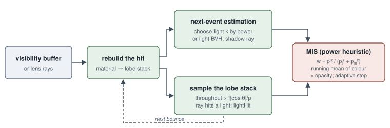
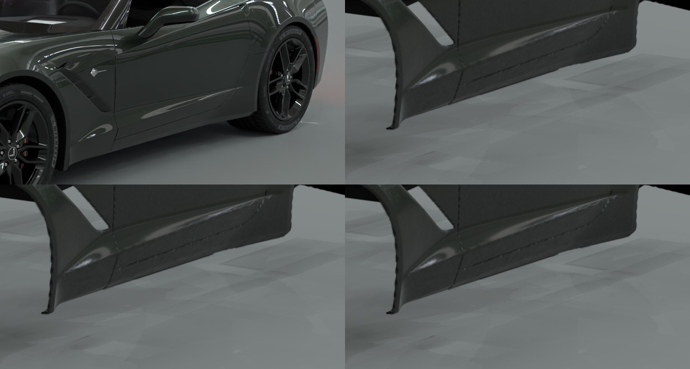
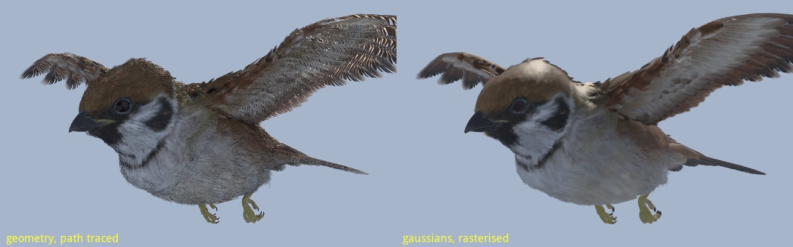
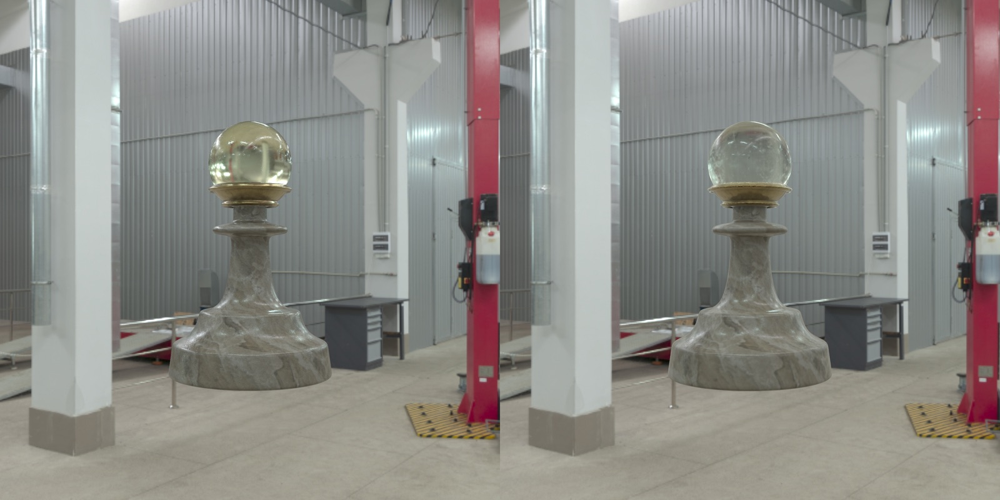

<!-- Copyright (c) 2026 jesus luque. -->

::: {#front}

# athenea: A Relight Baker for Gaussian Splatting from Production USD Assets {.unnumbered .unlisted .paper-title}

jesus luque

19 October 2026

## Abstract {.unnumbered .unlisted}

We describe athenea, a relight baker for 3D Gaussian splatting: it converts production USD meshes and their materials
into Gaussians and bakes into each Gaussian the light transport needed to relight it at draw time, with the reference
always a path trace of the source mesh. A mesh is converted on the device into anisotropic Gaussians, one per cell of
a camera-derived lattice, with coverage-correct opacity, edges held where a surface stops or folds, layered OpenPBR
materials, glass classified as solid or thin wall, and roughness widened by the spread of normals under each Gaussian.
The renderer's own GPU path tracer then bakes a transfer into every Gaussian: degree-3 spherical harmonics of direct
and indirect light, a reflected field, 256 bits of open directions and the material's marks. At draw time these relight
the cloud under any sky and any light, with sharp reflections turned per pixel by a stored shape operator. On a
Chevrolet Corvette C7 of 192 meshes, doubling the bake resolution from 640 to 1280 px raised the relit car's PSNR
against the path trace from 16.55 to 17.88 dB on its crop and from 22.18 to 23.90 dB on the frame, and a 5120 px
close-up level of 74.5 million leaves in 24 trees was baked for close views. The baker rests on a USD and Hydra
renderer in which every step that touches scene data runs as a GPU compute kernel. Rigged assets keep their skeleton,
with a Jacobian that includes the weights' gradients, zonal transfer lobes that turn with a limb and per-part
visibility fields. Per-part merge trees with a monotone, bounded screen error, back-face and occlusion culls, and pages
ordered by error give levels of detail at a cost of about 0.1 dB. A transfer is read in its cloud's own frame, with
the sky turned into it once per instance, so a cloud a scene rotates relights as it does unrotated (relMSE
$9\times10^{-6}$). Every parameter a Gaussian carries, from its albedo and normal to the transfer's sky visibility,
bounce and reflected field, can be drawn through a camera as an image channel of its own. The bake's output is a
master: a USD file holding every parameter at full precision, judged against the path trace, which the engine, an
OpenFX node in a compositor (with depth, world position and Cryptomatte layers and a sky the artist chooses) and a
Blender add-on read as it is. A separate process with its own goal derives from the master a web format for a phone:
clustered PCA of the transfer, vector-quantised visibility and a 40-byte compact record carry the relit car to a WebGPU
player on an iPhone, its loss measured against the master.

**Keywords:** relight baking; 3D Gaussian splatting; precomputed radiance transfer; spherical harmonics; USD; Hydra;
mesh to Gaussians; path tracing; level of detail; clustered PCA; GPU-only pipelines; WebGPU; OpenFX;
compositing; image channels.

## Contents {.unnumbered .unlisted}

::: {#contents}

| 1. Introduction
| 2. The athenea engine and renderer
| 3. From USD meshes to Gaussians (mesh2splat)
| 4. Light transport baked into Gaussians (transfer) and relighting
| 5. Animated assets: skeletons, skinning and per-part visibility (the pawn and the sparrow)
| 6. Levels of detail: merge trees, cuts by error, pages and occlusion
| 7. Application: compression and a WebGPU player on mobile
| 8. Evaluation
| 9. Limitations and future work
| 10. References
| Appendix A. Repositories and commands

:::

:::

<!-- Copyright (c) 2026 jesus luque. -->

# 1. Introduction

## 1.1 The problem

Production 3D assets are authored as meshes: polygons, layered physically based materials, textures, lights and,
for characters, skeletons, all composed in USD. They are rendered faithfully by a path tracer, which is too slow for
interactive use, and interactively by a rasteriser, which needs the asset's full geometry and texture set resident and
still approximates its light transport. 3D Gaussian splatting (3DGS) offers a third route: a cloud of anisotropic
Gaussians, sorted and blended in screen space, draws photographic detail at interactive rates on modest hardware. A
Gaussian cloud, however, is normally *trained* from photographs of a real scene. It holds the light of that capture, it
cannot be relit, and it has no material, no skeleton and no relation to an authored asset.

This paper addresses the converse problem: a **relight baker** for Gaussian splatting. Given a photoreal USD asset
(the case followed throughout is a Chevrolet Corvette C7 of 192 meshes with OpenPBR car paint, chrome, glass, rubber
and lamps), the baker produces a Gaussian representation that

1. **relights**: each Gaussian carries the light transport baked from the asset, so that the cloud answers any sky and
   any light at draw time, not only the illumination it was made under;
2. is **faithful to a path trace** of the source mesh under that lighting, judged image against image and region by
   region;
3. keeps a rig where the asset has one, so that an animated asset still moves and its light turns with it;
4. scales from far views to close-ups through levels of detail.

Neither of the obvious routes meets these. Training a cloud from path-traced views of the asset gives a fixed
illumination and spends hours of optimisation per asset. Rasterising the mesh with an approximate shading model gives
up the path trace's light transport. The route taken here converts the mesh directly into Gaussians and bakes the
asset's light transport into each Gaussian with the renderer's own GPU path tracer; the relit cloud is then compared
with the path trace of the mesh. Reducing, compressing and streaming the baked cloud to a WebGPU player on a phone is
a parallel application of the same data (§7).

## 1.2 Goals and constraints

The central requirement is fidelity of the relit Gaussians to the path-traced reference. The design requirements
below hold throughout and shape almost every design decision in Sections 2–7.

| requirement | statement | where it acts |
|---|---|---|
| Fidelity to the path trace | The reference is the path trace of the source mesh under the same lighting. Where quality and frame rate conflict, quality takes precedence. | §3.10, §4.10, §8 |
| GPU-only arithmetic | No arithmetic on scene data runs on the CPU: no CPU renderer, fallback or test oracle. The host reads files and keeps the books (counts, slots, queues). | Every section; §2.1 states the rule |
| Pure 3DGS at draw time | What is drawn is Gaussians only. The ground is not a mesh: its interaction with the object is converted into Gaussians (a shadow catcher). A mesh is only an input to the bake. | §3.9, §7.9 |
| Automatic, not manual | Per-asset choices are detected from the data: the cell size from a camera, solid versus thin glass, closed shells, the ground for the shadow catcher. Options only override. | §3.3, §3.5, §3.8, §3.9 |
| Small pieces held to the same standard | Badges, grilles, trims and lamps are judged as carefully as panels, close up as well as far. | §3.11, §6.9, §7.12 |

## 1.3 Contributions

The contributions described in this paper are the following.

1. **A relightable transfer baked into each Gaussian** (TX, Section 4), the core of the baker: degree-3 spherical
   harmonics of direct and indirect transfer, a reflected field normalised over closed directions and coupled to the
   sky at draw time, 256 bits of open directions read as cones by each reflection lobe, and the material's marks;
   per-pixel sharp lobes driven by a stored shape operator, with the bake's widening undone and a tube distinguished
   from a fold.
2. **A mesh-to-Gaussian conversion** (mesh2splat, Section 3) that prepares the baker's input, run as an AOFX effect on
   the device, with cells derived from a camera's pixel footprint, opacity that reproduces a surface's coverage, hard
   edges and closed shells found on the device, Toksvig widening of roughness by the normals' spread, layered OpenPBR
   capture, and automatic glass classification.
3. **A GPU-only USD renderer** (athenea, Section 2) on which the baker runs, drawing meshes, points and Gaussian splats
   through Hydra, with a tile rasteriser and a Gaussian ray tracer that share one Gaussian layout, a MaterialX-to-Slang
   material compiler checked against MaterialX itself, a path tracer with multiple importance sampling used as ground
   truth and as the bake's integrator, and a verification discipline in which every image comparison is itself a GPU
   kernel.
4. **Skinned Gaussian clouds** (Section 5) that carry the rig rather than the frames: a skinning kernel using the full
   Jacobian including the weights' gradients, zonal transfer lobes that turn with the Gaussian, per-part visibility
   fields read as a product of table lookups, and decimation that keeps the rig.
5. **Per-part merge trees with a bounded error cut** (Section 6): pair merging under guards that respect parts and
   materials, a least-squares coverage opacity for merges, an error made monotone with covering spheres so that one
   parallel test selects the cut, back-face culling of closed shells, a conservative shared occlusion codebook, and
   pages ordered by the parent's error.
6. **A measured account** (Section 8) of what each step of the bake buys against the path trace, on one production
   asset, through the relit leaves, the cuts and the 640, 1280 and 5120 px bakes.
7. **A web format derived from the master** (Part II, Section 7): a `.athc` v3 container with byte-plane encodings, clustered PCA
   of the transfer kept compressed on the GPU, vector-quantised open-direction bits, a 40-byte compact record,
   quantised traversal records of 5–11 bytes, and a frame-time and still-frame policy for a WebGPU player on an
   iPhone.
8. **The baked cloud as image channels and in production hosts** (Sections 4.11 and 2.14): every parameter a Gaussian
   carries drawn through a camera as a channel of its own, the material and geometry beside the precomputed light
   transport, as the inputs and targets of a learned relighting; an OpenFX node that renders the relit cloud inside a
   compositor (Nuke, Natron) out of process, with depth, world position and Cryptomatte as planes and a sky the artist
   swaps; and a Blender add-on that draws it as a render engine.

## 1.4 Organisation

The work is two processes with different goals. **Part I** is the bake: it turns a production USD asset into a
relightable Gaussian cloud written as a USD file, the master, and is judged by fidelity to the path trace. **Part II**
derives from that master a web format for a phone, and is judged by size, memory and frame time, with its loss against
the master measured. Part I opens with what the master holds; Section 2 describes the engine and renderer on which the
baker runs, and the hosts that drive it. Section 3 describes the conversion from USD meshes to Gaussians, and Section 4
the light transport baked into them and how they are relit. Section 5 covers animated assets: skinning, the sparrow and
the pawn. Section 6 covers levels of detail. Part II opens with the derivation, parameter by parameter; Section 7
describes the web format and its WebGPU player. Section 8 consolidates the evaluation from Sections 2–7, Section 9 gathers
the limitations and the work left, and Section 10 lists the references, followed by an appendix on the repositories
and commands (Figure 1).

## 1.5 Related work

**Gaussian splatting.** Kerbl et al. (2023) introduced 3D Gaussian splatting: a scene as anisotropic Gaussians with
spherical-harmonic colour, optimised from photographs and drawn by a tile-based, depth-sorted rasteriser. Its
projection is the EWA splatting of Zwicker et al. (2001, 2002), a local affine approximation of the perspective map.
Mip-Splatting (Yu et al., 2024) adds a 3D smoothing filter and a 2D screen filter against aliasing; athenea's 0.3 px²
dilation with its opacity compensation is of that family (§2.5.1). 2D Gaussian splatting (Huang et al., 2024) flattens
each Gaussian to an oriented disc evaluated by ray–plane intersection, in the line of surfels (Pfister et al., 2000);
athenea's surfels follow it (§2.5.2). 3D Gaussian ray tracing (Moënne-Loccoz et al., 2024) traces particles through
bounding proxies in a BVH, which athenea's hardware route follows (§2.6).

**From meshes to Gaussians.** Electronic Arts' mesh2splat converts a mesh into Gaussians by rasterising each triangle
in its dominant axis plane, one Gaussian per covered texel; athenea's conversion starts from it (§3.1). Mesh2GS
(arXiv 2606.21898) derives a Gaussian's size from a camera's pixel footprint, which athenea's `--cell-from-camera`
follows (§3.3).

**Precomputed light transport.** Precomputed radiance transfer (Sloan, Kautz and Snyder, 2002) stores, per point, the
projection of visibility times the cosine onto spherical harmonics, so that relighting is a dot product with the
environment's coefficients; Ramamoorthi and Hanrahan (2001) showed that nine coefficients represent irradiance well.
Clustered PCA (Sloan et al., 2003) compresses such transfers by clustering and a per-cluster principal basis, which
athenea uses both for the file and on the phone's GPU (§7.2). Zonal harmonics, which rotate by rotating an axis, are
fitted after Sloan (2008) (§4.4.5, §5.7). Filtered importance sampling (Křivánek and Colbert, 2008) prefilters the
environment (§4.3), and Lagarde and de Rousiers (2014) give the specular occlusion fit that the first transfer used
(§4.6.1).

**Specular antialiasing.** Toksvig (2005) widens a microfacet distribution by the variance of the normals it
averages; athenea applies the same idea at conversion, to the spread of normals under one Gaussian (§3.7, §4.9).

**Levels of detail for Gaussians.** Octree-GS (Ren et al., 2024) organises anchors in an octree selected by view
distance. Hierarchical 3D Gaussians (Kerbl et al., 2024) build a merge hierarchy from Gaussian moments and cut it by
screen size; athenea's original level of detail follows its moments (§6.1). NanoGS (Xiong et al., 2026) merges
mutual nearest neighbours pairwise, which athenea's per-part trees run on the device (§6.2). The cost uses Runnalls'
(2007) bound for Gaussian mixture reduction, and the error-band pages follow Nanite's (Karis et al., 2021) use of a
monotone error for a parallel cut (§6.3, §6.8).

**Engines and formats.** The engine is built on OpenUSD and Hydra, MaterialX and OpenPBR materials, Slang shaders
compiled through slang-rhi to Metal, Vulkan and CUDA, Intel Open Image Denoise and OpenColorIO. The player is a fork
of Spark with a WebGPU backend.

## 1.6 Conventions

Unless stated otherwise, measurements were taken on an Apple M5 Pro under Metal. Images are compared on the GPU
(§2.15). **PSNR** is in dB on display-encoded images; **relMSE** is relative mean squared error on linear values.
**The path trace** (PT) of the Corvette is the mesh path-traced from `/World/Camera` at 1920 × 1080 under the
`autoshop_01_4k` sky. **Car crop** is PSNR on the 900 × 420 crop of the car, **frame** on the whole frame; a **class
ratio** is a region's mean over the path trace's. The validate-corvette harness of the player measures other regions
(car, door, sill, bumper, hood), which are not the car crop (§7.12.3). The words *Gaussian* and *splat* are used
interchangeably; a *leaf* is a baked Gaussian, a *merge* a node of a merge tree, and a *cut* the set of nodes drawn for
one view. *Transfer* is the baked light transport (§4), *TX* its current form.

<!-- Copyright (c) 2026 jesus luque. -->

# Part I. The bake: from production USD to a relightable master USDC {.unnumbered}

The first process turns a production USD asset into a Gaussian cloud that can be relit, and writes it as a USD file:
the **master**. Its goal is fidelity. The master is judged by one criterion, its relit image against a path trace of
the source mesh under the same sky and lights, and every choice in it -- the cell size, the bake's samples, the bits
per direction, the merge cost -- is made by that measurement, not by its size.

**Input.** A USD stage as production delivers it: meshes with their MaterialX or OpenPBR materials, UsdLux lights and
domes, cameras, and for an animated asset its skeleton and clips.

**The process**, in the order it runs, each step a set of GPU kernels on the engine of Section 2:

1. **Conversion** (Section 3). Each mesh becomes anisotropic Gaussians, one per cell of a lattice sized from a camera's
   pixel footprint, with the coverage of the surface as opacity, edges held where it stops or folds, the layered
   material captured per Gaussian, glass classified as solid or thin wall, and roughness widened by the normals' spread.
2. **The transfer bake** (Section 4). The engine's path tracer traces each Gaussian's hemisphere and stores how any sky
   reaches it: degree-3 harmonics of direct and indirect light, a reflected field, 256 bits of open directions and the
   surface's curvature. With these the cloud is relit at draw time under skies and lights it was never baked under.
3. **The rig and visibility** of an animated asset (Section 5): influences and their gradients per Gaussian, zonal
   transfer lobes that turn with a limb, and per-part visibility fields.
4. **Levels of detail** (Section 6): per-part merge trees whose cut by screen error is bounded, back-face and shared
   occlusion culls, and pages ordered by error, written beside the leaves in the same file format.

**Output: the master USDC.** A `ParticleField3DGaussianSplat` per cloud (or per merge tree), whose standard attributes
(positions, orientations, scales, opacities, radiance harmonics) are read by any USD application, and whose athenea
primvars carry the rest at full precision:

| parameter | primvar (`primvars:athenea:splat:`) | per Gaussian | § |
|---|---|---|---|
| material | `normal`, `metallic`, `roughness`, `materialRoughness`, `transmission`, `specularWeight`, `coatWeight`, `sheenColor`, `emission`, `schlickMetal`, `thinWalled`, `closed`; `ior` per cloud | a value per property | 3.6–3.8, 6.6 |
| transfer (TX) | `transferDirect` (16), `transferIndirect` (48 rgb), `transferReflected` (48 rgb) | 112 values | 4.2, 4.4 |
| open directions | `shadowBits` | 256 bits | 4.4.2 |
| curvature | `curvature` | $(S_{uu}, S_{uv}, S_{vv})$, 3 floats | 4.8 |
| transfer and visibility, together | | 480 B in the file, 256 B on the device | 4.2 |
| rig | `skel:jointIndices`, `skel:jointWeights` (4 each), `jointWeightGradients` (half, 6), `transferZonal` (10), `skinningXforms` per joint | | 5.3, 5.5, 5.7 |
| levels of detail | `lodTree`, `lodParent`, `lodStart`, `lodSize`, `lodCost`, `lodSpill`, `coverage`, `coverageMass`, `occlusionIndex`; `occlusionCodebook` per tree; the merges written after the leaves | per node | 6.2–6.8 |
| ids | `cryptoObject`, the Cryptomatte id of the Gaussian's prim; `cryptoManifest` per cloud | 1 word | 2.5.2, 3.10 |

Sizes measured on the assets of this paper: the pawn's two clouds 489 MB; the sparrow, skinned with transfer and
visibility, 216 MB; the Corvette's relightable cloud of 3 M Gaussians 2.9 GB; the Corvette's close-up level as 24 merge
trees of 74.5 M leaves and 148.9 M nodes, 87.4 GB.

**Who reads the master.** The engine itself, through Hydra, on both its raster and its path tracer; the comparison
against the path trace (Section 8); the OpenFX node in a compositor and the Blender add-on (§2.14); the image channels
of §4.11. And every derived format, of which Part II describes one. The master is the source: a derived format is made
from it and cannot be turned back into it.

# 2. The athenea engine and renderer

athenea is a USD renderer built so that every step that touches scene data runs on the GPU. It draws three kinds of
primitive: meshes, with MaterialX materials and UsdLux lights; points; and 3D Gaussian splats. It offers two
techniques, an interactive raster and a path tracer that serves as ground truth. Hydra feeds both through the
`hdAthenea` render delegate. This section covers the engine's architecture, the algorithms each subsystem runs, how
correctness is established without a CPU oracle, and what has been measured. Unless stated otherwise, every number is
quoted from `docs/decisions.md`, with its unit and conditions, and was measured on an Apple M5 Pro under Metal.

## 2.1 Design rules

The codebase holds to a small number of rules. Where possible, each one is enforced by a test.

1. **No CPU arithmetic on data.** athenea has no CPU reference renderer, no CPU fallback and no CPU test oracle. The
   host reads files, parses headers, decompresses, and keeps the books: counts, slots and queues. Decoding, sorting,
   merging, culling, mip generation, light power prefixes and image comparison are all compute kernels. Steps that
   had run on the host were moved to the device; examples are per-element
   interleaving of `ParticleField` arrays, half-to-float conversion, per-pixel conversion of Hydra render buffers, and
   each light's cumulative share of the frame's power (`light_prefix.slang`). The one documented exception is Dear
   ImGui's tessellation, which processes viewer chrome and no scene data.
2. **Binding by name.** Every shader parameter is bound through reflection (`cursor["name"].setBinding(...)`,
   `ComputeKernel::dispatch`) and never by slot, which removes the class of errors in which a slot count
   drifts from the shader's declaration.
3. **Errors as values.** Errors are reported as `Result<T>` with `ATHENEA_TRY`, and nothing throws. OS calls
   live only in `modules/core/Platform`, which is also where a Windows port would start.
4. **One Slang, one slang-rhi, one TBB per process.** OpenUSD, OIDN and the engine share one TBB, and the
   `single_tbb` test checks the count. For the same reason OIDN is built from source: its release binaries ship a
   second `libtbb.12`.
5. **GPU devices only, everywhere.** OIDN is built for GPU devices only, because a denoiser that falls back to the
   CPU is a CPU fallback. A test whose capability is missing on a device skips and names the missing capability.

The backends are those of slang-rhi: Metal (macOS, iOS), Vulkan and CUDA (Linux, NVIDIA L4). All kernels are
written in Slang.

## 2.2 Module architecture

Each module under `modules/<name>` is a static library, `athenea::<name>`. Modules are listed in dependency order and
each links only the ones above it (`modules/CMakeLists.txt`) (Figure 2).

| Module | Contents |
|---|---|
| core | `Result`, logging, `Platform` (all OS calls) |
| ui | viewer panels as a description (`Controls.h`, `GaussianPanel.h`), walked by `athenea view` and the iOS app |
| sched | `FrameClock`: genlock PTP and ST 2059-1 alignment, timecode |
| image | `Image`: float32 RGBA premultiplied, bottom-left origin; the type gpe and AOFX exchange |
| io | CPU file readers (PLY header, SPZ, SOG zip/WebP, IES), EXR with attributes |
| gpu | slang-rhi device, `ShaderLibrary`, `ComputeKernel`, `CommandBatch`, `Buffer`, `AsyncReadback`; `gpu/algo` (PrefixSum, RadixSort) |
| gpu_host | gpe adopting slang-rhi's device: one `MTLDevice` or CUDA context, buffers shared without copies |
| colour | `ColourCompiler` (OpenColorIO as a compiler into Slang), `ColourNames` |
| scene | `CloudLoader`: raw records uploaded and decoded on the GPU into `GpuSplats` / `GpuPoints` |
| render | `TileRasterizer`, `GaussianRayTracer`, `PointRasterizer`, `ReferenceRenderer`, `Camera`/`Projection`, `SplatEdit` |
| geom | `MeshBuilder`: Hydra meshes triangulated, smooth-normalled and primvar-expanded on the GPU |
| material | `TextureStore`, `MaterialCompiler` (MaterialX → Slang), the lobe library |
| light | UsdLux lights on the device: one record per light, sampling, densities, light BVH |
| world | `GpuScene`, `Instancing`, `RayTracingScene` (BLAS/TLAS), `BvhScene` (two-level compute LBVH) |
| technique | `VisibilityRaster/Trace/Bvh`, shading, `AovShading`, path tracer, `Denoiser`, `DisplayTransform`, `SplatVisibility` |
| lod | `LodBuilder`, `CutSelector`, the `.athc` reader/writer and `StreamingPool` (Section 6) |
| usd | `Engine`, `StageRenderer`, `Export`, the `hdAthenea` plugin, codeless schemas |
| mcp | the engine as an MCP server (JSON-RPC 2.0) |
| aofx | this engine's side of the AOFX host (aopenfx `host/`), `renderEffect`, the bundles |
| view | `athenea view`: GLFW window, Dear ImGui on the engine's device |

The shader tree `shaders/athenea/` mirrors the modules (common, algo, scene, splat, rt, points, reference, lod, geom,
world, material, light, technique, usd, volume, view). Shaders are copied into the build tree and compiled at run
time.

## 2.3 GPU foundations

**Device and kernels.** `gpu::Device` wraps a slang-rhi device. `ComputeKernel` is one compute entry point compiled
as a pipeline. It is dispatched in threads, not groups: the group count is rounded up on every backend and each kernel
does its own bounds check. `RasterKernel` is a vertex and fragment pipeline that pulls its data from
`StructuredBuffer`s, with no vertex buffers or input layouts. `RayTracingKernel` covers OptiX and Vulkan RT
pipelines. On Metal, slang-rhi offers no ray tracing pipelines, so tracing uses inline `RayQuery` inside compute
kernels.

**ShaderLibrary.** The library loads Slang modules. A module may declare link-time constants
(`extern static const uint kName;`) and is then linked against a generated exports module, which yields one program
per distinct set of values. It also compiles modules that exist only as generated source, such as materials and the
colour functions; loading an existing name with different source is refused. A persistent `DiskShaderCache` writes
one file per compiled program, keyed by slang-rhi's hash of the linked program. With a warm cache the whole test
suite went from 89 s to 26 s.

**Parallel primitives.** `PrefixSum` and `RadixSort` are the only sorting and scanning in the engine. The tiled
radix route (`radix_block.slang`) is a reduce-then-scan form of the stable LSD pass. A group of 256 threads counts a
tile of 1024 keys in group memory, a digit-major prefix sum places each tile's share of each digit, and the group
sorts its tile with eight one-bit splits. It sorts 10 M 32-bit pairs in **12.4 ms**, against 39.9 ms for the chunked
passes it replaced from 65 536 elements up. It uses no wave operations and no device atomics.

**Mips.** slang-rhi does not generate mip chains, so `MipGenerator` is a kernel. Each texel of a level is the
area-weighted mean of the texels above it. An odd edge $2n+1$ folds into $n$ with weights $(n-x,\,n,\,x+1)/(2n+1)$,
so every source texel gives exactly $n/(2n+1)$ of itself to the level below and the chain preserves level 0's mean.
On sizes 64², 37×23, 1×9 and 128×5, the means agree to 2·10⁻⁶.

**Memory as a first-class error.** A Metal command buffer that runs out of memory used to assert inside slang-rhi on
Metal's completion thread, which ended the process. A patch now records the error on the queue
(`SLANG_E_OUT_OF_MEMORY`) and returns it from the next `submit()` or `waitOnHost()`. `Device::admit` refuses any
allocation that would exceed the budget: `ATHENEA_GPU_BUDGET`, or else Metal's `recommendedMaxWorkingSetSize`, which
is 18 186 MiB on the M5 Pro. An allocation must also fit the free physical memory less 1.5 GiB. On unified memory,
several processes each within Metal's figure can together exhaust physical memory and force the system to swap.
When a frame runs out of memory, `Engine::relieveMemory` steps down: it drops splat shadows first, then moves up to four LOD levels coarser, and finally reopens streams at half their budget.

## 2.4 The Gaussian representation

Every renderer, the loaders and the LOD share one GPU layout, `GpuSplats`. Each splat takes **32 bytes before its
harmonics**, defined in `common/packing.slang`:

| Field | Encoding | Reason |
|---|---|---|
| position, opacity | 4 × float32 | fp16 positions would step two pixels at 4K close up |
| rotation | smallest-three quaternion, 3 × 10 bits + dropped index | within a tenth of a degree |
| scale | f16 of $\log s$ per axis | 0.1 % relative precision at every size |
| base colour | 3 × f16 | may leave [0, 1] |
| SH rest | `shWords` × u32, f16 per coefficient | signed |
| normal (optional) | octahedral 2 × 16 bits | shading normal kept apart from the frame |
| emission (optional) | RGB9E5 | radiance the surface emits |

`CloudLoader` reads PLY, SPZ, SOG, `.splat` and USD `ParticleField` prims. It uploads the raw records and decodes
them on the GPU. For SOG, the host's only work is to unzip the archive and decode the WebP images.

**Linear light.** Every Gaussian is blended in linear Rec.709, and sRGB appears only where an image is displayed. A
capture keeps the sRGB harmonics it was trained with: each projection evaluates them, clamps at zero and converts to
linear (`cloudLight`) before blending. A cloud written by athenea declares that it holds light
(`primvars:athenea:splat:linear`) and is used as stored. On two half-opaque overlapping discs, the rasteriser, the
reference and the ray tracer each match the analytic over-operator at p99 0. Under the previous encoded blend, all
three read p99 26.

## 2.5 The tile rasteriser

`render::TileRasterizer` is the interactive route for splats. It is a sort-based, deterministic tile rasteriser in
the 3DGS family. Seven stages run on the device (Figure 3):

| Stage | Work |
|---|---|
| project | per splat: covariance, conic, colour, 24-bit depth key, footprint, exact count of tiles touched |
| sort | splats by depth (RadixSort) |
| gather | tiles-touched counts in depth order, prefix sum |
| emit | one (tile, splat) pair per touched tile, in depth order |
| sort | pairs by tile, stably, on tile bits only |
| ranges | start and end of each tile's pairs |
| blend | per pixel: its tile's pairs, front to back |

The engine sorts splats by depth once (N 32-bit keys) and then sorts pairs stably by tile (P keys of about 15 bits).
This gives every tile its splats in depth order, with ties broken by splat index, exactly as a single 64-bit
(tile, depth) sort would. The construction is deterministic. Tiles are 16 × 16 pixels.

### 2.5.1 Projection

A splat with rotation $R$ and scales $S=\mathrm{diag}(s)$ has the 3D covariance $\Sigma = R S S^\top R^\top$, built
in the cloud's own space. With $W$ the linear part of object-to-view and $J$ the Jacobian of the perspective map at
the view-space centre $t$, the screen covariance is the EWA local affine approximation

$$\Sigma_{2D} = (J W M)(J W M)^\top,\qquad M = R S,\qquad
J=\begin{pmatrix} f_x/t_z & 0 & -f_x t_x/t_z^2\\ 0 & f_y/t_z & -f_y t_y/t_z^2\end{pmatrix}.$$

Before $J$ is built, $t_x/t_z$ and $t_y/t_z$ are clamped to the frustum widened to $[-0.15, 1.15]$ of the image. A
splat far off screen would otherwise smear across the whole frame, and 3DGS clamps in the same way. Orthographic
cameras use $J=\mathrm{diag}(f_x,f_y)$.

**Shutter and lens, as convolutions.** A Gaussian smeared along a straight screen path $d$ under a uniform shutter
is that Gaussian convolved with a segment. Matching second moments turns this into a rank-one update. A thin lens
convolves with the disc of the circle of confusion:

$$\Sigma' = \Sigma + \tfrac{1}{12} d\,d^\top,\qquad
\Sigma' = \Sigma + \tfrac{R^2}{4} I,\quad R = f\,A\,\left|\tfrac1z - \tfrac1{z_f}\right|.$$

The displacement $d$ has two sources: what a skeleton moved the splat over the shutter (a per-splat buffer), and a
view-space step that combines camera and prim motion (`viewStep`). Both are projected by the same rows $JW$ as the
covariance. The update is checked against the same rasteriser run at N instants and averaged on the device
(§2.5.3).

**Antialiasing filter and the opacity it pays back.** The covariance is then dilated by 0.3 px², as in
Mip-Splatting's 2D filter. Each convolution spreads the splat, so its peak must drop by
$k = \sqrt{\det\Sigma_{\text{still}}/\det\Sigma'}$ to keep its energy. One square root covers the filter, the shutter
and the lens together. Scaling alone loses mass, however, because a splat is drawn only out to where it falls below
1/255, and the spread enlarged that area by $1/k$. A converted plane meant to cover 0.25 covered 0.18 at a twentieth
of the screen. The opacity is therefore paid back as

$$\alpha' = \begin{cases} k\alpha + (1-k)/255 & k\alpha \ge 1/255\\ k\alpha & \text{otherwise.}\end{cases}$$

This keeps the sharp splat's covered area (`paidOpacity`). Paying back every splat would also draw those the filter
had made too faint to keep. That raised a distant converted pawn from 8.7 to 29.8 ms (debug build), and the rule
above costs 11.0 ms there.

**Footprint and tiles.** A splat is cut at the squared Mahalanobis radius

$$r^2_{\max}(\alpha) = \min\big(2\ln(255\,\alpha),\ 9\big),$$

which is where its own contribution falls below 1/255, and never beyond 3σ. The tile count is exact rather than
taken from a bounding box. For each tile in the axis-aligned extent, the minimum of the quadratic form
$q(\delta)=\delta^\top \Sigma'^{-1}\delta$ over the box of the tile's pixel centres is computed in closed form: since
$q$ is convex, it is either 0 or lies on an edge, where it is a clamped 1D quadratic. The emit stage repeats the same
test. Because the blend cuts at the same radius, no pixel outside a counted tile could have been touched, so tile
edges are seamless. A culled slot writes the reason for culling into its unused depth-key word (edit, depth, no area,
faint, off-screen, no tile), and the viewer's Gaussians panel counts these reasons without adding a counter to the
projection.

**Depth key.** The key is `bit_cast<uint>(z) >> 7`, which is order-preserving for positive floats and 24 bits wide.

### 2.5.2 Blending

One 16 × 16 thread group per tile loads the tile's records in batches of 256 into group memory, and every pixel walks
them from there. For pixel $p$ and splat $i$ with conic $Q_i=\Sigma_i'^{-1}$, centre $\mu_i$ and colour $c_i$:

$$\alpha_i(p) = \min\!\Big(0.99,\ \alpha_i' \exp\!\big(-\tfrac12 (p-\mu_i)^\top Q_i (p-\mu_i)\big)\Big),\qquad
C = \sum_i c_i\,\alpha_i \prod_{j<i}(1-\alpha_j) + T\,C_{\text{behind}}.$$

Contributions below 1/255 are skipped. A pixel stops once $T=\prod(1-\alpha_j) < 10^{-4}$, and the group stops loading
once all 256 of its pixels are done. $C_{\text{behind}}$ is either the background or the opaque *under* layer of
meshes and points, composited by view z: the walk ends at the first record behind the layer's depth. Depth is written
either as the alpha-weighted mean or as the first crossing of a coverage threshold. The same walk also accumulates a
six-rank Cryptomatte, by id coverage, and for pruning the per-splat contribution $T\alpha$ or the squared error the
splat's removal would leave (the GaussianPOP score). Specialised entry points compile the composite and matte
branches out, because leaving them live in a frame that has neither cost the blend half again.

**Surfels and harder kernels** (athenea-pieces branch). A Gaussian with one scale exactly 0 is a *surfel*. The
rasteriser draws it by intersecting each pixel's ray with the disc's plane (Huang et al. 2024): the disc's axes are
stored in homogeneous screen coordinates and pulled back through the pixel's two planes. The screen filter is a max,
not a convolution: the larger of the disc and a round Gaussian of variance ½ px². Its opacity is paid back by area,

$$\alpha' = \alpha\cdot\min\!\Big(1,\ \frac{\sqrt{\lambda_1\lambda_2}}{\sqrt{\lambda_1\lambda_2}+\tfrac12-\sqrt{\min(\lambda_1,\tfrac12)\min(\lambda_2,\tfrac12)}}\Big),$$

where $\lambda_{1,2}$ are the eigenvalues of the undilated screen covariance. A merged Gaussian may carry an opacity
$D>1$. That value selects Spark's harder kernel, $1-(1-g)^A$ with $A=\exp((D^2-1)/e)$ and $D$ capped at 5. This is the
composite of $A$ coincident Gaussians, and its cut is widened by $0.7(D-1)\sigma$. A *hard surfel* uses
$\exp(-(|u|^p+|v|^p)/2)$, with $p$ fitted to its members' kurtosis. Section 6 covers both, together with the merges
that produce them.

### 2.5.3 Measured

**Coverage of converted surfaces** (`athenea_coverage_tests`, 256 × 256, alpha of planes converted by mesh2splat,
against the mesh's alpha; sizes are fractions of full screen):

| Plane | Mesh | Raster 1× / 0.25× / 0.05× | Traced 1× / 0.25× / 0.05× |
|---|---|---|---|
| constant 0.25 | 0.250 | 0.251 / 0.250 / 0.248 | 0.251 / 0.251 / 0.251 |
| constant 0.5 | 0.500 | 0.501 / 0.499 / 0.493 | 0.501 / 0.501 / 0.500 |
| constant 0.75 | 0.750 | 0.752 / 0.749 / 0.736 | 0.752 / 0.752 / 0.752 |
| opaque | 1.000 | 1.000 / 1.000 / 0.999 | 1.000 / 1.000 / 1.000 |

Without `paidOpacity`, the raster read 0.18 / 0.455 / 0.73 at 0.05×.

**Motion blur and lens** (`[motion]`, `[lens]`; truth = the same rasteriser at N instants, or 64 lens positions,
averaged on the device):

| Case | Result |
|---|---|
| shutter step 0.10 (many splat widths) | p99 8, max 24 |
| shutter step 0.03 | p99 2, max 9; energy ratio 1.0000 |
| shutter step 0.9 | energy ratio 0.9030 (tails below the 1/255 cut) |
| zero shutter vs still frame | max 0, bit for bit |
| f/2, 12.7 px confusion | p99 17 (not blurring: p99 113) |
| f/11, 2.3 px confusion | p99 9 (not blurring: p99 33) |
| at the focus distance | max 0, bit for bit |

**Frame cost by stage** (`ATHENEA_STAGES=1`, every stage waited for; the sparrow's clips, 5 887 323 Gaussians at
1600 × 1000, playing):

| Stage | Before | After | Change |
|---|---|---|---|
| depth sort (24 bits) | 11.3 ms | 6.6 ms | tiled radix |
| tile sort (8.8 M pairs) | 8.4 ms | 6.0 ms | tiled radix |
| blend | 13–25 ms | 8–13 ms | tile records shared through group memory |
| project, emit, counts, commit | 13.6 ms | 13.4 ms | – |
| frame, playing | 102 ms | 49 ms | cloud no longer re-uploaded each step |

A frame of six million Gaussians spends its time on the Gaussians rather than on pixels: changing the render scale
from 800 × 500 to 3200 × 2000 leaves the time unchanged.

## 2.6 The Gaussian ray tracer

`render::GaussianRayTracer` evaluates each particle in 3D at its peak response along the ray, with no EWA
approximation and no 0.3 px dilation. Particles are blended front to back in order of their peak along the ray. In
the particle's whitened frame (origin $o$, direction $d$, with $\Sigma^{-1/2}$ applied), the peak and the entry into
the cut ellipsoid are

$$t^\ast = -\frac{o\cdot d}{d\cdot d},\qquad \rho = \lVert o + t^\ast d\rVert^2,\qquad
t_{\text{entry}} = t^\ast - \sqrt{(r^2_{\max}-\rho)/(d\cdot d)}.$$

The textbook discriminant $b^2-ac$ cancels catastrophically for flat particles and lost 176 of 400 thin layers, which
is why the peak form is used. Colour is the rasteriser's: the harmonics evaluated once per frame in the direction
from the eye to the centre.

**Two routes, one integrator.** Both routes feed the same `Integrator` (`rt_integrate.slang`). The *Hardware* route
gives every particle a stretched-icosahedron proxy (3DGRT's) in a device BVH queried with inline `RayQuery`. The
*ComputeBvh* route is a Karras LBVH built on the GPU (Morton codes, radix sort, hierarchy, refit until a pass changes
nothing) and traversed in compute. Each traversal records up to 256 unsorted entries, which are evaluated and ordered
after traversal by a 128-bucket counting sort and then an insertion sort over an index permutation. When a ray meets
more proxies than that, the segment closes at the nearest dropped entry and the next traversal resumes a relative
10⁻⁵ before it. Particles peaking beyond the boundary are carried into the next segment; only when more than 64 are
carried are the nearest blended early, which is the route's single approximation.

| train_7k (742 k splats), 1080p | Frame | Build |
|---|---|---|
| Hardware (Metal) | 435 ms | 731 ms |
| ComputeBvh (Metal) | 343 ms | 168 ms |
| tile rasteriser, same frame | 13 ms | – |

On Metal, each non-opaque candidate costs a round trip out of hardware traversal. An opaque closest-hit query over
the same 15 M proxy triangles takes 6 ms, but enumerating every candidate takes 255 ms, so `Auto` picks ComputeBvh on
Metal. The optimisation history on this frame went from 2.52 s (a 3DGRT-style 16-entry k-buffer) to 343 ms. The
largest steps were recording unsorted entries and evaluating after traversal (1.94 s → 658 ms) and the bucket sort
(−85 ms); a record size of 256 was chosen from a sweep of 64 to 512.

**Shadow and secondary queries.** Transmittance is a product, so `rt_shadow.slang` takes proxies in whatever order
they arrive, with no k-buffer, and stops when the product falls below its cut. It does not cull back faces, because a
shadow ray born inside a proxy must still see the particle it starts in. Three closed forms check it: $1-\alpha$
through one centre, measured 0.50000; $(1-\alpha)^4$ through four, measured 0.06250; and early termination after
three of four. The integrator answers a query `rtTraceSegment(ray, [a, b))` rather than writing a pixel, and
`segmentOver` composes two segments: a sparse cloud split at any depth is bit-exact with the single query.

## 2.7 Points

`PointRasterizer` draws point clouds through a z-buffered raster pipeline with no sort, optionally followed by
surface splatting and eye-dome lighting. On devices without rasterisation (CUDA), points are drawn as discs in the
splat pipeline. In that case a record's `colour.w > 0.5` marks it as an opaque disc, which ends the walk exactly as
the under layer does.

## 2.8 Meshes: geometry, scene and visibility

**On the device, in Hydra's order.** `geom::MeshBuilder` triangulates Hydra topology in `HdMeshUtil`'s fan order,
including holes and left-handed orientation. It computes smooth normals with `Hd_SmoothNormals`' formula, as
per-corner cross products scattered to points through a radix sort, and expands primvars of every interpolation per
corner, resolving indexed primvars and decoding doubles on the device. A height field's normals come within
1.1·10⁻⁷ rad of a brute-force sum. `world::GpuScene` pools positions, indices, corners, faces and primvar values,
with a 64-byte record per mesh and a 176-byte `InstanceRecord` per drawn copy. `world::Instancing` composes instancer
chains exactly as Storm does, $\text{instancer}\cdot T\cdot R\cdot S\cdot\text{instanceTransform}$, nested as
$\text{parent}[i]\cdot\text{level}[j]$, with one dispatch for all instanced sets. For Kitchen_set_instanced's 1462
sets this took command recording from 32 ms to 0.4 ms.

**Three routes, one visibility buffer.** Each route writes (instance + 1, triangle) per pixel. Shading and AOVs
rebuild the hit from those two numbers with Möller–Trumbore in view space (`technique/surface.slang`), so all routes
shade alike.

- `VisibilityRaster` uses reversed infinite Z (depth $= \text{near}/z$, D32Float), one draw per mesh with
  `instanceCount`, and a single shared root object.
- `VisibilityTrace` builds one BLAS per mesh and a TLAS per frame. A kernel writes the instance descriptors in each
  backend's layout (64 B generic, 80 B OptiX, 68 B Metal).
- `VisibilityBvh` builds a Karras LBVH per mesh and one over instances, for devices without RT hardware.

Single-sided culling matches Storm in all three routes.

**Storm as the oracle** (Kitchen_set, 480 × 270; ids compared as segmentation, because Storm numbers prims
differently):

| Route | Coverage | Segmentation | Depth, worst | Neye > 6/255 |
|---|---|---|---|---|
| raster | 0 differ | 18 of 57 219 | 1.2·10⁻⁶ | 17 |
| rays | 4 differ | 41 of 57 236 | 6.3·10⁻⁶ | 17 |
| bvh | 4 differ | 36 of 57 233 | 6.3·10⁻⁶ | 17 |

**Visibility timings** (`athenea stage --frames 40`, median frame after the first, headlight shading, readback
included):

| Scene | Size | raster | rays | bvh |
|---|---|---|---|---|
| Kitchen_set (1788 meshes) | 480 × 270 | 18.0 ms | 4.8 ms | 8.9 ms |
| Kitchen_set | 1920 × 1080 | 31.7 ms | 19.2 ms | 29.2 ms |
| Kitchen_set_instanced (1462 sets) | 1920 × 1080 | 29.1 ms | 19.2 ms | 28.6 ms |

Raster loses mainly on the host side: recording about 1800 draws costs about 8 ms, because slang-rhi writes render
state per draw. The automatic setting therefore prefers rays wherever the device has ray queries.

## 2.9 Materials

**Textures.** The `TextureStore` uses Hio only to read a file's bytes. The bytes are uploaded raw and a kernel decodes
them into the working space. Mips are a kernel that decodes sRGB, filters in light and re-encodes. UDIM is an
indirection table. All textures sit in one `ParameterBlock` of 1024 slots, which Metal takes as an argument buffer.
Filtering is chosen per target with `__target_switch`: `SampleGrad` where compute allows it, and an explicit level
from the footprint's wider side elsewhere (CUDA). On Metal, where both are available, they pick the same levels. A
decoded texture is the file to the last bit (0 of 3404 components differ). Input colour spaces resolve through
`colour::ColourNames`, and transforms are generated by OpenColorIO (§2.12).

**MaterialX into Slang.** The generator derives from MaterialX 1.39.5's `SlangShaderGenerator`. Every node keeps its
genglsl or genslang implementation except four kinds whose rasteriser meaning cannot hold here:

- the surface node, which has no light loop here: its BSDF graph runs once, pushing lobes;
- BSDF and EDF nodes, which push lobes instead of answering a light;
- image nodes, which sample the texture table;
- `heighttonormal`, which needs screen derivatives.

A BSDF value is a *weight per built lobe*, so `mix`, `layer`, `add` and `multiply` combine weights. Uniforms are not
baked into the code: each input is read from a float blob, and the module is named by a hash of its source, so
materials that differ only in values share one compiled module. Generated sizes include UsdPreviewSurface at 580
lines and 23 blob words, standard_surface at 821 and 59, and OpenPBR at 945 and 55.
`technique::MaterialPrograms` generates one module that imports every compiled material and dispatches on a material
row. A kernel that evaluates materials walks its pixels in quad order (`atheneaQuadPixel`), because on Metal
the lanes run along rows, and in row order every vertical derivative is wrong (15 939 of 15 939 threads).

**The lobe library.** It contains Oren–Nayar and energy-compensated EON, Burley, translucent, dielectric (reflection,
transmission, both), conductor, generalised Schlick with an F82 tint, and sheen in both its Imageworks and Zeltner
forms. Each lobe has `eval`, `sample` and `pdf`. Microfacet lobes sample the visible normal distribution and
transmission follows Walter. A material's lobes form a `LobeStack`, which is sampled with one-sample MIS by the lobes'
weighted directional albedos.

**Checks against MaterialX itself.** The same graphs are compiled a second time in a reference variant whose closures
are MaterialX's own genglsl responses, and a kernel evaluates both for 65 536 light directions. The worst component
difference over eleven graphs is **3.2·10⁻⁵**. On the device, the lobes pass a χ² test of sampled directions against
the pdf (393.2 on 399 degrees of freedom for the diffuse lobes) and a white furnace that agrees within 3 %.

**Cutouts and bump.** Visibility evaluates `opacityThreshold`: the raster uses a generated discarding fragment
shader, and the ray routes carry the ray past a cut sample up to sixteen times. Only rows flagged as cutouts pay for
this. A cutout square shows what lies behind it exactly (8464 pixels, 0 mismatches) on all three routes.

## 2.10 Lights

**Records and units.** Each UsdLux light becomes one record in world space, in the units the stage authored.
Exposure, the blackbody of a colour temperature (Krystek's fit, normalised to luminance 1) and `normalize` are
derived in the shader. Supported kinds are sphere, disk, rect, distant with an angle, dome and cylinder, plus
shaping cones and IES profiles. An IES profile is read as authored, sampled bilinearly with its declared symmetry,
and modulates radiance but never density. Lights under instancers are composed on the device as meshes are.

**Sampling where the light stands.** A sphere or sun is sampled uniformly over the cone it subtends. A disk, rect or
cylinder is sampled uniformly by area and converted to solid angle by $p_\omega = d^2/(\cos\theta_l\,A)$. A dome is
sampled either cosine-weighted about the shading normal or by warping down its image's mip chain by luminance. The
warp's density needs no tables:

$$p(\omega) = \frac{L(u,v)}{\bar L\; 2\pi^2 \sin\theta},$$

where $\bar L$ is the 1 × 1 mip level's mean. The image's variation chooses between the two strategies: on a flat sky
the warp is 20 % out where the cosine is 0.08 %. `lightPdf` returns the density of any direction and `lightHit`
answers the converse question, which light a ray meets and with what radiance. Together they are what MIS needs.
With `athenea:chooseLights`, a sample takes one light chosen through a **light BVH** (`light_bvh.slang`). Each node is
a box, an orientation cone (Conty and Kulla 2018) and the power beneath it, and the BVH is built by the same compute
LBVH kernels as the geometry.

**Checks.** Every light is held to a closed form that shares no code with the renderer: a Lambert plane under a
sphere, a disk, a rect (Lambert's edge formula), a sun and a dome. In each case 0 of 8281 pixels are beyond 2 %;
the worst is 1.6 % for the disk. Each light also runs a χ² test with 10⁶ samples, binned in the light's own support,
against `lightPdf` integrated per bin: sphere z = −0.23, disk 0.14, rect −0.27, sun −0.29, dome −1.61, every pdf
integrating to 1.0000. The dome warp needed two fixes, both found by χ² in image space. The bug reached z = 61 543
and later 1 164 589, against 0.84 after the fixes. The per-sample consistency check had passed throughout, because it
compares a density with itself.

**Measured** (Kitchen_set with four authored lights, 1600 × 900, `athenea view --frames 200`, draw median):

| Configuration | Draw |
|---|---|
| headlight only, rays | 10.61 ms |
| four lights, 1 sample, rays | 27.77 ms |
| the same, compute BVH | 35.14 ms |
| the same, raster | 40.94 ms |
| four lights, 16 samples, rays | 275.40 ms |

## 2.11 The path tracer

The path tracer is the engine's ground truth. Its paths start from the same visibility buffer the raster shading
reads, so the two techniques differ by exactly one thing: the bounces. With a lens, the tracer additionally casts its
own primary rays. A hit is rebuilt by `material_surface.slang`, its material is evaluated into the same lobe stack,
and direct light is gathered by next-event estimation (NEE). The bounce samples the stack, and the path throughput is
multiplied by `LobeSample.weight` $= f|\cos\theta|/p$ (Figure 4).

**MIS.** At each vertex that continues the path by sampling its material, NEE's sample of light $k$ and the material
sample's hits on lights (`lightHit`, including escaping rays meeting domes and suns) are weighed by the power
heuristic,

$$w_{\text{light}} = \frac{p_l^2}{p_l^2 + p_m^2},\qquad p_l = P(k\mid x)\; p_k(\omega),$$

where $P(k\mid x)$ is the light-choice probability (by power, or through the light BVH) and $p_m$ is `stackPdf`.
Delta lights, delta lobes and the last vertex keep a weight of 1. **Emissive triangles** form a light table
(`technique::EmissiveTable`): each material row's emission is probed once, triangles are weighted by world area times
that luminance, and the choice between lights and triangles is made by power, with each side's density carrying the
other's share. On a floor of roughness 0.2 at 32 paths, MIS reduced error against a deep frame by 4.5× under a rect,
57.7× under an imageless dome and 2.4× under a sphere. An emissive quad and an equivalent UsdLux rect agree to
relMSE 4.1·10⁻⁷ at 8192 paths.

**Accumulation, sampler, adaptivity.** A frame is a running mean of colour × opacity. An earlier implementation took
the product of means, which is unbiased only while every sample is opaque. The sampler folds pixel, stream, absolute
path index, bounce and dimension through a PCG hash, so 256 paths in one pass and 4 × 64 differ by relMSE
3.9·10⁻¹⁵. Between passes the camera is jittered by a Halton (2, 3) offset inside the pixel; the first pass takes no
offset. This is antialiasing at no cost. Adaptive sampling stops a pixel once

$$\frac{\sqrt{(\mathbb E[l^2]-\mathbb E[l]^2)/N}}{\mathbb E[l]} < \varepsilon$$

after a minimum count. The variance used is the larger of the pixel's own and the mean of its 3 × 3 neighbours',
which reduced the stopped pixels beyond three of their own σ from 526 to 100 of 4212. **Thin lens and radial
distortion** come from `UsdGeomCamera`: the lens radius is $f/(2N)$, and rays are scaled by $1+k_1r^2+k_2r^4$.

**Verification.** Every check is a GPU kernel against a closed form or against a second, independent estimator:

| Check | Result |
|---|---|
| closed emissive sphere, $E(1+\rho+\dots+\rho^N)$, N = 0, 1, 2, 3, 6 | 0 of 3072 pixels beyond 10⁻⁴, worst 1.7·10⁻⁷ |
| white furnace under an imageless dome vs unweighted NEE | p99 relative 0.0000, max 0.0003 |
| one bounce vs raster direct light (nothing to bounce off) | p99 1, max 1 (8-bit codes), 4096 paths |
| error vs N, pairs of independent estimates, 64–1024 paths | exponent −0.499 (window −0.42 to −0.58) |
| in focus vs pinhole (lens radius 0.2) | relMSE 0, bit for bit |
| out of focus vs circular-segment profile | 0 of 4235 pixels beyond 4 % |
| OIDN, 16 paths vs 4096-path reference | relMSE 3.65·10⁻⁴ → 7.17·10⁻⁵ |

The furnace exposed a one-sided MIS weight. On a dome against a Lambert lobe the two densities are the same function,
so the weight was exactly ½, and the furnace read 0.5453 instead of 1. The shell exposed a double division,
$\rho\pi/\cos$ instead of $\rho$, whose infinite second moment had held the convergence exponent at −0.43 to −0.45.

**Denoiser.** `technique::Denoiser` runs OIDN 2.5.1's `RT` filter on the engine's own queue, guided by the first hit's
albedo and normal. On Metal, OIDN shares only hazard-tracked buffers, which slang-rhi forbids. The engine therefore
copies through tracked staging buffers using a kernel, since slang-rhi's blit silently did nothing on a wrapped
buffer (4095 of 4096 words untouched). On CUDA the engine's buffers are shared directly. On Vulkan, OIDN runs through
CUDA on imported memory (`oidnNewSharedBufferFromFD`).

**Measured** (Kitchen_set, 1920 × 1080, `athenea stage --frames 11`, median, release):

| Stage | raster | rt (1 path, 1 bounce) |
|---|---|---|
| no lights (headlight) | 43.1 ms | 333.3 ms |
| lit (dome, rect, two spheres) | 96.0 ms | 358.9 ms |

Through MCP, the OpenChessSet path traced at 640 × 360 with 64 paths, one bounce and ACES 2.0 takes 25.7 s.

## 2.12 Display and colour

`technique::DisplayTransform` writes the window's surface texture directly. It supports Standard; AgX, in Wrensch's
analytic fit (log2 over [−12.47, 4.03] stops, a sixth-order sigmoid); and ACES 2.0. The ACES 2.0 output transform
(`aces2.slang`) is ported function for function from the Academy's CTL, including Hellwig 2022's appearance model,
tonescale and gamut compression. The reference's init-time tables (362 entries per hue) are built on the device by
three kernels. Checks: 256 greys over sixteen stops stay neutral to 5·10⁻⁶; 18 % grey reads 0.10000 of reference
white at 100 nits; inverse-then-forward over 8192 colours returns within 6·10⁻⁶ of peak. The display formulas,
re-derived in a second kernel, agree to 3.5·10⁻⁶. OpenColorIO is used **as a compiler**: `colour::ColourCompiler` asks
OCIO for HLSL, loads it as a Slang module `athenea_cs_<hash>`, and fills its LUTs on the device. The host computes
shader text and LUT values but nothing per pixel.

## 2.13 USD and Hydra

The `hdAthenea` plugin implements `HdRenderDelegate` with rprims for meshes, basis curves, points, `ParticleField`
(Gaussian splats) and volumes; sprims for cameras, materials, the six UsdLux light types, ext computations and
coordinate systems; and bprims for render buffers and render settings. Implicit surfaces (sphere, cube, cone,
cylinder, capsule, plane) reach the delegate as meshes, converted by hdsi's scene indices. **Threading:** `Sync`,
which Hydra may run on any thread, only hands CPU records to `Engine` under a lock. The render pass thread commits
uploads, opens `.athc` files and compiles materials, then renders, so the device has a single caller. A skinned cloud
whose arrays carry no time samples is held across steps (`_held`) and not re-uploaded; this took the sparrow's
playing frame from 102.4 to 71.7 ms before the sort and blend work of §2.5.3. **Outputs:** colour, depth, primId,
instanceId, elementId, Neye, normal, `primvars:*`, Cryptomatte and light groups. They are converted on the device
(`usd/aov_convert.slang`) only when a host maps a buffer, and are stored bottom row first, as Storm stores them.
`StageRenderer` is the programmatic entry point and draws until a path-traced frame holds its total.

The engine reads codeless schemas of its own (`AtheneaSplatLightingAPI`, `AtheneaStreamedAssetAPI` and others).
Render settings arrive as `athenea:*` settings: technique, visibility route, path samples, bounces, totals, MIS,
denoise, antialias and lens.

## 2.14 Hosts and front ends

- **`athenea view`** keeps frames on the device: `StageRenderer::draw`, then `DisplayTransform` writes the surface
  texture and Dear ImGui draws on the same device. Measured with materials at 1600 × 900, Kitchen_set draws in
  9.27 ms on rays. The panels are described once in `modules/ui`, so the iOS app draws the same ones.
- **AOFX host.** The AOFX SDK and host are aopenfx's (`third_party/aopenfx`), and the engine declares only what it
  provides (`Host.cpp`). They change only additively under the ABI's rule, so the compositor's bundles load
  unchanged. `aofx_sdk_manifest` fails on any header change. Data-processing steps such as mesh2splat (Section 3) and
  `athenea compare` are AOFX bundles.
- **MCP server** (`athenea-mcp`): JSON-RPC 2.0 over stdio, with a warm device and stage. Tools are `open_stage`,
  `render` (returning a PNG image block), `pick`, `bounds`, `convert`, `timings` and `settings`. A protocol test suite
  checks handshake, notifications and error codes. For a program that composites the frame, `render` takes a camera as
  a compositor holds one (camera to world and a lens in millimetres) and writes the frame's own numbers to a file:
  premultiplied RGBA, view depth, and on request the world position (made on the device from the depth) and the three
  Cryptomatte layers, with the matte's manifest in the answer. `sky`, `skyRotation` and `skyVisible` put another image
  on every dome of the stage, turn it, and hide the background while it still lights.
- **OpenFX node** (`Athenea.ofx.bundle`, built on Natron's OpenFX). A generator that draws a cloud through its camera
  at the project's format and the frame's time. It loads none of the engine: it starts `athenea-mcp` as a child, one
  for the host process, and reads each frame back from a file, so the host's own USD and TBB never meet the engine's
  and a device fault ends the server, not the host. Its knobs are a Camera node's (translate, rotate in an order,
  focal, apertures), the sky, its rotation and visibility, and the layer a host without planes shows in RGBA. Through a
  minimal OpenFX host its frame is bit-identical to the server's own render of the same camera (relMSE 0). In Natron,
  which takes custom planes, a pawn at 1920 × 1080 writes one 32-bit EXR of 21 channels (colour, `depth.Z`, `P`,
  `CryptoObject00`–`02`) whose colour and position match that host's to within $10^{-6}$. The Corvette's relightable
  cloud (3 M Gaussians, 2.9 GB) at 1920 × 1080 with every plane takes 7.5 s for the first frame, which opens and
  uploads the stage, then 120–170 ms a frame under a still sky and 190–220 ms with the sky turning every frame. Nuke
  takes from an OpenFX node only its own planes, so there one layer a node is shown.
- **Blender add-on** (`athenea_hydra`). A Hydra render engine for Blender 5.3 over the engine's delegate: viewport and
  final render by athenea, mesh-to-Gaussian conversion of selected objects, clouds referenced as Empties, the World's
  environment as the dome.

## 2.15 Verification without a CPU oracle

Every image comparison is a kernel. `ReferenceRenderer` is the ground truth for splats: every pixel considers every
splat, sorts exactly what reaches it (depth, then index, the rasteriser's tie rule) and blends front to back, with
no tiles, ranges or pairs. A comparison is valid only when no pixel overflows its 1024 contributors.
`renderPeaks` is the ray tracer's reference, sorting exactly by peak. The metrics read back to the host are
`compareImages` (p99, max and the number of pixels over 2, in 8-bit sRGB codes), `compareHdr` (relMSE
$=\overline{(a-b)^2/(b^2+10^{-2})}$ and the relative p99) and `countDifferent` for id buffers. The ray tracer is held
to its reference at p99 ≤ 1 with at most 0.05 % of pixels over 2. Against the rasteriser, the tolerance holds only
where the two definitions agree: p99 2 for orthographic sparse scenes, where EWA is exact, and 4 for perspective
scenes with particles a few pixels across. Dense scenes differ by tens of codes, which reflects ordering rather than
error.

**Three devices** (each machine computes the same GPU metric itself, and no pixels travel between
machines):

| | Metal (M5 Pro) | Vulkan (L4) | CUDA (L4, OptiX 9, no inline rays) |
|---|---|---|---|
| Cases | 188 | 188 | 188 |
| Passed | 188 | 180 | 96 |
| Failed | 0 | 0 | 1 |
| Skipped (capability named) | 0 | 8 | 91 |

## 2.16 Limitations

- Splats are not yet inside the path tracer's secondary rays. A splats-only stage is traced whole by
  `GaussianRayTracer`. With meshes, splats are composited over the path-traced surfaces by depth; they cast shadows
  onto meshes, but a bounce ray does not see them.
- The rasteriser's motion and lens blur are moment-matched Gaussians, not plateaus or bokeh discs: up to 38 % too
  peaked for long streaks.
- Clouds whose Gaussians are a few hundredths of a pixel across vanish from the raster (5·10⁻⁶ of the frame against
  3·10⁻⁴ for the mesh and the tracer); levels of detail are the remedy (Section 6).
- Raster mesh visibility pays about 8 ms of host time per 1800 draws.
- Material compilation is synchronous.
- The TLAS is rebuilt every frame.
- Lens distortion beyond $k_1, k_2$ is not applied.

<!-- Copyright (c) 2026 jesus luque. -->

# 3. From USD meshes to Gaussians (mesh2splat)

The conversion is the relight baker's first stage: it turns a USD stage of polygonal meshes and their materials
into a cloud of anisotropic 3D Gaussians, and that cloud is what the transfer bake of Section 4 fills with light. It
is invoked as `athenea mesh2splat STAGE`; every Gaussian the rest of the system draws, bakes, decimates and streams
was a triangle of a mesh first. This section
describes how the stage is read, how large a Gaussian's cell is, how each Gaussian is placed, shaped and coloured,
how the conversion handles the places where a surface stops or folds, how it captures a layered physically based
material, how it treats glass, and what was measured on the Chevrolet Corvette C7 asset that drives most of the
project. The path-traced bake that follows emission (the *transfer*) is the subject of Section 4 and is
touched on here only where it constrains the conversion.

Numbers in this section come from `docs/decisions.md` and `docs/pieces.md` of the repository and from the source (`plugins/mesh2splat/mesh2splat.slang`,
`apps/athenea/src/CmdMesh2Splat.cpp`, `shaders/athenea/usd/mesh2splat_*.slang`). All measurements were taken on an
Apple M5 Pro (Metal) unless said otherwise.

## 3.1 Origin, and where the conversion runs

The emission algorithm is that of Electronic Arts' *mesh2splat* (BSD-3): every triangle is projected onto the axis
plane its normal points along most, the projection is rasterised at a fixed resolution, and each covered texel
becomes one Gaussian lying in the triangle's plane, as wide as a texel measured in the world. The original is an
OpenGL geometry and fragment shader pair; here it is one compute kernel in which each thread owns a triangle and
walks the cells of its projected bounding box.

The kernel is not a module of the engine but an AOFX effect, the bundle `plugins/mesh2splat`, loaded through the
same host registry every program shares (the AOFX ABI, Section 2.14). The conversion is a stateless kernel over
triangles, which is exactly the shape of an AOFX effect, and making it one keeps a converter out of the renderer's
modules and lets the same bundle run in other AOFX hosts. The cost is a boundary: an effect is handed pictures, so a
mesh travels as a *picture of numbers*, six `float4` per triangle — $(\mathbf p, u)$ and $(\mathbf n, v)$ for each
corner, in world space (`mesh_pack.slang`) — and every texture a material names travels as rows of linear `float4`
sampled out of the engine's texture table (`texture_rows.slang`). Neither is a copy: the pictures live in the gpe
image storage that adopts the engine's Metal device, and `Context::renderView` gives a view of the same bytes, so the
packing kernel writes where the effect reads. The records the effect writes are gathered into the cloud's device
buffers (`mesh2splat_gather`), the cloud's bounds are folded on the device (`mesh2splat_span`), and the bake reads
them in place. Only counters and the final USD arrays cross to the processor.

The command is therefore a pipeline of device passes orchestrated by the host (Figure 5):

1. read the stage (`usd::MeshStage`) and split meshes into *pieces*;
2. pack each piece into a mesh picture, fold boxes, choose each piece's cell (`mesh2splat_cells`);
3. mark hard edges and closed shells per mesh (`mesh2splat_edges`), classify glass (`mesh2splat_sheet`);
4. run the Mesh2Splat effect per piece — count, scan, emit — into records;
5. optionally bake (radiance, or a transfer) at every Gaussian with the path tracer;
6. write a `ParticleField3DGaussianSplat` stage (or a `.athc`) atomically.

## 3.2 Reading the stage

`usd::MeshStage` walks the stage with `UsdShade` directly rather than through Hydra: the conversion wants no render
index, and the material side is built on the stage's own bindings.

**Selection.** `--prim P` restricts conversion to meshes at or under `P`; `--hide P` (repeatable) authors
invisibility on `P` and everything below it, in a non-persistent layer over the stage, before the read. A mesh that computes invisible at the read's time code
is skipped, so the conversion converts what the renderer draws. `--hide` affects the conversion only: the bake
traces the whole stage, so a part converted with every other part hidden still receives the others' shadows and
inter-reflections. This is what allows the Corvette to be converted in groups (Section 3.11).

**Instancing.** A `PointInstancer` prototype's mesh is emitted once per instance of the innermost instancer that
holds it, at (mesh relative to its prototype root) × (instance transform, prototype root included) × (instancer to
world); the built mesh buffers are shared between copies. Without this expansion the chess set's sixteen pawns
convert to two.
Nested instancers are expanded at the innermost level only.

**Time and pose.** `--time T` sets the time code at which positions, transforms and primvars (including their
indices) are read and at which the bake traces. A skinned mesh's `points` do not animate in USD, so the stage is
first posed with `UsdSkelBakeSkinning` into a non-persistent layer over $[T, T]$, which costs one pose and leaves the file
untouched; a stage without a `SkelRoot` is unchanged and converts byte-identically. With `--skinned` the Gaussians
are built in the bind pose and each keeps four joints and their weight gradients; that path is described in
Section 5.

**Pieces.** A mesh whose `materialBind` GeomSubsets bind different materials is converted as several *pieces*: each
subset's triangles, and those no subset claims. A piece's triangles are listed on the device in the mesh's order
(flag, prefix sum, scatter) and packed as if they were a mesh, so the effect is untouched. A test mesh with two faces
bound red and blue by subsets and the mesh bound green converts to 272 red and 272 blue Gaussians and none green;
reading the mesh's own binding alone makes it all green.

**Materials in their own words.** The bound surface — MaterialX `standard_surface`, OpenPBR `open_pbr_surface`,
`gltf_pbr` or `UsdPreviewSurface` — is read with its own input names and its own defaults (standard_surface 0.8 grey
at roughness 0.2, OpenPBR roughness 0.3, glTF a fully rough metal, UsdPreviewSurface 0.18 at 0.5), following
connections through node graphs and interface inputs to the image node that produces a value. A value computed by a
graph (a mix, a noise) has no answer without shading a point, so the default stands and a warning is printed; a TX
bake later reads such fields back from the compiled material on the device. A texture's colour space is taken from
the file input's `colorSpace` metadata (or `sourceColorSpace`), and maps are capped at `--texture-size` (1024 by
default): a map is a `float4` picture on the device, so a 4k map would occupy 268 MB.

## 3.3 The size of a cell

Everything downstream scales with the cell $h$, the world length one Gaussian stands for. The conversion offers four
ways to choose it, in increasing order of preference.

**Per model** (`--density per-model`, the default when no camera is given). $h = R / N$, where $N$ is
`--resolution` (512 by default) and $R$ the wider of the projection plane's two ranges of the model's box — the
original's `orthogonalUvs`. Two defects followed: a 16-unit floor diluted the car standing on it, and a panel
facing forward walked a cell 2.5 times finer than the hood, because its projection plane is the car's short side.

**Per mesh** (`--density per-mesh`). $h = L_m / N$ with $L_m$ the longest side of the mesh's own box, the same for
every triangle of it (`cellByLongest`), clamped to $[h_{\min}, h_{\max}]$ given by `--cell-min`/`--cell-max`; left at
0 they derive from the model's cell $h_M$: $h_{\max} = h_M$, $h_{\min} = h_M/8$, a density ratio of 64 between the
finest and coarsest part. Measured on `MustangHero.usda` (car on a 16-unit floor) at `--resolution 512`:

| mode | total | bumper `Object_199` | hood `Kapoot` | floor |
|---|---|---|---|---|
| per-model | 375 199 | 762 (cell 0.0313) | 2 326 | 262 144 |
| per-mesh, defaults | 934 338 | 3 082 (cell 0.0039) | 20 279 | 262 144 |
| per-mesh, `--cell-min` = `--cell-max` = 0.03125 | 375 157 | 764 | 2 339 | 262 144 |

The control row reproduces per-model to 0.01 %; the remaining difference is the orientation effect alone.

**From a camera** (`--cell-from-camera CAM --camera-pixels P`, after Mesh2GS, arXiv 2606.21898). Each piece's cell
is what one pixel of camera `CAM`, `P` pixels across, covers where the piece's mesh box is nearest to it:

$$
h = \frac{z\,(A/P)}{f}, \qquad z = \max\bigl(\lVert \operatorname{clamp}(\mathbf e, \mathbf b_{\min}, \mathbf b_{\max}) - \mathbf e \rVert,\; z_{\text{near}}\bigr),
$$

with $A$ the camera's horizontal aperture, $f$ its focal length, $\mathbf e$ the eye, and the result bounded only by
explicit `--cell-min`/`--cell-max`. Mesh2GS takes $z_{\min}$ over the box inside the frustum and over the camera's
time samples; the Euclidean distance at `--time` is the same for a box in view and finer, never coarser, for one
beside the frustum. On two equal cards three and seven units from a 64-pixel camera, the near card received 930
Gaussians and the far one 169: a ratio of 5.5 against $(7/3)^2 = 5.4$ expected. This is the mode used for every
production bake of the Corvette (`--cell-from-camera /World/Camera --camera-pixels` 640, 1280 or up to 5120).

**The budget.** `--max-splats` (2 M by default) is shared over the whole stage. Every piece is first counted (a run
of the effect with room for one Gaussian, whose count and scan cover everything a run would write); where the total
$W$ exceeds the budget $B$, piece $i$ wanting $w_i$ gets $s_i = \max(1, B w_i / W)$ and walks a cell
$\sqrt{w_i / s_i}$ times coarser. A cell $k$ times coarser covers the surface with $k^2$ fewer Gaussians, so
proportional shares and uniform coarsening are the same thing. On two cards wanting about 1 300 under a budget of
800 the shares came out 356 and 361; spent in mesh order, the second card held about 145.

**Per-triangle and per-run limits.** A triangle walks at most `--max-cells` cells of its projected bounding box
($2^{18}$ by default); cells beyond are counted and reported as a warning. At 4736 px the Corvette's
`Infinite_Black` lost 359 628 cells this way (visible holes) and was re-baked with `--max-cells 1048576`. A run's
output picture is capped at 2 M Gaussians (`kRunCeiling`, 192 MB); a piece wanting more is converted in slices — the
effect reports the first triangle the ceiling cut into, and the host reruns from there with `firstTriangle` — giving
the same array a single run would have written.

## 3.4 One Gaussian per cell

**The projection.** For a triangle $(\mathbf a, \mathbf b, \mathbf c)$ with geometric normal $\hat{\mathbf n}_g$,
the two axes $(i, j)$ along which $\hat{\mathbf n}_g$ points least define the projection; a point maps to
$\mathbf o(\mathbf x) = (x_i - b_{\min,i},\, x_j - b_{\min,j}) / R$, with $R$ the range in use (the model's, the
mesh's longest side, or the camera-derived box). A cell is $1/N$ of that unit square, i.e. $h = R/N$ in the world,
bounded as in Section 3.3. A Gaussian is emitted at every cell whose centre falls inside the projected triangle,
located by its barycentric coordinates $\boldsymbol\lambda$, at the world point
$\boldsymbol\mu = \lambda_0 \mathbf a + \lambda_1 \mathbf b + \lambda_2 \mathbf c$.

**The sizes.** With $E = [\mathbf b - \mathbf a,\; \mathbf c - \mathbf a]$ and $O = [\mathbf o_b - \mathbf o_a,\;
\mathbf o_c - \mathbf o_a]$, the Jacobian of the projection's inverse is $J = E\,O^{-1} = [\mathbf j_u, \mathbf j_v]$
(guarded at $|\det O| > 10^{-24}$). The two in-plane standard deviations and the third are

$$
s_u = \min\!\left(\lVert \mathbf j_u \rVert\,\sigma\,\tfrac{1}{N},\; \ell_{\max}\right), \qquad
s_v = \min\!\left(\lVert \mathbf j_v \rVert\,\sigma\,\tfrac{1}{N},\; \ell_{\max}\right), \qquad
s_n = \varphi\,\min(s_u, s_v),
$$

where $\sigma$ is `--sigma`, $\ell_{\max}$ the triangle's longest edge and $\varphi$ `--flatness`. Three details follow
the original source: the Jacobian is over the triplanar coordinates, not over texture
coordinates; the $1/N$ factor is applied by the original's exporter, not by a shader (without it every Gaussian is
the size of the model); and the frame is not the Jacobian's columns but the triangle's longest edge
$\hat{\mathbf t}$, the interpolated shading normal $\hat{\mathbf n} = \operatorname{normalize}(\sum_k \lambda_k
\mathbf n_k)$, and their cross product. The covariance is therefore

$$
\Sigma = R_{\text{frame}}\,\operatorname{diag}(s_u^2, s_v^2, s_n^2)\,R_{\text{frame}}^{\!\top}, \qquad
R_{\text{frame}} = [\hat{\mathbf t}_\perp,\; \hat{\mathbf n}\times\hat{\mathbf t}_\perp,\; \hat{\mathbf n}],
$$

with $\hat{\mathbf t}_\perp$ the edge made orthogonal to $\hat{\mathbf n}$. Without the bound $\ell_{\max}$,
1 859 slivers of a BMW, seen almost edge-on by their own projection, produce Jacobian columns twenty orders of
magnitude too long and draw white spikes metres long.

**Width.** The original's $\sigma = 0.65$ leaves a converted surface about 30 % transparent to a ray tracer. Measured
on a unit quad lit head-on (mesh pixel 0.5032):

| $\sigma$ | coverage | pixel |
|---|---|---|
| 0.65 | 0.702 | 0.351 |
| 0.85 | 0.848 | 0.425 |
| 1.0 | 0.911 | 0.456 |
| 1.2 | 0.957 | 0.479 |
| 1.5 | 0.986 | 0.493 |

The default is therefore $\sigma = 1.0$; `--sigma 0.65` restores the original.

**Flatness and surfels.** The original wrote $10^{-7}$ model units as the third size, which made a Gaussian's
thinness depend on the model's scale: a 66 mm pawn traced correctly while a 100-unit fox became a ghost under the ray
tracer. The third size is now the fraction $\varphi$ (default 0.1) of the smaller in-plane size. `--flatness 0`
writes surfels — Gaussians with one scale exactly zero, the 2D Gaussian-splatting disc — which the rasteriser draws
by a ray–plane intersection per pixel and the path tracer clamps to $10^{-4}$ of the widest axis.

**Opacity as coverage.** A point of a converted surface lies under several Gaussians at once, so an opacity written
straight into each over-covers: a mask of 0.5 covered 96 % of what stood behind it. Every opacity the conversion
reads (`--opacity`, the material's constant, a map's value, what a glass keeps) is treated as the surface's
*coverage* $F$ and converted into the per-Gaussian $\alpha$ by expanding the transmittance of the stack to second
order: on the cell lattice the footprints sum to $2\pi\sigma^2$ and their squares to $\pi\sigma^2$, so

$$
\tfrac{\pi\sigma^2}{2}\,\alpha^2 + 2\pi\sigma^2\,\alpha = -\ln(1 - F)
\;\;\Longrightarrow\;\;
\alpha = \frac{\sqrt{4S^2 + 2S\,L} - 2S}{S} + \tfrac{1}{255}, \quad S = \pi\sigma^2,\; L = -\ln(1-F),
$$

the $1/255$ paying back the area a Gaussian loses where it is cut at $1/255$; $F \ge 0.999$ maps to 1 and 0 to 0.
Measured on planes of constant coverage 0.25 / 0.5 / 0.75, the raster gives 0.251 / 0.501 / 0.752 and the ray
tracer the same at full size, against 0.253 / 0.510 / 0.770 with the first-order term alone. A cut-out map below
`--opacity-cut` (0.5) writes no Gaussian at all, so the budget goes where the surface is.

**A triangle that catches no cell.** A triangle smaller than a cell need contain no cell centre; rasterised, it
vanishes. Without a fallback, that removes the Buick's grille and window rubbers (80 137 triangles become 34 011 Gaussians).
Such a triangle therefore gets one Gaussian at its centroid, sized by its own second moments (`m2sOwnSize`): the uniform
triangle's covariance $\Sigma_\triangle = \tfrac{1}{12}\sum_k \mathbf d_k \mathbf d_k^\top$ (corners about the
centroid, in the tangent plane), widened as a cell is, $\Sigma = 12\sigma^2 \Sigma_\triangle$, with the wide axis
clamped to $[0.05\,s_{\max}, s_{\max}]$ of the cell's size and the narrow axis to at least 0.02 of the wide. Without
it, a panel's rolled lip — a strip of sub-cell triangles — draws a band of cell-wide beads three pixels thick along
every Corvette edge where the path tracer draws a hairline. In the Corvette bakes, glass and tyres come out at about
one Gaussian per triangle at both 640 and 1280 px.

**Deterministic order.** The original appended with an atomic counter, so two conversions of the pawn produced the
same 729 073 Gaussians in different orders. The emit is now three passes — count each triangle's covered cells, an
exclusive scan in one 256-thread workgroup, write each triangle's Gaussians at its offset — sharing one function
(`m2sTriangleOf`) so that counting and writing cannot disagree. Two conversions are now byte-identical, a budget
keeps the first Gaussians in mesh order, and Gaussian $i$ is the same Gaussian from one pose to the next. A record
that decodes to nothing is written as an empty slot rather than dropped, so array indices stay aligned.

## 3.5 Where a surface stops or folds

A Gaussian is a cell wide, and on the Corvette a cell is a pixel of the conversion camera. A part narrower than that
— the flange a hood folds down into its gap — still received cell-wide Gaussians in its own plane; they reached out
of the gap over the paint beside it, carrying the gap's baked darkness, and every panel edge became a thick black
wavy line where the path tracer draws a thin one.

**Hard edges** (`mesh2splat_edges.slang`). Per mesh, over all its pieces, every edge and corner is keyed by where its
points stand and radix-sorted on the device; each run of equal edge keys is one edge. An edge is *hard* when it is
open (one triangle uses it: the part stops or another mesh begins), when the two triangles sharing it fold by more
than $40^\circ$ (`kCreaseDegrees`), or when more than two triangles share it (non-manifold). Because keys are
positions over the whole mesh, a boundary between two materials on one smooth surface is not an edge. Each hard edge
becomes a line with an inside, $(\hat{\mathbf m}, c)$ with inside $\hat{\mathbf m}\cdot\mathbf x \ge c$ — the plane
through the edge, orthogonal to its triangle, facing the third corner — known to its own triangle as a bit and told
to every triangle touching either end (up to five lines each), since a Gaussian near a corner can stand beside the
next triangle's hard edge.

**Holding the reach** (`m2sHoldEdges`, `--edge-reach` $\rho$, default 1.5). For each line in the Gaussian's plane,
let $\mathbf m$ be its normal in the tangent basis, $C$ the in-plane covariance, $r^2 = \mathbf m^\top C\,\mathbf m$
the variance across the line and $d$ the centre's signed distance to it. The size allowed across the line is
$a = \max(d/\rho,\; 0.05\,r)$, and where $r > a$

$$
C \leftarrow C - \kappa\,(C\mathbf m)(C\mathbf m)^\top, \qquad \kappa = \frac{1 - a^2/r^2}{r^2},
$$

which makes $\mathbf m^\top C\,\mathbf m = a^2$ exactly while keeping the variance along the line's conjugate
direction, so a strip of Gaussians still covers the strip. Lines not lying in the Gaussian's plane (the flange seen
from the paint it folds off), and lines the centre stands more than a quarter size behind, are ignored; lines are
applied in a canonical order so the result does not depend on discovery order. The new covariance is
re-diagonalised into a tangent and two sizes. The count of Gaussians is unchanged — only their shapes are.

**Closed shells.** The same pass counts edges not shared by exactly two triangles, one counter read back per mesh. A
mesh is marked closed when

$$
n_{\text{open}} < 2\sqrt{1.5\,T},
$$

$T$ its triangles ($1.5T$ approximates its welded edges), and its Gaussians carry
`primvars:athenea:splat:closed = 1`, which allows a player or a cut to drop nodes facing away. A fixed share of edges
(2 %) is not sufficient: an open sheet's border grows as the square root of its area, so a fine enough tube
passes as closed — with that rule the rims' barrels (1 %) are culled and light shows between the spokes. Against the
square root, the doors (no open edge), logos (1.4) and calipers (1.5) stay closed and rims (4.0), tyres (3.1), hood
(3.1) and bumper (4.4) do not: 102 of the Corvette's 192 meshes. A car's door is two skins; drawn without culling,
the inner skin sorts in front of the outer in patches, a net of dark cracks at small screen sizes.

**Measured.** The Corvette's TX base at 640 px of `/World/Camera`, rebaked with edges held (default 1.5) and as a
control with `--edge-reach 0`, both 5 380 804 Gaussians; day frame at 1920 × 1080 against the mesh path trace:

| bake | relMSE (HDR) | PSNR (display) | SSIM |
|---|---|---|---|
| previous base (earlier build) | 0.0900 | 21.83 dB | 0.8555 |
| control, edges not held | 0.0902 | 21.86 dB | 0.8554 |
| edges held, $\rho = 1.5$ | 0.0887 | 21.93 dB | 0.8567 |

The global gain is small because the edges are a small fraction of the frame; the visible effect is on the panel
gaps.

## 3.6 Material capture

Each Gaussian record carries position, coverage-derived opacity, three sizes, a rotation and a colour, followed —
depending on what the cloud needs — by the shading normal and metallic, roughness, transmission and texture
coordinates; four joints and their gradients; three relief entries for displacement; an emission entry; four layer
entries; and the shape operator.

**Base.** The colour is the material's base colour times its base weight, times the albedo map where there is one
(decoded to linear). Metallic and roughness are the material's constants, multiplied by the packed map's channels
where there is one (blue metallic, green roughness), as glTF multiplies its factors; a missing channel is a factor
of one. The original defaults to $(0.1, 0.5)$ from the map alone, so every material without a map becomes the same
plastic; with the material's own values passed, a converted quad under a head-on light reads 0.5009 against the
mesh's 0.5032.

**Shading normal.** A normal map is read in the frame its UVs give — $\partial\mathbf p/\partial u$ from the
triangle's positions and UVs, orthonormalised against the normal, as the mesh shader does — and the result is kept as
the Gaussian's shading normal (`primvars:athenea:splat:normal`) beside its geometric frame. Read against the longest
edge instead, every facet of the pawn's marble turns its veins by its own angle. The disc
itself is not turned unless `--normal-map-turns` is given, which would open the surface where the relief is steep.

**Layers.** A Gaussian carries the specular weight, colour and index; the coat's weight, roughness and
index; the sheen's colour times its weight and its roughness; and the coat darkening switch — OpenPBR's units, three
words per splat on the device. Up to three maps on these inputs are sampled per Gaussian (`m2sLayersAt`). This is
required because the Corvette's paint (`Car_Paint_Main`) is OpenPBR metalness 1 over a base of about 0.05 under a
clear coat of weight 1: everything the eye sees of it is the lacquer, and without the coat a converted car comes out
nearly black.

**Schlick metals.** OpenPBR and glTF metals are MaterialX `generalized_schlick_bsdf` (colour head-on, specular colour
at $82^\circ$), not a conductor of the artistic index; for a dark metal the two differ by a factor of two at grazing
angles (at $60^\circ$: 0.172 for the conductor, 0.077 for the Schlick from $F_0 = 0.047$). The material's kind is
written per Gaussian (`primvars:athenea:splat:schlickMetal`) and the renderer reflects it with the DFG fit of its two
ends. Treating every OpenPBR metal as dielectric polish in the bake has a measured cost: a Mustang's front bumper
stores the constant that decodes to black in all 27 016 Gaussians; with Schlick lobes of $F_0 > 0.2$ kept as body,
the bumper's mean colour is (0.45, 0.51, 0.61).

**Emission and transmission.** Emission is the material's colour times its map, linear and unbounded, in an entry of
its own. Transmission $T$ and transmission colour $\mathbf c_T$ are a channel the original did not have (glass comes
out opaque white). The colour is taken towards the transmission colour,

$$
\mathbf c \leftarrow \operatorname{lerp}\!\bigl(\mathbf c,\; \operatorname{lerp}(\mathbf 1, \mathbf c, w_T)\,\mathbf c_T,\; T\bigr),
$$

with $w_T = 1$ for glTF (transmission tinted by the base colour) and 0 for OpenPBR and standard_surface. The opacity
is the coverage mapping of Section 3.4 applied to $o\cdot o_{\text{mat}}\cdot\text{mask}\cdot
\operatorname{lerp}(1, g, T)$, $g$ being what a fully transmitting surface still covers (Section 3.8).

**The material roughness mark.** The stored roughness may be widened by the specular filter (Section 3.7). The
material's own roughness before widening is written separately, `primvars:athenea:splat:materialRoughness` (−1 under
a roughness map, read as sharp). The player uses it to decide whether the polish lobe answers its occluded part from
the baked reflected field (material roughness at least 0.3: paint, 0.34) or keeps it dark (chrome 0, rough metal
0.22); in the decimated tree it is packed into the `pbr` word (bit 26 present, bits 27–31 the value in five bits).

## 3.7 The specular filter (Toksvig widening)

A Gaussian has one normal. Where a strip of chrome curves under it, the path-traced pixel averages a highlight that
moves across the footprint and shows a thin line; the Gaussian shows the light its single normal meets, at full
brightness, over its whole footprint. On the Corvette, without filtering, the grille trim — four pixels high — comes out as a row of
white beads, and the chrome reads 1.6 times the path trace while a chrome ball validates within 1 %.

The conversion therefore widens the roughness by the spread of normals under the Gaussian (`m2sSpread`,
`m2sWidened`). The turn rate is the largest angle between corner normals per unit corner distance, over the
triangle's three edges, and the spread is that rate times the Gaussian's wider size:

$$
s = k\,\max_{e}\frac{\angle(\mathbf n_{e_0}, \mathbf n_{e_1})}{\lVert \mathbf p_{e_1} - \mathbf p_{e_0} \rVert}\,\max(s_u, s_v),
$$

with $k$ = `--specular-filter` (1 with `--transfer`, 0 otherwise). With perceptual roughness $r$ and GGX
$\alpha = r^2$, the spread is added to the slope variance (Toksvig):

$$
\alpha'^2 = \alpha^2 + 2 s^2, \qquad r' = \operatorname{saturate}\!\left((r^4 + 2 s^2)^{1/4}\right).
$$

A flat triangle, or one whose corners share a normal, is unchanged. The coat's roughness is widened the same way
unless the cloud carries the shape operator.

**The shape operator.** For a transfer the conversion also writes, in the Gaussian's own axes $(\mathbf u, \mathbf
v)$, the symmetric shape operator $S$ with $\mathrm d\mathbf n = S\,\mathrm d\mathbf x$, solved from the corners'
normal differences against their position differences (`m2sShape`, stored as $(S_{uu}, S_{uv}, S_{vv})$). The
renderer uses it to turn the reflection across the footprint pixel by pixel (the per-pixel "sharp lobe"). Widening
the coat as well would blur twice, so where $S$ is written the coat is not widened, and the player reads the sharp
lobes at the unwidened roughness $r_0 = \max(r'^4 - 2s^2, 0)^{1/4}$ (`unwidened`), with $s$ carried per Gaussian.

**Measured.** At 640 px the coat came out at roughness 0.17–0.24 with 5–14 % high-pass on folds; at 1280 px the
spread under each Gaussian is smaller and the coat's roughness comes out at exactly 0, so the widening matters less as
the bake gets finer. Turning it off is nevertheless worse (Section 3.11): with `--specular-filter 0` a dashed dark
line appears on the sill's fold and the chrome strip sparkles.

## 3.8 Glass

A Gaussian cannot refract, but it can let what is behind it through by its opacity, reflect through its specular
lobe, and carry an index of refraction that the renderer bends by (`primvars:athenea:splat:ior`, one per cloud; with
layers each Gaussian bends by its own specular index). The conversion's job is to decide, per transmitting piece,
whether the glass is a *solid* (a body: a ball, a lens) or a *thin wall* (a sheet or slab whose two faces bend
nothing), because the two are drawn differently.

**Classification** (`classifySheets`, `mesh2splat_sheet.slang`), for every transmitting piece whose material does
not already declare itself thin-walled. On the device, the piece's edges are keyed by position, sorted, and their
runs counted; the signed volume $V$ (tetrahedra to the origin) and the area $A$ are summed. Then

- *open*: more than $1/200$ of the edges have one triangle, or any edge has more than two;
- *slab*: closed, and the thickness $2V/A$ is below four of the model's cells or below $0.02\sqrt A$
  ($2V/A$ is a slab's gap and two thirds of a ball's radius).

An open or slab piece is read thin-walled — unless it is *tinted* (transmission colour luminance below 0.9), which
stays solid for now, since a thin wall lets the background through grey. The Corvette's glass consists of
closed slabs 3–4 mm thick, which the edge rule alone calls solid; the thickness rule reads
them. Each decision is printed, e.g. for the rear light lens: "tinted, kept solid glass: 200 of its 17284 edges open,
0 shared by more than two; 1.199 thick (2V/A) against a cell of 0.007921". `--thin-glass MAT` and `--solid-glass MAT`
override per material.

**Coverage.** A solid glass covers `--glass-opacity` of what is behind it (by default 1 on a stage lit by domes
alone and 0.6 where a lamp or a sun stands: a TX lens answers its background from the domes alone, so under a lamp a
glass that covered fully hid the light shining through it). A thin
wall covers exactly what the sheet reflects head-on, both faces with inter-reflection:

$$
g_{\text{thin}} = \min\!\left(\frac{2R}{1+R},\; 0.998\right), \qquad R = \left(\frac{n-1}{n+1}\right)^2,
$$

and the frame scales its reflection back by $1/R$. At the windscreen's index of 1.16 that is an opacity of 0.0055,
and the rasteriser draws such sheets at an opacity of at least 0.1 with colour scaled down by the same factor, which
keeps the product $\alpha\,\mathbf c$ — the reflection — intact (windshield relMSE 2.26 → 0.89 under the workshop
sky).

## 3.9 Shadow and light catchers

The ground is not converted as a surface; its interaction with the object is converted instead, so the playback is
Gaussians only.

**Shadow catcher** (`--shadow-catcher --prim OBJECT`). The ground is found automatically (the largest flat mesh
outside the object whose top is at the object's bottom; `--catcher-ground` names one). A patch of quads — the
object's footprint widened by `--catcher-margin` heights (1.5), split into a grid so that no triangle exceeds
`--max-cells` — is added to an in-memory copy of the stage and converted alone at a cell of a hundredth of the object's
height, as a TX transfer whose rays meet the object and the ground. At draw time the gaussian's opacity is
$-\ln(\text{ratio})/2\pi$, where the ratio is light reaching it with the object against without, since a lattice of
$\sigma = 1$-cell Gaussians sums to $2\pi$ and a layer of opacity $a$ leaves $e^{-2\pi a}$. The Corvette's: a
5.9 × 8.3 m patch, 11 × 11 quads, 309 k Gaussians at a 1.26 cm cell, baked in 79 s. Against the path trace:

| | under the car (GT 0.182) | bumper contact (GT 0.043) | open ground (GT 0.217) |
|---|---|---|---|
| mesh ground's own shadow map | 0.182 | 0.041 | 0.215 |
| catcher, depth 2.4, two triangles | 0.144 | 0.002 | 0.206 |
| catcher, depth $2\pi$, grid | 0.192 | 0.030 | 0.220 |

**Light catcher** (`--light-catcher`). The same patch, reaching `--light-reach` object lengths (3) ahead and behind,
at a cell of a thirtieth of the height, converted as a radiance bake per light group with the dome black; drawn
additively, it carries the low beam's pool and the tail lamps' glow.

## 3.10 Validation against the path trace

`--validate DIR` measures a conversion material by material against the stage path-traced, for any stage. The groups
are the stage's material bindings (a mesh of two materials is in both); the conversion is the command's own, run
once per group with every mesh outside it hidden, so every option is what is measured. The ground truth is path
traced once (`--validate-paths` 512, `--validate-bounces` 6) and kept; the stage is rasterised once as meshes with
its Cryptomatte, and each group's mask is the coverage of every rank whose id hashes one of its meshes. Within the
mask's box the Measure effect gives relMSE, p99 and the means of the cloud and of the mesh raster beside it, written
to `validate.json`. `--validate-sky white` (or an image) draws everything under another sky with the stage's other
lights off, so a transfer's error is its occlusion's and reflection's alone. Among the defects it measures: a solid glass ball
traced at half the path-traced brightness (0.096 against 0.195) when rays are not bent into it, and a paint ball
under a white dome reading 13 % under because of the coat's Fresnel.

## 3.11 Measured results on the Corvette

All bakes below are TX transfers, `--cell-from-camera /World/Camera`, 64 paths per Gaussian, 3 bounces, no adaptive
extra paths, with the specular filter and edge reach at their defaults (1 and 1.5). "Car crop" is display PSNR on the
900 × 420 crop of the car, "frame" on the full 1920 × 1080 frame, both against the mesh path trace, after the merge
tree is cut at 0.25 px with back culling.

**640 → 1280 px.** The 640 px bake's leaves were 3–4 mm on the hood, and the door's stripes and the sill's hairs —
absent from the path trace — were in the cloud. The car is re-baked at 1280 px in 8 groups of top-level parts
balanced by count, each converted with all other parts hidden (part names taken from the Cryptomatte manifest). The
eight bakes wrote 891 387, 896 496, 809 073, 790 403, 1 631 765, 1 073 954, 1 302 878 and 1 307 473 Gaussians
(8 703 429 in total) in 212–304 s of transfer each, about 34 min altogether.

| | 640 px | 1280 px |
|---|---|---|
| leaves | 5.38 M | 8.70 M |
| hood / door | 50 k / 79 k | 151 k / 266 k |
| glass, tyres | about one per triangle | about one per triangle |
| car crop / frame (PSNR) | 16.55 / 22.18 dB | 17.88 / 23.90 dB |

Analysis of the 1280 px cloud against the 640 px one: hood highlights 3.2 → 2.0 px off their path-traced position,
the door's open-reflection contrast 0.35/0.53 → 0.56/0.74 of the path trace's, the grille's holes in the coarse cut
2.24 → 1.04, the sill's hairs 987 → 459 px from the resolution alone (Figures 6 and 7).

**Settings for 1280 px (variants A/B/C).** To select the 1280 px settings, eight parts (both doors, both sill panels, front fender,
chrome grille, grille rim, hood) were baked with the whole car casting, 931 017 Gaussians in each variant:

| variant | settings | result |
|---|---|---|
| **A** | as the 640 px bake ($k = 1$, $\rho = 1.5$) | selected: no hairs, the door smooth |
| B | `--specular-filter 0` | dashed dark line on the sill's fold; the chrome strip sparkles |
| C | B + `--edge-reach 1.0` | elongation and hairs identical to B |

The variants test whether the door's streaks are the coat's Toksvig widening saturating on folds and the sill's
hairs the edge pass's elongated Gaussians. Neither holds at 1280 px: the widening is needed on folds and the
tighter edge reach changes nothing, so the settings of A are used (Figure 8).

**The 5120 px close-up level.** A close view stands far nearer than `/World/Camera`, about 0.5 mm per screen
pixel against 3–4 mm leaves. A logo-and-grille conversion from a close camera grows from 108 527 to
404 594 Gaussians between 1280 and 5120 px and shows the checkered flag, the bowtie and the grille's mesh crisp. The
66 parts the 1280 px bake had already given at most 1.5 Gaussians per triangle (badges, grilles, lamps, calipers,
mirrors, wheels, wipers, trims) are re-baked at 5120 px in seven groups; the panels at 5120 px or as fine as kept a
part under a cap of leaves (5 M, lowered to 4.5 M after a 5.01 M tree did not fit in device memory), with
`--max-cells 1048576` (Figure 9):

| groups | leaves | resolution (px) |
|---|---|---|
| fine0–6 (66 detailed parts) | 18 610 627 | 5120 |
| door | 4 084 170 | 5120 |
| Bottom | 4 897 428 | 3392 |
| Part_3 | 4 370 459 | 4480 |
| Infinite_Black | 4 481 738 | 4736 |
| six large panels and the windshield | 15 994 566 | 5120 |
| pan0–4 (small panels) | 17 088 152 | 5120 |
| Front_Bumper_001 | 5 008 986 | 4480 |
| **24 trees** | **74 536 126** | |

The 24 merge trees hold 74 328 031 merges, 208 095 roots and 148 864 157 nodes in 49 634 pages (87.4 GB) and
share one occlusion codebook of 8 182 entries; Section 6.9 gives the details. (The conversion of Front_Bumper_001
emits 5 009 059 Gaussians; its tree holds 5 008 986 leaves, the figure used in the table.)

## 3.12 Limitations

- A Gaussian has one normal and one cell's footprint: a chrome tube a few pixels across is still 38 % brighter than
  the path trace on the front bumper, and the bumper's lower lip is ragged.
- Lamps carry no emission in the transfer bake; headlights are dark against the path trace.
- A tinted thin glass is converted solid, and a cloud keeps a single index unless it carries layers.
- The coverage mapping assumes the cell lattice's overlap $2\pi\sigma^2$; sub-cell triangles and displaced, split
  cells overlap otherwise and are not corrected.
- Nested point instancers are expanded only at the innermost level; motion authored as velocities is read at the
  sample.
- Device memory bounds a part at about 5 M leaves for the merge tree that follows; larger parts are converted at a
  coarser camera resolution.

<!-- Copyright (c) 2026 jesus luque. -->

# 4. Light transport baked into Gaussians (transfer) and relighting

A cloud converted from a mesh can carry its light in two ways. A *radiance bake* stores, per Gaussian, the light that
arrived under the stage's own illumination; it is exact for that illumination and wrong under any other. A *transfer*
stores instead how each Gaussian's surroundings would carry an arbitrary environment to it, and a frame combines that
geometry with whatever sky and lights it has. This section describes the core of the work, the baker: the transfer that the scene's
path tracer bakes into every Gaussian, and the relighting that evaluates it at draw time, in its TX form (a transfer that holds under any sky and any light), the reflection model built on top of it, the
per-pixel treatment of sharp lobes, and what each piece was measured to buy against a path trace of the source mesh.
Everything described runs on the GPU: the bake is the scene's own path tracer in a transfer mode, and the evaluation is
the splat projection and blend kernels (`shaders/athenea/splat/splat_relight.slang`, `splat_project.slang`,
`splat_blend.slang`).

## 4.1 Notation

A Gaussian has a position $\mathbf{p}$, a unit normal $\mathbf{n}$ (its shortest axis, or a stored shading normal,
turned towards the eye), an albedo $\rho$, a metalness $m$, a perceptual roughness $r$ with GGX parameter
$\alpha = r^2$, and optionally a clear coat (weight $w_c$, roughness $r_c$, index $\eta_c$), a sheen and a
transmission. $\boldsymbol{\omega}_o$ is the direction to the eye and $\mathbf{m} = \operatorname{reflect}(-\boldsymbol{\omega}_o,
\mathbf{n})$ the mirror direction. $Y_k$ are the real spherical harmonics, indexed $k = l^2 + l + m$; degree 2 has 9
coefficients and degree 3 has 16. A sky has radiance coefficients $L_k$ (rgb), a sun of direction $\mathbf{s}$ and
irradiance $E_\odot$ extracted from it, and a prefiltered map $\tilde L(\boldsymbol{\omega}, r)$.

## 4.2 What a Gaussian stores

The transfer is one run of values per Gaussian, f16 on the device. There is no mode token: the count is the layout
(`common/transfer_layout.slang`) (Figure 10).

| values | layout | origin |
|---|---|---|
| 9 | degree 2, direct | first transfer |
| 36 | degree 2, direct + indirect (27) | first transfer |
| 84 | degree 2, both + reflected field (48) | TX at `--transfer-degree 2` |
| 16 | degree 3, direct | |
| 64 | degree 3, direct + indirect (48) | |
| 112 | degree 3, both + reflected field (48) | **TX default** |
| 10 | two zonal lobes in the Gaussian's frame | skinned clouds |

Beside it:

- **Open directions** (`primvars:athenea:splat:shadowBits`): 2 words (64 bits, an 8 x 8 octahedral grid; first
  transfer), 8 words (16 x 16 cells over the whole sphere; TX default) or 32 words (32 x 32). A bit is set where the
  bake's ray in that cell left the scene.
- **Curvature** (`primvars:athenea:splat:curvature`): the shape operator in the Gaussian's two in-plane axes,
  $(S_{uu}, S_{uv}, S_{vv})$, three floats, written with `--transfer`.
- **Material roughness** (`primvars:athenea:splat:materialRoughness`): the material's own roughness before the bake's
  widening (section 4.9), -1 under a texture map. On the device it rides in five bits (27-31) of the pbr word, flagged
  by bit 26.

The direct half is a scalar per coefficient (geometry alone); the indirect half is rgb, coloured by what light bounced
off; the reflected field is rgb. The TX layout costs, per Gaussian:

| | first transfer | TX |
|---|---|---|
| direct | 9 | 16 |
| indirect | 27 | 48 |
| reflected field | -- | 48 |
| visibility | 2 ints (64 bits) | 8 ints (256 bits) |
| file, bytes | 152 | 480 |
| device, bytes | 80 | 256 |

For the whole Corvette (about 10 M Gaussians at the time) that is 4.8 GB of file and 2.6 GB of device for the transfer
alone; the codecs that reduce its storage and bandwidth (a clustered PCA of the transfer, a Hamming k-means codebook of the shadow
bits) are described in Section 7, where they serve one application, a WebGPU player.

## 4.3 The environment at draw time

`technique::Environment` prepares each dome in three forms, all buffers read through one module
(`light/environment.slang`) by both the rasteriser and the tracer.

**Spherical harmonics of radiance.** `env_project` sums the texels of one level of the dome's mip chain, each weighed by
the lat-long solid angle $2\pi^2 \sin\theta\,\Delta u\,\Delta v$ (the measure the dome's importance sampling uses):

$$L_k = \sum_{\text{texels}} L(\boldsymbol{\omega}_t)\, Y_k(\boldsymbol{\omega}_t)\, 2\pi^2 \sin\theta_t\, \Delta u\, \Delta v .$$

Sixteen coefficients are projected (degree 3); the irradiance of an untransferred body reads the first nine, convolved
at read time with the clamped-cosine zonal weights $\{\pi, 2\pi/3, \pi/4\}$. A constant sky projects back to
$\pi L$ of irradiance at every normal: 6.2841 against 6.2832 (0.089 %) over 64 directions.

**The sun, taken out.** A disc a thousand times brighter than the sky is not a degree-2 function; projected, it smears
into a lobe sixty degrees wide. `env_sun` finds the brightest region whose light is as concentrated as a disc of its
solid angle (light-weighted mean square angle about its centre at most twice a disc's, $\theta_{\text{cone}}^2/2$),
takes its texels out of both the harmonics and the prefilter's source, and returns a direction $\mathbf{s}$, an
irradiance $E_\odot$ and a half angle. The irradiance is summed over exactly the texels the harmonics skip, at the same
level and with the same measure, so what leaves the coefficients arrives as a light (closed form 0.1119 against 0.1113).

**The prefiltered map.** The sky without its sun, convolved with a GGX lobe into an octahedral mip chain of eight
levels, level $k$ standing for roughness $(k/7)^2$ (0, 0.020, 0.082, 0.184, 0.327, 0.510, 0.735, 1). The base side
matches the dome's own texel, $S = \sqrt{2WH/\pi}$, rounded down to a power of two in $[256, 2048]$. The prefilter uses
filtered importance sampling (Krivanek and Colbert): each GGX sample reads the source one level coarser than its own
solid angle asks, never narrower than the texel it writes, with the sequence turned by a per-texel hash, 64 samples at
level 1 doubling to 1024. The source's lat-long mips weigh each row by $\cos\theta_0 - \cos\theta_1$, so every level
keeps the sky's solid-angle mean. Without these, a 1.5-degree sun in a rough level was a scatter of texel-sized blobs
(a paint ball's 4-16 px band at 2.13 times the path trace).

**A cloud the scene turns.** Everything a Gaussian stores of its transfer (§4.2) -- the harmonics of both halves, the
reflected field and the open-direction bits -- is a set of directions of the cloud, measured in the frame of the file
it was baked in. A prim that rotates the cloud (a Y-up asset placed in a Z-up scene, a part turned into place) changes
none of them. The draw therefore reads the transfer in the cloud's frame. Let $R$ be the rotation of the instance's
transform, its linear part with columns made unit. Every direction of the world the draw asks along -- the mirror of
the view, the way through a glass, the sun, a light, a lobe's cone of cells -- is turned by $R^\top$ before it is
looked up, and the sky's sixteen coefficients are turned into the same frame once per instance and frame,

$$L'_k = \int_{S^2} Y_k(\boldsymbol{\omega})\, L(R\,\boldsymbol{\omega})\, d\boldsymbol{\omega},$$

by a product rule exact for the degree-6 products it integrates (four Gauss–Legendre nodes in $\cos\theta$ by eight
even steps in $\varphi$). The body then dots the transfer with $L'_k$; what is evaluated in the world (the prefiltered
map, the background) keeps $L_k$. A zonal transfer (§4.4.5) turns with each Gaussian already and is left as it is. With
the pawn of §5.11 rotated 60 degrees about its up axis together with its camera and its sky, the relit frame matches
the unrotated one at relMSE $9\times10^{-6}$ (61 dB) at 768 × 768; turned the other way, 11 dB. Read in the world's
frame instead, the pawn stood up from Y-up into a Z-up scene drew its glass head in fragments (Figure 11).

## 4.4 The bake

### 4.4.1 The transfer integral and its estimator

The transfer is the projection of visibility times the clamped cosine, the albedo taken as one:

$$T_k = \frac{1}{\pi} \int_{S^2} V(\boldsymbol{\omega})\, \max(\mathbf{n}\cdot\boldsymbol{\omega}, 0)\, Y_k(\boldsymbol{\omega})\, d\boldsymbol{\omega},$$

and a frame recombines it with the sky as $\langle T, L \rangle = \sum_k T_k L_k$. It is gathered by a third variant of
the path-traced kernel, `kTransfer`, beside the radiance bake and the camera path. At a Gaussian's first vertex the
material is replaced by the sampled direction itself: directions are stratified (a jittered $\sqrt{N}\times\sqrt{N}$
grid) and uniform over the hemisphere, density $1/2\pi$, against an estimator that wants $\cos\theta/\pi$, so an
escaping sample is worth $2\cos\theta\, Y_k(\boldsymbol{\omega})$ and a blocked one nothing. Uniform rather than cosine
sampling, and over the hemisphere measured as a sphere with the far half empty, because the harmonics are orthonormal
only over the sphere; fitted coefficient by coefficient over a hemisphere they overshoot (the pawn came back ten times
too bright). The accumulation *is* the projection; no fit is solved.

The same paths give two halves at no extra ray: a path that escapes right after the first vertex contributes to the
direct half (scalar); one that escapes after bouncing carries the colour of what it met and contributes to the indirect
half $T^{\text{ind}}_k$ (rgb). Checked against closed forms: an unoccluded point transfers the clamped cosine,
$(0.2820, 0.3258, 0.1581)$ against the exact $(0.2821, 0.3257, 0.1577)$ for bands 0-2, and a constant sky of 0.7
reads 0.6998. A corner of floor and wall, transfer recombined against a radiance bake of the same points:

| | transfer | radiance bake | worst point |
|---|---|---|---|
| no wall, 1 bounce | 0.6000 | 0.6000 | 0.0 % |
| black wall, 1 bounce | 0.3091 | 0.3039 | 2.5 % |
| white wall, 3 bounces | 0.5095 | 0.5325 | 4.3 % |

### 4.4.2 Open directions and the direct half by quadrature

At the first sample of each point TX traces one any-hit ray per cell of a $S_c \times S_c$ octahedral grid
($S_c = 16$ or 32) over the *whole* sphere: the far half too, starting from the far side of the surface, so a direction
behind a solid meets the solid and one behind a sheet leaves. A cell's bit is set where at least half the light gets
through: the occlusion ray passes up to eight surfaces whose material transmits, weighed by transmission times colour
luminance less the Fresnel at that angle (a ninth closes the way). The cells are traced from four origins over the
Gaussian's footprint (cell $c$ from origin $(c + \lfloor c/S_c \rfloor) \bmod 4$: the centre and three points brought
onto the surface within the Gaussian's disc), so a groove narrower than a Gaussian no longer reads as a dashed line of
whole shadows.

The same rays then give the direct half by quadrature (no grain), each cell weighted by its octahedral solid angle:

$$T_k^{\text{dir}} = \sum_{c} \tau_c\, \frac{\max(\mathbf{n}\cdot\boldsymbol{\omega}_c,0)}{\pi}\, \Delta\Omega_c\, Y_k(\boldsymbol{\omega}_c),
\qquad \Delta\Omega_c = \frac{4}{S_c^2}\,\lVert\boldsymbol{\omega}_c\rVert_1^3,$$

with $\tau_c$ the fraction transmitted along the cell's ray. Words are written four at a time as each 128 cells are
traced, so the kernel holds no array the size of the grid.

### 4.4.3 The reflected field

A reflection needs the bounced light *by direction*, not integrated. For every path that leaves the Gaussian, meets the
scene and later escapes, the throughput past the first vertex is the radiance that arrives along its first direction
$\boldsymbol{\omega}_1$ under a white sky of radiance one. It is projected onto degree 3 of $\boldsymbol{\omega}_1$,
uniformly over the domain it was drawn from:

$$F_j \approx \frac{1}{N} \sum_{i:\ \text{escaped after a bounce}} \Omega_{\text{meas}}\, \frac{\beta_i}{w_i}\, Y_j(\boldsymbol{\omega}_{1,i}),$$

with $\beta_i$ the throughput, $w_i$ the first-vertex weight and $\Omega_{\text{meas}} = 2\pi$ (or $4\pi$ over the
sphere). That is 16 rgb coefficients, `primvars:athenea:splat:transferReflected`. It costs no ray. Because $F$ is zero
along open directions, sixteen harmonics read a closed direction beside an open one at a fraction of what stands there
(the paint's closed part was 0.0014 of 0.115). So the bake also projects the indicator of closed directions $C_j$ over
the same samples, and the conversion divides the two, a normalised convolution giving the mean radiance of the closed
directions about each direction, falling back to the closed directions' mean where their share is under 0.1 (blended
up to 0.4), and re-projects the result over a 16 x 16 grid by cell solid angle (`m2sFieldOverClosed`).

For a transmitting Gaussian the first direction is drawn over the whole sphere (`bakeSphereDirection`: the stratum's
height stretched to $[-1,1]$ and the lower half mirrored through the tangent plane). Front samples keep the transfer's
estimator ($4\cos\theta$ at density $1/4\pi$); back samples feed only the field, after being bent into a solid
dielectric by its index (`refractInto`), so the field along $-\boldsymbol{\omega}_o$ holds what the eye's ray finds
through both faces. Unbent, a glass ball validated at half the path trace (0.265 against 0.541 under a white dome).

### 4.4.4 Slices, filtering, and the split bake

The whole TX Corvette asked for its bake's answer at once: 35 float4 per Gaussian, 7.8 GB, with 5 GB free.
`Converter::transfer` therefore bakes in slices whose answer is at most 1.5 GB (never under the bake's own batch,
$2^{19}$), and at most $2^{20}$ Gaussians where the filter runs. Each slice's rays are copied on the device, baked
(`StageRenderer::bakePointsOnDevice` in transfer mode), its bounced halves filtered, written by `m2sTransferInto` and
read back into the file's arrays before the next. The radiance bake uses the related `StageRenderer::bakeSplitOnDevice`,
which keeps the direct and indirect halves as separate sums so that the indirect one can be filtered before
`combineBake` fits the two. The transfer follows the same principle: its indirect half and its field (the noisiest
values, at 64 paths per Gaussian in the Corvette's bakes) go through the splat bake filter, an a-trous filter at
`--bake-filter` iterations (3), whose weights are position on the tangent plane, facing and prim id; the direct half,
which holds the shadows, is never filtered.

### 4.4.5 Zonal lobes for skinned clouds

Nine harmonics are in the world; a skeleton turns the Gaussian under them. Rotating them costs a 9 x 9 per Gaussian. A
zonal lobe rotates by rotating its axis, so a skinned cloud keeps two lobes, each the octahedral $(u, v)$ of its axis in
the Gaussian's own frame and zonal coefficients $z_0, z_1, z_2$: ten values (`primvars:athenea:splat:transferZonal`).
As harmonics a lobe about $\mathbf{a}$ is $g_{lm} = z_l\, k_l\, Y_{lm}(\mathbf{a})$ with $k_l = \sqrt{4\pi/(2l+1)}$.
For a fixed axis the best coefficients are the projection $z_l = k_l \sum_m f_{lm} Y_{lm}(\mathbf{a})$, leaving error
$\lVert f\rVert^2 - \sum_l z_l^2$, so the fit (an AOFX effect, `splattransferzonal`) searches the axis on the device
(band-1 direction, the normal, 64 Fibonacci directions, then a halving walk), fits the second lobe to the residual and
refits the pair twice (Sloan 2008). At draw time `splatTransferFrame` turns each axis by the skinned frame and rebuilds
nine world harmonics, which everything downstream reads unchanged. The bake poses the cloud at `--time` with the
engine's own skinner, so the frame the lobes are fitted against is the packed quaternion a renderer reads. The shadow
bits stay two words, re-binned into the Gaussian's frame. The indirect half is not kept zonal.

## 4.5 The body

For a Gaussian with a transfer, the part that does not depend on the eye is

$$\mathbf{B} = \sum_{k<16} L_k\,\big(T_k^{\text{dir}} + T_k^{\text{ind}}\big) \;+\; E_\odot\,\frac{\max(\mathbf{n}\cdot\mathbf{s},0)}{\pi}\, O(\mathbf{s}) \;+\; E_\odot\, T^{\text{ind}}(\mathbf{s}),
\qquad T^{\text{ind}}(\mathbf{s}) = \max\Big(\sum_k T_k^{\text{ind}} Y_k(\mathbf{s}), 0\Big),$$

the last term being the sun's bounce, which the first transfer lost with the sun it took out of the harmonics. $O(\mathbf{s})$
is the sun's share: for TX the bilinear read of the four cells around $\mathbf{s}$, cells behind the normal left out;
for the 64 bits the same on an 8 x 8 grid; without bits, the degree-2 ratio

$$O_{\text{SH}}(\mathbf{s}) = \frac{\sum_k T_k Y_k(\mathbf{s})}{\sum_k \hat A_l\, Y_k(\mathbf{n})\, Y_k(\mathbf{s})}, \qquad \hat A_l = \{1, 2/3, 1/4\},$$

numerator and denominator sharing the truncation so it reads one where nothing occludes. The diffuse body is then
$U\,\rho\,(1-m)\,\big[(1-t)\,\mathbf{B} + t\,(\ldots)\big]$ with $U$ the layers' throughput (section 4.6.4) and $t$ the
transmission. $\mathbf{B}$, the sun's share and the field coupling (below) are kept per Gaussian while the sky and the
lights stand (`transferViewless`, the `txCache`); a frame computes only what the eye changes.

The transfer's constant term is also an ambient occlusion: over an open hemisphere $T_0 = A_0 Y_0 / \pi = 0.28209$, so
$o = \operatorname{sat}(T_0 / 0.28209)$ is the fraction of the sky that reaches the Gaussian.

**Lights that are not the sky.** A distant, sphere, disk or rect light is evaluated with one sample at its centre
through the same lobes. With TX cells, its shadow is the cells read over the cone the light subtends
($\tan^{-1}$ of its radius over the distance, or half a distant light's angular diameter), the darker of that and any
ray-measured shadow; its bounce is $T^{\text{ind}}$ read along it, times $L/p$ of the sample, on the body and the sheen,
and it couples the reflected field as the sun does (`splatLightBounce`).

## 4.6 Reflection

### 4.6.1 Which part of a lobe sees the sky

The first transfer narrowed every reflection by Lagarde and de Rousiers' fit of the constant term,

$$O_{\text{L}}(\mathbf{n}\cdot\boldsymbol{\omega}_o, o, r) = \operatorname{sat}\!\Big( (\mathbf{n}\cdot\boldsymbol{\omega}_o + o)^{2^{-16r-1}} - 1 + o \Big),$$

one number for the hemisphere: a door reflected the open sky where the ground stands in its mirror, and the Corvette's
rims read 2.4 times the path-traced mesh, `Metal_rough` 6.5 times, the brake discs a hundred. With TX cells the lobe
itself is asked (`splatLobeOpen`, `splatConeOpen`): the cell read $o_c(\cdot)$ (bilinear over four cells, cells behind
$\mathbf{n}$ excluded) at the mirror and at a ring of six directions around it at angle

$$\theta_r = \max\!\big(\min(1.4\,\tan^{-1}\alpha,\ 1.2),\ 2\cdot\tfrac{\pi}{2S_c}\big),$$

about the angle within which GGX reflects half its energy, never narrower than a cell; and

$$O(\mathbf{m}, \alpha) = \frac{\tfrac13 o_c(\mathbf{m}) + \tfrac19 \sum_{k=1}^{6} o_c(\mathbf{d}_k)}{\tfrac13 + \tfrac69}$$

over the reads that weighed anything. A cone inside one cell read that cell's single bit and speckled the Corvette's
paint (0.393 relMSE against the path trace; 0.298 with the cone held to a cell).

### 4.6.2 What the closed part shows: the field coupled to the sky

The field was baked under a white sky. Under a real one its pattern stands and its brightness is scaled per channel by
how much more the surroundings bounce under that sky than under white (`splatFieldCoupling`):

$$\kappa = \frac{\sum_k T_k^{\text{ind}} L_k + E_\odot\, T^{\text{ind}}(\mathbf{s})}{\sqrt{4\pi}\; T_0^{\text{ind}}},$$

falling back to the sky's mean radiance where the Gaussian bounces nothing. The coupling is rank one: exact for a
Gaussian surrounded by one surface lit by one sky, and it puts a lit ground's colour, not its shape, under a sky lit from
one side. Read along a direction at a lobe's roughness, the field's bands are narrowed as a reflected GGX taken as a
von Mises-Fisher of concentration $1/2\alpha^2$:

$$F(\mathbf{d}; \alpha) = \max\Big(\sum_{j<16} F_j\, e^{-l_j(l_j+1)\alpha^2}\, Y_j(\mathbf{d}),\ 0\Big).$$

The two roughnesses a Gaussian needs (polish and coat) are taken from one read of the 48 values
(`splatFieldAlongPair`). The alternatives weighed were a 9 x 9 transfer matrix per Gaussian (243 numbers, 5 GB for the
car, still degree 2) and a per-direction index into the cloud (needs a radiance cache and sees nothing of a mesh
ground).

### 4.6.3 Polish and coat

The base's reflection ("polish") and the coat are

$$\mathbf{R}_{\text{polish}} = U\,g\,P(\mathbf{n}\cdot\boldsymbol{\omega}_o)\,\big[O\,\tilde L(\mathbf{m}, r) + (1-O)\,\chi\,\kappa\,F(\mathbf{m};\alpha)\big] + U\,g\,P\,E_\odot\, O(\mathbf{s})\, p_\odot(\mathbf{m}, \mathbf{s}),$$
$$\mathbf{R}_{\text{coat}} = w_c E_c\,\big[O_c\,\tilde L(\mathbf{m}, r_c) + (1-O_c)\,\kappa\,F(\mathbf{m};\alpha_c)\big] + w_c E_c\, E_\odot\, O(\mathbf{s})\, p_\odot(\mathbf{m},\mathbf{s}),$$

where $P$ is the polish's environment albedo, $g$ the thin-wall gain (section 4.7), $E_c$ the coat's albedo and $\chi$
the polish-field gate:

- **The polish's openness and gate.** $\chi = 1$ and $O = O(\mathbf{m}, \alpha)$ only where the material's own
  roughness is at least `kPolishFieldRoughness` = 0.3; elsewhere $\chi = 0$ and $O = O_{\text{L}}$. On the Corvette's
  chrome (0) and rough metal (0.22) the cells' openness read 1.64 and 0.221 relMSE against the path trace where the
  harmonics' read 1.05 and 0.128 for the same mean, and the field read the metals a third bright (chrome 0.261 where the
  path trace reads 0.197). A lobe at 0.3 or wider is wider than the field's degree resolves, so what closes it (a ball's
  ground) is what the field says: green and white balls at 0.3421 on a grey ground reflected the sky in their lower half
  without it. The gate reads the *material* roughness, not the stored one, because the bake's widening pushes a thin
  chrome tube's stored roughness past 0.3. The coat always uses the cells and the field.
- **The analytic sun.** The map holds no sun, so the sun is added through each lobe's distribution of reflected
  directions with the eye along the normal, $D(\mathbf{h})/4$ for the half vector between mirror and sun, the disc's half
  angle $\theta_\odot$ folded into the width:

  $$p_\odot(\mathbf{m}, \mathbf{s}) = \frac{\tilde\alpha^2}{4\pi\,d^2},\qquad d = \cos^2\!\tfrac{\theta}{2}\,(\tilde\alpha^2-1)+1,\qquad \tilde\alpha^2 = \alpha^2 + \theta_\odot^2,\qquad \cos\theta = \mathbf{m}\cdot\mathbf{s}.$$

  It integrates to one, so weight times $E_\odot$ times $p_\odot$ is the sun's whole reflection. The split sum read a
  compact sun a quarter short at every map level (0.57-0.74 of the path trace on a floating metal ball; part of that gap
  came from the path tracer's own dome sampling density, since corrected).

### 4.6.4 Layers, Fresnel, metals, sheen

**Environment albedo.** $P$ is MaterialX's `ggxDirectionalAlbedo` with multiple-scattering compensation, not Lazarov's
fit, which differed by up to 76 % at grazing; a dielectric uses the exact Fresnel against $F_0$, a conductor its colour
at both ends, mixed by $m$. Where the material's metal is a generalized Schlick (OpenPBR, glTF), it runs from its colour
head on to the specular colour at grazing (`ggxEnvSchlickMetal`); for a dark metal a conductor of artistic index and a
Schlick differ by twice at sixty degrees, and the car's paint read matte and bright as a conductor.

**The coat's Fresnel.** Schlick is low through the middle of a dielectric's curve (0.070 at sixty degrees where a
lacquer at 1.45 reflects 0.081); a coat over black read 0.084 against the path trace's 0.099. The coat's albedo is the
fit scaled by exact over Schlick at the eye, fading with roughness:

$$E_c = E_{\text{fit}}(r_c, \mathbf{n}\cdot\boldsymbol{\omega}_o, \eta_c)\cdot \operatorname{lerp}\!\Big(\frac{F(\mathbf{n}\cdot\boldsymbol{\omega}_o,\eta_c)}{F_{\text{Schlick}}},\ 1,\ \operatorname{sat}(\alpha_c)\Big),$$

and exactly $F$ below $\alpha_c = 10^{-3}$. Against a quadrature of the lobe it is within 3 % at $\alpha$ 0.3 and 0.6
where the fit was 8-16 % under.

**Layering.** As MaterialX's `layer` node: the coat over the sheen over the base, each layer taking from what is below
it the share it reflects at the eye. With $E_{\text{fit}}$ the coat's fitted albedo, $E_s$ the sheen's directional albedo and $w_s$
the sheen colour's largest channel,

$$U = \big(1 - w_c E_{\text{fit}}\big)\big(1 - w_s E_s\big)\cdot \operatorname{lerp}\!\Big(1,\ \frac{1-K}{1-E_b K},\ w_c\Big),\qquad K = 1 - \frac{1-F_0(\eta_c)}{\eta_c^2},$$

the last factor OpenPBR's coat darkening (light returning from the base is reflected back down by the coat's
underside), with $E_b$ the base albedo; the paint's ball read 1.5 times the mesh at its centre without it. The sheen
(Imageworks, Conty and Kulla) is a lobe as broad as a body, so it is answered as one: its directional albedo times
$\mathbf{B}$, under the coat.

## 4.7 Glass, transmission and thin walls

A Gaussian cannot refract. What it sends on is the light from behind it: $(1-t)$ of the body faces the eye's side,
$t$ faces away, and what stands behind is seen through the Gaussian's opacity.

- **What passes is what is not reflected**: the transmitted half is weighted by $1 - w_{\text{spec}} E_{\text{fit}}(r,\eta)$, with $w_{\text{spec}}$ the specular weight; one
  Fresnel per face, as the path tracer's transmission lobe pays it; a ball came back half again too bright with a
  rim 2.5 times too hot before.
- **Rasterised TX glass** sees through along $-\boldsymbol{\omega}_o$: the sky where the cells behind are open
  (`splatConeOpen` about $-\mathbf{n}$) and $\kappa F$ where they are closed, so a windscreen shows the cabin, blurred
  to degree 3. **A solid glass is a lens**: its own far face closes every cell behind it, so the field's white-sky value
  along $-\boldsymbol{\omega}_o$ decides openness ($\operatorname{smoothstep}(0.5, 0.85)$ of its luminance) and the open
  part reads the sky sharp along the exit of a sphere guessed from the stored mean curvature (`lensExit`: bent in, across
  the chord, bent out), with the far face's Fresnel and second tint (`lensExitThrough`). Filling the lens with the field
  drew the pawn's clear head milky and flat (0.58 against the path-traced mesh).
- **Roughness through glass**: a microfacet tilt $\theta$ turns a mirror ray by $2\theta$ but a transmitted one by far
  less, so the sky through both faces is read at $r_t = r\sqrt{\operatorname{sat}((\eta - 1)/\sqrt2)}$; the pawn's head
  went from 0.081 to 0.048 relMSE.
- **The far face's reflection** sends back $(1-R)\,R\,(1-R)$ times the tint of the light along the mirror (the Gaussian's colour carries the first tint); a clear
  ball under a uniform sky read 0.952 without it, 0.9998 with it (0.92 through both faces + 0.04 near polish + 0.037
  this).
- **Thin walls.** A slab classified thin (open edges, or a thickness $2V/A$ under four cells or a fiftieth of its own size) is converted with
  opacity $2R_0/(1+R_0)$, $R_0 = ((\eta-1)/(\eta+1))^2$, and its reflection scaled by the gain $g = 1/R_0$ at its own
  index ($R_0$ held at $10^{-3}$ at least; 1.5 only where no index was kept), so the blend leaves the reflection whole. The
  Corvette's headlight cover at 1.15 got 0.0097 of opacity and, at the old 1.5 floor, a gain of 25 where 205 makes it
  whole. A sheet's Gaussians are drawn at an opacity of at least 0.1 with their colour scaled down by as much (and its
  ramp with it): windshield relMSE 2.26 to 0.89 under the shop, 0.31 to 0.067 under goegap.

## 4.8 Reflection across the footprint

The paint's error is one of sharpness, not energy: against the path trace blurred by one pixel its relMSE falls from
0.80 to 0.28. A Gaussian showed its centre's reflection flat over its footprint.

### 4.8.1 The per-pixel normal turn

The conversion writes the shape operator of the centre triangle in the Gaussian's axes $(\mathbf{u}, \mathbf{v})$,
$S = \operatorname{sym}\big([\Delta\mathbf{n}_1\ \Delta\mathbf{n}_2]\,[\Delta\mathbf{p}_1\ \Delta\mathbf{p}_2]^{-1}\big)$ projected on
$(\mathbf{u},\mathbf{v})$ (`m2sShape`). The projection inverts its own linearisation on the splat's plane: with
$J$ the $2\times2$ map from plane coordinates to pixels, one pixel right and down are $\mathbf{e}_x = J^{-1}(1,0)$,
$\mathbf{e}_y = J^{-1}(0,1)$, and the normal a pixel away is

$$\mathbf{n}_x = \operatorname{normalize}\big(\mathbf{n} + \mathbf{h}_x\big),\quad \mathbf{h}_x = \operatorname{clamp}_{0.5}\!\big((S\,\mathbf{e}_x)_u\,\mathbf{u} + (S\,\mathbf{e}_x)_v\,\mathbf{v}\big),$$

the turn held to half a unit so a splat seen edge on does not swing across the sky.

### 4.8.2 The slope, and the sharp lobe

For a rough reflection the projection reads the sky again along $\operatorname{reflect}(-\boldsymbol{\omega}_o, \mathbf{n}_x)$
and $\mathbf{n}_y$ and stores the colour's change per pixel, $\mathbf{g}_x, \mathbf{g}_y$ (`kSlopeMark`). The blend
draws $\max(\mathbf{c} + \mathbf{g}_x d_x + \mathbf{g}_y d_y, 0)$ at offset $\mathbf{d}$. The ramp's largest fall over
the three-sigma ellipse is held to the colour per channel, $3\sqrt{\mathbf{g}^\top\Sigma\,\mathbf{g}} \le \mathbf{c}$, so
the shade never reaches zero inside the footprint (a dashed black line along a pawn's gold ring before). The one-sided
slope beat the central difference and minmod on the Corvette (paint 0.393 against 0.584 and 0.564 relMSE).

A linear ramp cannot draw a point. A coat smoother than `kSharpRoughness` (0.2) and a base polish smoother than
`kSharpPolishRoughness` (0.5) are instead handed to the blend (`kSharpMark`): the projection subtracts the centre's
reading (sky and analytic sun) from the colour, unclamped, and writes the mirror's octahedral coordinate
$\mathbf{a}_0$ and its steps $\Delta\mathbf{a}_x, \Delta\mathbf{a}_y$ (zeroed across the octahedron's fold), the lobes'
weights (coat weight times $O_c$; polish rgb weight times $O$), their roughness and their sun weights. Per pixel the
blend decodes $\mathbf{m}(\mathbf{d}) = \operatorname{octDecode}(\mathbf{a}_0 + \Delta\mathbf{a}_x d_x + \Delta\mathbf{a}_y d_y)$
and adds

$$w_c\,\tilde L(\mathbf{m}(\mathbf{d}), r_c') + \mathbf{w}_p\,\tilde L(\mathbf{m}(\mathbf{d}), r_p') + E_\odot\big(\mathbf{w}_{p\odot}\,p_\odot(\mathbf{m}(\mathbf{d}),\mathbf{s}; r_p') + w_{c\odot}\,p_\odot(\mathbf{m}(\mathbf{d}),\mathbf{s}; r_c')\big),$$

clamping after. A 1.5-degree sun mirrored in a curved coat is drawn where it falls inside the Gaussian rather than as
a blob of the Gaussian's size. Cost: one sky read per pixel per sharp record, and the slope's group memory at 17,412 of
WebGPU's 17,416 bytes.

### 4.8.3 The pixel's own spread

The sharp read is a point sample at the pixel's centre, while the normal turns by $\mathbf{h}_x, \mathbf{h}_y$ across
the pixel: a box of slopes whose variance, doubled for the mirror, widens the lobe:

$$\alpha'^2 = \alpha^2 + 2\cdot\frac{\lVert\mathbf{h}_x\rVert^2 + \lVert\mathbf{h}_y\rVert^2}{12},$$

held at $\alpha' \le 1$, applied after the unwidening and the fold widening of section 4.9. A
panel's rolled lip no longer sparkles. In the WebGPU player's sharp lobe (§7), without this term, the door's and the sill's folds show
bright specks: with it, 27/25 specks become 2/1 (on the 1280 px car the player reads the door at 35.53 dB and the sill at
32.36 against the path trace, against 33.77 and 31.87 without the term and with the 640 px bake).

## 4.9 Undoing the bake's widening

### 4.9.1 Toksvig at conversion

A Gaussian has one normal. Where a thin curved strip of chrome turns the reflection across a Gaussian, the path-traced
pixel averages a moving highlight into a thin line, and a Gaussian drew a bead of its own size at full brightness (the
Corvette's chrome read 1.6 times the path trace). The conversion widens the roughness, and the coat's, by the spread of
normals under the Gaussian (Toksvig):

$$s = \lambda\, \max_{\text{edges } kj} \frac{\angle(\mathbf{n}_k, \mathbf{n}_j)}{\lVert\mathbf{p}_j - \mathbf{p}_k\rVert}\, \max(\sigma_u, \sigma_v),\qquad \alpha'^2 = \alpha^2 + 2 s^2,$$

with $\lambda$ = `--specular-filter` (1 with `--transfer`) and $r' = \operatorname{sat}(\alpha'^{1/2})$.

### 4.9.2 Unwidened sharp lobes

The sharp lobes already turn the mirror per pixel; read at the widened roughness, the turn is counted twice. A door's
lacquer, a mirror ($r_c = 0$), came out matte: stored at $p_{50} = 0.112$ on the door and 0.080 on the hood (640 px
bake), saturating to 1 at folds. The projection recovers the spread from the stored curvature,

$$s \approx \kappa_{\max}\, \max(\sigma_u, \sigma_v),\qquad \kappa_{\max} = \Big|\frac{S_{uu}+S_{vv}}{2}\Big| + \sqrt{\Big(\frac{S_{uu}-S_{vv}}{2}\Big)^2 + S_{uv}^2},$$

and reads the sharp coat and polish at

$$r = \big(r'^4 - 2 s^2\big)^{1/4}\quad (\text{held at } 0).$$

### 4.9.3 The fold's coat

At a fold the widened lacquer reached nearly 1 and a joint drew a dark streak (door joints 0.69 of the path trace). The
coat is held:

$$r_c \leftarrow \max\big(\operatorname{unwidened}(r_c, s),\ \min(r_c,\ 0.3)\big)\quad\text{if } r_{\text{mat}} \ge 0.3,$$

`kCoatFoldRoughness` = 0.3. Applied everywhere, it lit chrome, glass and a rim's spokes the path trace shows dark
(chrome -1.4 dB, spokes -0.5 dB by region in the web player), hence the paint-only gate. At 1280 px the bake no longer
widens the coat (it comes out at exactly 0), so on the re-baked car this term changes nothing.

### 4.9.4 A tube turns, a fold widens

The per-pixel turn extrapolates the centre triangle's shape operator; past an edge it no longer holds. The stored normal
and curvature are exact at the centre (normal $p_{90}$ 0.009 degrees from the interpolated mesh normal), but 64 % of a
hood's $\pm2\sigma$ footprints cross an edge, and the extrapolated normal's RMS error reached $p_{90}$ 46 and $p_{99}$ 198
degrees. Let $t = 2s$ be the turn across $\pm2\sigma$. In the 1280 px cloud a chrome tube's body sits at $t \in [0.3, 1]$,
coherent with its neighbours (2 % of opposite sign); normals smoothed across a fold within triangles narrower than the
Gaussian sit past 1 (a sill's 5-9 rad). With

$$w = \operatorname{smoothstep}(0.7,\ 1.5,\ t),\qquad S \leftarrow (1-w)\,S,\qquad \alpha' = \min\!\Big(\sqrt{\alpha^2 + w\,(t/2)^2},\ 0.5^2\Big)$$

(`kFoldTurnLow` 0.7, `kFoldTurnHigh` 1.5, `foldWidened` capped at `kFoldRoughness` 0.5 in $r$, never narrower than
before), a tube turns its pixels in full and draws its thin line of light, while a fold is integrated as the path tracer
integrates it within a pixel. The smoothstep keeps a moving camera from seeing a step.

## 4.10 Measurements against the path trace

All car figures are against the mesh path trace (`/World/Camera`, 1920 x 1080, `autoshop_01_4k`). "Car crop" is PSNR
on the 900 x 420 crop of the car, "frame" on the whole frame; class ratios are a region's mean over the path trace's.
"Leaves" is the whole baked cloud drawn without a cut; "cut" is the error cut of §6.3 at 0.25 px; "cull" is the
back-face culling of §6.6. The *widened* configurations read the sharp lobes at the bake's stored roughness (§4.9.1),
the *unwidened* ones apply §4.9.2.

### 4.10.1 The TX gate, per material (relMSE)

| state | chrome | rough metal | paint |
|---|---|---|---|
| first transfer | 0.536 | 0.0896 | 0.705 |
| TX, cells and field everywhere | 1.64 | 0.221 | 0.393 |
| polish open by harmonics, cone ≥ cell, field on coat only | 0.591 | 0.0835 | 0.341 |
| later: + sharp coat and sharp polish per pixel | 0.545 | 0.083 | 0.281 |

### 4.10.2 Playback cost

The whole TX Corvette (14.7 M Gaussians, no ground, 1920 x 1080) drew in 158 ms against about 83 for a relit cloud of
its size; of the projection's 84.5 ms the field and its coupling took 24, the cells read by the lobes 16.5, the sun's
share and bounce 12, the body's transfer 7.5. Reading the field once for both lobes (§4.6.2) and caching the
eye-independent terms (§4.5) address the first and the last.

### 4.10.3 The whole car, by bake and configuration

| bake | configuration | car crop (dB) | frame (dB) |
|---|---|---|---|
| 640 px | leaves (5.38 M), widened | 16.37 | 21.92 |
| 640 px | leaves, unwidened sharp lobes | 16.58 | 22.15 |
| 640 px | cut + cull, widened | 16.29 | -- |
| 640 px | cut, unwidened + coat held at folds (*cut A*) | 16.51 | 22.15 |
| 640 px | *cut A* + polish field on rough materials (*cut B*) | 16.55 | 22.18 |
| 640 px | leaves (cut at 0.01 px) with all of *cut B*'s terms, no cull / cull | 16.73 / 16.75 | 22.40 / 22.43 |
| 640 px | *cut B* + turn capped at 0.2 rad / + coat fold on paint only | 16.57 / 16.57 | 22.20 / 22.20 |
| 1280 px | **cut + cull, capped turn, coat fold on paint only (5.0 M)** | **17.88** | **23.90** |
| 1280 px | the same without the cap | 17.88 | 23.91 |
| 1280 px | capped + sharp polish gated on unwidened roughness | 17.88 | 23.90 |
| 1280 px | capped + gate + tube/fold split | 17.90 | 23.93 |
| 1280 px | capped + tube/fold split (retained) | 17.88 | 23.91 |

PSNR over a crop moves little; the class ratios below show where the changes act.

### 4.10.4 The door and the hood, by class

The paint is a dark metal base (roughness 0.3421) under a coat of roughness 0 at 1.45. Each pixel is classed by where
its mirror falls: the ground (closed; the field answers) or the HDRI (open). With the 640 px leaves and widened lobes,
86 % of the door's deficit was in pixels reflecting ground. Mean over the path trace (640 px bake):

| door class | leaves, widened | cut + cull, widened | *cut A* | *cut B* | leaves, no cull | leaves, cull |
|---|---|---|---|---|---|---|
| mirror to ground < 3 m | 0.78 | 0.89 | 0.92 | **1.02** | 0.90 | 1.02 |
| mirror to ground 3-30 m | 0.69 | 0.77 | 0.76 | 0.88 | 0.79 | 0.88 |
| mirror to HDRI (open) | 0.92 | 1.04 | 1.03 | 1.13 | 1.01 | 1.13 |
| joints | 0.69 | 0.83 | 0.95 | **1.04** | 0.90 | 1.02 |

Unwidening alone leaves the ground classes at 0.78/0.67 and the joints at 0.69; the polish field (*cut B*) lifts the
near ground to 1.02 and the coat fold the joints to 1.04, as an analytic estimate of the missing term predicts
(under-coat 0.94 x polish albedo 0.078 x reflected ground 0.11 = 0.008 against a measured deficit of 0.0056-0.0085).
Back culling lifts the whole door by about 12 %. The open class's remaining 1.13 splits by whether the mirror meets the
car itself: 68 % of the excess is in "car" pixels (2.04 of the path trace), where the 16 x 16 cells of about 11 degrees
leave 25 % of sky open behind a mirror or pillar.

Local contrast (std of the high-pass over the mean, $\sigma$ = 1.5 / 4 px), relative to the path trace:

| | 640 px leaves, widened | 640 px leaves, unwidened | 640 px *cut B* | 1280 px cut + cull |
|---|---|---|---|---|
| door, open reflections | 0.12 / 0.26 | 0.40 / 0.61 | 0.35 / 0.53 | 0.56 / 0.74 |
| hood, open reflections | 0.27 / 0.38 | 0.41 / 0.52 | 0.41 / 0.51 | -- |

A simulation of the coat's reflection with the path trace's mirror over the prefiltered HDRI shows that the stored coat
roughness alone explains the blur: at $r_c$ = 0.11 the door keeps 0.24 / 0.31 of the $r_c$ = 0 contrast, at 0.08 the
hood 0.21 / 0.28.

### 4.10.5 The hood's highlights

Tiles of 24 px with highlights (168), aligned by high-pass correlation within $\pm$6 px:

| render | offset $p_{50}$ | $\sigma$ to match | peak (PT 5.8) |
|---|---|---|---|
| 640 px leaves, widened | 4.1 px | 2.5 | 1.9 |
| 640 px, no per-pixel turn | 4.1 px | 1.5 | 2.1 |
| 640 px, no slope | 4.2 px | 2.5 | 1.8 |
| 640 px leaves, unwidened | 3.2 px | 1.5 | 3.0 |
| 640 px *cut B* | 3.2 px | 1.5 | 2.6 |
| 1280 px cut + cull | 2.0 px | 0.75 | 3.3 |

The hood's mean goes from 0.89 to 0.98 of the path trace at 1280 px. The normal's extrapolation error scales with the
square of the cell (0.146 degrees median at 640 px, 0.060 at 960, 0.032 at 1280).

### 4.10.6 The extrapolated normal, and the tube/fold split

RMS error of the extrapolated normal on the hood (degrees):

| variant | $p_{50}$ | $p_{90}$ | $p_{99}$ |
|---|---|---|---|
| no turn | 0.575 | 22.7 | 35.8 |
| centre's shape operator | 0.146 | 46 | 198 |
| + cap $\lVert S\rVert\,2\sigma \le 0.2$ rad | 0.147 | 20.2 | 32.0 |
| least squares on mesh samples | 0.088 | 9.8 | 14.6 |

At 640 px the cap moves the car crop from 16.55 to 16.57 dB but worsens the front rim's joints (1.48 to 1.54); at
1280 px removing it changes nothing (§4.10.3). The tube/fold split of §4.9.4 replaces it. On the 1280 px cut:

| | capped turn | + sharp polish gate | + gate + split | + split (retained) |
|---|---|---|---|---|
| bright specks on the sill's fold | 10 | 11 | 1 | 1 |
| chrome strip, RMS | 0.0358 | 0.0535 | 0.0415 | 0.0359 |
| chrome strip, high-pass / PT | 0.41 | 1.12 | 0.58 | 0.41 |

The retained split also takes the door's specks from 405 to 389 and the rim's from 204 to 190, leaving frame and crop
unchanged. At 1280 px the bake no longer widens the coat, and without the split the Gaussians on the sill's fold reflect
as mirrors with spinning normals, bright dashes over the path trace's dark groove; the split removes them without
touching the strip. Alternatives considered: gating the sharp polish on the unwidened roughness triples the strip's
high-pass error; `--specular-filter 0` draws a dashed dark line on the sill's fold and sparkling chrome. The polish
needs its widening there.

## 4.11 The parameters as image channels

Each Gaussian carries the parameters the relight reads -- its material, its shape and its precomputed light transport
-- and any one of them can be drawn through a camera in place of the light (`athenea:splatView`). The splat is blended
by its opacity as the light is, so a frame of one parameter is that parameter as the camera sees the cloud: the same
sort, the same footprints, the same coverage as the lit frame, and therefore aligned with it pixel for pixel. Values
that are not colours are put on a scale to be seen, and kept as numbers in an EXR. Figure 12 shows the pawn of §5.11.

| channel | what it is | scale |
|---|---|---|
| light | the relit frame under the chosen sky | linear radiance |
| baked | the light the cloud carries, as captured or baked, not relit | linear radiance |
| albedo | the surface's colour without light | linear |
| roughness | the roughness the specular reads, widened by the spread of normals under the Gaussian (§3.7) | 0–1 |
| materialRoughness | the material's own roughness before that widening; 0 where the cloud does not keep it | 0–1 |
| metallic, transmission | the material's metal and transmission weights | 0–1 |
| ior | the specular's index of refraction minus one | grey |
| normal | the facing the shading uses, in the world | $\mathbf{n}/2 + 1/2$ |
| opacity | the Gaussian's peak opacity | 0–1 |
| size | the Gaussian's largest axis | logarithmic ramp, 10 µm (blue) to 10 cm (red) |
| skyVisibility | the transfer's cosine-weighted sky seen, $T_0 / Y_0$: 1 where nothing occludes | 0–1 |
| bounce | the indirect half under a white sky of radiance one: light that reached the Gaussian after a bounce, coloured by what it bounced off | linear |
| openCells | the share of the 256 directions the bake found leaving the scene | 0–1 |
| field | the reflected field's mean under a white sky: what the Gaussian sees around it | linear |
| emission | light the surface gives off itself | linear |

The channels fall in three groups. The material and geometry (albedo, roughness, metallic, transmission, ior, normal,
with depth and world position from §2.14) are independent inputs. The transfer's channels (skyVisibility, bounce,
openCells, field) are the light transport the bake precomputed in 3D: they depend on the whole scene, including what no
camera sees, and are the expensive part of the asset. The light is a fixed function of both groups and the sky: the
relight of §4.5–§4.7 computes it, so a frame's light is determined by its channels and the HDRI. Some channels follow
from others. World position is depth unprojected through the camera, exactly; the normal follows approximately from
the gradient of position on screen, losing detail and breaking at silhouettes; skyVisibility is, up to the transfer's
band limit, the cosine-weighted mean of the open directions, which carry more than it does; and roughness is the
material's roughness widened by the normals' spread, which a cloud keeping that spread would recompute. Others do not:
the transfer's channels cannot be recovered from what one camera sees, since a screen-space ambient occlusion misses
whatever is off screen and a bounce or a reflection depends on neighbours that may not be in the frame; albedo from the
light is inverse rendering, ill-posed; and opacity and size are the Gaussians' own.

Drawn this way, a relit cloud under a set of skies and cameras gives aligned frames of inputs (material, geometry),
precomputed transport and targets (light per sky) -- the material of a dataset for learning to predict the transport,
or the relit light, from inputs that do not carry it. On the pawn at 768 × 768 a channel costs 20–60 ms. A cloud that is
not relit has only its light, opacity and size to show.

## 4.12 Limitations

- **Rank-one field.** The coupling puts a lit ground's colour, not its shape, in a reflection under a sky lit from one
  side; at degree 3 the field resolves a horizon to about twenty degrees and blurs the car's shadow on the ground into
  the far ground (in simulation: correlation 0.56 at degree 3, 0.63 at degree 5, 0.85 with a 32 x 32 octahedral map).
- **Cell resolution.** 16 x 16 cells of about 11 degrees let sky through where a sharp coat mirrors the car itself
  (the door's open class at 1.13); 32 x 32 cells (+96 B per Gaussian) would halve it.
- **One sun per dome**; lamps inside a scene are shadowed by bits that say which ways leave the scene, not which reach
  the lamp. The bake has no lamp emission: the headlights are dark against the path trace.
- **Remaining defects** on the 1280 px car: the chrome strip on the front bumper 38 % brighter than the path trace with
  a lower peak; the rim's near-ground reflection at 0.72; the hood highlights 2.0 px off, which a curvature fitted over
  the footprint from the mesh would roughly halve.
- **Zonal transfers** keep the direct half only, and know only the pose that was traced; occlusion between limbs in
  other poses is not multiplied in.
- **A turned cloud on the traced route.** The ray-traced route turns its directions into the cloud's frame but dots
  the transfer's harmonics with the world's sky, so a rotated cloud's body is relit under a sky at the wrong
  orientation there.

<!-- Copyright (c) 2026 jesus luque. -->

# 5. Animated assets: skeletons, skinning and per-part visibility (the pawn and the sparrow)

This section describes how athenea turns a rigged USD asset (UsdSkel) into a
cloud of 3D Gaussians that a skeleton still drives. It covers how the cloud is
converted, how it is posed on the GPU every frame, how its light and
self-shadowing are kept valid under deformation, how levels of detail treat it,
and, as an application, how it is played back in a browser and on a phone. Two assets run through
the section. The Eurasian tree sparrow (`SparrowBird.usda`, 609 joints, 71
animation clips) is the animated test case. The chess pawn of The Open Chess
Set is the rigid control. Every number below is taken from
`docs/decisions.md`, the source files named alongside it, or the measurement
files of the web player (`sparkwebGPU`). Numbers that were not measured are
marked as not measured.

## 5.1 Design principle: carry the rig, not the frames

There are two ways to animate a Gaussian cloud. The first stores every
gaussian's position, orientation and scale at every frame. The second stores
the gaussians once, in the bind pose, together with the joints that carry
each one, plus one transform per joint per frame. athenea uses the second, for
three reasons, each measured:

1. **Size.** For a plausible character of 150 k gaussians over 120 frames,
   the per-frame arrays cost 960 MB at half precision (1.2 GB at float). The
   rig (four joints per gaussian, 60 joints per frame) costs 2.9 MB. A
   synthetic tube (200 rings × 64 segments, 40 joints, 184 320 gaussians) was
   measured as written. Its file is 9.27 MB at 25 instants and 9.50 MB at 121,
   against about 713 MB for the same range as per-frame arrays. Five times the
   frames cost 230 kB.
2. **Exactness between samples.** A rig is exact at every instant of the
   range. A sampled cloud is only as good as the reader's interpolation.
3. **Stable identity.** The posed cloud is written into buffers that outlive
   it, so a renderer sees the same cloud from one frame to the next. That is
   what lets the ray tracer *refit* its acceleration structure instead of
   rebuilding it (§5.6).

The cost of this choice is that whatever was baked in world space (radiance,
spherical-harmonic transfer, visibility) stops being valid as soon as a limb
moves. §5.7 and §5.8 deal with this.

## 5.2 Reading a rigged stage

The converter (`athenea mesh2splat`) does not go through Hydra. It reads
meshes through its own `MeshStage`, which leaves two ways to handle a skinned
mesh:

- **Posed.** Without `--skinned`, the stage is posed before it is read.
  `UsdSkelBakeSkinning` writes the posed points as time samples into an
  in-memory override layer above the root layer, over `GfInterval(t, t)`. This costs one pose, leaves the
  file on disk unchanged, and leaves a stage with no `SkelRoot` untouched.
  Test: a square carried by one joint that slides (1.2, 0.4, 0) between t = 0
  and t = 1 converts to bounds, folded on the device, that differ by exactly
  that slide.
- **Carried.** With `--skinned`, the **bind** pose is read and
  `UsdSkelBakeSkinning` is skipped. Posing first would skin the geometry
  twice. For each mesh, `MeshStage` resolves its skel binding with a
  `UsdSkelCache` over every `SkelRoot` and one `UsdSkelSkinningQuery` per
  skinnable prim. It returns the joint influences, `geomBindTransform`, the
  skeleton path and the skeleton's joint order.

**Joint order.** A mesh may list its own subset of joints in `skel:joints`.
UsdSkel's mapper only maps skeleton order to mesh order, so it is run over the
identity to learn the skeleton index of each mesh index. Influences are always
written in skeleton order, so one cloud has one joint order no matter how many
meshes it was converted from. A mesh in a skinned stage that no joint carries
(the sparrow stage holds a cylinder and a plane beside the bird) still gets
one influence record per gaussian: four joints of zero weight, which the
skinner reads as "stay in the bind pose". This keeps rig and cloud aligned
one to one.

**`--skinned` forces `--no-bake`.** A radiance bake holds the scene's
environment and bounces (the ground under a foot), and carrying that up with
a lifted limb amounts to rotating a lightmap. A skinned cloud carries its
material and is relit every frame. Its light transfer, when one is asked
for, is kept in a form that rotates with the gaussian (§5.7).

## 5.3 Influences per gaussian, and their gradients

`mesh_pack.slang` writes each triangle corner's four heaviest influences into
a second picture laid out exactly like the mesh's, so the AOFX effect
addresses both the same way. The effect knows where inside the triangle each
gaussian stands, so it blends the corners there
(`blendInfluences`, `mesh2splat.slang`). With barycentric coordinates
$\lambda_a,\lambda_b,\lambda_c$ and corner weights $w_{cj}$, the raw weight of
joint $j$ is

$$\tilde w_j = \sum_{c\in\{a,b,c\}} w_{cj}\,\lambda_c .$$

Twelve (joint, weight) pairs go in and four come out. A joint already present
gains the weight, an empty slot takes a new joint, and otherwise the new joint
replaces the lightest. Once the four joints are chosen, each kept weight is
recomputed as its full blend and the four are renormalised,
$w_k = \tilde w_k / W$ with $W=\sum_{i\in K}\tilde w_i$. A gaussian is
therefore always fully carried.

**Gradients.** $\tilde w_j$ is linear on the triangle, with
$\nabla\tilde w_j=\sum_c w_{cj}\nabla\lambda_c$, where
$\nabla\lambda_b = (e_2\times n)/|n|^2$,
$\nabla\lambda_c = (n\times e_1)/|n|^2$ and
$\nabla\lambda_a = -\nabla\lambda_b-\nabla\lambda_c$. The gradient of the
renormalised weight follows from the quotient rule:

$$\nabla w_k = \frac{\nabla\tilde w_k - w_k\sum_{i\in K}\nabla\tilde w_i}{W}.$$

This is exact at the gaussian's centre. Only the two components along the
gaussian's rest axes $(\hat u,\hat v)$ act on a disc, and the gradients sum to
zero, so only the first three joints' gradients are stored. That is three
words of two halves, **12 bytes per gaussian**, in
`primvars:athenea:splat:jointWeightGradients` (`half[]`, `elementSize` 6). The
fourth gradient is minus the sum of the other three. With gradients, the
effect's record for a carried gaussian grows to nine entries.

**Measured.** A square bound entirely to one joint converts to 1056
gaussians, all naming that joint with full weight. Through the effect, 272
gaussians of a quad whose corners all name joint 3 come out on joint 3, with
the other slots empty and the weights summing to one. With one joint
everywhere, the stored gradient is below $10^{-3}$.

**Truncation.** Four influences is a truncation. On the sparrow, 27 % of wing
vertices carry more than four (6686 vertices, `elementSize` 25), and a
gaussian takes the union of three corners' joints, so the share of truncated
gaussians is at least as large. That share has not been measured.

## 5.4 Skinning a Gaussian on the device

`scene::SplatSkinner` dispatches `shaders/athenea/scene/splat_skin.slang`, one
thread per gaussian. Its inputs are the rest cloud, the (joint, weight)
pairs, the joints' skinning transforms at the current instant, and three
matrices: the bind transform $G$, `skelToWorld` and `worldToPrim`. USD
matrices are row-major and act on row vectors, so the host transposes them as
`geom::Skinner` does for meshes (Figure 13).

### 5.4.1 The mean

Let $q = G\,p$ be the rest point in bind space, $X_j q = A_j q + t_j$ joint
$j$'s skinning transform, and $M=\texttt{worldToPrim}\cdot\texttt{skelToWorld}$.
The posed mean is linear blend skinning, with exactly the arithmetic the mesh
skinner uses:

$$\mu' = M \sum_j w_j\,X_j\,(G\,\mu).$$

### 5.4.2 The frame: the whole Jacobian

The posed covariance should be the rest covariance pushed through the
derivative of the position map. When the weights vary in space, that
derivative is

$$J = L(M)\Big[\sum_j w_j A_j\,L(G) \;+\; \sum_j (X_j q)\,\nabla_p w_j^{\mathsf T}\Big],$$

where $L(\cdot)$ is the linear part. The first term is the usual "blend the
joints' linear parts". The second, the *elastic* term, is what stretches a
gaussian across a bend where two joints disagree about where its point goes.
With two joints a relative angle $\theta$ apart and a weight transition of
length $L$, its size relative to the first term is about
$2\tan(\theta/2)\,d/L$, which is of order one at a right angle.

The kernel builds the elastic term in the same loop that forms $X_k q$. It
accumulates $\sum_k (X_k q)\,g_k$ on each rest axis, *relative to the blended
point*. The gradients sum to zero, so this is the same sum, but it is computed
as a difference of nearby points, which stays exact in float far from the
origin. A joint with zero weight but a non-zero gradient still contributes.

The posed covariance in the gaussian's plane is

$$\Sigma' = J\,E\,S^2E^{\mathsf T}J^{\mathsf T},\qquad E=[\hat u\ \hat v],\ S=\mathrm{diag}(s_u,s_v).$$

The kernel takes an orthonormal basis $(e_1,e_2)$ of the plane spanned by
$a=J\hat u\,s_u$ and $b=J\hat v\,s_v$, writes $[a\ b]=[e_1\ e_2]K$ with $K$
upper triangular, and diagonalises $C=KK^{\mathsf T}$ in closed form. The
larger eigenvalue is $m+r$, with $m=\tfrac12(c_{00}+c_{11})$ and
$r=\sqrt{\tfrac14(c_{00}-c_{11})^2+c_{01}^2}$. The smaller is computed as
$(k_{00}k_{11})^2/(m+r)$ rather than $m-r$, which would cancel to nothing for
a thin gaussian in float. The new axes are the eigenvectors, the new sizes
the square roots of the eigenvalues. The first axis is the eigenvector closer
to the first carried axis, and where $c_{01}$ is pure rounding the basis is
kept exactly, so a round gaussian is not spun. The third axis is the plane's
normal, and the third size (a disc's thickness) is left as converted. The
shading normal turns with the cofactor of the whole $J$, because
$(Ja)\times(Jb)=\mathrm{cof}(J)(a\times b)$.

The kernel writes only position, rotation and the two in-plane scales.
Opacity, colour, harmonics, PBR channels and the word holding the third size
are left untouched. A frame therefore costs one kernel over the cloud and
nothing is decoded again.

### 5.4.3 Measured

The strip test in `tests/scene/test_loading.cpp` uses 4096 gaussians across a
linear ramp of weights, bent a quarter turn. It compares each gaussian's
decoded posed covariance with the analytic
$J=(1-w)I+wR+(Rp-p)\nabla w^{\mathsf T}$, and counts relative Frobenius errors
over 3 %. The tolerance comes from the format: a ten-bit smallest-three
quaternion cannot pin an axis closer than about $\sqrt2/1023$.

| case | blend only, Gram–Schmidt (before) | whole Jacobian, eigenframe (after) |
|---|---|---|
| bent, axes 0.1 rad from the ramp | 2048 of 4096 | 0 |
| bent, axes turned 30° | 2048 | 0 |
| rigid turn and slide (control) | 0 | 0 |
| a joint that shears, constant weights | 4096 | 0 |
| bent, no gradients stored | 2048 | 1984 |

An earlier test placed 4096 gaussians on a helix, each with its own frame and
size. At rest every gaussian stays where it was. Under a rigid turn of 1.2 rad
about a slanted axis plus a slide, every gaussian is carried rigidly. Only
four counters are read back.

On the sparrow's `Flight` clip (61 frames, 1500 wing triangles, the posed mesh
as reference), the blend term alone departs from the mesh's own map by a
median of 4–6 %, a 90th percentile of 14–19 % and a 99th of 37–50 %, on the
wing hand and the feather fans. With the elastic term the 90th and 99th
percentiles fall to 5–6.5 % and 11–13 %. In path-traced images (1 125 022
gaussians, 1024×768, frames 5, 31, 36) the two kernels differ by a few 8-bit
levels in about a tenth of the pixels (p99 14–16), and the wings look the
same. The whole-image relMSE against the mesh gets 2–3 % *worse*, but an
ablation shows this is the metric's doing: negated, swapped, halved and
doubled gradients (0.0900, 0.0907, 0.0887, 0.0983 against 0.0904) rank by
the size of the change, not its correctness, because conversion error
dominates. Correctness rests on the strip test, and on a diagnostic over
174 305 wing gaussians: between neighbours with the same four joints, the
stored gradients predict the change of the stored weights with an RMS
residual of 12.5 %, against 158 % with the axes swapped and 100 % with no
gradient.

## 5.5 The file: the rig as USD

A skinned cloud is a `ParticleField3DGaussianSplat`. The rig was first
written under `AtheneaSplatSkinningAPI`, and is now written under UsdSkel's
own names. `mesh2splat --skinned` applies `SkelBindingAPI` and writes
`skel:jointIndices` and `skel:jointWeights` (`elementSize` 4),
`skel:geomBindTransform`, `skel:joints` and `skel:skeleton`. It also writes
`primvars:athenea:splat:skinningXforms`: one matrix per joint, in skeleton
order, **time sampled**. This is the only property of an animated cloud that
changes from frame to frame. The transforms are
`UsdSkelSkeletonQuery::ComputeSkinningTransforms` at each instant of
`--range START:END[:STEP]`.

**Binding to the Skeleton.** usdSkelImaging builds ext computations only for
meshes, curves and points. It does, however, resolve any Skeleton's
`skinningTransforms` at any instant. `HdAtheneaSkelSplatSceneIndex`
(`modules/usd/src/SkelSplat.cpp`) puts those resolved transforms on the cloud
as `athenea:splat:skinningXforms`, remapped by `UsdSkelAnimMapper` when the
cloud names a subset of joints, and forwards a Skeleton's dirty notices to its
clouds. The primvar that the conversion writes is then a **cache**: a stage
that composes the cloud without its Skeleton still moves, and where both are
present the cache wins. Dual-quaternion skinning (`skel:skinningMethod`) is
not implemented for clouds; such a prim is skinned by linear blend, with a
warning printed once.

**Measured.** 512 gaussians bound to a one-joint Skeleton whose animation
puts the joint at t = 1 where the cache has it at t = 2 draw, with the cache
blocked, the cache's t = 2 frame at t = 1 pixel for pixel (p99 0, max 0). On
the sparrow, the 609 joints the engine receives through the Skeleton agree
with the rig layer's; USD's own transforms against the Blender-written cache
differ by at most $5\times10^{-4}$, and the frames differ by a mean of
$8\times10^{-6}$.

**Time scale.** Without `timeCodesPerSecond` the cloud was read at 24 under a
30 fps stage and lagged the mesh (mean error 0.031 at frame 16, 0.049 at 61);
with the rate written, $1.4\times10^{-5}$ and $1.1\times10^{-5}$.

**Clips.** The sparrow arrives as five FBX files with 71 clips. Each clip
changes only `skinningXforms` (609 matrices a frame), so a clip is a layer
over one shared cloud: 377 MB for all 71, against 22 GB for 71 converted
clouds. `SparrowClips.usda` offers them as a USD **variant set**. The cloud
comes in as a payload, because a sublayer's local opinion would beat the
variant, and each clip comes in as a reference inside its variant. The engine
stays generic: it lists variant sets, selects one in an in-memory override layer, and
reports `animationRange()`, the span of authored samples (for example 1..25
for `land_hop_1`, 1..33 for `air_fly_A0`). Choosing a clip reads about 3 MB,
not 213 MB.

| asset (`mesh2splat --skinned`) | gaussians | joints | instants | file |
|---|---|---|---|---|
| rigged tube, resolution 512 | 184 320 | 40 | 25 / 121 | 9.27 / 9.50 MB |
| Khronos fox, resolution 512 | 204 517 | 24 | 28 | 13.35 MB |
| sparrow, resolution 1400 (first conversion) | 4 991 908 | 609 | 33 | — |

## 5.6 The engine: posing, bounds, refit and motion blur

`Engine::carryCloud` pairs the file's two arrays into the (joint, weight)
layout, keeps the uploaded cloud as the bind pose, and runs the skinner into a
separate `GpuSplats` that shares the harmonics and PBR buffers, since the
skinner writes neither. Measuring this exposed two errors. First, a posed
cloud's extent is not the bind pose's, so the extent is now folded again on
the device after skinning. Second, `Engine::bounds()` folded the uploaded
cloud instead of the drawn one.

**A time step is not a new cloud.** At first, every time-code change
re-decoded every array and rebuilt the CPU-side influence pairs (137 MB on
the 4.27 M-gaussian sparrow). Arrays are now compared by identity
(`skinningXforms` excluded), pairs are rebuilt only on upload, and arrays
with no time samples are held (`_held`), since the crate file's compressed
integer arrays arrive in new buffers on every read. Viewer, 400 frames at
1280×720:

| | before | after |
|---|---|---|
| cloud uploads over 400 frames | 400 | **1** |
| raster, median / warm | 134.96 / 31.56 ms | **56.87 / 13.40 ms** |
| `rt`, median / warm | 268.66 / 55.31 ms | **178.99** / 55.05 ms |

**Refit, not rebuild.** A pose changes neither the number of particles nor
their order, so `GaussianRayTracer::sync` refits. On the hardware route this
recomputes proxies and updates each chunk's BLAS in place. On the compute BVH
route it refits one tree height at a time, bottom up, with no read-back. A
full rebuild runs every `refitsPerRebuild` = 240 refits. Against a rebuild
every pose, the images agree to p99 0, max 1. A stale tree reads p99 255.
Sparrow at resolution 256 (300 862 gaussians, compute BVH): 140.9 / 143.1 /
135.6 ms per frame before, 84.7 / 83.9 / 83.7 ms after (−40 %).

**Motion blur from the skeleton.** `ParticleField` samples
`skinningXforms` over the shutter. The skinner blends the second pose in the
same loop (points only, about a third of a kernel) and writes each gaussian's
displacement as two words of halves. The rasteriser turns that displacement
into a rank-one covariance term. Hydra brackets rather than clips the
shutter, so the displacement is scaled by $(t_c-t_o)/(t_1-t_0)$; without that
factor the wings blur twice as far. On the 5.9 M sparrow at 1280×800, a
frame takes 90.0 ms with shutter 0 and 100.5 ms with shutter 0.5 (+11 %).

## 5.7 Light that turns with a limb: zonal transfer lobes

A static cloud can carry a precomputed transfer of nine spherical harmonics
in world space. Under a skeleton those harmonics would keep the sky of the
conversion pose, and rotating them costs a $9\times9$ matrix per gaussian.
athenea instead stores one or two **zonal lobes** per gaussian, with each
lobe's axis expressed in the gaussian's own frame. A zonal function rotates by
rotating its axis, a single $3\times3$, so whatever frame the skinner
produces carries the lobes with it, and no gaussian has to be assigned to a
part.

A lobe with axis $a$ and coefficients $z_l$ is, in harmonics,
$g_{lm}=z_l\,k_l\,Y_{lm}(a)$ with $k_l=\sqrt{4\pi/(2l+1)}$. For a fixed axis
the best coefficients are the projection
$z_l = k_l\sum_m f_{lm}Y_{lm}(a)$. By the addition theorem the residual is

$$\|f-g\|^2=\|f\|^2-\sum_{l=0}^{2} z_l^2,$$

so the axis is chosen to maximise $\sum_l z_l^2$. On the device the search
tries the band-1 direction, the normal, and 64 Fibonacci directions on a
hemisphere, then refines by a walk that halves its step. The second lobe is
fitted to the first lobe's residual, and the two are refitted against each
other twice (Sloan's ZH fit). The data is ten floats per gaussian,
`primvars:athenea:splat:transferZonal` (`elementSize` 10): per lobe, the
octahedral $(u,v)$ of the axis in the frame and $z_0,z_1,z_2$. On the device
it is the ordinary `transfer` buffer with `transferCount` = 10. At read time,
`splatTransferFrame` turns each axis into world space using the gaussian's
current rotation and rebuilds the nine harmonics.

**The bake pose.** At first the bake posed the cloud at `--time` using four
influences per gaussian, while Hydra skinned the mesh with all of its own
(ten per vertex on the feathers, 25 on the wings). Where the two disagreed,
the bake's ray missed its surface, and 566 603 of 1 504 160 gaussians came
out transparent. The bake now holds the skeleton in its bind pose
(`StageRenderer::holdBindPose`) and poses the cloud with identity transforms:
1 504 156 of 1 504 160 find their surface. The transfer therefore holds the
bind pose's self-shadowing (wings spread). Occlusion that another limb casts
in another pose is the job of §5.8.

**Checked.** In `[zonal]`, a two-lobe transfer survives the fit and f16
storage within 0.5 %. Turning a gaussian's frame by $R$ and reading along
$Rw$ gives what the unturned gaussian gives along $w$. In a USD test, 512
gaussians carried by a joint that turns 60° match the same cloud under an
Xform of that rotation, with relMSE below $10^{-4}$ on both raster and traced
routes. The fit's error on the sparrow has not been measured. The indirect
half of the transfer is not kept zonal.

## 5.8 Per-part visibility fields: baked once, a product of table reads per frame

A relit cloud also has to shadow itself, and the measurements ruled out the
obvious routes. In the traced route `--splat-shadows` changed nothing, because
a traced splat had no shadow pass. In the raster route it cost 36× the frame
(49.58 → 1810.24 ms) and crushed the bird to black. Sweeping the self-offset
from 1 to 800 own sigmas moved the mean image monotonically from 0 % to 99 % of
the unshadowed value, with no plateau. The literature agrees that baked
visibility does not survive articulation unless it is factored by body part:
Lin et al. use directional MLPs per part, and DNF-Avatar a scalar AO grid per
bone. athenea combines the two ideas: a **directional table per part**.

**Partition.** `partitionJoints` takes the largest subtree not yet a part,
with at least `minJoints` (6) joints, and makes it a part, until there are
`--parts` (12). On the sparrow this gives root, centre, chest, pelvis, head,
and each wing in three segments. Each gaussian belongs to the part of its
dominant joint.

**Bake** (`athenea visibility`, `splat_visibility_bake.slang`). This is done
once, in the bind pose. For part $p$, a grid of $N^3$ probes covers the
cloud's box plus a 5 % margin. Each probe holds an octahedral map of $O^2$
directions. A texel stores the transmittance of a ray leaving the probe
through part $p$'s gaussians alone. The part's gaussians are gathered into a
cloud of their own and traced with inline rays, using the same product of
$(1-\alpha)$ that the shadow kernels use. Each probe also stores an ambient
term, its mean over directions, used for domes.

**Read** (`splat_visibility_read.slang`). Every frame, `visPartFrames`
computes one affine map per part from the posed space back to the bind space
where the field lives:

$$x_{\text{rest}} = U A_{k_p}^{-1}\,(x' - t_{k_p}) - U g,\qquad U=L(G)^{-1},$$

where $k_p$ is the part's head joint, $X_{k_p}=(A_{k_p},t_{k_p})$ its skinning
transform and $g$ the translation of $G$; call this map $T_p^{-1}$. Before this map was precomputed it cost
two $3\times3$ inverses per gaussian per part per light, about 260 million a
frame on the sparrow; precomputing it took the read from 12.7 to 8.0 ms
(5 887 323 gaussians, 1600×1000). The factor for gaussian $i$ and light direction
$\omega_\ell$ is then the product over the other parts:

$$V_{i\ell}=\prod_{p\ne \pi(i)} F_p\!\left(T_p^{-1}x_i,\;L(T_p)^{-1}\omega_\ell\right),$$

where $\pi(i)$ is the gaussian's own part, $F_p$ is read trilinearly over the probes and bilinearly over the
octahedral map, and is 1 outside the part's box. A dome uses the ambient term
instead. The factors go into the same `shadowFactors` that both routes read,
so the traced route, which had no splat shadows at all, gets them too. No ray
is traced per frame.

**Found while building it.** An empty part's unwritten texels read as total
shadow and turned the bird black; a grid of 0 now marks it and it is skipped.
The bake traces inline rays, which the CUDA target lacks, so it is a separate
module and CUDA devices read fields baked elsewhere. A part does not shadow
itself: its field, read at its own gaussian, is the crowd it stands in. An
$8\times8$ map (about 22° per texel) cannot resolve a wing's edge; 16 and 32
are exact outside a band of one probe cell.

**Measured** on the sparrow: 4 269 858 gaussians, 609 joints, 12 parts,
grid 24, octave 16.

| | |
|---|---|
| bake (M5 Pro) | 22 s, 3 538 944 texels per part ($24^3\times16^2$) |
| fields in the file | 81 MB (two f16 per word) |
| factors under ½, frame 31, sun + dome | 21.3 % |
| viewer raster, 400 frames, median / warm | 71.82 / 9.69 ms (56.87 / 13.40 without) |
| viewer `rt`, median / warm | 193.88 / 51.65 ms (178.99 / 55.05 without) |
| L4 (CUDA) raster, 8 frames 1280×720 | 73.04 ms (67.48 without) |
| L4 (CUDA) `rt` | 128.77 ms (121.48 without) |

On the L4 the fields cost 5–7 ms per frame for
4.27 M gaussians × 2 lights × 11 parts of lookups. The shadow lands where the
mesh's does (the far wing, the flank under the raised wing, the tail root) and
follows the wings across frames. With every feather card included (9.5 M
gaussians at resolution 1400), the bake ran out of memory at the largest part
on both the M5 Pro (Metal) and an L4 through Vulkan (a 1.17 GB BLAS for about
3.3 M gaussians). The bird is therefore baked at resolution 1100.

**Limits.** A part's own local shadowing (feather on feather) is left out.
The ambient term is a mean over the sphere rather than a cosine lobe. Parts
are assumed rigid and to occlude independently. The floor under the bird is
shadowed by a separate light-space map, which is stabilised against the
"breathing" of a posed bounding box (sized from the rest sphere, snapped to
the world texel grid). A density-grid alternative is not implemented.

## 5.9 Levels of detail and decimation for skinned clouds

The `.athc` octree merges Morton-ordered cells. That cannot apply to a skinned
cloud, because a cell that took wing and body together would not know which
joint to follow. Two mechanisms replace it.

**Discrete levels by reconversion.** `mesh2splat --lod-levels N` converts at
the requested resolution, then at half of it, and so on, each level a cloud
with its own rig. `Engine::lodLevelsFor` draws the coarsest level whose cell
spans no more than `athenea:lod:threshold` pixels (default 1) at the nearest
point of its *posed* bounds. Undrawn levels are not posed (`deferredPose`).
Sparrow clips at 1100 / 550 / 275 cells (5.9 M / 1.5 M / 0.4 M gaussians),
1600×1000: 49.6 → 51.5 ms when the bird fills the frame; **71.3 → 24.7 ms** at
four times the distance. Every level stays resident with its own visibility
fields (81 MB each), and switching between levels is a step, not a blend.

**Decimation that keeps the rig.** `usd::decimateStage` finds every
per-gaussian array and merges each by kind (`lod_attributes.slang`). When
`skel:jointIndices` has a matching `skel:jointWeights`, the pair is merged as
a rig (mode 3). Over the run of records $R$ that a kept gaussian stands for,
each with merge weight $\omega_r$,

$$c_j=\sum_{r\in R}\omega_r\sum_k w_{rk}\,[\,j_{rk}=j\,],$$

collecting up to 16 distinct joints. The `width` heaviest are kept and
renormalised, $w'_j = \min(c_j/\sum_{\text{kept}} c,\,1)$: a division on the
device is not correctly rounded, and a merge wholly on one joint came out at
$1 + 10^{-7}$. A record's dominant joint is
also folded into the merge key, so a merge never crosses a joint's edge.
Checked: a floor whose halves belong to two joints goes from 4096 to 256
gaussians, each kept gaussian wholly on its side's joint. The sparrow's finest
level (5 887 323 gaussians, with ids, material, visibility parts and rig)
keeps 87.7 % in 28 s. Posed at time 20, it draws as the undecimated cloud at
an image RMS of 0.002.

## 5.10 The sparrow

The sparrow and a BMW were the first two assets converted that were not
authored for this renderer, and most of what it uncovered was outside the skinning maths (Figure 14).

- **Animation export.** Blender's exporter wrote no joint samples for this
  FBX-imported rig, so `scripts/sparrow-anim.py` samples the evaluated pose.
  Solving a change of basis against `restTransforms` mangled the head, bill
  and toes, because rest and bind are different poses on this bird (worst
  1.989 at `Toe.L.010`). It now writes $W(t)=P(t)\,L^{-1}B$, so that
  $W(t)B^{-1}$ is Blender's own skinning matrix; what remains is
  quantisation, $4.9\times10^{-5}$–$7.1\times10^{-5}$ at frames 1, 31, 61.
- **Corrected stage.** `SparrowBird.usda` carries the asset fixes: no
  metallic on feathers or eyes, an unpremultiplied feather normal map
  (`UV2_treesparrow_normal_fixed.png`), and the second UV set (`UVMap_001`)
  for the feather alpha. Every later measurement uses it.
- **Cut-outs and budget.** Honouring the feathers' connected alpha `opacity`
  cut their budget from 15 378 695 to 5 898 220 gaussians at resolution 1400.
  Meshes past the 2 M-per-run ceiling are converted in slices; with every card
  the bird is 9.5 M gaussians.
- **Mesh reference.** Making the raster and path-traced mesh renders agree
  took the raster's relMSE against the tracer from 7.28 to 3.67 (960×540).

Measured cloud against mesh (`--no-bake`, wing camera, alpha without dome,
relMSE with it), after coverage was made to follow opacity:

| | alpha before → after (mesh) | relMSE before → after |
|---|---|---|
| sparrow wing, raster | 0.2395 → 0.2367 (0.2253) | 0.1742 → 0.1635 |
| sparrow wing, traced | 0.2385 → 0.2358 (0.2462) | 0.1331 → 0.1247 |

For the web, the bird was converted with `--skinned --transfer
--resolution 512`, with zonal lobes baked at 256 paths and 3 bounces in the
bind pose and the 12-part visibility added (`sparrow_tx_vis.usdc`: 1 504 160
gaussians, 1 504 096 with content). Against the mesh path traced at 1024
paths (1024², `air_fly_A0`, frame 16), the cloud's raster render reads
relMSE 0.0025. The cloud's body comes out slightly darker and browner,
because the zonal transfer keeps only direct light.

## 5.11 The pawn: the rigid control

The chess pawn (The Open Chess Set, ASWF, CC BY 4.0) has **no skeleton**. It
is two meshes: a black-marble body `M_Pawn_Body_B` and a head `M_Pawn_Top_B`
with `transmission = 1`, a glass ball on a gold ring. It is in this section
because it is the asset every animation-related change had to leave
unchanged:

- When `MeshStageOptions` gained a time, the pawn converted to a file
  identical byte for byte to the one before.
- When the flat axis became $\min(\text{along}_U,\text{along}_V)\times0.1$ to
  fix the fox's ghosting under the ray tracer, the pawn's marble moved from
  0.0644/0.0798/0.0778 to 0.0645/0.0799/0.0780.
- Every skinned path, with identity transforms, reduces to the rigid one, and
  the pawn is the reference for the rigid one.

Its first end-to-end conversion produced 729 073 gaussians at resolution 512.
Its material and transfer results belong to Sections 3 and 4. The
high-quality white-pawn validation (`pawn_mesh.usda`, 2048², 2048 reference
paths) gives, per material:

| material | gaussians | relMSE | p99 | mean (cloud) | mean (path-traced mesh) |
|---|---|---|---|---|---|
| `M_Pawn_Body_W` | 1 568 499 | 0.0218 | 0.273 | 0.167 / 0.165 / 0.133 | 0.164 / 0.162 / 0.132 |
| `M_Pawn_Top_W` (glass) | 307 296 | 0.1418 | 0.354 | 0.236 / 0.260 / 0.221 | 0.365 / 0.397 / 0.279 |

Three later conversions of the same pawn, measured at 1024², give glass
relMSE 0.149, 0.081 and 0.043, with the body unchanged at 0.025. The body is
within a few percent of the path-traced mesh. The error is concentrated in the
glass head (Figure 15).

## 5.12 Application: playback on the web and on a phone

The web player (`sparkwebGPU`, a WebGPU fork of Spark) reuses athenea's
kernels compiled to WGSL. athenea's `.athc` writer refuses `--skinned`, so the
web side reads the USD cloud (`usd-athc`, built on the `openusd` crate) and
writes a `.athc` v3. That file adds a `SKIN` section per element, with the
influences packed as joint u16 | weight unorm16 and the gradients as halves,
and an `ATSK` skeleton blob holding joint names, the bind transform and the
first clip. Every other clip is an `ATCL` file fetched when it is played.
Merged LoD nodes carry the opacity-weighted blend of their splats' influences
(the four heaviest, renormalised) and no gradient.

The skinning kernel (`athenea_adapter/skin.slang`) restates `splatSkin` line
for line, because the original binds eleven storage buffers and Chrome on a
Mac allows ten per stage. A GPU test runs athenea's own kernel on the same
splats and compares the two. Against athenea's raster the result is relMSE
0.0015–0.0053 with a brightness ratio of 1.01. No shutter motion is written.

| page | content | measured |
|---|---|---|
| `/pawn` (published 2026-10-06) | body 727 061 + head 673 711 splats, transfer, 6 CC0 HDRIs | 60 fps in Chrome; v8 data set: download 281.3 → 82.7 MB; desktop GPU memory 1127 → 800 MB |
| `/sparrow` (published 2026-10-07) | 1 504 096 splats, 125.7 MB, 12 clips (6.4 MB gzip), zonal transfer, HDRI | desktop GPU memory 1084 → 684 MB |
| `/sparrow` on phones | `sparrow-mobile`: 488 656 splats, 31.7 MB, cut from the LoD tree (`--keep-splats 600000`) | 60 fps headless in mobile mode, animated |
| sparrow-v2 (candidate) | 1 100 334 splats (−26.8 %), 75.9 MB; mobile 371 138, 26.1 MB | same error as published (4.46e-3) |

**The compact route.** A skinned cloud also plays through the compact path of
§7: each node carries its skin in the compact record, the draw skins it, a
page's box is the union of its boxes over the poses, and the occlusion and
back-face culls are off for what moves. The sparrow's merge tree is split in two
by roots with common zonal scales, two files of about 162 MiB with the clips and
its own domes, 347 MB in all (`sparrow-compact-tx`, published 2026-10-18); on the
desktop it draws 795 k Gaussians at $\tau$ 1.5 and 60 fps while flying, and the
emulated phone 232 k.

**Temporal antialiasing.** A temporal resolve was tried in the player (Karis's
scheme: Halton jitter, reprojection, YCoCg clamp and an exponential mean), with
motion vectors per Gaussian, the wings' from the previous frame's bone matrices.
The vectors are right (reprojection error 0.05 → 0.015–0.028 on the wings,
0.018 → 0.003 on the car), but in motion the frame does not beat the frame without
it on the car, the sparrow or the compact path: it shows more error, flicker and
trails, because the highlights are HDR and view-dependent and the jitter is not
averaged out. Variants (Catmull–Rom history, Salvi's variance clip, an $\alpha$
by speed, contrast-adaptive sharpening) do not change that. With the camera still
it matches a 16-frame accumulation. It costs 3 ms at 1080p and is left optional.

**Pruning a moving asset.** Gaussians hidden in the bind pose cannot simply be
dropped, because other poses reveal them. Measured over 12 clips × 4 samples
= 48 poses plus the bind pose, 61 views each: 61.2 % of the sparrow is hidden
in the bind pose, but only **32.5 %** is hidden in every pose. Removing what
the bind pose hides costs relMSE up to $4.5\times10^{-2}$ in close views of
unsampled poses. Removing what every pose hides costs at most
$2.9\times10^{-4}$. sparrow-v2 is the latter. For comparison, the static pawn
has only 2.7 % hidden.

## 5.13 What is not done

- More than four influences per gaussian. This limits accuracy at
  the sparrow's wing tips, both in the animation and in the bake's agreement
  with the mesh.
- Dual-quaternion skinning for clouds. Retargeting and clip blending, which a
  cloud holding baked transforms cannot do.
- Several skinned meshes at different prim transforms (only the first one's
  is kept), and skeletons with their own animated transform.
- The traced route poses once per frame, so it does not blur a skinned cloud.
  LoD instances carry no motion.
- The part's own self-shadowing term. Cross-part occlusion in poses other
  than the bind pose, inside the zonal transfer. Visibility bakes beyond about
  3 M gaussians per part.
- The zonal fit's error on the sparrow, and a geometric measure of coverage
  at a close bend, which is what would show the gain of the elastic Jacobian
  term.

<!-- Copyright (c) 2026 jesus luque. -->

# 6. Levels of detail: merge trees, cuts by error, pages and occlusion

A cloud baked from a mesh at 1280 px holds 8.7 million Gaussians for one car. The close-up level baked at 5120 px
holds 74.5 million. Views range from the whole asset far away to a badge close up, and a cloud of that size can be
neither drawn nor kept resident whole: what is drawn and what is resident must follow the view, under a node budget
and a memory budget, with the data streamed in units. This section first describes the engine's original level of
detail (§6.1), which was built for captured scenes, and explains why it does not scale to such clouds. It then
covers the structure that replaces it: per-part pair-merge trees (§6.2), one cut by a bounded screen error (§6.3), the
opacity a merge is given (§6.4) and a spill metric that was evaluated and not adopted (§6.5), two view-dependent culls
(§6.6, §6.7), pages ordered by error (§6.8), the 5120 px close-up level (§6.9) and the measurements (§6.10). Every
kernel named here is a Slang compute kernel. The CPU reads files and does bookkeeping only (§2).

Notation. A node $n$ is a leaf (a baked Gaussian) or a merge. $\mu_n$ is its centre and $\Sigma_n$ its covariance,
with scales $s_n = (s_x, s_y, s_z)$ and opacity $o_n$. $\mathrm{par}(n)$ is its parent. $\tau$ is the threshold in
pixels, $f$ is the focal length in pixels at unit distance (`pixelsPerUnit`), and $e$ is the eye.

## 6.1 The engine's original level of detail

**Octree by Morton code.** `LodBuilder` (`modules/lod`, `shaders/athenea/lod/lod_common.slang`) sorts the splats by a
30-bit Morton code. The octree cell of a splat at level $r$ is the top $3r$ bits of its code, so the cells of a level
are runs of equal prefixes. A boundary pass and a prefix sum find them, and no tree is walked. Each cell carries
moments, following Kerbl et al. 2024. With $w = o \cdot A_2(s)$, where $A_2$ is the area of the two longest axes,

$$W=\sum w,\quad S_1=\sum w\,\mu,\quad S_2=\sum w\,(\Sigma+\mu\mu^\top),\quad C=\sum w\,c .$$

Moments add, so each coarser level is summed from its children. A cell becomes one Gaussian with $\mu=S_1/W$,
$\Sigma=S_2/W-\mu\mu^\top$ (Jacobi sweeps in the shader), $c=C/W$ and $o=\min(W/A_2,0.99)$. The stored levels run from
`coarsestLevel` down to the deepest level whose cell count is at most half the splat count.

**Cut.** `CutSelector` draws a group when its cell's edge, projected at the cell's nearest distance, is at most $\tau$
and its parent cell's projection is above $\tau$. A child cell lies inside its parent, so the test is monotone along
any root-to-leaf line, and every place is drawn at exactly one level. The only readback is a count per level and a
read per instance per frame.

**Chunks, `.athc` and streaming.** The splats are cut into chunks of 65 536 consecutive Morton-ordered splats. The
merged levels stay on the device, and the chunks are streamed. The `.athc` format (`.lrtc` in the lucabRTrender tree)
has a 104 B header, level and chunk tables, and blocks aligned to 4 KiB so that a chunk can be mapped and faulted in
alone. `StreamingPool` maps the file. Two loader threads copy the wanted chunks, most wanted first. Each slot is taken
from a free slot, from the chunk wanted least recently, or from a chunk wanted less than half as much. A finest-level
group whose chunks are missing draws its own merged Gaussian, so the image never has a hole. On train_7k (742 k
splats, M5 Pro), the build took 47 ms and produced 146 k merged Gaussians. At 8 px the cut drew 83 k splats (11 %),
rendering in 3.3 ms against 12.6 ms, with a mean absolute error of $3\cdot10^{-3}$. On train_30k, the `.athc` streamed
into 4 of 16 slots wrote byte-identical EXRs and settled in 2 cuts.

**Why it does not scale to baked assets.** Four properties of this structure do not fit clouds of tens of millions
of material Gaussians under a shared budget.

1. The threshold is set per instance and is not a budget. Each instance costs two blocking submits and a readback per
   frame, and no budget is shared across instances.
2. The octree cells ignore the object. A cell merges whatever falls inside it, including a badge with the panel
   beneath it and glass with paint.
3. A streamed splat costs 132 B, against ~55 B for the compact record (§7.4).
4. Only the splats are chunked. The merged levels, down to one with up to half as many cells as splats, are always
   resident, and for millions of leaves they alone exceed the budget.

## 6.2 Per-part pair-merge trees

`athenea decimate --tree` builds a binary merge tree by mutual nearest-neighbour pair merging. It is NanoGS (Xiong et
al. 2026) on the device (`lod_pairs.slang`, `lod_pairs_final.slang`, `Lod.cpp`), with guards that suit baked material
clouds (Figure 16).

### 6.2.1 Nodes as moments

A node is a vector of 24 floats: $W$, $W\mu$, $W(\Sigma+(\mu-\bar\mu)(\mu-\bar\mu)^\top)$ (6), $W\cdot\mathrm{sRGB}(c)$, $W n$, $W\alpha$,
$W\cdot$metallic, $W\cdot$transmission, $W\cdot$specular, the key, the record count, the weighted thickness ratio and
the node's index in the tree. Here $w = o\cdot\max(s_xs_y, s_ys_z, s_xs_z)$ (`discArea`), and $\alpha$ is the GGX
roughness squared. A merge sums the two vectors. Because sums are associative, a node's moments are those of all its
leaves whatever the merge order.

The second moment is taken about the group's own centre $\bar\mu$, not the origin: a leaf group's from each Gaussian's
offset to the group's mean, a coarser group's from its children's with each child's mean offset (the parallel axis
theorem), a pair's merge the same way. About the origin, $\Sigma = S_2/W - \mu\mu^\top$ is the difference of two
numbers the size of $\mu\mu^\top$, which a float holds to about $5\times10^{-7}$ m² two metres from the origin --
the whole variance of a Gaussian a millimetre wide. The close-up bakes' needles on long thin triangles (0.93 × 0.043
× 0.004 mm on the front bumper, variances across of $2\times10^{-9}$ m²) merged as thin as the rounding left them, and
the cost read from the same moments called them nearly free, so a cut chose them and drew their holes as bright grain.
On the bumper's front-left corner baked alone at 5120 px (301 k Gaussians), the cut at 0.01 px from a close camera went
from relMSE $8.8\times10^{-4}$ to $1.3\times10^{-5}$ against the bake, and the cut at 0.25 px from `/World/Camera`
draws 42 719 Gaussians instead of 94 351 at slightly less error ($3.7$ against $3.9\times10^{-4}$). Every other attribute (transfer, shadow bits, material, joints) is merged once at the
end, mass-weighted over the node's run of leaves (`lodMergeAttribute`).

The merged Gaussian (`pairFinalize`) takes the moment-matched $\mu$ and $\Sigma$, eigen-decomposed by Jacobi with the
thinnest axis third. Merging by moments preserves the second moment. A $2\times2$ block of discs as wide as their
spacing therefore merges into one disc 0.58 of the spacing wide, which leaves visible holes when seen up close.
Along each wide axis $u$, the merge is widened as follows. Let $v_u$ be the area-weighted variance of the member
centres, $c_u$ their mean width, and $d^2 = 12\sqrt{v_uv_v}/(n-1)$ the spacing of a grid of $n$ members over that
spread. Then

$$s_u' = \mathrm{clamp}\!\left(\frac{c_u}{d}\sqrt{12v_u+d^2},\; s_u,\; 2s_u\right).$$

The opacity under the default rule is the members' area-weighted mean, capped at 0.99. The mass coverage $W/A(s')$ is
kept as `coverageMass`. A merge of discs whose thinnest axis is under 0.12 of its middle axis is written as a surfel
(thinnest scale exactly 0).

### 6.2.2 The cost

For nodes $a, b$ with $\pi = W_a/(W_a+W_b)$ and merged $\Sigma$, the shape term is Runnalls' KL bound per unit mass.
The disc's area replaces the volume, which a surfel does not have:

$$c_{\text{shape}} = \max\!\Big(0,\ \tfrac12\big[\log I_2(\Sigma) - \pi\log I_2(\Sigma_a) - (1-\pi)\log I_2(\Sigma_b)\big]\Big),$$

where $I_2$ is the second invariant (sum of pairwise eigenvalue products, computed without eigenvalues). The full cost
is

$$c = \sigma_{\text{px}}\big(c_{\text{shape}} + w_f\,\phi^2 + w_n(1-\cos\theta_{ab})(1+F_0/\alpha)\big) + w_c\,\lVert\Delta c_{\text{sRGB}}\rVert^2 + w_m\,\Delta_{\text{mat}},$$

where $\phi$ is the thickness the merge adds over its thicker member. The term $\sigma_{\text{px}} =
\mathrm{smoothstep}(0.5, 2, \text{px})$ removes the shape terms of merges that are under half a pixel on the
conversion camera. Defaults: $w_c=20$, $w_n=1$, $w_m=4$, $w_f=4$.

### 6.2.3 Guards

A pair whose members differ in any of the ways below costs $\infty$ (`kNoMerge`):

| guard | rule | default |
|---|---|---|
| part | key differs (prim, joint, sheet, thin wall, Schlick metal) | always |
| glass | transmission $>0.5$ on one side only | always |
| glass with glass | only with `--merge-glass` | off |
| mirror | $\alpha<0.01$ on one side only | always |
| fold | $\cos\theta_{ab} < \cos 60^\circ$ | 60° |
| highlight | $\alpha<0.1$ and $1-\cos\theta_{ab} > \tfrac12\kappa^2\alpha$ | $\kappa=1$ |
| colour edge | $\lVert\Delta c_{\text{sRGB}}\rVert > 0.15$ | 0.15 |
| needle | plane aspect above both `maxAspect` and 1.25× the members' | 1000 (off) |
| stroke | merge wider than `maxPixels` on the camera | off |

### 6.2.4 Passes and the relaxed top

In each pass, every node computes the cost of merging with the 8 neighbours on either side along a Morton order of
the centres. It then repeats this along a second order shifted by half the finest cell, and keeps the cheaper partner.
Pairs that chose each other are binned into a $\log_{10}$ cost histogram, and the host picks the cost threshold that
merges as many pairs as the pass may, which is at most half the nodes. Merging stops at `treeRatio` (4096×) or when
nothing more may merge. With `relaxTop`, merging then continues with the colour edge (2.0), the angle, the
glass-among-itself guard, the aspect and the pixel limit lifted. The key, glass-with-non-glass and mirror guards stay.
Each such merge records its cost **negated**, which marks it as past the guards. This gives a far view coarse levels
to cut to: one headlight cover goes from 76 486 roots to 123.

**Layout.** The tree is written as a ParticleField. The leaves come first, in depth-first order, so that every node is
a contiguous run of leaves. The merges follow in the order they were made. Each node carries `lodParent` (a root is
its own parent), `lodStart` (its first leaf), `lodSize` (its number of leaves) and `lodCost`.

### 6.2.5 Many parts: `--passes`, `--merge-glass`, `--object-groups`

On the whole Corvette (5.38 M leaves), the tree can be built in one pass, but writing its attributes exceeds device
memory. `--object-groups K --object-group i` keeps the Gaussians whose `cryptoObject` mod $K$ is $i$. Merges never
cross parts, so each group's tree is exactly the subtree the whole asset would hold for those parts. Each pass merges
at most half of what is left, and a group of many small parts merges few pairs at once. The default cap of 60 passes
leaves a group with 116 549 roots out of 323 613 leaves. At `--passes 1000` it reaches 1 298 roots in 310 passes.
`--tree-report` shows two causes of the remaining roots: solid glass never merges (roots equal leaves), and the tyres
merge a trickle per pass until the cap.

| group (640 px car) | roots before | with `--merge-glass --passes 4000` |
|---|---|---|
| group 2 | 190 490 | 4 237 |
| group 5 | 36 508 | 817 |
| whole car (8 groups) | — | 17 133 roots, 5.38 M leaves, 3 582 pages |

## 6.3 The cut by error, with bounds

**Alternative considered: the size cut.** `--cut-pixels` keeps a node when its on-screen width $2\max(s)f/d$ is at
most $\tau$ and no ancestor's is. Merges past the guards pass only at $0.25\tau$. That cut is still available. The
error cut below, after Nanite, gives higher PSNR with fewer nodes (table at the end of this section).

**Own error.** Let $r_n=\lVert s_n\rVert$ (the square root of $\mathrm{tr}\,\Sigma_n$) and $\alpha_n =
\max(\text{roughness},0.02)^2$. A merge's own error in metres is

$$\varepsilon_0(n) = r_n\Big(|\mathrm{cost}_n| + w_c\,s_c(n) + w_n\,\frac{\theta(n)^2}{\alpha_n} + w_s\max(E_n-E_0,0)\Big),\qquad w_c=10,\ w_n=1,$$

and $\varepsilon_0=0$ for a leaf. Merges past the guards ($\mathrm{cost}_n<0$) are not measured by their cost, which
misses the moiré it causes on glass and the colour it drags across an edge. They are therefore held to

$$\varepsilon_0(n) \leftarrow \max\big(g\,\varepsilon_0(n),\ 2r_n\big),\qquad g=4\ (\texttt{--cut-guard}).$$

The spill term $w_s$ is 0 by default (§6.5).

**Bounds.** A merge's cost covers only the last pair it joined. A chain of merges, each within the colour edge, can
drift across that edge. So a colour spread $s_c$ and a normal cone $\theta$ are climbed up the tree by the triangle
inequality (`treeBoundsUp`), starting at 0 for the leaves:

$$s_c(p) = \max_{k\in\mathrm{ch}(p)}\big(s_c(k)+\lVert c_k-c_p\rVert\big),\qquad \theta(p) = \max_{k}\big(\theta(k)+\angle(n_k,n_p)\big).$$

Both are therefore bounds on every leaf under $p$.

**Monotone error and covering spheres.** The error is made monotone, and every node gets a sphere that contains its
children's spheres:

$$\varepsilon(n) = \max\big(\varepsilon_0(n),\ \max_{k}\varepsilon(k)\big),\qquad \rho(n)=\max_k\big(\lVert\mu_n-\mu_k\rVert+\rho(k)\big),\quad \rho(\text{leaf})=2\max(s).$$

Each climb is one kernel launched over all nodes, in which every node raises its parent with `InterlockedMax` on the
float's bits. The kernel is relaunched until a counter reads zero, which is the tree's depth in rounds. The error is
projected at the sphere's nearest point:

$$P(n) = \frac{\varepsilon(n)\,f}{\max(\lVert\mu_n-e\rVert-\rho(n),\ 10^{-3})}.$$

**Proposition.** If $P(n)\le\tau<P(\mathrm{par}(n))$ selects $n$ (a root needs only the first inequality), then every
leaf is drawn exactly once. *Proof.* $\varepsilon$ does not decrease going up. The parent's sphere contains the
child's, so the distance to the sphere decreases going up. $P$ therefore does not decrease along any leaf-to-root
path. Leaves have $P=0\le\tau$, so the predicate "$P\le\tau$" holds on a prefix of the path starting at the leaf, and
exactly one node is the last of that prefix. $\square$

So the cut is a single parallel test per node (`treeErrorKeep`), with no walk up the ancestors. `--cut-budget N`
bisects $\log\tau$ over $[10^{-4},10^4]$ in 40 steps for the smallest threshold whose cut holds at most $N$ nodes.

| configuration | scene | size cut | error cut |
|---|---|---|---|
| far, 393 px, 0.25 px | six pieces | 83 k, 34.4 dB | 34 k, 34.9 dB |
| near, 426 k nodes | six pieces | 42.92 / 31.22 dB (frame / grille) | 43.61 / 34.50 dB (reference prototype 43.61 / 34.47) |

## 6.4 The opacity of a merge: least-squares coverage

Mass over the moment ellipse counts the leaves' overlapping tails twice. The overcount measures 27 % at the median and
2.3× at p10. On the grille at 393 px, merges draw darker than their leaves. `--cut-coverage` (at cut time) and
`--tree-coverage` (when the tree is written) set every merge's opacity from what its leaves actually cover, as
follows.

1. The node's plane is spanned by its two widest axes $u,v$, with scales $s_u,s_v$. An $8\times8$ grid covers the
   core $[-1.25,1.25]^2$ in units of $(s_u,s_v)$.
2. Each leaf $l$ under the node (its run, up to 4096 leaves when writing the tree and 2048 in a cut) is projected onto
   the plane. Its in-plane covariance is $(u^\top\Sigma_lu,\ u^\top\Sigma_lv,\ v^\top\Sigma_lv)$ and its centre
   offset is $m_l$. A longer run keeps its mass-based opacity. The leaves are composited as the rasteriser would:
   $C(x)=1-\prod_l\big(1-\min(o_l,0.99)\,G_l(x)\big)$.
3. The node's own footprint on the grid is $G(x)=\exp(-\tfrac12\lVert x\rVert^2)$. The opacity is the least-squares
   fit of $aG$ to $C$:

$$a^\star = \frac{\sum_x G(x)\,C(x)}{\sum_x G(x)^2},\qquad o_n = \mathrm{clamp}(a^\star,0,0.99).$$

Two alternatives were measured. Normalising by $\sum G$ instead of $\sum G^2$ gives 0.5 for a merge as wide as one
opaque leaf. A fit over $\pm2\sigma$ instead of $\pm1.25\sigma$ gives a panel's merges 0.84, because the fringe is
where the neighbours carry the surface, and a fender comes out mottled. Leaves edge-on to the plane, such as a
grille's wires seen square on, cover nothing, so the merge goes to 0. A loader drops anything under 1/255, which would
break the tree, so a merge is written at least at

$$o_n \ge 2/255\quad(\texttt{treeCoverageFloor}).$$

The tree is rewritten in its own file order, and only the merges' opacities change (`treeCoverageToFile`), because
`lodParent`/`lodStart` are file indices that a rewrite through the Morton-ordered store would scramble. The fit reads a
Blob's axes as rows. Read as columns, they give the inverse rotation and turn every Gaussian the wrong way: a fender's
merges then come out at 0.59 of their mass where a reference fit gives 1.00.

| configuration | what | coverage | mass |
|---|---|---|---|
| fit at cut time (48 k) | grille, 393 px | 39.79 dB (from 33.87) | — ; leaves 41.59 |
| refitted tree (49.4 k) | grille, 393 px | 41.28 dB | 39.79 at 48.1 k (`--cut-coverage`) |
| 1 px, bounds, axes read as columns | six pieces near at 1920 | 40.96 frame / 32.09 grille | old tree 41.11 / 30.09 |
| axes read as rows | six pieces near at 1920 | **43.86** | 42.55 |
| axes read as rows | six pieces far at 393 | 39.95 | 39.66 |
| axes read as rows | grille near at 393 | 39.71 | **41.16** |

The grille is the exception. Neighbouring merges overlap and composite as $1-\prod$, so a little extra opacity darkens
the whole patch. The web player (Spark) draws each node's mass ($\min(\text{coverageMass},0.99)$), and the engine's
rasteriser keeps the coverage.

## 6.5 The spill metric, and why it failed for the grille

At a coarse cut the grille's holes close: in the 0.25 px cut of the 640 px car at 1920 px with back-face culling, the
near-ground region reads 2.24× the path trace, against 1.18 in the leaves. The cause is two-leaf merges of the
sub-pixel strips of `Chrome_Part_Grill`, seen face on and 3–6 px wide at $\tau=0.25$. Their cost is ~0 because a
pair's coverage, measured on its own plane, does not change. A spill is defined on the coverage fit's own grid:

$$E_n = \frac{\sum_x \max\big(a G(x) - C(x),\,0\big)}{\sum_x aG(x)}\in[0,1],$$

that is, the share of what the merge paints that its leaves do not. It matches a NumPy reference implementation to a
correlation of 0.994, and is written as `lodSpill`. The cut adds $r\,w_s\max(E-E_0,0)$ to the own error.

| 640 px car, group 0, 0.25 px | nodes | car crop | frame |
|---|---|---|---|
| $w_s=0$ | 307 665 | 16.55 dB | 22.18 dB |
| $w_s=2$ | 561 242 (+82 %) | 16.79 | 22.38 |
| $w_s=5$ | 599 983 | 16.79 | 22.38 |
| $w_s=10$ | 612 963 (+99 %) | 16.79 | 22.38 |

The spill closes the holes: from 1.90 to 1.09 of the leaves in the render, and from 4.66× to 1.0 in an image-space
hole proxy. The price is 82–99 % more nodes. Every merge spills about 0.16, and the merges that fill the holes spill
no more than a panel's merges do, so no floor $E_0$ separates the two groups. The hole is a property of the
**projection**: the merge covers nothing in 3D that its neighbours do not cover, and the gap opens only where the
strips' screen footprints fall apart. No view-independent per-node measure sees that. The default is $w_s=0$.
The 1280 px bake (§6.10) resolves the problem in the data instead: the grille's holes in the cut go from 2.24 to 1.04.

## 6.6 Back-face culling of closed shells

At small output sizes, a cut shows back faces as black. On the grille at 393 px, culling back faces raises the uncut
leaves from 38.2 to 41.6 dB. `--cut-cull-back` drops a node whose whole normal cone faces away:

$$\theta(n)<\tfrac{\pi}{2}\ \wedge\ n_n\cdot\frac{e-\mu_n}{\lVert e-\mu_n\rVert} < -\sin\theta(n).$$

The cone bounds every leaf under the node (§6.3), so the node's whole subtree faces away too. Two measurements set
where it applies. Applied to the six test pieces with the headlight's glass cover among them, it costs 6 dB at 1920:
glass is seen through, so its back faces are visible. On the whole car at 393 px with the 1 px error cut, the doors
and panels, which are two skins, show a net of dark cracks: the inner skin's merges, facing away and lit by the dark
interior, sort in front of the outer skin in patches. The net is the same with mass or coverage opacity, and
`--cut-guard 1000` does not change it. On a closed shell, what lies behind a face that looks away is the part's own
inside, so culling it is safe and removes the net. The cull is therefore applied, to leaves and merges alike, only on
**closed shells that are not glass** (`primvars:athenea:splat:closed`, transmission $\le 0.5$).

**The open-edge rule.** `mesh2splat` counts the edges not shared by exactly two triangles, $O$. Two simpler rules were
considered: $O=0$, and a share of open edges under 2 % (111 of 192 meshes closed). An open sheet's border grows as the
square root of its area, so a fine tube passes the share rule: a rim's barrel at 1 % is culled, and light shows
between the spokes. The rule used is

$$\text{closed} \iff O < 2\sqrt{E},\qquad E = 1.5\,T,$$

for a mesh of $T$ triangles. Under it, doors (0), logos (1.4) and calipers (1.5) are closed, and rims (4.0), tyres
(3.1), the hood (3.1) and the bumper (4.4) are not, which gives 102 of the Corvette's 192 meshes. With all leaves at
1920 px against the path trace, the cull lifts the whole door ~12 % evenly (door 1.01, near ground 1.02 of the path
trace), with 4.35 M → 3.70 M Gaussians and car crop 16.73 → 16.75 dB.

## 6.7 Occlusion masks

A TX transfer stores 256 shadow bits per Gaussian, one per cell of a $16\times16$ octahedral grid over the world's
sphere, set where a ray from the Gaussian reached the sky. A direction whose cells are all closed is one from which an
eye outside the asset cannot see the Gaussian. The shading bits cannot be reused for this: a merge holds its leaves'
bits by majority, and the player's codebook (`shadow_vq`, §7.3) is also a majority, so both would close directions from which
some leaf is seen. `--occlusion-mask N` (`occlusion_mask.slang`, `Occlusion.cpp`) builds a conservative mask per node.

**Masks.** A leaf's mask $M_l$ is its open cells dilated by one cell ($3\times3$), mirrored across the octahedral
square's edge at the fold. One cell is ~11°, and without the margin an occluder's edge closes directions from which a
grille's chrome is still visible. The mask is all open on glass (transmission $>0.5$, since what lies behind glass is
seen through it) and on a leaf with no bits. A merge's mask is the OR of its children's, climbed until no mask changes:

$$M_p = \bigvee_{k\in\mathrm{ch}(p)} M_k .$$

**Conservative codebook.** The masks are replaced by an index into $N$ entries of 256 bits each. Entry 0 is all open.
A node's **worth** is the number of closed cells among the *relevant* ones, the directions with $d\cdot\hat{up} >
-0.25$ (an eye down to ~15° below the horizon). The nodes in the lowest $\log_2$-worth bins, together under 2 % of the
total worth, take entry 0 and stay out of the fit. The remaining entries are seeded from fitted nodes spread through
the file. Round 1 assigns each node to the entry nearest in Hamming distance over the relevant cells. Rounds 2–8
assign a node only to an entry that **contains** its open set, choosing the one with the fewest relevant open cells.
After each round an entry becomes the OR of its members. Every entry is therefore a superset of each member's open
set, and the codebook can never close a direction a node has open. The codebook's cost is the cells it reopens
($M_{\text{entry}}\wedge\lnot M_n$) as a share of all closed cells.

**Shared by need.** One asset's trees share one codebook (`--occlusion-group`). Each unit is fitted alone at the full
size and the entries it uses are counted. The codebook is then shared out as $\text{share}_u = 16 +
\lfloor\text{spare}\cdot \text{used}_u/\sum\text{used}\rfloor$, and each unit is refitted within its share. Sharing by
fit quality and by part (`--occlusion-by-part`) were both measured and are worse:

| configuration | trees | codebook | reopened | culling vs ideal |
|---|---|---|---|---|
| one codebook per tree | 6 pieces | 256 | 3.2–10 % | — |
| one fit over all trees | 6 pieces | 4096 / 1024 | 3.2 % / 6.5 % | — |
| + worth, relevant cells only | 6 pieces | 4096 / 1024 | 21.9 % / 24.7 % | — |
| worth = closed cells, not leaves | 6 pieces | 4096 | 14.7 % | — |
| shared by need | 6 pieces | 4096 | 7.2 % (grille 2.8 %, 1 249 entries) | 86 % near / 82 % far |
| 8 groups by need | car 640 | 4096 | 16.2 % | — |
| 8 groups by need | car 640 | 8192 | 11.9 % | 84 % |
| by part (192) | car 640 | 4096 / 8192 | — | 66 % / 74 % |
| 8 groups by need | car 1280 | 8187 | 12.3 % | — |
| 24 trees by need | car 5120 | 8182 | 0–23.6 % per tree | — |

(From the third row onward, the fit counts only relevant cells, so the total reopened over *all* cells rises. Those
percentages are not comparable with the first two rows.) On the close-up level, the sum of closed cells over ~150 M
nodes exceeds a 32-bit counter, so the totals are summed in 64 bits. The per-tree results are: Windshield 0.0 %
(glass, 1 entry used), Part_2 5.3 %, Hood 7.0 %, the pilot door 7.7 %, the fine groups 8.9–15.9 % and the small-panel
group pan2 23.6 %.

**The player's rule** (and `occludedFrom` in the cut). This rule applies only when the eye is outside the asset's
bounding box. Let $d=\mathrm{normalize}(e-\mu_n)$ and $q=16\,\mathrm{oct}(d)-0.5$. The four cells
$\lfloor q\rfloor+\{0,1\}^2$, clamped to $[0,15]^2$, are the bilinear $2\times2$ footprint toward the eye. The node is
culled when all four are closed in its entry. With the car as occluder (never in a partial scene), the rule removes
12 % of the near cut and 8 % of the far cut for 0.06 dB. On the whole car at 393 px, with back culling, occlusion
takes the near cut from 522 931 to 360 333 nodes.

## 6.8 Pages by error

A player cannot hold a whole tree. It needs units that it fetches whole and tests without reading their nodes.

**Alternative considered: pages by level.** Pages taken as breadth-first tops of sibling subtrees still need 114 of
the hood's 263 pages for a far cut. The bounds keep small nodes wherever a highlight or a colour turns, so the cut
spans nodes from single leaves to $2^{11}$ leaves.

**Pages by error.** A node is needed exactly when it is a root or its parent's projected error exceeds $\tau$. So the
layout follows the parent's error (`lod_pages.slang`). The **band** of a node is

$$b(n) = \mathrm{clamp}\big(\lfloor\log_2\varepsilon(\mathrm{par}(n))\rfloor+40,\ 0,\ 63\big),\qquad b(\text{root}) = 63 .$$

The sort key, in the pages' own order, is (coarsest band first, then first leaf, then larger node first):

$$\text{hi} = (63-b)\ll22 \;|\; \text{bucket}\ll19 \;|\; \text{start}\gg6,\qquad \text{lo} = (\text{start}\,\&\,63)\ll26 \;|\; (2^{26}-1-\text{leaves}).$$

A GPU radix sort orders the nodes, and page $p$ holds sorted positions $[pP,(p+1)P)$. The pages cross band
boundaries, so a coarse band of a few nodes does not become a page of its own. A parent's band is never finer than its
child's, its first leaf is never later, and when both tie the parent is the larger node. A parent is therefore never
placed after its child. (A layout that runs each band's leaves backwards puts 92 parents after their children on the
hood.) `--tree-pages P` writes, for each node, `lodPage`, and for each page:

- `lodPageInfo` = (coarsest band, nodes, first node in page order), and
- `lodPageBounds` = the box holding the **parents'** spheres (a node's need is measured from its parent) and the
  largest and smallest parent error.

The player projects the largest error from the box and loads the page when that projection exceeds $\tau$. The
bucket bits (`--pages-by-facing`: dominant normal axis and sign) make residency worse, 4.45× against 3.98× at
$\tau=2.5$, and are off.

**Residency.** A walk needs the cut and all its ancestors, about 2× the cut. Pages hold about 4× the cut whatever
their size or order, because needed and culled nodes share every page while the culling depends on the view.

| configuration | scene | $\tau$ | cut | nodes needed | pages holding (× cut) |
|---|---|---|---|---|---|
| P 3000 | six pieces, near 1920 | 1 | 244 114 | — | 2.0–2.6× |
| P 3000 | six pieces, far 393 | — | — | — | 2.2–4.9× (hood: 2 pages) |
| P 3000 | car 640, near 393 | 2 | 293 629 | 647 707 (2.20×) | 1 170 000 (3.98×) |
| P 3000 | car 640, near 393 | 2.5 | 263 918 | 580 997 (2.20×) | 1 050 000 (3.97×) |
| P 3000 | car 640, near 393 | 3 | 198 702 | 445 195 (2.24×) | 957 000 (4.81×) |
| P 3000 | car 640, near 393 | 6.75 | 92 987 | 214 827 (2.31×) | 423 000 (4.54×) |
| P 1000 / 500 | car 640, near 393 | 2 | 293 629 | — | 3.91× / 3.87× |
| P 1000 / 500 | car 640, near 393 | 2.5 | 263 918 | — | 3.77× / 3.60× |

`treeCulledMark` marks the nodes the culls leave out. A culled node's subtree is culled too, so a walk stops there.
That brings the nodes needed to 2.2× (a walk into culled subtrees needs ~4×), but the pages still hold 3.6–4.5×. A
streaming player can therefore keep the traversal at 12 B per node for what is needed and the payload in deflate runs
of 64 for what is drawn; in the WebGPU player of §7, near at $\tau=3$, that comes to ~60 MB and 226 k drawn at 60 fps
(emulated).

## 6.9 The close-up level

Close up, the logo and grille stay soft at the 1280 px bake. A close camera comes to about 0.5 mm per output
pixel, while the 1280 px leaves are 3–4 mm. A logo-and-grille bake from a close camera at 5120 px shows the checkered
flag, the bowtie and the grille's mesh crisp (108 527 → 404 594 Gaussians). The close-up level (car5120) re-bakes the
car in groups (Figure 9):

- **Detailed parts.** The 66 parts that the 1280 px bake gives at most 1.5 Gaussians per triangle (badges, grilles,
  lamps, calipers, mirrors, wheels, wipers, trims), at 5120 px, in 7 groups (`fine0–6`).
- **Panels.** Each part at 5120 px, or as fine as keeps it under a leaf cap of 4.5 M (a 5.01 M-leaf tree is at the
  limit of device memory when written), with the small ones grouped up to 4 M. `--max-cells 1048576` is required: at
  4736 px, Infinite_Black loses 359 628 cells past the default 262 144 per triangle, which leaves holes.

Each group is converted with every other part hidden, but the bake traces the whole stage, so a part keeps the others'
shadows. Trees are per part, so the close-up level has the same format as car1280: the coarse roots stay, and the
deeper levels are paged in only close up.

| groups | leaves | resolution |
|---|---|---|
| fine0–6 (66 detailed parts) | 18 610 627 | 5120 |
| door (pilot) | 4 084 170 | 5120 |
| Bottom | 4 897 428 | 3392 |
| Part_3 | 4 370 459 | 4480 |
| Infinite_Black | 4 481 738 | 4736 |
| Panel_under_Door_001, Windshield, Front_Fender, Hood, Front_Bumper, Part_2, Part_23 | 15 994 566 | 5120 |
| pan0–4 (small panels) | 17 088 152 | 5120 |
| Front_Bumper_001 | 5 008 986 | 4480 |
| **24 trees** | **74 536 126 leaves, 74 328 031 merges, 208 095 roots** | |

The 24 trees hold 148 864 157 nodes in 49 634 pages of 3000, and 87.4 GB on disk. Rebuilt from their leaves with the
second moments about each group's own centre (§6.2.1), and with a shared occlusion codebook of 8181 entries (11.9 % of
cells reopened), the car's cut at 0.25 px draws 11.7 M Gaussians instead of 16.9 M and reads 24.00 dB on the frame and
18.31 dB on the car against the path trace (23.62 and 17.91 before). Some trees keep many lone roots
(fine5: 29 213; Infinite_Black: 92 773), because merges never cross parts or guards, by design. The player's
packer (§7.5.4) adds a multi-level synthetic root above them, since a file holds about 3 000 roots.

**Memory for trees of 4–5 M leaves.** A front wheel with 4.45 M leaves and 8.88 M nodes (the tyre alone 2.56 M) builds
its tree within device memory, but writing it needs two changes.

1. `mergeAttribute` needs a weights buffer only for a rig's joints. Allocated as large as each attribute, it costs
   1.7 GB alongside each of a transfer's 48-float arrays over 8.9 M nodes. It is one word for every other attribute.
2. The write must not hold each array three times in unified memory (what was read, a copy, and the merged arrays
   started as another copy). The merged arrays start from the metadata alone, and the tree's write, the last step,
   releases each array once it is on the device.

With these changes, a 4.08 M-leaf door peaks at 10.5 GB resident and 4.90 M leaves are written. Front_Bumper_001
(5.01 M) is written with 2.23 GB of free memory at the lowest point; the 4.5 M cap for panels keeps that margin.

**Occlusion written in place.** At 87.4 GB for the 24 trees, a copy of each tree does not fit beside them on disk.
`occlusionMasksShared` writes each tree to `<tree>.occlusion.usdc` beside it and renames it over the original. The
shared codebook (8 182 entries) takes 645 s, with a peak resident set of 10.2 GB; per tree it reopens 0–23.6 % of the
closed cells (§6.7).

## 6.10 Measured results

All renders are the engine's rasteriser. "Leaves at 4×" means every leaf drawn at 4× resolution and box-reduced, the
reference for far cuts (a 1920 px bake drawn at 393 px is see-through). "PT" is the mesh path trace at 1920×1080 from
`/World/Camera`, compared on the frame and on the car's 900×420 crop.

**The 640 px car at 393 px, against the leaves at 4×.**

| configuration | cut | near nodes | near dB | far nodes | far dB |
|---|---|---|---|---|---|
| coverage trees | error 1 px, bounds | 666 585 | 33.29 | 343 541 | 39.15 |
| mass trees | error 1 px, bounds | 666 585 | 33.27 | — | — |
| coverage trees | $\tau=0.5$ | 930 119 | 33.17 | — | — |
| + back culling | closed shells by the 2 % rule | 522 931 | 33.63 | — | — |
| + occlusion | 8192 shared by group | 360 333 | 33.58 | 195 049 | 39.53 |
| both culls | $O<2\sqrt{E}$ rule (102 parts) | 378 028 | 33.53 | — | — |

The far cut (195 k) fits a budget of ~250 k nodes, the one the mobile player of §7 draws at 30 fps. The near cut is
~1.4× that.

**Against the path trace (1920 px).**

| bake | what | nodes | car crop | frame |
|---|---|---|---|---|
| 640 px | all leaves | 5.38 M | 16.37 | 21.92 |
| 640 px | error 1 px, both culls | 675 760 | 16.28 (31.91 vs leaves) | 21.80 |
| 640 px | error 0.25 px, back culling | 2 313 541 | 16.29 (34.01 vs leaves) | 21.81 |
| 640 px | leaves, unwidened sharp lobes | 5.38 M | 16.58 | 22.15 |
| 640 px | 0.25 px, back culling, shading fixes | — | 16.55 | 22.18 |
| 640 px | leaves (0.01 px), no cull / cull | 4.35 M / 3.70 M | 16.73 / 16.75 | 22.40 / 22.43 |
| 640 px | group 0 with spill $w_s=2$ | 561 242 (g0) | 16.79 | 22.38 |
| **1280 px** | 0.25 px, back culling | 4 998 976 | **17.88** | **23.90** |
| 1280 px | 0.25 px, back culling, tube/fold split (§4.9.4) | — | 17.88 | 23.91 |

The level of detail costs about 0.1 dB against the path trace (16.37 → 16.28 at 1/8 of the leaves). The bake accounts
for the rest: its resolution, its lamps and the sharpness of its reflections. The 1280 px re-bake (8.69 M leaves,
8.67 M merges, 20 723 roots, 5 789 pages, occlusion reopening 12.3 %) adds 1.3 dB on the car. Against the 640 px
0.25 px cut with the shading fixes, the 1280 px cut takes the grille's holes from 2.24 to 1.04 of the path trace, the
hood highlights from 3.2 to 2.0 px off, and the joints from 0.90 to 1.02 of the path trace.

## 6.11 Limits and open items

- **Projection-only holes.** A coarse cut of sub-pixel strips (the grille) fills holes that no per-node, view-free
  measure can see (§6.5). This is resolved in practice by finer leaves, not by the cut.
- **Occlusion weighting.** The codebook is shared by entries used, not by how often a view culls a node. Weighting by
  an orbit of views in the bake is expected to lift culling past 84 % of the ideal.
- **Residency at ~4×.** It is bound by pages that mix needed and view-culled nodes. A streaming player splits traversal from
  payload rather than shrinking pages.
- **Glass merges.** Every thin-sheet Gaussian is lifted to the 0.1 sheet floor, so merging fewer, larger sheets varies
  the transmission cell to cell. Spark declares sheet merges at 4× their size in the interim, and a floor per pixel
  rather than per Gaussian is pending.
- **Far, thin trims** still become fat dashes in every cut. The bounds miss this error.
- **Not ported.** The closed-shell back rule and the error cut live in `athenea-pieces`. The main engine's
  `CutSelector` is unchanged.

<!-- Copyright (c) 2026 jesus luque. -->

# Part II. The web format: a derived delivery format {.unnumbered}

The second process starts where the first ends. It takes the master of Part I and derives from it a format for one
purpose: delivering the relit asset to a web browser on a phone. Its goal is different, and so is its criterion. A
phone tab has a memory budget (about 50–60 MB of asset data while the camera moves, about 100 MB at rest), a download
that must start drawing within seconds, and a frame time; the format is made to meet those, and its fidelity is
measured as a loss against the master's own uncompressed relight and, through it, against the path trace. Nothing in
this process changes the master, and nothing in it is read back by the bake.

**Input.** The master's merge trees with their pages and occlusion codebook (Section 6); for the Corvette, the 24 trees
of the close-up level.

**The process**, in order, run by the player's tools rather than by the engine:

1. **Reading the master** (`usd-athc`, a reader built on the `openusd` crate): the USD cloud becomes an `.athc`
   version 3 container, laid out in sections and tiers so that one HTTP Range fetches what one tier of one block needs
   (§7.1). A skinned cloud adds its skin and its skeleton and clips (§5.12).
2. **Lossless packing** (§7.1): each array transposed into byte planes, or into planes of differences, whichever gzip
   compresses better, since gzip is what a browser decompresses.
3. **The transfer** (§7.2): either a clustered PCA of each block of the file (encoding 3), or a basis fitted over the
   whole asset (`fit-compact-basis`) that the phone keeps resident, each Gaussian then holding a cluster id and
   $3\times8$ int4 weights.
4. **The open directions** (§7.3): a Hamming-space dictionary of 4096 masks shared by the asset; each Gaussian holds a
   16-bit index.
5. **The compact record** (§7.4): every remaining parameter quantised into byte planes, 40 bytes a Gaussian on the GPU.
6. **Pages, tiers and traversal records** (§7.5): the tree's pages cut into error bands, traversal records of 5–11
   bytes, and an asset table (the bases, the dictionary, the materials) fetched once.
7. **At playback** (§7.6–§7.10): streaming by Range requests, a cut per frame within the memory budget, the draw and
   the relight on the phone, a contact shadow, and a still-frame policy that refines when the camera stops.

**What each parameter becomes.**

| parameter | master USDC | web format | measured loss | § |
|---|---|---|---|---|
| position | 3 floats | $3\times$u16 in the page's box | under $10^{-6}$ of image error (ablation) | 7.4 |
| scale, opacity | 3 + 1 floats | u8 logarithmic scale; u8 opacity in two ranges | under $10^{-6}$ (ablation) | 7.4 |
| orientation | quaternion | one 32-bit word: octahedral axis 10+10 bits, angle 12 | | 7.4 |
| albedo | float rgb | u8 sRGB | under $10^{-6}$ (ablation) | 7.4 |
| normal | float | octahedral, 12 bits an axis | relMSE $2.7\times10^{-4}$ (8+8 bits: $5.2\times10^{-2}$) | 7.4 |
| curvature | 3 floats | 3 × s8, signed logarithm in the page's range | under $10^{-6}$ (ablation) | 7.4 |
| material | packed words per Gaussian | u16 index into an exact table of the asset's materials | none (exact) | 7.4 |
| transfer | 112 f16 values | cluster id + 24 int4 weights on a shared basis | transfer relMSE 0.0054 over the car (v8.2b); image within relMSE $10^{-3}$ of the uncompressed transfer | 7.2, 7.12 |
| open directions | 256 bits | u16 index into a 4096-entry dictionary | 62.9–65.4 dB | 7.3 |
| rig | influences, gradients, zonal lobes | `SKIN` section: joint u16, weight unorm16, gradients in half; merged nodes without gradient | relMSE 0.0015–0.0053 against the engine's raster | 5.12 |
| merge tree | nodes, pages, occlusion | error-band pages, traversal records of 5–11 bytes, the occlusion codebook | the same cut | 7.5 |

The whole compact record is 40 bytes on the GPU (42.4 bytes resident with its tables, and 16 bytes per drawn splat),
against 256 bytes for the master's transfer and visibility alone on the device. The compact path's image is within
40.2–41.9 dB of the full relight of the same cloud. For the Corvette, the 87.4 GB of the close-up level's 24 trees
become 12.77 GB of web data (v8.2b, 149.0 M nodes), streamed by page so that a view loads a fraction of it.

**Why the two are kept apart.** Each step of this process discards information the bake produced: a basis fitted to
one asset, a dictionary that replaces each mask by its nearest, quantisation chosen for what the eye sees at a phone's
resolution. A web data set is therefore never a master: it cannot be relit beyond what its encodings keep, re-baked,
converted to another format or compared against the path trace without the master it came from. Every improvement to
the asset is made on the master and the web format is derived again.

# 7. The web format: compression, streaming and a WebGPU player

This section describes the web format of Part II and the player that draws it: the whole Corvette, with its full light transfer, drawn on an iPhone in a web page and judged against the mesh path trace, within about 50–60 MB of car data while moving and about 100 MB at rest, with small parts that look right. The player is a fork of Spark with a WebGPU backend (sparkwebGPU, branch `webgpu`); its input is the master of Part I -- the clouds, the merge trees, the pages and the occlusion that athenea writes. This section describes the formats, the streaming, the draw and the relight on the phone, and the measured results. The `.athc` v3 format is specified in the player repository (`spark/docs/docs/athc-v3.md`).

**Three kinds of measurement** appear, and they are not interchangeable:

- **Dawn / M5 Pro**: GPU timestamps from headless Dawn (Metal) on an Apple M5 Pro, at the phone's CSS resolution (393 × 852) or at 1920 × 1080. They are a proxy for the phone's GPU.
- **Emulated iPhone**: the live site in desktop Chrome on the same M5 Pro, with the page in its mobile mode at 393 × 852. The pool sizes, the cut and the memory are the phone's; the speed is not. The emulated frame rates are about twice the real iPhone's, so draw counts are judged on the device.
- **Real iPhone**: iOS 18.7, Safari 26.6.1, a 393 × 852 @3 screen (the iPhone 14 Pro–16 class), canvas 393 × 695 at pixel ratio 1. These are stress-page ramps and two whole-car runs on the device.

Image quality is given as PSNR in dB, or as relMSE ($\sum(x-y)^2/\sum y^2$; where PSNR is written $-10\log_{10}\mathrm{relMSE}$ it is stated). The reference is either the path trace at athenea's `/World/Camera` (1920 × 1080) or the player's own uncompressed path. The reference used is named in each case.

## 7.1 The container: `.athc` version 3

athenea's `.athc` v2 is a flat array of words per splat. The web player rewrites it as **version 3**, which is laid out by sections and tiers. Inside each block, the data a tier needs is a prefix, so each (block, tier) pair is one HTTP Range request:

| Tier | Sections | Contents |
|---|---|---|
| 1 | `CORE`, `SHRS`, and optionally `LODS`, `LODE`, `OCCL`, `LODM`, `TREE`, `SKIN` | splat geometry and colour; LoD metadata |
| 2 | `MATL` | normals, emission, pbr, lobes |
| 3 | `SHAD`, `CURV`, `TXDI`, `TXIN`, `TXFD` | open-direction bits, curvature, transfer (direct, indirect, reflected field) |
| 4 | `CMPC` | the compact record for the phone (§7.4) |

A browser offers gzip and nothing better (`DecompressionStream`), so the lossless lever is what gzip is given. **Encoding 1** transposes each array into byte planes: byte 0 of every element, then byte 1, and so on. The high byte of an f16 or f32 changes little from one splat to the next in Morton order, so it forms runs that gzip finds. **Encoding 2** does the same after replacing each 16-bit lane with its wrapped difference from the previous element. `athc-convert --gzip --planes` picks the smaller encoding per section. Measured on the published clouds: Corvette light 68.1 → 60.9 MB (−10.6 %), Corvette HD 288.7 → 248.6 MB (−13.9 %), its paint −23 %, pawn parts −17 to −33 %. The shadow bits are random, and they never gain.

## 7.2 Transfer compression by clustered PCA

The transfer is 30–70 % of a relit cloud's bytes, and neighbouring transfers are close. Two clustered-PCA codings are used: a lossy encoding of the file (encoding 3), and a joint basis that the phone keeps resident.

### 7.2.1 Encoding 3 (file level)

Following Sloan et al. (2003), a transfer section of one block is stored as up to $K$ clusters (k-means on a sample; $K \le n/128$). Each cluster $c$ has a mean $\mu_c$ and $m_c \le M$ principal directions $\mathbf{d}_{c,j}$ in f16. Each element $i$ has a cluster id and $m_c$ quantised coefficients:

$$
\hat{\mathbf{t}}_i = \mu_{c(i)} + \sum_{j<m_{c(i)}} \left(q_{ij}\,\Delta_{c(i)}\right)\mathbf{d}_{c(i),j},
\qquad q_{ij}\in\mathbb{Z},
$$

where every product and sum is rounded to f32 in that order and the result is rounded to the nearest half. This makes the Rust/WASM and TypeScript decoders bit-identical. The step $\Delta_c$ is proportional to the cluster's RMS, which gives the same relative error in dim clusters as in bright ones. The coefficients are zig-zag integers of 1–3 bytes, stored as byte planes. $m_c$ is the smallest count whose truncation takes at most 40 % of the error budget. The budget is relative per block:

$$
E_{\text{block}} = \frac{\sum_i \lVert \hat{\mathbf t}_i - \mathbf t_i\rVert^2}{\sum_i \lVert \mathbf t_i\rVert^2} \le E, \qquad E = 10^{-5}\ \text{by default},
$$

and the step shrinks until the budget holds. Because the SH transfer coefficients are orthonormal, $E$ is the $L^2$ error over the sphere. A block that cannot meet $E$, or that byte planes store smaller, keeps its values exactly. Measured: the transfer sections take 4–7× fewer bytes (the pawn top's TX 112 went from 157 to 28 MB); a relit splat moves by relMSE $4\times10^{-8}$ to $3\times10^{-5}$; the Corvette light set went from 67.9 to 49.5 MB and the pawn page from 281 to 84 MB.

### 7.2.2 The joint basis kept on the GPU

For the phone, the transfer is never expanded. athenea's joint CPCA splits the 112 TX values into three blocks $b \in \{\text{direct } (16), \text{indirect } (48), \text{reflected } (48)\}$. It uses $C$ clusters shared by the three blocks and $K = 8$ directions a block. A gaussian stores one cluster id $c$ and $3 \times 8$ weights:

$$
\mathbf t^{(b)}_i \;\approx\; \mu^{(b)}_{c} + \sum_{k=1}^{8} q^{(b)}_{ik}\,\frac{s^{(b)}_{c,k}}{127}\,\mathbf B^{(b)}_{c,k},
$$

where $\mathbf B$ are the per-cluster axes and $s$ their scales. On the GPU, each direction is stored premultiplied by $s/127$ in f16, 504 words a cluster. **Weights** are int8 or, on the phone, int4: encoded at 7 levels and decoded as $q_8 = \mathrm{round}(q_4 \cdot 127/7)$. On the phone, int4 costs $+0.7\times10^{-4}$ of per-splat colour relMSE and $0.1$–$4.6\times10^{-5}$ of image relMSE; the CPCA's own truncation dominates.

**The projected route.** Under one dome, only the reflected block depends on the eye. Each relight, a thread per cluster projects the cluster's mean and 8 axes of the direct and indirect blocks onto the light (the dome's 16 harmonics, the sun direction, the white-sky coupling): 144 words a cluster. The view-independent ("kept") terms of a gaussian are then dot products of its weights with those projections. Per frame, only the 48 reflected values are rebuilt, in registers. On real data this route reproduces the full rebuild to relMSE $3\times10^{-11}$.

**Basis evolution.**

| basis | clusters | fitted on | relMSE of the transfer | notes |
|---|---|---|---|---|
| athenea's basis | 256 | athenea's sample of `base_tx` | 1.69e-2 (whole car) | 1.17 MB f32 file; the player's cluster assignment matches athenea's 100 % |
| player fit, six parts | 256 | six parts of the car | direct 2.7e-4, indirect 2.5e-3, reflected 1.1e-3 | in-sample; held-out pieces 10–400× worse |
| player fit, whole car | 256 | every second node of the car | 1.03e-2 (direct 1.6e-3, indirect 8.0e-3, reflected 1.06e-2) | image within relMSE 1e-3 of the uncompressed transfer |
| player fit, 512 clusters (v8 data) | 512 | car1280 + car5120 | fine3_0: 0.0181 → 0.0136 | every 1280 panel group −20 to −30 % |

The fit (`fit-compact-basis`) normalises the energy per block, runs k-means (k-means++ seeds, Lloyd over every node) on the joint vectors, then a per-cluster PCA of each block, and chooses the scale per direction with the least error through the int4 code. The **512-cluster basis** keeps the record size: the 9th bit of the cluster id goes into the free bit 15 of the shadow-dictionary index, which caps the dictionary at 32 768 entries (the car's has 4096). Files with 256 clusters read as before. Cost: basis 516 KB → 1.03 MB (f16), projections 147 → 295 KB, tier 4 +1.6–1.8 %, and the same shade time on the M5 Pro (2.82–2.88 ms at 400k drawn). It has not been measured on the real phone.

## 7.3 The open-direction bits by vector quantisation

Each gaussian's 16 × 16 open-direction cells (256 bits) are replaced by an index into a dictionary (`athc-convert --shadow-vq`). The dictionary is k-means in Hamming space, each centroid the bitwise majority of its members with ties kept open, 12 rounds, seeded from member $\lfloor c\,n/C\rfloor$. With 1024 centroids a piece, the image error is 62.9–65.4 dB (athenea's figure: 62 dB), and the mean Hamming distance is 2.0–2.5 of 256 (p99 14–16). The raw masks as a dictionary would be 15.3 MB at 1M splats, against 1.51 MB for the VQ. Across six pieces, one asset dictionary of 4096 entries (131 KB, mean distance 1.07) beats six dictionaries of 1024 (197 KB, mean distance 1.00) on bytes for about the same error, so the shared dictionary is the default.

## 7.4 The compact record

The compact path holds a gaussian as byte planes in one storage buffer. Each plane is 64-byte aligned and read by `fieldAt(plane, width, i)`:

| plane | bytes | encoding |
|---|---:|---|
| position | 6 | $3\times$u16 in the page's box: $x = \ell + q\,(h-\ell)/65535$ |
| albedo | 3 | u8 sRGB |
| opacity | 1 | $q\le191$: $\alpha=(q/191)^2$; $q\ge192$: $\alpha = 1 + (q-192)/63$ (Spark's LoD opacity, $>1$) |
| scale | 3 | $s = \exp(\ell + (q-1)\,\delta)$, $\delta = (h-\ell)/254$; $q=0$ means exactly 0 (surfels) |
| rotation | 4 | quaternion word: octahedral axis 10+10 bits, angle 12 |
| normal | 3 | octahedral, 12 bits an axis |
| curvature | 3 | $s8$: $\kappa = \pm f\,(2^{|q|R/127}-1)$, signed log in the page's range |
| material | 2 | u16 into an exact table (pbr + lobes, 4 words) |
| cluster | 1 | u8 (9th bit in the shadow index) |
| weights | 12 | $3\times8$ int4 |
| shadow | 2 | u16 into the dictionary |
| **GPU total** | **40** | |

The planes are what the data forced. An 8+8-bit normal shifted the coat's reflections by relMSE $5.2\times10^{-2}$; at 12 bits the error is $2.7\times10^{-4}$. A linear opacity code destroyed the glass sheets' 0.01 alphas. The car has 17–22k distinct materials, so a u8 index could not hold them. In an ablation, position, opacity, albedo, scale and curvature each contribute under $10^{-6}$ of image error. Against the full relight on the same cloud, the compact path's per-splat colour is within relMSE $6.3$–$7.3\times10^{-4}$. The image is within 40.2–41.9 dB at 0.4–1.0M splats.

Against the earlier relight's 308 B a gaussian, this path keeps **42.4 B** resident (planes plus tables) and **16 B per drawn splat** (the sort buffers reused as draw records). The fixed cost drops from 29 MiB to about 3 MiB. At 1M splats that is 58.6 MiB, against 326 MiB before (Dawn, buffer sizes).

## 7.5 Error-band pages and the compact tier

### 7.5.1 The error cut

Each merged node $n$ carries the bounds $\varepsilon_n$ (error) and $\rho_n$ (sphere radius) in f16 (`LODE`). With $p$ the pixels per unit at unit distance, the traversal refines $n$ when

$$
P_n = \frac{\varepsilon_n\, p}{\max(d_n - \rho_n,\ \text{near})} > \tau .
$$

$\tau$ is in pixels. athenea pages its merge trees by **error bands**, as Nanite does. A node is needed exactly when its parent's projected error exceeds $\tau$, so each node goes into the band (an octave) of its parent's error. The bands are ordered coarse to fine, each in leaf order, and the order is cut into pages of $P = 3000$ nodes. A page-table row holds a box around the parents' spheres and the largest and smallest parent error. A page is needed when

$$
\frac{\varepsilon^{\max}_{\text{page}}\, p}{\max(\operatorname{dist}(\text{eye}, \text{box}),\ \text{near})} > \tau \quad(\text{page 0 always}).
$$

Because the box bounds the parents' spheres, this test is conservative against the traversal. On a set of car parts, the settled paged cut was identical to the fully resident cut; residency was 2.27–2.53× the cut.

Two culls are applied in the traversal:

- **Back faces.** A node of a closed part is pruned with its subtree when $\mathbf n\cdot\mathbf v < -\sin(\theta + \arcsin(\rho/d))$, with $\theta$ the half-angle of its normal cone.
- **Occlusion.** With the eye outside the asset's box, a node is pruned when the four bilinear cells toward the eye ($\mathrm{oct}(\mathbf v)\cdot16-0.5$) are all closed in its occlusion-codebook entry.

athenea's codebook for the car has 8192 entries (84 % of the ideal, with no false positives), and the v8 codebook has 8182. With quantised centres, occlusion is tested over the box of possible centres (split by orthant, where both octahedral coordinates are monotone). Over the car's 10.7M nodes, at athenea's cameras and 24 random eyes, this hid 0 nodes that the exact centre keeps, at a cost of at most 0.06 % of the hidden nodes being kept. With every cull on, the drawn count is −51 % against every cull off, at 36.9 dB between the two images.

### 7.5.2 The compact tier and its versions

The tier-4 section `CMPC` holds the 40 GPU bytes plus the traversal's bytes, so a phone reads none of tiers 1–3. The tables shared by a piece (`CMPT`: dictionary, materials, basis) and by an asset (`.cmpa`: basis, one dictionary, one material table, and the occlusion codebook with the asset's box; identified by FNV-1a 64) are read once.

| `CMPC` | bytes a node (file) | traversal | change |
|---|---|---|---|
| v1 | 64 = 40 + 24 | LoD tree's 4 words + `LODE`'s 2 | first compact pages; paged = resident bit for bit |
| v2 | 56 = 40 + 16 | 16 B file, 14 B WASM | `CMPT` v2 and the `.cmpa` asset table; same cut node for node; near-view download 23.7 → 16.8 MB, tables 3.62 → 0.97 MB |
| v3 | 64 = 40 + 24 | +cone word, 13-bit occlusion index; 30 B in, 20 B WASM | back-cull and occlusion on by default; only the pages the traversal asks for are planned |
| v4 | container `CMP4` | 12-byte quantised records | payload as **raw-deflate runs of 64 nodes**, plane after plane; node pool; tier 4 +10 % (314 → 344 MB) |

The **v4 page** is a container: a header, each run's end offset, the gzipped traversal planes, then each run of 64 nodes compressed by raw deflate. Runs can be fetched, kept and evicted one by one, so the CPU keeps a page's payload compressed and the GPU keeps records only for the **drawn** cut. The node pool's census motivated this: with whole pages resident, only about 26 % of each page's nodes were drawn, and smaller pages did not help (residency/cut 4.54× at $P=3000$, 4.46× at $P=500$) (Figure 17).

### 7.5.3 Traversal records

The WASM traversal's per-node cost went down in steps, each producing the same cut:

| stage | bytes a node | how |
|---|---:|---|
| Spark `LodSplat` | 24 | full tree |
| `CMPC` v2 / v3 in WASM | 14 / 20 | f16 centre as an f16-order step from the compact position (exact), $\varepsilon,\rho$ f16, children |
| v4 `QuantNode` | 12 | centre $3\times10$ bits in the page's box of centres; $\varepsilon$ 8 and $\rho$ 7 bits of log code over the page's range; $\theta$ 6; axis 5+5; occlusion 13; children as place + page delta |
| class records | 5, 7, 9 or 11 | 2 bits pick leaf/merge × cone/no cone; 9-bit centres; **9-bit index into the page's occlusion palette** (511: none); a byte offset every 32 nodes |

Rounding only refines more and culls less: $\varepsilon,\rho,\theta$ are rounded up, a merge's axis error is added to its $\theta$, and the page's largest centre error is added to every sphere. Across the whole car, 1.15M resident nodes take 10.4 MB as class records, against 13.8 MB as 12-byte words. The page budget assumes 8 B a node. A further lossless step pointed each page's merges to their children's page through a **per-page palette** of 9 bits. This kept 436 nodes in full form instead of 181k on the 1280 car, and removed a 2.5 MB WASM map.

### 7.5.4 Synthetic multi-level roots

A page-0 slot holds 3072 nodes, but athenea's car5120 forests keep thousands of lone roots on purpose (merges never cross parts or athenea's guards): fine5 has 29 213 and fine6 21 065. Past a fan-out (2048), the packer cuts the roots, in Morton order of their centres, into runs, each the children of a synthetic node, and repeats until page 0 can hold the rest. Each synthetic node has infinite error (always refined), a sphere around its children, no cone and no occlusion index, so the cut is the flat forest's (tested at 5 eyes × 5 values of $\tau$). fine5 went from 10 files to 3 and fine6 from 8 to 1.

## 7.6 Streaming and the per-frame cut

The reader (`CompactBandStreamer`) reads only the page tables at open. After each traversal:

1. The **needed set** comes from each tree's page table alone, with the eye in the tree's object space (the car's turn from athenea's Z-up stage) and foveated.
2. The **missing pages** are requested in order of the error a page removes per byte it costs; ties go to the nearer page. Consecutive pages are merged into one Range request (up to 8 MiB), within the pool's free room.
3. The pool **evicts** pages that are not needed from the finest band down. Page 0 and any page a resident page depends on are never evicted.
4. **$\tau$** rises until the needed set fits (`tauToFit`). The current version finds, by bisection, the lowest $\tau$ that fits, which stopped the near-view oscillation (4.61–5.76 → 5.16).

A node whose children are absent is drawn as a leaf, or as its parent or children while a run is being decoded. With v4 runs, the cut's own runs and those of its parents and children are always kept, and the rest are dropped first under a run budget. An extrapolated camera (2.5 updates ahead) is traversed too, so its runs are prefetched. Up to 12 Range requests are in flight.

The work is split across the main thread, the WASM traversal and two workers (Figure 18):

| where | what | measured |
|---|---|---|
| loader worker (WASM) | traversal over all trees, streaming the cut in chunks; stack instead of heap when the budget does not bind | Camera, $\tau=3$: 128 → 40 ms (same cut) |
| node worker (`NodeCutter`) | cut to slots, run inflation (~0.3 µs a node), record packing, draw list with substitutes, prefetch | JS packing 32.8 → ~9 ms; orbit max / p99 from 31–35 / 26–31 to 17.5–19.0 / 17.4–18.7 ms |
| main thread | Range fetches, writes of records and draw lists (adopted, no GC) | — |
| GPU compute | record moves when the pool shrinks (one dispatch, a thread a word) | first frame after a still frame 88–100 → 34 ms |

On a fast orbit of 120° at 1° a frame on the emulated phone, the share of the cut missing from a frame fell from 26 % with the first v4 streamer to 4.3–6.4 %, which is 0.24–0.30 % of the screen area. Frames stayed at 60 fps with a maximum of 17.3–19.6 ms. The cut settled 2.6–3.1 s after load.

## 7.7 The draw

The compact path (`CompactRelitPath`, `compact.slang`) runs five passes a frame:

1. **Project** (one thread a cluster, only when the light changes): the per-cluster projections of §7.2.2.
2. **Cull** (one thread a listed node): frustum test; a 24-bit radial-distance key and the index appended with an atomic.
3. **Sort**: GPU radix sort of the drawn keys, back to front (6 passes over 24 bits).
4. **Shade** (one thread a drawn slot, binned by cluster): decode, relight (§7.8), project. A 16-byte record is written into the sort's own buffers: centre as u16 at 1/16 px, $\sigma_1$ (half) with the major-axis angle, $\sigma_2$ (half) with $\alpha$ (half; a negative sign marks LoD opacity), and colour in RGB9E5.
5. **Draw**: instanced quads, premultiplied over an rgba16float target.

**Projection (EWA).** With $W$ the view rotation, $R,S$ the splat's rotation and scale, and $J$ the perspective Jacobian at the view-space centre $(x,y,z)$:

$$
J = \begin{pmatrix} f_x/z & 0 & -f_x x/z^2\\ 0 & f_y/z & -f_y y/z^2\end{pmatrix},\qquad
\Sigma_{2D} = J\,W R S\,(J W R S)^{\!\top} = \begin{pmatrix} a & b\\ b & d\end{pmatrix}.
$$

**Opacity compensation.** The anti-aliasing blur adds $\beta = 0.3\ \text{px}^2$ to the diagonal, and the opacity is scaled so the splat's mass is kept:

$$
\Sigma' = \Sigma_{2D} + \beta I,\qquad \alpha' = \alpha_0 \sqrt{\det\Sigma_{2D}/\det\Sigma'} .
$$

A merged node with LoD opacity $\alpha_0 > 1$ is drawn with $\alpha_0 \leftarrow \min(4\alpha_0 - 3, 5)$, and its quad is widened by $0.7(\alpha_0-1)$ deviations. A faint splat ($\alpha' < 4\,\alpha_{\min}$) keeps its mass $\alpha_0\sqrt{\det\Sigma_{2D}}$: its blur is chosen so its opacity reaches the faint target, or it is drawn at that target with probability $\alpha'/(4\alpha_{\min})$ by a stable hash dither. A thin glass sheet's floor of 0.1 is applied **after** the blur and faded by its area on screen. Applied before the blur, it had made the headlight cover 1.63× too bright. The fragment evaluates $\alpha = \alpha'\,e^{-z^2/2}$ inside the cut radius, discards under $\alpha_{\min}$, and adds the per-pixel sharp lobes (§7.8).

A thread per drawn slot reuses the sort buffers as records, so nothing else is per-splat. The compact path has no relit records (84 B), no pixel records (48 B), no accumulator (32 B) and no ext splats (32 B). On the phone it also has no depth texture: nothing reads it. A still view re-runs only the draw. Writing directly to 8 bits saved no GPU time (Apple blends in tile memory) and changed the image by up to about 100 codes in 1–3 % of channels, so the target stays rgba16float.

## 7.8 Relighting on the phone

The shade evaluates athenea's `relitByDome` (TX branch) for one dome. The code is a verbatim copy with the field reads taken from registers, because WebGPU cannot bind one buffer as both read and write in a dispatch. The kept terms come from the projections; the reflected field (16 coefficients × RGB) is read along the mirror. The following refinements were ported or added, and each was measured.

**The reflected field.** It is 42 % of the shade, and the cost is arithmetic, not memory. Two changes cut it: shading binned by cluster (a counting sort of the slots per cluster, with per-workgroup histograms), −6 to −9 %; and the field limited to degree 1 (4 coefficients) when a footprint is under 3 px, −23 % of the shade at 215k drawn. Against the path trace, the change in the door, sill, bumper and hood is under 0.01 dB.

**Sharp per-pixel lobes.** A coat or polish below the sharp roughness thresholds is not answered once at the centre. The shade subtracts the centre's sky reading and hands the draw a 5-word record: the mirror direction at the centre (unorm16 × 2), its steps one pixel right and one pixel down (f16 pairs), the coat weight and both roughnesses as square roots, and the polish weight in RGB9E5. The fragment then reads the sky along $\mathrm{oct}^{-1}(\mathbf a_0 + \mathbf s_x\,\delta x + \mathbf s_y\,\delta y)$. The roughness read is built in three steps:

- *Unwidening.* The bake widened the stored roughness by Toksvig, $r'^4 = r^4 + 2s^2$ with $s$ the normal spread. Since the per-pixel turn already accounts for that spread, the lobe reads $r = \max(r'^4 - 2s^2, 0)^{1/4}$.
- *Fold rule.* With $t = 2s$ the turn over $\pm2\sigma$ and $w = \mathrm{smoothstep}(0.7, 1.5, t)$, the pixel's turn is scaled by $1-w$ and the lobe widens, $\alpha' = \sqrt{\alpha^2 + w\,(t/2)^2}$, held under 0.5.
- *Pixel spread.* The normal turns by $\mathbf d_x,\mathbf d_y$ across a pixel. That box of slopes, doubled for the mirror, widens the GGX $\alpha = r^2$:
$$
\alpha^2 \leftarrow \alpha^2 + \frac{2\left(\lVert\mathbf d_x\rVert^2+\lVert\mathbf d_y\rVert^2\right)}{12} = \alpha^2 + \frac{\lVert\mathbf d_x\rVert^2+\lVert\mathbf d_y\rVert^2}{6}.
$$

Without the pixel spread, v7 showed bright specks on folds. At $\tau$ 1 / 3, the specks went from 24 / 27 to 6 / 2 on the sill and from 19 / 25 to 2 / 1 on the door crease; the door went from 34.21 to 35.53 dB. A lobe whose mirror stays within 2 texels of its sky level across $3\sigma$ is read once at the centre (the draw −10 to −12 % close up, with no change against the path trace within 0.001 dB).

**The environment as a filterable atlas.** At first the fragment decoded two levels of four texels each from a storage buffer. The dome's eight prefiltered levels are now copied into one rgba16float atlas: level 0 at the origin, the others down a column to its right (0.9 MB for a base side of 256, 3.1 MB at 512). The atlas is sampled with a hardware bilinear sampler, two samples a lobe. The image is 77 dB of the storage reads. The compact pass at 393 × 852, $\tau=3$ (M5 Pro, wall time) went from 11.8 to 4.0 ms with sharp lobes from 1 px; at 1920, $\tau=1$, from 75 to 17.2 ms. The shade reads its own env texels from the atlas as well, which freed the env buffer (−2.67 MB).

**polishField and coatFold.** Each material carries its own roughness in pbr bits 26–31, at no cost per node. Where that roughness is $\ge 0.3$, the polish asks its own lobe's cells, and the reflected field answers what they close (the door's ratio to the path trace went from 0.786 to 0.857). Where the surface turns fast, the coat is held: $r_{\text{coat}} = \max(\mathrm{unwidened}(c,s),\ \min(c, 0.3))$. This applies only where the material's roughness is $\ge 0.3$. Applied everywhere, it lit chrome, glass and rim spokes (wheels +63 % relMSE). On the 1280 bake the coat comes out at 0, so the term no longer changes the car.

## 7.9 The contact shadow

A compact set draws without Spark's renderer, so the contact shadow is a pass of its own (`ground-shadow.js`), and it uses gaussians only (no mesh, no AO). athenea's shadow catcher is black gaussians on the ground plane, each with its open-direction cells. They are splatted over the dome before the car: EWA with the same 0.3 px² blur and opacity compensation, black at opacity $\alpha_i = o_i\,\kappa_i$. Black over black needs no sort. The darkening is

$$
\kappa_i = \frac{-\ln r_i}{2\pi},\qquad
r_i = \frac{\displaystyle\sum_{\text{open cells } j} L_{\text{dome}}(\boldsymbol\omega_j)\cos\theta_j\,\Delta\Omega_j \;+\; \text{sun through the cells}}{\text{irradiance of the whole sky above the floor}},
$$

recomputed on the CPU from the dome's 16 harmonics whenever the dome changes. athenea's day catcher (309k gaussians at 1.26 cm) costs 9.9 MB of GPU drawn whole, and thinning it 1 in 4 shows a wavy grain. Instead, `floor_shadow --merge 2` moment-matches 2 × 2 neighbours (centre and covariance weighted by opacity × area, mass kept, cells by majority). The result is 78k gaussians, 0.65 MB gzipped, 2.5 MB of GPU, and the closest to the path trace in every region:

| region (shadow factor) | PT | thinned 1 in 4, 77k | full 309k | merge 2 × 2, 78k |
|---|---:|---:|---:|---:|
| front wheel | 0.607 | 0.565 | 0.568 | **0.594** |
| rear wheel | 0.713 | 0.617 | 0.618 | **0.638** |
| front floor | 0.211 | 0.168 | 0.164 | **0.224** |
| under sill | 0.437 | 0.390 | 0.387 | **0.430** |

Without the shadow the car floated, and the sill read 1.66× the path trace: it was the hall's floor at infinity seen past the car's edge. With the shadow the sill reads 1.08 (desktop: 1.07).

## 7.10 Frame-time control and the still frame

The draw target has had four designs:

1. **Draw target.** It started at 260k drawn and was cut at once when the GPU median frame passed 16.5 ms. It rose 6 % a second while under 14 ms.
2. **~227k drawn.** For a still eye, the $\tau$ floor was bisected until about 227k were drawn (v6's 60 fps cut).
3. **$\tau$ floor from frame time, plus a still frame**, with a 16.5 ms target.
4. **Quality first**: image quality takes precedence over frame rate, with a 33 ms target. This is the current version.

In the current version, the GPU time of a frame is measured from its start to `onSubmittedWorkDone`. Every 0.5 s, with $\bar t$ the median of at least 8 moving frames and $T = 33$ ms:

$$
\tau_{\text{floor}} \leftarrow
\begin{cases}
\tau_{\text{floor}}\cdot\min\!\left(1.6,\ \sqrt{\bar t / (0.91\,T)}\right) & \bar t > T,\\[2pt]
\tau_{\text{floor}}/1.04 & \bar t < 0.85\,T \text{ for two periods},\\
\tau_{\text{floor}} & \text{otherwise},
\end{cases}
\qquad \tau_{\text{floor}} \in [1.5,\ 8]\ \text{px}.
$$

The square root follows from the number drawn scaling about as $1/\tau^2$.

**The still frame.** After 300 ms with no input and no camera change, the moving cut is pinned in the node pool, $\tau$ drops to 0.5 px, and the page limit rises from the moving pool (14 MB of traversal) to the still pool (28 MB). One fine cut is drawn whatever it costs, and drawn again as more pages land. Then nothing is redrawn until a touch, which brings the pinned moving cut back in that same frame and evicts down to the moving budget at 32 pages an update. The budget is about 100 MB of car data at rest and about 55 MB while moving. Measured on the emulated phone, close up and still: 529k drawn at $\tau$ 1.23 with 95.6 MB of car data. A second measurement gave 531k at $\tau$ 1.22 in 118 ms, at a simulated 190 ms a million, with the first frame after a touch at 39–47 ms.

## 7.11 Memory accounting

The 50–60 MB budget applies to the **car data** only. Car data is the resident pages and runs, the WASM traversal, the node worker's heap and buffers, and the GPU records. The **render state** is counted apart: sharp records, atlas, shadow, targets, sort. It carries the image quality, and an iPhone 15 tab held about 1.2 GB in the stress probes. The **page** itself (JS heap, three.js, domes) is a third figure.

| state | data | car data | render state | page |
|---|---|---:|---:|---:|
| six parts, $\tau$ 1, emulated | CMPC v1 | — | GPU 53 MB total (peak 59.6): data 24.7, fx 9, target + dome 7.9, env 2.7, sort 4.6, canvas 3.8 | — |
| whole car, $\tau$ 3, first v4 streamer | v5 | ≈60 MB CPU + GPU (page pool at the same $\tau$: ≈87) | — | — |
| whole car, $\tau$ 3, class traversal records | v6 | Camera 55.1, close 59.0, far 49.1 (all together) | | |
| whole car, $\tau$ 3, after the atlas | v6 | Camera **39.0**, close **43.8**, far **33.0** | 24.1 / 26.0 / 21.7 | ~39 → 25 → ~17 (two reductions) |
| whole car, $\tau$ 3 | v7 | 31–36 | — | — |
| still frame, close up | v7 | **95.6** (529k, $\tau$ 1.23) | — | — |

Several reductions were each byte-identical in the image:

- the relight sky's floats rebuilt from RGBE on upload (1.6 MB held instead of 8 MB for a 1k dome);
- the visible dome in rg11b10ufloat on the phone;
- one shared occlusion codebook (4.3 MB of JS arrays before);
- sharp records sized to the drawn slots (−0.3 to −2.2 MB);
- the WASM shipped as a separate file, with the layout parsed in a worker.

The earlier per-gaussian accounting explains why the compact path was needed. The previous relight kept 308 B a gaussian plus 29 MiB fixed: 147 / 206 / 323 MiB at 0.4 / 0.6 / 1.0M. The compact path keeps 42.4 B + 16 B per drawn splat + about 3 MiB.

## 7.12 Measured results

### 7.12.1 The real iPhone

**Stress page, 10–11 October** (synthetic ramps over real Corvette splats; medians):

| path | 200k | 400k | 600k | 800k | ~1M | notes |
|---|---:|---:|---:|---:|---:|---|
| plain 3DGS, fps | 58.8 | 58.8 | 45.5 | 34.5 | 26.3–27 | cool phone; ~37 ms a million |
| transfer, earlier "by" path, fps | 38.5 | 12.3 | 7.2 | 5.2 | 3.7 | 362–469 MB GPU |
| compact, synthetic basis, ms (fps) | 30 (33.3) | 63 (15.9) | 101 (9.9) | 137 (7.3) | 154 (6.5) | 20.8–79.8 MB GPU |
| compact, basis fitted on car data, optimised shade, ms (fps) | 27 (37) | 47 (21.3) | 70 (14.3) | 95 (10.5) | 108 (9.3) | 35 MB GPU at 400k |

Model for the optimised shade: about 115 ms a million drawn + 4 ms, so 30 fps holds about 250k drawn and 60 fps about 110k. The first second of each step ran 2–3× faster than the sustained rate (clock or thermal state), and a run following four runs in 20 minutes was half as fast from 600k up. Sustained figures are used for planning.

**Whole-car runs on the device** (v7 data):

| run | view | drawn | $\tau$ | fps | observation |
|---|---|---:|---:|---:|---|
| first | default | 106k | 8.00 | 53 | fluid; the $\tau$ 8.00 was the old frame-time "breath" stuck at its ceiling (fixed) |
| first | close up | 160k | — | 32 | soft logo and grille |
| second | close up | — | — | — | still soft |

The estimated shade cost on that iPhone is about 190 ms a million. The softness close up comes from the cloud, not the player: the logo baked at 1280 px is blurred even with all its leaves, and crisp at 5120 px. The car5120 close-up level (v8) addresses it.

### 7.12.2 The emulated iPhone

| data | view | drawn / resident | $\tau$ | download | fps |
|---|---|---|---:|---:|---:|
| six parts, paged | default | 174k / 384k | 1.55 | 25 MB | 61 |
| six parts, CMPC v1 | default | 199k / 555k | 1 | 24.6 MB | 60 |
| same, CMPC v2 + `.cmpa` | default | 199k / 555k | 1 | 17 MB | 60 |
| whole car, v3 (24 MB pool, fov = h) | default | 147k / 580k | 6.75 | 20 MB | 60 |
| whole car, v5 (CMPC v4) | default | 226k / 1016k | 3 | 36 MB read | 60 |
| whole car, v7 | default | 216k / 1318k | 2.22 | — | 60 |
| whole car, v7, later streaming revisions | default | 234k | 1.95 | — | 60 |
| whole car, v7, still frame | close up | 529k | 1.23 | — | (one frame) |

### 7.12.3 Against the path trace, by data version

`car-compact-tx` data versions are distinct from the `CMPC` format versions:

| set | content |
|---|---|
| v3 | occl8k, CMPC v3 |
| v4 | athenea's closed2 trees |
| v5 | CMPC v4 runs |
| v6 | athenea's mrough trees, per-material roughness, 1.35 GB |
| v7 | car1280, 1.81 GB |
| v8 | car5120: 24 trees, 74.5M leaves, 148.9M nodes, shared 8182-entry occlusion (§6.9) |
| v8.2b (final) | car5120 rebuilt (§6.2.1): 149.0M nodes, 8181-entry occlusion, a shared 512-cluster basis refitted with the 5120 data and four bases of 256 of the asset's own (Part_2, Infinite_Black, two parts of Part_3 and Front_Bumper_001), 83 files, 12.77 GB; transfer relMSE 0.0054 over the car |

Unless noted, the figures below are PSNR at athenea's camera at 1920 × 1080, by the validate-corvette harness's regions.

| version | car | door | sill | bumper | hood | source / condition |
|---|---:|---:|---:|---:|---:|---|
| v6 | 19.33 | 33.77 | 31.87 | 20.21 | 14.16 | compact path |
| v6, Toksvig unwiden | 19.68 → 20.58 | +1.0 | — | — | +1.3 | per-pixel detail on |
| v7 (first conversion) | +0.5 vs v6 | −2.3 | −2.7 | — | +0.9 | specks on folds |
| v7 + pixel spread, $\tau$ 1 | — | **35.53** | **32.36** | relMSE 0.199 | 14.46 | pixel spread on |
| v7, current defaults | 19.03 | 35.52 | 32.36 | 22.28 | 14.68 | degree-1 field |
| v8.1 | 19.22 | 35.92 | — | — | — | pool 3000, $\tau$ 1; draws 4.0 M |
| v8.2b | 19.27 | 35.53 | — | — | — | pool 3000, $\tau$ 1; draws 2.26 M; logo from a close camera 18.12 dB (v8.1 17.75) |

The car crop metric of §1.6 (900 × 420 crop) is a different region. On it, the per-pixel sharp lobe in the compact path took the car from 16.49 to 17.46 dB (17.41 with lobes from 4 px), which is the desktop path's level. On the phone, $\tau$ 3 against $\tau$ 1 differs by 40 dB, so the remaining defects (hairs, streaks, blotches) come from the cloud, not from the cut. Lossless steps were checked against the previous image: the sharp records in 5 words, 60–80 dB; binned shading, 84 dB (run-to-run noise 78 dB); the glass-only terms, 188 dB.

## 7.13 Limitations and open work

- **v8.2b**, the final data set (car5120 rebuilt, §6.2.1), is published: against the path trace it gains on the car, the grille, the chrome and the bumper and on the close logo, and loses 0.39 dB on the door against v8.1 while drawing about half as many Gaussians. Its download and frame times on the real phone are not measured.
- Real-device timing exists only for the stress ramps and the two whole-car runs. The emulated phone's speed is not the phone's.
- The front bumper's chrome strip is 38 % brighter than the path trace. The lamps have no emission in the bake. The door's open reflections (1.13) come from 16 × 16 cells of 11°.
- The compact traversal does not keep a merge's LoD size, so the combined size/error cut has nothing to guard with. The error cut alone did not beat the size cut on these data in every view.

<!-- Copyright (c) 2026 jesus luque. -->

# 8. Evaluation

This section gathers the measurements of Sections 2–7 into one account, by process. Part I, the bake, leads: the master
validated by relighting the baked Gaussians against the path trace of the source mesh (§8.2, §8.3), the engine (§8.4),
the levels of detail (§8.5) and the bake's costs (§8.6). Part II, the web format, comes last: its compression, its
behaviour on the phone and its memory (§8.7–§8.9), measured as a loss against the master. It introduces no new
numbers: every figure is quoted from the section named beside it. Where two sources give different figures for the
same quantity, §8.10 says which is which.

## 8.1 Setting

Desktop measurements were taken on an Apple M5 Pro under Metal; Vulkan and CUDA results come from an NVIDIA L4
(§2.15). The Corvette's reference is the mesh path trace from `/World/Camera` at 1920 × 1080 (§1.6). The player was
measured in three ways that are not interchangeable (§7): GPU timestamps from headless Dawn on the M5 Pro, the live
site in desktop Chrome in its mobile mode at 393 × 852 (the *emulated iPhone*, about twice as fast as the real one),
and a real iPhone (iOS 18.7, Safari 26.6.1, 393 × 852 @3).

## 8.2 The conversion against the path trace

| asset or test | measure | result | § |
|---|---|---|---|
| unit quad lit head-on (mesh pixel 0.5032) | converted pixel at $\sigma$ = 1.0 / material values passed | 0.456 / 0.5009 | 3.4, 3.6 |
| Corvette, 640 px, edges held vs control | relMSE / PSNR / SSIM, day frame | 0.0887 / 21.93 dB / 0.8567 against 0.0902 / 21.86 dB / 0.8554 | 3.5 |
| Corvette shadow catcher vs path trace | under the car / bumper contact / open ground | 0.192 / 0.030 / 0.220 against 0.182 / 0.043 / 0.217 | 3.9 |
| Corvette, 640 → 1280 px bake | car crop / frame | 16.55 → 17.88 dB / 22.18 → 23.90 dB | 3.11 |
| white pawn, body / glass head (2048²) | relMSE | 0.0218 / 0.1418 (later runs: glass 0.149, 0.081, 0.043) | 5.11 |
| sparrow (web conversion) vs mesh path trace | relMSE, raster | 0.0025 | 5.10 |
| sparrow wing, raster / traced | relMSE after coverage follows opacity | 0.1635 / 0.1247 | 5.10 |

## 8.3 The whole car along the pipeline

The same frame, relit under the path trace's sky and measured as each step of the bake and the draw was added, in
the order they were added. Rows from §4.10.3 and §6.10; nodes are drawn Gaussians.

| bake | configuration | nodes | car crop (dB) | frame (dB) |
|---|---|---|---|---|
| 640 px | all leaves, before §4's later steps | 5.38 M | 16.37 | 21.92 |
| 640 px | same bake, error cut 1 px, both culls | 675 760 | 16.28 | 21.80 |
| 640 px | error cut 0.25 px, back culling | 2 313 541 | 16.29 | 21.81 |
| 640 px | leaves, sharp lobes unwidened | 5.38 M | 16.58 | 22.15 |
| 640 px | cut, + coat held at folds | — | 16.51 | 22.15 |
| 640 px | cut, + polish field on rough materials | — | 16.55 | 22.18 |
| 640 px | leaves (0.01 px), no cull / cull | 4.35 M / 3.70 M | 16.73 / 16.75 | 22.40 / 22.43 |
| 640 px | group 0 with spill $w_s$ = 2 | 561 242 (group 0) | 16.79 | 22.38 |
| 640 px | turn capped / coat fold on paint only | — | 16.57 / 16.57 | 22.20 / 22.20 |
| 1280 px | cut 0.25 px, back culling | 4 998 976 | **17.88** | **23.90** |
| 1280 px | without the cap / gated sharp polish | — | 17.88 / 17.88 | 23.91 / 23.90 |
| 1280 px | gate + tube/fold split | — | 17.90 | 23.93 |
| 1280 px | tube/fold split (retained) | — | 17.88 | 23.91 |

Three conclusions follow. The level of detail costs about 0.1 dB against the path trace (all 640 px leaves against
the 1 px cut with both culls, 16.37 → 16.28 at an eighth of the leaves; §6.10). The shading steps of §4 moved the
640 px car by about 0.2–0.4 dB. The bake's resolution moved it by 1.3 dB on the crop and 1.7 dB on the frame (the
640 px cut with the polish field against the 1280 px cut). PSNR over a crop moves little, so the class ratios below
show where the changes act.

| region or class (mean over the path trace's) | before | after | condition | § |
|---|---|---|---|---|
| door, mirror to ground < 3 m | 0.78 | 1.02 | 640 px leaves → 640 px cut with polish field | 4.10.4 |
| door, mirror to ground 3–30 m | 0.69 | 0.88 | 640 px leaves → 640 px cut with polish field | 4.10.4 |
| door, mirror to the HDRI (open) | 0.92 | 1.13 | 640 px leaves → 640 px cut with polish field | 4.10.4 |
| door joints | 0.69 | 1.04 | 640 px leaves → 640 px cut with polish field | 4.10.4 |
| door open reflections, local contrast ($\sigma$ 1.5 / 4 px) | 0.35 / 0.53 | 0.56 / 0.74 | 640 px cut with polish field → 1280 px cut | 4.10.4 |
| hood highlights, offset $p_{50}$ | 3.2 px | 2.0 px | 640 px cut with polish field → 1280 px cut | 4.10.5 |
| hood mean | 0.89 | 0.98 | 640 → 1280 px | 4.10.5 |
| grille's holes in the coarse cut | 2.24 | 1.04 | 640 → 1280 px | 3.11, 6.5 |
| sill's hairs (pixels) | 987 | 459 | 640 → 1280 px | 3.11 |
| sill, under the car (phone) | 1.66 | 1.08 | without → with the contact shadow | 7.9 |
| chrome strip high-pass / PT | 0.41 | 0.41 | 1280 px cut → tube/fold split (gated sharp polish: 1.12) | 4.10.6 |
| bright specks on the sill's fold | 10 | 1 | 1280 px cut → tube/fold split | 4.10.6 |

| material (relMSE against the path trace) | chrome | rough metal | paint | § |
|---|---|---|---|---|
| first transfer | 0.536 | 0.0896 | 0.705 | 4.10.1 |
| TX, cells and field everywhere | 1.64 | 0.221 | 0.393 | 4.10.1 |
| TX with the polish gate | 0.591 | 0.0835 | 0.341 | 4.10.1 |
| + sharp coat and sharp polish per pixel | 0.545 | 0.083 | 0.281 | 4.10.1 |

## 8.4 The engine's correctness and speed

Every check below is a GPU kernel against a closed form, an independent estimator, MaterialX, or Storm.

| check | result | § |
|---|---|---|
| two half-opaque discs, raster / reference / ray tracer vs analytic over-operator | p99 0 (encoded blend: p99 26) | 2.4 |
| converted planes of coverage 0.25 / 0.5 / 0.75, raster at full size | 0.251 / 0.501 / 0.752 | 2.5.3 |
| shutter step 0.03 vs N instants | p99 2, energy ratio 1.0000 | 2.5.3 |
| ray tracer vs its exact-order reference | p99 ≤ 1, at most 0.05 % of pixels over 2 | 2.15 |
| mesh visibility vs Storm (Kitchen_set), raster / rays / bvh | segmentation 18 / 41 / 36 differing pixels of ~57 k | 2.8 |
| MaterialX graphs vs MaterialX's own genglsl, 65 536 directions | worst 3.2·10⁻⁵ over eleven graphs | 2.9 |
| lights vs closed forms; χ² against `lightPdf` | 0 of 8281 pixels beyond 2 %; $\lvert z\rvert \le 1.61$ | 2.10 |
| path tracer: closed emissive shell; convergence exponent | 0 of 3072 beyond 10⁻⁴; −0.499 | 2.11 |
| OIDN, 16 paths vs 4096-path reference | relMSE 3.65·10⁻⁴ → 7.17·10⁻⁵ | 2.11 |
| test suite on three devices (188 cases) | Metal 188 passed; Vulkan 180 passed, 8 skipped; CUDA 96 passed, 1 failed, 91 skipped | 2.15 |
| a TX cloud rotated 60° with its camera and sky vs unrotated | pawn relMSE 9·10⁻⁶ (61 dB); test balls 1–2·10⁻⁴, 1.5·10⁻²–0.13 under a sky left unturned | 4.3 |
| OpenFX node vs the server's own render, same camera | relMSE 0; in Natron, colour and world position within 10⁻⁶ of a plain OpenFX host | 2.14 |

| workload | figure | § |
|---|---|---|
| radix sort, 10 M 32-bit pairs | 12.4 ms (39.9 ms before) | 2.3 |
| sparrow clips, 5 887 323 gaussians at 1600 × 1000, playing | 102 → 49 ms a frame | 2.5.3 |
| train_7k (742 k), 1080p: tile raster / ComputeBvh / hardware tracer | 13 / 343 / 435 ms | 2.6 |
| Kitchen_set visibility at 1920 × 1080: raster / rays / bvh | 31.7 / 19.2 / 29.2 ms | 2.8 |
| Kitchen_set lit at 1920 × 1080: raster / path tracer (1 path, 1 bounce) | 96.0 / 358.9 ms | 2.11 |
| whole TX Corvette (14.7 M gaussians) at 1920 × 1080, desktop rasteriser | 158 ms (about 83 ms for a relit cloud of its size) | 4.10.2 |
| relightable Corvette (3 M) through the OpenFX node in Natron, 1920 × 1080, every plane | first frame 7.5 s (stage opened); then 120–170 ms, 190–220 ms with the sky turning | 2.14 |
| one parameter channel, pawn at 768 × 768 | 20–60 ms | 4.11 |

## 8.5 Levels of detail

| level | leaves | merges | roots | pages | occlusion codebook | cells reopened | § |
|---|---|---|---|---|---|---|---|
| 640 px car | 5.38 M | — | 17 133 | 3 582 | 8192 | 11.9 % | 6.2.5, 6.7 |
| 1280 px car | 8.69 M | 8.67 M | 20 723 | 5 789 | 8187 | 12.3 % | 6.7, 6.10 |
| 5120 px close-up level | 74 536 126 | 74 328 031 | 208 095 | 49 634 | 8 182 | 0–23.6 % per tree | 6.7, 6.9 |

The close-up level is 24 trees and 148 864 157 nodes, 87.4 GB on disk, with its shared occlusion written in place
(645 s, 10.2 GB peak resident; §6.9).

| cut, at 393 px wide, against the leaves at 4× | near nodes | near dB | far nodes | far dB | § |
|---|---|---|---|---|---|
| error 1 px, bounds | 666 585 | 33.29 | 343 541 | 39.15 | 6.10 |
| + back culling of closed shells | 522 931 | 33.63 | — | — | 6.10 |
| + occlusion | 360 333 | 33.58 | 195 049 | 39.53 | 6.10 |
| both culls, $O<2\sqrt{E}$ rule | 378 028 | 33.53 | — | — | 6.10 |

Each cull lowers the node count, and no culled cut reads lower against the leaves than the error cut alone (§6.10). In the player, every cull on draws 51 % fewer nodes than every cull
off, at 36.9 dB between the two images, and the occlusion codebook reaches 84 % of the ideal (§7.5.1). Residency is the
weak point: a walk needs about 2.2× the cut, and pages hold 3.6–4.5× it whatever their size (§6.8), which is why the
player keeps the traversal apart from the payload (§7.5.2).

## 8.6 Costs

| step | figure | § |
|---|---|---|
| 1280 px car, 8 groups, transfer each | 212–304 s, about 34 min in all | 3.11 |
| shadow catcher, 309 k gaussians | 79 s | 3.9 |
| sparrow's per-part visibility fields (12 parts) | 22 s | 5.8 |
| sparrow decimation keeping the rig (5.89 M) | 28 s | 5.9 |
| shared occlusion codebook over the close-up level | 645 s | 6.9 |
| original LOD build, train_7k | 47 ms | 6.1 |

## 8.7 Compression

| step | before | after | image cost | § |
|---|---|---|---|---|
| byte planes (lossless), Corvette light / HD | 68.1 / 288.7 MB | 60.9 / 248.6 MB | none | 7.1 |
| transfer encoding 3 (CPCA in the file), Corvette light set / pawn page | 67.9 / 281 MB | 49.5 / 84 MB | per splat relMSE $4\times10^{-8}$–$3\times10^{-5}$ | 7.2.1 |
| joint CPCA on the GPU, whole-car basis (256 clusters) | 112 values | 1 id + 24 int4 weights | transfer relMSE 1.03·10⁻²; image within relMSE 10⁻³ | 7.2.2 |
| 512-cluster basis (v8 trial), fine3_0 | 0.0181 | 0.0136 | same shade time on the M5 Pro | 7.2.2 |
| open-direction bits by VQ, 1024 centroids a piece | 256 bits | u16 index | 62.9–65.4 dB | 7.3 |
| compact record (resident) | 308 B a gaussian + 29 MiB | 42.4 B + 16 B a drawn splat + ~3 MiB | 40.2–41.9 dB against the full relight | 7.4 |
| traversal record | 24 B (Spark) | 5–11 B by class | same cut | 7.5.3 |

## 8.8 The phone

**Against the path trace, by data version** (validate-corvette regions, PSNR in dB at 1920 × 1080; §7.12.3):

| version | car | door | sill | bumper | hood |
|---|---:|---:|---:|---:|---:|
| v6 (640 px trees) | 19.33 | 33.77 | 31.87 | 20.21 | 14.16 |
| v7 + pixel spread, $\tau$ 1 (1280 px) | — | 35.53 | 32.36 | relMSE 0.199 | 14.46 |
| v7, current defaults | 19.03 | 35.52 | 32.36 | 22.28 | 14.68 |
| v8 (5120 px close-up level) | — | — | — | — | — |

v8 had not been converted for the player at the time of writing and has not been measured. On the car crop, the
compact path's per-pixel sharp lobe took the car from 16.49 to 17.46 dB (§7.12.3).

**Speed** (§7.12.1, §7.12.2):

| device | data | drawn | result |
|---|---|---|---|
| real iPhone, stress page | plain 3DGS | 200 k / ~1 M | 58.8 / 26.3–27 fps |
| real iPhone, stress page | compact, real basis | 200 k / 400 k / ~1 M | 27 / 47 / 108 ms |
| real iPhone, model | compact | — | ~115 ms a million + 4 ms: ~250 k at 30 fps, ~110 k at 60 fps |
| real iPhone, first device test | v7, default view | 106 k | 53 fps ($\tau$ 8.00) |
| real iPhone, first device test | v7, close up | 160 k | 32 fps, soft logo and grille |
| emulated iPhone | v5 / v7 / v7 after a later frame-time adjustment | 226 k / 216 k / 234 k | 60 fps at $\tau$ 3 / 2.22 / 1.95 |
| emulated iPhone, still frame | v7, close up | 529 k | one frame at $\tau$ 1.23 |
| Dawn, M5 Pro, compact pass | 393 × 852 $\tau$ 3 / 1920 $\tau$ 1 | — | 4.0 / 17.2 ms |

By the model, the far LOD cut with both culls (195 049 nodes, §8.5) fits the ~250 k the phone draws at 30 fps, and the
near cut is about 1.4× that (§6.10). A second device test found the close-up view still soft. The softness was traced
to the 1280 px cloud, not to the player, which led to the 5120 px close-up level (§7.12.1, §6.9). For the sparrow, the
mobile cut (488 656 splats, 31.7 MB) ran at 60 fps headless in mobile mode, animated (§5.12).

## 8.9 Memory

| quantity | figure | § |
|---|---|---|
| car data, v6 after the atlas, $\tau$ 3: Camera / close / far | 39.0 / 43.8 / 33.0 MB | 7.11 |
| render state, same views | 24.1 / 26.0 / 21.7 MB | 7.11 |
| page (JS heap, three.js, domes) | ~39 → 25 → ~17 MB | 7.11 |
| car data, v7, $\tau$ 3 | 31–36 MB | 7.11 |
| car data, still frame close up (budget ~100 MB) | 95.6 MB | 7.10, 7.11 |
| per gaussian, earlier relight / compact path | 308 B + 29 MiB / 42.4 B + 16 B a drawn splat + ~3 MiB | 7.4, 7.11 |
| at 1 M splats, earlier / compact | 326 / 58.6 MiB | 7.4 |
| tree write, 4.08 M-leaf door (after the fix) | 10.5 GB peak resident | 6.9 |
| shared occlusion over 24 trees | 10.2 GB peak resident | 6.9 |

The player's 50–60 MB target applies to car data only; render state is counted apart (§7.11). Moving, the car data
was 49.1–59.0 MB in v6 before the atlas and 31–44 MB in v6 after it and in v7, inside the target (§7.11).

## 8.10 Where sources differ

- **1280 px leaves.** The eight bakes wrote 8 703 429 Gaussians (§3.11, "8.70 M"); the trees hold 8.69 M leaves
  (§6.10). The first is the conversion's count, the second the trees'.
- **Front_Bumper_001.** The transfer bake reports 5 009 059 Gaussians, the tree 5 008 986 leaves (§3.11); the totals
  use the tree's figure.
- **The close-up level's size on disk.** 87.4 GB for the 24 trees; "about 86 GB" was the estimate before the last tree
  was written (§6.9).
- **The close-up occlusion total.** A first count read 132.4 % reopened; it was a 32-bit overflow of the closed-cell
  total, since fixed. The per-tree figures (0–23.6 %) and the codebook were correct (§6.7).
- **The still frame.** One measurement gives 529 k drawn at $\tau$ 1.23 with 95.6 MB of car data; another gives 531 k
  at $\tau$ 1.22 in 118 ms (§7.10). They are two runs of the same policy.
- **Door joints at 1280 px.** §6.10 gives the joints as rising from 0.90 to 1.02 between the 640 px cut with the
  polish field and the 1280 px cut, whereas the class table of §4.10.4 gives the former's joints as 1.04 (0.90 is the
  640 px leaves without culling). The two figures come from different measurement runs; both put the 1280 px joints
  within 2–4 % of the path trace.
- **Car crop on the phone.** 17.46 dB for the compact path (§7.12.3) and 17.88 dB for the 1280 px cut on the desktop
  rasteriser (§4.10.3) are separate measurements on different paths and data, and are not compared here.
- **Real versus emulated speed.** Emulated figures run at about twice the real iPhone's; draw counts are judged on the
  device (§7).

<!-- Copyright (c) 2026 jesus luque. -->

# 9. Limitations and future work

The limitations below are gathered from the sections' own lists (§2.16, §3.12, §4.12, §5.13, §6.11, §7.13) and
grouped by where they act, the relit bake first and the mobile application last. Each is stated with the figure that
measures it, where one exists.

## 9.1 Remaining defects on the Corvette

These are what the relit 1280 px car still shows against the path trace.

| defect | measured | cause | remedy proposed | § |
|---|---|---|---|---|
| lamps dark | headlights dark against the path trace | the transfer bake carries no lamp emission | bake the lamps' emission and their light on the car | 3.12, 4.12 |
| chrome strip on the front bumper | 38 % brighter than the path trace, with a lower peak | a tube a few pixels across: each Gaussian reads its own mirror with one normal | — (open) | 3.12, 4.12 |
| rim's near-ground reflection | 0.72 of the path trace | — (not analysed further) | — (open) | 4.12 |
| door's open reflections | 1.13 of the path trace; 68 % of the excess where the mirror meets the car | 16 × 16 cells of about 11° let sky through behind a mirror or pillar | 32 × 32 cells (+96 B a Gaussian) would roughly halve it | 4.10.4, 4.12 |
| hood highlights | 2.0 px off their path-traced position | the per-pixel turn extrapolates the centre triangle's shape operator | a curvature fitted over the footprint from mesh samples ($p_{90}$ 9.8° against 46°) would roughly halve it | 4.10.6, 4.12 |
| bumper's lower lip | ragged | one cell's footprint per Gaussian at a rolled edge | — (open) | 3.12 |
| grille's holes in coarse cuts | 2.24 of the leaves at 640 px, 1.04 at 1280 px | merges of sub-pixel strips; the hole is a property of the projection | finer leaves (done at 1280 px); no view-free per-node measure sees it | 6.5, 6.11 |
| far, thin trims | fat dashes in every cut | the error bounds miss this error | — (open) | 6.11 |

## 9.2 The representation and the transfer

- **Rank-one field.** The reflected field's coupling to the sky puts a lit ground's colour, not its shape, into a
  reflection under a sky lit from one side; at degree 3 it resolves a horizon to about twenty degrees (correlation
  0.56 at degree 3, 0.63 at degree 5, 0.85 with a 32 × 32 octahedral map, in simulation) (§4.12).
- **Lights inside the scene.** One sun is extracted per dome. Lamps inside a scene are shadowed by bits that say which
  directions leave the scene, not which reach the lamp (§4.12).
- **One normal, one footprint.** A Gaussian has one normal and a cell's footprint; thin curved strips and rolled
  edges are where this shows (§9.1). The coverage mapping assumes the cell lattice's overlap $2\pi\sigma^2$, which
  sub-cell triangles and edge-held Gaussians do not have (§3.12).
- **Glass.** A tinted thin glass is converted solid, and a cloud keeps a single index of refraction unless it carries
  layers (§3.12). Thin-sheet Gaussians are lifted to a 0.1 opacity floor per Gaussian, so merging fewer, larger
  sheets varies the transmission cell to cell; a floor per pixel is pending (§6.11).
- **Size on device.** Device memory bounds a part at about 5 M leaves for the merge tree; the 4.5 M cap made larger
  parts convert at a coarser camera resolution (Bottom at 3392 px, Part_3 and Front_Bumper_001 at 4480 px; §3.11,
  §6.9).
- **Instancing.** Nested point instancers are expanded at the innermost level only, and motion authored as velocities
  is read at the sample (§3.12).

## 9.3 Animated assets

- Four influences per Gaussian truncate the sparrow's wing tips (27 % of wing vertices carry more); the share of
  truncated Gaussians is unmeasured (§5.3, §5.13).
- No dual-quaternion skinning for clouds, no retargeting and no clip blending; several skinned meshes at different
  prim transforms keep only the first one's (§5.13).
- The traced route poses once per frame, so it does not blur a skinned cloud, and LoD instances carry no motion
  (§5.13).
- Per-part visibility leaves out a part's own self-shadowing, assumes rigid parts that occlude independently, and has
  not been baked beyond about 3 M Gaussians per part; zonal transfers keep only the direct half and the bind pose's
  self-shadowing (§4.12, §5.8, §5.13).
- The zonal fit's error on the sparrow, and a geometric measure of coverage at a close bend, are unmeasured (§5.13).

## 9.4 The engine

- Splats are not yet inside the path tracer's secondary rays: with meshes, splats are composited over path-traced
  surfaces by depth and cast shadows onto them, but a bounce ray does not see them (§2.16).
- The rasteriser's motion and lens blur are moment-matched Gaussians, up to 38 % too peaked for long streaks (§2.16).
- Gaussians a few hundredths of a pixel across vanish from the raster; levels of detail are the remedy (§2.16).
- Raster mesh visibility pays about 8 ms of host time per 1800 draws; material compilation is synchronous; the TLAS is
  rebuilt every frame; lens distortion beyond $k_1, k_2$ is not applied (§2.16).
- The traced route reads a rotated cloud's transfer against a sky left in the world's frame (§4.12).
- **Hosts.** In Nuke an OpenFX node gives one layer a node, since Nuke takes only its own planes from one; the
  Cryptomatte manifest stops at the plugin, since OpenFX carries no metadata, so a matte is picked by id; the camera is
  linked knobs rather than the host's own camera; gaussians carry no normals or motion vectors as layers. The Blender
  add-on is built on an earlier engine and runs on macOS only (§2.14).

## 9.5 Levels of detail, streaming and the player

- **Occlusion weighting.** The shared codebook is apportioned by entries used, not by how often a view culls a node;
  weighting by an orbit of views in the bake should lift culling past 84 % of the ideal (§6.11).
- **Not ported.** The closed-shell back rule and the error cut live in `athenea-pieces`; the main engine's
  `CutSelector` is unchanged (§6.11).
- **Residency.** Pages hold about 4× the cut because needed and view-culled nodes share every page; the player splits
  traversal from payload rather than shrinking pages (§6.8, §6.11).
- **Merge opacity in the player.** The player draws each merge's mass, while athenea's rasteriser keeps the
  least-squares coverage; the coverage fit is the better choice except on the grille (§6.4).
- **The cut in the player.** The compact traversal does not keep a merge's LoD size, so a combined size/error cut has
  nothing to guard with, and the error cut alone did not beat the size cut in every view (§7.13).

## 9.6 Gaps in the validation

- **One production asset.** The car-level figures are for one asset, the Corvette, with the sparrow and the pawn as
  the animated and rigid controls. Generality to other assets has not been measured.
- **One environment for the car.** The car-level comparisons against the path trace are under one sky
  (`autoshop_01_4k`, §1.6). Relighting fidelity under other skies and local lights has not been measured at the scale
  of the car.
- **The 5120 px close-up level against the path trace** is measured over the whole car at one camera and cut (0.25 px:
  24.00 dB on the frame, 18.31 dB on the car, §6.9) and on the close logo in the player (§7.12.3), not along a close
  orbit.
- **v8.2b on the phone.** The final data set is published and measured against the path trace in the player
  (§7.12.3); its download and frame times on the real iPhone are not, nor the 512-cluster basis there (§7.2.2).
- **Real-device timing** exists only for the stress ramps and two device tests (§7.13); the emulated phone's speed is
  not the phone's.

## 9.7 Future work

In the order the measurements suggest:

1. Bake the lamps' emission into the transfer, so that the headlights and their light on the car match the path
   trace.
2. Fit curvature over each Gaussian's footprint from mesh samples, to halve the hood highlights' offset and steady the
   per-pixel turn.
3. Move to 32 × 32 open-direction cells where a sharp coat mirrors the car itself (the door's open class).
4. Address thin chrome tubes and rolled lips (the bumper's strip and lower lip), the rim's near-ground reflection and
   far thin trims.
5. Measure the relit car against the path trace under varied environments and local lights, and the 5120 px
   close-up level along a close orbit of the whole car.
6. For animated assets: more than four influences, cross-part occlusion in poses other than the bind pose, and
   visibility bakes beyond 3 M Gaussians per part.
7. Weight the occlusion codebook by an orbit of views, and port the error cut and the closed-shell rule into the main
   engine's `CutSelector`.
8. In the mobile application, measure v8.2b on the real iPhone, close up and far, with the 512-cluster basis.
9. Draw the channels of §4.11 for many assets, skies and cameras, aligned with the relit frames, and learn from them to
   predict the transport channels or the relit light from inputs that do not carry them -- a learned adapter on an
   image model that drives the light of a capture or a render as the bake would.

<!-- Copyright (c) 2026 jesus luque. -->

# 10. References

References are given by authors, title and year as cited in the text. Where the sources this paper draws on name a
work without its full bibliographic details, it is listed as cited and marked so.

## 10.1 Gaussian splatting and point-based rendering

1. Kerbl, B., Kopanas, G., Leimkühler, T., Drettakis, G. (2023). 3D Gaussian Splatting for Real-Time Radiance Field
   Rendering. ACM Transactions on Graphics (SIGGRAPH).
2. Kerbl, B., Meuleman, A., Kopanas, G., Wimmer, M., Lanvin, A., Drettakis, G. (2024). A Hierarchical 3D Gaussian
   Representation for Real-Time Rendering of Very Large Datasets. ACM Transactions on Graphics (SIGGRAPH).
3. Zwicker, M., Pfister, H., van Baar, J., Gross, M. (2001). EWA Volume Splatting / Surface Splatting. IEEE
   Visualization and SIGGRAPH; and (2002) EWA Splatting, IEEE Transactions on Visualization and Computer Graphics.
4. Yu, Z., Chen, A., Huang, B., Sattler, T., Geiger, A. (2024). Mip-Splatting: Alias-free 3D Gaussian Splatting.
   CVPR.
5. Huang, B., Yu, Z., Chen, A., Geiger, A., Gao, S. (2024). 2D Gaussian Splatting for Geometrically Accurate Radiance
   Fields. SIGGRAPH.
6. Pfister, H., Zwicker, M., van Baar, J., Gross, M. (2000). Surfels: Surface Elements as Rendering Primitives.
   SIGGRAPH.
7. Moënne-Loccoz, N., et al. (2024). 3D Gaussian Ray Tracing: Fast Tracing of Particle Scenes (3DGRT). ACM
   Transactions on Graphics (SIGGRAPH Asia).
8. Ren, K., et al. (2024). Octree-GS: Towards Consistent Real-time Rendering with LOD-Structured 3D Gaussians.
9. Xiong, et al. (2026). NanoGS: pairwise mutual-nearest-neighbour merging of Gaussians. As cited in §6.2.
10. GaussianPOP: a per-Gaussian pruning score by the error its removal leaves. As cited in §2.5.2.
11. Spark: a 3D Gaussian splatting renderer for the web (World Labs). The player of §7 is a fork with a WebGPU backend.

## 10.2 Meshes to Gaussians

12. Electronic Arts (SEED). mesh2splat: converting meshes into 3D Gaussian splats by rasterisation (open source,
    BSD-3). The origin of the conversion of §3.
13. Mesh2GS. arXiv 2606.21898 (2026). The camera-derived cell size of §3.3.

## 10.3 Light transport, precomputed transfer and compression

14. Sloan, P.-P., Kautz, J., Snyder, J. (2002). Precomputed Radiance Transfer for Real-Time Rendering in Dynamic,
    Low-Frequency Lighting Environments. SIGGRAPH.
15. Sloan, P.-P., Hall, J., Hart, J., Snyder, J. (2003). Clustered Principal Components for Precomputed Radiance
    Transfer. SIGGRAPH.
16. Sloan, P.-P. (2008). Stupid Spherical Harmonics (SH) Tricks. Game Developers Conference. (Zonal harmonic fitting.)
17. Ramamoorthi, R., Hanrahan, P. (2001). An Efficient Representation for Irradiance Environment Maps. SIGGRAPH.
18. Křivánek, J., Colbert, M. (2008). Real-time Shading with Filtered Importance Sampling. Computer Graphics Forum
    (EGSR).
19. Lagarde, S., de Rousiers, C. (2014). Moving Frostbite to Physically Based Rendering. SIGGRAPH course notes.
20. Toksvig, M. (2005). Mipmapping Normal Maps. Journal of Graphics Tools.
21. Veach, E., Guibas, L. (1995). Optimally Combining Sampling Techniques for Monte Carlo Rendering. SIGGRAPH. (The
    power heuristic of §2.11.)
22. Conty Estevez, A., Kulla, C. (2018). Importance Sampling of Many Lights with Adaptive Tree Splitting. HPG. (The
    light BVH of §2.10.)
23. Lloyd, S. (1982). Least Squares Quantization in PCM. IEEE Transactions on Information Theory; Arthur, D.,
    Vassilvitskii, S. (2007). k-means++: The Advantages of Careful Seeding. SODA. (The k-means fits of §7.2–7.3.)

## 10.4 Materials and shading

24. Walter, B., Marschner, S., Li, H., Torrance, K. (2007). Microfacet Models for Refraction through Rough Surfaces.
    EGSR.
25. Heitz, E. (2018). Sampling the GGX Distribution of Visible Normals. Journal of Computer Graphics Techniques.
26. Oren, M., Nayar, S. (1994). Generalization of Lambert's Reflectance Model. SIGGRAPH; Portsmouth, J., Kutz, P.,
    Hill, S. (2025). EON: A Practical Energy-Preserving Rough Diffuse BRDF.
27. Burley, B. (2012). Physically-Based Shading at Disney. SIGGRAPH course notes.
28. Estevez, A. C., Kulla, C. (2017). Production Friendly Microfacet Sheen BRDF. Sony Pictures Imageworks;
    Zeltner, T., Burley, B., Chiang, M. J.-Y. (2022). Practical Multiple-Scattering Sheen Using Linearly Transformed
    Cosines.
29. Lazarov, D. (2013). Getting More Physical in Call of Duty: Black Ops II. SIGGRAPH course notes. (The environment
    albedo fit compared in §4.6.4.)
30. Andersson, Z., Kutz, P., et al. (2024). OpenPBR Surface specification. Academy Software Foundation.
31. MaterialX: an open standard for rich material and look-development content (version 1.39). Academy Software
    Foundation.

## 10.5 Geometry, acceleration structures and levels of detail

32. Karras, T. (2012). Maximizing Parallelism in the Construction of BVHs, Octrees, and k-d Trees. High Performance
    Graphics.
33. Möller, T., Trumbore, B. (1997). Fast, Minimum Storage Ray–Triangle Intersection. Journal of Graphics Tools.
34. Runnalls, A. R. (2007). Kullback–Leibler Approach to Gaussian Mixture Reduction. IEEE Transactions on Aerospace
    and Electronic Systems.
35. Karis, B., Stubbe, R., Wihlidal, G. (2021). Nanite: A Deep Dive. SIGGRAPH Advances in Real-Time Rendering.

## 10.6 Colour

36. Academy of Motion Picture Arts and Sciences (2024). ACES 2.0 output transforms (CTL reference).
37. Hellwig, L., Stolitzka, D., Fairchild, M. D. (2022). The colour appearance model known as Hellwig 2022, a revision
    of CAM16, used by the ACES 2.0 output transforms.
38. Wrensch, B. An analytic fit of the AgX view transform. Online note, as cited in §2.12.
39. Krystek, M. (1985). An Algorithm to Calculate Correlated Colour Temperature. Color Research and Application. (The
    blackbody fit of §2.10.)
40. OpenColorIO. Academy Software Foundation.

## 10.7 Animation and visibility

41. Lin, et al. Directional visibility MLPs per body part for articulated avatars. As cited in §5.8.
42. DNF-Avatar: a scalar ambient-occlusion grid per bone. As cited in §5.8.

## 10.8 Systems and standards

43. Pixar Animation Studios. OpenUSD (Universal Scene Description) and Hydra, including UsdSkel, UsdLux, UsdShade and
    the `ParticleField` schema.
44. He, Y., Fatahalian, K., Foley, T. (2018). Slang: Language Mechanisms for Extensible Real-time Shading Systems. ACM
    Transactions on Graphics; slang-rhi, the rendering hardware interface used by the engine.
45. Intel. Open Image Denoise (OIDN) 2.5.
46. W3C. WebGPU and the WebGPU Shading Language (WGSL).
47. Friedman, J., Jones, A. C. (2015). Fully Automatic ID Mattes with Support for Motion Blur and Transparency
    (Cryptomatte). SIGGRAPH Posters.
48. O'Neill, M. E. (2014). PCG: A Family of Simple Fast Space-Efficient Statistically Good Algorithms for Random Number
    Generation; Halton, J. H. (1960). On the efficiency of certain quasi-random sequences of points.

# Appendix A. Repositories and commands

## A.1 Repositories

| repository | where | what it holds |
|---|---|---|
| athenea | github.com/jesusluque/athenea | the engine and renderer of §2: modules, shaders, the `hdAthenea` delegate, the `athenea` CLI, the manuals `docs/operations.md` and `docs/development.md` with their Spanish translations, and `docs/decisions.md` |
| athenea-pieces | github.com/jesusluque/athenea-pieces, branch `pieces` (private) | a fork of athenea holding the per-part merge trees, the error cut, closed shells, the shared occlusion, the 1280 and 5120 px bakes (§3.11, §6); `docs/pieces.md` and this paper under `docs/paper/` |
| sparkwebGPU | `~/luc/sparkwebGPU`, branch `webgpu` | the WebGPU fork of Spark of §7: the `.athc` v3 reader, the compact path, the streamer, the player pages |
| athenea, branch `blender` | github.com/jesusluque/athenea | the Blender add-on `athenea_hydra` of §2.14 |

## A.2 Commands and options

The manual for every subcommand and option is `docs/operations.md` (Spanish: `docs/operations.es.md`), which gives each
option's default, unit and constraint. The commands this paper relies on:

| command | used for | manual section | § |
|---|---|---|---|
| `athenea mesh2splat STAGE` (`--cell-from-camera`, `--camera-pixels`, `--transfer`, `--hide`, `--max-cells`, `--specular-filter`, `--edge-reach`, `--shadow-catcher`, `--light-catcher`, `--validate`, `--skinned`, `--lod-levels`) | conversion and bake | 2.8, 3.1 | 3, 4, 5 |
| `athenea decimate` (`--tree`, `--passes`, `--merge-glass`, `--object-groups`, `--tree-coverage`, `--tree-pages`, `--occlusion-mask`, `--occlusion-group`, `--cut-budget`, `--cut-cull-back`) | merge trees, cuts, pages, occlusion | 2.4.1, 3.3 | 5.9, 6 |
| `athenea visibility` | per-part visibility fields | 2.9 | 5.8 |
| `athenea stage`, `athenea view` | timings (`--frames`) and the viewer | 2.5, 2.6 | 2 |
| `athenea compare` | GPU image comparison | 2.11 | 2.15 |
| `athenea aofx` | the AOFX effects (mesh2splat, Measure) | 2.10, 7 | 2.14, 3.1 |
| `athc-convert` (`--gzip --planes`, `--shadow-vq`), `fit-compact-basis`, `floor_shadow --merge 2`, `usd-athc` | the player's formats (sparkwebGPU) | — | 7 |
| `athenea-mcp`, tool `render` (`xform`, `raw`, `layers`, `sky`, `skyRotation`, `skyVisible`, `splatView`) | a frame for a compositor, the sky swapped, the parameter channels | 6 | 2.14, 4.3, 4.11 |
| `Athenea.ofx.bundle` (`ATHENEA_BUILD_OFX`) | the OpenFX node in Nuke and Natron | 6.1 | 2.14 |

Environment variables (`ATHENEA_GPU_BUDGET`, `ATHENEA_STAGES`) are listed in `docs/operations.md` §8.1, the formats
(`.athc`, the codeless schemas) in §8.2 and §4.3.
