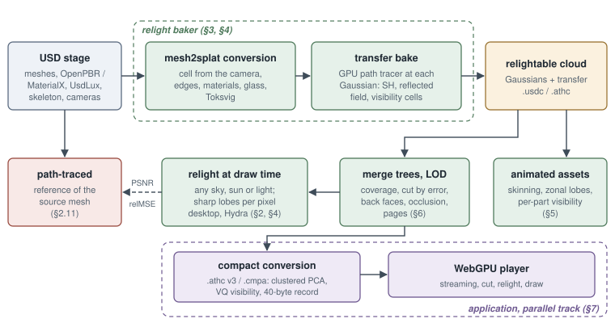
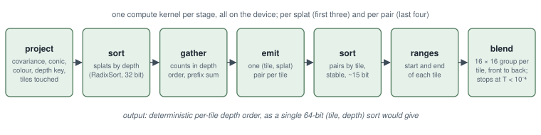

# Architecture

athenea is a USD engine written in C++ and Slang. It reads a stage through Hydra, and every step that touches scene data is a GPU compute kernel. On that engine it bakes production USD assets into Gaussian splats that can be relit: each mesh becomes anisotropic Gaussians, and the engine's path tracer bakes into every Gaussian how any sky reaches it, so the cloud is relit at draw time under skies and lights it was never baked under.

This page is an overview. The depth is in [`docs/development.md`](https://github.com/jesusluque/athenea/blob/main/docs/development.md) (how the engine is made and changed) and [`docs/decisions.md`](https://github.com/jesusluque/athenea/blob/main/docs/decisions.md) (why it is so, and what was measured).

## Two products, two processes

<figure markdown>
  
  <figcaption>The two processes: the bake makes the production master; the web format is derived from it.</figcaption>
</figure>

The work is two processes with different goals, described in the [paper](paper.md) as Part I and Part II.

| | The production master | The web format |
|---|---|---|
| Process | Part I, the bake | Part II, derived from the master in a separate step |
| File | a USDC: a `ParticleField3DGaussianSplat` per cloud, with athenea primvars (`primvars:athenea:splat:`) | `.athc` version 3, compressed and streamed by pages |
| Holds | every parameter at full precision | the master's parameters encoded: clustered PCA of the transfer, vector-quantised open directions, a 40-byte compact record |
| Read by | the engine (`athenea stage`, `athenea view`, the hdAthenea delegate), the OpenFX node in Nuke and Natron, the Blender add-on | a WebGPU player in a browser, on desktop and on a phone |
| Goal | fidelity | size, memory and frame time |
| Judged by | its relit image against a path trace of the source mesh under the same sky and lights | its loss against the master's uncompressed relight |

**The master.** Its standard attributes (positions, orientations, scales, opacities, radiance harmonics) are read by any USD application; the athenea primvars carry the rest: the material per Gaussian, the baked transfer, and for an animated asset its rig and visibility. It is produced by these steps, each a set of GPU kernels:

1. **Conversion** (`athenea mesh2splat`): each mesh becomes Gaussians, one per cell of a lattice sized from a camera's pixel footprint, with the layered material captured per Gaussian.
2. **The transfer bake** (`--transfer`): the path tracer traces each Gaussian's hemisphere and stores how any sky reaches it.
3. **The rig and visibility** of an animated asset: skinning influences per Gaussian and per-part visibility fields (`athenea visibility`).
4. **Levels of detail**: merge trees whose cut by screen error is bounded.

**The web format.** It starts where the master ends and changes nothing in it. A phone tab has a memory budget (about 50–60 MB of asset data while the camera moves, about 100 MB at rest), a download that must start drawing within seconds, and a frame time; the format is made to meet those. The tools that write `.athc` version 3 and the WebGPU player that reads it are not in this repository. The engine's `lod` module has its own `.athc` reader and writer (`lod/Athc.h`), used by `athenea convert` and the engine's streaming.

## Modules

<figure markdown>
  
  <figcaption>The modules in dependency order.</figcaption>
</figure>

`modules/<name>` is a static library `athenea::<name>`. The modules are listed in `modules/CMakeLists.txt` in dependency order, and each links only the ones above it.

| # | Module | What it holds |
|---|---|---|
| 1 | core | `Result` (errors without exceptions), logging, `Platform` (the whole OS surface) |
| 2 | ui | the viewer's panels as a description, drawn by `athenea view` and the iOS app |
| 3 | sched | `FrameClock`: genlock PTP and ST 2059-1 alignment, timecode; built only with genlock |
| 4 | image | `Image`: float32 RGBA premultiplied, bottom-left origin; what gpe and aofx exchange |
| 5 | io | CPU file readers (PLY header, SPZ, SOG zip/WebP, OpenVDB), EXR with attributes, the standard files `athenea flatten` writes |
| 6 | gpu | the slang-rhi device, `ShaderLibrary`, `ComputeKernel` (parameters bound by name), `CommandBatch`, `Buffer`, `AsyncReadback`; `gpu/algo` for prefix sum and radix sort |
| 7 | gpu_host | gpe adopting slang-rhi's device: one `MTLDevice`, CUDA context or `VkDevice`, buffers shared without copies |
| 8 | colour | OpenColorIO as a compiler of Slang functions and LUTs |
| 9 | scene | `CloudLoader`: raw records uploaded and decoded on the GPU into `GpuSplats` / `GpuPoints`, the layout every renderer reads |
| 10 | render | `TileRasterizer`, `GaussianRayTracer`, `PointRasterizer`, `ReferenceRenderer`, `Camera` / `Projection`, `Flatten` |
| 11 | geom | `MeshBuilder` (Hydra meshes triangulated and their primvars expanded on the GPU), `Skinner`, `Subdivision` |
| 12 | material | `TextureStore` (decode, mips, UDIM), `MaterialCompiler` (MaterialX graphs into Slang), the lobe library |
| 13 | light | UsdLux lights on the device: a record per light, and how a shading point samples one |
| 14 | world | `GpuScene` (vertex, index and primvar pools, instance records), `Instancing`, `RayTracingScene` (BLAS/TLAS), `BvhScene` (compute LBVH) |
| 15 | technique | how a frame is drawn: the visibility routes, material shading, `PathTracer`, `AovShading`, `Denoiser` (OIDN), `DisplayTransform`, `SplatVisibility` |
| 16 | lod | `LodBuilder`, `CutSelector`, `Athc.h` (the `.athc` reader and writer), `StreamingPool` |
| 17 | usd | `Engine`, `StageRenderer`, `Export`; the `hdAthenea` Hydra plugin; the codeless schemas in `modules/usd/schemas` |
| 18 | mcp | the engine as an MCP server: JSON-RPC 2.0 (`Server`) and the tools over a warm stage |
| 19 | aofx | this engine's side of the AOFX host (aopenfx's `host/`): capabilities, `renderEffect` |
| 20 | view | `athenea view`: GLFW window, Dear ImGui drawn on the engine's device |

Some modules are conditional: `sched` is built only with `ATHENEA_WITH_GENLOCK`; `gpu_host`, `mcp` and `aofx` are not built for iOS; `view` only with `ATHENEA_BUILD_VIEW`. An embedder links `athenea::engine`, an interface target holding the renderer without the viewer, the MCP server or `athenea::usd`.

## Shaders

The Slang shaders live under `shaders/athenea/<area>` and mirror the modules. They are copied to `build/<preset>/shaders` by the build and compiled at run time.

| Directory | What it holds |
|---|---|
| `common` | what every area shares; `packing.slang` is the cross-module contract: how a splat's opacity, scale, quaternion and colour are packed |
| `algo` | prefix sums, radix sorts, mip chains |
| `scene` | decoding and validating clouds on the device |
| `splat` | the tile rasteriser's pipeline (`frame.slang` names its stages), flatten, the sky turned into a cloud's frame |
| `rt` | the Gaussian ray tracer and its compute BVH; both routes share `rt_integrate.slang` |
| `points` | the point rasteriser |
| `reference` | the reference renderer and the image comparisons (statistics, HDR and 8-bit comparison) |
| `lod` | decimation, the cut, the `.athc` blocks |
| `geom` | mesh topology and normals, primvar expansion, skinning, curves |
| `world` | instancing, the scene's compute BVH, motion |
| `material` | the lobe library, the material runtime, MaterialX support (`mx`) |
| `light` | lights, environments, the light BVH, IES profiles |
| `technique` | visibility, shading, AOVs, Cryptomatte ids, display transforms |
| `volume` | volumes and NanoVDB |
| `usd` | the `usd` module's kernels: AOV conversion, world position, the bake's gather and resolve, mesh2splat validation |
| `view` | the viewer's ImGui drawing |
| `test` | the check kernels the tests use as GPU oracles |

## Programs

`apps/athenea` is the command line (CLI11). Each subcommand is documented in [`docs/operations.md`](https://github.com/jesusluque/athenea/blob/main/docs/operations.md), section 2.

| Subcommand | What it does |
|---|---|
| `info` | the device, what it can do, and the toolchain |
| `render`, `bench` | splat files to an EXR; the same frame timed |
| `convert` | a splat file into a USD `ParticleField` stage, or into a `.athc` with levels of detail |
| `decimate` | fewer Gaussians, kept where they matter |
| `stage` | a USD stage rendered through the engine's Hydra delegate |
| `view` | a window on a stage: free camera, stage cameras, outputs, picking |
| `live` | a stage on a clock, each frame at its ST 2059-1 instant; only in builds with genlock |
| `mesh2splat` | a USD stage of meshes into Gaussians, optionally with the transfer bake and skinning |
| `flatten` | a stage's transfer clouds under a sky, as standard Gaussian splatting files (PLY, SPZ, glTF, USD) |
| `visibility` | a skinned cloud's per-part visibility, baked into its file |
| `lights merge` | a base cloud and one cloud per group of lamps, merged into light layers |
| `aofx list`, `aofx run` | the AOFX bundles found; one effect run over EXR files |
| `compare` | what one or two EXR images hold and how far apart they are, measured on the GPU |
| `migrate` | files written under the engine's earlier names, rewritten under athenea's |

`apps/athenea-mcp` is the MCP server over stdio: JSON-RPC 2.0 with a warm device and stage, and tools such as `open_stage`, `stage_tree`, `render`, `pick` and `settings`. The OpenFX node drives it as a child process.

## AOFX plugins

The bundles under `plugins/` are built with aopenfx's SDK (`third_party/aopenfx`), one directory each, picked up without registration, and land in `build/<preset>/aofx`. Data-processing steps of the bake are AOFX effects, so the same binaries run in any AOFX host.

| Bundle | Identifier | What it does |
|---|---|---|
| Mesh2Splat | `rt.sparrow.aofx.mesh2splat` | a mesh into Gaussian splats; the conversion `athenea mesh2splat` runs |
| SplatBakeFilter | `rt.sparrow.aofx.splatbakefilter` | a baked cloud's indirect light averaged between neighbouring Gaussians on their surface |
| SplatTransferZonal | `rt.sparrow.aofx.splattransferzonal` | a baked transfer fitted into one or two zonal lobes in each Gaussian's own frame |
| Measure | `rt.sparrow.aofx.measure` | two images measured against each other on the device; what `athenea compare` runs |
| Invert | `tv.mediapro.aofx.invert` | one minus the image, on the GPU |

## Integrations

| Directory | What it is |
|---|---|
| `integrations/ofx` | `Athenea.ofx.bundle`, an OpenFX generator for Nuke and Natron that draws a cloud out of process; see [OpenFX (Nuke, Natron)](ofx.md) |
| `integrations/blender` | `athenea_hydra`, a Blender extension that registers hdAthenea as a render engine, converts meshes to Gaussians and exports them; see [Gaussian splats in Blender](tutorials/blender.md) |

## How a frame is made

<figure markdown>
  
  <figcaption>The raster route: visibility, shading and the splats composited by view depth.</figcaption>
</figure>

**One GPU, one thread.** Hydra's `Sync` runs on whatever thread the host gives it, and may run on several at once. It never touches the device: it takes a lock and hands the engine CPU-side records. The render pass thread then commits them (uploads, opens `.athc` files, builds acceleration structures) and draws. The device has one caller.

**A rasterised frame.**

1. Meshes are written into a visibility buffer, `(instance + 1, triangle)` per pixel. Three routes write the same ids: `VisibilityRaster`, `VisibilityTrace` and `VisibilityBvh`.
2. Shading and AOVs rebuild the surface from that buffer and shade it, so the three routes shade alike.
3. Points, where there are any, are rasterised into their own layer and composited with the meshes by view z.
4. That opaque layer is handed to `TileRasterizer` as its `under` layer; the splats are projected, sorted, tiled and blended over it in linear light.
5. Domes are painted behind and exposure is applied. `DisplayTransform` turns the frame into something to look at, and only a viewer or a preview calls it.

**A path traced frame.** `PathTracer` integrates from the same visibility buffer, so the raster and path traced routes shade the same surface and can be compared pixel for pixel. A frame of splats alone is traced whole by `GaussianRayTracer`, whose two routes (hardware acceleration structures, compute BVH) share one integrator.

**Materials.** A MaterialX graph is compiled into a Slang module named by a hash of its source, so materials that differ only in values share one module.

**Hydra render buffers** are bottom row first, as Storm's, and are converted only when a host maps them. `athenea view` keeps frames on the device.
