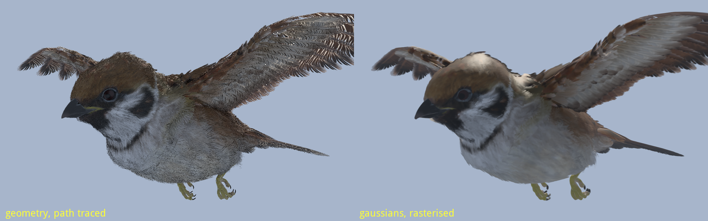

athenea

# A relight baker for 3D Gaussian splatting

athenea converts production USD assets into Gaussian splats and bakes, into every Gaussian, the light transport that relights it at draw time. The result is judged against a path trace of the source mesh under the same camera and the same light. The baker runs on a USD and Hydra renderer in which every step that touches scene data is a GPU compute kernel.

These pages describe the desktop version on the public `main` branch: how it is built, and how a USD asset becomes a relit cloud.

## The flow

| Step | Command | What it produces |
|---|---|---|
| 1. Conversion and bake | `athenea mesh2splat` | a `UsdVolParticleField3DGaussianSplat`: one Gaussian per cell, with its material and, with `--transfer`, how much of a sky reaches it from each direction |
| 2. Relight and render | `athenea stage`, `athenea view` | the cloud drawn under the stage's lights, by raster or by path trace, through the same Hydra delegate a DCC loads |
| 3. Reference | `athenea stage --technique rt` | the source meshes path traced from the same camera |
| 4. Judgement | `athenea compare` | the relative HDR error and the 8-bit code-value distribution between the two images, measured on the GPU |

<figure markdown>
  
  <figcaption>The sparrow from the repository: the source mesh and its Gaussian cloud.</figcaption>
</figure>

## Where to start

- [Desktop installation](install.md): prerequisites, the CMake presets and the runtime environment on macOS (Apple Silicon, Metal) and Linux (x86_64, CUDA).
- [From a USD asset to a baked cloud](tutorials/usd-to-cloud.md): a pawn from the ASWF Open Chess Set, converted with a transfer bake.
- [Rendering and comparing with the path trace](tutorials/render-compare.md): the same pawn drawn as Gaussians and as meshes, and measured.
- [Preparing a USD stage](tutorials/authoring-usd.md): plugin paths, materials, lights, render settings and the schemas the engine reads.
- [Large clouds and levels of detail](tutorials/large-clouds.md): levels, decimation and streaming under a GPU budget.

The full option tables are in [`docs/operations.md`](https://github.com/jesusluque/athenea/blob/main/docs/operations.md), which these pages follow.
