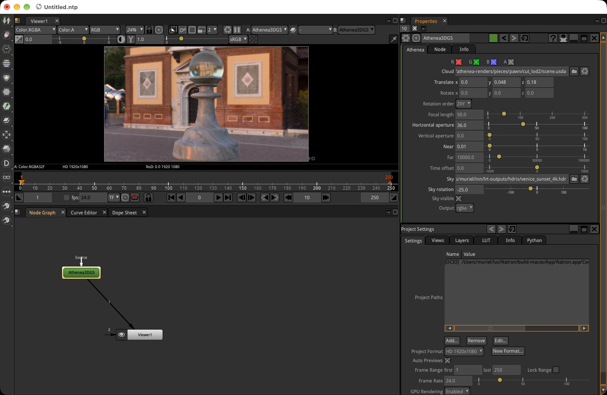
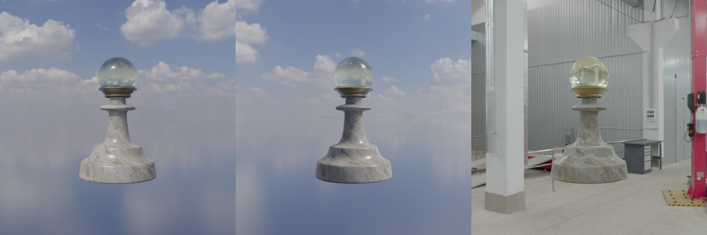

# OpenFX (Nuke, Natron)

`Athenea.ofx.bundle` is an OpenFX plugin with one node, **Athenea 3DGS** (group *Athenea*). It is a generator with no input: it draws one Gaussian cloud through the node's camera, at the project's format and the frame's time, with athenea's rasteriser, and outputs linear premultiplied RGBA floats and the frame's other layers (depth, world position, Cryptomatte). A relightable cloud (a transfer) is lit by a sky the artist chooses on the node.

The source is `integrations/ofx`. The operations manual describes it in section 6.1 of [`docs/operations.md`](https://github.com/jesusluque/athenea/blob/main/docs/operations.md), and the design and measurements are in the section *The OpenFX plugin* of [`docs/decisions.md`](https://github.com/jesusluque/athenea/blob/main/docs/decisions.md).

## The engine out of process

<figure markdown>
  
  <figcaption>Natron with the Athenea 3DGS node: the node graph (Athenea3DGS into the Viewer), its parameters (cloud, camera, sky, output) and the pawn under the Venice sunset.</figcaption>
</figure>

The plugin loads none of the engine. A compositor carries its own OpenUSD and TBB, and the engine brings one of each; two of either in one process share symbols. So the plugin links only OpenFX's support library and a JSON parser, and starts `athenea-mcp`, the engine's MCP server, as a child process the first time it renders.

- The server keeps the device and the cloud open between frames.
- Each frame comes back as numbers in a file in the temporary directory, never as a picture: RGBA floats, then depth, then the layers asked for, bottom row first and premultiplied, as an OpenFX image lies.
- There is one server for the whole host process, whatever number of instances of the node the host makes (Natron makes one per render thread), so a cloud is loaded once. Renders go to it one at a time.
- A device lost or a kernel fault ends the server, not the host; the next frame starts it again.

## Building

The plugin is built with the engine when `ATHENEA_BUILD_OFX` is on, which is the default. The CMake build compiles it on macOS and Linux, and not on Windows. It has been run in Natron on macOS (see *Measured*). It needs the `third_party/openfx` submodule, which is Natron's OpenFX: its support library carries the multi-plane extension (Foundry's planes and Natron's custom planes).

```sh
cmake --preset macos-arm64-release          # or linux-x86_64-release
cmake --build --preset macos-arm64-release
```

The bundle is written to `<build>/ofx/Athenea.ofx.bundle`, laid out as OpenFX lays one out:

| Path inside the bundle | What it holds |
|---|---|
| `Contents/MacOS/Athenea.ofx` (macOS), `Contents/Linux-x86-64/Athenea.ofx` (Linux) | the plugin |
| `Contents/Info.plist` (macOS) | the bundle's description |
| `Contents/Resources/bin/athenea-mcp` | the server the plugin starts |

## Installing

Copy or link the bundle into a directory the host searches for OpenFX plugins: on macOS `/Library/OFX/Plugins`, or any directory listed in `OFX_PLUGIN_PATH`.

| Variable | What it does |
|---|---|
| `ATHENEA_MCP` | the server the plugin starts, in place of the `athenea-mcp` in `Contents/Resources/bin` and of one on the `PATH` |
| `ATHENEA_OFX_DEBUG` | set to anything: the plugin prints each frame's request and the server's answer (its time) on standard error |

## Parameters

<figure markdown>
  
  <figcaption>The sky on the node: the same cloud under a sky, the same sky turned 120 degrees, and a workshop interior.</figcaption>
</figure>

| Parameter | Value | Default | Notes |
|---|---|---|---|
| `cloud` | file | none | a `.usdc` or `.usda` holding the cloud (a `ParticleField3DGaussianSplat`). Empty draws nothing |
| `translate` | 3 numbers | `0 0 5` | where the camera stands, in the cloud's units |
| `rotate` | 3 numbers, degrees | `0 0 0` | about x, y and z |
| `rot_order` | `XYZ` … `ZYX` | `ZXY` | the order the rotations apply in, the first letter first; ZXY is Nuke's default |
| `focal` | mm | `50` | |
| `haperture` | mm | `24.576` | |
| `vaperture` | mm | `0` | 0 fits the format's aspect, pixel aspect counted, as Nuke fits a camera to its format |
| `near`, `far` | scene units | `0.1`, `10000` | the clipping planes |
| `time_offset` | frames | `0` | added to the frame to give the cloud's USD time, for an animated (skinned) cloud |
| `sky` | file | none | an HDR image (lat-long `.hdr` or `.exr`) on every dome of the stage; empty keeps the stage's own; a stage with no dome gets one |
| `sky_rotation` | degrees | `0` | about the stage's up axis |
| `sky_visible` | on/off | on | off leaves the background transparent, to merge over a plate; the sky still lights |
| `output` | `rgba`, `depth`, `P`, `CryptoObject00` … `02` | `rgba` | the layer shown in RGBA by a host that takes no planes; `depth` is the view z in every channel |

**The camera.** The matrix is built as Nuke builds a Camera node's: the rotations in the order chosen, then the translation, looking down −z with +y up. A Camera node's knobs (`translate`, `rotate`, `rot_order`, `focal`, `haperture`) are linked to these by expression, so the cloud moves with the plate's camera. The node renders whole frames, not tiles.

**The sky.** The sky is set only when it changes, since each change is a session edit Hydra syncs. The first frame after a change prepares the new sky (its harmonics and prefiltered chain); the frames after it cost what they did before.

## Layers

<figure markdown>
  
  <figcaption>What the node outputs, from one render: RGBA (relit, premultiplied), depth, P (world position) and Cryptomatte (one id per object: the body and the glass head).</figcaption>
</figure>

| Layer | Channels | Content |
|---|---|---|
| colour | `R G B A` | linear, premultiplied |
| `depth` | `Z` | the view z, 0 where nothing was drawn |
| `P` | `X Y Z A` | the world position, made on the device from the depth; `A` 1 where something was drawn |
| `CryptoObject00` … `CryptoObject02` | `R G B A` | the Cryptomatte's layers: id, coverage, id, coverage |

Gaussians write colour, depth and the Cryptomatte; `P` is derived from the depth. Normals and motion vectors are not written for Gaussians.

**Natron**, a host that takes planes, gets every layer as a plane of the node's output, whatever `output` says, drawn in one call; only the planes the host asks for are drawn. Natron's writer defaults to half floats, which would round a Cryptomatte id into another: write the matte with a 32-bit float bit depth.

**Nuke** takes from an OpenFX node only its own planes, so there `output` picks the one layer RGBA shows; one node per layer gives them all.

The Cryptomatte's manifest does not reach the host, since OpenFX carries no metadata: a matte is picked by id rather than by name.

## Measured

From the section *The OpenFX plugin* of `docs/decisions.md`. The server's times are those `ATHENEA_OFX_DEBUG` prints.

| Case | Result |
|---|---|
| Unit sphere, 96k Gaussians, 640 × 360, through the OpenFX test host (`tests/ofx`), against `athenea-mcp`'s own render of the same camera | identical (relMSE 0); a warm frame costs the server 16 ms |
| `P` against the depth, sparrow cloud, 480 × 270 | distance along the view axis within 7e-8 relative; every covered pixel reprojects onto its own centre |
| Pawn transfer cloud, 1024 × 1024, sky changed | about 0.4 s for the first frame after the change, 50 ms for the frames after it; the stage's own sky given back draws a frame identical to the stage's (relMSE 0) |
| Pawn in Natron, 1920 × 1080, every plane, 32-bit float | one EXR of 21 channels; colour and `P` identical to the test host's frames of the same camera (relMSE 0; `P` within 1e-6) |
| Corvette transfer cloud (3 M Gaussians, 2.9 GB), 24 frames in Natron, 1920 × 1080, every plane | first frame 7.5 s (the stage opened and uploaded); 120–170 ms a frame with a still sky; 190–220 ms with the sky turning every frame; 14 s from the first render to the last write |

## Not done

- The order of Nuke's rotations is taken from its documentation and has not yet been checked in Nuke.
- Nuke's own camera input (its OpenFX camera extension) in place of linked knobs.
- Normals and motion vectors of Gaussians, which the rasteriser does not write.
- The sky as an image input of the node rather than a file.
- `.ply` and `.spz` opened directly rather than converted first.
- Linux and Windows builds, and a signed bundle. The CMake build compiles the plugin on Linux, but the record lists the Linux build as not done; on Windows the plugin is not compiled.
