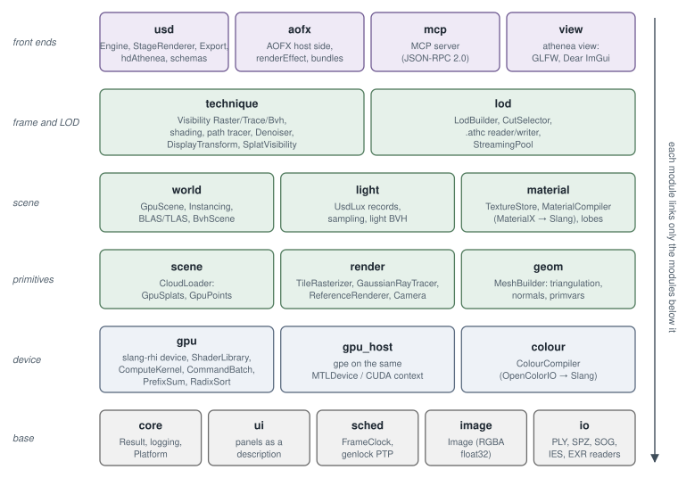

<!-- Copyright (c) 2026 jesus luque. -->
<!-- Generated by docs/paper/site.py from docs/paper; edit the sources there. -->

# Part I. The bake: from production USD to a relightable master USDC 

The first process turns a production USD asset into a Gaussian cloud that can be relit, and writes it as a USD file:
the **master**. Its goal is fidelity. The master is judged by one criterion, its relit image against a path trace of
the source mesh under the same sky and lights, and every choice in it – the cell size, the bake's samples, the bits
per direction, the merge cost – is made by that measurement, not by its size.

**Bake** — in rendering, to "bake" a result is to compute it once, with an expensive method, and store it so that it can be read cheaply later. Here the bake is the whole of Part I: from a USD stage one obtains a cloud of Gaussians that carries, besides its geometry and its colour, precomputed data on how light reaches it (the transfer, §4). The expensive part (path tracing the hemisphere of each Gaussian) is paid once per asset; the cheap part (relighting at draw time) is paid every frame.

**Relight / relightable** — a 3DGS cloud trained from photographs [1] carries its light "painted in": its colour is outgoing radiance under the capture's illumination and cannot be changed. A relightable cloud carries, instead of (or in addition to) that radiance, the material parameters and the light transport needed to recompute the radiance under a new sky and new lights. It is the idea of Precomputed Radiance Transfer [14] applied per Gaussian.

**Master** — the highest-fidelity copy, in the post-production sense (the *master* of a film from which every distribution print is struck). Compression decisions (Part II, §7) are taken afterwards and on top of it; the master is not optimised for size.

**The single criterion** — judging the master by its image against a path trace of the source mesh under the same illumination turns every parameter (cell size, samples, bits, merge cost) into a measurable question: does it improve or worsen the error against the reference truth? It is the alternative to judging by metrics intrinsic to the cloud (number of Gaussians, PSNR on the training views), which say nothing about how it will look under other light. The risk of this criterion is that a global metric (PSNR, relMSE) can reward a slightly dark or blurred image; that is why the paper uses per-class metrics and judges whole frames (§8).

*References:* [1], [14], [43] in §10; code: `apps/athenea/src/CmdMesh2Splat.cpp`, `apps/athenea/src/CmdDecimate.cpp`; `docs/decisions.md` (section "Path traced into gaussians: the bake").

**Input.** A USD stage as production delivers it: meshes with their MaterialX or OpenPBR materials, UsdLux lights and
domes, cameras, and for an animated asset its skeleton and clips.

**USD stage** — in OpenUSD [43], a *stage* is the composed view of a scene: the root of a hierarchy of *prims* that results from composing layers through sublayers, references, payloads, variants and inherits. "As production delivers it" means with all of that composition, not an ad hoc flattened file.

**MaterialX and OpenPBR** — MaterialX [31] is the ASF standard for describing renderer-independent material graphs (texture, maths and BSDF nodes). OpenPBR Surface [30] is a standardised "uber-shader" surface model (the joint successor of Autodesk Standard Surface and Adobe Standard Material), expressed as a MaterialX graph. In USD they arrive as `UsdShade` networks.

**UsdLux and domes** — UsdLux is USD's light schema: `SphereLight`, `DiskLight`, `RectLight`, `CylinderLight`, `DistantLight` and `DomeLight` (an environment in a lat-long image that surrounds the scene). A dome is what other tools call an HDRI or an environment light.

**Skeleton and clips** — UsdSkel defines a `Skeleton` (a hierarchy of joints with its bind pose), the per-point influences (`skel:jointIndices`, `skel:jointWeights`) and `SkelAnimation` with the transforms over time. USD *value clips* let the animation live in separate files that are sequenced in time (the sparrow has 71 clips, §5).

*References:* [30], [31], [43] in §10; OpenUSD specification (openusd.org, "UsdSkel", "UsdLux", "Value Clips"); code: `modules/usd/src/Light.cpp`, `modules/usd/src/Material.cpp`, `modules/usd/src/SkelSplat.cpp`.

**The process**, in the order it runs, each step a set of GPU kernels on the engine of Section 2:

1. **Conversion** (Section 3). Each mesh becomes anisotropic Gaussians, one per cell of a lattice sized from a camera's
   pixel footprint, with the coverage of the surface as opacity, edges held where it stops or folds, the layered
   material captured per Gaussian, glass classified as solid or thin wall, and roughness widened by the normals' spread.
2. **The transfer bake** (Section 4). The engine's path tracer traces each Gaussian's hemisphere and stores how any sky
   reaches it: degree-3 harmonics of direct and indirect light, a reflected field, 256 bits of open directions and the
   surface's curvature. With these the cloud is relit at draw time under skies and lights it was never baked under.
3. **The rig and visibility** of an animated asset (Section 5): influences and their gradients per Gaussian, zonal
   transfer lobes that turn with a limb, and per-part visibility fields.
4. **Levels of detail** (Section 6): per-part merge trees whose cut by screen error is bounded, back-face and shared
   occlusion culls, and pages ordered by error, written beside the leaves in the same file format.

**Anisotropic Gaussian** — a 3D Gaussian with a covariance $\Sigma$ not proportional to the identity: it has three axes with different scales $s_1, s_2, s_3$ and an orientation $R$, so its isosurface is an ellipsoid and not a sphere. To represent a surface, two axes are aligned with the tangent plane and the third (the "normal") is very thin; in the limit $s_3 = 0$ it is a disc, the surfel of §2.5.2 [5][6].

**Lattice, cell and pixel footprint** — the conversion places one Gaussian per cell of a regular grid (lattice) over the surface. The cell size comes from how large a pixel of a reference camera is at the object's distance (the pixel's *footprint* on the surface): if the cell is smaller than the footprint, Gaussians are spent on invisible detail; if it is larger, the cloud looks blurred. It is the same logic as choosing a mip level [13].

**Coverage as opacity** — a Gaussian is not "opaque" or "transparent": its opacity $\alpha$ multiplies its profile and several neighbouring Gaussians overlap. For a surface that, in the mesh, covers a fraction $F$ of what lies behind it (e.g. a 0.5 mask) to cover the same once converted, the opacity of each Gaussian is solved so that the product of the stack's transmittances gives $1-F$ (see the note in §2.5.3 and `docs/decisions.md`, "A converted surface covers what its opacity says").

**Transfer, degree-3 harmonics** — spherical harmonics (SH) are an orthonormal basis of functions on the sphere; up to degree $\ell = 3$ there are $(3+1)^2 = 16$ functions. Storing the transfer in SH lets relighting be a dot product between the transfer's coefficients and the sky's [14][17]. 16 coefficients for direct light (monochrome: visibility × cosine) and 48 = 16 × 3 RGB for indirect light (with coloured interreflections).

**Open directions** — 256 bits per Gaussian, one per direction of a fixed partition of the hemisphere/sphere: 1 if the sky is visible from the Gaussian in that direction. They make it possible to shade point lights and suns (which degree-3 SH cannot represent, being high-frequency) with a bit lookup.

**Merge tree and cut** — the LOD groups Gaussians in pairs into a binary tree whose leaves are the originals and whose interior nodes are merged Gaussians that approximate their children [2][9][34]. A *cut* is a set of nodes that covers every leaf exactly once; choosing it by screen error is the technique of Nanite [35] and of hierarchical 3DGS [2].

*References:* [2], [5], [6], [9], [12], [13], [14], [17], [34], [35] in §10; code: `plugins/mesh2splat/` (the AOFX effect), `shaders/athenea/usd/mesh2splat_cells.slang`, `shaders/athenea/usd/mesh2splat_bake.slang`, `modules/lod/include/athenea/lod/Lod.h`.

**Output: the master USDC.** A `ParticleField3DGaussianSplat` per cloud (or per merge tree), whose standard attributes
(positions, orientations, scales, opacities, radiance harmonics) are read by any USD application, and whose athenea
primvars carry the rest at full precision:

| parameter | primvar (`primvars:athenea:splat:`) | per Gaussian | § |
|---|---|---|---|
| material | `normal`, `metallic`, `roughness`, `materialRoughness`, `transmission`, `specularWeight`, `coatWeight`, `sheenColor`, `emission`, `schlickMetal`, `thinWalled`, `closed`; `ior` per cloud | a value per property | 3.6–3.8, 6.6 |
| transfer (TX) | `transferDirect` (16), `transferIndirect` (48 rgb), `transferReflected` (48 rgb) | 112 values | 4.2, 4.4 |
| open directions | `shadowBits` | 256 bits | 4.4.2 |
| curvature | `curvature` | $(S_{uu}, S_{uv}, S_{vv})$, 3 floats | 4.8 |
| transfer and visibility, together | | 480 B in the file, 256 B on the device | 4.2 |
| rig | `skel:jointIndices`, `skel:jointWeights` (4 each), `jointWeightGradients` (half, 6), `transferZonal` (10), `skinningXforms` per joint | | 5.3, 5.5, 5.7 |
| levels of detail | `lodTree`, `lodParent`, `lodStart`, `lodSize`, `lodCost`, `lodSpill`, `coverage`, `coverageMass`, `occlusionIndex`; `occlusionCodebook` per tree; the merges written after the leaves | per node | 6.2–6.8 |
| ids | `cryptoObject`, the Cryptomatte id of the Gaussian's prim; `cryptoManifest` per cloud | 1 word | 2.5.2, 3.10 |

**`ParticleField3DGaussianSplat`** — the OpenUSD schema (introduced in the 25.x/26.x series) for Gaussian splat clouds: a prim with the standard attributes `positions`, `orientations` (quaternions), `scales`, `opacities` and SH radiance coefficients. Using the standard schema guarantees that any application that reads USD sees at least the cloud with its capture colour, even if it ignores athenea's data.

**Namespaced primvars** — in USD, a *primvar* is an attribute interpolable over the geometry (constant, uniform, vertex, varying, faceVarying). The prefix `primvars:athenea:splat:` isolates them: an application that does not know them ignores them without error. Their precision is full (float32) in the master; quantisation is left to the derived formats.

**How to read the table** — "per Gaussian" is the cost per element. The transfer is $16 + 48 + 48 = 112$ values; with the 256 bits (32 B) of open directions they form the 480 B block in the file (112 floats × 4 B = 448 B + 32 B). On the device it is packed to 256 B (halves and quantisation), which sets the memory budget at draw time. `jointWeightGradients` (6 halves) is the spatial derivative of the skinning weights along the Gaussian's two tangent axes, which lets its covariance be deformed and not only its centre (§5.5). `transferZonal` (10 values) are lobes of *zonal harmonics*, SH with rotational symmetry about an axis, which can be rotated cheaply with the limb [16].

**Cryptomatte** — `cryptoObject` is the 32-bit id (a hash of the prim's name) that the Cryptomatte standard [47] uses to generate per-object mattes in compositing; `cryptoManifest` maps hash → name.

*References:* [16], [43], [47] in §10; code: `modules/usd/include/athenea/usd/Export.h`, `modules/usd/src/Export.cpp`, `modules/usd/src/ParticleField.cpp`, `shaders/athenea/common/transfer_layout.slang`; `docs/decisions.md` (sections "Step 4: the ParticleField, read against `schema.usda`" and "A transfer right under any sky and any light (task TX)", subsection "What a file costs").

Sizes measured on the assets of this paper: the pawn's two clouds 489 MB; the sparrow, skinned with transfer and
visibility, 216 MB; the Corvette's relightable cloud of 3 M Gaussians 2.9 GB; the Corvette's close-up level as 24 merge
trees of 74.5 M leaves and 148.9 M nodes, 87.4 GB.

**How to judge the sizes** — these are masters at full precision, not distribution formats. The Corvette cloud (3 M Gaussians, 2.9 GB) comes to ≈ 970 B per Gaussian: the 480 B of transfer + visibility, plus geometry, radiance SH, material and LOD. The close-up level (74.5 M leaves, 148.9 M nodes ≈ 2 nodes per leaf, as befits a complete binary tree with $2n-1$ nodes) takes 87.4 GB, ≈ 590 B per node. These sizes justify Part II: the distribution target for the Corvette on an iPhone was of the order of 60–90 MB, three orders of magnitude less.

*References:* §7 of the paper; `docs/decisions.md` (sections "The Corvette on an iPhone (11-12 Oct)" and "Decimation: the levels of detail, cut once by what a merge loses").

**Who reads the master.** The engine itself, through Hydra, on both its raster and its path tracer; the comparison
against the path trace (Section 8); the OpenFX node in a compositor and the Blender add-on (§2.14); the image channels
of §4.11. And every derived format, of which Part II describes one. The master is the source: a derived format is made
from it and cannot be turned back into it.

**Hydra** — OpenUSD's rendering architecture [43]: a *scene delegate* (or a chain of *scene indices*) translates the stage into render primitives, and a *render delegate* (here `hdAthenea`) draws them. In this way the same renderer works in `usdview`, Houdini, Blender and any Hydra host with no host-specific code.

**OpenFX** — an open standard for image-effect plugins for compositors (Nuke, Natron, Resolve, Flame). An OpenFX node receives parameters and time and writes a frame.

**Irreversible derived format** — the one-way direction master → derivative is deliberate: a derivative quantises, prunes and truncates (e.g. lower-degree SH, transfer compressed by k-means [23]), and the information lost cannot be recovered. This forces the master to be kept as the source and the derivatives to be regenerated when the compressor changes.

*References:* [23], [43] in §10; code: `modules/usd/src/RenderDelegate.cpp`, `integrations/ofx/src/AtheneaOfx.cpp`; Blender add-on in `integrations/blender/athenea_hydra/`.

# 2. The athenea engine and renderer

athenea is a USD renderer built so that every step that touches scene data runs on the GPU. It draws three kinds of
primitive: meshes, with MaterialX materials and UsdLux lights; points; and 3D Gaussian splats. It offers two
techniques, an interactive raster and a path tracer that serves as ground truth. Hydra feeds both through the
`hdAthenea` render delegate. This section covers the engine's architecture, the algorithms each subsystem runs, how
correctness is established without a CPU oracle, and what has been measured. Unless stated otherwise, every number is
quoted from `docs/decisions.md`, with its unit and conditions, and was measured on an Apple M5 Pro under Metal.

**"GPU-first" renderer** — every piece of scene data (vertices, splats, textures, lights) is transformed in compute kernels and the CPU only does I/O and bookkeeping. It is a stronger constraint than is usual in production renderers, which prepare geometry on the CPU and only trace on the GPU.

**Raster vs path tracer** — the raster resolves primary visibility (what is seen at each pixel) and approximates the illumination (direct light, without full interreflections). The path tracer solves Kajiya's rendering equation (1986)
$$L_o(x,\omega_o) = L_e(x,\omega_o) + \int_{\Omega} f(x,\omega_i,\omega_o)\,L_i(x,\omega_i)\,|\cos\theta_i|\,d\omega_i$$
by Monte Carlo, recursively; it converges to the physically correct value (given the material model) as samples increase, which is why it serves as the *reference truth*.

**CPU oracle** — in testing, an *oracle* is the independent implementation that says what the correct answer is. The usual one in GPU renderers is a reference CPU renderer. Here it is forbidden (§2.1) and is replaced by closed forms, by a second independent kernel (e.g. `ReferenceRenderer`) and by Storm (OpenUSD's OpenGL/Metal renderer) as an external oracle (§2.8).

**Apple M5 Pro with Metal** — a unified-memory GPU: CPU and GPU share the same DRAM. This affects the memory figures (§2.3) and makes the cost of "uploading" data a copy within the same memory, not a transfer over PCIe.

*References:* Kajiya, J. T. (1986), "The Rendering Equation", SIGGRAPH; [43] in §10; `docs/decisions.md` (all the "Measured (M5 Pro, ...)" sections).

## 2.1 Design rules

The codebase holds to a small number of rules. Where possible, each one is enforced by a test.

1. **No CPU arithmetic on data.** athenea has no CPU reference renderer, no CPU fallback and no CPU test oracle. The
   host reads files, parses headers, decompresses, and keeps the books: counts, slots and queues. Decoding, sorting,
   merging, culling, mip generation, light power prefixes and image comparison are all compute kernels. Steps that
   had run on the host were moved to the device; examples are per-element
   interleaving of `ParticleField` arrays, half-to-float conversion, per-pixel conversion of Hydra render buffers, and
   each light's cumulative share of the frame's power (`light_prefix.slang`). The one documented exception is Dear
   ImGui's tessellation, which processes viewer chrome and no scene data.
2. **Binding by name.** Every shader parameter is bound through reflection (`cursor["name"].setBinding(...)`,
   `ComputeKernel::dispatch`) and never by slot, which removes the class of errors in which a slot count
   drifts from the shader's declaration.
3. **Errors as values.** Errors are reported as `Result<T>` with `ATHENEA_TRY`, and nothing throws. OS calls
   live only in `modules/core/Platform`, which is also where a Windows port would start.
4. **One Slang, one slang-rhi, one TBB per process.** OpenUSD, OIDN and the engine share one TBB, and the
   `single_tbb` test checks the count. For the same reason OIDN is built from source: its release binaries ship a
   second `libtbb.12`.
5. **GPU devices only, everywhere.** OIDN is built for GPU devices only, because a denoiser that falls back to the
   CPU is a CPU fallback. A test whose capability is missing on a device skips and names the missing capability.

**Rule 1, no CPU arithmetic** — the motivation is twofold. (a) Performance and scalability: tens of millions of Gaussians do not fit in a CPU loop per frame, and any CPU step forces a round trip of data. (b) A single implementation: if a CPU path existed, there would be two versions of every algorithm silently diverging. The examples cited are steps that were on the host and were migrated: the *interleave* of `ParticleField`'s separate arrays (USD stores positions, scales, etc. as independent arrays; the device wants them interleaved in `GpuSplats`), the half → float conversion, the per-pixel conversion of the render buffers (`shaders/athenea/usd/aov_convert.slang`) and the light power prefix (`shaders/athenea/light/light_prefix.slang`), which is a prefix sum (scan) of each light's power so that a light can be chosen with probability proportional to its power by binary search in the CDF.

**Rule 2, binding by name (reflection)** — Slang [44] exposes the reflection of the compiled program: the layout of each parameter. slang-rhi offers a `ShaderCursor` that navigates that layout by name (`cursor["positions"]`). The classic alternative, giving numeric *slots* (registers `t0`, `u3`, descriptor set indices), breaks silently when a parameter is added and the indices shift; moreover each backend (Metal argument buffers, Vulkan descriptor sets, CUDA kernel parameters) numbers differently.

**Rule 3, errors as values** — `Result<T>` is a "value or error" sum type (like C++23's `std::expected` or Rust's `Result`). `ATHENEA_TRY(expr)` evaluates, and if there is an error returns it to the caller; otherwise it extracts the value. Advantage: the error's control flow is explicit and no exceptions cross the boundaries of C libraries (slang-rhi, OIDN, AOFX plugins). `Platform` gathers `mmap`, free physical memory, paths, processes, etc., which delimits the work of a Windows port.

**Rule 4, one TBB per process** — Intel oneTBB keeps a global *scheduler*; two copies of the library in one process (e.g. one from OpenUSD and another bundled with OIDN) duplicate the thread pool and can cause oversubscription or subtle failures from duplicated global state. That is why OIDN is built from source against USD's TBB. The `single_tbb` test counts the `libtbb` images loaded.

**Rule 5, GPU devices only** — OIDN [45] can run on the CPU; building it only with GPU backends prevents a configuration without a compatible GPU from silently falling back to the CPU, which would violate rule 1. Tests that require a capability (hardware ray tracing, rasterisation) are marked *skipped*, naming the capability, instead of passing or failing misleadingly.

**The Dear ImGui exception** — the UI library generates the interface's triangle lists on the CPU. It touches no scene data, which is why it is accepted.

*References:* [44], [45] in §10; code: `modules/core/include/athenea/core/Platform.h`, `modules/core/src/Platform.cpp`, `modules/gpu/src/ComputeKernel.cpp`, `tests/CMakeLists.txt` (`single_tbb` test), `cmake/Usd.cmake`; the repository's `CLAUDE.md` ("Rules this codebase holds to").

The backends are those of slang-rhi: Metal (macOS, iOS), Vulkan and CUDA (Linux, NVIDIA L4). All kernels are
written in Slang.

**slang-rhi** — the rendering hardware interface layer of the Slang project (shader-slang/slang-rhi on GitHub): a single API to create devices, buffers, textures, pipelines and command encoders over Metal, Vulkan, D3D12, CUDA (and experimental WebGPU). The engine calls no native graphics API directly except at the interoperability points (gpe, OIDN).

**Backends** — *Metal* (Apple), *Vulkan* (Khronos, cross-platform) and *CUDA* (NVIDIA, pure compute, no rasteriser; ray tracing goes through OptiX). The NVIDIA L4 is a data-centre GPU (Ada Lovelace, 24 GB) used for testing on Linux and Windows.

**Slang** — a shading language derived from HLSL with modules, generics, interfaces and automatic differentiation, which compiles to MSL, SPIR-V, CUDA/PTX, HLSL and WGSL [44]. Writing everything in Slang gives a single source per kernel for every backend.

*References:* [44] in §10; github.com/shader-slang/slang-rhi; shader-slang.org (language documentation); code: `modules/gpu/src/Device.cpp`.

## 2.2 Module architecture

Each module under `modules/<name>` is a static library, `athenea::<name>`. Modules are listed in dependency order and
each links only the ones above it (`modules/CMakeLists.txt`) (Figure 2).

| Module | Contents |
|---|---|
| core | `Result`, logging, `Platform` (all OS calls) |
| ui | viewer panels as a description (`Controls.h`, `GaussianPanel.h`), walked by `athenea view` and the iOS app |
| sched | `FrameClock`: genlock PTP and ST 2059-1 alignment, timecode |
| image | `Image`: float32 RGBA premultiplied, bottom-left origin; the type gpe and AOFX exchange |
| io | CPU file readers (PLY header, SPZ, SOG zip/WebP, IES), EXR with attributes |
| gpu | slang-rhi device, `ShaderLibrary`, `ComputeKernel`, `CommandBatch`, `Buffer`, `AsyncReadback`; `gpu/algo` (PrefixSum, RadixSort) |
| gpu_host | gpe adopting slang-rhi's device: one `MTLDevice` or CUDA context, buffers shared without copies |
| colour | `ColourCompiler` (OpenColorIO as a compiler into Slang), `ColourNames` |
| scene | `CloudLoader`: raw records uploaded and decoded on the GPU into `GpuSplats` / `GpuPoints` |
| render | `TileRasterizer`, `GaussianRayTracer`, `PointRasterizer`, `ReferenceRenderer`, `Camera`/`Projection`, `SplatEdit` |
| geom | `MeshBuilder`: Hydra meshes triangulated, smooth-normalled and primvar-expanded on the GPU |
| material | `TextureStore`, `MaterialCompiler` (MaterialX → Slang), the lobe library |
| light | UsdLux lights on the device: one record per light, sampling, densities, light BVH |
| world | `GpuScene`, `Instancing`, `RayTracingScene` (BLAS/TLAS), `BvhScene` (two-level compute LBVH) |
| technique | `VisibilityRaster/Trace/Bvh`, shading, `AovShading`, path tracer, `Denoiser`, `DisplayTransform`, `SplatVisibility` |
| lod | `LodBuilder`, `CutSelector`, the `.athc` reader/writer and `StreamingPool` (Section 6) |
| usd | `Engine`, `StageRenderer`, `Export`, the `hdAthenea` plugin, codeless schemas |
| mcp | the engine as an MCP server (JSON-RPC 2.0) |
| aofx | this engine's side of the AOFX host (aopenfx `host/`), `renderEffect`, the bundles |
| view | `athenea view`: GLFW window, Dear ImGui on the engine's device |

**Dependency order** — each module links only the ones above it in the table: an acyclic graph imposed by construction. Thus there are no circular dependencies and a prefix can be extracted (for example `core`…`render` for a splat-only player) without dragging in USD.

**Terms in the table** — *genlock PTP / ST 2059-1*: frame synchronisation with broadcast studio clocks (Precision Time Protocol, IEEE 1588, and its SMPTE ST 2059 profile for aligning video signals), used by `athenea live`. *gpe*: a GPU processing library (submodule `third_party/gpe`) that adopts the same `MTLDevice`/CUDA context to share buffers without copies. *BLAS/TLAS*: the bottom/top level acceleration structures of hardware ray tracing (one per mesh / one per scene of instances). *LBVH*: Karras's linear BVH [32], built by sorting Morton codes. *MCP*: Model Context Protocol, a JSON-RPC protocol through which AI agents call tools. *AOFX*: aopenfx's effect plugin interface (`third_party/aopenfx`).

**`.athc`** — the engine's chunk container for clouds with LOD and streaming (§6), read by `StreamingPool`.

*References:* [32] in §10; IEEE 1588-2019; SMPTE ST 2059-1/2; modelcontextprotocol.io; code: `modules/CMakeLists.txt`, `modules/sched/include/athenea/sched/FrameClock.h`, `modules/lod/include/athenea/lod/Athc.h`, `modules/world/src/BvhScene.cpp`.

The shader tree `shaders/athenea/` mirrors the modules (common, algo, scene, splat, rt, points, reference, lod, geom,
world, material, light, technique, usd, volume, view). Shaders are copied into the build tree and compiled at run
time.

**Run-time compilation** — the `.slang` files are not compiled in the C++ build; they are copied to `build/<preset>/shaders` and `ShaderLibrary` compiles them when loading them. Advantages: a shader-only change needs no C++ recompilation; generated modules (materials, OCIO) use the same path; link constants are specialised by value. Cost: the first run pays for compilation, mitigated by the `DiskShaderCache` (§2.3).

*References:* code: `modules/gpu/src/ShaderLibrary.cpp`, `cmake/Shaders.cmake`; the repository's `CLAUDE.md` ("Checking a shader compiles").

## 2.3 GPU foundations

**Device and kernels.** `gpu::Device` wraps a slang-rhi device. `ComputeKernel` is one compute entry point compiled
as a pipeline. It is dispatched in threads, not groups: the group count is rounded up on every backend and each kernel
does its own bounds check. `RasterKernel` is a vertex and fragment pipeline that pulls its data from
`StructuredBuffer`s, with no vertex buffers or input layouts. `RayTracingKernel` covers OptiX and Vulkan RT
pipelines. On Metal, slang-rhi offers no ray tracing pipelines, so tracing uses inline `RayQuery` inside compute
kernels.

**Device, pipeline and dispatch** — a *compute pipeline* is an entry point compiled and linked with its parameter layout. To *dispatch* is to launch it over a grid of thread groups (threadgroups in Metal, blocks in CUDA, workgroups in Vulkan). `ComputeKernel::dispatch` receives the number of *threads* and computes $\lceil N / \text{groupSize}\rceil$ groups; since the last group has spare threads, every kernel begins with `if (tid >= count) return;`. This unifies the backends: Metal has `dispatchThreads` (with partial groups) but Vulkan and CUDA do not.

**`RasterKernel` without vertex buffers** — the vertex shader reads from `StructuredBuffer`s indexed by `SV_VertexID`/`SV_InstanceID` (*vertex pulling*). It avoids declaring per-format *input layouts* and lets the same `GpuScene` buffers serve raster, rays and compute.

**`RayTracingKernel` and inline `RayQuery`** — there are two styles of hardware ray tracing. The *pipeline* style (DXR/Vulkan RT/OptiX) uses separate shaders (raygen, closest-hit, any-hit, miss) and a shader binding table. The *inline* style (`RayQuery`, DXR 1.1 / `VK_KHR_ray_query` / Metal `intersection_query`) traverses the structure from any shader, including a compute one, with an explicit loop over candidates. slang-rhi on Metal exposes only the second form, which is why on Metal all tracing is inline.

*References:* slang-rhi documentation; Khronos, `VK_KHR_ray_query` and `VK_KHR_ray_tracing_pipeline`; NVIDIA OptiX 9 Programming Guide; Apple, Metal Shading Language Specification (ray tracing); code: `modules/gpu/src/ComputeKernel.cpp`, `modules/gpu/include/athenea/gpu/RasterKernel.h`, `modules/gpu/include/athenea/gpu/RayTracingKernel.h`.

**ShaderLibrary.** The library loads Slang modules. A module may declare link-time constants
(`extern static const uint kName;`) and is then linked against a generated exports module, which yields one program
per distinct set of values. It also compiles modules that exist only as generated source, such as materials and the
colour functions; loading an existing name with different source is refused. A persistent `DiskShaderCache` writes
one file per compiled program, keyed by slang-rhi's hash of the linked program. With a warm cache the whole test
suite went from 89 s to 26 s.

**Link constants** — `extern static const uint kName;` declares a constant whose value is not in the module: it is supplied at link time, by a generated "exports" module that defines it. The compiler then sees a concrete value and can unroll loops and eliminate branches (specialisation), like Vulkan's *specialization constants* or Metal's *function constants*, but portably. Each combination of values gives a distinct program, which multiplies variants and compilations: the cache matters.

**Rejecting an existing name with different code** — a Slang module is identified by name; if two different materials generated the same name, the second would receive the first one's program. Detecting it turns a silent error into an explicit one. That is why generated modules carry a hash of their code in the name (`athenea_cs_<hash>`, §2.12).

**`DiskShaderCache` and the 89 s → 26 s figure** — compiling Slang to MSL/SPIR-V and then through the driver's compiler is expensive (hundreds of ms per large kernel). The cache stores the binary by the hash of the linked program; with it warm the whole suite dropped to under a third, which indicates that ~70 % of the test time was shader compilation and not execution.

*References:* [44] in §10; Slang documentation ("Link-time specialization"); code: `modules/gpu/src/ShaderLibrary.cpp` (`ShaderLibrary::link`), `modules/gpu/src/ShaderCache.h`, `modules/gpu/src/ShaderCache.cpp`; `docs/decisions.md` (section "Complete USD: GPU foundations (M1)").

**Parallel primitives.** `PrefixSum` and `RadixSort` are the only sorting and scanning in the engine. The tiled
radix route (`radix_block.slang`) is a reduce-then-scan form of the stable LSD pass. A group of 256 threads counts a
tile of 1024 keys in group memory, a digit-major prefix sum places each tile's share of each digit, and the group
sorts its tile with eight one-bit splits. It sorts 10 M 32-bit pairs in **12.4 ms**, against 39.9 ms for the chunked
passes it replaced from 65 536 elements up. It uses no wave operations and no device atomics.

**Prefix sum (scan)** — given a sequence $x_0, x_1, \dots$, the exclusive prefix sum is $y_i = \sum_{j<i} x_j$. It is the primitive that turns "how many elements each thread produces" into "where each thread writes" (compaction, pair emission, histograms). On the GPU it is done in blocks: a local scan in shared memory, a scan of the block totals, and adding the offset (Blelloch 1990; Harris et al., GPU Gems 3 ch. 39).

**Stable LSD radix sort** — sorts integer keys digit by digit starting from the *least significant digit*; each pass must be stable (preserving the relative order of keys with the same digit) so that the final result is sorted by the full key. With $b$-bit digits and $k$-bit keys there are $k/b$ passes, each one: a digit histogram, a scan of the histogram (each digit's output position) and a scatter.

**Block-wise reduce-then-scan** (`radix_block.slang`) — a variant (Merrill and Grimshaw 2011, "High Performance and Scalable Radix Sorting") in which each group of 256 threads processes a block of 1024 keys (4 per thread): it counts its block's histogram in group memory (*reduce*), a global scan ordered by digit (all blocks of digit 0, then of digit 1…) gives the offset of each (block, digit), and the group sorts its block locally with eight one-bit *splits* (each split is a 1-bit scan, stable) before writing. Sorting locally before the scatter makes the writes to global memory contiguous per digit (coalesced), which is where the gain comes from.

**No wave operations or atomics** — *wave/subgroup ops* (ballot, prefix within the warp) and device atomics speed up the fastest radix sorts (Onesweep, Adinets and Merrill 2022), but their semantics vary across backends (wave width 32 on NVIDIA/Apple, 64 on AMD; non-deterministic atomic order). Doing without them gives a portable and **deterministic** sort: the same result bit for bit on Metal, Vulkan and CUDA.

**How to read 12.4 ms for 10 M pairs** — 10 M × 8 B = 80 MB per pass of reading and as much of writing, ×4 passes of 8 bits → ~640 MB moved, ≈ 50 GB/s effective. The M5 Pro's bandwidth is of the order of hundreds of GB/s, so there is headroom; the 3.2× improvement over the chunked version is the relevant measure. The threshold of 65 536 elements indicates that for small sizes the previous version is still better (fewer launches).

*References:* Blelloch, G. (1990), "Prefix Sums and Their Applications"; Merrill, D., Grimshaw, A. (2011), "High Performance and Scalable Radix Sorting", Parallel Processing Letters; Adinets, A., Merrill, D. (2022), "Onesweep"; code: `modules/gpu/src/algo/RadixSort.cpp`, `modules/gpu/src/algo/PrefixSum.cpp`, `shaders/athenea/algo/radix_block.slang`, `shaders/athenea/algo/radix_histogram.slang`, `shaders/athenea/algo/radix_scatter.slang`; `docs/decisions.md` (subsection "Where a rasterised frame of splats went, and what came off it").

**Mips.** slang-rhi does not generate mip chains, so `MipGenerator` is a kernel. Each texel of a level is the
area-weighted mean of the texels above it. An odd edge $2n+1$ folds into $n$ with weights $(n-x,\,n,\,x+1)/(2n+1)$,
so every source texel gives exactly $n/(2n+1)$ of itself to the level below and the chain preserves level 0's mean.
On sizes 64², 37×23, 1×9 and 128×5, the means agree to 2·10⁻⁶.

**Mip chain** — a mipmapped texture stores successive half-resolution versions (Williams 1983, "Pyramidal Parametrics") so that it can be filtered without aliasing when minified. Each level is obtained by averaging the previous one.

**The odd-edge problem** — if a level has $2n+1$ texels, the next has $n$ (rounding down). The naive 2×2 box filter drops a texel or weights it wrongly, and the image's mean drifts from level to level. With the three-tap filter $(n-x,\ n,\ x+1)/(2n+1)$ for destination texel $x$, each destination covers exactly $(2n+1)/n$ source texels and each source texel distributes in total $n/(2n+1)$ of itself. Sum of weights per destination: $(n - x + n + x + 1)/(2n+1) = 1$. Summing over all destinations, the image total is preserved scaled by $n/(2n+1)$, which is exactly the ratio of areas: the **mean** is preserved exactly.

**Why the mean matters** — the dome is importance-sampled using the 1×1 level as the mean $\bar L$ (§2.10); if the chain does not preserve the mean, the pdf does not integrate to 1 and the estimator is biased. The test with non-power-of-two sizes (37×23, 1×9, 128×5) and the agreement to $2\cdot10^{-6}$ (float32 relative precision ≈ $10^{-7}$ accumulated over several levels) validates exactly that invariant.

*References:* Williams, L. (1983), "Pyramidal Parametrics", SIGGRAPH; code: `modules/gpu/src/algo/Mips.cpp`, `modules/gpu/include/athenea/gpu/algo/Mips.h`, `shaders/athenea/algo/mips.slang`; `docs/decisions.md` (subsection "A dome's mips keep its solid-angle mean (research 087, step 1)").

**Memory as a first-class error.** A Metal command buffer that runs out of memory used to assert inside slang-rhi on
Metal's completion thread, which ended the process. A patch now records the error on the queue
(`SLANG_E_OUT_OF_MEMORY`) and returns it from the next `submit()` or `waitOnHost()`. `Device::admit` refuses any
allocation that would exceed the budget: `ATHENEA_GPU_BUDGET`, or else Metal's `recommendedMaxWorkingSetSize`, which
is 18 186 MiB on the M5 Pro. An allocation must also fit the free physical memory less 1.5 GiB. On unified memory,
several processes each within Metal's figure can together exhaust physical memory and force the system to swap.
When a frame runs out of memory, `Engine::relieveMemory` steps down: it drops splat shadows first, then moves up to four LOD levels coarser, and finally reopens streams at half their budget.

**Command buffer and completion** — in Metal, GPU work is recorded into an `MTLCommandBuffer` and submitted; a *completion handler* runs on a system thread when it finishes. If the GPU could not allocate memory, the error appears there. slang-rhi used to `assert` on that thread, which killed the process with no chance of recovery. The patch (in the project's slang-rhi) turns the failure into `SLANG_E_OUT_OF_MEMORY` returned at the next synchronous call.

**Budget and `recommendedMaxWorkingSetSize`** — `MTLDevice.recommendedMaxWorkingSetSize` is the figure Metal recommends as the maximum memory the GPU can keep resident without degrading performance (on the M5 Pro, 18 186 MiB ≈ 17.8 GiB, a fraction of the total RAM). `Device::admit` rejects, before allocating, any buffer that would exceed it (or `ATHENEA_GPU_BUDGET` if set).

**Free physical memory minus 1.5 GiB** — Metal's figure is per process; with unified memory, two processes that each respect their limit can exhaust the joint RAM and force paging (swap to SSD), which for a GPU amounts to a system stall (macOS's WindowServer can go down). The second condition queries the system's actual free memory (through `Platform`) and keeps 1.5 GiB in reserve.

**`Engine::relieveMemory`, stepwise degradation** — on a memory failure in a frame, instead of aborting, quality is lowered in steps from most to least expendable: (1) the splat shadow tracer is released, (2) the *LOD bias* is raised by up to four coarser levels, (3) the `.athc` streams are reopened with half the budget. It is the *graceful degradation* pattern of game engines.

*References:* Apple Developer, `MTLDevice.recommendedMaxWorkingSetSize`; code: `modules/gpu/src/Device.cpp` (`Device::admit`, `kSystemReserve`), `modules/gpu/include/athenea/gpu/Device.h`, `modules/core/src/Platform.cpp`, `modules/usd/src/Engine.cpp` (`relieveMemory`), `tests/gpu/test_memory.cpp`; `docs/decisions.md` (section "Out of device memory is an error, and the engine steps down").

## 2.4 The Gaussian representation

Every renderer, the loaders and the LOD share one GPU layout, `GpuSplats`. Each splat takes **32 bytes before its
harmonics**, defined in `common/packing.slang`:

| Field | Encoding | Reason |
|---|---|---|
| position, opacity | 4 × float32 | fp16 positions would step two pixels at 4K close up |
| rotation | smallest-three quaternion, 3 × 10 bits + dropped index | within a tenth of a degree |
| scale | f16 of $\log s$ per axis | 0.1 % relative precision at every size |
| base colour | 3 × f16 | may leave [0, 1] |
| SH rest | `shWords` × u32, f16 per coefficient | signed |
| normal (optional) | octahedral 2 × 16 bits | shading normal kept apart from the frame |
| emission (optional) | RGB9E5 | radiance the surface emits |

**32-byte layout** — 16 B of `positions` (xyz + opacity, float32) + 16 B of `shape` (4 × uint32 with packed rotation, scale and base colour). Against the 59 floats (236 B) of the 3DGS PLY [1] with degree-3 SH, it reduces memory and, above all, the bandwidth of projection, which reads every splat every frame.

**Position in float32** — a half (fp16) has 10 mantissa bits: relative precision $2^{-11} \approx 4.9\cdot10^{-4}$. For an object 2 m from the origin, the step is ~1 mm, which close up at 4K is ~2 pixels. Positions do not tolerate that quantisation.

**Smallest-three quaternion** — a unit quaternion $(x,y,z,w)$ has 3 degrees of freedom. The component of largest magnitude is omitted (its index is stored, 2 bits) and reconstructed as $\sqrt{1 - a^2 - b^2 - c^2}$ with a positive sign (possible because $q$ and $-q$ represent the same rotation). The other three lie in $[-1/\sqrt2, 1/\sqrt2]$, a range quantised to 10 bits each: 32 bits in total. The resulting angular error is of the order of a tenth of a degree. A standard technique in game networking (Glenn Fiedler, "Snapshot Compression") and in SPZ/SOG.

**Scale as f16 of $\log s$** — storing the logarithm turns relative precision into absolute precision: a half's error in $\log s$ (~$10^{-3}$) gives a relative error in $s$ of ~0.1 % whatever its magnitude, from the micrometre to the kilometre. 3DGS already optimises in log space.

**Base colour in f16** — the DC term of the SH; it can leave [0,1] (the SH are summed and clamped afterwards; moreover a cloud written by athenea stores linear HDR radiance).

**Octahedral normal** — a mapping of the unit sphere onto the square $[-1,1]^2$ by projecting onto the octahedron $|x|+|y|+|z| = 1$ and folding the lower hemisphere (Cigolle et al. 2014, "A Survey of Efficient Representations for Independent Unit Vectors", JCGT). 2 × 16 bits give an error < 0.01°. It is kept separate from the Gaussian's frame because the shading normal (with a normal map, smoothing) does not coincide with the ellipse's thin axis.

**RGB9E5** — a shared-exponent HDR colour format: three 9-bit mantissas and a common 5-bit exponent (32 bits). It is the `GL_RGB9_E5`/`MTLPixelFormatRGB9E5Float` format: range up to 65 408 with relative precision ~1/512 with respect to the largest channel.

*References:* [1] in §10; Cigolle, Z. et al. (2014), JCGT 3(2); `EXT_texture_shared_exponent` specification; code: `shaders/athenea/common/packing.slang` (`encodeQuaternion`, `packNormal`, `packRgb9e5`), `shaders/athenea/common/octahedral.slang`, `modules/scene/include/athenea/scene/GpuClouds.h` (`struct GpuSplats`).

`CloudLoader` reads PLY, SPZ, SOG, `.splat` and USD `ParticleField` prims. It uploads the raw records and decodes
them on the GPU. For SOG, the host's only work is to unzip the archive and decode the WebP images.

**Cloud formats** — *PLY*: the output format of the original 3DGS [1], a binary table of floats per splat. *SPZ*: Niantic's compressed format (gzip of quantised fields, ~10× smaller). *SOG*: PlayCanvas's format (Self-Organizing Gaussians, Morgenstern et al. 2024): the attributes are arranged in a 2D grid and stored as WebP images inside a zip, taking advantage of image compression. *`.splat`*: the 32 B/splat format of antimatter15's web viewer.

**Upload raw and decode on the GPU** — the host only does what is inherently sequential or library work (inflating the zip, the WebP decoder); all the dequantisation, exponent computation, quaternion normalisation and packing go in `splat_decode.slang`/`sog_decode.slang`. It is rule 1 applied to loading.

*References:* [1] in §10; Morgenstern, W. et al. (2024), "Compact 3D Scene Representation via Self-Organizing Gaussian Grids", ECCV; github.com/nianticlabs/spz; code: `modules/scene/include/athenea/scene/GpuClouds.h` (`CloudLoader`), `modules/io/src/SplatReaders.cpp`, `shaders/athenea/scene/splat_decode.slang`, `shaders/athenea/scene/sog_decode.slang`; `docs/decisions.md` (sections "SPZ" and "SOG").

**Linear light.** Every Gaussian is blended in linear Rec.709, and sRGB appears only where an image is displayed. A
capture keeps the sRGB harmonics it was trained with: each projection evaluates them, clamps at zero and converts to
linear (`cloudLight`) before blending. A cloud written by athenea declares that it holds light
(`primvars:athenea:splat:linear`) and is used as stored. On two half-opaque overlapping discs, the rasteriser, the
reference and the ray tracer each match the analytic over-operator at p99 0. Under the previous encoded blend, all
three read p99 26.

**Blending in linear light** — the *over* operator (Porter and Duff 1984) $C = c_1\alpha_1 + (1-\alpha_1)C_2$ is a weighted sum of radiances, and radiance is additive only in linear space. Blending values encoded in sRGB (with its ~gamma 2.2 curve) gives dark edges and wrong semitransparency. The original 3DGS trains and blends in sRGB, and its SH learnt to compensate for that error; that is why a capture is evaluated in sRGB, clamped to $\ge 0$ and converted to linear before blending (`cloudLight`). This does not reproduce the training image exactly, but it makes splats and meshes (which are linear) composite correctly.

**Linear Rec.709** — the primaries and D65 white of sRGB/BT.709 without the transfer function; it is the engine's scene working space.

**p99 0 versus p99 26** — p99 is the 99th percentile of the per-pixel error in 8-bit sRGB codes (§2.15). p99 0 means that 99 % of pixels match the analytic over exactly; p99 26 (≈10 % of the range) was the systematic error of blending in the encoded space.

*References:* Porter, T., Duff, T. (1984), "Compositing Digital Images", SIGGRAPH; ITU-R BT.709; IEC 61966-2-1 (sRGB); code: `shaders/athenea/common/color.slang` (`cloudLight`), `modules/usd/src/ParticleField.cpp`, `shaders/athenea/test/linear_blend.slang`; `docs/decisions.md` (section "Every gaussian is blended in linear light").

## 2.5 The tile rasteriser

`render::TileRasterizer` is the interactive route for splats. It is a sort-based, deterministic tile rasteriser in
the 3DGS family. Seven stages run on the device (Figure 3):

| Stage | Work |
|---|---|
| project | per splat: covariance, conic, colour, 24-bit depth key, footprint, exact count of tiles touched |
| sort | splats by depth (RadixSort) |
| gather | tiles-touched counts in depth order, prefix sum |
| emit | one (tile, splat) pair per touched tile, in depth order |
| sort | pairs by tile, stably, on tile bits only |
| ranges | start and end of each tile's pairs |
| blend | per pixel: its tile's pairs, front to back |

**The 3DGS tile rasteriser** — Kerbl et al.'s algorithm [1] for drawing millions of Gaussians: split the screen into tiles, give each tile the list of splats that touch it sorted by depth, and have each tile walk it front to back with *early termination*. It is a "software" rasteriser in compute: it does not use the hardware's triangle rasteriser.

**The seven stages** — *project* computes each splat's 2D ellipse and how many tiles it touches; *sort* orders splats by depth; *gather* scans the counts to know where each splat writes its pairs; *emit* writes one (tile, splat) pair per touched tile; the second *sort* groups pairs by tile; *ranges* finds the start and end of each tile in the sorted list (detecting key changes between neighbours); *blend* composites per pixel.

**Deterministic** — the same input produces the same frame bit for bit, on any run. Rasterisers that use atomics to reserve pair positions are not (the order of the atomics varies), which produces flicker between splats of equal depth and makes comparing at 0 impossible.

*References:* [1] in §10; code: `modules/render/src/TileRasterizer.cpp`, `shaders/athenea/splat/splat_project.slang`, `shaders/athenea/splat/splat_gather_counts.slang`, `shaders/athenea/splat/splat_emit.slang`, `shaders/athenea/splat/splat_ranges.slang`, `shaders/athenea/splat/splat_blend.slang`.

The engine sorts splats by depth once (N 32-bit keys) and then sorts pairs stably by tile (P keys of about 15 bits).
This gives every tile its splats in depth order, with ties broken by splat index, exactly as a single 64-bit
(tile, depth) sort would. The construction is deterministic. Tiles are 16 × 16 pixels.

**Two sorts instead of one 64-bit sort** — the original 3DGS forms a 64-bit key `(tile << 32) | depth` per pair and sorts it with CUB. Here: (1) sort the $N$ splats by depth (24–32-bit keys), (2) emit the pairs in that order, (3) sort the $P$ pairs by tile only with a **stable** sort. Thanks to stability, within each tile the pairs stay in emission order, which is depth order. Advantage: the large sort ($P$, typically several times $N$; 8.8 M pairs for 5.9 M splats in §2.5.3) uses ~15-bit keys (the bits needed to index the tiles: 1920×1080/256 ≈ 8100 tiles → 13 bits), that is 2 passes of 8 bits instead of 8.

**Ties by index** — if two splats have the same key, the stable radix sort keeps the input order (index), a tie-breaking rule that `ReferenceRenderer` replicates exactly (§2.15).

**16 × 16 tiles** — 256 pixels = one group of 256 threads, each one a pixel; it is the standard 3DGS compromise between few tiles per splat (fewer pairs) and little wasted work per pixel.

*References:* [1] in §10; code: `modules/render/src/TileRasterizer.cpp` (`kTile = 16`).

### 2.5.1 Projection

A splat with rotation $R$ and scales $S=\mathrm{diag}(s)$ has the 3D covariance $\Sigma = R S S^\top R^\top$, built
in the cloud's own space. With $W$ the linear part of object-to-view and $J$ the Jacobian of the perspective map at
the view-space centre $t$, the screen covariance is the EWA local affine approximation

$$\Sigma_{2D} = (J W M)(J W M)^\top,\qquad M = R S,\qquad
J=\begin{pmatrix} f_x/t_z & 0 & -f_x t_x/t_z^2\\ 0 & f_y/t_z & -f_y t_y/t_z^2\end{pmatrix}.$$

**3D covariance** — $\Sigma = R S S^\top R^\top$ with $R$ the quaternion's rotation matrix and $S = \mathrm{diag}(s_1,s_2,s_3)$. This factorisation guarantees that $\Sigma$ is symmetric positive semidefinite and separates orientation from size; it is the parametrisation of 3DGS [1].

**EWA splatting** — Zwicker et al. [3] showed that a 3D Gaussian projected by an affine transformation remains a Gaussian, with covariance $A\Sigma A^\top$. Perspective projection is not affine, so it is linearised at the splat's centre: its Jacobian $J$ (the derivatives of the screen coordinates with respect to the view coordinates). With $u = f_x t_x/t_z$, $\partial u/\partial t_x = f_x/t_z$ and $\partial u/\partial t_z = -f_x t_x/t_z^2$, which are the rows of $J$. Writing $\Sigma_{2D} = (JWM)(JWM)^\top$ instead of $JW\Sigma W^\top J^\top$ is equivalent but avoids forming $\Sigma$ and is numerically better (the product of a factor by its transpose is SPD by construction).

**Pitfall: the affine approximation** — the linearisation is exact only at the centre; for large splats near the camera or at the edges of the field of view the real ellipse is distorted. It is the main reason for the differences between rasteriser and ray tracer in perspective scenes (§2.15), and the motivation for 3DGRT [7] and for the ray tracer of §2.6.

*References:* [1], [3], [7] in §10; code: `shaders/athenea/splat/splat_project.slang`.

Before $J$ is built, $t_x/t_z$ and $t_y/t_z$ are clamped to the frustum widened to $[-0.15, 1.15]$ of the image. A
splat far off screen would otherwise smear across the whole frame, and 3DGS clamps in the same way. Orthographic
cameras use $J=\mathrm{diag}(f_x,f_y)$.

**Clamping to the widened frustum** — $J$ grows as $1/t_z$ and as $t_x/t_z^2$: a splat far outside the field of view (or almost behind the camera) would have an enormous Jacobian and a screen ellipse covering the whole image, with cost and artefacts. Clamping $t_x/t_z$ to the image range widened by 15 % on each side (1.3 times the FOV) limits the linearisation to a reasonable region. The original 3DGS uses the same factor 1.3 (`limx = 1.3 * tan_fovx`).

**Orthographic** — with no division by $z$, $J$ is the constant scale $\mathrm{diag}(f_x,f_y)$ and the EWA projection is exact (which is why the orthographic tests allow the strictest tolerance, §2.15).

*References:* [1] in §10; code: `shaders/athenea/splat/splat_project.slang` (the `-0.15` and `1.15` limits).

**Shutter and lens, as convolutions.** A Gaussian smeared along a straight screen path $d$ under a uniform shutter
is that Gaussian convolved with a segment. Matching second moments turns this into a rank-one update. A thin lens
convolves with the disc of the circle of confusion:

$$\Sigma' = \Sigma + \tfrac{1}{12} d\,d^\top,\qquad
\Sigma' = \Sigma + \tfrac{R^2}{4} I,\quad R = f\,A\,\left|\tfrac1z - \tfrac1{z_f}\right|.$$

**Motion blur as a convolution** — the image during the shutter is the time integral of the moving Gaussian. If on screen it moves at constant speed along the vector $d$ (from shutter open to close), the image is the Gaussian convolved with a uniform segment. A uniform distribution on $[-\tfrac12, \tfrac12]$ along $d$ has covariance $\tfrac{1}{12}dd^\top$ (the variance of a uniform of length 1 = $1/12$). Replacing the segment with a Gaussian with the same second moments (*moment matching*) gives $\Sigma' = \Sigma + \tfrac1{12}dd^\top$, a rank-one update. It is an approximation: the result is still a Gaussian, not a "streak" with a plateau, hence the limitation in §2.16 (up to 38 % too peaked).

**Depth of field** — with a thin lens, a point at depth $z$ focused at $z_f$ is seen as a disc (circle of confusion) of radius $R = f A |1/z - 1/z_f|$ on the sensor (here $f$ is the focal length in pixels and $A$ the aperture radius). A uniform disc of radius $R$ has covariance $\tfrac{R^2}{4}I$ (for a disc, $\mathbb E[x^2] = R^2/4$). Moment matching again: the bokeh is represented by a Gaussian, not by a hard-edged disc.

**Alternative** — *Gaussian Splatting on the Move* (Seiskari et al., ECCV 2024) averages several sub-instants; here a single pass suffices. A path tracer would produce both effects exactly by sampling time and lens.

*References:* [3] in §10; Seiskari, O. et al. (2024), "Gaussian Splatting on the Move", ECCV; Potmesil, M., Chakravarty, I. (1981), "A Lens and Aperture Camera Model for Synthetic Image Generation", SIGGRAPH; code: `shaders/athenea/splat/splat_project.slang`; `docs/decisions.md` (sections "A splat under a shutter: one rank-one term, not five passes" and "Depth of field in the rasteriser: the other convolution").

The displacement $d$ has two sources: what a skeleton moved the splat over the shutter (a per-splat buffer), and a
view-space step that combines camera and prim motion (`viewStep`). Both are projected by the same rows $JW$ as the
covariance. The update is checked against the same rasteriser run at N instants and averaged on the device
(§2.5.3).

**Two sources of displacement** — (a) a per-splat buffer with what the skinning moved each Gaussian during the shutter (in cloud space, two packed halves), and (b) `viewStep`, the difference of the object→view matrix between shutter open and close, which combines camera and prim motion in one 3×4. Projecting with the same $JW$ rows makes shape and blur live in a single linearisation.

**Brute-force verification on the GPU** — the truth is the same rasteriser run at N instants of the shutter and averaged in a kernel. It is an oracle independent of the convolution formula (it does not use it), although it shares the rest of the pipeline.

*References:* code: `modules/render/include/athenea/render/TileRasterizer.h` (`viewStep`), `modules/render/src/FrameParams.h`, `tests/render/test_splat_motion.cpp`, `tests/render/test_splat_lens.cpp`.

**Antialiasing filter and the opacity it pays back.** The covariance is then dilated by 0.3 px², as in
Mip-Splatting's 2D filter. Each convolution spreads the splat, so its peak must drop by
$k = \sqrt{\det\Sigma_{\text{still}}/\det\Sigma'}$ to keep its energy. One square root covers the filter, the shutter
and the lens together. Scaling alone loses mass, however, because a splat is drawn only out to where it falls below
1/255, and the spread enlarged that area by $1/k$. A converted plane meant to cover 0.25 covered 0.18 at a twentieth
of the screen. The opacity is therefore paid back as

$$\alpha' = \begin{cases} k\alpha + (1-k)/255 & k\alpha \ge 1/255\\ k\alpha & \text{otherwise.}\end{cases}$$

**The Mip-Splatting filter** — a Gaussian thinner than a pixel produces aliasing (it appears and disappears as it moves). Mip-Splatting [4] convolves the 2D Gaussian with a screen filter (a Gaussian of variance ~0.3 px² on each axis, adding 0.3 to the diagonal of $\Sigma_{2D}$) and **compensates** the opacity to preserve energy. The original 3DGS added 0.3 without compensating, which fattens thin splats as they recede.

**Preserving energy** — the integral of $\alpha\,\exp(-\tfrac12 x^\top\Sigma^{-1}x)$ is $\alpha \cdot 2\pi\sqrt{\det\Sigma}$. If $\Sigma \to \Sigma'$, to keep the integral the peak must scale by $k = \sqrt{\det\Sigma/\det\Sigma'} \le 1$. Since filter, shutter and lens are successive convolutions, the product of their factors is the ratio of determinants between the initial and final states: a single square root.

**The cut-off problem (paidOpacity)** — the splat is drawn only where its alpha exceeds 1/255. When it is widened and its peak lowered, a larger fraction of its mass falls below that threshold and is lost; moreover the drawn area does not grow in proportion. Measured result: a plane that should have covered 0.25 covered 0.18 seen small (1/20 of the screen). The correction $\alpha' = k\alpha + (1-k)/255$ approximately pays back the part lost below the threshold: it interpolates between $k\alpha$ (energy preserved) and adding the cut-off threshold in the proportion in which the filter widened the splat. It is applied only if the splat is still visible ($k\alpha \ge 1/255$), so as not to revive splats that the filter made negligible.

*References:* [1], [4] in §10; code: `shaders/athenea/splat/frame.slang` (`paidOpacity`), `shaders/athenea/splat/splat_project.slang`, `shaders/athenea/reference/reference_project.slang`; `docs/decisions.md` (section "A converted surface covers what its opacity says").

This keeps the sharp splat's covered area (`paidOpacity`). Paying back every splat would also draw those the filter
had made too faint to keep. That raised a distant converted pawn from 8.7 to 29.8 ms (debug build), and the rule
above costs 11.0 ms there.

**Why not to all of them** — applying the payback also to splats with $k\alpha < 1/255$ would lift them above the cut-off: tens of thousands of faint, distant splats would start being drawn, multiplying pairs and cost (8.7 → 29.8 ms on the distant pawn). The conditional rule costs 11.0 ms, +26 % against not compensating, in exchange for correct coverage. The figures are from a debug build: they are valid as a relative comparison, not as absolute times.

*References:* `docs/decisions.md` (section "A converted surface covers what its opacity says").

**Footprint and tiles.** A splat is cut at the squared Mahalanobis radius

$$r^2_{\max}(\alpha) = \min\big(2\ln(255\,\alpha),\ 9\big),$$

which is where its own contribution falls below 1/255, and never beyond 3σ. The tile count is exact rather than
taken from a bounding box. For each tile in the axis-aligned extent, the minimum of the quadratic form
$q(\delta)=\delta^\top \Sigma'^{-1}\delta$ over the box of the tile's pixel centres is computed in closed form: since
$q$ is convex, it is either 0 or lies on an edge, where it is a clamped 1D quadratic. The emit stage repeats the same
test. Because the blend cuts at the same radius, no pixel outside a counted tile could have been touched, so tile
edges are seamless. A culled slot writes the reason for culling into its unused depth-key word (edit, depth, no area,
faint, off-screen, no tile), and the viewer's Gaussians panel counts these reasons without adding a counter to the
projection.

**Mahalanobis distance** — $q(\delta) = \delta^\top\Sigma^{-1}\delta$ measures the distance to the centre in units of the Gaussian itself (in squared "sigmas"). The profile is $\alpha\,e^{-q/2}$; it falls below 1/255 when $q > 2\ln(255\alpha)$. Limiting to 9 corresponds to 3σ (where the profile is $e^{-4.5} \approx 1.1\%$). The original 3DGS uses a fixed radius of 3σ of the largest eigenvalue, which greatly overestimates the area of faint splats.

**Exact tile count** — instead of counting every tile of the ellipse's bounding box (which for a diagonal, elongated ellipse includes many empty tiles), the minimum of $q$ over the rectangle of pixel centres is computed for each tile. Since $q$ is a convex quadratic form, its minimum over a box lies in the interior (and is 0 if the centre is inside) or on an edge, where the restricted $q$ is a 1D parabola whose bounded minimum is computed analytically. If that minimum exceeds $r^2_{\max}$, the tile is not touched. It is the same principle as "StopThePop" (Radl et al. 2024) and the "tile-based culling" of later 3DGS work: fewer pairs, less sorting and blending.

**No seams** — since emit and blend use exactly the same test and the same radius, no pixel the splat affects lies in a tile that did not receive it.

**Discard reason in the free key** — a discarded splat needs no depth key; that word is reused to encode why (edit, depth, no area, faint, off screen, no tile). The viewer's panel builds a histogram of those codes without extra atomic counters in the projection.

*References:* [1] in §10; Radl, L. et al. (2024), "StopThePop: Sorted Gaussian Splatting for View-Consistent Real-time Rendering", SIGGRAPH; code: `shaders/athenea/splat/splat_project.slang`, `shaders/athenea/splat/splat_emit.slang`, `shaders/athenea/splat/splat_frame_counters.slang`, `modules/ui/include/athenea/ui/GaussianPanel.h`; `docs/decisions.md` (section "The Gaussians panel: what is on screen, counted where it happened").

**Depth key.** The key is `bit_cast<uint>(z) >> 7`, which is order-preserving for positive floats and 24 bits wide.

**`bit_cast<uint>(z) >> 7`** — for positive IEEE 754 floats, the bit pattern read as an unsigned integer is monotonic with the value (exponent in the high bits, mantissa in the low bits). Shifting by 7 bits drops mantissa precision (from 23 to 16 bits) and leaves a key of 32 − 7 = 25 bits; since the sign bit is always 0 for $z > 0$, 24 useful bits remain, which are sorted with three 8-bit radix passes. The loss of precision only affects splats at almost equal relative depths (≈ $2^{-16}$), whose order is settled by the index.

*References:* IEEE 754-2019; code: `shaders/athenea/splat/splat_project.slang` (`depthKeys[slot] = bit_cast<uint>(t.z) >> 7`).

### 2.5.2 Blending

One 16 × 16 thread group per tile loads the tile's records in batches of 256 into group memory, and every pixel walks
them from there. For pixel $p$ and splat $i$ with conic $Q_i=\Sigma_i'^{-1}$, centre $\mu_i$ and colour $c_i$:

$$\alpha_i(p) = \min\!\Big(0.99,\ \alpha_i' \exp\!\big(-\tfrac12 (p-\mu_i)^\top Q_i (p-\mu_i)\big)\Big),\qquad
C = \sum_i c_i\,\alpha_i \prod_{j<i}(1-\alpha_j) + T\,C_{\text{behind}}.$$

**Group memory (threadgroup/shared memory)** — on-chip memory shared by the threads of a group, much faster than global memory. The tile's 256 threads cooperatively load 256 splat records per batch and then each walks them: each record is read from global memory once per tile, not once per pixel (256× less traffic). It is the technique of the 3DGS CUDA rasteriser.

**Conic** — $Q = \Sigma'^{-1}$, the matrix of the quadratic form (a conic in the geometric sense: the isoline $q = c$ is an ellipse). The inverse is stored (3 values, symmetric) so that $\exp(-\tfrac12 \delta^\top Q\delta)$ can be evaluated without inverting per pixel.

**Compositing equation** — front to back: $T_i = \prod_{j<i}(1-\alpha_j)$ is the transmittance accumulated before splat $i$; its contribution is $c_i\alpha_iT_i$. It is the discrete quadrature of the volume rendering equation (Max 1995) used by NeRF and 3DGS. $T\,C_{\text{behind}}$ adds what is seen through: the background or the opaque layer.

**The min with 0.99** — prevents a single splat from making $T = 0$ exactly (from 3DGS: it keeps gradients alive in training, and here it avoids divisions by $T$ in later recoveries).

*References:* [1] in §10; Max, N. (1995), "Optical Models for Direct Volume Rendering", IEEE TVCG; code: `shaders/athenea/splat/splat_blend.slang` (`kBatch = kTile * kTile`).

Contributions below 1/255 are skipped. A pixel stops once $T=\prod(1-\alpha_j) < 10^{-4}$, and the group stops loading
once all 256 of its pixels are done. $C_{\text{behind}}$ is either the background or the opaque *under* layer of
meshes and points, composited by view z: the walk ends at the first record behind the layer's depth. Depth is written
either as the alpha-weighted mean or as the first crossing of a coverage threshold. The same walk also accumulates a
six-rank Cryptomatte, by id coverage, and for pruning the per-splat contribution $T\alpha$ or the squared error the
splat's removal would leave (the GaussianPOP score). Specialised entry points compile the composite and matte
branches out, because leaving them live in a frame that has neither cost the blend half again.

**Early termination** — when $T < 10^{-4}$, what remains behind contributes at most $10^{-4}$ of the value, invisible in 8 bits; the pixel stops. The group stops loading batches when all its pixels have finished (synchronisation by a barrier and a count of finished pixels).

***Under* layer** — meshes and points are drawn first into an opaque buffer with colour and view depth; the splat blend receives that layer and stops walking splats as soon as it passes the layer's depth (exact occlusion per pixel, not per splat). It is how splats are composited with geometry without putting them into the same z-buffer.

**Depth of a pixel of splats** — there is no single depth in a semitransparent medium. Two conventions: the average weighted by $\alpha_iT_i$ (smooth, good for DOF) or the first crossing of an accumulated-opacity threshold (e.g. 0.5, the "median", good for position/picking).

**Six-rank Cryptomatte** — Cryptomatte [47] stores per pixel the $k$ ids with the most coverage and their fraction; six ranks = three RGBA layers with (id, coverage) × 2. The coverage of an id = the sum of $\alpha_iT_i$ over its splats.

**Pruning score** — $T\alpha$ is the splat's visible contribution to the pixel; summed over pixels and views it gives the importance used by LightGaussian-style pruning. GaussianPOP's alternative [10] measures the squared error that removing it would leave (the colour that would appear behind against the current one), which is more faithful.

**Per-entry-point specialisation** — compiling variants without the compositing and matte branches removes registers and jumps from the inner loop: leaving dead but present branches increased register pressure and lowered the GPU's occupancy (+50 % blend time).

*References:* [10], [47] in §10; Fan, Z. et al. (2024), "LightGaussian", NeurIPS; code: `shaders/athenea/splat/splat_blend.slang` (`kCryptoSlots = 6`), `modules/usd/src/Decimate.cpp`; `docs/decisions.md` (sections "A pixel says which prims it saw: Cryptomatte" and "What no camera sees, and merges no wider than the screen holds (9 Oct)").

**Surfels and harder kernels**. A Gaussian with one scale exactly 0 is a *surfel*. The
rasteriser draws it by intersecting each pixel's ray with the disc's plane (Huang et al. 2024): the disc's axes are
stored in homogeneous screen coordinates and pulled back through the pixel's two planes. The screen filter is a max,
not a convolution: the larger of the disc and a round Gaussian of variance ½ px². Its opacity is paid back by area,

$$\alpha' = \alpha\cdot\min\!\Big(1,\ \frac{\sqrt{\lambda_1\lambda_2}}{\sqrt{\lambda_1\lambda_2}+\tfrac12-\sqrt{\min(\lambda_1,\tfrac12)\min(\lambda_2,\tfrac12)}}\Big),$$

where $\lambda_{1,2}$ are the eigenvalues of the undilated screen covariance. A merged Gaussian may carry an opacity
$D>1$. That value selects Spark's harder kernel, $1-(1-g)^A$ with $A=\exp((D^2-1)/e)$ and $D$ capped at 5. This is the
composite of $A$ coincident Gaussians, and its cut is widened by $0.7(D-1)\sigma$. A *hard surfel* uses
$\exp(-(|u|^p+|v|^p)/2)$, with $p$ fitted to its members' kurtosis. Section 6 covers both, together with the merges
that produce them.

**Surfel** — *surface element* [6]: an oriented disc with a colour. 2D Gaussian Splatting [5] uses 2D Gaussians (normal scale 0) and rasterises them by intersecting each pixel's ray with the disc's plane, instead of projecting a covariance: in this way the Gaussian is exact in perspective (there is no affine approximation) and its depth is geometrically well defined. The method: the disc's plane is described by its two tangent axes in homogeneous screen coordinates; the pixel defines two planes (x = const, y = const) whose intersection is the ray; solving the system gives the $(u,v)$ coordinates of the point of the disc that the pixel sees.

**Screen filter as a maximum** — a disc seen edge-on collapses to a segment with no area. 2DGS fixes this by taking the $\max$ of the disc's Gaussian and a round screen Gaussian (variance ½ px²), instead of convolving. The opacity is paid back by area: the formula compares the area of the projected disc ($\propto\sqrt{\lambda_1\lambda_2}$) with the effective area after the maximum, so that a surfel smaller than half a pixel does not become more opaque (otherwise thin edges, such as mouldings, darken).

**Spark's harder kernel** — a *merged* Gaussian that represents several can carry an "opacity" $D>1$ that is not an opacity but a hardness parameter. $1-(1-g)^A$, with $g$ the Gaussian profile, is the opacity of $A$ identical stacked Gaussians: with large $A$ the centre saturates to 1 and the edge falls more steeply, approximating an opaque disc with a soft edge. $A = \exp((D^2-1)/e)$ gives $A = 1$ at $D = 1$. Its edge extends ($0.7(D-1)\sigma$ more cut-off radius) because the tail is heavier.

**Hard surfel and kurtosis** — $\exp(-(|u|^p + |v|^p)/2)$ is a generalised Gaussian (super-ellipse): $p = 2$ is the Gaussian, $p \to \infty$ a hard-edged square. The kurtosis (normalised fourth moment) of the distribution of the merged members sets $p$: members spread uniformly over a patch have lower kurtosis than a Gaussian, which calls for $p > 2$.

*References:* [5], [6], [9], [11] in §10; code: `shaders/athenea/splat/splat_blend.slang` (`surfelPower`), `shaders/athenea/splat/frame.slang` (hard kernel), `shaders/athenea/splat/splat_project.slang`; `docs/decisions.md` (sections "Simplify: fewer gaussians by pairs, and surfels" and "Harder kernels where a merge covers a patch (9 Oct, evening)").

### 2.5.3 Measured

**Coverage of converted surfaces** (`athenea_coverage_tests`, 256 × 256, alpha of planes converted by mesh2splat,
against the mesh's alpha; sizes are fractions of full screen):

| Plane | Mesh | Raster 1× / 0.25× / 0.05× | Traced 1× / 0.25× / 0.05× |
|---|---|---|---|
| constant 0.25 | 0.250 | 0.251 / 0.250 / 0.248 | 0.251 / 0.251 / 0.251 |
| constant 0.5 | 0.500 | 0.501 / 0.499 / 0.493 | 0.501 / 0.501 / 0.500 |
| constant 0.75 | 0.750 | 0.752 / 0.749 / 0.736 | 0.752 / 0.752 / 0.752 |
| opaque | 1.000 | 1.000 / 1.000 / 0.999 | 1.000 / 1.000 / 1.000 |

**How to read the coverage table** — planes with constant opacity (0.25, 0.5, 0.75, 1) are converted with mesh2splat and the mean alpha the cloud draws is measured at three screen sizes (the plane fills the screen, 1/4, 1/20). The ideal value is the mesh's. Errors of thousandths at 1× and 0.25× are the precision of the conversion's second-order coverage fit. At 0.05× (Gaussians of a few pixels or subpixel) the raster loses 1–2 % (0.248, 0.493, 0.736): a residue of the antialiasing filter and of the 1/255 cut-off. The ray tracer has no screen filter or dilation and stays exact at every size: it confirms that the loss is the raster's, not the cloud's.

**The contrast line** — without `paidOpacity`, at 0.05× the 0.25 plane covered 0.18 (−28 %): the error that motivated the correction.

*References:* code: `tests/usd/test_coverage.cpp` (`athenea_coverage_tests` test), `tests/data/coverage/planes.usda`; `docs/decisions.md` (section "A converted surface covers what its opacity says").

Without `paidOpacity`, the raster read 0.18 / 0.455 / 0.73 at 0.05×.

**Motion blur and lens** (`[motion]`, `[lens]`; truth = the same rasteriser at N instants, or 64 lens positions,
averaged on the device):

| Case | Result |
|---|---|
| shutter step 0.10 (many splat widths) | p99 8, max 24 |
| shutter step 0.03 | p99 2, max 9; energy ratio 1.0000 |
| shutter step 0.9 | energy ratio 0.9030 (tails below the 1/255 cut) |
| zero shutter vs still frame | max 0, bit for bit |
| f/2, 12.7 px confusion | p99 17 (not blurring: p99 113) |
| f/11, 2.3 px confusion | p99 9 (not blurring: p99 33) |
| at the focus distance | max 0, bit for bit |

**How to read the motion/lens table** — p99 and max are errors in 8-bit sRGB codes against the average of N instantaneous renders. A short shutter (0.03) gives p99 2: the moment-matched Gaussian reproduces a short segment well. A long one (0.10, the streak spans many splat widths) gives p99 8: the real streak has a plateau and the Gaussian approximation is more peaked. The energy ratio 1.0000 confirms the compensation $k$; at 0.9 it drops to 0.903 because the widened tails fall below 1/255 and are cut. The "zero shutter" and "at the focus distance" cases at max 0 confirm that with $d = 0$ or $R = 0$ the code changes nothing bit for bit (the degenerate path is exact). For the lens, "not blurring" is the baseline error if nothing were done: the model reduces p99 from 113 to 17 (f/2) and from 33 to 9 (f/11).

*References:* code: `tests/render/test_splat_motion.cpp`, `tests/render/test_splat_lens.cpp`; `docs/decisions.md` (sections "A splat under a shutter..." subsection "Measured", and "Depth of field in the rasteriser: the other convolution").

**Frame cost by stage** (`ATHENEA_STAGES=1`, every stage waited for; the sparrow's clips, 5 887 323 Gaussians at
1600 × 1000, playing):

| Stage | Before | After | Change |
|---|---|---|---|
| depth sort (24 bits) | 11.3 ms | 6.6 ms | tiled radix |
| tile sort (8.8 M pairs) | 8.4 ms | 6.0 ms | tiled radix |
| blend | 13–25 ms | 8–13 ms | tile records shared through group memory |
| project, emit, counts, commit | 13.6 ms | 13.4 ms | – |
| frame, playing | 102 ms | 49 ms | cloud no longer re-uploaded each step |

**`ATHENEA_STAGES=1`** — an environment variable that inserts a wait (GPU synchronisation) after each stage to time it in isolation. This **serialises** the frame and makes it slower than in production; the per-stage figures are comparable with each other, not additive to the real frame time.

**Reading** — the depth sort (5.9 M 24-bit keys) dropped 1.7× and the tile sort (8.8 M pairs) 1.4× with the block-wise radix; the blend 1.6–1.9× by loading the tile's records into group memory. The frame's largest jump (102 → 49 ms) comes from no kernel but from no longer re-uploading the cloud at each playback step (a change of time is not a new cloud, §2.13). General lesson: in playback, the cost of data I/O tends to dominate that of compute.

*References:* code: `modules/usd/src/Engine.cpp` (`ATHENEA_STAGES`), `modules/technique/src/MaterialShading.cpp`; `docs/decisions.md` (subsections "Where a rasterised frame of splats went, and what came off it" and "A slower engine, measured: a time step was a new cloud", and section "A time change is not a new cloud").

A frame of six million Gaussians spends its time on the Gaussians rather than on pixels: changing the render scale
from 800 × 500 to 3200 × 2000 leaves the time unchanged.

**Bound by Gaussians, not by pixels** — the cost splits between per-splat work (projection, sort, emission) and per-pixel work (blending). If multiplying the pixels by 16 (800×500 → 3200×2000) does not change the time, the frame is dominated by per-splat work. Design implication: the LOD (§6), which reduces the number of Gaussians, is the performance lever; reducing the resolution is not.

## 2.6 The Gaussian ray tracer

`render::GaussianRayTracer` evaluates each particle in 3D at its peak response along the ray, with no EWA
approximation and no 0.3 px dilation. Particles are blended front to back in order of their peak along the ray. In
the particle's whitened frame (origin $o$, direction $d$, with $\Sigma^{-1/2}$ applied), the peak and the entry into
the cut ellipsoid are

$$t^\ast = -\frac{o\cdot d}{d\cdot d},\qquad \rho = \lVert o + t^\ast d\rVert^2,\qquad
t_{\text{entry}} = t^\ast - \sqrt{(r^2_{\max}-\rho)/(d\cdot d)}.$$

**Ray tracing Gaussians** — instead of projecting each Gaussian to the screen (EWA, approximate in perspective), one ray per pixel is cast and each particle is evaluated at the point of the ray where its density is greatest. It is the approach of 3DGRT [7]: exact for any camera (fisheye, distortion), compatible with secondary rays (shadows, reflections) and with no screen filter.

**Whitened frame** — applying $\Sigma^{-1/2}$ (in practice $S^{-1}R^\top$ after subtracting the centre) turns the Gaussian into a unit isotropic one: its density along the ray $o + td$ is $\exp(-\tfrac12\|o+td\|^2)$. Minimising $\|o+td\|^2$ gives $t^\ast = -(o\cdot d)/(d\cdot d)$ (the orthogonal projection of the centre onto the ray) and the minimum value $\rho$. The ray enters the cut-off ellipsoid $\|x\|^2 = r^2_{\max}$ at $t_{\text{entry}} = t^\ast - \sqrt{(r^2_{\max}-\rho)/(d\cdot d)}$ (if $\rho < r^2_{\max}$).

**Order by peak** — particles are composited by $t^\ast$, not by the depth of the centre: two elongated Gaussians can have their centres in one order and their peaks along the ray in the opposite one. It is more correct per pixel, which is why raster and ray tracer differ in dense scenes (§2.15).

*References:* [7] in §10; code: `modules/render/src/GaussianRayTracer.cpp`, `shaders/athenea/rt/rt_integrate.slang`, `shaders/athenea/rt/rt_render.slang`; `docs/decisions.md` (section "Ray tracing Gaussians", subsections "What is drawn" and "Ground truth").

The textbook discriminant $b^2-ac$ cancels catastrophically for flat particles and lost 176 of 400 thin layers, which
is why the peak form is used. Colour is the rasteriser's: the harmonics evaluated once per frame in the direction
from the eye to the centre.

**Catastrophic cancellation** — the textbook ray–quadric intersection solves $at^2 + 2bt + c = 0$ with discriminant $b^2 - ac$. For a very flat particle (one scale ~0), in the whitened frame $d$ and $o$ have huge components along the thin axis; $b^2$ and $ac$ are large, almost equal numbers and their difference loses every significant digit in float32. The peak form first computes $\rho$ (a sum of squares, with no subtraction of large numbers) and only afterwards the square root of a small quantity: it is stable. It lost 176 of 400 thin layers in a test with sheets.

**Colour by the eye→centre direction** — the radiance SH are evaluated once per splat and frame with the direction from the camera to the centre, as the raster does, not per ray. In this way raster and ray tracer use the same colour and differ only in geometry/order; the cost of evaluating SH per ray is saved.

*References:* Goldberg, D. (1991), "What Every Computer Scientist Should Know About Floating-Point Arithmetic"; code: `shaders/athenea/rt/rt_integrate.slang`; `docs/decisions.md` (subsection "Bugs found on the way" of "Ray tracing Gaussians").

**Two routes, one integrator.** Both routes feed the same `Integrator` (`rt_integrate.slang`). The *Hardware* route
gives every particle a stretched-icosahedron proxy (3DGRT's) in a device BVH queried with inline `RayQuery`. The
*ComputeBvh* route is a Karras LBVH built on the GPU (Morton codes, radix sort, hierarchy, refit until a pass changes
nothing) and traversed in compute. Each traversal records up to 256 unsorted entries, which are evaluated and ordered
after traversal by a 128-bucket counting sort and then an insertion sort over an index permutation. When a ray meets
more proxies than that, the segment closes at the nearest dropped entry and the next traversal resumes a relative
10⁻⁵ before it. Particles peaking beyond the boundary are carried into the next segment; only when more than 64 are
carried are the nearest blended early, which is the route's single approximation.

**Hardware route (icosahedron proxy)** — hardware BVHs only intersect triangles (or AABBs with an intersection shader). 3DGRT [7] wraps each Gaussian in an icosahedron stretched by $RS$ and scaled to the cut-off radius: 20 triangles that contain it. A ray that touches the proxy is a candidate; the particle is evaluated analytically. With inline `RayQuery` all the non-opaque candidates are enumerated.

**ComputeBvh route (Karras LBVH)** — parallel construction of a BVH (Karras 2012 [32]): (1) a 30-bit Morton code for each centre (interleaving the bits of quantised x, y, z; it orders along a Z-curve, grouping nearby particles), (2) radix sort of the codes, (3) building the binary radix tree in parallel (each interior node determines its range from the longest common prefix with its neighbours), (4) bottom-up boxes (*refit*); here the refit is repeated "until a pass changes nothing" because no atomics are used for the upward propagation. The traversal is a stack in compute.

**Unsorted records + counting sort + insertion sort** — 3DGRT keeps a sorted *k-buffer* of the $k$ nearest hits during traversal (an insertion per candidate, costly). Here the traversal only stacks up to 256 unsorted candidates; afterwards they are evaluated (peak $t^\ast$, alpha) and sorted with a counting sort into 128 buckets by $t^\ast$ (O(n), distributing them into ranges) followed by an insertion sort within each bucket (almost sorted, O(n) in practice), over an index permutation so that records are not moved.

**Segments and carry** — if there are more than 256 candidates, the segment is closed at the nearest discarded candidate and the next traversal starts slightly before it ($10^{-5}$ relative, so as not to lose it to rounding). Particles whose peak falls beyond the closure are kept (up to 64) for the next segment; only if there are more is any composited out of order: the only approximation.

*References:* [7], [32] in §10; Morton, G. M. (1966), IBM; code: `shaders/athenea/rt/rt_proxy.slang`, `shaders/athenea/rt/rt_integrate.slang` (`kRecord = 256`, `kCarry = 64`, `kOverlap = 1e-5`, `kBuckets = 128`), `shaders/athenea/rt/bvh_hierarchy.slang`, `shaders/athenea/rt/bvh_refit.slang`, `shaders/athenea/rt/rt_bvh_render.slang`; `docs/decisions.md` (subsections "Two routes, one integrator" and "Segments, order and carry").

| train_7k (742 k splats), 1080p | Frame | Build |
|---|---|---|
| Hardware (Metal) | 435 ms | 731 ms |
| ComputeBvh (Metal) | 343 ms | 168 ms |
| tile rasteriser, same frame | 13 ms | – |

**How to read the table** — train_7k is the "train" scene of Tanks and Temples trained for 7000 iterations (742 k splats), a common 3DGS benchmark. The ray tracer takes 25–35× longer than the tile rasteriser on the same frame: it is a tool for reference truth and secondary effects, not the interactive route. Building the LBVH in compute (168 ms) is 4× faster than the hardware BVH with 15 M proxy triangles (731 ms), which matters for animated clouds that rebuild or refit every frame.

*References:* Knapitsch, A. et al. (2017), "Tanks and Temples", ACM TOG; `docs/decisions.md` (subsection "What made it fast").

On Metal, each non-opaque candidate costs a round trip out of hardware traversal. An opaque closest-hit query over
the same 15 M proxy triangles takes 6 ms, but enumerating every candidate takes 255 ms, so `Auto` picks ComputeBvh on
Metal. The optimisation history on this frame went from 2.52 s (a 3DGRT-style 16-entry k-buffer) to 343 ms. The
largest steps were recording unsorted entries and evaluating after traversal (1.94 s → 658 ms) and the bucket sort
(−85 ms); a record size of 256 was chosen from a sweep of 64 to 512.

**Why the hardware loses on Metal** — in hardware ray tracing, a *non-opaque* candidate forces an exit from the fixed traversal unit to the shader (any-hit or the `RayQuery` loop) to decide; with thousands of semitransparent candidates per ray, that round trip dominates. The proof: the same BVH with an opaque closest-hit query (no exit per candidate) takes 6 ms; enumerating them all, 255 ms. That is why `Auto` chooses ComputeBvh on Metal. On OptiX/NVIDIA the balance may be different.

**Optimisation history** — 2.52 s → 343 ms (7.3×). The two dominant steps were to stop sorting during traversal (1.94 s → 658 ms) and the counting sort (−85 ms). The size 256 comes from a sweep: 64 → 845 ms, 128 → 657, 256 → 530, 512 → 553 (with the version of the time): too small forces many segments; too large spends registers/local memory and lowers occupancy.

*References:* code: `shaders/athenea/rt/rt_integrate.slang` (the comment on the `kRecord` sweep); `docs/decisions.md` (subsection "What made it fast").

**Shadow and secondary queries.** Transmittance is a product, so `rt_shadow.slang` takes proxies in whatever order
they arrive, with no k-buffer, and stops when the product falls below its cut. It does not cull back faces, because a
shadow ray born inside a proxy must still see the particle it starts in. Three closed forms check it: $1-\alpha$
through one centre, measured 0.50000; $(1-\alpha)^4$ through four, measured 0.06250; and early termination after
three of four. The integrator answers a query `rtTraceSegment(ray, [a, b))` rather than writing a pixel, and
`segmentOver` composes two segments: a sparse cloud split at any depth is bit-exact with the single query.

**Shadow transmittance without order** — for a shadow only $T = \prod_i (1-\alpha_i)$ matters, and the product is commutative: there is no need to sort the candidates or for a k-buffer. The ray stops when $T$ falls below a cut-off (the shadow is already total). It does not cull back faces because the shadow ray starts on a Gaussian, inside its proxy, and must still see that particle if the light passes through it.

**Three closed forms** — through one centre with $\alpha = 0.5$: $T = 0.5$ (measured 0.50000); through four: $0.5^4 = 0.0625$ (measured 0.06250); and the early stop after three. Five-digit precision: the computation is exact up to rounding.

**Composable segments** — `rtTraceSegment(ray, [a,b))` returns the premultiplied colour and the transmittance of the span; `segmentOver` applies over between consecutive spans: $C = C_1 + T_1C_2$, $T = T_1T_2$. Splitting a query in two and compositing gives the same result bit for bit, a property that allows tracing in pieces (e.g. between mesh surfaces) without error.

*References:* code: `shaders/athenea/rt/rt_shadow.slang` (`shadowDone`), `shaders/athenea/rt/rt_render.slang` (`rtTraceSegment`), `shaders/athenea/rt/rt_integrate.slang` (`segmentOver`); `docs/decisions.md` (section "Splats shadow meshes in the path tracer").

## 2.7 Points

`PointRasterizer` draws point clouds through a z-buffered raster pipeline with no sort, optionally followed by
surface splatting and eye-dome lighting. On devices without rasterisation (CUDA), points are drawn as discs in the
splat pipeline. In that case a record's `colour.w > 0.5` marks it as an opaque disc, which ends the walk exactly as
the under layer does.

**Point rasteriser** — points (LiDAR clouds, `UsdGeomPoints`) are drawn as primitives with a z-buffer: they need no ordering because they are opaque. *Surface splatting* (Zwicker et al. 2001 [3]) draws each point as a disc with a profile and normalises by the sum of weights, to obtain continuous surfaces from scattered points. *Eye-dome lighting* (Boucheny 2009) is a screen-space shading based only on depth (it compares the log of the depth with that of the neighbours) that gives a perception of shape to clouds without normals; it is the typical shading of CloudCompare/Potree.

**Without a rasteriser (CUDA)** — CUDA has no graphics pipeline, so points are turned into splat records marked as opaque discs (`colour.w > 0.5`), and the blend treats them like the under layer: they stop the traversal.

*References:* [3] in §10; Boucheny, C. (2009), "Interactive Scientific Visualization of Large Datasets" (thesis, EDF/INRIA); code: `modules/render/src/PointRasterizer.cpp`, `shaders/athenea/points/points_raster.slang`, `shaders/athenea/points/points_edl.slang`, `shaders/athenea/splat/points_project.slang`.

## 2.8 Meshes: geometry, scene and visibility

**On the device, in Hydra's order.** `geom::MeshBuilder` triangulates Hydra topology in `HdMeshUtil`'s fan order,
including holes and left-handed orientation. It computes smooth normals with `Hd_SmoothNormals`' formula, as
per-corner cross products scattered to points through a radix sort, and expands primvars of every interpolation per
corner, resolving indexed primvars and decoding doubles on the device. A height field's normals come within
1.1·10⁻⁷ rad of a brute-force sum. `world::GpuScene` pools positions, indices, corners, faces and primvar values,
with a 64-byte record per mesh and a 176-byte `InstanceRecord` per drawn copy. `world::Instancing` composes instancer
chains exactly as Storm does, $\text{instancer}\cdot T\cdot R\cdot S\cdot\text{instanceTransform}$, nested as
$\text{parent}[i]\cdot\text{level}[j]$, with one dispatch for all instanced sets. For Kitchen_set_instanced's 1462
sets this took command recording from 32 ms to 0.4 ms.

**Triangulation in `HdMeshUtil`'s order** — Hydra describes meshes with arbitrary polygons (`faceVertexCounts`, `faceVertexIndices`, `holeIndices`, `orientation`). `HdMeshUtil::ComputeTriangleIndices` triangulates them as a fan from the first vertex. Reproducing exactly that order makes `primitive id`/`elementId` match Storm, and makes *faceVarying* (per-corner) primvars expand the same way. *Left-handed* (`leftHanded`) reverses the order of the vertices.

**`Hd_SmoothNormals` smooth normals** — a vertex's normal is the sum (not normalised until the end) of the cross products of the adjacent edges at each corner of each face, which weights by angle/area implicitly. On the GPU, the "scatter to the points" sum is a reduction by key: the contributions are sorted by point index (radix sort) and segments are summed, avoiding float atomics (non-deterministic).

**Primvars and doubles** — an *indexed* primvar has `values` + `indices`; it is resolved on the GPU. USD's `double`s (e.g. points in `double3`) are uploaded as pairs of uint32 and converted in a kernel (Metal has no fp64).

**1.1·10⁻⁷ rad** — this is float32 precision (epsilon ≈ $1.2\cdot10^{-7}$): the normals are exact up to rounding.

**`InstanceRecord` and instancer composition** — `UsdGeomPointInstancer` applies per instance $\text{instancer}\cdot T\cdot R\cdot S\cdot\text{instanceTransform}$ (the array's translation, orientation and scale, and an additional transform); when nested, the parent multiplies at each level. Doing it in a single dispatch for the 1462 sets of Kitchen_set_instanced brought command recording down from 32 ms to 0.4 ms: the bottleneck was the number of calls, not the computation.

*References:* OpenUSD, `pxr/imaging/hd/meshUtil.h` and `smoothNormals.h`; `UsdGeomPointInstancer` documentation; code: `modules/geom/src/Mesh.cpp`, `modules/geom/include/athenea/geom/Mesh.h`, `shaders/athenea/geom/mesh_topology.slang`, `shaders/athenea/geom/mesh_normals.slang`, `shaders/athenea/geom/primvar_expand.slang`, `modules/world/src/GpuScene.cpp`, `modules/world/src/Instancing.cpp`, `shaders/athenea/world/instancing.slang`, `shaders/athenea/world/scene_types.slang`; `docs/decisions.md` (subsection "On the device, in Hydra's order" of M2).

**Three routes, one visibility buffer.** Each route writes (instance + 1, triangle) per pixel. Shading and AOVs
rebuild the hit from those two numbers with Möller–Trumbore in view space (`technique/surface.slang`), so all routes
shade alike.

**Visibility buffer** — instead of a G-buffer (normal, albedo, position… per pixel, many bytes), only which triangle of which instance is seen is stored (Burns and Hunt 2013, "The Visibility Buffer"). Shading reconstructs everything else: it casts the pixel's primary ray, intersects it with that triangle (Möller–Trumbore [33]) to obtain barycentrics, and interpolates positions, normals and primvars. Advantages: little bandwidth, shading decoupled from visibility, and the three routes (raster, hardware RT, BVH in compute) produce the same format and therefore shade identically. `instance + 1` reserves 0 for "nothing".

**Möller–Trumbore** — a ray–triangle intersection that solves $o + td = (1-u-v)v_0 + uv_1 + vv_2$ by Cramer's rule with cross products, without precomputing the plane. In view space (camera at the origin) for maximum precision near the camera.

*References:* [33] in §10; Burns, C. A., Hunt, W. A. (2013), "The Visibility Buffer: A Cache-Friendly Approach to Deferred Shading", JCGT 2(2); code: `shaders/athenea/technique/surface.slang`; `docs/decisions.md` (subsection "Three routes, one visibility buffer" of M2).

- `VisibilityRaster` uses reversed infinite Z (depth $= \text{near}/z$, D32Float), one draw per mesh with
  `instanceCount`, and a single shared root object.
- `VisibilityTrace` builds one BLAS per mesh and a TLAS per frame. A kernel writes the instance descriptors in each
  backend's layout (64 B generic, 80 B OptiX, 68 B Metal).
- `VisibilityBvh` builds a Karras LBVH per mesh and one over instances, for devices without RT hardware.

Single-sided culling matches Storm in all three routes.

**Reversed infinite Z** — $\text{near}/z$ is stored instead of the usual projective depth: 1 at the near plane, 0 at infinity (no far plane). With a float32 buffer this distributes precision almost uniformly in log distance, because the density of floats near 0 compensates the $1/z$ compression (Reed 2015, "Depth Precision Visualized"; Lapidous and Jiao 1999). It eliminates z-fighting at a distance.

**One draw per mesh with `instanceCount`** — hardware instancing: one draw draws every copy of a mesh.

**BLAS/TLAS and instance descriptors** — a BLAS per mesh (geometry), a TLAS per frame (instances with their transform). Each API has its own descriptor layout: `VkAccelerationStructureInstanceKHR` 64 B, `OptixInstance` 80 B, `MTLAccelerationStructureUserIDInstanceDescriptor` 68 B; a kernel writes them directly on the GPU from the `InstanceRecord`s.

**Single-sided culling** — `doubleSided = false` in USD: back faces are not seen. It must match Storm in all three routes (in raster through the *cull mode*; in rays, by checking the sign of $d\cdot n$).

*References:* Reed, N. (2015), "Depth Precision Visualized" (NVIDIA blog); Khronos `VK_KHR_acceleration_structure`; NVIDIA OptiX 9 API; Apple Metal `MTLAccelerationStructure`; code: `modules/technique/src/Visibility.cpp`, `shaders/athenea/technique/visibility_raster.slang`, `shaders/athenea/technique/visibility_trace.slang`, `shaders/athenea/technique/visibility_bvh.slang`, `shaders/athenea/world/instance_descs.slang`, `modules/world/src/RayTracingScene.cpp`, `modules/world/src/BvhScene.cpp`.

**Storm as the oracle** (Kitchen_set, 480 × 270; ids compared as segmentation, because Storm numbers prims
differently):

| Route | Coverage | Segmentation | Depth, worst | Neye > 6/255 |
|---|---|---|---|---|
| raster | 0 differ | 18 of 57 219 | 1.2·10⁻⁶ | 17 |
| rays | 4 differ | 41 of 57 236 | 6.3·10⁻⁶ | 17 |
| bvh | 4 differ | 36 of 57 233 | 6.3·10⁻⁶ | 17 |

**Storm as the oracle** — Storm is OpenUSD's reference rasterising renderer (HdSt). Comparing against it validates the interpretation of USD (triangulation, instancing, culling, transforms), not image quality. Ids are compared as a segmentation (do the same pixels belong to the same object?) because the numberings differ.

**How to read the table** — *Coverage*: pixels where one sees something and the other does not (0 in raster, 4 in the ray routes: silhouette edges where sampling at the pixel centre decides differently). *Segmentation*: 18–41 of ~57 000 covered pixels (≤ 0.07 %), on edges. *Depth*: maximum relative error $10^{-6}$ (float32 precision). *Neye > 6/255*: 17 pixels whose eye-space normal differs by more than 6 codes; identical in all three routes, hence a difference of convention with Storm, not of route.

*References:* code: `tests/usd/test_storm_oracle.cpp` (`athenea_storm_oracle_tests` test in `tests/CMakeLists.txt`; Storm runs without MSAA, `HDX_MSAA_SAMPLE_COUNT=1`, so that its per-pixel ids are comparable); `docs/decisions.md` (subsection "How it is checked" of M2).

**Visibility timings** (`athenea stage --frames 40`, median frame after the first, headlight shading, readback
included):

| Scene | Size | raster | rays | bvh |
|---|---|---|---|---|
| Kitchen_set (1788 meshes) | 480 × 270 | 18.0 ms | 4.8 ms | 8.9 ms |
| Kitchen_set | 1920 × 1080 | 31.7 ms | 19.2 ms | 29.2 ms |
| Kitchen_set_instanced (1462 sets) | 1920 × 1080 | 29.1 ms | 19.2 ms | 28.6 ms |

**Median of the frames after the first** — the first frame includes compilation and upload; the median is robust to occasional spikes. "Readback included" means that the result is copied to the host (as a Hydra host does when it maps the buffer).

**Reading** — on Kitchen_set at 480×270, rays (4.8 ms) is 3.7× faster than raster (18 ms): with few pixels the fixed cost of recording ~1800 draws dominates. At 1080p the differences narrow (19.2 vs 31.7 ms) because per-pixel work grows. The bvh route in compute stays close to raster without needing RT hardware. Instancing does not change the cost of rays (the instances were already TLAS entries).

*References:* `docs/decisions.md` (subsection "Measured (M5 Pro, release)" of M2).

Raster loses mainly on the host side: recording about 1800 draws costs about 8 ms, because slang-rhi writes render
state per draw. The automatic setting therefore prefers rays wherever the device has ray queries.

**Host cost per draw** — slang-rhi rewrites the render state (pipeline, bindings) on every draw; 1800 draws × ~4.4 µs ≈ 8 ms of CPU per frame. The usual solutions would be *multi-draw indirect* or a single draw of all meshes by *vertex pulling* with a command buffer generated on the GPU (GPU-driven rendering); this is not done (§2.16). Meanwhile the ray route (no draws: one dispatch) is preferred wherever there are ray queries.

*References:* Wihlidal, G. (2016), "Optimizing the Graphics Pipeline with Compute", GDC; code: `modules/technique/src/Visibility.cpp`.

## 2.9 Materials

**Textures.** The `TextureStore` uses Hio only to read a file's bytes. The bytes are uploaded raw and a kernel decodes
them into the working space. Mips are a kernel that decodes sRGB, filters in light and re-encodes. UDIM is an
indirection table. All textures sit in one `ParameterBlock` of 1024 slots, which Metal takes as an argument buffer.
Filtering is chosen per target with `__target_switch`: `SampleGrad` where compute allows it, and an explicit level
from the footprint's wider side elsewhere (CUDA). On Metal, where both are available, they pick the same levels. A
decoded texture is the file to the last bit (0 of 3404 components differ). Input colour spaces resolve through
`colour::ColourNames`, and transforms are generated by OpenColorIO (§2.12).

**Hio and decoding on the GPU** — Hio is OpenUSD's image I/O layer (it reads PNG, JPEG, EXR, TIFF, HDR through plugins). Here it is used only to obtain bytes; the format conversion (8/16 bits, half, float, channels) to the working space is a kernel (rule 1).

**Mips in light** — averaging encoded sRGB values darkens textures as they recede (the mean of the curve is not the curve of the mean); that is why they are decoded to linear, filtered and re-encoded.

**UDIM** — a texture tiling convention: UVs in $[u, u+1)\times[v, v+1)$ are read from image number $1001 + u + 10v$. The indirection table maps tile → slot.

**1024-slot `ParameterBlock` and argument buffers** — *bindless*: every texture in an array indexable from the shader, with no rebinding per material. On Metal it is an *argument buffer* (Tier 2).

**`__target_switch`, `SampleGrad` and CUDA** — Slang's `__target_switch` selects code per backend at compile time. `SampleGrad` chooses the mip level from explicitly given UV derivatives (in compute there are no automatic derivatives). On CUDA there is no equivalent with anisotropic gradients, so $\lambda = \log_2(\max(|\partial uv/\partial x|, |\partial uv/\partial y|)\cdot\text{size})$ is computed and `SampleLevel` is used.

**0 of 3404 components** — the decoding is bit-exact against the file.

*References:* Williams (1983); OpenUSD `pxr/imaging/hio`; Slang User's Guide ("Target switch"); Apple, "Argument buffers"; code: `modules/material/src/TextureStore.cpp`, `shaders/athenea/material/texture_decode.slang`, `shaders/athenea/material/texture_table.slang`, `modules/colour/src/ColourNames.cpp`; `docs/decisions.md` (subsection "Textures" of M4, and section "A texture's colour space, which a material network drops").

**MaterialX into Slang.** The generator derives from MaterialX 1.39.5's `SlangShaderGenerator`. Every node keeps its
genglsl or genslang implementation except four kinds whose rasteriser meaning cannot hold here:

- the surface node, which has no light loop here: its BSDF graph runs once, pushing lobes;
- BSDF and EDF nodes, which push lobes instead of answering a light;
- image nodes, which sample the texture table;
- `heighttonormal`, which needs screen derivatives.

**MaterialX ShaderGen** — MaterialX [31] ships code generators (`GenGlsl`, `GenMsl`, `GenOsl`, and since 1.39 `GenSlang`) that turn a graph into a shader: each node has an implementation per language and the generator chains them. Its surface model is a rasteriser's: the surface node contains a loop over lights and each BSDF returns the response to a given light direction.

**The four replaced classes** — in a path tracer the material is not evaluated "against a light" but turned into a stack of lobes (with `eval`/`sample`/`pdf`) that the integrator queries. Hence: the surface node runs its BSDF graph once, pushing lobes; the BSDF/EDF nodes push lobes and emission; the image nodes read the bindless table; `heighttonormal` (bump from a height map) needs screen derivatives, which in compute are obtained from the thread quad (see the next note).

*References:* [31] in §10; MaterialX Shader Generation documentation (materialx.org); code: `modules/material/src/MaterialCompiler.cpp` (derives from `SlangShaderGenerator`), `shaders/athenea/material/mx/athenea_heighttonormal_vector3.slang`; `docs/decisions.md` (subsection "MaterialX into Slang" of M4 and section "A material compiler with MaterialX libraries of its own").

A BSDF value is a *weight per built lobe*, so `mix`, `layer`, `add` and `multiply` combine weights. Uniforms are not
baked into the code: each input is read from a float blob, and the module is named by a hash of its source, so
materials that differ only in values share one compiled module. Generated sizes include UsdPreviewSurface at 580
lines and 23 blob words, standard_surface at 821 and 59, and OpenPBR at 945 and 55.
`technique::MaterialPrograms` generates one module that imports every compiled material and dispatches on a material
row. A kernel that evaluates materials walks its pixels in quad order (`atheneaQuadPixel`), because on Metal
the lanes run along rows, and in row order every vertical derivative is wrong (15 939 of 15 939 threads).

**Weight per lobe** — a value of BSDF type is not a colour but a list of lobes with weights. `mix(a, b, t)` multiplies $a$'s weights by $1-t$ and $b$'s by $t$; `layer` applies the top layer's attenuation to the bottom one; `add` concatenates; `multiply` scales. In this way the MaterialX graph is translated into the lobe stack without evaluating lights.

**Uniforms from a blob, and the hash** — if the input values were written as literals, each distinct material would be a distinct program (hundreds of compilations). By reading them from a buffer of floats, only the graph's *structure* defines the code; the module's name is the hash of the code, so two materials with the same structure share a compilation. The figures (UsdPreviewSurface 580 lines/23 words, standard_surface 821/59, OpenPBR 945/55) give an idea of the size of each model.

**`MaterialPrograms`** — generates a module that imports every material and dispatches with a `switch` on the material row: a single shading kernel for the whole scene (an *uber-kernel*).

**Quad order** — screen derivatives ($\partial/\partial x$, $\partial/\partial y$) are obtained in raster from differences between the 4 pixels of a 2×2 quad that the GPU runs together. In compute the threads must be arranged so that each group of 4 consecutive lanes is a quad (`atheneaQuadPixel`) and the quad operations (`QuadReadAcrossX/Y`) used. In row order, the 4 lanes lie on the same row and the vertical derivative comes out zero or garbage: 15 939 of 15 939 threads wrong in the test.

*References:* Slang, "Wave and quad intrinsics"; code: `modules/technique/src/MaterialPrograms.cpp`, `modules/technique/include/athenea/technique/MaterialPrograms.h`, `shaders/athenea/material/material_inputs.slang` (`atheneaQuadPixel`), `shaders/athenea/test/quad_derivatives.slang`; `docs/decisions.md` (subsections "Shading a frame, and who else evaluates a material" and "Bump" of M4).

**The lobe library.** It contains Oren–Nayar and energy-compensated EON, Burley, translucent, dielectric (reflection,
transmission, both), conductor, generalised Schlick with an F82 tint, and sheen in both its Imageworks and Zeltner
forms. Each lobe has `eval`, `sample` and `pdf`. Microfacet lobes sample the visible normal distribution and
transmission follows Walter. A material's lobes form a `LobeStack`, which is sampled with one-sample MIS by the lobes'
weighted directional albedos.

**Lobes** — a *lobe* is an elementary BRDF/BTDF. *Oren–Nayar* [26]: rough diffuse from V-shaped Lambertian microfacets; *EON* (Portsmouth et al. 2025, the OpenPBR variant): Oren–Nayar with energy compensation so as not to lose light at high roughness. *Burley* [27]: Disney's diffuse, with grazing retro-reflection. *Dielectric*: Fresnel reflection and transmission with GGX microfacets (Walter et al. [24]). *Conductor*: metal with complex Fresnel. *Generalised Schlick with F82 tint*: Schlick's Fresnel $F_0 + (1-F_0)(1-\cos\theta)^5$ with an additional term that sets the colour at 82° (Hoffman 2019, the OpenPBR/Adobe metal model). *Sheen*: velvet/fibres, in the Imageworks (Estevez and Kulla 2017) and Zeltner et al. 2022 (LTC) [28] forms.

**`eval`, `sample`, `pdf`** — the minimal Monte Carlo interface: evaluate $f(\omega_i,\omega_o)$, generate a direction with density $p$, and give $p$ for any direction (for MIS).

**Visible normal sampling (VNDF)** — in GGX microfacets the microfacet normal is sampled from the distribution of normals *visible* from $\omega_o$ (Heitz 2018 [25]), which greatly reduces variance at grazing angles. The code uses Dupuy and Benyoub's spherical-cap variant (2023).

**Walter** — the microfacet BTDF for refraction and its half-vector Jacobian [24].

**One-sample MIS by albedo** — to sample a stack of lobes, a lobe is chosen with probability proportional to its weighted directional albedo (how much energy it returns from $\omega_o$) and the total pdf is the mixture $p = \sum_k P_k p_k$ (*one-sample MIS* with the balance heuristic, Veach 1997 ch. 9).

*References:* [24], [25], [26], [27], [28], [30] in §10; Dupuy, J., Benyoub, A. (2023), "Sampling Visible GGX Normals with Spherical Caps", HPG; Hoffman, N. (2019), "Generalization of Adobe's Fresnel Model"; Veach, E. (1997), doctoral thesis, Stanford; code: `shaders/athenea/material/lobes.slang` (`struct Lobe`, `struct LobeSample`, `struct LobeStack`), `shaders/athenea/material/microfacet.slang`, `shaders/athenea/material/material_sample.slang`; `docs/decisions.md` (subsection "The lobe library" of M4).

**Checks against MaterialX itself.** The same graphs are compiled a second time in a reference variant whose closures
are MaterialX's own genglsl responses, and a kernel evaluates both for 65 536 light directions. The worst component
difference over eleven graphs is **3.2·10⁻⁵**. On the device, the lobes pass a χ² test of sampled directions against
the pdf (393.2 on 399 degrees of freedom for the diffuse lobes) and a white furnace that agrees within 3 %.

**Reference variant** — the same graphs are compiled with MaterialX's original genglsl closures (what a reference GLSL renderer would do) and a kernel compares both evaluations over 65 536 directions. $3.2\cdot10^{-5}$ per component is float32 error in long expressions: the two implementations are the same function.

**χ² test** — checks that the directions `sample` produces follow the density `pdf` declares. The sphere is divided into $K$ cells, $O_k$ samples are counted per cell and compared with the expected $E_k = N\int_k p$: $\chi^2 = \sum_k (O_k-E_k)^2/E_k$. If the sampling is correct, $\chi^2$ follows a chi-square distribution with $K-1$ degrees of freedom, with mean $K-1$ and deviation $\sqrt{2(K-1)}$. 393.2 with 399 d.o.f. lies $-0.2\sigma$ from the mean: no sign of error. (Jakob's method, Mitsuba.)

**White furnace** — light a non-absorbing material with a uniform environment of radiance 1: the reflected radiance must be 1 (energy conservation). Deviating by more than 3 % would indicate loss or creation of energy; single-scattering microfacet lobes lose some energy at high roughness, hence the tolerance.

*References:* Jakob, W., Mitsuba renderer (`chi2test`); Pearson, K. (1900); code: `tests/material/test_lobes.cpp`, `tests/material/test_material_compiler.cpp`; `docs/decisions.md` (subsections "MaterialX into Slang", "The lobe library" and "How it is checked" of M4).

**Cutouts and bump.** Visibility evaluates `opacityThreshold`: the raster uses a generated discarding fragment
shader, and the ray routes carry the ray past a cut sample up to sixteen times. Only rows flagged as cutouts pay for
this. A cutout square shows what lies behind it exactly (8464 pixels, 0 mismatches) on all three routes.

**Cutouts** — UsdPreviewSurface's `opacityThreshold`: if the material's opacity at a point is lower than the threshold, the surface is not there (leaves, grilles). In raster a generated fragment shader with `discard` is used; in rays, when a cut-out hit is found the ray continues from that point (up to 16 times), equivalent to an *any-hit* that ignores it. Only the flagged material rows pay this cost. 8464 pixels behind a cut-out square, 0 mismatches: the three routes see exactly the same thing.

*References:* OpenUSD, "UsdPreviewSurface Specification"; code: `shaders/athenea/technique/visibility_raster.slang`, `shaders/athenea/technique/visibility_trace_common.slang`, `modules/material/src/MaterialCompiler.cpp`; `docs/decisions.md` (subsection "Cutouts" of M4).

## 2.10 Lights

**Records and units.** Each UsdLux light becomes one record in world space, in the units the stage authored.
Exposure, the blackbody of a colour temperature (Krystek's fit, normalised to luminance 1) and `normalize` are
derived in the shader. Supported kinds are sphere, disk, rect, distant with an angle, dome and cylinder, plus
shaping cones and IES profiles. An IES profile is read as authored, sampled bilinearly with its declared symmetry,
and modulates radiance but never density. Lights under instancers are composed on the device as meshes are.

**UsdLux units** — a UsdLux light has `intensity`, `exposure` (multiplies by $2^{\text{exposure}}$), `color`, `enableColorTemperature`/`colorTemperature`, and `normalize` (divides by the area so that the size does not change the total power). Keeping the stage's units and deriving in the shader avoids a CPU conversion and respects what the stage wrote.

**Krystek blackbody** — the colour temperature is converted to RGB with Krystek's rational fit [39] of the Planckian locus in CIE 1960 $(u,v)$ coordinates, then to XYZ and to linear sRGB, normalised to luminance 1 (so that the temperature changes the hue and not the brightness). It is the fit USD renderers use.

**Shaping and IES** — `ShapingAPI` adds a cone (angle and softness) and an IES profile (an IESNA LM-63 photometric file with the per-angle intensity of a real luminaire). Reading it "as written" and with its declared symmetry (axial, quadrant, bilateral) avoids reinterpretations; it modulates the radiance, not the pdf (the light is sampled without the profile and weighted).

*References:* [39] in §10; OpenUSD, UsdLux documentation (`UsdLuxLightAPI`, `UsdLuxShapingAPI`); IESNA LM-63-2019; code: `shaders/athenea/light/lights.slang` (`blackbody`), `modules/light/src/LightTable.cpp`, `shaders/athenea/light/ies_prepare.slang`, `shaders/athenea/light/light_instances.slang`; `docs/decisions.md` (subsections "What a light is", "IES profiles, added with M6" and "Light instancing, added with M6" of M5).

**Sampling where the light stands.** A sphere or sun is sampled uniformly over the cone it subtends. A disk, rect or
cylinder is sampled uniformly by area and converted to solid angle by $p_\omega = d^2/(\cos\theta_l\,A)$. A dome is
sampled either cosine-weighted about the shading normal or by warping down its image's mip chain by luminance. The
warp's density needs no tables:

$$p(\omega) = \frac{L(u,v)}{\bar L\; 2\pi^2 \sin\theta},$$

where $\bar L$ is the 1 × 1 mip level's mean. The image's variation chooses between the two strategies: on a flat sky
the warp is 20 % out where the cosine is 0.08 %. `lightPdf` returns the density of any direction and `lightHit`
answers the converse question, which light a ray meets and with what radiance. Together they are what MIS needs.
With `athenea:chooseLights`, a sample takes one light chosen through a **light BVH** (`light_bvh.slang`). Each node is
a box, an orientation cone (Conty and Kulla 2018) and the power beneath it, and the BVH is built by the same compute
LBVH kernels as the geometry.

**Sampling by subtended solid angle** — a sphere of radius $r$ at distance $D$ subtends a cone of half-angle $\theta_{\max} = \arcsin(r/D)$; sampling that cone uniformly has the constant pdf $1/(2\pi(1-\cos\theta_{\max}))$ and never wastes samples on the hidden side. The same for a sun (DistantLight with `angle`).

**Area sampling and change of measure** — sampling a uniform point over the area $A$ of a disc or rectangle gives the pdf $1/A$ per area; in solid angle $p_\omega = p_A\, d^2/\cos\theta_l$, with $d$ the distance and $\theta_l$ the angle at the light (the Jacobian $d\omega = \cos\theta_l\,dA/d^2$).

**Dome: cosine or luminance warping** — a uniform dome is better sampled with cosine weighting about the normal (it matches the diffuse integrand). One with a sun or detail is sampled in proportion to its luminance. Hierarchical mip warping (*hierarchical sample warping*, Clarberg et al. 2005) descends the mip chain choosing at each level the quadrant with probability proportional to its luminance: it needs no CDF tables. The pdf in direction is the image's $L(u,v)/\bar L$ (per unit of UV area) divided by the lat-long Jacobian, $d\omega = 2\pi\cdot\pi\sin\theta\,du\,dv$: hence $2\pi^2\sin\theta$.

**Choosing the strategy by variation** — if the dome is almost flat, the warp (which follows the small variations) introduces more variance than the cosine (a 20 % deviation against 0.08 %); the image's variation is measured to choose.

**`lightPdf` and `lightHit`** — for MIS (§2.11) one needs, for a direction sampled by the material, the density with which the light would have sampled it (`lightPdf`), and to know whether that ray meets a light and with what radiance (`lightHit`).

**Light BVH (Conty and Kulla)** — with many lights, choosing by power ignores distance and orientation. Conty Estevez and Kulla [22] build a BVH in which each node stores a box, a power and an *orientation cone* (an axis and angles bounding where the subtree's lights emit). When sampling, the tree is descended choosing a child with probability proportional to an *importance* (power × distance attenuation × bounded cosine), and the probability of the chosen light is the product of the choices. Here it is built with the same LBVH kernels as the geometry.

*References:* [22] in §10; Shirley, P., Wang, C., Zimmerman, K. (1996), "Monte Carlo Techniques for Direct Lighting Calculations", ACM TOG; Clarberg, P. et al. (2005), "Wavelet Importance Sampling"; Pharr, Jakob, Humphreys, *Physically Based Rendering* 4th ed., ch. 12; code: `shaders/athenea/light/lights.slang`, `shaders/athenea/light/lights_image.slang` (`kTwoPiSquared`), `shaders/athenea/light/light_bvh.slang`, `shaders/athenea/light/light_bvh_build.slang`, `shaders/athenea/light/light_prefix.slang`; `docs/decisions.md` (subsections "How one is sampled" and "The dome" of M5, and "The light BVH" of M8).

**Checks.** Every light is held to a closed form that shares no code with the renderer: a Lambert plane under a
sphere, a disk, a rect (Lambert's edge formula), a sun and a dome. In each case 0 of 8281 pixels are beyond 2 %;
the worst is 1.6 % for the disk. Each light also runs a χ² test with 10⁶ samples, binned in the light's own support,
against `lightPdf` integrated per bin: sphere z = −0.23, disk 0.14, rect −0.27, sun −0.29, dome −1.61, every pdf
integrating to 1.0000. The dome warp needed two fixes, both found by χ² in image space. The bug reached z = 61 543
and later 1 164 589, against 0.84 after the fixes. The per-sample consistency check had passed throughout, because it
compares a density with itself.

**Independent closed forms** — the irradiance on a Lambertian plane from a sphere, a disc or a sun has an analytic expression; that of a polygon is given by Lambert's edge formula, $E = \frac{L}{2}\sum_i \gamma_i\,(\hat n\cdot\hat\Gamma_i)$, with $\gamma_i$ the angle subtended by each edge. Comparing against them (0 of 8281 pixels > 2 %) validates units, normalisation and sampling at once.

**χ² per light and z** — $10^6$ samples are binned into cells of the light's support and compared with `lightPdf` integrated per cell. The statistic is reported normalised, $z = (\chi^2 - \nu)/\sqrt{2\nu}$: $|z| \lesssim 2$ is compatible with correct sampling. The values −0.23…−1.61 are. *Every pdf integrates to 1.0000* checks the normalisation.

**The dome's lesson** — the warp had two errors with $z$ of 61 543 and 1.16 M; a "per-sample" consistency test (which checks that the pdf returned when sampling matches `lightPdf` in that direction) passed because both used the same wrong function: it compares the density with itself. Only a test that counts samples against the integral detects a pdf that does not describe the real distribution.

*References:* Lambert (1760), *Photometria*; Arvo, J. (1995), "Applications of Irradiance Tensors to the Simulation of Non-Lambertian Phenomena"; code: `tests/technique/test_lights.cpp`, `shaders/athenea/test/light_check.slang`, `shaders/athenea/test/light_bvh_check.slang`; `docs/decisions.md` (subsections "How it is checked" and "Bugs these found" of M5).

**Measured** (Kitchen_set with four authored lights, 1600 × 900, `athenea view --frames 200`, draw median):

| Configuration | Draw |
|---|---|
| headlight only, rays | 10.61 ms |
| four lights, 1 sample, rays | 27.77 ms |
| the same, compute BVH | 35.14 ms |
| the same, raster | 40.94 ms |
| four lights, 16 samples, rays | 275.40 ms |

**How to read the table** — from the headlight to four lights with 1 sample, the cost goes from 10.6 to 27.8 ms: each light costs a shadow ray and its material evaluation per pixel (~4 ms). With 16 samples per light the cost scales almost linearly (275 ms ≈ 10×): shading is dominated by shadow rays. The raster route is the slowest even with lights because it carries the ~8 ms of draw recording (§2.8) and its shadows use rays all the same.

*References:* `docs/decisions.md` (subsection "Measured (M5 Pro, release)" of M5).

## 2.11 The path tracer

The path tracer is the engine's ground truth. Its paths start from the same visibility buffer the raster shading
reads, so the two techniques differ by exactly one thing: the bounces. With a lens, the tracer additionally casts its
own primary rays. A hit is rebuilt by `material_surface.slang`, its material is evaluated into the same lobe stack,
and direct light is gathered by next-event estimation (NEE). The bounce samples the stack, and the path throughput is
multiplied by `LobeSample.weight` $= f|\cos\theta|/p$ (Figure 4).

**Same visibility buffer** — starting the path tracer from the raster's visibility buffer guarantees that the first intersection is identical: any difference between raster and path trace is illumination only (bounces), which makes debugging easier. With a lens (defocus), the primary rays no longer leave from the centre of projection and the path tracer traces its own.

**NEE (next-event estimation)** — at each vertex of the path a light is sampled explicitly and a shadow ray traced towards it, instead of waiting for the path to find it by chance. Essential for small lights.

**Throughput and `LobeSample.weight`** — the *throughput* $\beta$ is the accumulated product of the factors $f|\cos\theta|/p$ of each bounce; the contribution of a light found at vertex $k$ is $\beta_k L_e$. Returning the ratio already computed from the lobe avoids cancellations (e.g. with perfect sampling of a Lambertian, $f\cos/p = \rho$ exactly).

*References:* Kajiya (1986); Veach (1997) ch. 8; Pharr, Jakob, Humphreys, *PBRT* 4th ed., ch. 13; code: `modules/technique/src/PathTracer.cpp`, `shaders/athenea/technique/material_surface.slang`, `shaders/athenea/material/lobes.slang` (`LobeSample::weight`); `docs/decisions.md` (section "Complete USD: the path tracer (M6)", subsections "What it does" and "Where it runs from").

**MIS.** At each vertex that continues the path by sampling its material, NEE's sample of light $k$ and the material
sample's hits on lights (`lightHit`, including escaping rays meeting domes and suns) are weighed by the power
heuristic,

$$w_{\text{light}} = \frac{p_l^2}{p_l^2 + p_m^2},\qquad p_l = P(k\mid x)\; p_k(\omega),$$

where $P(k\mid x)$ is the light-choice probability (by power, or through the light BVH) and $p_m$ is `stackPdf`.
Delta lights, delta lobes and the last vertex keep a weight of 1. **Emissive triangles** form a light table
(`technique::EmissiveTable`): each material row's emission is probed once, triangles are weighted by world area times
that luminance, and the choice between lights and triangles is made by power, with each side's density carrying the
other's share. On a floor of roughness 0.2 at 32 paths, MIS reduced error against a deep frame by 4.5× under a rect,
57.7× under an imageless dome and 2.4× under a sphere. An emissive quad and an equivalent UsdLux rect agree to
relMSE 4.1·10⁻⁷ at 8192 paths.

**MIS and the power heuristic** — two strategies estimate direct light: sampling the light (good for small lights and diffuse materials) and sampling the material (good for specular materials and large lights). Multiple importance sampling (Veach and Guibas [21]) sums both, weighting each sample by $w_s = p_s^\beta/\sum_t p_t^\beta$; with $\beta = 2$ (the *power heuristic*) variance is reduced relative to the balance heuristic ($\beta=1$). For it to be unbiased, $\sum_s w_s = 1$ in every direction: each strategy must be able to evaluate the other's pdf (`lightPdf`, `stackPdf`). $P(k\mid x)$ includes the probability of having chosen that light among all of them.

**Deltas and the last vertex with weight 1** — a point light/sun with no angle or a perfectly specular lobe (a delta) cannot be sampled by the other strategy (infinite/zero pdf), so its only strategy carries weight 1. At the last vertex the material is not sampled, so NEE is the only strategy.

**Emitting triangles as lights** — a mesh with emission (a material with `emission`) is an arbitrary area light. `EmissiveTable` builds a table of emitting triangles weighted by area × emitted luminance, so that they can be sampled with NEE like any light. The light/triangle choice is made by power, and the combined density includes the probability of each side (otherwise MIS would be biased).

**How to read the gains** — "4.5× less error" against a deep reference frame at equal path count: it amounts to ~20× fewer samples for equal error (error ∝ $1/\sqrt N$). The largest gain (57.7×) is under a uniform dome over a somewhat glossy floor (roughness 0.2), where the light alone or the material alone works badly in complementary parts. Emitting quad vs RectLight at relMSE $4.1\cdot10^{-7}$: the emissive table and UsdLux are the same emitter.

*References:* [21] in §10; Veach (1997) ch. 9; code: `modules/technique/src/PathTracer.cpp` (field `mis`, "power heuristic"), `modules/technique/src/EmissiveTable.cpp`, `modules/technique/include/athenea/technique/EmissiveTable.h`; `docs/decisions.md` (subsections "Multiple importance sampling" and "Emitting triangles as a light" of M6).

**Accumulation, sampler, adaptivity.** A frame is a running mean of colour × opacity. An earlier implementation took
the product of means, which is unbiased only while every sample is opaque. The sampler folds pixel, stream, absolute
path index, bounce and dimension through a PCG hash, so 256 paths in one pass and 4 × 64 differ by relMSE
3.9·10⁻¹⁵. Between passes the camera is jittered by a Halton (2, 3) offset inside the pixel; the first pass takes no
offset. This is antialiasing at no cost. Adaptive sampling stops a pixel once

$$\frac{\sqrt{(\mathbb E[l^2]-\mathbb E[l]^2)/N}}{\mathbb E[l]} < \varepsilon$$

after a minimum count. The variance used is the larger of the pixel's own and the mean of its 3 × 3 neighbours',
which reduced the stopped pixels beyond three of their own σ from 526 to 100 of 4212. **Thin lens and radial
distortion** come from `UsdGeomCamera`: the lens radius is $f/(2N)$, and rays are scaled by $1+k_1r^2+k_2r^4$.

**Running mean of colour × opacity** — the accumulator keeps the mean of $c\cdot\alpha$ (premultiplied colour) and of $\alpha$; with each new sample $\bar x_{n} = \bar x_{n-1} + (x_n - \bar x_{n-1})/n$. The previous version multiplied the mean of the colour by the mean of the opacity, which is $\mathbb E[c]\mathbb E[\alpha] \neq \mathbb E[c\alpha]$ when there are partially covered pixels (edges against a transparent background): bias.

**PCG hash** — PCG [48] is a family of generators with an output permutation of good statistical quality. Here it is used as a hash function: the seed of each random number is derived from (pixel, stream, absolute path index, bounce, dimension) and not from a state that advances. Consequence: path number 137 of a pixel uses the same numbers whether it is computed in pass 1 or in pass 3, and 256 paths in one pass = 4 × 64 to an error of $3.9\cdot10^{-15}$ (double rounding). This makes the render reproducible and progressive.

**Halton (2, 3)** — the Halton sequence in bases 2 and 3 [48] is low-discrepancy: it fills the pixel more uniformly than random points. Shifting the camera by a subpixel amount between passes integrates the pixel (antialiasing by temporal *supersampling*) at no extra ray cost.

**Adaptive sampling** — the criterion is the relative standard error of the mean luminance, $\sqrt{\mathrm{Var}/N}/\mathbb E[l] < \varepsilon$. Estimating the variance from few samples is noisy: a lucky pixel (all samples equal) would stop with variance 0 even though it has not converged. Taking the maximum of its variance and the mean of its 3×3 neighbours regularises it: the pixels stopped with error > 3 of their own σ dropped from 526 to 100 of 4212.

**Thin lens and distortion** — `UsdGeomCamera` gives `focalLength`, `fStop`, `focusDistance`; the aperture radius is $f/(2N)$ (diameter $f/N$). Brown–Conrady radial distortion scales the image coordinate by $1 + k_1r^2 + k_2r^4$.

*References:* [48] in §10; Brown, D. C. (1966), "Decentering Distortion of Lenses"; code: `modules/technique/src/PathTracer.cpp` (`pcgHash`, `adaptive`), `modules/usd/src/Engine.cpp` (Halton offsets), `modules/render/src/Camera.cpp` (`distortionK1`, `distortionK2`), `shaders/athenea/test/adaptive_check.slang`; `docs/decisions.md` (subsections "Gathering a frame over several passes", "Adaptive sampling" and "The camera's lens" of M6, and section "Antialiasing: the camera moves inside the pixel between passes").

**Verification.** Every check is a GPU kernel against a closed form or against a second, independent estimator:

| Check | Result |
|---|---|
| closed emissive sphere, $E(1+\rho+\dots+\rho^N)$, N = 0, 1, 2, 3, 6 | 0 of 3072 pixels beyond 10⁻⁴, worst 1.7·10⁻⁷ |
| white furnace under an imageless dome vs unweighted NEE | p99 relative 0.0000, max 0.0003 |
| one bounce vs raster direct light (nothing to bounce off) | p99 1, max 1 (8-bit codes), 4096 paths |
| error vs N, pairs of independent estimates, 64–1024 paths | exponent −0.499 (window −0.42 to −0.58) |
| in focus vs pinhole (lens radius 0.2) | relMSE 0, bit for bit |
| out of focus vs circular-segment profile | 0 of 4235 pixels beyond 4 % |
| OIDN, 16 paths vs 4096-path reference | relMSE 3.65·10⁻⁴ → 7.17·10⁻⁵ |

**How to read the verification table** — *Closed emissive sphere*: inside a sphere of emission $E$ and albedo $\rho$, the radiance after $N$ bounces is the geometric series $E(1+\rho+\dots+\rho^N)$, exactly; worst error $1.7\cdot10^{-7}$ = float precision. *White furnace with MIS against unweighted NEE*: two estimators of the same value that agree only if MIS is unbiased. *One bounce with nothing to bounce off = the raster's direct light*: consistency between techniques to 1 code. *Exponent −0.499*: the RMS error of Monte Carlo must fall as $N^{-1/2}$; fitting in log-log the errors between pairs of independent estimates from 64 to 1024 paths gives −0.499, a sign of finite variance (an exponent smaller in absolute value betrays infinite variance, see the next note). *Focused lens vs pinhole*: bit for bit. *Defocused against the circular-segment profile*: the image of an edge defocused by a disc has an analytic profile (the area of a circular segment). *OIDN*: with 16 paths the denoiser reduces relMSE 5× against the 4096-path reference.

*References:* [45] in §10; code: `modules/technique/src/PathTracer.cpp`, `tests/technique/test_lights.cpp`, `tests/usd/test_lights.cpp`; `docs/decisions.md` (subsection "How it is checked" of M6).

The furnace exposed a one-sided MIS weight. On a dome against a Lambert lobe the two densities are the same function,
so the weight was exactly ½, and the furnace read 0.5453 instead of 1. The shell exposed a double division,
$\rho\pi/\cos$ instead of $\rho$, whose infinite second moment had held the convergence exponent at −0.43 to −0.45.

**The two errors found** — (1) *One-sided MIS weight*: if only one of the two strategies is weighted (or it is weighted with the wrong pdf), $\sum w \neq 1$. With a uniform dome and a Lambertian, both pdfs are the same function ($\cos\theta/\pi$), each weight is ½ and half of the other strategy was missing: 0.5453 instead of 1. (2) *Double division*: dividing twice by the pdf gave $\rho\pi/\cos\theta$ instead of $\rho$; since $1/\cos\theta$ diverges at grazing angles, the second moment $\int (1/\cos)^2\cos\,d\omega$ is infinite: the estimator still had a reasonable mean, but infinite variance, which shows up as convergence slower than $N^{-1/2}$ (exponent −0.43…−0.45). That is why the exponent test is valuable: it detects errors that the mean does not.

*References:* `docs/decisions.md` (subsection "What was wrong, and what was not" of M6).

**Denoiser.** `technique::Denoiser` runs OIDN 2.5.1's `RT` filter on the engine's own queue, guided by the first hit's
albedo and normal. On Metal, OIDN shares only hazard-tracked buffers, which slang-rhi forbids. The engine therefore
copies through tracked staging buffers using a kernel, since slang-rhi's blit silently did nothing on a wrapped
buffer (4095 of 4096 words untouched). On CUDA the engine's buffers are shared directly. On Vulkan, OIDN runs through
CUDA on imported memory (`oidnNewSharedBufferFromFD`).

**OIDN and the `RT` filter** — Open Image Denoise [45] is Intel's neural-network (U-Net) denoiser. The `RT` filter is trained for low-sample path-traced images, and uses as auxiliary guides the first hit's albedo and normal (noise-free), which let it preserve textures and edges.

**On the engine's own queue** — OIDN can create its device on the engine's existing queue/context (Metal command queue, CUDA stream), avoiding synchronising and copying to another queue.

**Hazard tracking** — in Metal, a resource with *hazard tracking* lets the driver insert the dependencies between encoders automatically; slang-rhi creates its buffers untracked (it manages barriers itself) and OIDN only accepts tracked ones. Solution: copy to tracked intermediate buffers with a kernel (slang-rhi's blit was a silent no-op with wrapped buffers: 4095 of 4096 words not copied, caught by a test).

**Vulkan through CUDA** — OIDN has no Vulkan backend; the Vulkan memory is exported as a file descriptor (`VK_KHR_external_memory_fd`) and OIDN imports it with `oidnNewSharedBufferFromFD` into its CUDA device: zero-copy interoperability.

*References:* [45] in §10; OIDN 2.x documentation ("Devices", "Shared buffers"); Apple, `MTLHazardTrackingMode`; code: `modules/technique/src/Denoiser.cpp`, `modules/technique/include/athenea/technique/Denoiser.h`; `docs/decisions.md` (subsection "The denoiser, and what it took to hand OIDN a buffer" of M6).

**Measured** (Kitchen_set, 1920 × 1080, `athenea stage --frames 11`, median, release):

| Stage | raster | rt (1 path, 1 bounce) |
|---|---|---|
| no lights (headlight) | 43.1 ms | 333.3 ms |
| lit (dome, rect, two spheres) | 96.0 ms | 358.9 ms |

Through MCP, the OpenChessSet path traced at 640 × 360 with 64 paths, one bounce and ACES 2.0 takes 25.7 s.

**How to read the measurements** — at 1080p with 1 path and 1 bounce, the path tracer costs ~8× the raster without lights and ~3.7× lit: the base cost of the bounce ray and its shading dominates, and lights add little to the path tracer (it already traces shadow rays) while making the raster much more expensive. One path-trace pass is not a final image: hundreds are accumulated. The 25.7 s for the OpenChessSet through MCP (640×360, 64 paths) include opening the stage, compiling and uploading.

*References:* `docs/decisions.md` (subsection "Measured (release, Apple M5 Pro)" of "End to end: Kitchen_set lit..." and subsection "The engine as an MCP server").

## 2.12 Display and colour

`technique::DisplayTransform` writes the window's surface texture directly. It supports Standard; AgX, in Wrensch's
analytic fit (log2 over [−12.47, 4.03] stops, a sixth-order sigmoid); and ACES 2.0. The ACES 2.0 output transform
(`aces2.slang`) is ported function for function from the Academy's CTL, including Hellwig 2022's appearance model,
tonescale and gamut compression. The reference's init-time tables (362 entries per hue) are built on the device by
three kernels. Checks: 256 greys over sixteen stops stay neutral to 5·10⁻⁶; 18 % grey reads 0.10000 of reference
white at 100 nits; inverse-then-forward over 8192 colours returns within 6·10⁻⁶ of peak. The display formulas,
re-derived in a second kernel, agree to 3.5·10⁻⁶. OpenColorIO is used **as a compiler**: `colour::ColourCompiler` asks
OCIO for HLSL, loads it as a Slang module `athenea_cs_<hash>`, and fills its LUTs on the device. The host computes
shader text and LUT values but nothing per pixel.

**Display transform** — the scene image is linear HDR radiance with no upper bound; a monitor shows a bounded range. The *view transform* compresses the range (tone mapping), manages the gamut and applies the display's transfer function. *Standard* is the classic sRGB clip. *AgX* (Troy Sobotka, adopted by Blender 4) compresses in log2 over a range of ~16.5 stops (from −12.47 to +4.03 EV relative to middle grey) with a sigmoid; Wrensch's analytic fit [38] replaces its LUT with a sixth-order polynomial.

**ACES 2.0** — the Academy Color Encoding System [36]; the 2.0 *Output Transforms* are based on a colour appearance model (Hellwig 2022 [37], a revision of CAM16) to compress tone and gamut in a perceptually uniform way (avoiding the hue shifts of ACES 1.x). The reference is the Academy's CTL code; porting it function by function and building its tables (362 entries per hue: gamut and cusp limits) on the GPU follows rule 1.

**How to read the checks** — neutral to $5\cdot10^{-6}$: a grey acquires no tint. 18 % → 0.10000 at 100 nits: scene middle grey is mapped to 10 nits, the ACES 2.0 convention for SDR. Round trip (inverse then forward) to $6\cdot10^{-6}$: the transform is numerically invertible within its domain.

**OpenColorIO as a compiler** — OCIO [40] can generate shader code (GLSL, HLSL, MSL) for a colour transform, plus its LUTs. Here HLSL is requested (which Slang accepts almost as is), it is loaded as an `athenea_cs_<hash>` module and its LUTs are uploaded as textures. The host computes the text and the LUT values (which is configuration, not per-pixel data), which respects rule 1. The alternative avoided: calling OCIO's CPU processor per pixel.

*References:* [36], [37], [38], [40] in §10; Sobotka, T., AgX (github.com/sobotka/AgX); ACES 2.0 Output Transforms (github.com/aces-aswf/aces-output); OpenColorIO, "GPU processing" (`GpuShaderDesc`); code: `modules/technique/src/DisplayTransform.cpp`, `shaders/athenea/technique/display.slang` (`agx`), `shaders/athenea/technique/aces2.slang`, `shaders/athenea/technique/aces2_prepare.slang`, `modules/technique/src/Aces2.cpp`, `modules/colour/src/ColourCompiler.cpp`, `modules/technique/src/Ocio.cpp`; `docs/decisions.md` (subsections "Display transform" of M3, "ACES 2.0, on the device, tables and all" of M10 and "Phase 0: one compiler, below material and technique").

## 2.13 USD and Hydra

The `hdAthenea` plugin implements `HdRenderDelegate` with rprims for meshes, basis curves, points, `ParticleField`
(Gaussian splats) and volumes; sprims for cameras, materials, the six UsdLux light types, ext computations and
coordinate systems; and bprims for render buffers and render settings. Implicit surfaces (sphere, cube, cone,
cylinder, capsule, plane) reach the delegate as meshes, converted by hdsi's scene indices. **Threading:** `Sync`,
which Hydra may run on any thread, only hands CPU records to `Engine` under a lock. The render pass thread commits
uploads, opens `.athc` files and compiles materials, then renders, so the device has a single caller. A skinned cloud
whose arrays carry no time samples is held across steps (`_held`) and not re-uploaded; this took the sparrow's
playing frame from 102.4 to 71.7 ms before the sort and blend work of §2.5.3. **Outputs:** colour, depth, primId,
instanceId, elementId, Neye, normal, `primvars:*`, Cryptomatte and light groups. They are converted on the device
(`usd/aov_convert.slang`) only when a host maps a buffer, and are stored bottom row first, as Storm stores them.
`StageRenderer` is the programmatic entry point and draws until a path-traced frame holds its total.

**`HdRenderDelegate` and prims** — a Hydra render delegate declares which prim types it supports: *rprims* (geometry that is drawn: mesh, basisCurves, points, volume, and here `ParticleField`), *sprims* (state: cameras, materials, lights, ext computations, coordinate systems) and *bprims* (buffers: render buffers, render settings). Hydra calls `Sync` on each dirty prim so that the delegate updates its data.

**hdsi scene indices** — in the modern Hydra 2.0 architecture, the scene goes through a chain of *scene index filters*; those in `hdsi` convert implicit surfaces (sphere, cube…) into meshes before they reach the delegate, so the delegate does not implement them.

**Threads and a single caller** — Hydra can run `Sync` in parallel (TBB). If each `Sync` touched the GPU, the device would have to be synchronised. Here `Sync` only copies CPU records under a mutex; the render pass thread does all the GPU work. A *single-writer* pattern that makes locks inside the engine unnecessary.

**`_held`** — a skinned cloud whose arrays do not vary over time is held between frames instead of being re-uploaded; the deformation is done by skinning on the GPU. 102.4 → 71.7 ms on the sparrow.

**AOVs** — *arbitrary output variables*: besides colour, depth, ids (prim, instance, element), Neye (the eye-space normal, Storm's convention), primvars, Cryptomatte and light groups (the separate contribution of each group, for relighting in compositing). They are converted to the requested format only when the host maps the buffer (lazily), and stored bottom row first (the OpenGL/Storm convention).

*References:* [43], [47] in §10; OpenUSD, "Hydra 2.0" and `HdRenderDelegate` (openusd.org/dev/api/class_hd_render_delegate.html); code: `modules/usd/src/RenderDelegate.cpp`, `modules/usd/src/RenderPass.cpp`, `modules/usd/src/Engine.cpp`, `modules/usd/src/ParticleField.cpp` (`_held`), `shaders/athenea/usd/aov_convert.slang`, `modules/usd/src/RenderBuffer.cpp`, `modules/usd/src/StageRenderer.cpp`; `docs/decisions.md` (subsections "Hydra outputs" of M2, "hdsi's conversions ahead of the delegate" of M8 and "Light groups" of M10).

The engine reads codeless schemas of its own (`AtheneaSplatLightingAPI`, `AtheneaStreamedAssetAPI` and others).
Render settings arrive as `athenea:*` settings: technique, visibility route, path samples, bounces, totals, MIS,
denoise, antialias and lens.

**Codeless schemas** — USD schemas defined only by `generatedSchema.usda` and `plugInfo.json`, with no generated C++ classes: the schema registry knows them (and validates them) but no code needs to be compiled. `AtheneaSplatLightingAPI` (how a cloud is lit) and `AtheneaStreamedAssetAPI` (a cloud read by streaming from an `.athc`) are *API schemas* applied to prims.

**`athenea:*` settings** — the delegate's render settings, exposed as `HdRenderSettings` and on `UsdRenderSettings` prims with the renderer's namespace.

*References:* OpenUSD, "Generating New Schema Classes" (the section on codeless schemas); code: `modules/usd/schemas/generatedSchema.usda`, `modules/usd/schemas/plugInfo.json`, `modules/usd/src/RenderSettings.h`; `docs/decisions.md` (subsections "In USD: `AtheneaStreamedAssetAPI`" and "Step 6: what is the specification's and what is ours, said in one place").

## 2.14 Hosts and front ends

- **`athenea view`** keeps frames on the device: `StageRenderer::draw`, then `DisplayTransform` writes the surface
  texture and Dear ImGui draws on the same device. Measured with materials at 1600 × 900, Kitchen_set draws in
  9.27 ms on rays. The panels are described once in `modules/ui`, so the iOS app draws the same ones.
- **AOFX host.** The AOFX SDK and host are aopenfx's (`third_party/aopenfx`), and the engine declares only what it
  provides (`Host.cpp`). They change only additively under the ABI's rule, so the compositor's bundles load
  unchanged. `aofx_sdk_manifest` fails on any header change. Data-processing steps such as mesh2splat (Section 3) and
  `athenea compare` are AOFX bundles.
- **MCP server** (`athenea-mcp`): JSON-RPC 2.0 over stdio, with a warm device and stage. Tools are `open_stage`,
  `render` (returning a PNG image block), `pick`, `bounds`, `convert`, `timings` and `settings`. A protocol test suite
  checks handshake, notifications and error codes. For a program that composites the frame, `render` takes a camera as
  a compositor holds one (camera to world and a lens in millimetres) and writes the frame's own numbers to a file:
  premultiplied RGBA, view depth, and on request the world position (made on the device from the depth) and the three
  Cryptomatte layers, with the matte's manifest in the answer. `sky`, `skyRotation` and `skyVisible` put another image
  on every dome of the stage, turn it, and hide the background while it still lights.
- **OpenFX node** (`Athenea.ofx.bundle`, built on Natron's OpenFX). A generator that draws a cloud through its camera
  at the project's format and the frame's time. It loads none of the engine: it starts `athenea-mcp` as a child, one
  for the host process, and reads each frame back from a file, so the host's own USD and TBB never meet the engine's
  and a device fault ends the server, not the host. Its knobs are a Camera node's (translate, rotate in an order,
  focal, apertures), the sky, its rotation and visibility, and the layer a host without planes shows in RGBA. Through a
  minimal OpenFX host its frame is bit-identical to the server's own render of the same camera (relMSE 0). In Natron,
  which takes custom planes, a pawn at 1920 × 1080 writes one 32-bit EXR of 21 channels (colour, `depth.Z`, `P`,
  `CryptoObject00`–`02`, Figure 5) whose colour and position match that host's to within $10^{-6}$. The Corvette's relightable
  cloud (3 M Gaussians, 2.9 GB) at 1920 × 1080 with every plane takes 7.5 s for the first frame, which opens and
  uploads the stage, then 120–170 ms a frame under a still sky and 190–220 ms with the sky turning every frame. Nuke
  takes from an OpenFX node only its own planes, so there one layer a node is shown.
- **Blender add-on** (`athenea_hydra`). A Hydra render engine for Blender 5.3 over the engine's delegate: viewport and
  final render by athenea, mesh-to-Gaussian conversion of selected objects, clouds referenced as Empties, the World's
  environment as the dome.

**`athenea view`** — the native viewer: frames that never leave the GPU (`DisplayTransform` writes the swapchain texture and ImGui draws on top on the same device). Panels are described as data in `modules/ui` and walked by each front end (desktop, iOS): a single interface code.

**AOFX host and ABI stability** — AOFX is aopenfx's effect plugin interface; its *bundles* are dynamic libraries that a host loads. A stable ABI (binary interface) requires changes to be additive only (new fields at the end, new functions), so that bundles built against an earlier version keep loading. `aofx_sdk_manifest` compares a manifest of the SDK headers and fails on any change: it forces every modification of the ABI to be reviewed deliberately.

**MCP server** — Model Context Protocol: JSON-RPC 2.0 over stdio, through which a client (an AI agent or a program) calls "tools". Keeping the device and the stage warm avoids paying for opening and compiling on each call. The `render` tool can receive a compositor camera (a camera→world matrix and a lens in mm) and write a file with premultiplied RGBA, depth, world position and Cryptomatte: what a compositor needs.

**OpenFX node as a child process** — the plugin does not link the engine: it launches `athenea-mcp` as a process and talks to it over MCP. Isolation: the host (Nuke, Natron) brings its own USD and TBB, incompatible with the engine's (rule 4); a device crash kills the server, not the compositor. Cost: the frame crosses through a file (a disk read), acceptable at 120–220 ms per Corvette frame. Bit for bit identical to the server's direct render (relMSE 0) through a minimal OpenFX test host. *Planes*: OpenFX allows additional image planes (the multi-plane suite); Natron accepts custom planes and Nuke only its own.

**Blender add-on** — a Blender Hydra `RenderEngine` (Blender 4+ includes Hydra/USD and allows external Hydra engines) on top of `hdAthenea`: viewport and final render, mesh conversion, Empties for referenced clouds and the World as a dome.

*References:* [43], [47] in §10; modelcontextprotocol.io (specification); OpenFX (openeffects.org, "Multiple Planes Suite"); Blender Python API, `bpy.types.HydraRenderEngine`; code: `modules/view/src/Viewer.cpp`, `modules/ui/include/athenea/ui/Controls.h`, `modules/aofx/host/src/Host.cpp`, `tests/aofx/CheckSdkManifest.cmake`, `tests/aofx/sdk_manifest.txt`, `modules/mcp/src/Tools.cpp`, `apps/athenea-mcp/`, `integrations/ofx/src/AtheneaOfx.cpp`, `integrations/ofx/src/RenderServer.cpp`, `tests/ofx/ofx_test_host.cpp`; `integrations/blender/athenea_hydra/__init__.py`; `docs/decisions.md` (sections "aofx at ABI 25, from aopenfx", "One AOFX host, from aopenfx", "The engine as an MCP server", "The OpenFX plugin: athenea's gaussians in Nuke (18 Oct)" and its subsection "Layers and the sky (19 Oct)").

**How to read the figure** — `P` (world position, in metres) is shown with an affine mapping ($12x + \tfrac12$, …) to bring the pawn's range into a visible [0,1]. The three `CryptoObject` layers hold (id, coverage) pairs per rank; the preview colours each id. 21 channels = RGBA (4) + `depth.Z` (1) + `P` (4: Natron labels custom planes as XYZA) + 3 × RGBA Cryptomatte (12). The EXR must be written in 32-bit float: in half, a Cryptomatte id (a 32-bit hash reinterpreted as a float) would round to another id.

*References:* [47] in §10; OpenEXR (multi-part/multi-channel); `docs/decisions.md` (subsection "Layers and the sky (19 Oct)").

## 2.15 Verification without a CPU oracle

Every image comparison is a kernel. `ReferenceRenderer` is the ground truth for splats: every pixel considers every
splat, sorts exactly what reaches it (depth, then index, the rasteriser's tie rule) and blends front to back, with
no tiles, ranges or pairs. A comparison is valid only when no pixel overflows its 1024 contributors.
`renderPeaks` is the ray tracer's reference, sorting exactly by peak. The metrics read back to the host are
`compareImages` (p99, max and the number of pixels over 2, in 8-bit sRGB codes), `compareHdr` (relMSE
$=\overline{(a-b)^2/(b^2+10^{-2})}$ and the relative p99) and `countDifferent` for id buffers. The ray tracer is held
to its reference at p99 ≤ 1 with at most 0.05 % of pixels over 2. Against the rasteriser, the tolerance holds only
where the two definitions agree: p99 2 for orthographic sparse scenes, where EWA is exact, and 4 for perspective
scenes with particles a few pixels across. Dense scenes differ by tens of codes, which reflects ordering rather than
error.

**`ReferenceRenderer`** — the splat oracle: for each pixel it walks *all* the splats, sorts those that touch it by (depth, index) and blends. It is $O(\text{pixels}\times\text{splats})$, unworkable for production but free of all the tile rasteriser's structures (tiles, pairs, ranges, global sorts) whose errors it aims to detect. The limit of 1024 contributors per pixel is its local buffer; if it overflows, the comparison is invalid. `renderPeaks` does the same with the ray tracer's peak order.

**Metrics** — `compareImages`: p99, maximum and number of pixels with error > 2 8-bit sRGB codes (perceptible). `compareHdr`: relMSE $=\overline{(a-b)^2/(b^2+10^{-2})}$; the $10^{-2}$ avoids dividing by dark values (it weights errors in blacks as absolute and in highlights as relative); it is the standard metric of denoising papers. `countDifferent`: differing ids.

**Tolerances and their meaning** — ray tracer vs its reference: p99 ≤ 1, ≤ 0.05 % of pixels > 2: equality up to rounding. Raster vs ray tracer: comparable only where the definitions coincide (EWA exact in orthographic: p99 2; perspective with small particles, where the affine approximation is good: 4). In dense scenes they differ by tens of codes because of **order** (centre versus peak), which is an error of neither.

*References:* [1], [7] in §10; Rousselle, F. et al. (2011), "Adaptive Sampling and Reconstruction using Greedy Error Minimization" (relMSE); code: `modules/render/src/ReferenceRenderer.cpp`, `modules/render/include/athenea/render/ReferenceRenderer.h`, `shaders/athenea/reference/reference_blend.slang`, `shaders/athenea/reference/reference_peak_blend.slang`, `shaders/athenea/reference/image_compare.slang`, `shaders/athenea/reference/image_compare_hdr.slang`; `docs/decisions.md` (subsection "Ground truth" of "Ray tracing Gaussians").

**Three devices** (each machine computes the same GPU metric itself, and no pixels travel between
machines):

| | Metal (M5 Pro) | Vulkan (L4) | CUDA (L4, OptiX 9, no inline rays) |
|---|---|---|---|
| Cases | 188 | 188 | 188 |
| Passed | 188 | 180 | 96 |
| Failed | 0 | 0 | 1 |
| Skipped (capability named) | 0 | 8 | 91 |

**How to read the three-device table** — the same suite (188 cases) on three backends; each machine computes its metrics on its own GPU (no images are transferred). Metal passes everything. Vulkan on the L4 skips 8 for missing capabilities. CUDA skips 91 because it has no rasteriser and no inline rays (`RayQuery`) in this configuration (OptiX only through the pipeline), and has 1 open failure. "Skipped with the capability named" distinguishes "does not apply on this device" from "passes": a test never passes by not running.

*References:* the repository's `CLAUDE.md` (`ctest --preset linux-x86_64-debug`); `docs/decisions.md` (the Linux section of M11, subsections "The three devices, at the end of this pass (commit 2e6e183)", "Vulkan on the L4" and "Open on this backend").

## 2.16 Limitations

- Splats are not yet inside the path tracer's secondary rays. A splats-only stage is traced whole by
  `GaussianRayTracer`. With meshes, splats are composited over the path-traced surfaces by depth; they cast shadows
  onto meshes, but a bounce ray does not see them.
- The rasteriser's motion and lens blur are moment-matched Gaussians, not plateaus or bokeh discs: up to 38 % too
  peaked for long streaks.
- Clouds whose Gaussians are a few hundredths of a pixel across vanish from the raster (5·10⁻⁶ of the frame against
  3·10⁻⁴ for the mesh and the tracer); levels of detail are the remedy (Section 6).
- Raster mesh visibility pays about 8 ms of host time per 1800 draws.
- Material compilation is synchronous.
- The TLAS is rebuilt every frame.
- Lens distortion beyond $k_1, k_2$ is not applied.

**Reading the limitations** — (1) *Splats outside secondary rays*: the mesh path tracer does not see splats in bounces (splats do cast shadows on meshes). A splat-only stage is traced entirely by `GaussianRayTracer`. Unifying them requires putting the splat proxies into the same TLAS/BVH as the triangles. (2) *Gaussian blur*: moment matching reproduces variance, not shape: a long streak is a plateau, the Gaussian a peak (up to 38 % higher at the centre). (3) *Subpixel Gaussians*: the raster loses them (the 1/255 cut-off after the filter), the ray tracer does not; the solution is not to draw Gaussians of hundredths of a pixel, but their LOD merges. (4) *8 ms per 1800 draws*: the host cost of the mesh raster (§2.8). (5) *Synchronous compilation*: a new material blocks the frame while it compiles. (6) *TLAS per frame*: correct but costly in scenes with many static instances; it could be refitted or only what changes rebuilt. (7) *Distortion*: only the radial terms $k_1, k_2$; the tangential terms ($p_1, p_2$) and higher-order radial terms of the Brown–Conrady model are missing.

*References:* §6 of the paper; `docs/decisions.md` (sections "Splats shadow meshes in the path tracer", "Depth of field in the rasteriser: the other convolution" and the "Not done" subsections of M2, M4 and M6).

