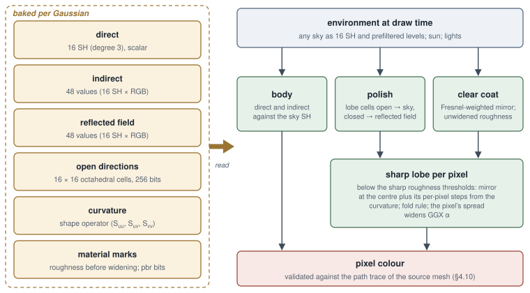

<!-- Copyright (c) 2026 jesus luque. -->
<!-- Generated by docs/paper/site.py from docs/paper; edit the sources there. -->

# 4. Light transport baked into Gaussians (transfer) and relighting

A cloud converted from a mesh can carry its light in two ways. A *radiance bake* stores, per Gaussian, the light that
arrived under the stage's own illumination; it is exact for that illumination and wrong under any other. A *transfer*
stores instead how each Gaussian's surroundings would carry an arbitrary environment to it, and a frame combines that
geometry with whatever sky and lights it has. This section describes the core of the work, the baker: the transfer that the scene's
path tracer bakes into every Gaussian, and the relighting that evaluates it at draw time, in its TX form (a transfer that holds under any sky and any light), the reflection model built on top of it, the
per-pixel treatment of sharp lobes, and what each piece was measured to buy against a path trace of the source mesh.
Everything described runs on the GPU: the bake is the scene's own path tracer in a transfer mode, and the evaluation is
the splat projection and blend kernels (`shaders/athenea/splat/splat_relight.slang`, `splat_project.slang`,
`splat_blend.slang`).

**Radiance bake versus transfer** — A *radiance bake* stores the result of the lighting integral already solved: for each Gaussian, the outgoing radiance (or the irradiance times the albedo) that the path tracer computed under the stage's lights at conversion time. It is a number (or some spherical harmonic coefficients of view-dependent colour, as in 3DGS [1]) that mixes three inseparable things: the geometry around the point, its material, and the particular light. Changing the sky means redoing the bake. A *transfer* separates the light from the rest: it stores a linear function that, applied to any illumination, returns the radiance. Since light transport is linear in emission (the rendering equation is linear in $L_e$), that function always exists; the problem is representing it in little space. This is the idea of *precomputed radiance transfer* (PRT) by Sloan, Kautz and Snyder [14]: project distant lighting onto a basis of functions (spherical harmonics) and precompute per point the vector (or matrix) that turns those coefficients into reflected light, so that at render time lighting reduces to a dot product.

**Rendering equation** — Kajiya (1986): $L_o(\mathbf{p},\boldsymbol{\omega}_o) = L_e(\mathbf{p},\boldsymbol{\omega}_o) + \int_{S^2} f_r(\mathbf{p},\boldsymbol{\omega}_i,\boldsymbol{\omega}_o)\, L_i(\mathbf{p},\boldsymbol{\omega}_i)\,|\mathbf{n}\cdot\boldsymbol{\omega}_i|\,d\boldsymbol{\omega}_i$. For a diffuse surface $f_r = \rho/\pi$. If the incident light comes from a distant environment $L_{\text{env}}$ and is modulated by visibility $V$ and by the scene's bounces, $L_i = V\,L_{\text{env}} + L_{\text{ind}}$, and both the first term (*direct* light from the sky) and the second (*indirect* light, arriving after one or more bounces) are linear in $L_{\text{env}}$. That linearity is what the transfer exploits.

**Path tracer in transfer mode** — There is no separate baker: the engine's own path tracing kernel (generated in `modules/technique/src/PathTracer.cpp`; the transfer mode is the `transfer` field of `BakePoints`, in `modules/technique/include/athenea/technique/PathTracer.h`) replaces the BRDF at the first vertex with a projection estimator. The bake therefore sees exactly the same geometry, materials, instancing and cutouts as the reference render, which removes a classic source of discrepancies between baker and renderer.

**Relighting and TX** — *Relighting* is the evaluation at draw time: the projection kernels (`shaders/athenea/splat/splat_project.slang`, entry point `splatProject` → `projectSplat`, whose template parameter `kTransfer` selects the variant) call `relitSplat` in `shaders/athenea/splat/splat_relight.slang`, which combines each Gaussian's transfer with the frame's sky and lights; `splat_blend.slang` composites per pixel (and evaluates the sharp lobes, §4.8). *TX* is the internal name of the task and of the layout that adds to the original transfer (the "first transfer", 9+27 coefficients) the fine open directions, the reflected field and degree 3.

*References:* [14] Sloan, Kautz, Snyder 2002; Kajiya, J. T., "The Rendering Equation", SIGGRAPH 1986; Pharr, Jakob, Humphreys, *Physically Based Rendering* (4th ed.), ch. 13 and 14. `docs/decisions.md`: "A gaussian that carries how much sky reaches it" (the first transfer) and "A transfer right under any sky and any light (task TX)".

## 4.1 Notation

A Gaussian has a position $\mathbf{p}$, a unit normal $\mathbf{n}$ (its shortest axis, or a stored shading normal,
turned towards the eye), an albedo $\rho$, a metalness $m$, a perceptual roughness $r$ with GGX parameter
$\alpha = r^2$, and optionally a clear coat (weight $w_c$, roughness $r_c$, index $\eta_c$), a sheen and a
transmission. $\boldsymbol{\omega}_o$ is the direction to the eye and $\mathbf{m} = \operatorname{reflect}(-\boldsymbol{\omega}_o,
\mathbf{n})$ the mirror direction. $Y_k$ are the real spherical harmonics, indexed $k = l^2 + l + m$; degree 2 has 9
coefficients and degree 3 has 16. A sky has radiance coefficients $L_k$ (rgb), a sun of direction $\mathbf{s}$ and
irradiance $E_\odot$ extracted from it, and a prefiltered map $\tilde L(\boldsymbol{\omega}, r)$.

**The Gaussian's normal** — A 3D Gaussian has covariance $\Sigma = R\,S\,S^\top R^\top$ with scales $(\sigma_1,\sigma_2,\sigma_3)$. In a cloud converted from a mesh the Gaussians are flattened discs (surfels [6], close to 2DGS [5]), so the axis of smallest scale is the surface normal. Its sign is ambiguous (a disc has no front face), which is why it is turned "towards the eye" ($\mathbf{n} \leftarrow -\mathbf{n}$ if $\mathbf{n}\cdot\boldsymbol{\omega}_o<0$). When the conversion stored a shading normal (the mesh's interpolated normal, which can differ from the geometric axis because of normal maps or smoothing), that one is used. Code: `splatNormal` and `splatShadingNormal` in `shaders/athenea/splat/splat_relight.slang`.

**Albedo, metalness, roughness and GGX** — These are the parameters of the Disney/OpenPBR-style microfacet model [27][30]. The *perceptual* roughness $r\in[0,1]$ is the one the artist sets; the parameter of the GGX normal distribution (Trowbridge–Reitz, Walter et al. [24]) is $\alpha = r^2$, a reparametrisation that makes the visual response roughly linear in $r$. The distribution is $D(\mathbf{h}) = \dfrac{\alpha^2}{\pi\,\big((\mathbf{n}\cdot\mathbf{h})^2(\alpha^2-1)+1\big)^2}$. Metalness $m$ interpolates between a dielectric (coloured diffuse + white specular with $F_0\approx0.04$) and a conductor (no diffuse, specular coloured by the albedo).

**Clear coat, sheen, transmission** — The coat is a thin dielectric layer on top of the base (a car's lacquer), with its own weight $w_c$, roughness $r_c$ and index of refraction $\eta_c$ (typically 1.5). Sheen is a grazing retroreflection lobe typical of fabrics (Conty and Kulla, Imageworks [28]). Transmission is the fraction that passes through a dielectric (glass).

**Mirror direction** — $\operatorname{reflect}(\mathbf{v},\mathbf{n}) = \mathbf{v} - 2(\mathbf{v}\cdot\mathbf{n})\mathbf{n}$; with $\mathbf{v} = -\boldsymbol{\omega}_o$ it gives the mirror $\mathbf{m}$, the direction around which the reflected GGX lobe concentrates.

**Real spherical harmonics** — An orthonormal basis of functions on the sphere, $\int_{S^2} Y_k Y_{k'}\,d\boldsymbol{\omega} = \delta_{kk'}$. They are grouped into *bands* $l = 0,1,2,\dots$ with $2l+1$ functions each ($m=-l..l$); band $l$ contains homogeneous polynomials of degree $l$ in $(x,y,z)$ restricted to the sphere, hence "degree" and "maximum band" are used as synonyms. Up to degree $L$ there are $(L+1)^2$ coefficients: 9 for $L=2$, 16 for $L=3$; the flat index $k = l^2 + l + m$ orders them band by band. The first ones: $Y_0 = \tfrac{1}{2}\sqrt{1/\pi} \approx 0.28209$; $Y_{1,\{-1,0,1\}} = 0.48860\,(y, z, x)$; band 2 has the constant $1.09255$ ($xy$, $yz$, $xz$), $0.31539\,(3z^2-1)$ and $0.54627\,(x^2-y^2)$. A projected function is reconstructed as $f(\boldsymbol{\omega})\approx\sum_k f_k Y_k(\boldsymbol{\omega})$, which is the best least-squares approximation in that subspace. Band $l$ represents angular variations of frequency $\sim l$: degree 2 resolves details of about $180°/2 = 90°$, degree 3 of about 60°; that is why a sun (0.5°) does not fit and is treated separately.

**Dot product of two functions** — By orthonormality, $\int_{S^2} f\,g\,d\boldsymbol{\omega} = \sum_k f_k g_k$ (truncated Parseval identity). This is the central trick of PRT: the lighting integral $\int T(\boldsymbol\omega) L(\boldsymbol\omega)d\boldsymbol\omega$ reduces to $\langle T, L\rangle$.

**Radiance, irradiance** — Radiance $L$ (W·sr⁻¹·m⁻²): power per solid angle and projected area, what a ray carries. Irradiance $E = \int_{\Omega} L\cos\theta\,d\boldsymbol{\omega}$ (W·m⁻²): power arriving per unit area; for a constant sky $L$ over an open hemisphere, $E = \pi L$. For the sun the irradiance $E_\odot$ is stored (not the disc's radiance) because, being almost a point, all that matters is how much power it delivers and from where.

**Prefiltered map** — The sky convolved in advance with a GGX lobe of each roughness, so that a read in direction $\mathbf{m}$ at roughness level $r$ gives $\int L(\boldsymbol\omega)\,D_r(\boldsymbol\omega;\mathbf{m})\,d\boldsymbol\omega$. It is the first half of Karis's *split sum* (UE4, 2013); the second is the directional albedo (§4.6.4).

*References:* [24] Walter et al. 2007; [27] Burley 2012; [30] OpenPBR; [28] Conty/Kulla; Green, R., "Spherical Harmonic Lighting: The Gritty Details", GDC 2003 (definitions and constants); Sloan, P.-P., "Stupid SH Tricks" [16]; Karis, B., "Real Shading in Unreal Engine 4", SIGGRAPH 2013 Course. Code: `shaders/athenea/common/sh.slang` (`shBasisValue`, the basis used by bake and relighting), `shaders/athenea/light/environment.slang`.

## 4.2 What a Gaussian stores

The transfer is one run of values per Gaussian, f16 on the device. There is no mode token: the count is the layout
(`common/transfer_layout.slang`) (Figure 11).

**"The count is the layout"** — There is no field saying what kind of transfer a Gaussian carries: the number of values in the run determines it unambiguously (9, 16, 36, 64, 84, 112, 10). `shaders/athenea/common/transfer_layout.slang` decodes it with `transferDirectCount`, `transferIndirectCount`, `transferHasField` and `transferFieldOffset`; the constant `kTransferFieldValues = 48`. The philosophy (in `docs/decisions.md`, "A gaussian that carries how much sky reaches it": *"There is no mode token… a token would be a second copy of the truth that nothing checks"*) prevents a flag and the data from contradicting each other, and means an old file keeps being read the same way.

**f16 on the device** — The coefficients are stored as half floats (IEEE 754 binary16: 10 mantissa bits, ~3 decimal digits, range ±65504) packed two to a `uint`; `transferAt` / `transferValue` in `splat_relight.slang` unpack them. The precision suffices because transfer coefficients are bounded (the constant term of an open hemisphere is 0.282) and the f16 error (~$5\times10^{-4}$ relative) is far below the bake's Monte Carlo noise.

*References:* `shaders/athenea/common/transfer_layout.slang`; `modules/scene/include/athenea/scene/GpuClouds.h` (`transfer` buffers); `docs/decisions.md`, "What a file costs" within task TX.

| values | layout | origin |
|---|---|---|
| 9 | degree 2, direct | first transfer |
| 36 | degree 2, direct + indirect (27) | first transfer |
| 84 | degree 2, both + reflected field (48) | TX at `--transfer-degree 2` |
| 16 | degree 3, direct | |
| 64 | degree 3, direct + indirect (48) | |
| 112 | degree 3, both + reflected field (48) | **TX default** |
| 10 | two zonal lobes in the Gaussian's frame | skinned clouds |

**Reading the table** — "Direct" is $(L+1)^2$ scalars (degree 2: 9; degree 3: 16): sky visibility weighted by the cosine, without colour, because it depends only on geometry. "Indirect" is as many coefficients again but rgb (27 or 48): the light that arrives after bouncing, coloured by the albedos of what it met. The "reflected field" is always 16 rgb coefficients (48 values), whatever the degree of the rest. Hence: $9+27=36$, $9+27+48=84$, $16+48=64$, $16+48+48=112$.

**Two zonal lobes (10 values)** — For skinned clouds: per lobe, 2 values for the axis (octahedral coordinates $(u,v)$ in the Gaussian's local frame) and 3 zonal coefficients $z_0,z_1,z_2$; $2\times5 = 10$. Detailed in §4.4.5. Since 10 matches no other count, the layout remains unambiguous.

**Why degree 3 is the TX default** — The clamped cosine has no energy in band 3 (its zonal coefficients are $\pi, 2\pi/3, \pi/4, 0, -\pi/24, 0,\dots$; all odd bands $>1$ vanish), so an unoccluded Gaussian gains nothing; what band 3 adds is resolution where visibility changes abruptly (the edge of a door over the sill, the pawn's neck), which degree 2 blurs over ~60°. `docs/decisions.md`, "Step 3: degree 3, and a maximum level to measure against".

*References:* Ramamoorthi and Hanrahan [17] (clamped cosine coefficients); `common/transfer_layout.slang`.

**Reading Figure 11** — It separates two parts of shading that are treated differently. The *body* (diffuse, view-independent) comes from the product of the direct and indirect SH with the sky's SH. What depends on the view is split into: *polish* (the base's specular reflection) and *clear coat*, which read the prefiltered map where the cells say the mirror sees the sky and the reflected field where it is closed; and the *sharp lobe*, the reflection of smooth lobes, re-evaluated per pixel in the blend (§4.8.2) because a constant colour per Gaussian cannot draw a reflection smaller than the Gaussian.

*References:* figure in `figures/fig-transfer.svg`; code: `relitByDome` and `transferViewless` in `shaders/athenea/splat/splat_relight.slang`.

Beside it:

- **Open directions** (`primvars:athenea:splat:shadowBits`): 2 words (64 bits, an 8 x 8 octahedral grid; first
  transfer), 8 words (16 x 16 cells over the whole sphere; TX default) or 32 words (32 x 32). A bit is set where the
  bake's ray in that cell left the scene.
- **Curvature** (`primvars:athenea:splat:curvature`): the shape operator in the Gaussian's two in-plane axes,
  $(S_{uu}, S_{uv}, S_{vv})$, three floats, written with `--transfer`.
- **Material roughness** (`primvars:athenea:splat:materialRoughness`): the material's own roughness before the bake's
  widening (section 4.9), -1 under a texture map. On the device it rides in five bits (27-31) of the pbr word, flagged
  by bit 26.

**Open directions** — A binary map of directional visibility: for each cell of a grid on the sphere, whether a ray from the Gaussian in that direction escapes the scene (1) or hits something (0). It is the same information as the transfer's $V(\boldsymbol\omega)$ term, but without projecting onto SH, which keeps sharp edges that degree 2 or 3 would round off. It is used for three things: the sun's shadow (§4.5), directional specular occlusion (§4.6.1) and the shadow of analytic lights.

**Octahedral grid** — The octahedral parametrisation (Engelhardt and Dachsbacher 2008; Cigolle et al. 2014) projects the sphere onto an octahedron $|x|+|y|+|z|=1$ and unfolds it into a square $[-1,1]^2$: the upper hemisphere occupies the central diamond and the lower one folds into the four corners. It is continuous except at the folds of the octahedron, nearly equal-area (the ratio between the largest and smallest cell is ~$3\sqrt3\approx5.2$, against the pole singularity of lat-long) and is indexed without trigonometry. Code: `octEncode` / `octDecode` in `shaders/athenea/common/octahedral.slang`.

**Resolutions** — $8\times8 = 64$ bits (2 32-bit words) in the first transfer, only the normal's hemisphere; $16\times16 = 256$ bits (8 words) over the whole sphere in TX; $32\times32 = 1024$ bits (32 words) with `--transfer-cells 32`. A $16\times16$ cell covers on average $4\pi/256 \approx 0.049$ sr, an angle of about $\sqrt{0.049}\approx 0.22$ rad $\approx 12.7°$ (the text says "about 11 degrees" in §4.10.4, depending on how the side is measured). As in the rest of the layout, the number of words is the layout.

**USD attribute** — `primvars:athenea:splat:shadowBits` is a primvar of athenea's codeless schema (`modules/usd/schemas/generatedSchema.usda`), written by `modules/usd/src/Export.cpp` and read by `modules/usd/src/ParticleField.cpp`.

*References:* Engelhardt, T., Dachsbacher, C., "Octahedron Environment Maps", VMV 2008; Cigolle, Z. et al., "A Survey of Efficient Representations for Independent Unit Vectors", JCGT 2014. `docs/decisions.md`: "The sun casts a shadow: sixty-four bits a gaussian" and "Step 1: a reflection's occlusion has a direction".

**Shape operator / second fundamental form** — In the differential geometry of surfaces, the *shape operator* (or Weingarten map) $S$ measures how the normal changes as one moves over the surface: $d\mathbf{n} = -S\,d\mathbf{p}$ (the sign depends on convention; here $\Delta\mathbf{n} = S\,\Delta\mathbf{p}$ is used). It is a self-adjoint endomorphism of the tangent plane; in an orthonormal basis $(\mathbf{u},\mathbf{v})$ it is a symmetric $2\times2$ matrix $\begin{pmatrix}S_{uu}&S_{uv}\\S_{uv}&S_{vv}\end{pmatrix}$, which is why three floats suffice. Its eigenvalues are the principal curvatures $\kappa_1,\kappa_2$; half its trace is the mean curvature $H$, its determinant the Gaussian curvature $K$. The *second fundamental form* $\mathrm{II}(\mathbf{a},\mathbf{b}) = \langle S\mathbf{a},\mathbf{b}\rangle$ is the associated quadratic form. For a sphere of radius $R$, $S = I/R$; for a cylinder, eigenvalues $1/R$ and $0$.

**What it is stored for** — To extrapolate the normal per pixel within the footprint (§4.8.1), to estimate how much the conversion widened the roughness (§4.9.2), to tell tubes from folds (§4.9.4) and to approximate the far face of a solid glass as a sphere of mean curvature (§4.7, `lensExit`). It is computed at conversion per triangle in `m2sShape` (`plugins/mesh2splat/mesh2splat.slang`).

*References:* do Carmo, M., *Differential Geometry of Curves and Surfaces*, ch. 3; Rusinkiewicz, S., "Estimating Curvatures and Their Derivatives on Triangle Meshes", 3DPVT 2004 (per-triangle estimation of $S$ from normal differences, which is what `m2sShape` does).

**Material roughness versus the stored one** — The conversion widens each Gaussian's roughness by the spread of normals beneath it (Toksvig [20], §4.9.1): a flat disc replaces a piece of curved surface, and widening the lobe reproduces on average the reflection the curved piece would make. But several relighting decisions need to know what the *material's* roughness was (for example the `kPolishFieldRoughness` gate, §4.6.3, or undoing the widening in the sharp lobes, §4.9.2), and so it is stored separately. "-1 under a texture map": when the roughness comes from a texture there is no single material value, and it is marked as unknown.

**Packing** — On the device it rides in the Gaussian's 32-bit "pbr" word: bit 26 flags its presence and bits 27–31 (5 bits, 32 levels, step $1/31\approx0.032$) quantise it. That suffices because it is only compared against thresholds such as 0.3. Code: `shaders/athenea/scene/splat_encoding.slang`; `SplatSurface::materialRoughness` in `splat_relight.slang`.

*References:* [20] Toksvig 2005; `docs/decisions.md`, "The polish sees its ground where its material is rough enough".

The direct half is a scalar per coefficient (geometry alone); the indirect half is rgb, coloured by what light bounced
off; the reflected field is rgb. The TX layout costs, per Gaussian:

**Why the direct half is scalar** — The direct part is $V(\boldsymbol\omega)\max(\mathbf{n}\cdot\boldsymbol\omega,0)/\pi$ projected: geometry alone; the colour is supplied later by the Gaussian's own albedo and the sky's. The indirect part, by contrast, has bounced off surfaces of different colours (a green ground tints the underside of a car), and that tint cannot be factored per channel by a single scalar; it needs a vector per rgb channel. This triples its cost, which is why the first transfer allowed omitting it (`--no-indirect`).

*References:* `docs/decisions.md`, "A gaussian that carries how much sky reaches it" (*"Two halves in one pass, for nothing"*).

| | first transfer | TX |
|---|---|---|
| direct | 9 | 16 |
| indirect | 27 | 48 |
| reflected field | – | 48 |
| visibility | 2 ints (64 bits) | 8 ints (256 bits) |
| file, bytes | 152 | 480 |
| device, bytes | 80 | 256 |

**Byte counts** — In the file, USD writes float32: first transfer $= (9+27)\times4 = 144$ B + 2 ints (8 B) = 152 B; TX $= (16+48+48)\times4 = 448$ B + 8 ints (32 B) = 480 B. On the device, f16: first transfer $36\times2 = 72$ B + 8 B = 80 B; TX $112\times2 = 224$ B + 32 B = 256 B. Compared with a standard 3DGS Gaussian (position, scale, rotation, opacity, 48 SH: about 236 B in float32; in this engine `positions` 16 B + `shape` 16 B + `sh` in f16), the TX transfer is most of the weight of a relit Gaussian.

*References:* `docs/decisions.md`, "What a file costs" (task TX).

For the whole Corvette (about 10 M Gaussians at the time) that is 4.8 GB of file and 2.6 GB of device for the transfer
alone; the codecs that reduce its storage and bandwidth (a clustered PCA of the transfer, a Hamming k-means codebook of the shadow
bits) are described in Section 7, where they serve one application, a WebGPU player.

**Scale of the problem** — $10^7 \times 480$ B $= 4.8$ GB and $10^7\times256$ B $\approx 2.6$ GB. That explains why the bake is done in slices (§4.4.4) and why section 7 introduces compression: a per-cluster PCA of the transfer is exactly the *Clustered PCA* idea of Sloan, Hall, Hart and Snyder [15] (grouping transfer vectors and representing them in a reduced basis per cluster), and the vector quantisation of the shadow bits uses k-means with Hamming distance (the number of differing bits) [23].

*References:* [15] Sloan et al. 2003; [23] Lloyd 1982 / Arthur and Vassilvitskii 2007.

## 4.3 The environment at draw time

`technique::Environment` prepares each dome in three forms, all buffers read through one module
(`light/environment.slang`) by both the rasteriser and the tracer.

**`technique::Environment`** — The class that prepares a dome (a UsdLux `DomeLight`, an HDRI) for every route: SH projection (`env_project`), sun extraction (`env_sun`) and the prefiltered mip chain (`env_prefilter`). The three forms live in device buffers and are always read through `shaders/athenea/light/environment.slang`, so the splat rasteriser and the ray tracer read the same sky with the same basis. This avoids the typical divergence between a "fast" route and a "reference" one.

**Dome light / IBL** — A *dome light* is a light source at infinity defined by a spherical image (usually lat-long, equirectangular). *Image-based lighting* (IBL) is lighting with that image; since Debevec (1998) it has been the standard way to bring the light of a real environment into a render.

*References:* `modules/technique/include/athenea/technique/Environment.h`, `modules/technique/src/Environment.cpp`, `shaders/athenea/light/environment.slang`; Debevec, P., "Rendering Synthetic Objects into Real Scenes", SIGGRAPH 1998. `docs/decisions.md`: "A cloud sees the sky it stands under".

**Spherical harmonics of radiance.** `env_project` sums the texels of one level of the dome's mip chain, each weighed by
the lat-long solid angle $2\pi^2 \sin\theta\,\Delta u\,\Delta v$ (the measure the dome's importance sampling uses):

$$L_k = \sum_{\text{texels}} L(\boldsymbol{\omega}_t)\, Y_k(\boldsymbol{\omega}_t)\, 2\pi^2 \sin\theta_t\, \Delta u\, \Delta v .$$

Sixteen coefficients are projected (degree 3); the irradiance of an untransferred body reads the first nine, convolved
at read time with the clamped-cosine zonal weights $\{\pi, 2\pi/3, \pi/4\}$. A constant sky projects back to
$\pi L$ of irradiance at every normal: 6.2841 against 6.2832 (0.089 %) over 64 directions.

**Projecting the sky onto SH** — The coefficient $L_k = \int_{S^2} L(\boldsymbol\omega) Y_k(\boldsymbol\omega)\,d\boldsymbol\omega$ is approximated as a Riemann sum over the texels of the lat-long image. In spherical coordinates $d\boldsymbol\omega = \sin\theta\,d\theta\,d\varphi$; with $u = \varphi/2\pi$ and $v = \theta/\pi$, $d\theta\,d\varphi = 2\pi^2\,du\,dv$, hence the weight $2\pi^2\sin\theta\,\Delta u\,\Delta v$. The $\sin\theta$ factor is essential: texels near the poles are stretched and cover much less solid angle. The projection is made from a mip level (not the full image) because degree-3 SH have no frequencies that need full resolution and the sum is much cheaper. Kernel: `envProject` in `shaders/athenea/technique/env_project.slang`, one thread per coefficient.

**Irradiance from SH (Ramamoorthi–Hanrahan)** — The irradiance at a normal $\mathbf{n}$ is the convolution of the sky with the clamped cosine $\max(\cos\theta,0)$. By the Funk–Hecke theorem, convolving with a zonal kernel multiplies each band by a constant: $E(\mathbf{n}) = \sum_{l,m} \hat A_l\,L_{lm}\,Y_{lm}(\mathbf{n})$ with $\hat A_0=\pi$, $\hat A_1 = 2\pi/3$, $\hat A_2 = \pi/4$, $\hat A_3 = 0$, $\hat A_4 = -\pi/24$… Since $\hat A_l$ falls off as $l^{-5/2}$, bands 0–2 capture more than 99 % of the kernel's energy on average, and that is why the irradiance of a body *without transfer* reads only the first 9 coefficients (`kEnvIrradianceCoefficients = 9` in `environment.slang`), even though 16 are projected for the degree-3 transfer.

**The check** — A constant sky $L$ gives $E = \pi L$ at every normal. With $L=2$ the exact value is $2\pi = 6.28319$; 6.2841 was measured, an error of 0.089 %, which is the quadrature error of the lat-long sum at that mip level.

*References:* [17] Ramamoorthi and Hanrahan 2001; Basri and Jacobs, "Lambertian Reflectance and Linear Subspaces", PAMI 2003 (the same result). `docs/decisions.md`: "A cloud sees the sky it stands under", "Step 3: degree 3…".

**The sun, taken out.** A disc a thousand times brighter than the sky is not a degree-2 function; projected, it smears
into a lobe sixty degrees wide. `env_sun` finds the brightest region whose light is as concentrated as a disc of its
solid angle (light-weighted mean square angle about its centre at most twice a disc's, $\theta_{\text{cone}}^2/2$),
takes its texels out of both the harmonics and the prefilter's source, and returns a direction $\mathbf{s}$, an
irradiance $E_\odot$ and a half angle. The irradiance is summed over exactly the texels the harmonics skip, at the same
level and with the same measure, so what leaves the coefficients arrives as a light (closed form 0.1119 against 0.1113).

**Why take the sun out** — Projecting a near-delta function (a disc of ~0.5° a thousand times brighter than the sky) onto low-degree SH produces a wide lobe (the "kernel" of the truncated projection of a delta, about 60° at degree 2) with negative lobes (Gibbs ringing). The resulting lighting loses the sun's sharp shadow and adds light where there is none. The standard solution in PRT and in game engines is to separate the high-frequency component as an analytic directional light and leave only the smooth residual in SH (Sloan et al. [14] already suggest it; Frostbite [19] and most engines do it).

**The concentration criterion** — `env_sun` looks for the brightest region and checks that its light is concentrated like a disc of the same solid angle: for a uniform disc of half-angle $\theta_{\text{cone}}$, the mean squared angle about the centre is $\langle\theta^2\rangle = \theta_{\text{cone}}^2/2$. If the measured region has a light-weighted $\langle\theta^2\rangle$ of at most twice that value, it is accepted as a sun. This way a bright overcast sky is not mistaken for a sun.

**Exact conservation** — The sun's irradiance is computed by summing exactly the same texels that were removed from the harmonics, at the same level and with the same measure $2\pi^2\sin\theta\Delta u\Delta v$: the energy that leaves the SH enters the directional light with neither loss nor duplication. The figure 0.1119 against 0.1113 compares the closed form with the measurement (0.5 % difference).

*References:* `shaders/athenea/technique/env_sun.slang` (`envSun`, `sunRegionOf`, `sunHolds`); `docs/decisions.md`: "The sun comes out of the sky and is lit as a light" and "The sun is the texels that are it".

**The prefiltered map.** The sky without its sun, convolved with a GGX lobe into an octahedral mip chain of eight
levels, level $k$ standing for roughness $(k/7)^2$ (0, 0.020, 0.082, 0.184, 0.327, 0.510, 0.735, 1). The base side
matches the dome's own texel, $S = \sqrt{2WH/\pi}$, rounded down to a power of two in $[256, 2048]$. The prefilter uses
filtered importance sampling (Krivanek and Colbert): each GGX sample reads the source one level coarser than its own
solid angle asks, never narrower than the texel it writes, with the sequence turned by a per-texel hash, 64 samples at
level 1 doubling to 1024. The source's lat-long mips weigh each row by $\cos\theta_0 - \cos\theta_1$, so every level
keeps the sky's solid-angle mean. Without these, a 1.5-degree sun in a rough level was a scatter of texel-sized blobs
(a paint ball's 4-16 px band at 2.13 times the path trace).

**GGX prefiltering** — Rough specular reflections need, for each direction $\mathbf{m}$ and roughness $r$, the integral of the sky weighted by the GGX lobe. Computing it per pixel every frame is expensive; it is precomputed for 8 discrete roughnesses, one per mip level (rougher levels need less resolution, so the mip chain plays both roles). The law $r_k=(k/7)^2$ gives more levels to low roughnesses, where appearance changes fastest. An octahedral map (see the note on the octahedral grid) instead of a cubemap or lat-long: a single 2D image per level, without face seams.

**Base size** — A $W\times H$ lat-long has $WH$ texels over $4\pi$ sr; an octahedral map of side $S$ has $S^2$ texels. Matching the solid angle per texel, taking into account that the lat-long texels at the equator are the largest, gives $S=\sqrt{2WH/\pi}$; it is then rounded to a power of two and clamped to $[256, 2048]$. `docs/decisions.md`: "The prefiltered sky is a mip chain of the dome, not a fixed 256".

**Filtered importance sampling (Křivánek and Colbert)** — Integrating the GGX lobe with $N$ importance-sampled samples over a high-frequency map produces noise (each sample reads one texel). FIS makes each sample read a mip level whose texel covers roughly the solid angle that sample "represents", $\Omega_s = 1/(N\,p(\boldsymbol\omega))$: each sample is then already a local average and the estimator is smooth with few samples. Here a level one coarser than $\Omega_s$ dictates is read (more smoothness), but never finer than the texel being written. The sequence (Hammersley, `hammersley` in `env_prefilter.slang`) is rotated by a per-texel hash to trade repeated structure for decorrelated noise.

**Mips that keep the mean** — Averaging lat-long texels without weights overestimates the poles. Weighting each row by $\cos\theta_0-\cos\theta_1$ (the exact solid angle of a latitude band, $\int_{\theta_0}^{\theta_1}\sin\theta\,d\theta$) makes each level keep the mean radiance per solid angle. Without it, a small sun at a rough level came out as scattered spots, and the paint ball measured 2.13 times the path trace in the 4–16 px band (mid scales of a band-pass filter). `docs/decisions.md`: "A dome's mips keep its solid-angle mean (research 087, step 1)", "The sky's rough levels hold a sun as one lobe".

*References:* [18] Křivánek and Colbert 2008; Karis 2013 (split sum, prefiltering with $N\cdot V = 1$); `shaders/athenea/technique/env_prefilter.slang` (`envPrefilter`).

**A cloud the scene turns.** Everything a Gaussian stores of its transfer (§4.2) – the harmonics of both halves, the
reflected field and the open-direction bits – is a set of directions of the cloud, measured in the frame of the file
it was baked in. A prim that rotates the cloud (a Y-up asset placed in a Z-up scene, a part turned into place) changes
none of them. The draw therefore reads the transfer in the cloud's frame. Let $R$ be the rotation of the instance's
transform, its linear part with columns made unit. Every direction of the world the draw asks along – the mirror of
the view, the way through a glass, the sun, a light, a lobe's cone of cells – is turned by $R^\top$ before it is
looked up, and the sky's sixteen coefficients are turned into the same frame once per instance and frame,

**The cloud's frame of reference** — Everything directional in the transfer (SH, field, cells) is measured in the axes of the file in which the bake was made. If a scene prim applies a rotation $R$ to the instance, the cloud and its directions turn together, but the sky does not. There are two ways to compensate: rotate each Gaussian's data into the world (expensive: rotating degree-3 SH is a block matrix of $1+9+25+49$ entries per channel, for millions of Gaussians), or rotate what is queried into the cloud's frame, which is once per direction or once per instance. The second is chosen.

**$R$ from the transform** — The $3\times3$ linear part of the instance matrix may include (non-uniform) scale. Normalising its columns recovers the rotation when there is no shear; with shear the result is not orthogonal, but in practice USD Xforms of rigid parts are rotation·scale. Directions are passed through $R^\top = R^{-1}$. Code: `relightCloudFrame` (builds the frame) and `transferAlong` (turns a world direction into the cloud's frame) in `shaders/athenea/splat/splat_relight.slang`.

*References:* `docs/decisions.md`, "A transfer the stage turns, and the gaussians' parameters drawn (19 Oct)".

$$L'_k = \int_{S^2} Y_k(\boldsymbol{\omega})\, L(R\,\boldsymbol{\omega})\, d\boldsymbol{\omega},$$

by a product rule exact for the degree-6 products it integrates (four Gauss–Legendre nodes in $\cos\theta$ by eight
even steps in $\varphi$). The body then dots the transfer with $L'_k$; what is evaluated in the world (the prefiltered
map, the background) keeps $L_k$. A zonal transfer (§4.4.5) turns with each Gaussian already and is left as it is. With
the pawn of §5.11 rotated 60 degrees about its up axis together with its camera and its sky, the relit frame matches
the unrotated one at relMSE $9\times10^{-6}$ (61 dB) at 768 × 768; turned the other way, 11 dB. Read in the world's
frame instead, the pawn stood up from Y-up into a Z-up scene drew its glass head in fragments (Figure 12).

**SH rotation** — A rotation transforms the SH of each band among themselves (bands do not mix: $Y_{lm}(R^{-1}\boldsymbol\omega) = \sum_{m'} D^l_{mm'}(R)\,Y_{lm'}(\boldsymbol\omega)$, with $D^l$ the Wigner matrices). There are recursive formulas (Ivanic and Ruedenberg 1996) or zonal ones (Sloan 2008), but a simpler and more robust alternative is used here: numerically reproject $L(R\boldsymbol\omega)$, evaluating the SH sky at rotated directions and integrating again against $Y_k$.

**Why the quadrature is exact** — $L(R\boldsymbol\omega)$ is a degree-3 function (rotation preserves degree) and so is $Y_k$, so the integrand is a spherical polynomial of degree $\le6$. In coordinates $(z=\cos\theta,\varphi)$ a product rule integrates exactly if: in $z$, $n$-node Gauss–Legendre is exact up to degree $2n-1$; with 4 nodes, up to 7 $\ge 6$. In $\varphi$, $N$ equal steps integrate $e^{im\varphi}$ exactly for $|m|<N$; with 8 steps up to $|m|=7 \ge 6$. In total 32 evaluations per coefficient, once per instance and frame. Kernel: `skyTurn` in `shaders/athenea/splat/sky_turn.slang`.

**What is turned and what is not** — The body (transfer·sky product) uses the turned sky $L'_k$. What is evaluated along world directions (the prefiltered map the mirror points into, the background) keeps the original sky, because those directions are already in the world. A zonal transfer stores its axes in each Gaussian's local frame and is carried into the world by the Gaussian's own rotation (`splatTransferFrame`), so it does not need this.

**Measurement: 61 dB and 11 dB** — A relMSE (mean relative squared error, see the note in §4.10) of $9\times10^{-6}$ between the turned pawn (with camera and sky turned by the same amount) and the original: practically identical, the differences are rasterisation rounding. The PSNR of 61 dB is computed on the display image (tonemapped, [0,1]), not from the relMSE; 61 dB means an RMS error of $10^{-61/20}\approx 9\times10^{-4}$ of the range, less than a quarter of an 8-bit level. The negative control (turning the wrong way) gives 11 dB, an RMS error of ~28 % of the range: it shows that the metric clearly separates a correct case from a wrong one.

*References:* Ivanic, J., Ruedenberg, K., "Rotation Matrices for Real Spherical Harmonics", J. Phys. Chem. 1996; [16] Sloan 2008; Abramowitz and Stegun (Gauss–Legendre quadrature). `docs/decisions.md`, "A transfer the stage turns…".

**Reading Figure 12** — On the left, the error: the transfer (especially the reflected field and the cells of the glass head, which depend strongly on direction) is queried with world directions, which for the cloud turned a quarter turn point to the wrong cells; each Gaussian sees "another" environment and the head comes out fragmented. In the centre, the correction. On the right, the unturned reference; the sky appears at another azimuth because the Y-up stage and the Z-up scene do not share the same "up", not because of an error.

*References:* `docs/decisions.md`, "A transfer the stage turns…" (the case was found in Blender, with the add-on's Empties turning the clouds).

## 4.4 The bake

### 4.4.1 The transfer integral and its estimator

The transfer is the projection of visibility times the clamped cosine, the albedo taken as one:

$$T_k = \frac{1}{\pi} \int_{S^2} V(\boldsymbol{\omega})\, \max(\mathbf{n}\cdot\boldsymbol{\omega}, 0)\, Y_k(\boldsymbol{\omega})\, d\boldsymbol{\omega},$$

and a frame recombines it with the sky as $\langle T, L \rangle = \sum_k T_k L_k$. It is gathered by a third variant of
the path-traced kernel, `kTransfer`, beside the radiance bake and the camera path. At a Gaussian's first vertex the
material is replaced by the sampled direction itself: directions are stratified (a jittered $\sqrt{N}\times\sqrt{N}$
grid) and uniform over the hemisphere, density $1/2\pi$, against an estimator that wants $\cos\theta/\pi$, so an
escaping sample is worth $2\cos\theta\, Y_k(\boldsymbol{\omega})$ and a blocked one nothing. Uniform rather than cosine
sampling, and over the hemisphere measured as a sphere with the far half empty, because the harmonics are orthonormal
only over the sphere; fitted coefficient by coefficient over a hemisphere they overshoot (the pawn came back ten times
too bright). The accumulation *is* the projection; no fit is solved.

**The transfer integral** — It is the version of Sloan et al. [14] for a shadowed diffuse receiver ("shadowed diffuse transfer"): $T_k = \frac{1}{\pi}\int V\,\max(\mathbf{n}\cdot\boldsymbol\omega,0)\,Y_k\,d\boldsymbol\omega$. With a sky $L = \sum_k L_k Y_k$, the shadowed irradiance divided by $\pi$ (the outgoing radiance of a Lambertian of albedo 1) is exactly $\int V\,\frac{\max(\mathbf{n}\cdot\boldsymbol\omega,0)}{\pi}\,L\,d\boldsymbol\omega = \sum_k T_k L_k$. Multiplying afterwards by $\rho$ gives the colour. The albedo is taken as one so that the transfer is geometry alone and the material can change without redoing the bake.

**Monte Carlo estimator** — $\hat T_k = \frac1N\sum_i \frac{V(\boldsymbol\omega_i)\cos\theta_i\,Y_k(\boldsymbol\omega_i)}{\pi\,p(\boldsymbol\omega_i)}$. With $p = 1/2\pi$ (uniform over the hemisphere), the weight is $\frac{2\pi}{\pi}\cos\theta = 2\cos\theta$: a sample that escapes ($V=1$) contributes $2\cos\theta\,Y_k$, a blocked one 0. "The accumulation is the projection": there is no system to solve, only a sum, which makes it parallel and unbiased.

**Stratification** — Instead of $N$ independent directions the domain is divided into $\sqrt N\times\sqrt N$ strata and one jittered sample is taken in each: the variance of the integral of smooth functions drops from $O(1/N)$ to nearly $O(N^{-2})$ in 2D (for functions with discontinuities, $O(N^{-3/2})$). See Veach 1997 ch. 2 or PBRT ch. 8.

**Uniform rather than cosine** — Cosine sampling ($p = \cos\theta/\pi$) would cancel the integrand's cosine and give less variance for $T_0$. But the text explains why it is not done: the higher bands $Y_k$ are not proportional to the cosine, and what matters is that the estimator be a projection over the *sphere*, where the SH are orthonormal. Over the hemisphere alone the $Y_k$ are not orthogonal (for example $\int_{H^2} Y_0 Y_{10} \neq 0$), and fitting the coefficients "coefficient by coefficient" as if they were counts the same energy several times: hence the pawn ten times too bright. Treating the hemisphere as a sphere whose far half is zero keeps orthonormality.

**Kernel variants** — The transfer is a third mode of the generated path tracing kernel, alongside the radiance bake and the camera path: the bake (radiance or transfer, according to `BakePoints::transfer`) uses the `kBake` section of the generated code and the camera path the `kNoBake` section; the intersection and material code is the same, and only the treatment of the first vertex changes.

*References:* [14] Sloan et al. 2002, §4 ("shadowed diffuse transfer"); Veach, E., *Robust Monte Carlo Methods for Light Transport Simulation*, PhD thesis, Stanford 1997, ch. 2; `modules/technique/src/PathTracer.cpp`, `modules/technique/include/athenea/technique/PathTracer.h`. `docs/decisions.md`: "A gaussian that carries how much sky reaches it".

The same paths give two halves at no extra ray: a path that escapes right after the first vertex contributes to the
direct half (scalar); one that escapes after bouncing carries the colour of what it met and contributes to the indirect
half $T^{\text{ind}}_k$ (rgb). Checked against closed forms: an unoccluded point transfers the clamped cosine,
$(0.2820, 0.3258, 0.1581)$ against the exact $(0.2821, 0.3257, 0.1577)$ for bands 0-2, and a constant sky of 0.7
reads 0.6998. A corner of floor and wall, transfer recombined against a radiance bake of the same points:

| | transfer | radiance bake | worst point |
|---|---|---|---|
| no wall, 1 bounce | 0.6000 | 0.6000 | 0.0 % |
| black wall, 1 bounce | 0.3091 | 0.3039 | 2.5 % |
| white wall, 3 bounces | 0.5095 | 0.5325 | 4.3 % |

**Two halves from the same paths** — Each path leaves the Gaussian. If it escapes directly (without intersecting anything), its contribution is direct visibility; if it hits something, bounces (with the real material of what it meets) and then escapes, its throughput $\beta$ (the product of BRDF·cosine/pdf accumulated over the bounces) is the fraction of "white sky" that arrives by that route, coloured. That second part forms the rgb $T^{\text{ind}}_k$, also linear in the sky under the approximation that the sky is evaluated in the *final* escape direction, but it is projected according to the first direction $\boldsymbol\omega_1$ (the one arriving at the Gaussian). Note the implicit approximation: $\sum_k T^{\text{ind}}_k L_k$ treats indirect light as if it arrived with the sky's directional spectrum in the arrival direction, when in fact it depends on the sky seen from the *bounce point*. It is exact under a constant sky and a "low-rank" approximation in general (the same as in the interreflected PRT of [14], which does store the full matrix).

**Closed-form checks** — An unoccluded point with normal $+z$ has $T_{lm} = \hat A_l Y_{lm}(\mathbf z)/\pi$: $T_0 = Y_0 = 0.28209$, $T_{10} = \frac{2}{3}\cdot0.48860 = 0.32573$, $T_{20} = \frac14\cdot0.63078 = 0.15770$. Measured: 0.2820, 0.3258, 0.1581, all within ~0.3 % (MC noise). A constant sky of 0.7 must give exactly 0.7 (since $\sum_k T_k L_k = T_0 L_0$ with $L_0 = 0.7\cdot\sqrt{4\pi}$, and $T_0\sqrt{4\pi}= 1$); 0.6998 was measured.

**The corner** — Floor and wall, comparing the recombined transfer under a constant sky with a direct radiance bake of those points under that sky (which is the correct answer for that sky). Without a wall the two agree; with a black wall only occlusion acts (the direct half), and the 2.5 % is the noise/SH truncation error of the visibility; with a white wall and 3 bounces the difference (4.3 %) measures the approximation of the indirect half and the low-degree truncation of the bounced light. Test: `tests/usd/test_usd.cpp`, tag `[transfer]`.

*References:* `docs/decisions.md`, "How it is checked" in "A gaussian that carries how much sky reaches it", and "What the corner found in the bake" (a bias from encoding sRGB before averaging, discovered with this test).

### 4.4.2 Open directions and the direct half by quadrature

At the first sample of each point TX traces one any-hit ray per cell of a $S_c \times S_c$ octahedral grid
($S_c = 16$ or 32) over the *whole* sphere: the far half too, starting from the far side of the surface, so a direction
behind a solid meets the solid and one behind a sheet leaves. A cell's bit is set where at least half the light gets
through: the occlusion ray passes up to eight surfaces whose material transmits, weighed by transmission times colour
luminance less the Fresnel at that angle (a ninth closes the way). The cells are traced from four origins over the
Gaussian's footprint (cell $c$ from origin $(c + \lfloor c/S_c \rfloor) \bmod 4$: the centre and three points brought
onto the surface within the Gaussian's disc), so a groove narrower than a Gaussian no longer reads as a dashed line of
whole shadows.

**Any-hit ray** — An occlusion ray (shadow ray) that only asks "is there anything?" and stops at the first accepted intersection, without looking for the nearest; in RT hardware (or in the engine's compute BVH) it is cheaper than a closest-hit. `pathOccluded` in the code generated by `modules/technique/src/PathTracer.cpp`.

**The whole sphere, from the back face** — The transfer of a glass, or of a sheet seen from behind, needs to know what is behind the surface. By launching the directions of the far hemisphere from the back side (with the offset to the other side), a closed solid intersects itself (all back cells closed) while a thin sheet lets the ray escape.

**Bit at 50 % transmission** — An occlusion ray can pass through up to eight transmissive surfaces, accumulating transmittance: at each one it is multiplied by (transmission) × (luminance of the transmission colour) × $(1-F(\theta))$, the Fresnel at that angle. If at least half passes at the end, the cell is marked open. A ninth surface is considered opaque (a cost limit). It is a binarisation of a continuous quantity $\tau_c$; the continuous quantity is used in the following quadrature.

**Four origins** — A Gaussian's footprint can be larger than a slit (between two panels). If all cells were traced from the centre, a narrow slit would look open or closed depending on the exact position of the centre, and neighbouring Gaussians would alternate, giving a dotted shadow. By distributing the cells among four origins (the centre and three points of the disc, projected onto the surface) with a pattern $(c + \lfloor c/S_c\rfloor)\bmod4$ (a checkerboard that alternates by row), each Gaussian averages spatially: it is spatial antialiasing of visibility, like a *percentage-closer filtering* at the source.

*References:* `docs/decisions.md`: "Step 1: a reflection's occlusion has a direction", "The cells see through glass", "The cells over the footprint"; Reeves, Salesin, Cook, "Rendering Antialiased Shadows with Depth Maps", SIGGRAPH 1987 (PCF, an analogous idea).

The same rays then give the direct half by quadrature (no grain), each cell weighted by its octahedral solid angle:

$$T_k^{\text{dir}} = \sum_{c} \tau_c\, \frac{\max(\mathbf{n}\cdot\boldsymbol{\omega}_c,0)}{\pi}\, \Delta\Omega_c\, Y_k(\boldsymbol{\omega}_c),
\qquad \Delta\Omega_c = \frac{4}{S_c^2}\,\lVert\boldsymbol{\omega}_c\rVert_1^3,$$

with $\tau_c$ the fraction transmitted along the cell's ray. Words are written four at a time as each 128 cells are
traced, so the kernel holds no array the size of the grid.

**Quadrature instead of Monte Carlo** — Since one ray per cell has already been traced on a deterministic grid, the direct half can be computed as a weighted sum over the cells instead of with the random paths: it has no noise (only the grid's discretisation error), and the shadow does not "boil" between neighbouring Gaussians.

**Solid angle of an octahedral cell** — With the octahedral square $[-1,1]^2$ of area 4 divided into $S_c^2$ cells of area $4/S_c^2$, the solid angle element is $d\Omega = dA\,\lVert\boldsymbol\omega\rVert_1^3$ for unit $\boldsymbol\omega$. Derivation: the point on the octahedron is $\mathbf{p} = \boldsymbol\omega/\lVert\boldsymbol\omega\rVert_1$ (1-norm), and the projection of an octahedron element onto the plane of the square has area $dA$; the solid angle it subtends is $dA_{\text{face}}\cos\gamma/\lVert\mathbf p\rVert_2^2$ with $\cos\gamma = 1/(\sqrt3\lVert\mathbf p\rVert_2)$ and $dA_{\text{face}} = \sqrt3\,dA$, so $d\Omega = dA/\lVert\mathbf p\rVert_2^3 = dA\,\lVert\boldsymbol\omega\rVert_1^3$. At the centre of a face ($\lVert\boldsymbol\omega\rVert_1 = \sqrt3$) cells are worth $3\sqrt3\approx5.2$ times more than at the vertices ($\lVert\boldsymbol\omega\rVert_1=1$). Summing over all cells gives $\approx 4\pi$.

**Continuous $\tau_c$** — The quadrature uses the real transmitted fraction, not the bit, so a partially transparent glass contributes its share of sky to the diffuse light.

**No grid-sized arrays** — A GPU thread with 1024 bits in registers (or 256 floats of $\tau$) would spill to local memory and reduce occupancy; accumulating 128 cells at a time (4 32-bit words) and writing them to global memory keeps the state small. This matters especially on Metal, where the path tracing kernel is already at the register limit.

*References:* `docs/decisions.md`: "The direct half without grain (proposal 032's first part)"; `octDecode` in `shaders/athenea/common/octahedral.slang`.

### 4.4.3 The reflected field

A reflection needs the bounced light *by direction*, not integrated. For every path that leaves the Gaussian, meets the
scene and later escapes, the throughput past the first vertex is the radiance that arrives along its first direction
$\boldsymbol{\omega}_1$ under a white sky of radiance one. It is projected onto degree 3 of $\boldsymbol{\omega}_1$,
uniformly over the domain it was drawn from:

$$F_j \approx \frac{1}{N} \sum_{i:\ \text{escaped after a bounce}} \Omega_{\text{meas}}\, \frac{\beta_i}{w_i}\, Y_j(\boldsymbol{\omega}_{1,i}),$$

with $\beta_i$ the throughput, $w_i$ the first-vertex weight and $\Omega_{\text{meas}} = 2\pi$ (or $4\pi$ over the
sphere). That is 16 rgb coefficients, `primvars:athenea:splat:transferReflected`. It costs no ray. Because $F$ is zero
along open directions, sixteen harmonics read a closed direction beside an open one at a fraction of what stands there
(the paint's closed part was 0.0014 of 0.115). So the bake also projects the indicator of closed directions $C_j$ over
the same samples, and the conversion divides the two, a normalised convolution giving the mean radiance of the closed
directions about each direction, falling back to the closed directions' mean where their share is under 0.1 (blended
up to 0.4), and re-projects the result over a 16 x 16 grid by cell solid angle (`m2sFieldOverClosed`).

**Why a "reflected field" is needed** — A specular reflection needs the radiance arriving *from the mirror direction*, not an integral over the hemisphere. The indirect transfer is a cosine-weighted integral; it does not say what colour there is in each direction. Where the mirror points to an open direction the sky is read (prefiltered map); where it points to something in the scene (the ground under a car, the bodywork in the chrome), one needs to know what is seen there: that is the field $F(\boldsymbol\omega)$, the incident radiance per direction under a white sky.

**The estimator** — $F_j = \int_{\Omega} L_{\text{in}}^{\text{ind}}(\boldsymbol\omega)\,Y_j(\boldsymbol\omega)\,d\boldsymbol\omega$, estimated with the same samples $\boldsymbol\omega_{1,i}$ as the transfer. If the sample was generated with density $p$, the estimator is $\frac1N\sum L(\boldsymbol\omega_i)Y_j(\boldsymbol\omega_i)/p(\boldsymbol\omega_i)$; with uniform $p =1/\Omega_{\text{meas}}$ that is $\Omega_{\text{meas}}\cdot L\,Y_j$. $\beta_i/w_i$ undoes the weight the first vertex applied (the transfer's $2\cos\theta$), leaving pure radiance. The sums are the same ones the "split" radiance bake uses for its indirect half, idle in transfer mode: zero ray cost.

**Dilution by the open directions** — $F$ is zero where the direction escapes (there is no surface to reflect; that part is supplied by the sky). Projected onto 16 SH, an open/closed edge blurs, and reading a closed direction next to an open one gives an average with many zeros: 0.0014 where the paint should read 0.115. The fix is a *normalised convolution* (Knutsson and Westin 1993): also project the closed indicator $C(\boldsymbol\omega)$ and divide, $\tilde F = (F * K)/(C * K)$, which gives the average radiance *only over the nearby closed directions*. Where $C*K<0.1$ (almost all open), the division is unstable and the global mean of the closed directions is used, blending smoothly up to 0.4. The result is projected back onto SH through a $16\times16$ grid of cells weighted by their solid angle. Code: `m2sFieldOverClosed` in `shaders/athenea/usd/mesh2splat_bake.slang` and `shaders/athenea/usd/transfer_field_fill.slang`.

*References:* Knutsson, H., Westin, C.-F., "Normalized and Differential Convolution", CVPR 1993; `docs/decisions.md`: "Step 2: what the closed directions show", "The field says what the closed directions show, undiluted".

For a transmitting Gaussian the first direction is drawn over the whole sphere (`bakeSphereDirection`: the stratum's
height stretched to $[-1,1]$ and the lower half mirrored through the tangent plane). Front samples keep the transfer's
estimator ($4\cos\theta$ at density $1/4\pi$); back samples feed only the field, after being bent into a solid
dielectric by its index (`refractInto`), so the field along $-\boldsymbol{\omega}_o$ holds what the eye's ray finds
through both faces. Unbent, a glass ball validated at half the path trace (0.265 against 0.541 under a white dome).

**Sampling the sphere for glass** — For a transmitting Gaussian, the field must also contain what is seen *through* it. `bakeSphereDirection` (in `modules/technique/src/PathTracer.cpp`) stretches the stratum's height coordinate from $[0,1]$ to $[-1,1]$ (uniform sampling in $\cos\theta$ = uniform in area on the sphere, by Archimedes' theorem) and mirrors the lower half in the tangent plane. Density $1/4\pi$, so the transfer weight becomes $4\cos\theta$ on the front samples.

**Refraction** — The back samples are bent according to Snell's law on entering a solid dielectric of index $\eta$ (`refractInto`): $\eta_1\sin\theta_1 = \eta_2\sin\theta_2$. Without that refraction, the field in direction $-\boldsymbol\omega_o$ recorded what lies in a straight line behind, not what a refracted ray sees through both faces, and a glass ball validated at half (0.265 against 0.541 under a white dome).

*References:* `docs/decisions.md`: "Step 5: glass", "A converted glass bends, and its cloud says which schema it carries", "A bake's ray into a lens leaves by a hair too".

### 4.4.4 Slices, filtering, and the split bake

The whole TX Corvette asked for its bake's answer at once: 35 float4 per Gaussian, 7.8 GB, with 5 GB free.
`Converter::transfer` therefore bakes in slices whose answer is at most 1.5 GB (never under the bake's own batch,
$2^{19}$), and at most $2^{20}$ Gaussians where the filter runs. Each slice's rays are copied on the device, baked
(`StageRenderer::bakePointsOnDevice` in transfer mode), its bounced halves filtered, written by `m2sTransferInto` and
read back into the file's arrays before the next. The radiance bake uses the related `StageRenderer::bakeSplitOnDevice`,
which keeps the direct and indirect halves as separate sums so that the indirect one can be filtered before
`combineBake` fits the two. The transfer follows the same principle: its indirect half and its field (the noisiest
values, at 64 paths per Gaussian in the Corvette's bakes) go through the splat bake filter, an a-trous filter at
`--bake-filter` iterations (3), whose weights are position on the tangent plane, facing and prim id; the direct half,
which holds the shadows, is never filtered.

**Slices** — 35 float4 per Gaussian is the size of the kernel's response (the direct, indirect, field and indicator SH sums, in float32 before conversion to f16): $10^7 \times 35\times16$ B $\approx 5.6$ GB, plus auxiliary buffers, 7.8 GB. By cutting into slices of ≤1.5 GB (and never smaller than $2^{19}$ Gaussians, the bake's internal batch, so as not to waste occupancy), peak memory stays bounded. `Converter::transfer` in `apps/athenea/src/CmdMesh2Splat.cpp`; `StageRenderer::bakePointsOnDevice`, `bakeSplitOnDevice` and `combineBake` in `modules/usd/src/StageRenderer.cpp`; written with `m2sTransferInto` (`shaders/athenea/usd/mesh2splat_bake.slang`).

**À-trous filter** — The "à-trous" ("with holes") filter is multiscale: at iteration $i$ a small kernel (e.g. a $5\times5$ B-spline) is applied with spacing $2^i$ between taps, which gives a large effective support at constant cost per iteration. Dammertz et al. (2010) made it *edge-avoiding*: each tap is additionally weighted by similarity in guide attributes (normal, position, colour). Here, since the Gaussians are not on an image grid, neighbours are searched in the cloud's space and the edge weights are: distance in the tangent plane, difference in orientation (normal) and equality of prim id (do not mix different parts). Three iterations by default (`--bake-filter`). Implemented as an AOFX effect: `plugins/splatbakefilter/splatbakefilter.slang`; I/O in `shaders/athenea/usd/transfer_filter_io.slang`.

**Why the direct half is not filtered** — It contains the shadows, which are sharp edges; filtering would soften them. Moreover, with the quadrature of §4.4.2 it no longer has noise. The indirect half and the field, estimated with 64 paths per Gaussian, are the noisiest and at the same time the spatially smoothest (bounced light varies slowly), which is exactly the case where a spatial filter gains most.

*References:* Dammertz, H., Sewtz, D., Hanika, J., Lensch, H., "Edge-Avoiding À-Trous Wavelet Transform for Fast Global Illumination Filtering", HPG 2010; Mallat, *A Wavelet Tour of Signal Processing* (the à trous algorithm). `docs/decisions.md`: "4. The splat bake filter" (within "The bake's grain"), "A large transfer is baked in slices", "A transfer goes up a slice at a time", "The transfer's grain".

### 4.4.5 Zonal lobes for skinned clouds

Nine harmonics are in the world; a skeleton turns the Gaussian under them. Rotating them costs a 9 x 9 per Gaussian. A
zonal lobe rotates by rotating its axis, so a skinned cloud keeps two lobes, each the octahedral $(u, v)$ of its axis in
the Gaussian's own frame and zonal coefficients $z_0, z_1, z_2$: ten values (`primvars:athenea:splat:transferZonal`).
As harmonics a lobe about $\mathbf{a}$ is $g_{lm} = z_l\, k_l\, Y_{lm}(\mathbf{a})$ with $k_l = \sqrt{4\pi/(2l+1)}$.
For a fixed axis the best coefficients are the projection $z_l = k_l \sum_m f_{lm} Y_{lm}(\mathbf{a})$, leaving error
$\lVert f\rVert^2 - \sum_l z_l^2$, so the fit (an AOFX effect, `splattransferzonal`) searches the axis on the device
(band-1 direction, the normal, 64 Fibonacci directions, then a halving walk), fits the second lobe to the residual and
refits the pair twice (Sloan 2008). At draw time `splatTransferFrame` turns each axis by the skinned frame and rebuilds
nine world harmonics, which everything downstream reads unchanged. The bake poses the cloud at `--time` with the
engine's own skinner, so the frame the lobes are fitted against is the packed quaternion a renderer reads. The shadow
bits stay two words, re-binned into the Gaussian's frame. The indirect half is not kept zonal.

**Zonal harmonics** — A *zonal* function is symmetric about an axis $\mathbf a$: it depends only on $\mathbf a\cdot\boldsymbol\omega$. In SH with the axis along $z$ it has only $m=0$ components: one coefficient per band ($z_0, z_1, z_2$ up to degree 2). By the *addition theorem*, rotating it to the axis $\mathbf a$ gives $g_{lm} = \sqrt{4\pi/(2l+1)}\,z_l\,Y_{lm}(\mathbf a)$: rotating costs only evaluating $Y$ at the new axis, instead of multiplying by a $9\times9$ matrix.

**Best projection and error** — For a fixed axis, the best least-squares approximation of $f$ by a zonal lobe is $z_l = k_l\sum_m f_{lm}Y_{lm}(\mathbf a)$, and the residual error is $\lVert f\rVert^2 - \sum_l z_l^2$ (Pythagoras in the subspace). So maximising $\sum_l z_l^2$ over $\mathbf a$ gives the best axis. The GPU search combines candidates (the dominant direction of band 1, the normal, 64 Fibonacci directions on a hemisphere, because the energy is even in the axis) and a local refinement whose step is halved. With two lobes, the second is fitted to the residual and then refinements alternate (Sloan 2008).

**Why it is needed with skinning** — With a skeleton every Gaussian turns every frame. SH stored in the world would stay fixed while the wing turns, with the wing's shadow "stuck" to the bake's orientation. A zonal lobe with its axis in the local frame is carried by the rotation (`splatTransferFrame` in `splat_relight.slang` rebuilds 9 world SH, and the rest of the code reads them just like stored SH). The indirect half is not converted (three channels of lobes would be more data and another fit). The shadow bits are rebinned in the local frame (`rebin`).

**Bake pose** — The stage's skeleton is posed at `--time`; the conversion poses its own cloud with the engine's skinner and fits the lobes against the frame the renderer will see, the packed 10-bit quaternion, so there is no quantisation mismatch (`zonalPoseRays` in `shaders/athenea/usd/transfer_zonal_io.slang`).

*References:* [16] Sloan, "Stupid SH Tricks" 2008 (ZH fitting); Sloan, Luna, Snyder, "Local, Deformable Precomputed Radiance Transfer", SIGGRAPH 2005 (ZH for deformable objects, the original idea); `plugins/splattransferzonal/splattransferzonal.slang`; `tests/aofx/test_transfer_zonal.cpp`. `docs/decisions.md`: "A skinned cloud keeps its transfer: zonal lobes in each gaussian's frame", "A skinned transfer is traced at the bind pose".

## 4.5 The body

For a Gaussian with a transfer, the part that does not depend on the eye is

$$\mathbf{B} = \sum_{k<16} L_k\,\big(T_k^{\text{dir}} + T_k^{\text{ind}}\big) \;+\; E_\odot\,\frac{\max(\mathbf{n}\cdot\mathbf{s},0)}{\pi}\, O(\mathbf{s}) \;+\; E_\odot\, T^{\text{ind}}(\mathbf{s}),
\qquad T^{\text{ind}}(\mathbf{s}) = \max\Big(\sum_k T_k^{\text{ind}} Y_k(\mathbf{s}), 0\Big),$$

the last term being the sun's bounce, which the first transfer lost with the sun it took out of the harmonics. $O(\mathbf{s})$
is the sun's share: for TX the bilinear read of the four cells around $\mathbf{s}$, cells behind the normal left out;
for the 64 bits the same on an 8 x 8 grid; without bits, the degree-2 ratio

$$O_{\text{SH}}(\mathbf{s}) = \frac{\sum_k T_k Y_k(\mathbf{s})}{\sum_k \hat A_l\, Y_k(\mathbf{n})\, Y_k(\mathbf{s})}, \qquad \hat A_l = \{1, 2/3, 1/4\},$$

numerator and denominator sharing the truncation so it reads one where nothing occludes. The diffuse body is then
$U\,\rho\,(1-m)\,\big[(1-t)\,\mathbf{B} + t\,(\ldots)\big]$ with $U$ the layers' throughput (section 4.6.4) and $t$ the
transmission. $\mathbf{B}$, the sun's share and the field coupling (below) are kept per Gaussian while the sky and the
lights stand (`transferViewless`, the `txCache`); a frame computes only what the eye changes.

**The three terms of the body** — (1) $\sum_k L_k(T^{\text{dir}}_k + T^{\text{ind}}_k)$: the sky without the sun, direct plus bounced, by the SH dot product (with $L_k$ turned if the instance turns, §4.3). (2) $E_\odot\,\max(\mathbf n\cdot\mathbf s,0)/\pi\cdot O(\mathbf s)$: the sun as a directional light, a Lambertian of albedo 1 (outgoing radiance = irradiance·cosine/π) multiplied by the fraction of the sun that is not occluded. (3) $E_\odot\,T^{\text{ind}}(\mathbf s)$: the sun's bounce.

**Why the sun's bounce is evaluated this way** — $T^{\text{ind}}(\boldsymbol\omega) = \sum_k T^{\text{ind}}_k Y_k(\boldsymbol\omega)$ is the reconstruction of the indirect transfer function as a function of the arrival direction: how much light reaches the Gaussian (after bouncing) per unit of sky radiance coming from $\boldsymbol\omega$. A directional light is a delta $E_\odot\,\delta(\boldsymbol\omega-\mathbf s)$; its dot product with the transfer function is simply $E_\odot\,T^{\text{ind}}(\mathbf s)$. It is clamped to 0 because a truncated SH reconstruction can be negative (ringing). The first transfer had removed the sun from the SH (§4.3) and with it the light the sun makes bounce: the underside of a car was left without the warm bounce from the sunlit ground.

**A note on the approximation** — Reading the indirect transfer in the sun's direction assumes that the light bouncing towards the Gaussian depends on the direction of the sky *seen from the Gaussian*. For a sun, what matters is which neighbouring surfaces are sunlit, which is not the same; it is exact only if all neighbouring surfaces see the sun alike. It is the same low-rank approximation as the field coupling (§4.6.2).

*References:* `transferredBody`, `splatIndirectAlong` and `transferViewless` in `shaders/athenea/splat/splat_relight.slang`; `docs/decisions.md`: "Step 2: what the closed directions show" (the sun's bounce), "The sun comes out of the sky and is lit as a light".

**The sun's fraction $O(\mathbf s)$** — With the TX cells it is a bilinear read: the four cells surrounding the sun's direction on the octahedral grid are interpolated, so the shadow has a soft edge instead of one stepped by cells; cells whose centre lies behind the normal are excluded (the sun cannot light from behind the face, and those cells are usually closed by the object itself, which would darken the terminator). With the 64 bits of the first transfer, the same at $8\times8$. Without bits, the SH transfer is used.

**The ratio $O_{\text{SH}}$** — The numerator $\sum_k T_k Y_k(\mathbf s)$ is the reconstruction of the transfer in the sun's direction: $V(\mathbf s)\max(\mathbf n\cdot\mathbf s,0)/\pi$ smoothed to degree 2. The denominator is the same for an unoccluded Gaussian ($V\equiv1$): by Funk–Hecke the projected clamped cosine is $\sum_l \hat A_l/\pi\cdot Y_{lm}(\mathbf n)Y_{lm}(\mathbf s)$, and with $\hat A_l/\pi = \{1, 2/3, 1/4\}$ one obtains the formula. Dividing both with the *same* truncation makes the truncation error (the degree-2 reconstruction of the cosine is not exactly the cosine) cancel, and makes the ratio exactly 1 when nothing occludes. It is a low-frequency estimate of $V(\mathbf s)$.

**The diffuse body** — $U\rho(1-m)[(1-t)\mathbf B + t(\ldots)]$: the albedo, removing the metallic part (a metal has no diffuse), attenuated by the layers above ($U$: what coat and sheen do not reflect, §4.6.4), and split between the opaque part $(1-t)$ that receives the light on this side and the transmitted part $t$ that receives the light from the other side (§4.7).

**Caching what does not depend on the eye** — $\mathbf B$, the sun term and $\kappa$ depend only on the sky, the lights and the Gaussian. As long as they do not change, they are computed once (`splatTransferViewless`, a kernel in `splat_project.slang` that calls `transferViewless`) and kept in the `TileRasterizer`'s `txCache`; a frame with a moving camera recomputes only the specular. It is the equivalent of a dynamic lightmap invalidated when the light changes. `docs/decisions.md`: "A TX frame computes what the eye changes (playback)".

*References:* [17] Ramamoorthi and Hanrahan (Funk–Hecke); `splatSunShare`, `splatSunOpen`, `splatCellsOpen` in `splat_relight.slang`; `modules/render/src/TileRasterizer.cpp`.

The transfer's constant term is also an ambient occlusion: over an open hemisphere $T_0 = A_0 Y_0 / \pi = 0.28209$, so
$o = \operatorname{sat}(T_0 / 0.28209)$ is the fraction of the sky that reaches the Gaussian.

**Ambient occlusion from $T_0$** — Classic *ambient occlusion* is $\mathrm{AO} = \frac1\pi\int_{H^2} V\cos\theta\,d\boldsymbol\omega$, the cosine-weighted visible fraction of the hemisphere. Since $Y_0$ is constant, $T_0 = Y_0\cdot\frac1\pi\int V\max(\cos\theta,0)\,d\boldsymbol\omega = Y_0\cdot\mathrm{AO}$. Without occlusion, $\mathrm{AO}=1$ and $T_0 = Y_0 = 0.28209$ (the text's $A_0Y_0/\pi$ with $A_0=\pi$). So $o = T_0/0.28209$ is exactly the cosine-weighted AO, for free, without another ray. It is used in Lagarde's specular occlusion (§4.6.1) and as the `skyVisibility` channel (§4.11). Code: `splatOpenness` in `splat_relight.slang`.

*References:* Zhukov, Iones, Kronin, "An Ambient Light Illumination Model", EGWR 1998; Landis, H., "Production-Ready Global Illumination", SIGGRAPH 2002 Course.

**Lights that are not the sky.** A distant, sphere, disk or rect light is evaluated with one sample at its centre
through the same lobes. With TX cells, its shadow is the cells read over the cone the light subtends
($\tan^{-1}$ of its radius over the distance, or half a distant light's angular diameter), the darker of that and any
ray-measured shadow; its bounce is $T^{\text{ind}}$ read along it, times $L/p$ of the sample, on the body and the sheen,
and it couples the reflected field as the sun does (`splatLightBounce`).

**Analytic lights** — UsdLux lights other than the dome (`DistantLight`, `SphereLight`, `DiskLight`, `RectLight`) are evaluated with a single sample at their centre, applying the same BRDF lobes as the rest (`relitByOne`). What the TX transfer adds is their shadow and their bounce.

**Shadow by cone** — An area light subtends a cone of half-angle $\theta_\ell = \tan^{-1}(r/d)$ (radius over distance); a sun, half its angular diameter. The cells over that cone are read (`splatConeOpen`, the same code as the occlusion of a specular lobe, with the centre and a ring of six directions at that angle), which gives an approximate penumbra whose size grows with the light's apparent size. If real shadow rays were also traced (`--cloud-shadows`), the darker one wins. Limitation: the bits say whether the direction *leaves the scene*, not whether it reaches the light; a lamp inside a car has occluders behind it that shadow it wrongly (§4.12).

**Bounce** — $T^{\text{ind}}$ evaluated in the light's direction times $L/p$ (the sample's radiance over its density, the one-sample estimator of the light's integral), added to the body and the sheen; and the reflected field coupled to that bounce in the closed parts of the lobes. Code: `splatLightBounce`, `lightHalfAngle` in `splat_relight.slang`.

*References:* `docs/decisions.md`: "Step 4: lights that are not the sky"; angle test in `shaders/athenea/test/lobe_open_check.slang`.

## 4.6 Reflection

### 4.6.1 Which part of a lobe sees the sky

The first transfer narrowed every reflection by Lagarde and de Rousiers' fit of the constant term,

$$O_{\text{L}}(\mathbf{n}\cdot\boldsymbol{\omega}_o, o, r) = \operatorname{sat}\!\Big( (\mathbf{n}\cdot\boldsymbol{\omega}_o + o)^{2^{-16r-1}} - 1 + o \Big),$$

one number for the hemisphere: a door reflected the open sky where the ground stands in its mirror, and the Corvette's
rims read 2.4 times the path-traced mesh, `Metal_rough` 6.5 times, the brake discs a hundred. With TX cells the lobe
itself is asked (`splatLobeOpen`, `splatConeOpen`): the cell read $o_c(\cdot)$ (bilinear over four cells, cells behind
$\mathbf{n}$ excluded) at the mirror and at a ring of six directions around it at angle

$$\theta_r = \max\!\big(\min(1.4\,\tan^{-1}\alpha,\ 1.2),\ 2\cdot\tfrac{\pi}{2S_c}\big),$$

about the angle within which GGX reflects half its energy, never narrower than a cell; and

$$O(\mathbf{m}, \alpha) = \frac{\tfrac13 o_c(\mathbf{m}) + \tfrac19 \sum_{k=1}^{6} o_c(\mathbf{d}_k)}{\tfrac13 + \tfrac69}$$

over the reads that weighed anything. A cone inside one cell read that cell's single bit and speckled the Corvette's
paint (0.393 relMSE against the path trace; 0.298 with the cone held to a cell).

**Specular occlusion** — A specular reflection must not see the sky in blocked directions. The correct way would be to trace a ray (or several) through the lobe; the cheap way, to estimate it from the AO. **Lagarde and de Rousiers** (Frostbite [19]) fitted an empirical formula that, from $\mathbf n\cdot\boldsymbol\omega_o$, the AO $o$ and the roughness, gives specular visibility: $\operatorname{sat}((\mathbf n\cdot\boldsymbol\omega_o + o)^{2^{-16r-1}} - 1 + o)$. For $r\to1$ the exponent tends to 0 and the result to $o$; for $r\to0$ the lobe is thin and the formula narrows the opening a lot at grazing angles. Its flaw is that it is a number without direction: if the ground is right in a door's mirror, the door's AO (it faces sideways) is high and the formula lets the sky through. Code: `specularOpenness`.

**Lobe opened by cells** — The cells are asked in the directions of the lobe itself. Ring angle: $1.4\tan^{-1}\alpha$ approximates the half-angle containing half the energy of a reflected GGX lobe (for GGX, the half-energy angle of $D$ is $\theta_{1/2} = \tan^{-1}\alpha$ in half-vector space; in the reflected one it roughly doubles, and 1.4 is a measured compromise). It is clamped to 1.2 rad and from below to two half-cells ($2\cdot\pi/(2S_c)$), so that a very thin lobe never reads a single cell. Weights: $\frac13$ for the centre and $\frac19$ for each of the six on the ring, normalised by the weights of valid reads (those not behind the normal).

**The effect of reading a single cell** — A cone narrower than a cell reads a single bit; neighbouring Gaussians whose mirrors fall into different cells alternate between 0 and 1, and the paint becomes speckled: relMSE 0.393 against 0.298 with the cone limited to one cell. It is *aliasing* of the discretised visibility.

*References:* [19] Lagarde and de Rousiers 2014, §4.10.2 of their notes; Jimenez, J. et al., "Practical Realtime Strategies for Accurate Indirect Occlusion" (GTSO), SIGGRAPH 2016 Course (an alternative: visibility cone against lobe); `splatLobeOpen` and `splatConeOpen` in `splat_relight.slang`. `docs/decisions.md`: "Step 1: a reflection's occlusion has a direction", "The cells over the footprint".

### 4.6.2 What the closed part shows: the field coupled to the sky

The field was baked under a white sky. Under a real one its pattern stands and its brightness is scaled per channel by
how much more the surroundings bounce under that sky than under white (`splatFieldCoupling`):

$$\kappa = \frac{\sum_k T_k^{\text{ind}} L_k + E_\odot\, T^{\text{ind}}(\mathbf{s})}{\sqrt{4\pi}\; T_0^{\text{ind}}},$$

falling back to the sky's mean radiance where the Gaussian bounces nothing. The coupling is rank one: exact for a
Gaussian surrounded by one surface lit by one sky, and it puts a lit ground's colour, not its shape, under a sky lit from
one side. Read along a direction at a lobe's roughness, the field's bands are narrowed as a reflected GGX taken as a
von Mises-Fisher of concentration $1/2\alpha^2$:

$$F(\mathbf{d}; \alpha) = \max\Big(\sum_{j<16} F_j\, e^{-l_j(l_j+1)\alpha^2}\, Y_j(\mathbf{d}),\ 0\Big).$$

The two roughnesses a Gaussian needs (polish and coat) are taken from one read of the 48 values
(`splatFieldAlongPair`). The alternatives weighed were a 9 x 9 transfer matrix per Gaussian (243 numbers, 5 GB for the
car, still degree 2) and a per-direction index into the cloud (needs a radiance cache and sees nothing of a mesh
ground).

**Rank-one coupling** — The field $F$ was baked under a white sky of radiance 1. Under a real sky $L$ the exact answer would be a transfer matrix $M$ with $F_j^{(L)} = \sum_k M_{jk}L_k$ (9×9 or 16×16 per channel, PRT's "interreflected transfer matrix" for glossy surfaces, [14] §6). Here $M$ is approximated by a rank-one matrix: $F^{(L)} \approx \kappa(L)\cdot F^{(\text{white})}$, with a scalar factor $\kappa$ per channel. That factor is taken from the indirect half, which does know how much bounced light arrives under $L$: $\kappa = \langle T^{\text{ind}}, L\rangle/\langle T^{\text{ind}},\text{white}\rangle$ (plus the sun's bounce). Under a white sky of radiance 1, $L_0 = \sqrt{4\pi}$ and the other $L_k = 0$, which is why the denominator is $\sqrt{4\pi}\,T^{\text{ind}}_0$. Interpretation: the pattern of what surrounds the Gaussian (geometry, albedos) is kept; its overall brightness and tint are given by the sky. Exact if all neighbouring surfaces receive the same sky; under a side-lit sky, a half-sunlit ground would reflect its mean, not its bright half and its dark half. Code: `splatFieldCoupling`.

**Narrowing by roughness: von Mises–Fisher** — Reading the field along a lobe of roughness $\alpha$ is convolving it with that lobe. If the reflected GGX lobe is approximated by a **von Mises–Fisher** distribution (the "Gaussian on the sphere", $\propto e^{\kappa\,\boldsymbol\mu\cdot\boldsymbol\omega}$) with concentration $\kappa = 1/(2\alpha^2)$, its zonal coefficients are approximately $e^{-l(l+1)/(2\kappa)} = e^{-l(l+1)\alpha^2}$; by Funk–Hecke the convolution multiplies each band by that factor. The higher bands are attenuated more the rougher the lobe, which is exactly an angular blur. The GGX↔vMF equivalence with $\kappa\approx 2/\alpha^2$ (in half-vector space) and the factor of 4 on passing to the reflected direction are standard in the spherical Gaussian literature (Wang et al. 2009). Code: `splatFieldAlong` and `splatFieldAlongPair` (a single read of the 48 values serves polish and coat, applying two sets of factors).

**Rejected alternatives** — A $9\times9$ transfer matrix per Gaussian ($81\times3 = 243$ numbers, 5 GB for the car, and still limited to degree 2) or a per-direction index pointing to the Gaussian seen (it would need a radiance cache of the whole cloud every frame and does not see a ground that remains a mesh).

*References:* [14] Sloan et al. 2002 (transfer matrices for glossy); Banerjee et al., "Clustering on the Unit Hypersphere using von Mises–Fisher Distributions", JMLR 2005; Wang, J. et al., "All-Frequency Rendering of Dynamic, Spatially-Varying Reflectance", SIGGRAPH Asia 2009 (SG/vMF for BRDFs); `docs/decisions.md`: "Step 2: what the closed directions show".

### 4.6.3 Polish and coat

The base's reflection ("polish") and the coat are

$$\mathbf{R}_{\text{polish}} = U\,g\,P(\mathbf{n}\cdot\boldsymbol{\omega}_o)\,\big[O\,\tilde L(\mathbf{m}, r) + (1-O)\,\chi\,\kappa\,F(\mathbf{m};\alpha)\big] + U\,g\,P\,E_\odot\, O(\mathbf{s})\, p_\odot(\mathbf{m}, \mathbf{s}),$$
$$\mathbf{R}_{\text{coat}} = w_c E_c\,\big[O_c\,\tilde L(\mathbf{m}, r_c) + (1-O_c)\,\kappa\,F(\mathbf{m};\alpha_c)\big] + w_c E_c\, E_\odot\, O(\mathbf{s})\, p_\odot(\mathbf{m},\mathbf{s}),$$

where $P$ is the polish's environment albedo, $g$ the thin-wall gain (section 4.7), $E_c$ the coat's albedo and $\chi$
the polish-field gate:

**Split sum** — The specular reflection of an environment is $\int L(\boldsymbol\omega_i) f_s(\boldsymbol\omega_i,\boldsymbol\omega_o)\cos\theta_i\,d\boldsymbol\omega_i$. Karis (UE4) approximates it as the product of two factors: $\big[\int L\,D\,d\boldsymbol\omega\big]$ (the prefiltered map $\tilde L(\mathbf m, r)$) times $\big[\int f_s\cos\theta\,d\boldsymbol\omega\big]$ (the directional albedo, here $P$ or $E_c$). The text's formulas are exactly that, with the specular occlusion $O$ choosing between sky and field: $O\,\tilde L + (1-O)\,\chi\,\kappa\,F$. The sun term is separate because the map contains no sun (it was taken out in §4.3).

**Polish versus coat** — Polish is the base's specular lobe (under the coat): its weight carries $U$ (what the coat and the sheen let through) and $g$ (thin-wall gain). The coat is the top layer, with its albedo $E_c$ and its weight $w_c$, and is not attenuated by anything.

*References:* Karis, B., "Real Shading in Unreal Engine 4", SIGGRAPH 2013 Course; `relitByDome` in `shaders/athenea/splat/splat_relight.slang`.

- **The polish's openness and gate.** $\chi = 1$ and $O = O(\mathbf{m}, \alpha)$ only where the material's own
  roughness is at least `kPolishFieldRoughness` = 0.3; elsewhere $\chi = 0$ and $O = O_{\text{L}}$. On the Corvette's
  chrome (0) and rough metal (0.22) the cells' openness read 1.64 and 0.221 relMSE against the path trace where the
  harmonics' read 1.05 and 0.128 for the same mean, and the field read the metals a third bright (chrome 0.261 where the
  path trace reads 0.197). A lobe at 0.3 or wider is wider than the field's degree resolves, so what closes it (a ball's
  ground) is what the field says: green and white balls at 0.3421 on a grey ground reflected the sky in their lower half
  without it. The gate reads the *material* roughness, not the stored one, because the bake's widening pushes a thin
  chrome tube's stored roughness past 0.3. The coat always uses the cells and the field.
- **The analytic sun.** The map holds no sun, so the sun is added through each lobe's distribution of reflected
  directions with the eye along the normal, $D(\mathbf{h})/4$ for the half vector between mirror and sun, the disc's half
  angle $\theta_\odot$ folded into the width:

  $$p_\odot(\mathbf{m}, \mathbf{s}) = \frac{\tilde\alpha^2}{4\pi\,d^2},\qquad d = \cos^2\!\tfrac{\theta}{2}\,(\tilde\alpha^2-1)+1,\qquad \tilde\alpha^2 = \alpha^2 + \theta_\odot^2,\qquad \cos\theta = \mathbf{m}\cdot\mathbf{s}.$$

  It integrates to one, so weight times $E_\odot$ times $p_\odot$ is the sun's whole reflection. The split sum read a
  compact sun a quarter short at every map level (0.57-0.74 of the path trace on a floating metal ball; part of that gap
  came from the path tracer's own dome sampling density, since corrected).

**The polish field gate** — Why the field only for polish with material roughness ≥ 0.3: the field is degree-3 SH, which resolves details of ~60°. A lobe of roughness ≥0.3 ($\alpha\ge0.09$; with the widening and at non-frontal angles, reflected lobes of tens of degrees) is as wide as that resolution or wider, and the field gives its correct answer "on average" (the ground under a ball). A thinner lobe (chrome at 0, metal at 0.22) needs more detail than the field has; the blurred field overestimates the light (the chrome read 0.261 where the path trace says 0.197) and, in addition, the opening by cells (sharper) clashes with the lack of detail. In those cases it falls back to Lagarde's formula ($\chi=0$), which statistically gave a better relMSE on the Corvette (1.05 against 1.64 on chrome).

**Material roughness, not the stored one** — The conversion's Toksvig widening (§4.9.1) takes a thin chrome tube (material 0) to a stored roughness >0.3; if the gate read the stored one, the chrome would wrongly switch to the field regime. Hence the `materialRoughness` attribute (§4.2).

*References:* `kPolishFieldRoughness` in `splat_relight.slang`; `docs/decisions.md`: "The polish sees its ground where its material is rough enough", "The metals against the first transfer (the TX gate)".

**The sun through the reflection** — The sun is a directional light with a small disc; its reflection in a GGX lobe is the density of reflected directions evaluated in the sun's direction. With the eye along the normal, the change of variables between half vector $\mathbf h$ and reflected direction has Jacobian $d\boldsymbol\omega = 4(\boldsymbol\omega_o\cdot\mathbf h)\,d\mathbf h$, and the pdf of the reflected direction is $D(\mathbf h)(\mathbf n\cdot\mathbf h)/(4\,\boldsymbol\omega_o\cdot\mathbf h) = D(\mathbf h)/4$ when $\boldsymbol\omega_o=\mathbf n$. Since $\int D(\mathbf h)(\mathbf n\cdot\mathbf h)\,d\mathbf h = 1$, that pdf integrates to 1 over the sphere: it is a normalised distribution, and multiplying it by $E_\odot$ distributes all of the sun's power without creating or losing energy. The "half vector between mirror and sun" has $\cos^2(\theta_h) = \cos^2(\theta/2) = (1+\mathbf m\cdot\mathbf s)/2$, hence $d = \cos^2\frac\theta2(\tilde\alpha^2-1)+1$, the GGX denominator.

**Disc folded into the width** — Convolving a lobe of width $\alpha$ with a disc of half-angle $\theta_\odot$ is approximated by adding variances: $\tilde\alpha^2 = \alpha^2+\theta_\odot^2$ (treating both as angular Gaussians). This way a perfectly smooth coat ($\alpha\to0$) reflects a sun-sized disc instead of an infinitely bright point (which would be impossible to sample in a rasteriser). Code: `sunReflectPdf` in `splat_relight.slang` (returns $\tilde\alpha^2/(\pi d^2)\cdot\frac14$).

**Why not put the sun in the split sum** — A compact sun inside a prefiltered map is a peak that prefiltering by discrete levels (with FIS, with interpolation between levels) flattens: measured, it stayed at 57–74 % of the path trace on a metal ball. Treating it analytically makes it exact in energy.

*References:* [24] Walter et al. 2007 (pdf of the reflected direction and Jacobian); [25] Heitz 2018; `docs/decisions.md`: "The sun goes through a reflection analytically", "A sun is a disc, and the sharp levels read at their own footprint", "The path traced frame was too bright under an HDR's sun".

### 4.6.4 Layers, Fresnel, metals, sheen

**Environment albedo.** $P$ is MaterialX's `ggxDirectionalAlbedo` with multiple-scattering compensation, not Lazarov's
fit, which differed by up to 76 % at grazing; a dielectric uses the exact Fresnel against $F_0$, a conductor its colour
at both ends, mixed by $m$. Where the material's metal is a generalized Schlick (OpenPBR, glTF), it runs from its colour
head on to the specular colour at grazing (`ggxEnvSchlickMetal`); for a dark metal a conductor of artistic index and a
Schlick differ by twice at sixty degrees, and the car's paint read matte and bright as a conductor.

**Directional albedo (DFG)** — $P(\mathbf n\cdot\boldsymbol\omega_o) = \int f_s(\boldsymbol\omega_i,\boldsymbol\omega_o)\cos\theta_i\,d\boldsymbol\omega_i$, the fraction of energy the specular lobe returns for a uniform white light. In the split sum it is the second factor; it is usually tabulated in a 2D LUT ($\mathbf n\cdot\boldsymbol\omega_o$, roughness) with two channels (scale and bias of $F_0$). MaterialX's `ggxDirectionalAlbedo` (`shaders/athenea/material/microfacet.slang`) is an analytic fit of that table.

**Multiple-scattering compensation** — The single-bounce microfacet model loses the energy that bounces several times between microfacets; at high roughness a white metal reflects only ~60 % instead of 100 %. Kulla and Conty (2017) and Turquin (2019) add a compensating term $\propto (1-E)/E$ that restores that energy. MaterialX includes it (`mx_ggx_energy_compensation`), and the Gaussian uses the same one to match the path tracer.

**Lazarov** — An analytic fit of the DFG from Black Ops II [29], common on mobile; at grazing angles (~85°) it differed by up to 76 % from the exact DFG, and object edges came out wrong.

**Conductor Fresnel and generalised Schlick** — A dielectric uses the exact Fresnel from the Fresnel equations for index $\eta$; an ideal conductor in the artistic model uses its colour as reflectance at both ends. OpenPBR and glTF model metals with a *generalised Schlick*: $F(\theta) = F_0 + (F_{90}-F_0)(1-\cos\theta)^{5}$ with $F_0$ the base colour and $F_{90}$ the specular colour at grazing (in OpenPBR, Hoffman's/Gulbrandsen's "F82 tint"). For a dark metal, an "artistic-index conductor" (Gulbrandsen 2014) and a Schlick give different values at 60° (twice as much), and since the Corvette's paint is a dark metal under a coat, the choice changes its tone. `ggxEnvSchlickMetal` in `splat_relight.slang`.

*References:* [29] Lazarov 2013; [30] OpenPBR; [31] MaterialX; Kulla, C., Conty, A., "Revisiting Physically Based Shading at Imageworks", SIGGRAPH 2017 Course; Turquin, E., "Practical Multiple Scattering Compensation for Microfacet Models", 2019; Gulbrandsen, O., "Artist Friendly Metallic Fresnel", JCGT 2014; Hoffman, N., "Generalization of Adobe's Fresnel Model", 2023. `docs/decisions.md`: "A car's paint is a Schlick metal, not a conductor".

**The coat's Fresnel.** Schlick is low through the middle of a dielectric's curve (0.070 at sixty degrees where a
lacquer at 1.45 reflects 0.081); a coat over black read 0.084 against the path trace's 0.099. The coat's albedo is the
fit scaled by exact over Schlick at the eye, fading with roughness:

$$E_c = E_{\text{fit}}(r_c, \mathbf{n}\cdot\boldsymbol{\omega}_o, \eta_c)\cdot \operatorname{lerp}\!\Big(\frac{F(\mathbf{n}\cdot\boldsymbol{\omega}_o,\eta_c)}{F_{\text{Schlick}}},\ 1,\ \operatorname{sat}(\alpha_c)\Big),$$

and exactly $F$ below $\alpha_c = 10^{-3}$. Against a quadrature of the lobe it is within 3 % at $\alpha$ 0.3 and 0.6
where the fit was 8-16 % under.

**Schlick versus exact Fresnel** — Schlick's approximation $F \approx F_0 + (1-F_0)(1-\cos\theta)^5$ is exact at the ends (0° and 90°) but falls short in the middle range for dielectrics: at 60° and $\eta=1.45$ ($F_0 = ((\eta-1)/(\eta+1))^2 \approx 0.0337$), Schlick gives 0.070 and Fresnel 0.081. Over black, all the light is the coat's, and the error shows directly (0.084 against 0.099).

**Correcting the fit** — $E_{\text{fit}}$ is a fit of the coat's directional albedo built with Schlick. It is scaled by the exact/Schlick ratio evaluated at the eye's angle; at high roughness the lobe averages many angles and the point ratio stops being representative, which is why the correction fades with $\operatorname{sat}(\alpha_c)$. For practically mirror coats ($\alpha_c < 10^{-3}$) the albedo is exactly $F$. Result: within 3 % of a numerical quadrature of the lobe at $\alpha$ 0.3 and 0.6, where the original fit was off by 8–16 %.

*References:* Schlick, C., "An Inexpensive BRDF Model for Physically-based Rendering", CGF 1994; `ggxEnvDielectricExactAt` and `splatLayers` in `splat_relight.slang`; `docs/decisions.md`: "A coat reflects by the exact Fresnel".

**Layering.** As MaterialX's `layer` node: the coat over the sheen over the base, each layer taking from what is below
it the share it reflects at the eye. With $E_{\text{fit}}$ the coat's fitted albedo, $E_s$ the sheen's directional albedo and $w_s$
the sheen colour's largest channel,

$$U = \big(1 - w_c E_{\text{fit}}\big)\big(1 - w_s E_s\big)\cdot \operatorname{lerp}\!\Big(1,\ \frac{1-K}{1-E_b K},\ w_c\Big),\qquad K = 1 - \frac{1-F_0(\eta_c)}{\eta_c^2},$$

the last factor OpenPBR's coat darkening (light returning from the base is reflected back down by the coat's
underside), with $E_b$ the base albedo; the paint's ball read 1.5 times the mesh at its centre without it. The sheen
(Imageworks, Conty and Kulla) is a lobe as broad as a body, so it is answered as one: its directional albedo times
$\mathbf{B}$, under the coat.

**Layers in the style of MaterialX's `layer`** — In the layering model without internal scattering, each upper layer reflects a share $w\,E$ (weight times directional albedo) and lets the rest, $1-wE$, through to the one below; the base receives the product. $U = (1-w_cE_{\text{fit}})(1-w_sE_s)$ is that throughput through coat and sheen. It uses $E_{\text{fit}}$ (not the exact value) to keep what the path tracer uses in its lobe stack.

**OpenPBR coat darkening** — Light rising from the base hits the inner face of the coat and a fraction $K$ is reflected back down (internal reflection, higher than the external one because it includes total reflection beyond the critical angle). If the base has albedo $E_b$, the multiple bounces form a geometric series $\sum_n (E_bK)^n$ and the light that finally leaves is $(1-K)/(1-E_bK)$ times what would leave without an interface. $K = 1-(1-F_0)/\eta^2$ is the mean diffuse internal reflectance of an interface (the diffuse light inside a medium of index $\eta$ that gets out is $\approx(1-F_0)/\eta^2$, because of the compression of solid angle). Weighted by $w_c$ through the lerp. Without this term the paint ball came out 1.5 times too bright at its centre.

**Sheen as a body** — Imageworks' sheen [28] is a lobe so wide that its response to an environment is almost that of a diffuse one: it is modelled as its directional albedo $E_s$ times the same $\mathbf B$ (irradiance with transfer), under the coat. Code: `imageworksSheenDirectionalAlbedo` used in `splatLayers`.

*References:* [30] OpenPBR (section "coat darkening", `base_darkening` in `open_pbr_surface.mtlx`); [31] MaterialX `layer`; [28] Conty and Kulla 2017; Weidlich, A., Wilkie, A., "Arbitrarily Layered Micro-Facet Surfaces", GRAPHITE 2007.

## 4.7 Glass, transmission and thin walls

A Gaussian cannot refract. What it sends on is the light from behind it: $(1-t)$ of the body faces the eye's side,
$t$ faces away, and what stands behind is seen through the Gaussian's opacity.

**A Gaussian does not refract** — In a splat rasteriser each Gaussian contributes colour with opacity $\alpha$ and lets $(1-\alpha)$ of what lies behind through *in a straight line* (alpha blending). There is no way to bend what is seen through. So a glass is modelled as: what is reflected (specular), what the Gaussian itself "emits" towards the eye as transmitted light (the body's $t$, which faces the opposite side: light arriving from behind and passing through), and what is seen behind through its transparency. `docs/decisions.md`: "Translucency: what a gaussian can do about glass", "Opacity is coverage, not glass".

- **What passes is what is not reflected**: the transmitted half is weighted by $1 - w_{\text{spec}} E_{\text{fit}}(r,\eta)$, with $w_{\text{spec}}$ the specular weight; one
  Fresnel per face, as the path tracer's transmission lobe pays it; a ball came back half again too bright with a
  rim 2.5 times too hot before.
- **Rasterised TX glass** sees through along $-\boldsymbol{\omega}_o$: the sky where the cells behind are open
  (`splatConeOpen` about $-\mathbf{n}$) and $\kappa F$ where they are closed, so a windscreen shows the cabin, blurred
  to degree 3. **A solid glass is a lens**: its own far face closes every cell behind it, so the field's white-sky value
  along $-\boldsymbol{\omega}_o$ decides openness ($\operatorname{smoothstep}(0.5, 0.85)$ of its luminance) and the open
  part reads the sky sharp along the exit of a sphere guessed from the stored mean curvature (`lensExit`: bent in, across
  the chord, bent out), with the far face's Fresnel and second tint (`lensExitThrough`). Filling the lens with the field
  drew the pawn's clear head milky and flat (0.58 against the path-traced mesh).
- **Roughness through glass**: a microfacet tilt $\theta$ turns a mirror ray by $2\theta$ but a transmitted one by far
  less, so the sky through both faces is read at $r_t = r\sqrt{\operatorname{sat}((\eta - 1)/\sqrt2)}$; the pawn's head
  went from 0.081 to 0.048 relMSE.
- **The far face's reflection** sends back $(1-R)\,R\,(1-R)$ times the tint of the light along the mirror (the Gaussian's colour carries the first tint); a clear
  ball under a uniform sky read 0.952 without it, 0.9998 with it (0.92 through both faces + 0.04 near polish + 0.037
  this).
- **Thin walls.** A slab classified thin (open edges, or a thickness $2V/A$ under four cells or a fiftieth of its own size) is converted with
  opacity $2R_0/(1+R_0)$, $R_0 = ((\eta-1)/(\eta+1))^2$, and its reflection scaled by the gain $g = 1/R_0$ at its own
  index ($R_0$ held at $10^{-3}$ at least; 1.5 only where no index was kept), so the blend leaves the reflection whole. The
  Corvette's headlight cover at 1.15 got 0.0097 of opacity and, at the old 1.5 floor, a gain of 25 where 205 makes it
  whole. A sheet's Gaussians are drawn at an opacity of at least 0.1 with their colour scaled down by as much (and its
  ramp with it): windshield relMSE 2.26 to 0.89 under the shop, 0.31 to 0.067 under goegap.

**One Fresnel per face** — Light crossing an interface loses the reflected fraction; the transmitted part is weighted by $1 - w_{\text{spec}}E_{\text{fit}}(r,\eta)$, the energy the specular lobe did not take. The path tracer charges that Fresnel once in its transmission lobe (per face crossed), and the relighting must do the same to match. Without it the ball came out 1.5 times brighter, with the rim (where Fresnel is high) 2.5 times too hot. Code: `transmittedWeight`, `transmittedShare` in `splat_relight.slang`.

*References:* `docs/decisions.md`: "A transmission pays its Fresnel once".

**Seeing through with the cells** — For a TX glass one looks along $-\boldsymbol\omega_o$ (what lies behind along the line of sight): where the cells behind are open, the sky is seen; where they are closed, $\kappa F$, the field, which contains what the refracted ray meets (the cabin behind the windshield), blurred to degree 3.

**Solid glass as a lens** — In a closed glass (the pawn's head, a knob), the back face itself closes all the cells behind, so the cells cannot decide whether the sky is seen. The luminance of the field under a white sky along $-\boldsymbol\omega_o$ is used instead: if the ray crossing both faces escapes, the field is ~1 (white sky); if it meets something, less. $\operatorname{smoothstep}(0.5, 0.85)$ turns it into a smooth opening. The open part reads the *sharp* sky (not the blurred field) in the exit direction of a sphere whose radius is estimated from the stored mean curvature ($R\approx1/H$): refraction on entry, travel along the sphere's chord, refraction on exit (`lensExit`), with the Fresnel and a second tint from the far face (`lensExitThrough`). It is a first-order "spherical lens" model. Filling the lens with the field gave a milky head (0.58 of the path trace).

*References:* `lensExit`, `lensExitThrough`, `lensFarReflection` in `splat_relight.slang`; `docs/decisions.md`: "The lens's far face, in the rasteriser", "A solid glass covers 0.6 again", "A ray that went into a glass meets its far face".

**Transmitted roughness** — A microfacet tilted by $\theta$ turns the reflected ray by $2\theta$ (law of reflection) but the refracted one only by $\approx(1-1/\eta)\theta$ to first order (linearised Snell's law), much less for $\eta\approx1.5$. That is why the blur of what is seen through frosted glass is smaller than that of its reflection. The fit $r_t = r\sqrt{\operatorname{sat}((\eta-1)/\sqrt2)}$ (`transmittedRoughness`) is an empirical formula that vanishes for $\eta=1$ (no refraction, no blur) and grows with the index; it improved the pawn's head from a relMSE of 0.081 to 0.048.

*References:* [24] Walter et al. 2007 (microfacets in transmission); `docs/decisions.md`: "The room through a rough glass is sharper than its reflection".

**Far-face reflection** — A ray that enters (transmits $1-R$), reflects off the back face ($R$) and leaves again ($1-R$) contributes $(1-R)R(1-R)$, tinted by the glass's colour along the mirror. In common glass $R\approx0.04$, so it is worth ~0.037. The bookkeeping for a transparent ball under a uniform sky of 1: 0.92 of light transmitted through both faces ($(1-0.04)^2$), 0.04 of near-face reflection, 0.037 from the far face: 0.997, against the 1 that energy conservation demands (with zero absorption). Without the far face 0.952 was measured. Code: `farFaceReflected`, `lensFarReflection`.

*References:* `docs/decisions.md`: "What a glass cloud's far face lets out".

**Opacity of a thin sheet** — A sheet with two interfaces and reflectance $R_0$ per interface (normal incidence, $R_0 = ((\eta-1)/(\eta+1))^2$) reflects in total, summing the internal bounces, $R_0 + (1-R_0)^2R_0\sum_n R_0^{2n} = 2R_0/(1+R_0)$. For the alpha blend to show what lies behind with the right transmittance, the Gaussian takes that reflectance as its opacity: what is not reflected passes. But then the Gaussian's colour is multiplied by that small opacity in the blend, and the reflection would be lost; the gain $g=1/R_0$ (`thinWallGain`) compensates exactly so that the result after the blend is the whole reflection. With the real index: the headlight cover at $\eta=1.15$ has $R_0\approx0.0049$, opacity $\approx0.0097$, gain $\approx205$; with the old floor of 1.5 ($R_0=0.04$, $g=25$) the reflection fell 8 times short.

**Classification as thin** — Open edges (an unclosed surface, a sheet) or a small thickness $2V/A$ (for a plate of area $A_{\text{face}}$ per face, $V = A_{\text{face}}\cdot e$ and the total area $A\approx2A_{\text{face}}$, so $2V/A\approx e$).

**Minimum opacity 0.1** — Gaussians of opacity ~0.01 are discarded in sorting/culling or lose precision in the blend (and with 8 bits of alpha in the player, 0.0097 is almost zero). Raising the opacity to 0.1 and dividing the colour in the same proportion keeps the colour·opacity product (what reaches the eye), and the transmittance ends up somewhat lower, an accepted error: the windshield went from relMSE 2.26 to 0.89 under the shop (autoshop) and from 0.31 to 0.067 under goegap.

*References:* Hecht, *Optics*, ch. 9 (a plate with multiple reflections); `docs/decisions.md`: "A thin wall reflects at its own index", "A thin sheet of glass is drawn as a layer", "Thin walls, and a glass bird that is not black", "A windscreen modelled as one surface is a sheet (`--thin-glass`)".

## 4.8 Reflection across the footprint

The paint's error is one of sharpness, not energy: against the path trace blurred by one pixel its relMSE falls from
0.80 to 0.28. A Gaussian showed its centre's reflection flat over its footprint.

**Sharpness versus energy** — If blurring the path trace by one pixel lowers the relMSE from 0.80 to 0.28, most of the error is not in mean brightness but in high-frequency detail: the Gaussian render has the right energy but in the wrong place at pixel scale. The cause: a Gaussian computes its colour once (at its centre) and paints it constant over its whole footprint, so a reflection that changes quickly over a curved surface turns into a mosaic. It is the equivalent of *per-vertex shading* (Gouraud) against *per-pixel* (Phong): §4.8 moves part of the shading to the pixel.

### 4.8.1 The per-pixel normal turn

The conversion writes the shape operator of the centre triangle in the Gaussian's axes $(\mathbf{u}, \mathbf{v})$,
$S = \operatorname{sym}\big([\Delta\mathbf{n}_1\ \Delta\mathbf{n}_2]\,[\Delta\mathbf{p}_1\ \Delta\mathbf{p}_2]^{-1}\big)$ projected on
$(\mathbf{u},\mathbf{v})$ (`m2sShape`). The projection inverts its own linearisation on the splat's plane: with
$J$ the $2\times2$ map from plane coordinates to pixels, one pixel right and down are $\mathbf{e}_x = J^{-1}(1,0)$,
$\mathbf{e}_y = J^{-1}(0,1)$, and the normal a pixel away is

$$\mathbf{n}_x = \operatorname{normalize}\big(\mathbf{n} + \mathbf{h}_x\big),\quad \mathbf{h}_x = \operatorname{clamp}_{0.5}\!\big((S\,\mathbf{e}_x)_u\,\mathbf{u} + (S\,\mathbf{e}_x)_v\,\mathbf{v}\big),$$

the turn held to half a unit so a splat seen edge on does not swing across the sky.

**Deriving the shape operator per triangle** — With two triangle edges $\Delta\mathbf p_1,\Delta\mathbf p_2$ and the differences of the (vertex-interpolated) normal $\Delta\mathbf n_1,\Delta\mathbf n_2$, one looks for $S$ such that $S\Delta\mathbf p_i = \Delta\mathbf n_i$: $S = [\Delta\mathbf n_1\ \Delta\mathbf n_2][\Delta\mathbf p_1\ \Delta\mathbf p_2]^{-1}$ (in 2D coordinates of the plane), symmetrised ($\operatorname{sym}(A) = (A+A^\top)/2$) because the true shape operator is symmetric. It is Rusinkiewicz's 2004 per-face estimator.

**$J$ and the pixel steps** — The EWA projection [3] linearises the perspective transform around the splat's centre: a displacement $(a,b)$ in the Gaussian's plane moves $J(a,b)$ pixels on screen. Inverting $J$, one pixel in $x$ or $y$ corresponds to the displacements $\mathbf e_x,\mathbf e_y$ in the plane. The normal changes there by $S\mathbf e_x$ (in $(u,v)$ coordinates), which is added to $\mathbf n$ and normalised. Limiting $\mathbf h$ to magnitude 0.5 stops a splat seen nearly edge-on ($J$ nearly singular, $J^{-1}$ huge) from producing absurd normal turns that would sweep the whole sky.

*References:* [3] Zwicker et al. 2001/2002 (EWA splatting, the $J$ linearisation); Rusinkiewicz 2004; `m2sShape` in `plugins/mesh2splat/mesh2splat.slang`; `projectSplat` in `shaders/athenea/splat/splat_project.slang`. `docs/decisions.md`: "A TX transfer's reflection turns across the gaussian (proposals 044, 046, 049)".

### 4.8.2 The slope, and the sharp lobe

For a rough reflection the projection reads the sky again along $\operatorname{reflect}(-\boldsymbol{\omega}_o, \mathbf{n}_x)$
and $\mathbf{n}_y$ and stores the colour's change per pixel, $\mathbf{g}_x, \mathbf{g}_y$ (`kSlopeMark`). The blend
draws $\max(\mathbf{c} + \mathbf{g}_x d_x + \mathbf{g}_y d_y, 0)$ at offset $\mathbf{d}$. The ramp's largest fall over
the three-sigma ellipse is held to the colour per channel, $3\sqrt{\mathbf{g}^\top\Sigma\,\mathbf{g}} \le \mathbf{c}$, so
the shade never reaches zero inside the footprint (a dashed black line along a pawn's gold ring before). The one-sided
slope beat the central difference and minmod on the Corvette (paint 0.393 against 0.584 and 0.564 relMSE).

**Colour slope** — With the normals $\mathbf n_x$, $\mathbf n_y$ the reflection is recomputed (reading the prefiltered map along the turned mirrors) and the per-pixel derivative of the colour is obtained, $\mathbf g_x = \mathbf c(\mathbf n_x) - \mathbf c(\mathbf n)$, likewise for $y$: a *one-sided* finite difference. The blend draws a linear plane $\mathbf c + \mathbf g\cdot\mathbf d$ within the footprint, a first-order extrapolation (shading with a gradient, as in *texture-space shading* with derivatives).

**Limiter** — A linear ramp can go negative far from the centre. The largest variation over the Gaussian's $3\sigma$ ellipse (of covariance $\Sigma$ in pixels) in the gradient's direction is $3\sqrt{\mathbf g^\top\Sigma\mathbf g}$ (the ellipse's semi-axis projected onto $\mathbf g$); bounding it by $\mathbf c$ guarantees positivity over the whole effective footprint. It is the same idea as the *slope limiters* of finite-volume schemes (MUSCL), where **minmod** picks the smaller of the one-sided gradients to avoid oscillations; here minmod and the central difference were tried and the one-sided difference won (paint relMSE 0.393 against 0.584 and 0.564), probably because the central one mixes the two sides of a reflection edge.

*References:* van Leer, B., "Towards the Ultimate Conservative Difference Scheme V", J. Comput. Phys. 1979 (limiters, minmod); `kSlopeMark` in `shaders/athenea/splat/frame.slang`, `splat_project.slang`, `splat_blend.slang`.

A linear ramp cannot draw a point. A coat smoother than `kSharpRoughness` (0.2) and a base polish smoother than
`kSharpPolishRoughness` (0.5) are instead handed to the blend (`kSharpMark`): the projection subtracts the centre's
reading (sky and analytic sun) from the colour, unclamped, and writes the mirror's octahedral coordinate
$\mathbf{a}_0$ and its steps $\Delta\mathbf{a}_x, \Delta\mathbf{a}_y$ (zeroed across the octahedron's fold), the lobes'
weights (coat weight times $O_c$; polish rgb weight times $O$), their roughness and their sun weights. Per pixel the
blend decodes $\mathbf{m}(\mathbf{d}) = \operatorname{octDecode}(\mathbf{a}_0 + \Delta\mathbf{a}_x d_x + \Delta\mathbf{a}_y d_y)$
and adds

$$w_c\,\tilde L(\mathbf{m}(\mathbf{d}), r_c') + \mathbf{w}_p\,\tilde L(\mathbf{m}(\mathbf{d}), r_p') + E_\odot\big(\mathbf{w}_{p\odot}\,p_\odot(\mathbf{m}(\mathbf{d}),\mathbf{s}; r_p') + w_{c\odot}\,p_\odot(\mathbf{m}(\mathbf{d}),\mathbf{s}; r_c')\big),$$

clamping after. A 1.5-degree sun mirrored in a curved coat is drawn where it falls inside the Gaussian rather than as
a blob of the Gaussian's size. Cost: one sky read per pixel per sharp record, and the slope's group memory at 17,412 of
WebGPU's 17,416 bytes.

**Per-pixel sharp lobe** — A linear ramp cannot represent a localised maximum (the reflection of a 1.5° sun in a curved coat is a point). For smooth lobes (coat with $r_c<0.2$, polish with $r<0.5$), the projection does not compute the final reflection but hands the blend the ingredients: the mirror at the centre in octahedral coordinates $\mathbf a_0$ and its per-pixel derivatives $\Delta\mathbf a_x$, $\Delta\mathbf a_y$, the weights and the roughnesses. The blend, for each covered pixel, extrapolates the octahedral coordinate, decodes the direction and reads the prefiltered map plus the analytic sun. The reflection thus lands where it should within the Gaussian.

**Subtracting the centre's read** — The projection had already added the centre's reflection to the Gaussian's colour; it is subtracted (without clamping, even if negative) so as not to count it twice, and the blend clamps after adding the per-pixel read. Clamping earlier would lose information (a Gaussian whose centre reflected a sun while in shadow would lose its body).

**The octahedron's fold** — The octahedral parametrisation is discontinuous at the edge of the lower hemisphere (the folds of the square). If the mirror crosses a fold, linear extrapolation in octahedral coordinates would jump to a distant direction; that is why the derivatives are set to zero there (the variation is lost, but no artefact is created).

**Group memory** — The splat blend works in tiles in *workgroup shared memory*; each splat record takes a few words there. Enlarging the record from three to four words for the sharp lobe brought usage to 17 412 bytes, next to the 17 416 limit it is compiled with for WebGPU (WebGPU's `maxComputeWorkgroupStorageSize` limit has a guaranteed minimum of 16 384 B and adapters may expose more). That is why the sharp-lobe polish does not fit in group memory and is read from global memory alongside the record (in the current version, in a plane of the `slopes` buffer itself; a separate `sharpPolish` buffer took the TX kernel over Metal's limit of 31 buffers, according to the comment in `splat_project.slang`).

*References:* `kSharpMark`, `kSharpRoughness`, `kSharpPolishRoughness`; `octDecode` in `common/octahedral.slang`; `shaders/athenea/splat/splat_blend.slang`; [46] W3C WebGPU (limits). `docs/decisions.md`: "A sharp coat is read per pixel".

### 4.8.3 The pixel's own spread

The sharp read is a point sample at the pixel's centre, while the normal turns by $\mathbf{h}_x, \mathbf{h}_y$ across
the pixel: a box of slopes whose variance, doubled for the mirror, widens the lobe:

$$\alpha'^2 = \alpha^2 + 2\cdot\frac{\lVert\mathbf{h}_x\rVert^2 + \lVert\mathbf{h}_y\rVert^2}{12},$$

held at $\alpha' \le 1$, applied after the unwidening and the fold widening of section 4.9. A
panel's rolled lip no longer sparkles. In the WebGPU player's sharp lobe (§7), without this term, the door's and the sill's folds show
bright specks: with it, 27/25 specks become 2/1 (on the 1280 px car the player reads the door at 35.53 dB and the sill at
32.36 against the path trace, against 33.77 and 31.87 without the term and with the 640 px bake).

**Variance of a box** — The per-pixel read is a point sample, but the normal varies across the pixel: within the pixel the slope moves uniformly between $-\mathbf h/2$ and $+\mathbf h/2$. A uniform distribution of width $h$ has variance $h^2/12$; adding the two screen directions, $(\lVert\mathbf h_x\rVert^2+\lVert\mathbf h_y\rVert^2)/12$. The factor 2 is the same as in the Toksvig widening of §4.9.1 ($\alpha'^2 = \alpha^2 + 2s^2$): in GGX the microfacet slope variance per axis is of the order of $\alpha^2/2$, so adding a slope variance $v$ is equivalent to adding $2v$ to $\alpha^2$ (the text describes it as variance "doubled for the mirror"). It is specular antialiasing: the same principle as the *specular antialiasing* of Kaplanyan et al. (2016) or Tokuyoshi (2017–2019), which widen the roughness according to the screen derivative of the normal. Code: `splat_project.slang` (the $d^2/12$ sums in `projectSplat`).

**Specks** — Without this term, the folds (where the normal turns a lot per pixel) produce intermittent bright points as the camera moves (*sparkles*); with it, 27/25 specks become 2/1 on door/sill. PSNR 35.53 dB and 32.36 dB against 33.77 and 31.87 dB: a gain of ~1.8 dB and ~0.5 dB (+1.8 dB means 19 % less RMS error; see the note in §4.10).

*References:* Kaplanyan, A., Hill, S., Patney, A., Lefohn, A., "Filtering Distributions of Normals for Shading Antialiasing", HPG 2016; Tokuyoshi, Y., Kaplanyan, A., "Improved Geometric Specular Antialiasing", I3D 2019; [20] Toksvig.

## 4.9 Undoing the bake's widening

### 4.9.1 Toksvig at conversion

A Gaussian has one normal. Where a thin curved strip of chrome turns the reflection across a Gaussian, the path-traced
pixel averages a moving highlight into a thin line, and a Gaussian drew a bead of its own size at full brightness (the
Corvette's chrome read 1.6 times the path trace). The conversion widens the roughness, and the coat's, by the spread of
normals under the Gaussian (Toksvig):

$$s = \lambda\, \max_{\text{edges } kj} \frac{\angle(\mathbf{n}_k, \mathbf{n}_j)}{\lVert\mathbf{p}_j - \mathbf{p}_k\rVert}\, \max(\sigma_u, \sigma_v),\qquad \alpha'^2 = \alpha^2 + 2 s^2,$$

with $\lambda$ = `--specular-filter` (1 with `--transfer`) and $r' = \operatorname{sat}(\alpha'^{1/2})$.

**Toksvig** — In mipmapping of normal maps, averaging unit normals gives a shorter vector; its length $\lVert\bar{\mathbf n}\rVert$ measures the spread, and Toksvig turns that spread into a widening of the specular exponent (or of the roughness) so that the mean reflection of the filtered texel is the mean of the reflections. Here the idea is applied at the geometric level: a flat Gaussian replaces a piece of curved surface, and the angle the normal turns beneath it becomes slope variance added to the lobe.

**The formula** — $\angle(\mathbf n_k,\mathbf n_j)/\lVert\mathbf p_j-\mathbf p_k\rVert$ is an estimate of the curvature (angle per unit length) along an edge; the maximum over the triangle's edges is the largest principal curvature; multiplied by the Gaussian's largest size ($\max(\sigma_u,\sigma_v)$) it gives the normal's turn over it, $s$ (radians ≈ slope). GGX variance: $\alpha'^2 = \alpha^2 + 2s^2$. $\lambda$ is a user factor (`--specular-filter`), 1 by default with `--transfer`. The new perceptual roughness is $r'=\sqrt{\alpha'}$.

**The problem it solves** — A thin curved chrome strip: the path trace averages in each pixel a highlight that moves along a very thin line; a single Gaussian with a constant normal draws that highlight at full size and full brightness (1.6× the path trace). Widening the lobe spreads the energy like the true mean. Code: `m2sSpread` in `plugins/mesh2splat/mesh2splat.slang`.

*References:* [20] Toksvig 2005; Han, C. et al., "Frequency Domain Normal Map Filtering", SIGGRAPH 2007; Olano, M., Baker, D., "LEAN Mapping", I3D 2010. `docs/decisions.md`: "A reflection off a curved strip is the mean over the gaussian (Toksvig)".

### 4.9.2 Unwidened sharp lobes

The sharp lobes already turn the mirror per pixel; read at the widened roughness, the turn is counted twice. A door's
lacquer, a mirror ($r_c = 0$), came out matte: stored at $p_{50} = 0.112$ on the door and 0.080 on the hood (640 px
bake), saturating to 1 at folds. The projection recovers the spread from the stored curvature,

$$s \approx \kappa_{\max}\, \max(\sigma_u, \sigma_v),\qquad \kappa_{\max} = \Big|\frac{S_{uu}+S_{vv}}{2}\Big| + \sqrt{\Big(\frac{S_{uu}-S_{vv}}{2}\Big)^2 + S_{uv}^2},$$

and reads the sharp coat and polish at

$$r = \big(r'^4 - 2 s^2\big)^{1/4}\quad (\text{held at } 0).$$

**Double counting** — The sharp lobes already turn the mirror per pixel following the curvature (§4.8). If they are also read at the widened roughness (which encodes that same turn as blur), the effect of the curvature is applied twice: the lacquer, a mirror ($r_c=0$), was left with a stored median roughness ($p_{50}$, the 50th percentile) of 0.112 on the door and reached 1 at the folds: matte.

**Recovering the spread** — From the stored curvature the largest principal curvature in absolute value is computed: the eigenvalues of the symmetric matrix $S$ are $\frac{S_{uu}+S_{vv}}{2}\pm\sqrt{(\frac{S_{uu}-S_{vv}}{2})^2+S_{uv}^2}$, and the one of largest magnitude is $|H| + \sqrt{\cdot}$ (the text's formula). Times the Gaussian's size it gives $s$, and the widening is inverted: $\alpha^2 = \alpha'^2 - 2s^2$, i.e. $r = (r'^4 - 2s^2)^{1/4}$ (with $\alpha = r^2$), clamped to 0. Code: `unwidened` in `splat_relight.slang` (and the `bakeSpread` field of `SplatSlope`).

*References:* `unwidened` and `SplatSlope::bakeSpread` in `shaders/athenea/splat/splat_relight.slang`.

### 4.9.3 The fold's coat

At a fold the widened lacquer reached nearly 1 and a joint drew a dark streak (door joints 0.69 of the path trace). The
coat is held:

$$r_c \leftarrow \max\big(\operatorname{unwidened}(r_c, s),\ \min(r_c,\ 0.3)\big)\quad\text{if } r_{\text{mat}} \ge 0.3,$$

`kCoatFoldRoughness` = 0.3. Applied everywhere, it lit chrome, glass and a rim's spokes the path trace shows dark
(chrome -1.4 dB, spokes -0.5 dB by region in the web player), hence the paint-only gate. At 1280 px the bake no longer
widens the coat (it comes out at exactly 0), so on the re-baked car this term changes nothing.

**The fold's coat** — At a *fold* (a crease in the mesh: a sharp edge smoothed by interpolated normals, such as the joint between door and sill) the coat's widened roughness reached ~1, and an almost matte lacquer reflects little sky: a dark streak (0.69 of the path trace). The rule limits the coat to $\le0.3$ (but never below its unwidened value) only where the material is rough (≥0.3, that is the paint: a metallic base at 0.3421 under a coat). On chrome, glass or wheels the path trace really does show those folds dark (the material reflects what is in a gap), and applying it there made things worse (−1.4 dB, −0.5 dB). At a 1280 px bake the Gaussians are smaller, the coat's widening is 0 and the rule does not act.

**Reading "dB per region"** — A change of −1.4 dB in PSNR is equivalent to an RMS error $10^{1.4/20}\approx1.17$ times larger (17 % more error).

*References:* `kCoatFoldRoughness` in `splat_relight.slang`.

### 4.9.4 A tube turns, a fold widens

The per-pixel turn extrapolates the centre triangle's shape operator; past an edge it no longer holds. The stored normal
and curvature are exact at the centre (normal $p_{90}$ 0.009 degrees from the interpolated mesh normal), but 64 % of a
hood's $\pm2\sigma$ footprints cross an edge, and the extrapolated normal's RMS error reached $p_{90}$ 46 and $p_{99}$ 198
degrees. Let $t = 2s$ be the turn across $\pm2\sigma$. In the 1280 px cloud a chrome tube's body sits at $t \in [0.3, 1]$,
coherent with its neighbours (2 % of opposite sign); normals smoothed across a fold within triangles narrower than the
Gaussian sit past 1 (a sill's 5-9 rad). With

$$w = \operatorname{smoothstep}(0.7,\ 1.5,\ t),\qquad S \leftarrow (1-w)\,S,\qquad \alpha' = \min\!\Big(\sqrt{\alpha^2 + w\,(t/2)^2},\ 0.5^2\Big)$$

(`kFoldTurnLow` 0.7, `kFoldTurnHigh` 1.5, `foldWidened` capped at `kFoldRoughness` 0.5 in $r$, never narrower than
before), a tube turns its pixels in full and draws its thin line of light, while a fold is integrated as the path tracer
integrates it within a pixel. The smoothstep keeps a moving camera from seeing a step.

**Tube versus fold** — Two situations with large normal turns under a Gaussian, needing opposite treatments. In a **tube** (a cylindrical chrome strip) the curvature is real, smooth and coherent between neighbours: the per-pixel turn of §4.8.1 is correct and draws the thin line of light the path trace shows. In a **fold**, the mesh's smoothed normal turns several radians within triangles narrower than the Gaussian; the shape operator of the centre triangle does not hold outside it (64 % of the $\pm2\sigma$ footprints on a hood cross an edge, and there the extrapolated normal is off by up to $p_{99}$ 198°). The path trace, within a pixel, integrates all those normals and gives a diffuse highlight; a Gaussian that turned its mirror per pixel would give false bright streaks.

**The criterion** — $t = 2s$ is the total turn of the normal across $\pm2\sigma$ (in radians). Tubes: $t\in[0.3,1]$. Folds: $t>1$ (5–9 rad on a sill). With $w = \operatorname{smoothstep}(0.7, 1.5, t)$: for $w=0$ the turn is kept; for $w=1$ the turn is cancelled ($S\leftarrow0$) and instead the roughness is widened by the variance of that turn, $\alpha'^2 = \alpha^2 + (t/2)^2$, bounded to $r\le0.5$ (`kFoldRoughness`), never narrower than before (`foldWidened`). The smoothstep ($3x^2-2x^3$, continuous derivative) avoids visible jumps when a Gaussian crosses the threshold as the camera moves.

*References:* `kFoldTurnLow`, `kFoldTurnHigh`, `kFoldRoughness`, `foldWidened` in `shaders/athenea/splat/splat_relight.slang`.

## 4.10 Measurements against the path trace

All car figures are against the mesh path trace (`/World/Camera`, 1920 x 1080, `autoshop_01_4k`). "Car crop" is PSNR
on the 900 x 420 crop of the car, "frame" on the whole frame; class ratios are a region's mean over the path trace's.
"Leaves" is the whole baked cloud drawn without a cut; "cut" is the error cut of §6.3 at 0.25 px; "cull" is the
back-face culling of §6.6. The *widened* configurations read the sharp lobes at the bake's stored roughness (§4.9.1),
the *unwidened* ones apply §4.9.2.

**PSNR** — *Peak signal-to-noise ratio*: $\mathrm{PSNR} = 10\log_{10}(\mathrm{MAX}^2/\mathrm{MSE})$ dB, with MAX the maximum value (1 in normalised images) and MSE the mean squared error per pixel and channel. Here it is computed on the display images (after the view transform, in [0,1]), on the GPU (`athenea compare`, AOFX effect Measure, `apps/athenea/src/CmdCompare.cpp`, `plugins/measure`). Logarithmic scale: +10 dB = MSE divided by 10; +6.02 dB = RMS error halved; +1 dB ≈ 11 % lower RMS; +0.1 dB ≈ 1.1 % lower RMS. Reference values: 20–25 dB is a visibly different approximation; 30–40 dB hard to tell apart; >50 dB practically identical. The PSNRs of 16–24 dB in this section are low in absolute terms because they compare two different renderers (Gaussians against a path trace of a mesh, with MC noise and sub-pixel misalignments at edges), not an image with its compressed version; what matters are the differences between configurations.

**relMSE** — Relative squared error: $\frac1N\sum_{\text{pixels}}\frac{(a-b)^2}{b^2+\epsilon}$ (channel mean), with $b$ the reference and $\epsilon = 10^{-2}$ in the code (`ReferenceRenderer.h`: *"mean over pixels of the channel-mean (a - b)^2 / (b^2 + 1e-2)"*). It is computed on linear HDR. It normalises by brightness, so an error in a dark area weighs as much as in a bright one; it is the standard metric in the denoising and path guiding literature (Rousselle et al. 2011). A relMSE of 0.3 means a typical RMS error of ~55 % of the local value; 0.01, ~10 %. Raw PSNR and relMSE can favour slightly dark images (a render darker than the reference reduces the error in noisy bright areas), which is why they are accompanied here by per-class mean ratios.

**Per-class ratios** — The mean of the image over a region divided by the mean of the path trace over the same region: 1.00 is correct in energy, 0.78 is 22 % dark. It measures bias, not detail.

**Leaves, cut, cull** — *Leaves* are the leaves of the LOD tree (the bake's complete cloud); *cut* is a cut of the tree chosen so that the projected error does not exceed 0.25 px (§6.3); *cull* is discarding back-facing Gaussians (§6.6).

*References:* `modules/render/include/athenea/render/ReferenceRenderer.h`; Rousselle, F., Knaus, C., Zwicker, M., "Adaptive Sampling and Reconstruction using Greedy Error Minimization", SIGGRAPH Asia 2011 (relMSE); Wang, Z. et al., "Image Quality Assessment: From Error Visibility to Structural Similarity" (SSIM), IEEE TIP 2004.

### 4.10.1 The TX gate, per material (relMSE)

| state | chrome | rough metal | paint |
|---|---|---|---|
| first transfer | 0.536 | 0.0896 | 0.705 |
| TX, cells and field everywhere | 1.64 | 0.221 | 0.393 |
| polish open by harmonics, cone ≥ cell, field on coat only | 0.591 | 0.0835 | 0.341 |
| later: + sharp coat and sharp polish per pixel | 0.545 | 0.083 | 0.281 |

**Reading table 4.10.1** — Four states of the Corvette's door. *First transfer*: degree-2 SH and Lagarde's occlusion. *TX with everything*: cells and field in polish and coat; it improves the paint (0.705→0.393) but makes the metals much worse (chrome 0.536→1.64): the field, too blurred for thin lobes, and the cells, too sharp without context. *With the gate* (polish opened by Lagarde's formula with SH, cone ≥ cell, field only in the coat): the metals return to first-transfer levels and the paint keeps improving. *With sharp lobes*: the best in all three columns. This table is the "TX gate" the design had to pass: TX no worse than the first transfer on any material.

*References:* `docs/decisions.md`: "The metals against the first transfer (the TX gate)", "A sharp coat is read per pixel".

### 4.10.2 Playback cost

The whole TX Corvette (14.7 M Gaussians, no ground, 1920 x 1080) drew in 158 ms against about 83 for a relit cloud of
its size; of the projection's 84.5 ms the field and its coupling took 24, the cells read by the lobes 16.5, the sun's
share and bounce 12, the body's transfer 7.5. Reading the field once for both lobes (§4.6.2) and caching the
eye-independent terms (§4.5) address the first and the last.

**Cost breakdown** — 158 ms per frame at 1920×1080 for 14.7 M Gaussians (M5 Pro), almost twice a relit cloud without TX. The projection (84.5 ms) breaks down into: field and coupling 24 ms (reading 48 halves and evaluating 16 SH per lobe), cells 16.5 ms (bilinear reads of 7 directions × 2 lobes), sun and its bounce 12 ms, body 7.5 ms. The two optimisations target the most expensive view-independent terms: reading the field once for both lobes (`splatFieldAlongPair`) and caching $\mathbf B$, the sun and $\kappa$ (`txCache`, §4.5). A "playback" frame with a fixed sky pays only for what the eye changes.

*References:* `docs/decisions.md`: "A TX frame computes what the eye changes (playback)", "Measured (M5 Pro, 1920 x 1080, the TX car and its catcher)".

### 4.10.3 The whole car, by bake and configuration

| bake | configuration | car crop (dB) | frame (dB) |
|---|---|---|---|
| 640 px | leaves (5.38 M), widened | 16.37 | 21.92 |
| 640 px | leaves, unwidened sharp lobes | 16.58 | 22.15 |
| 640 px | cut + cull, widened | 16.29 | – |
| 640 px | cut, unwidened + coat held at folds (*cut A*) | 16.51 | 22.15 |
| 640 px | *cut A* + polish field on rough materials (*cut B*) | 16.55 | 22.18 |
| 640 px | leaves (cut at 0.01 px) with all of *cut B*'s terms, no cull / cull | 16.73 / 16.75 | 22.40 / 22.43 |
| 640 px | *cut B* + turn capped at 0.2 rad / + coat fold on paint only | 16.57 / 16.57 | 22.20 / 22.20 |
| 1280 px | **cut + cull, capped turn, coat fold on paint only (5.0 M)** | **17.88** | **23.90** |
| 1280 px | the same without the cap | 17.88 | 23.91 |
| 1280 px | capped + sharp polish gated on unwidened roughness | 17.88 | 23.90 |
| 1280 px | capped + gate + tube/fold split | 17.90 | 23.93 |
| 1280 px | capped + tube/fold split (retained) | 17.88 | 23.91 |

PSNR over a crop moves little; the class ratios below show where the changes act.

**Reading table 4.10.3** — The differences between configurations at 640 px are tenths of a dB (16.29–16.75 on the crop), that is a few per cent of RMS error. The big jump comes from the 1280 px bake (+1.3 dB on the crop, +1.7 dB on the frame, ~16–18 % less RMS error): with Gaussians half the size, the footprint blur and the normal extrapolation improve together (§4.10.5: the extrapolation error scales with the square of the cell). The variants at 1280 px barely differ (≤0.03 dB), which says those terms no longer act on the global metric at that resolution; their effects show per class (following tables). The row in bold is the published configuration.

**Why the global PSNR moves little** — The regions that change (folds, joints, chrome) are a small fraction of the pixels; a PSNR over 900×420 dilutes them. That is why the text continues with per-pixel-class measurements.

### 4.10.4 The door and the hood, by class

The paint is a dark metal base (roughness 0.3421) under a coat of roughness 0 at 1.45. Each pixel is classed by where
its mirror falls: the ground (closed; the field answers) or the HDRI (open). With the 640 px leaves and widened lobes,
86 % of the door's deficit was in pixels reflecting ground. Mean over the path trace (640 px bake):

| door class | leaves, widened | cut + cull, widened | *cut A* | *cut B* | leaves, no cull | leaves, cull |
|---|---|---|---|---|---|---|
| mirror to ground < 3 m | 0.78 | 0.89 | 0.92 | **1.02** | 0.90 | 1.02 |
| mirror to ground 3-30 m | 0.69 | 0.77 | 0.76 | 0.88 | 0.79 | 0.88 |
| mirror to HDRI (open) | 0.92 | 1.04 | 1.03 | 1.13 | 1.01 | 1.13 |
| joints | 0.69 | 0.83 | 0.95 | **1.04** | 0.90 | 1.02 |

Unwidening alone leaves the ground classes at 0.78/0.67 and the joints at 0.69; the polish field (*cut B*) lifts the
near ground to 1.02 and the coat fold the joints to 1.04, as an analytic estimate of the missing term predicts
(under-coat 0.94 x polish albedo 0.078 x reflected ground 0.11 = 0.008 against a measured deficit of 0.0056-0.0085).
Back culling lifts the whole door by about 12 %. The open class's remaining 1.13 splits by whether the mirror meets the
car itself: 68 % of the excess is in "car" pixels (2.04 of the path trace), where the 16 x 16 cells of about 11 degrees
leave 25 % of sky open behind a mirror or pillar.

**Classes by mirror direction** — Each pixel is classified according to where its mirror points in the path trace: to the near ground (<3 m), to the far ground (3–30 m) or to the open HDRI; plus the *joints* (gaps between panels). 86 % of the door's deficit was in pixels reflecting ground: the problem was the closed part of the polish, which *cut B* solves with the field (0.78 → 1.02).

**Analytic estimate of the missing term** — The missing part of the polish is: throughput under the coat (0.94) × polish albedo (0.078) × radiance of the reflected ground (0.11) ≈ 0.008, which matches the measured deficit (0.0056–0.0085). This kind of order-of-magnitude check confirms the cause before implementing.

**The open class's 1.13** — A 13 % excess where the mirror should see sky. 68 % of that excess is in pixels whose mirror, in the path trace, meets the car itself (2.04 of the path trace there), but which the ~11° cells classify as open: a mirror or a thin pillar takes up less than a cell, so it lets 25 % of sky through. 32×32 cells would reduce it (§4.12).

**Back-face culling +12 %** — Removing back-facing Gaussians stops Gaussians from the other side of the panel (or from the interior) mixing in the blend with the front ones and darkening the result.

Local contrast (std of the high-pass over the mean, $\sigma$ = 1.5 / 4 px), relative to the path trace:

| | 640 px leaves, widened | 640 px leaves, unwidened | 640 px *cut B* | 1280 px cut + cull |
|---|---|---|---|---|
| door, open reflections | 0.12 / 0.26 | 0.40 / 0.61 | 0.35 / 0.53 | 0.56 / 0.74 |
| hood, open reflections | 0.27 / 0.38 | 0.41 / 0.52 | 0.41 / 0.51 | – |

A simulation of the coat's reflection with the path trace's mirror over the prefiltered HDRI shows that the stored coat
roughness alone explains the blur: at $r_c$ = 0.11 the door keeps 0.24 / 0.31 of the $r_c$ = 0 contrast, at 0.08 the
hood 0.21 / 0.28.

**Local contrast** — The standard deviation of the high-pass image (the image minus its version blurred with a Gaussian of $\sigma$ 1.5 or 4 px) divided by the local mean: it measures how much reflection detail remains, independently of brightness. Relative to the path trace, 1 is the correct contrast. The widened leaves keep 0.12/0.26 on the door: the HDRI's reflection came out almost flat. Undoing the widening (0.40/0.61) and baking at 1280 px (0.56/0.74) largely recover it.

**The simulation** — Reflecting the prefiltered HDRI with the path trace's exact mirror but at the stored roughness ($r_c$ 0.11 or 0.08 instead of 0), the contrast drops to 0.21–0.31: the stored roughness on its own explains the blur. It is an *ablation* experiment that isolates one cause from the others (geometry, footprint), and it justifies §4.9.2.

### 4.10.5 The hood's highlights

Tiles of 24 px with highlights (168), aligned by high-pass correlation within ±6 px:

| render | offset $p_{50}$ | $\sigma$ to match | peak (PT 5.8) |
|---|---|---|---|
| 640 px leaves, widened | 4.1 px | 2.5 | 1.9 |
| 640 px, no per-pixel turn | 4.1 px | 1.5 | 2.1 |
| 640 px, no slope | 4.2 px | 2.5 | 1.8 |
| 640 px leaves, unwidened | 3.2 px | 1.5 | 3.0 |
| 640 px *cut B* | 3.2 px | 1.5 | 2.6 |
| 1280 px cut + cull | 2.0 px | 0.75 | 3.3 |

The hood's mean goes from 0.89 to 0.98 of the path trace at 1280 px. The normal's extrapolation error scales with the
square of the cell (0.146 degrees median at 640 px, 0.060 at 960, 0.032 at 1280).

**Hood highlights** — 168 tiles of 24 px with a specular highlight are taken, aligned with the path trace by cross-correlation of the high-pass (searching within ±6 px), and the following are measured: the median shift (how far the highlight falls from its place), the $\sigma$ of the Gaussian blur that, applied to the path trace, best matches the tile (how much the render blurs) and the peak (its intensity, 5.8 in the path trace). Without widening the peak gets closer (3.0 against 1.9) and the shift shrinks; at 1280 px the shift drops to 2.0 px and the blur to 0.75.

**Extrapolation error ∝ cell²** — The linear extrapolation of the normal (§4.8.1) has a second-order error: $\mathbf n(\mathbf d) = \mathbf n + S\mathbf d + O(\lVert\mathbf d\rVert^2)$; if the footprint scales with the cell size $c$, the error is $\propto c^2$. Going from 640 to 1280 px divides $c$ by 2 and the error by ~4 (0.146° → 0.032°, a factor of 4.6).

### 4.10.6 The extrapolated normal, and the tube/fold split

RMS error of the extrapolated normal on the hood (degrees):

| variant | $p_{50}$ | $p_{90}$ | $p_{99}$ |
|---|---|---|---|
| no turn | 0.575 | 22.7 | 35.8 |
| centre's shape operator | 0.146 | 46 | 198 |
| + cap $\lVert S\rVert\,2\sigma \le 0.2$ rad | 0.147 | 20.2 | 32.0 |
| least squares on mesh samples | 0.088 | 9.8 | 14.6 |

At 640 px the cap moves the car crop from 16.55 to 16.57 dB but worsens the front rim's joints (1.48 to 1.54); at
1280 px removing it changes nothing (§4.10.3). The tube/fold split of §4.9.4 replaces it. On the 1280 px cut:

| | capped turn | + sharp polish gate | + gate + split | + split (retained) |
|---|---|---|---|---|
| bright specks on the sill's fold | 10 | 11 | 1 | 1 |
| chrome strip, RMS | 0.0358 | 0.0535 | 0.0415 | 0.0359 |
| chrome strip, high-pass / PT | 0.41 | 1.12 | 0.58 | 0.41 |

The retained split also takes the door's specks from 405 to 389 and the rim's from 204 to 190, leaving frame and crop
unchanged. At 1280 px the bake no longer widens the coat, and without the split the Gaussians on the sill's fold reflect
as mirrors with spinning normals, bright dashes over the path trace's dark groove; the split removes them without
touching the strip. Alternatives considered: gating the sharp polish on the unwidened roughness triples the strip's
high-pass error; `--specular-filter 0` draws a dashed dark line on the sill's fold and sparkling chrome. The polish
needs its widening there.

**Reading tables 4.10.6** — The first measures the error of the extrapolated normal on the hood. The centre's shape operator improves the median (0.575° → 0.146°) but makes the tail much worse ($p_{99}$ 198°), because of the footprints that cross edges; limiting the turn to 0.2 rad trims the tail; a least-squares fit with mesh samples over the footprint would be better throughout (9.8°/14.6°) and is the pending improvement (§4.12).

**The second** compares alternatives on the 1280 px cut. "Bright specks" counts false points in the sill's fold; "chrome strip RMS" and "high-pass / PT" measure the chrome strip (1 = the same detail as the path trace). Gating the sharp-lobe polish on the unwidened roughness makes the strip too sharp (1.12) and triples its high-pass error; the tube/fold split alone keeps the strip (0.41) and removes the specks (10 → 1). Hence "retained".

**`--specular-filter 0`** — Disabling the Toksvig widening leaves the strip and the folds with lobes that are too thin: chrome that sparkles and a dashed dark line. The polish needs its widening; only the sharp lobes undo it.

## 4.11 The parameters as image channels

Each Gaussian carries the parameters the relight reads – its material, its shape and its precomputed light transport
– and any one of them can be drawn through a camera in place of the light (`athenea:splatView`). The splat is blended
by its opacity as the light is, so a frame of one parameter is that parameter as the camera sees the cloud: the same
sort, the same footprints, the same coverage as the lit frame, and therefore aligned with it pixel for pixel. Values
that are not colours are put on a scale to be seen, and kept as numbers in an EXR. Figure 13 shows the pawn of §5.11.

**Parameter channels (AOVs)** — An *AOV* (*arbitrary output variable*) is a renderer output other than the final image: normals, albedo, depth... Here each Gaussian parameter is drawn instead of its colour, and composited with the same alpha blending, order and footprints as the light, so the channel is pixel-aligned with the light frame (a property that AOVs computed separately, e.g. by rasterising the mesh, do not guarantee). It is the same principle by which 3DGS and 2DGS render depth and normals "by splatting" [1][5]. Selection: `athenea:splatView` (a render delegate setting), the `splatView` parameter of the MCP server's `render` tool (`modules/mcp/src/Tools.cpp`). Code: `splatParameterColour` in `splat_relight.slang`.

*References:* `docs/decisions.md`, "A transfer the stage turns, and the gaussians' parameters drawn (19 Oct)".

| channel | what it is | scale |
|---|---|---|
| light | the relit frame under the chosen sky | linear radiance |
| baked | the light the cloud carries, as captured or baked, not relit | linear radiance |
| albedo | the surface's colour without light | linear |
| roughness | the roughness the specular reads, widened by the spread of normals under the Gaussian (§3.7) | 0–1 |
| materialRoughness | the material's own roughness before that widening; 0 where the cloud does not keep it | 0–1 |
| metallic, transmission | the material's metal and transmission weights | 0–1 |
| ior | the specular's index of refraction minus one | grey |
| normal | the facing the shading uses, in the world | $\mathbf{n}/2 + 1/2$ |
| opacity | the Gaussian's peak opacity | 0–1 |
| size | the Gaussian's largest axis | logarithmic ramp, 10 µm (blue) to 10 cm (red) |
| skyVisibility | the transfer's cosine-weighted sky seen, $T_0 / Y_0$: 1 where nothing occludes | 0–1 |
| bounce | the indirect half under a white sky of radiance one: light that reached the Gaussian after a bounce, coloured by what it bounced off | linear |
| openCells | the share of the 256 directions the bake found leaving the scene | 0–1 |
| field | the reflected field's mean under a white sky: what the Gaussian sees around it | linear |
| emission | light the surface gives off itself | linear |

**Notes on the channels** — `skyVisibility` is $T_0/Y_0$, the cosine-weighted AO (see the note in §4.5). `bounce` is the indirect half under a white sky ($\sqrt{4\pi}\,T^{\text{ind}}_0$): the normalised bounced irradiance. `openCells` is the number of bits set to 1 out of 256 (a fraction of the sphere, without cosine, unlike skyVisibility). `field` is the mean of the reflected field, its coefficient 0 times $Y_0$. `normal` is encoded as $\mathbf n/2+1/2$ to take $[-1,1]$ to $[0,1]$ (the normal-map convention). `ior` minus one shows as grey (1.5 → 0.5). `size` on a logarithmic ramp because the scales span four orders of magnitude (10 µm–10 cm).

The channels fall in three groups. The material and geometry (albedo, roughness, metallic, transmission, ior, normal,
with depth and world position from §2.14) are independent inputs. The transfer's channels (skyVisibility, bounce,
openCells, field) are the light transport the bake precomputed in 3D: they depend on the whole scene, including what no
camera sees, and are the expensive part of the asset. The light is a fixed function of both groups and the sky: the
relight of §4.5–§4.7 computes it, so a frame's light is determined by its channels and the HDRI. Some channels follow
from others. World position is depth unprojected through the camera, exactly; the normal follows approximately from
the gradient of position on screen, losing detail and breaking at silhouettes; skyVisibility is, up to the transfer's
band limit, the cosine-weighted mean of the open directions, which carry more than it does; and roughness is the
material's roughness widened by the normals' spread, which a cloud keeping that spread would recompute. Others do not:
the transfer's channels cannot be recovered from what one camera sees, since a screen-space ambient occlusion misses
whatever is off screen and a bounce or a reflection depends on neighbours that may not be in the frame; albedo from the
light is inverse rendering, ill-posed; and opacity and size are the Gaussians' own.

**What is redundant and what is not** — The discussion classifies the channels by whether they can be *derived* from others seen by the camera. Position from depth: exact (unprojection). Normal from position: approximate (screen gradient, fails at silhouettes). skyVisibility from openCells: approximate (band-limited, cosine-weighted projection). Widened roughness from the material's and the curvature: recomputable. But the transfer cannot be derived from a frame: screen-space AO (SSAO, Mittring 2007; GTAO, Jiménez 2016) sees only what is in the frame and in the depth buffer, not what is occluded or out of shot; the bounce and the reflection depend on surfaces that may not be visible. Getting the albedo from the light is *inverse rendering* (decomposing an image into material and illumination), an ill-posed problem in Hadamard's sense (many solutions explain the same image).

*References:* Mittring, M., "Finding Next Gen: CryEngine 2", SIGGRAPH 2007 Course (SSAO); Jimenez et al. 2016 (GTAO); Barron, J., Malik, J., "Shape, Illumination, and Reflectance from Shading", PAMI 2015 (inverse rendering).

Drawn this way, a relit cloud under a set of skies and cameras gives aligned frames of inputs (material, geometry),
precomputed transport and targets (light per sky) – the material of a dataset for learning to predict the transport,
or the relit light, from inputs that do not carry it. On the pawn at 768 × 768 a channel costs 20–60 ms. A cloud that is
not relit has only its light, opacity and size to show.

**A dataset** — Rendering a relit cloud under several skies and cameras yields aligned tuples (inputs: material and geometry; intermediate variables: precomputed transport; target: light per sky). It is the kind of data used by *neural rendering* methods that learn to predict AO, GI or relighting in screen space (e.g. Nalbach et al., "Deep Shading", EGSR 2017), with the advantage that here the transport channels are exact (from the path tracer) and come in 3D.

**Reading Figure 13** — The `transmission` channel lights up only on the glass head, `metallic` only on the gold ring; `size` shows large Gaussians on the head because the LOD (§6) merged more there; `bounce` is dark because the pawn stands alone over nothing and has no nearby surfaces to return light to it.

## 4.12 Limitations

- **Rank-one field.** The coupling puts a lit ground's colour, not its shape, in a reflection under a sky lit from one
  side; at degree 3 the field resolves a horizon to about twenty degrees and blurs the car's shadow on the ground into
  the far ground (in simulation: correlation 0.56 at degree 3, 0.63 at degree 5, 0.85 with a 32 x 32 octahedral map).
- **Cell resolution.** 16 x 16 cells of about 11 degrees let sky through where a sharp coat mirrors the car itself
  (the door's open class at 1.13); 32 x 32 cells (+96 B per Gaussian) would halve it.
- **One sun per dome**; lamps inside a scene are shadowed by bits that say which ways leave the scene, not which reach
  the lamp. The bake has no lamp emission: the headlights are dark against the path trace.
- **Remaining defects** on the 1280 px car: the chrome strip on the front bumper 38 % brighter than the path trace with
  a lower peak; the rim's near-ground reflection at 0.72; the hood highlights 2.0 px off, which a curvature fitted over
  the footprint from the mesh would roughly halve.
- **Zonal transfers** keep the direct half only, and know only the pose that was traced; occlusion between limbs in
  other poses is not multiplied in.
- **A turned cloud on the traced route.** The ray-traced route turns its directions into the cloud's frame but dots
  the transfer's harmonics with the world's sky, so a rotated cloud's body is relit under a sky at the wrong
  orientation there.

**On the limitations** — *Rank one*: the correlation (between the reconstructed field and the true radiance per direction, in simulation) of 0.56 at degree 3 rises only to 0.63 at degree 5 and to 0.85 with a 32×32 octahedral map: the bottleneck is the SH basis, not the degree; a direct map (more data) would be the next step. *Cell resolution*: 32×32 costs 1024 bits = 128 B per Gaussian instead of 32 B (+96 B). *One sun per dome* and *no lamp emission in the bake*: the transfer models distant lighting; nearby lamps (headlights) would need point-to-point visibility, which is a different kind of data (PRT's "local light transfer" requires source fields, Annen et al. 2004). *Zonal transfers*: direct only and the occlusion of the bake pose; occlusion between limbs in other poses is the role of the per-part visibility fields of §5.8. *Turned cloud in the traced route*: `rt_shade.slang` turns directions but multiplies the transfer with the world sky (`skyCloud` 0), so the body of a turned cloud is lit wrongly on that route.

*References:* Annen, T., Kautz, J., Durand, F., Seidel, H.-P., "Spherical Harmonic Gradients for Mid-Range Illumination", EGSR 2004; `shaders/athenea/rt/rt_shade.slang`; `docs/decisions.md`: "A transfer the stage turns…" (*Not done*).

