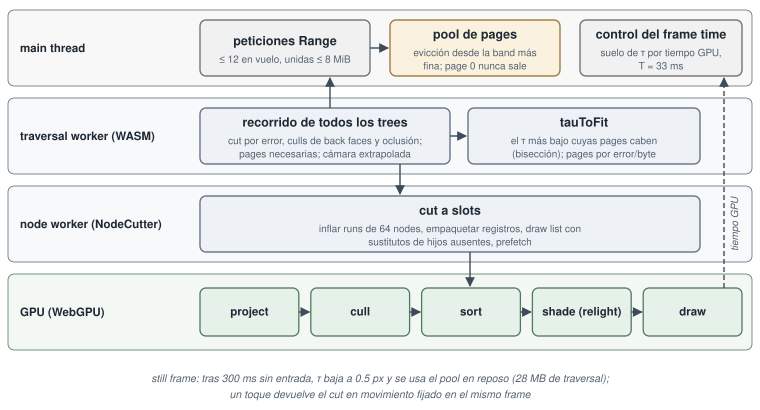

<!-- Copyright (c) 2026 jesus luque. -->
<!-- Generated by docs/paper/site.py from docs/paper; edit the sources there. -->

# Parte II. El formato web: un formato de entrega derivado 

El segundo proceso empieza donde termina el primero. Toma el master de la Parte I y deriva de él un formato con un
solo propósito: llevar el asset con relight a un navegador web en un móvil. Su objetivo es otro, y también su criterio.
Una pestaña de móvil tiene un budget de memoria (unos 50–60 MB de datos del asset mientras la cámara se mueve, unos 100
MB en reposo), una descarga que debe empezar a dibujar en segundos, y un tiempo de frame; el formato se hace para
cumplirlos, y su fidelidad se mide como una pérdida frente al relight sin comprimir del propio master y, a través de él,
frente al path trace. Nada de este proceso cambia el master, y nada de él lo vuelve a leer el bake.

**Master frente a formato de entrega** — La Parte I produce un *master*: la representación de máxima fidelidad (USD con todas las Gaussians, su transfer en f16, sus 256 bits de open directions, sus merge trees completos) de la que se puede rehacer cualquier cosa. La Parte II produce un *formato de distribución*, igual que en vídeo se distingue un master ProRes/EXR de un H.264/AV1 de entrega: el segundo se deriva del primero, pierde información de forma irreversible y se optimiza para un receptor concreto. Aquí el receptor es una pestaña de un navegador móvil, y sus tres restricciones son las que fijan el diseño:

- **Memoria.** Safari en iOS no publica un límite por pestaña; WebKit y el sistema (el mecanismo de *jetsam* de iOS) matan el proceso de contenido web cuando su huella total supera un umbral que depende del modelo y de la presión de memoria del sistema. Por eso el artículo fija un budget propio y conservador: 50–60 MB de *datos del asset* con la cámara en movimiento y unos 100 MB en reposo (§7.10–§7.11), separado del estado de render y del resto de la página.
- **Latencia de arranque.** Una página que tarda decenas de segundos en mostrar algo se abandona; el formato debe permitir dibujar un cut grueso con muy pocos bytes (la page 0 de cada tree) y refinar después (§7.5–§7.6).
- **Tiempo de frame.** 16.7 ms para 60 fps, 33.3 ms para 30 fps. En un iPhone el coste del shade por Gaussian dibujada domina (§7.12.1), así que el número de Gaussians dibujadas por frame es la variable de control (§7.10).

**La cadena de medidas de fidelidad** — La pérdida del formato web se mide contra el relight *sin comprimir* del mismo master (aísla el error de compresión), y el master se mide contra el path trace del mesh (aísla el error del bake). Como los errores se componen, una cifra frente al path trace mezcla ambos; por eso el artículo da siempre la referencia de cada número (§7, "Aparecen tres tipos de medida").

*Referencias:* Parte I del artículo (§2–§6); el player sparkwebGPU, con demos públicas en https://sparkwebgpu.lucab.co.uk ; el motor athenea, en github.com/jesusluque/athenea.

**Entrada.** Los merge trees del master con sus pages y su codebook de oclusión (sección 6); para el Corvette, los 24
trees del close-up level.

**Merge tree, pages y codebook de oclusión** — Los tres productos de la sección 6 que consume este proceso. Un *merge tree* es la jerarquía de niveles de detalle de una nube: las hojas son las Gaussians del bake y cada nodo interior (*merge*) es una Gaussian que sustituye a sus hijos, con una cota de error $\varepsilon$ y una esfera de radio $\rho$ que acotan cuánto se nota la sustitución. Las *pages* son trozos del tree (unos 3000 nodos) ordenados por bandas de error, la unidad de streaming (§7.5.1). El *codebook de oclusión* es un diccionario de máscaras de 16 × 16 direcciones (en proyección octaédrica) que dice desde qué direcciones es visible algo del subárbol de cada nodo; cada nodo guarda un índice a él (§7.5.1, "Oclusión").

**Close-up level y los 24 trees del Corvette** — El *close-up level* es el nivel de bake más fino (el `car5120`, bake a 5120 px de cámara, §6.2.1), partido por grupos de piezas del coche: 24 trees independientes. Cada tree es un fichero (o varios, §7.5.4) en el formato web.

*Referencias:* §6 del artículo; [35] (Nanite, la idea de paginar por error); athenea `apps/athenea/src/CmdDecimate.cpp` (`--tree`, `--tree-pages`, `--occlusion-mask`), athenea `modules/usd/src/Occlusion.cpp`, athenea `shaders/athenea/lod/lod_pages.slang`; `docs/decisions.md` (sección "Decimation: the levels of detail, cut once by what a merge loses").

**El proceso**, en orden, lo ejecutan las herramientas del player, no el motor:

1. **Leer el master** (`usd-athc`, un lector construido sobre el crate `openusd`): la nube USD se convierte en un
   contenedor `.athc` versión 3, organizado en secciones y tiers para que un HTTP Range traiga lo que necesita un tier
   de un bloque (§7.1). Una nube con skinning añade su skin, su skeleton y sus clips (§5.12).
2. **Empaquetado sin pérdida** (§7.1): cada array transpuesto en planos de bytes, o en planos de diferencias, lo que
   gzip comprima mejor, porque gzip es lo que descomprime un navegador.
3. **El transfer** (§7.2): o un PCA por clusters de cada bloque del fichero (codificación 3), o una base ajustada sobre
   todo el asset (`fit-compact-basis`) que el móvil mantiene residente, de modo que cada Gaussian guarda un id de
   cluster y $3\times8$ pesos int4.
4. **Las open directions** (§7.3): un diccionario en espacio de Hamming de 4096 máscaras compartido por el asset; cada
   Gaussian guarda un índice de 16 bits.
5. **El registro compacto** (§7.4): cada parámetro restante cuantizado en planos de bytes, 40 bytes por Gaussian en la
   GPU.
6. **Pages, tiers y traversal records** (§7.5): las pages del tree partidas en bandas de error, traversal records de
   5–11 bytes, y una tabla del asset (las bases, el diccionario, los materiales) que se descarga una vez.
7. **En la reproducción** (§7.6–§7.10): streaming por peticiones Range, un cut por frame dentro del budget de memoria,
   el dibujo y el relight en el móvil, una contact shadow, y una política de still frame que refina cuando la cámara se
   para.

**`usd-athc` y el crate `openusd`** — `usd-athc` es un binario Rust del player que lee el USDC del master sin la biblioteca C++ de Pixar: usa `openusd` (versión 0.7.0), una implementación en Rust del lector de USDA/USDC. Es una decisión práctica: las herramientas del player se compilan sin la cadena de OpenUSD/MaterialX/TBB del motor, y la conversión solo necesita leer primvars (posiciones, escalas, transfer, máscaras, índices de oclusión) de un `ParticleField`/`Points` ya cocinado, no componer un stage.

**`.athc` versión 3, secciones y tiers** — Un contenedor binario propio. *Sección* = un array de un tipo de dato (identificado por un FourCC, cuatro caracteres ASCII como `CORE` o `TXDI`); *tier* = un nivel de calidad de lectura (1: geometría y color; 2: material; 3: relight completo; 4: el registro compacto del móvil). La propiedad clave es que, dentro de cada bloque, las secciones de un tier forman un **prefijo** contiguo del bloque, de modo que leer "el bloque $b$ hasta el tier $t$" es un único rango de bytes.

**HTTP Range** — La cabecera `Range: bytes=a-b` de HTTP/1.1 (RFC 9110, §14) pide a un servidor estático solo un trozo de un fichero, al que responde con `206 Partial Content`. Permite hacer streaming de un fichero enorme sin servidor especial: el cliente lee primero la cabecera y las tablas, y luego pide exactamente los bytes de las pages que necesita. Cualquier CDN (R2, Cloudflare) lo soporta.

**Skin, skeleton, clips** — Para una nube con esqueleto (el gorrión, §5.12): las influencias por Gaussian (joints y pesos), la jerarquía de joints (`ATSK`) y las animaciones (clips `ATCL`).

**Los pasos 2–6** son la cadena de compresión: sin pérdida (planos de bytes + gzip), con pérdida del transfer (PCA por clusters), con pérdida de la visibilidad (cuantización vectorial), con pérdida de los parámetros escalares (cuantización por planos), y la reorganización del tree para el streaming. El paso 7 es lo que hace el player en tiempo de ejecución. Cada término se desarrolla en su sección.

*Referencias:* RFC 9110 (HTTP Semantics), §14 "Range Requests"; [43] (OpenUSD); crate `openusd` en crates.io.

**En qué se convierte cada parámetro.**

| parámetro | master USDC | formato web | pérdida medida | § |
|---|---|---|---|---|
| posición | 3 floats | $3\times$u16 en la caja de la page | menos de $10^{-6}$ de error de imagen (ablación) | 7.4 |
| escala, opacidad | 3 + 1 floats | escala logarítmica u8; opacidad u8 en dos tramos | menos de $10^{-6}$ (ablación) | 7.4 |
| orientación | cuaternión | una palabra de 32 bits: eje octaédrico de 10+10 bits, ángulo de 12 | | 7.4 |
| albedo | rgb float | sRGB u8 | menos de $10^{-6}$ (ablación) | 7.4 |
| normal | float | octaédrica, 12 bits por eje | relMSE $2.7\times10^{-4}$ (8+8 bits: $5.2\times10^{-2}$) | 7.4 |
| curvatura | 3 floats | 3 × s8, logaritmo con signo en el rango de la page | menos de $10^{-6}$ (ablación) | 7.4 |
| material | un valor por propiedad y Gaussian | índice u16 en una tabla exacta de los materiales del asset | ninguna (exacta) | 7.4 |
| transfer | 112 valores f16 | id de cluster + 24 pesos int4 sobre una base compartida | relMSE del transfer 0.0054 sobre el coche (v8.2b); imagen a menos de relMSE $10^{-3}$ del transfer sin comprimir | 7.2, 7.12 |
| open directions | 256 bits | índice u16 en un diccionario de 4096 entradas | 62.9–65.4 dB | 7.3 |
| rig | influencias, gradientes, lobes zonales | sección `SKIN`: joint u16, peso unorm16, gradientes en half; nodos fusionados sin gradiente | relMSE 0.0015–0.0053 frente al raster del motor | 5.12 |
| merge tree | nodos, pages, oclusión | pages por banda de error, traversal records de 5–11 bytes, el codebook de oclusión | el mismo cut | 7.5 |

**Lectura de la tabla, fila a fila** — Cada fila dice cómo se guarda un parámetro en el master (USDC, floats de 32 bits salvo el transfer en f16) y en el formato web, y qué error introduce la conversión:

- **Posición, $3\times$u16 en la caja de la page.** Cuantización uniforme a 16 bits dentro de la caja envolvente de la page: $x = \ell + q\,(h-\ell)/65535$. El paso es $(h-\ell)/65535$; para una page de 1 m de lado, unos 15 µm, muy por debajo del tamaño de cualquier Gaussian. Por eso su error de imagen es despreciable ($<10^{-6}$ de relMSE en la ablación: quitar la cuantización de ese parámetro y medir la diferencia).
- **Escala logarítmica u8.** Las escalas de las Gaussians varían en órdenes de magnitud; cuantizar $\ln s$ uniformemente da error *relativo* constante (cada paso multiplica la escala por el mismo factor), que es lo que el ojo percibe.
- **Opacidad u8 en dos tramos.** Un tramo cuadrático para $[0,1]$ (más resolución cerca de 0) y otro lineal para la opacidad de LoD de Spark ($>1$). Se detalla en §7.4.
- **Orientación en una palabra de 32 bits.** El cuaternión se reescribe como eje (en proyección octaédrica, 10+10 bits) y ángulo (12 bits): un formato de Spark ("ext").
- **Albedo sRGB u8.** La curva sRGB (aproximadamente $\gamma\approx2.2$) concentra los códigos en los oscuros, donde el ojo distingue más; 8 bits en sRGB equivalen perceptualmente a unos 12 bits lineales.
- **Normal octaédrica de 12 bits por eje.** La proyección octaédrica (Cigolle et al. 2014) lleva la esfera unidad a un cuadrado; 12+12 bits dan un error angular del orden de $10^{-3}$ rad. Con 8+8 el error angular (del orden de $10^{-2}$ rad) se dobla en la dirección de reflexión y los reflejos nítidos del clear coat se desplazan: relMSE $5.2\times10^{-2}$ frente a $2.7\times10^{-4}$.
- **Curvatura.** Tres valores con signo y gran rango dinámico: logaritmo con signo en 8 bits, normalizado al rango de la page.
- **Material.** Un índice exacto a una tabla de las combinaciones de material distintas del asset: sin pérdida.
- **Transfer.** 112 valores f16 (224 bytes) pasan a 1 byte de cluster y 24 pesos de 4 bits (12 bytes): 17× menos. El relMSE del *transfer* (0.0054, error de los coeficientes) no es el de la *imagen* (a menos de $10^{-3}$ del transfer sin comprimir), porque el color es un producto escalar con la luz que promedia errores.
- **Open directions.** 256 bits (32 bytes) pasan a un índice de 16 bits (2 bytes); la cifra 62.9–65.4 dB es PSNR de imagen frente a las máscaras exactas.
- **Rig.** Joint u16, peso en unorm16 (entero sin signo normalizado a $[0,1]$), gradientes de peso en f16.
- **Merge tree.** Reorganizado, no aproximado: "el mismo cut" significa que la traversal elige exactamente los mismos nodos que con el tree original.

*Referencias:* Cigolle, Z. H., et al. (2014), "A Survey of Efficient Representations for Independent Unit Vectors", JCGT 3(2); IEC 61966-2-1 (sRGB).

El registro compacto entero ocupa 40 bytes en la GPU (42.4 bytes residentes con sus tablas, y 16 bytes por splat
dibujado), frente a 256 bytes solo para el transfer y la visibilidad del master en el device. La imagen de la ruta
compacta queda a 40.2–41.9 dB del relight completo de la misma nube. Para el Corvette, los 87.4 GB de los 24 trees del
close-up level se convierten en 12.77 GB de datos web (v8.2b, 149.0 M de nodos), servidos por page para que una vista
cargue una fracción.

**40 bytes frente a 256** — Los 256 bytes del master en el device son el transfer (112 × 2 = 224 B) más las open directions (32 B); los 40 bytes del registro compacto incluyen ya *todos* los parámetros. Los 42.4 B "residentes con sus tablas" reparten entre las Gaussians el coste de la base CPCA, el diccionario de sombras y la tabla de materiales. Los 16 B por splat dibujado son el registro que escribe el shade para el pase de dibujo (§7.7), y solo existen para el cut de ese frame.

**40.2–41.9 dB** — PSNR de la imagen del camino compacto frente al relight completo (sin comprimir) de la misma nube: un error cuadrático medio relativo de unos $10^{-4}$, invisible a simple vista salvo en reflejos especulares.

**87.4 GB → 12.77 GB** — Un factor 6.8. Los 12.77 GB son todo el conjunto web publicado (83 ficheros con todos sus tiers, §7.12.3); en media son unos 86 bytes por nodo para 149.0M nodos, pero ningún móvil lee más que una fracción: los tiers 1–3 no los toca y del tier 4 solo pide las pages que su vista necesita. Lo que importa al móvil es la descarga por vista (decenas de MB, §7.12.2), no el total.

*Referencias:* §7.4, §7.11 y §7.12.3 del artículo.

**Por qué se mantienen separados.** Cada paso de este proceso descarta información que produjo el bake: una base
ajustada a un asset, un diccionario que sustituye cada máscara por la más cercana, una cuantización elegida por lo que
el ojo ve a la resolución de un móvil. Un conjunto de datos web, por tanto, nunca es un master: no admite relight más
allá de lo que guardan sus codificaciones, ni un nuevo bake, ni la conversión a otro formato, ni la comparación frente al
path trace sin el master del que salió. Toda mejora del asset se hace en el master, y el formato web se vuelve a
derivar.

**Pérdida generacional** — Cada paso de la cadena (base ajustada, diccionario, cuantización) es una proyección a un espacio más pequeño elegida *para un uso*: una base CPCA ajustada al Corvette representa mal otro asset (§7.2.2: piezas excluidas del ajuste hasta 400 veces peor); un diccionario de máscaras no conserva las máscaras raras; una cuantización elegida para la resolución de un móvil puede no bastar para un 4K. Recomprimir un dato ya comprimido acumula errores sin control (lo que en vídeo se llama *generation loss*). Por eso la regla es estructural: el formato web es una hoja del grafo de datos, nunca una entrada. Tampoco permite validar contra el path trace por sí solo, porque no se sabe qué parte del error viene de la compresión y qué parte del bake.

*Referencias:* §7.2.2 (tabla "Evolución de la base"); [15] (la CPCA es una aproximación dependiente de los datos).

# 7. El formato web: compresión, streaming y un player WebGPU

Esta sección describe el formato web de la Parte II y el player que lo dibuja: el Corvette entero, con su transfer de luz completo, dibujado en un iPhone dentro de una página web y juzgado frente al path trace del mesh, dentro de unos 50–60 MB de datos del coche en movimiento y unos 100 MB en reposo, con piezas pequeñas que se vean bien. El player es un fork de Spark con backend WebGPU (sparkwebGPU, con demos en sparkwebgpu.lucab.co.uk); su entrada es el master de la Parte I – las nubes, los merge trees, las pages y la oclusión que escribe athenea. Esta sección describe los formatos, el streaming, el dibujado y el relight en el móvil, y los resultados medidos.

**Spark** — Un renderer de Gaussian splatting para la web de World Labs [11], construido sobre three.js (la biblioteca 3D de JavaScript sobre WebGL): carga PLY/SPZ/SOG, hace sort y dibujo de splats, LoD y edición. Su backend original es WebGL2.

**WebGPU** — La API gráfica moderna de la web (W3C, [46]), sucesora de WebGL. Expone el modelo de Vulkan/Metal/D3D12: dispositivo y cola explícitos, pipelines precompilados, *compute shaders*, storage buffers y bind groups. Chrome la publica desde 2023, Safari desde la versión 26 (2025) en macOS e iOS. Para este player lo decisivo son los *compute shaders*: sin ellos no hay sort en GPU, ni relight por Gaussian, ni cull en GPU. Su lenguaje de shaders es **WGSL** (WebGPU Shading Language); el player escribe sus kernels en Slang [44] y los compila a WGSL.

**sparkwebGPU** — El fork de Spark con backend WebGPU, más unos adaptadores de athenea escritos en Slang (el relight, el camino compacto) y unas herramientas Rust para el formato. El dibujado de athenea en el móvil es un camino propio (`CompactRelitPath`), no el renderer de Spark.

**Juzgado frente al path trace del mesh** — La referencia última es el render path-traced del modelo original (triángulos y materiales MaterialX), no la nube: el objetivo es que el iPhone se parezca al render de producción.

*Referencias:* [11] (Spark), [46] (W3C WebGPU: https://www.w3.org/TR/webgpu/ ; WGSL: https://www.w3.org/TR/WGSL/), [44] (Slang); athenea `docs/decisions.md` (sección "A note on WebGPU": qué portaría y qué no del motor nativo).

**Aparecen tres tipos de medida**, y no son intercambiables:

- **Dawn / M5 Pro**: marcas de tiempo de GPU de Dawn sin interfaz (Metal) en un Apple M5 Pro, a la resolución CSS del móvil (393 × 852) o a 1920 × 1080. Son un sustituto de la GPU del móvil.
- **iPhone emulado**: el sitio publicado en Chrome de escritorio en el mismo M5 Pro, con la página en su modo móvil a 393 × 852. Los tamaños de pool, el cut y la memoria son los del móvil; la velocidad no. Las tasas de frames emuladas son más o menos el doble que las del iPhone real, así que los dibujados se juzgan en el device.
- **iPhone real**: iOS 18.7, Safari 26.6.1, pantalla de 393 × 852 @3 (la clase iPhone 14 Pro–16), canvas de 393 × 695 con pixel ratio 1. Son las rampas de la página de estrés y dos pasadas del coche entero en el device.

**Dawn** — La implementación de WebGPU de Google en C++ (la que usa Chrome). "Sin interfaz" (*headless*): ejecutada desde Node mediante el paquete `webgpu` (bindings de Dawn para Node), sin navegador ni ventana, sobre Metal en el Mac. Las *marcas de tiempo de GPU* son la característica opcional `timestamp-query` de WebGPU: el pase escribe un contador de la GPU al principio y al final (`timestampWrites`), lo que mide tiempo de GPU puro, sin el ruido de la CPU ni de la sincronización.

**M5 Pro como sustituto** — La GPU del M5 Pro es mucho más rápida que la de un iPhone, pero tiene la misma arquitectura (GPU de Apple, renderizado diferido por tiles) y el mismo lenguaje de shaders de destino (Metal), así que los cambios relativos de un kernel (−23 %, ×3) se transfieren mejor que los tiempos absolutos.

**Resoluciones** — 393 × 852 son *puntos CSS* de la clase iPhone 14 Pro–16; con pixel ratio @3, la pantalla física tiene 1179 × 2556 píxeles. El player dibuja a pixel ratio 1 en un canvas de 393 × 695 (la altura que deja la interfaz de Safari): 9 veces menos píxeles que la resolución nativa, una elección deliberada para mantener el coste por píxel bajo.

**iPhone emulado** — El modo de dispositivo de las DevTools de Chrome: viewport, pixel ratio y user agent del móvil, y la página activa su configuración de móvil (pool, budget, $\tau$). La GPU sigue siendo la del Mac, por eso los fps emulados no valen como medida del device.

**iOS 18.7 y Safari 26.6.1** — La combinación es la que declara el navegador. Desde iOS 26 Safari congela la versión de iOS de su user agent en 18.x, así que es probable que el device ejecutara iOS 26 aunque la cadena diga 18.7; el artículo da la cadena tal como se leyó.

*Referencias:* Dawn: https://dawn.googlesource.com/dawn ; especificación WebGPU, §"Timestamp Query" ([46]).

La calidad de imagen se da como PSNR en dB, o como relMSE ($\sum(x-y)^2/\sum y^2$; cuando el PSNR se escribe como $-10\log_{10}\mathrm{relMSE}$ se indica). La referencia es el path trace en la `/World/Camera` de athenea (1920 × 1080) o el propio camino sin comprimir del player. En cada caso se dice cuál.

**PSNR y relMSE** — Dos formas de medir la diferencia entre una imagen $x$ y una referencia $y$:

$$
\mathrm{relMSE} = \frac{\sum_p (x_p-y_p)^2}{\sum_p y_p^2},\qquad
\mathrm{PSNR} = 10\log_{10}\frac{\mathrm{MAX}^2}{\mathrm{MSE}} .
$$

La relMSE normaliza por la energía de la referencia, así que no depende de la exposición ni de un valor máximo (útil en HDR lineal). Cuando se escribe "PSNR" como $-10\log_{10}\mathrm{relMSE}$ es la misma escala logarítmica con la energía de la referencia en lugar de $\mathrm{MAX}^2$: relMSE $10^{-3}$ equivale a 30 dB, $10^{-4}$ a 40 dB, $10^{-6}$ a 60 dB. Cada 10 dB son un factor 10 en error cuadrático; 3 dB, un factor 2. Como regla práctica, por encima de 40 dB una diferencia no se ve sin ampliar; por encima de 60 dB es ruido de redondeo; cifras como 188 dB (§7.12.3) indican imágenes iguales salvo diferencias en el último bit de alguna operación en coma flotante.

**Las dos referencias** — El path trace (`/World/Camera` de athenea, 1920 × 1080) mide la calidad *absoluta* (todo el error del bake más el de la compresión); "el camino sin comprimir del player" mide solo el error que añade el formato web. Una cifra frente al path trace de 19 dB y otra de 41 dB frente al relight sin comprimir no se contradicen: miden cosas distintas.

*Referencias:* athenea `docs/decisions.md` y `docs/operations.md` (`athenea compare`: la comparación de imágenes en GPU); §2.15 y §8 del artículo. El PSNR premia ligeramente las imágenes algo más oscuras que la referencia (menos energía, menos error absoluto en las altas luces), por eso el artículo da también regiones y cocientes de brillo.

## 7.1 El contenedor: `.athc` versión 3

El `.athc` v2 de athenea es un array plano de palabras por splat. El player web lo reescribe como **versión 3**, organizada por secciones y tiers. Dentro de cada bloque, los datos que necesita un tier son un prefijo, así que cada par (bloque, tier) es una sola petición HTTP Range:

**`.athc` v2 frente a v3** — La v2 de athenea es "array de estructuras": por cada splat, todas sus palabras seguidas. Bueno para subir a la GPU de una vez, malo para la web: no se puede leer *solo* la geometría sin el transfer, ni pedir solo un trozo útil. La v3 es "estructura de arrays" por bloque (un bloque es un nivel de LoD o un chunk/page de splats), con las secciones ordenadas por tier, de modo que el prefijo del bloque hasta el tier $t$ contiene todo lo que pide ese tier. La conversión v2 → v3 → v2 es idéntica byte a byte: v3 reordena, no cambia valores.

| Tier | Secciones | Contenido |
|---|---|---|
| 1 | `CORE`, `SHRS` y, opcionalmente, `LODS`, `LODE`, `OCCL`, `LODM`, `TREE`, `SKIN` | geometría y color del splat; metadatos de LoD |
| 2 | `MATL` | normales, emisión, pbr, lobes |
| 3 | `SHAD`, `CURV`, `TXDI`, `TXIN`, `TXFD` | bits de open directions, curvatura, transfer (directo, indirecto, reflected field) |
| 4 | `CMPC` | el registro compacto para el móvil (§7.4) |

**Las secciones, una a una** —

- `CORE` (36 B/splat): posición, forma (opacidad, escala, cuaternión y color DC empaquetados) y una cola de datos; lo mínimo para dibujar una Gaussian 3DGS [1].
- `SHRS`: los armónicos esféricos de color restantes (grados 1–3) de un 3DGS clásico.
- `LODS`: el tamaño de LoD de un merge medido por error (un float). `LODE` (8 B): las cotas del cut por error, $\varepsilon$ y $\rho$ en f16, más el cono de normales ($\theta$ f16 y un eje de 8+8 bits). `LODM`: una segunda opacidad para los merges. `OCCL`: el índice al codebook de oclusión (entrada + 1; 0 sin máscara). `TREE` (8 B): para un tree paginado, la page de los hijos, la posición del primero y su número.
- `SKIN`: influencias y gradientes de peso de una nube con skinning.
- `MATL` (tier 2): normales, emisión, palabras pbr y lobes (el material por Gaussian).
- `SHAD` (tier 3): los bits de open directions (256 bits por Gaussian). `CURV`: la curvatura (el operador de forma de athenea, tres f16). `TXDI`/`TXIN`/`TXFD`: el transfer partido en mitad directa, mitad indirecta y reflected field, para que se pueda leer un prefijo (16, 64 o 112 valores).
- `CMPC` (tier 4): el registro compacto del móvil, autosuficiente: un móvil no lee ningún byte de los tiers 1–3.

**Por qué la división en tiers** — Un visor de escritorio de "solo 3DGS" lee el tier 1; un visor con material el 2; el relight completo de escritorio el 3; un móvil el 4. Cada lector paga solo lo suyo y el fichero es uno.

*Referencias:* §5.12 (skin), §6 (LODE, OCCL, TREE) del artículo.

Un navegador ofrece gzip y nada mejor (`DecompressionStream`), así que la palanca sin pérdida es lo que se le da a gzip. La **codificación 1** transpone cada array en planos de bytes: el byte 0 de todos los elementos, luego el byte 1, y así sucesivamente. El byte alto de un f16 o un f32 cambia poco de un splat al siguiente en orden de Morton, así que forma tramos que gzip encuentra. La **codificación 2** hace lo mismo tras sustituir cada carril de 16 bits por su diferencia (con desbordamiento) respecto al elemento anterior. `athc-convert --gzip --planes` elige la codificación más pequeña por sección. Medido en las nubes publicadas: Corvette ligero 68.1 → 60.9 MB (−10.6 %), Corvette HD 288.7 → 248.6 MB (−13.9 %), su pintura −23 %, piezas del peón −17 a −33 %. Los bits de sombra son aleatorios y nunca ganan.

**gzip, DEFLATE y `DecompressionStream`** — gzip (RFC 1952) es un envoltorio de DEFLATE (RFC 1951): LZ77 (sustituir repeticiones por referencias hacia atrás dentro de una ventana de 32 KB) seguido de códigos de Huffman. La API `DecompressionStream` (estándar Compression Streams del WHATWG) descomprime `"gzip"`, `"deflate"` y `"deflate-raw"` de forma nativa y en streaming; no ofrece zstd y brotli no está en todos los motores. Un descompresor en WASM (zstd, por ejemplo) sería posible, pero más lento y más pesado que el nativo. Por eso la palanca es **preparar los datos** para que DEFLATE los comprima mejor, no cambiar de compresor.

**Codificación 1: planos de bytes** — Transposición: para $n$ elementos de $w$ bytes, se escriben primero los $n$ bytes 0, luego los $n$ bytes 1, etc. (el mismo filtro que el *shuffle* de Blosc o de HDF5). Intuición con un f16 (1 bit de signo, 5 de exponente, 10 de mantisa): su byte alto contiene signo, exponente y los 2 bits altos de mantisa, y cambia poco entre splats vecinos; el byte bajo es casi ruido. Entrelazados, el ruido rompe cada repetición; separados, el byte alto forma largas series que LZ77 encuentra y Huffman codifica con pocos bits. El **orden de Morton** (curva Z: intercalar los bits de las coordenadas x, y, z) hace que splats consecutivos en el fichero sean vecinos en el espacio, lo que vuelve los valores vecinos parecidos.

**Codificación 2: planos de diferencias** — Antes de transponer, cada carril de 16 bits se sustituye por $v_i - v_{i-1} \bmod 2^{16}$ (con desbordamiento, es decir, aritmética modular, reversible exactamente). Funciona mejor cuando los valores varían suavemente (las diferencias son pequeñas y sus bytes altos casi siempre 0 o 0xFF).

**Las cifras** — Elegir la mejor codificación por sección (`write_v3_smallest`) ahorra un 10–14 % sobre gzip directo en el Corvette, más en la pintura (−23 %, una superficie grande y suave) y en el peón (−17 a −33 %). Los bits de sombra son, para un compresor, casi aleatorios (cada bit depende de la geometría lejana, no de la posición en el orden de Morton), con entropía cercana a 1 bit por bit: ninguna reordenación ayuda. Lo resolverá la cuantización vectorial (§7.3).

*Referencias:* RFC 1951 (DEFLATE), RFC 1952 (gzip); WHATWG Compression Streams: https://compression.spec.whatwg.org/ ; Morton, G. M. (1966), IBM technical report.

## 7.2 Compresión del transfer por PCA agrupada

El transfer es el 30–70 % de los bytes de una nube con relight, y los transfers vecinos se parecen. Se usan dos codificaciones por PCA agrupada: una codificación con pérdida del fichero (codificación 3) y una base conjunta que el móvil mantiene residente.

**El transfer** — Es el núcleo del relight (§4): por cada Gaussian, un vector de coeficientes que, multiplicado por la luz expresada en armónicos esféricos (SH), da su radiancia saliente. Es la idea de Precomputed Radiance Transfer de Sloan et al. [14]: la integral de iluminación $\int L(\omega)\,T(\omega)\,d\omega$ se convierte, con $L$ y $T$ proyectados en una base ortonormal, en un producto escalar $\sum_k l_k t_k$. Los 112 valores son 16 directos (SH de grado 3, escalar: la visibilidad del cielo con coseno), 48 indirectos (16 × RGB: la luz rebotada en el propio objeto) y 48 del reflected field (16 × RGB: lo que se ve reflejado en cada dirección, para el especular).

**Por qué se parecen los vecinos** — El transfer es una función suave de la posición y la normal: dos Gaussians contiguas de una misma superficie ven casi el mismo cielo y el mismo entorno. Los vectores de transfer de un bloque viven, por tanto, cerca de un subespacio de dimensión baja, que es exactamente lo que explota una PCA.

*Referencias:* [14] (PRT), [15] (CPCA), [17] (irradiancia con 9 SH); §4 del artículo; athenea `docs/decisions.md` (sección "A transfer right under any sky and any light (task TX)").

### 7.2.1 Codificación 3 (en el fichero)

Siguiendo a Sloan et al. (2003), una sección de transfer de un bloque se guarda como hasta $K$ clusters (k-means sobre una muestra; $K \le n/128$). Cada cluster $c$ tiene una media $\mu_c$ y $m_c \le M$ direcciones principales $\mathbf{d}_{c,j}$ en f16. Cada elemento $i$ tiene un id de cluster y $m_c$ coeficientes cuantizados:

**k-means** — Partir $n$ vectores en $K$ grupos minimizando la suma de distancias cuadráticas a la media de cada grupo; el algoritmo de Lloyd [23] alterna asignar cada punto al centro más cercano y recalcular cada centro como media de sus puntos. Aquí se ajusta sobre una muestra uniforme del bloque y luego se asigna cada elemento a su centro más cercano. La cota $K \le n/128$ garantiza al menos unos 128 elementos por cluster de media, para que la media y las direcciones principales del cluster salgan de suficientes datos y su coste (guardado en f16) se amortice.

**PCA por cluster** — Análisis de componentes principales: las direcciones $\mathbf d_{c,j}$ son los vectores propios de la matriz de covarianza del cluster, $\mathrm{Cov}_c = \frac{1}{n_c}\sum_{i\in c}(\mathbf t_i-\mu_c)(\mathbf t_i-\mu_c)^\top$, ordenados por valor propio decreciente. Truncar a las $m_c$ primeras es la mejor aproximación de rango $m_c$ en error cuadrático (teorema de Eckart–Young). La combinación de ambas ideas es la *Clustered PCA* (CPCA) de Sloan et al. [15], diseñada precisamente para PRT: un cluster capta la región, la PCA local capta su variación.

*Referencias:* [15], [23]; Jolliffe, I. T. (2002), *Principal Component Analysis*; Eckart, C., Young, G. (1936), Psychometrika.

$$
\hat{\mathbf{t}}_i = \mu_{c(i)} + \sum_{j<m_{c(i)}} \left(q_{ij}\,\Delta_{c(i)}\right)\mathbf{d}_{c(i),j},
\qquad q_{ij}\in\mathbb{Z},
$$

**La reconstrucción** — Cada elemento se reconstruye como la media de su cluster más una combinación lineal de las direcciones del cluster. El coeficiente real es $q_{ij}\,\Delta_{c}$: un entero por un paso de cuantización uniforme del cluster. Si $\mathbf t_i$ es un vector de dimensión $D$, se guardan $m_c$ enteros pequeños en lugar de $D$ halves, y la media y las direcciones se pagan una vez por cluster.

*Referencias:* [15] (ecuación de reconstrucción CPCA).

donde cada producto y cada suma se redondean a f32 en ese orden y el resultado se redondea al half más cercano. Eso hace que los decodificadores de Rust/WASM y de TypeScript sean idénticos al bit. El paso $\Delta_c$ es proporcional al RMS del cluster, lo que da el mismo error relativo en clusters oscuros que en claros. Los coeficientes son enteros zig-zag de 1–3 bytes, guardados como planos de bytes. $m_c$ es el menor número cuyo truncado consume como mucho el 40 % del budget de error. El budget es relativo por bloque:

**Decodificación idéntica al bit** — La suma en coma flotante no es asociativa: $(a+b)+c \ne a+(b+c)$ en general. Si el decodificador de Rust (compilado a WASM, para ficheros enteros y pages) y el de TypeScript (para streams sueltos de un chunk) sumaran en otro orden o con otra precisión (JavaScript usa doubles por defecto), darían halves distintos y la imagen dependería de qué camino cargó cada bloque. Fijando la receta —cada producto y cada suma redondeados a f32 (en JS con `Math.fround`) en un orden dado, y redondeo final al half más cercano con empates al par— ambos producen exactamente los mismos bits, y un test lo comprueba.

**Paso proporcional al RMS** — Con $\Delta_c \propto \mathrm{RMS}_c$, el error de cuantización (uniforme, varianza $\Delta^2/12$ por coeficiente) es proporcional a la magnitud típica del cluster: el error *relativo* es el mismo en clusters oscuros (transfer pequeño, zonas en sombra) que en claros. Sin esto, un paso global destrozaría las zonas oscuras, donde el ojo es más sensible a errores relativos.

**Zig-zag** — Mapea enteros con signo a enteros sin signo intercalando: $0\to0, -1\to1, 1\to2, -2\to3,\dots$; en bits, $z = (q \ll 1) \oplus (q \gg 31)$. Así un entero pequeño en valor absoluto tiene bytes altos a cero, y en planos de bytes esos planos altos se comprimen casi a nada. Es la codificación de Protocol Buffers.

**Reparto del budget: 40 % truncado, 60 % cuantización** — El error total tiene dos fuentes: las direcciones descartadas (truncado) y el redondeo de los coeficientes. Se elige el menor $m_c$ cuyo truncado consume como mucho el 40 % del budget $E$, y el paso $\Delta$ se ajusta para que el total quepa en $E$.

*Referencias:* IEEE 754-2019 (redondeo al más cercano, empates al par); Protocol Buffers, "Encoding" (ZigZag): https://protobuf.dev/programming-guides/encoding/ .

$$
E_{\text{block}} = \frac{\sum_i \lVert \hat{\mathbf t}_i - \mathbf t_i\rVert^2}{\sum_i \lVert \mathbf t_i\rVert^2} \le E, \qquad E = 10^{-5}\ \text{por defecto},
$$

**El budget de error relativo** — $E_{\text{block}}$ es una relMSE sobre los coeficientes del bloque. Con $E = 10^{-5}$ (por defecto) el transfer reconstruido está a unos 50 dB del original: un error muy pequeño, pensado para que la codificación 3 sea "casi sin pérdida" en el fichero de escritorio.

y el paso se reduce hasta que se cumple. Como los coeficientes SH del transfer son ortonormales, $E$ es el error $L^2$ sobre la esfera. Un bloque que no cumple $E$, o que los planos de bytes guardan más pequeño, conserva sus valores exactos. Medido: las secciones de transfer ocupan entre 4 y 7 veces menos (el TX 112 de la tapa del peón pasó de 157 a 28 MB); un splat relight se mueve un relMSE de $4\times10^{-8}$ a $3\times10^{-5}$; el set ligero del Corvette pasó de 67.9 a 49.5 MB y la página del peón de 281 a 84 MB.

**Por qué $E$ es el error $L^2$ sobre la esfera** — Los armónicos esféricos $Y_k$ son ortonormales: $\int_{S^2} Y_k Y_l\,d\omega = \delta_{kl}$. Para una función $f=\sum_k t_k Y_k$, la identidad de Parseval da $\int_{S^2}(\hat f - f)^2\,d\omega = \sum_k(\hat t_k - t_k)^2$. El error medido sobre los coeficientes es exactamente el error de la función sobre la esfera, que es lo que leen el producto con el cielo, la evaluación del sol en un punto y la reflexión del campo.

**Un bloque que no cumple** guarda sus valores exactos (modo 0, solo planos de bytes): la codificación nunca empeora un bloque por encima del budget.

**Las cifras** — 4–7× menos bytes en las secciones de transfer (157 → 28 MB: 5.6× en la tapa del peón con TX de 112 valores). Un splat relight se mueve entre $4\times10^{-8}$ y $3\times10^{-5}$ de relMSE (entre 75 y 45 dB): invisible. El conjunto ligero del Corvette pasa de 67.9 a 49.5 MB (−27 %), menos que el factor de las secciones porque el transfer es solo una parte del fichero.

*Referencias:* [16] (propiedades de los SH), [17].

### 7.2.2 La base conjunta residente en la GPU

En el móvil el transfer nunca se expande. La CPCA conjunta de athenea divide los 112 valores TX en tres bloques $b \in \{\text{directo } (16), \text{indirecto } (48), \text{reflejado } (48)\}$. Usa $C$ clusters compartidos por los tres bloques y $K = 8$ direcciones por bloque. Una Gaussian guarda un id de cluster $c$ y $3 \times 8$ pesos:

**"El transfer nunca se expande"** — En el escritorio el transfer se descomprime a 112 halves por Gaussian en la GPU. En el móvil eso costaría 224 B por Gaussian (224 MB por millón), inaceptable; el shade trabaja directamente con los pesos y la base.

**CPCA conjunta** — A diferencia de la codificación 3 (clusters por bloque de fichero), aquí la base es **una** para todo el asset y los tres bloques comparten el mismo id de cluster: un único byte de cluster por Gaussian. El clustering se hace sobre el vector conjunto de 112 valores (cada bloque normalizado por su energía para que el reflejado, de mayor magnitud, no domine), y luego se hace una PCA por cluster y por bloque. $K=8$ direcciones por bloque es un compromiso fijo: el registro necesita tamaño constante (12 bytes de pesos) para que la GPU direccione por índice.

*Referencias:* [15]; athenea `shaders/athenea/lod/transfer_codec.slang` (cabecera: el códec de la base de athenea, "direct 16, indirect 48 and reflected 48 coefficients, each divided by its block's energy norm").

$$
\mathbf t^{(b)}_i \;\approx\; \mu^{(b)}_{c} + \sum_{k=1}^{8} q^{(b)}_{ik}\,\frac{s^{(b)}_{c,k}}{127}\,\mathbf B^{(b)}_{c,k},
$$

**La fórmula** — $\mathbf t^{(b)}_i$ es el bloque $b$ del transfer de la Gaussian $i$; $\mu^{(b)}_c$ la media del cluster en ese bloque; $\mathbf B^{(b)}_{c,k}$ el eje $k$; $s^{(b)}_{c,k}$ la escala de ese eje (el rango de los pesos que necesita); $q^{(b)}_{ik}$ un entero de 8 bits con signo en $[-127,127]$. El peso real es $q\,s/127$, que va de $-s$ a $s$.

donde $\mathbf B$ son los ejes de cada cluster y $s$ sus escalas. En la GPU, cada dirección se guarda premultiplicada por $s/127$ en f16, 504 palabras por cluster. Los **pesos** son int8 o, en el móvil, int4: se codifican a 7 niveles y se decodifican como $q_8 = \mathrm{round}(q_4 \cdot 127/7)$. En el móvil, int4 cuesta $+0.7\times10^{-4}$ de relMSE del color por splat y $0.1$–$4.6\times10^{-5}$ de relMSE de imagen; domina el propio truncado de la CPCA.

**504 palabras por cluster** — Por cluster se guardan la media (112 valores) y los ejes ($8\times112 = 896$ valores): 1008 halves = 504 palabras de 32 bits. Premultiplicar cada eje por $s/127$ ahorra una multiplicación por peso en el shade y deja el decode como $\mu + \sum_k q_k \mathbf B'_k$. Para 256 clusters, $256\times504\times4 = 516\,096$ bytes: los "516 KB" de la §7.2.2.

**int8 frente a int4** — En el móvil cada peso usa 4 bits con signo, con valores en $[-7, 7]$ ("7 niveles" por lado, 15 en total). Se decodifica al grid de int8 con $q_8 = \mathrm{round}(q_4\cdot127/7)$, para que el shader trate igual ambos anchos. El error de cuantización (uniforme) tiene varianza $\Delta^2/12$; pasar de 255 a 15 niveles multiplica $\Delta$ por 17, pero el error resultante ($+0.7\times10^{-4}$ de relMSE del color por splat) sigue siendo menor que el del propio truncado a 8 direcciones de la CPCA. Por eso "domina el truncado": invertir bits en los pesos no compensaría.

**La ruta proyectada.** Bajo una sola cúpula, solo el bloque reflejado depende del ojo. En cada relight, un hilo por cluster proyecta la media y los 8 ejes de los bloques directo e indirecto sobre la luz (los 16 harmonics de la cúpula, la dirección del sol, el acoplamiento de cielo blanco): 144 palabras por cluster. Los términos independientes de la vista ("conservados") de una Gaussian son entonces productos escalares de sus pesos con esas proyecciones. En cada frame solo se reconstruyen, en registros, los 48 valores reflejados. Con datos reales esta ruta reproduce la reconstrucción completa con un relMSE de $3\times10^{-11}$.

**La ruta proyectada: linealidad** — El color difuso conservado (bloques directo e indirecto) es lineal en el transfer: $c = \mathbf t\cdot\mathbf L$, donde $\mathbf L$ son los coeficientes SH de la luz. Sustituyendo la reconstrucción,

$$
\mathbf t^{(b)}_i\cdot\mathbf L = \mu^{(b)}_c\cdot\mathbf L + \sum_{k=1}^{8} q^{(b)}_{ik}\,\big(\mathbf B'^{(b)}_{c,k}\cdot\mathbf L\big).
$$

Los productos entre paréntesis dependen solo del cluster y de la luz, no de la Gaussian: se calculan una vez por cluster cuando cambia la luz (un hilo por cluster) y cada Gaussian solo hace 8+8 multiplicaciones-suma con sus pesos. Esto es exactamente el "truco" de Sloan et al. [15]: en CPCA, el coste de render por vértice es proporcional al número de componentes $m$, no a la dimensión del transfer.

**144 palabras por cluster** — Se proyectan 18 vectores (media + 8 ejes, en dos bloques) sobre la cúpula (16 harmonics RGB), la dirección del sol y el acoplamiento de cielo blanco: unas 8 palabras por vector proyectado, 144 en total; $256\times144\times4 = 147\,456$ bytes, los "147 KB" de la §7.2.2.

**El bloque reflejado** depende del ojo (la dirección de reflexión cambia con la cámara), así que no se puede proyectar de antemano: en cada frame, cada Gaussian reconstruye sus 48 valores en registros y los evalúa en su dirección de espejo.

**$3\times10^{-11}$** — Diferencia de puro redondeo en coma flotante (unos 105 dB): la ruta proyectada es matemáticamente idéntica a la reconstrucción completa.

*Referencias:* [15], [14].

**Evolución de la base.**

| base | clusters | ajustada sobre | relMSE del transfer | notas |
|---|---|---|---|---|
| base de athenea | 256 | la muestra de `base_tx` de athenea | 1.69e-2 (coche entero) | fichero f32 de 1.17 MB; la asignación de clusters del player coincide con la de athenea al 100 % |
| ajuste del player, seis piezas | 256 | seis piezas del coche | directo 2.7e-4, indirecto 2.5e-3, reflejado 1.1e-3 | dentro de la muestra; piezas excluidas entre 10 y 400 veces peor |
| ajuste del player, coche entero | 256 | uno de cada dos nodos del coche | 1.03e-2 (directo 1.6e-3, indirecto 8.0e-3, reflejado 1.06e-2) | imagen a relMSE 1e-3 del transfer sin comprimir |
| ajuste del player, 512 clusters (datos v8) | 512 | car1280 + car5120 | fine3_0: 0.0181 → 0.0136 | todos los grupos de paneles de 1280, −20 a −30 % |

**La tabla de bases** —

- **Base de athenea (q97).** Ajustada sobre una muestra del `base_tx` (el bake con transfer del Corvette), 256 clusters, guardada en f32 (1.17 MB). relMSE del transfer 1.69e-2 sobre el coche entero. Que la asignación de clusters coincida al 100 % confirma que el player y el motor aplican la misma regla de asignación (centroide más cercano con normalización de energía).
- **Ajuste del player sobre seis piezas.** Mucho mejor *dentro de la muestra* (directo 2.7e-4), pero 10–400 veces peor en piezas no vistas: es sobreajuste (*overfitting*) a la distribución de esas piezas. Lección: la base debe ajustarse sobre todas las piezas que va a codificar.
- **Ajuste sobre el coche entero.** Con uno de cada dos nodos (`--sample 2`, para que quepa en RAM: 448 bytes por nodo ajustado) mejora a q97 (1.03e-2 frente a 1.69e-2); en imagen queda a relMSE $10^{-3}$ (30 dB) del transfer sin comprimir. Que el reflejado sea el bloque peor (1.06e-2) es natural: es el que más varía (depende de reflejos de alta frecuencia).
- **512 clusters (datos v8).** Duplicar clusters reduce el error un 20–30 % por grupo de paneles (en `fine3_0`, de 0.0181 a 0.0136).

*Referencias:* athenea `shaders/athenea/lod/transfer_codec.slang`.

El ajuste (`fit-compact-basis`) normaliza la energía por bloque, aplica k-means (semillas k-means++, Lloyd sobre todos los nodos) a los vectores conjuntos, luego una PCA por cluster de cada bloque, y elige la escala de cada dirección con el menor error a través del código int4. La **base de 512 clusters** mantiene el tamaño del registro: el 9.º bit del id de cluster va en el bit 15 libre del índice del diccionario de sombras, lo que limita el diccionario a 32 768 entradas (el del coche tiene 4096). Los ficheros de 256 clusters se leen igual que antes. Coste: base 516 KB → 1.03 MB (f16), proyecciones 147 → 295 KB, tier 4 +1.6–1.8 %, y el mismo tiempo de shade en el M5 Pro (2.82–2.88 ms con 400k dibujados). No se ha medido en el móvil real.

**El ajuste paso a paso** —

1. *Normalizar la energía por bloque*: dividir cada bloque por su norma media para que los tres pesen igual en la distancia de k-means.
2. *k-means++* [23]: elegir las semillas al azar con probabilidad proporcional al cuadrado de la distancia a la semilla más cercana ya elegida, lo que da una solución inicial a un factor $O(\log K)$ del óptimo en esperanza; luego Lloyd sobre todos los nodos.
3. *PCA por cluster y bloque*: diagonalizar la covarianza (método de Jacobi, que es simple y robusto para matrices simétricas de hasta 48 × 48).
4. *Escala por dirección consciente de la cuantización*: en lugar de tomar $s$ como el máximo absoluto de los coeficientes (que desperdicia niveles por un valor atípico), se busca la $s$ que minimiza el error tras pasar por el código int4 y el grid int8. Es el equilibrio clásico entre error de recorte (*clipping*) y error granular.

**El 9.º bit** — Con 512 clusters el id necesita 9 bits, pero el registro tiene 1 byte de cluster. El índice de sombra es u16 y el diccionario del coche tiene 4096 entradas (12 bits), así que el bit 15 está libre: se usa como bit 8 del cluster (`clusterAt` lee `cluster | (shadow >> 15) << 8`). El precio es que el diccionario queda limitado a $2^{15} = 32\,768$ entradas. El registro sigue en 40 bytes y los ficheros de 256 clusters (bit 15 siempre 0) se leen igual.

**Coste** — La base se duplica ($512\times504\times4 \approx 1.03$ MB), las proyecciones también (295 KB), el tier 4 crece un 1.6–1.8 % (más entropía en el byte de cluster). El shade no cambia (2.82–2.88 ms con 400k dibujados en el M5 Pro): el número de clusters no altera el trabajo por Gaussian, solo el tamaño de las tablas.

*Referencias:* [23] (Lloyd; Arthur y Vassilvitskii, k-means++); Golub, G. H., Van Loan, C. F., *Matrix Computations* (método de Jacobi).

## 7.3 Los bits de open directions por cuantización vectorial

Las 16 × 16 cells de open directions de cada Gaussian (256 bits) se sustituyen por un índice a un diccionario (`athc-convert --shadow-vq`). El diccionario es k-means en espacio de Hamming, cada centroide la mayoría bit a bit de sus miembros con los empates abiertos, 12 rondas, con semilla en el miembro $\lfloor c\,n/C\rfloor$. Con 1024 centroides por pieza, el error de imagen es de 62.9–65.4 dB (cifra de athenea: 62 dB), y la distancia de Hamming media es de 2.0–2.5 sobre 256 (p99 14–16). Las máscaras en bruto como diccionario ocuparían 15.3 MB a 1M splats, frente a 1.51 MB con la VQ. Sobre seis piezas, un diccionario de asset de 4096 entradas (131 KB, distancia media 1.07) gana en bytes a seis diccionarios de 1024 (197 KB, distancia media 1.00) con casi el mismo error, así que el diccionario compartido es el de por defecto.

**Open directions** — Para cada Gaussian, el bake (§4) traza un rayo por cada una de las $16\times16 = 256$ cells de una proyección octaédrica del hemisferio/esfera de direcciones y guarda un bit: 1 si la dirección está *abierta* (el rayo escapa al cielo), 0 si está cerrada (choca con el propio objeto). El relight las usa para que el sol y los reflejos nítidos respeten la oclusión con más resolución angular que los SH de grado 3. Cada cell cubre unos $11^\circ$ (§7.13).

**Cuantización vectorial (VQ)** — En lugar de guardar cada vector (aquí una máscara de 256 bits), se guarda un índice a un diccionario (*codebook*) de $C$ vectores representativos, y cada máscara se sustituye por la entrada más cercana. Es el esquema clásico de compresión con pérdida de Linde–Buzo–Gray y Gersho–Gray; su entrenamiento es un k-means en la métrica que corresponda.

**k-means en espacio de Hamming** — La distancia entre máscaras es la de Hamming: el número de bits distintos, $d_H(a,b)=\mathrm{popcount}(a\oplus b)$. Para esta métrica, el "centroide" que minimiza la suma de distancias a los miembros no es la media sino la **mayoría bit a bit**: cada bit del centroide vale 1 si al menos la mitad de los miembros lo tienen a 1 (es la mediana por coordenada, el análogo binario de k-medians; también se conoce como *k-modes* para datos categóricos). Los **empates abiertos** son una decisión conservadora: ante la duda, la dirección se marca abierta, que deja pasar luz en lugar de inventar sombra. La semilla del centroide $c$ es la máscara del miembro $\lfloor c\,n/C\rfloor$: muestreo con paso fijo en el orden de la nube (orden espacial, porque la nube está en orden de un recorrido del tree), determinista y repartido por toda la pieza. 12 rondas de asignación + actualización bastan para estabilizar.

**Las cifras** — Con 1024 centroides por pieza, la distancia media es de 2.0–2.5 bits de 256 (menos del 1 % de las cells mal), con un p99 de 14–16 (el 1 % peor tiene unas 15 cells cambiadas, el 6 %). En imagen, 62.9–65.4 dB: invisible. Las máscaras distintas tal cual (477 206 en la medida) como diccionario ocuparían $477\,206\times32 \approx 15.3$ MB; los diccionarios VQ de 62 piezas (47 229 máscaras), 1.51 MB: 10× menos. Un diccionario de asset de 4096 entradas ocupa $4096\times32 = 131\,072$ B; seis de 1024, $6\times1024\times32 = 196\,608$ B. El compartido gana porque las máscaras se repiten entre piezas (un panel de puerta y uno de aleta ven situaciones parecidas) y porque el coste fijo por pieza (32 KB) no escala con piezas pequeñas.

*Referencias:* Linde, Y., Buzo, A., Gray, R. M. (1980), "An Algorithm for Vector Quantizer Design", IEEE Trans. Communications; Gersho, A., Gray, R. M. (1992), *Vector Quantization and Signal Compression*; Huang, Z. (1998), "Extensions to the k-Means Algorithm for Clustering Large Data Sets with Categorical Values" (k-modes); [23].

## 7.4 El registro compacto

El camino compacto guarda una Gaussian como planos de bytes en un único storage buffer. Cada plano está alineado a 64 bytes y se lee con `fieldAt(plane, width, i)`:

**Storage buffer** — En WebGPU, un buffer enlazado a un shader con el tipo `"storage"` (en WGSL, `var<storage, read>` o `var<storage, read_write>`): memoria de GPU de tamaño arbitrario, direccionable por índice, a diferencia del *uniform buffer* (pequeño, constante). Es la forma de dar a un compute shader arrays grandes.

**Planos de bytes en un único buffer** — Estructura de arrays: todos los bytes de posición de todas las Gaussians, luego todos los de albedo, etc., cada plano empezando en una frontera de 64 bytes. WGSL no tiene tipos de 8 o 16 bits en storage (solo `u32`, `f32`, `i32`, y `f16` como extensión opcional), así que `fieldAt(plane, width, i)` calcula el byte $\text{plane} + i\cdot\text{width}$, lee la palabra o las dos palabras de 32 bits que lo contienen y extrae los `width` bytes con desplazamientos y máscaras. Un único buffer evita gastar *bindings*: WebGPU limita los storage buffers por etapa (`maxStorageBuffersPerShaderStage`, 8 por defecto en los adaptadores básicos y en muchos móviles).

*Referencias:* [46] (WebGPU, §"Buffer Usages" y §"Limits"; WGSL, §"Address Spaces").

| plano | bytes | codificación |
|---|---:|---|
| posición | 6 | $3\times$u16 en la caja de la page: $x = \ell + q\,(h-\ell)/65535$ |
| albedo | 3 | u8 sRGB |
| opacidad | 1 | $q\le191$: $\alpha=(q/191)^2$; $q\ge192$: $\alpha = 1 + (q-192)/63$ (opacidad de LoD de Spark, $>1$) |
| escala | 3 | $s = \exp(\ell + (q-1)\,\delta)$, $\delta = (h-\ell)/254$; $q=0$ significa exactamente 0 (surfels) |
| rotación | 4 | palabra de cuaternión: eje octaédrico de 10+10 bits, ángulo de 12 |
| normal | 3 | octaédrica, 12 bits por eje |
| curvatura | 3 | $s8$: $\kappa = \pm f\,(2^{|q|R/127}-1)$, log con signo en el rango de la page |
| material | 2 | u16 a una tabla exacta (pbr + lobes, 4 palabras) |
| cluster | 1 | u8 (el 9.º bit en el índice de sombra) |
| pesos | 12 | $3\times8$ int4 |
| sombra | 2 | u16 al diccionario |
| **total en GPU** | **40** | |

**Fórmulas de la tabla** —

- **Posición**: $x = \ell + q\,(h-\ell)/65535$, con $[\ell,h]$ la caja de la page (en su cabecera) y $q\in[0,65535]$.
- **Albedo**: un byte por canal en sRGB; el shader lo convierte a lineal.
- **Opacidad** en dos tramos: para $q\le191$, $\alpha = (q/191)^2$, una curva cuadrática que da pasos finos cerca de 0 ($d\alpha/dq = 2\sqrt\alpha/191$: en $\alpha=0.01$ el paso es $\approx 0.001$, un 10 %). Con un código lineal de 8 bits el paso sería $1/255 \approx 0.0039$ y $\alpha=0.01$ caería en el código 3 (0.0118): un 18 % de error, y los valores intermedios de las láminas de cristal desaparecerían. Para $q\ge192$, $\alpha = 1 + (q-192)/63 \in [1,2]$: la *opacidad de LoD* de Spark, un valor mayor que 1 que marca a un nodo de merge como "splat ensanchado" (§7.7).
- **Escala**: $s = \exp(\ell + (q-1)\delta)$, $\delta = (h-\ell)/254$ con $[\ell,h]$ el rango de $\ln s$ en la page; $q=0$ es exactamente 0, que marca un eje degenerado: un *surfel* (Gaussian plana, 2DGS [5]; surfels [6]).
- **Rotación**: el cuaternión como eje (octaédrico 10+10 bits) y ángulo (12 bits).
- **Normal**: octaédrica 12+12 bits = 3 bytes.
- **Curvatura**: $\kappa = \pm f\,(2^{|q|R/127}-1)$ con $q$ un s8: código logarítmico con signo; $R$ y $f$ fijan el rango de la page. Valores pequeños con buena resolución relativa, grandes sin desbordar.
- **Material**: u16 a una tabla de 4 palabras por material (pbr + lobes) del asset.
- **Cluster**: u8 (+ el bit 15 de sombra con 512 clusters).
- **Pesos**: $3\times8$ int4 = 96 bits = 12 bytes.
- **Sombra**: u16 al diccionario de open directions.

Suma: $6+3+1+3+4+3+3+2+1+12+2 = 40$ bytes.

*Referencias:* [5], [6], [11] (opacidad de LoD de Spark).

Los planos son los que impusieron los datos. Una normal de 8+8 bits movía los reflejos del clear coat un relMSE de $5.2\times10^{-2}$; con 12 bits el error es de $2.7\times10^{-4}$. Un código lineal de opacidad destruía los alfas de 0.01 de las láminas de cristal. El coche tiene 17–22k materiales distintos, así que un índice u8 no los cabía. En una ablación, posición, opacidad, albedo, escala y curvatura aportan cada una menos de $10^{-6}$ de error de imagen. Frente al relight completo sobre la misma nube, el color por splat del camino compacto queda a un relMSE de $6.3$–$7.3\times10^{-4}$. La imagen queda a 40.2–41.9 dB con 0.4–1.0M splats.

**"Los planos los impusieron los datos"** — Cada ancho de bit se fijó midiendo, no por convención:

- **Normal de 12 bits.** Un reflejo especular sigue la dirección de espejo $\mathbf r = 2(\mathbf n\cdot\mathbf v)\mathbf n - \mathbf v$, que gira el doble que la normal. Un clear coat tiene roughness muy baja (lobes de pocos grados), así que un error de normal de unas décimas de grado mueve el reflejo de forma visible. 8+8 bits: relMSE $5.2\times10^{-2}$ (13 dB en esa región); 12+12: $2.7\times10^{-4}$ (36 dB).
- **Opacidad no lineal**: las láminas de cristal tienen $\alpha\approx0.01$ (§7.4, tabla).
- **Material u16**: 17–22k materiales distintos (texturas horneadas por Gaussian dan combinaciones únicas de pbr/lobes): no caben en 256.
- **Ablación**: deshacer la cuantización de un parámetro cada vez y medir el cambio de la imagen; posición, opacidad, albedo, escala y curvatura quedan por debajo de $10^{-6}$ (60 dB), así que el error total del registro viene del transfer, la normal y las sombras.

**$6.3$–$7.3\times10^{-4}$ por splat, 40.2–41.9 dB de imagen** — El error por splat (color de cada Gaussian frente al relight completo) es mayor que el de imagen porque en la imagen cada píxel mezcla muchas Gaussians y sus errores, no correlacionados, se promedian.

Frente a los 308 B por Gaussian del relight anterior, este camino mantiene residentes **42.4 B** (planos más tablas) y **16 B por splat dibujado** (los buffers del sort reutilizados como registros de dibujado). El coste fijo baja de 29 MiB a unos 3 MiB. Con 1M splats son 58.6 MiB, frente a 326 MiB antes (Dawn, tamaños de buffer).

**La cuenta de memoria** — Con $N$ Gaussians residentes y $D$ dibujadas:

$$
M_{\text{compacto}} \approx 42.4\,N + 16\,D + 3\ \text{MiB},\qquad M_{\text{anterior}} \approx 308\,N + 29\ \text{MiB}.
$$

Con $N = D = 10^6$: $42.4\ \text{MB} = 40.4$ MiB, $16\ \text{MB} = 15.3$ MiB, más 3: 58.7 MiB (el artículo: 58.6). Antes: $308\ \text{MB} = 293.7$ MiB + 29 ≈ 323 MiB (326 medido). Un factor 5.6.

**"Los buffers del sort reutilizados"** — El sort necesita, por splat dibujado, una clave y un valor (dos palabras) y sus buffers de ping-pong; una vez ordenado, el shade escribe el registro de dibujo (16 B) en esos mismos buffers, porque el sort ya no los necesita. Es un *aliasing* de memoria temporal: el coste por splat dibujado no crece por tener registros de dibujo.

**El coste fijo** (29 → 3 MiB) eran buffers dimensionados al máximo (registros relit, de píxel, acumulador) que el camino compacto no tiene (§7.7).

## 7.5 Pages por bandas de error y el tier compacto

### 7.5.1 El cut por error

Cada nodo de merge $n$ lleva las cotas $\varepsilon_n$ (error) y $\rho_n$ (radio de la esfera) en f16 (`LODE`). Con $p$ los píxeles por unidad a distancia unidad, la traversal refina $n$ cuando

**El cut por error y sus cotas** — Cada merge $n$ sustituye a su subárbol; $\varepsilon_n$ es una cota (en unidades de mundo) de cuánto difiere el merge del subárbol que representa, y $\rho_n$ el radio de una esfera centrada en el nodo que contiene todo el subárbol. Ambos se guardan en f16 en la sección `LODE` (redondeados hacia arriba para seguir siendo cotas). $p$ son los píxeles que ocupa una unidad de mundo a distancia 1: para una cámara perspectiva de altura $H$ píxeles y campo vertical $\phi$, $p = H/(2\tan(\phi/2))$.

*Referencias:* §6 del artículo; [35] (Nanite: el error proyectado como criterio de cut y la paginación por error); [2] (jerarquías de Gaussians).

$$
P_n = \frac{\varepsilon_n\, p}{\max(d_n - \rho_n,\ \text{near})} > \tau .
$$

**El test de refinado** — $P_n$ es el error del nodo proyectado en píxeles: el error en unidades de mundo por los píxeles por unidad a esa distancia. El denominador usa $d_n-\rho_n$, la distancia al punto más cercano de la esfera, no al centro: es la peor distancia posible para cualquier parte del subárbol, lo que hace el test conservador. El `near` evita la división por cero o negativa cuando el ojo está dentro de la esfera (entonces se refina siempre). Si $P_n>\tau$, el nodo se sustituye por sus hijos; si no, se dibuja él. El *cut* es el conjunto de nodos dibujados: una frontera que corta el árbol.

*Referencias:* [35]; athenea `shaders/athenea/lod/lod_tree_cut.slang`.

$\tau$ está en píxeles. athenea pagina su merge tree por **bandas de error**, como Nanite. Un nodo hace falta exactamente cuando el error proyectado de su padre supera $\tau$, así que cada nodo va a la banda (una octava) del error de su padre. Las bandas se ordenan de gruesa a fina, cada una en orden de leaves, y el orden se trocea en pages de $P = 3000$ nodos. Una fila de la tabla de pages guarda una caja alrededor de las esferas de los padres y el error de padre máximo y mínimo. Una page hace falta cuando

**$\tau$ en píxeles** — El umbral del error visible: con $\tau = 1$ ningún merge dibujado puede diferir de su subárbol más de un píxel en pantalla; con $\tau=3$, tres. Es el mando principal de calidad frente a coste: el número de nodos dibujados escala aproximadamente como $1/\tau^2$ (§7.10).

**Bandas de error, como Nanite** — Un nodo está en el cut solo si su **padre** se refinó, es decir si $P_{\text{padre}}>\tau$. Por tanto, la pregunta "¿necesito este nodo?" la responde el error del padre. Agrupando los nodos por la octava ($\lfloor\log_2\varepsilon_{\text{padre}}\rfloor$) del error de su padre, una banda entera deja de hacer falta en cuanto $\tau$ y la distancia hacen que su error máximo proyectado caiga bajo $\tau$. Las bandas se ordenan de gruesa (error grande, necesarias desde lejos) a fina; dentro de cada banda, en orden de hojas (espacial), y la secuencia se corta en pages de $P = 3000$ nodos. Así una page agrupa nodos que se necesitan a la vez: mismo rango de error y misma zona.

**La fila de la tabla de pages** — Una caja que contiene las esferas de los *padres* de sus nodos y el error de padre máximo y mínimo. Con eso el player decide si necesita una page sin leer sus nodos.

*Referencias:* [35] (Karis et al., "Nanite: A Deep Dive", la jerarquía de clusters con error monótono y su streaming); athenea `shaders/athenea/lod/lod_pages.slang`.

$$
\frac{\varepsilon^{\max}_{\text{page}}\, p}{\max(\operatorname{dist}(\text{eye}, \text{box}),\ \text{near})} > \tau \quad(\text{la page 0 siempre}).
$$

**El test de page** — Es el test de nodo aplicado al peor caso de la page: el mayor error de padre $\varepsilon^{\max}_{\text{page}}$ y la menor distancia posible, la del ojo a la caja. La page 0 (las raíces) se carga siempre: es lo que permite dibujar algo desde el primer momento.

Como la caja acota las esferas de los padres, este test es conservador respecto a la traversal. En un conjunto de piezas del coche, el cut paginado ya asentado fue idéntico al cut con todo residente; lo residente fue 2.27–2.53 veces el cut.

**Conservador** — Si un nodo $n$ hace falta, su padre $p$ cumple $\varepsilon_p\,\mathrm{px}/(d_p-\rho_p) > \tau$. La caja de la page contiene la esfera de $p$, así que la distancia del ojo a la caja es $\le d_p-\rho_p$, y $\varepsilon^{\max}_{\text{page}}\ge\varepsilon_p$: el test de la page da un valor mayor o igual y también supera $\tau$. Ningún nodo necesario queda en una page no pedida. El precio es cargar de más: lo residente fue 2.27–2.53 veces el cut (nodos de pages necesarias que no acaban en el cut: ancestros, nodos podados por los culls y nodos por debajo del cut). Este sobrecoste motivará la v4 (§7.5.2).

En la traversal se aplican dos culls:

- **Caras traseras.** Un nodo de una pieza cerrada se poda con su subárbol cuando $\mathbf n\cdot\mathbf v < -\sin(\theta + \arcsin(\rho/d))$, con $\theta$ el semiángulo de su cono de normales.
- **Oclusión.** Con el ojo fuera de la caja del asset, un nodo se poda cuando las cuatro cells bilineales hacia el ojo ($\mathrm{oct}(\mathbf v)\cdot16-0.5$) están todas cerradas en su entrada del codebook de oclusión.

**Cull de caras traseras por cono de normales** — Cada nodo guarda un cono que contiene las normales de todo su subárbol: un eje $\mathbf n$ y un semiángulo $\theta$. Visto desde el ojo, la esfera del nodo subtiende un semiángulo $\arcsin(\rho/d)$, así que las direcciones de vista hacia cualquier punto del nodo se apartan de la dirección al centro $\mathbf v$ como mucho ese ángulo. Si incluso en el caso más favorable (normal girada $\theta$ y vista girada $\arcsin(\rho/d)$) todas las normales siguen mirando hacia atrás, el subárbol entero es invisible: $\mathbf n\cdot\mathbf v < -\sin(\theta+\arcsin(\rho/d))$, equivalente a que el ángulo entre $\mathbf n$ y $\mathbf v$ supere $90^\circ+\theta+\arcsin(\rho/d)$. Solo se aplica a piezas *cerradas* (sólidos), y no al cristal: en una superficie abierta o transparente la cara trasera se ve.

**Cull por oclusión** — Cada nodo tiene una máscara de 16 × 16 direcciones (octaédricas, en el espacio del asset) de las que algo de su subárbol es visible. Se calcula la dirección $\mathbf v$ del nodo al ojo, su posición en la rejilla $\mathrm{oct}(\mathbf v)\cdot16-0.5$ y las cuatro cells vecinas que usaría una interpolación bilineal; si las cuatro están cerradas, el nodo no se ve desde ahí. Solo vale con el ojo **fuera** de la caja del asset: las máscaras se calcularon para direcciones que vienen del exterior (dentro del coche, por ejemplo, no dicen nada).

*Referencias:* sobre conos de normales: Shirman, L. A., Abi-Ezzi, S. S. (1993), "The Cone of Normals Technique for Fast Processing of Curved Patches", Computer Graphics Forum; athenea `shaders/athenea/lod/occlusion_mask.slang`, `shaders/athenea/lod/lod_tree_cut.slang`.

El codebook de athenea para el coche tiene 8192 entradas (el 84 % del ideal, sin falsos positivos), y el de v8 tiene 8182. Con centros cuantizados, la oclusión se prueba sobre la caja de centros posibles (partida por octantes, donde las dos coordenadas octaédricas son monótonas). Sobre los 10.7M nodos del coche, en las cámaras de athenea y 24 ojos aleatorios, esto ocultó 0 nodos que el centro exacto conserva, a costa de conservar como mucho el 0.06 % de los ocultos. Con todos los culls activos, los dibujados bajan un −51 % frente a todos apagados, con 36.9 dB entre las dos imágenes.

**El codebook de oclusión** — Las máscaras de oclusión se cuantizan también a un diccionario, pero con una regla distinta a las open directions: cada entrada es el **OR** de sus miembros. Así una entrada nunca cierra una dirección que algún miembro tiene abierta (sin falsos positivos: nunca se oculta algo visible), a costa de abrir direcciones de más (oculta menos de lo ideal). "84 % del ideal" significa que oculta el 84 % de los nodos que ocultarían las máscaras exactas de cada nodo.

**Centros cuantizados** — En la traversal compacta el centro del nodo está cuantizado (§7.5.3), así que la dirección exacta hacia el ojo es incierta. Se prueba la caja de centros posibles: partida por octantes (en cada uno, las coordenadas octaédricas son monótonas en cada componente, así que las 8 esquinas dan su rango), el nodo se oculta solo si todas las cells que cualquier dirección desde esa caja podría leer están cerradas. El test pierde poco (conserva como mucho un 0.06 % de nodos que el centro exacto ocultaría) y no oculta nada que el exacto conserve (0 en 10.7M nodos).

**−51 % de dibujados, 36.9 dB** — Con ambos culls, la mitad de los nodos dibujados desaparece; la imagen cambia 36.9 dB respecto a dibujarlo todo. No es 0 porque las Gaussians ocultas contribuyen algo en los bordes (semitransparencias, siluetas), y las máscaras tienen un margen de una cell.

*Referencias:* athenea `apps/athenea/src/CmdDecimate.cpp` (`--occlusion-mask`, `--occlusion-group`), athenea `modules/usd/src/Occlusion.cpp`.

### 7.5.2 El tier compacto y sus versiones

La sección `CMPC` del tier 4 guarda los 40 bytes de GPU más los bytes de la traversal, así que un móvil no lee nada de los tiers 1–3. Las tablas que comparte una pieza (`CMPT`: diccionario, materiales, base) y un asset (`.cmpa`: base, un diccionario, una tabla de materiales, y el codebook de oclusión con la caja del asset; identificado por FNV-1a 64) se leen una sola vez.

**`CMPC`, `CMPT` y `.cmpa`** — Tres niveles de datos del camino compacto: `CMPC` son los registros por nodo (tier 4, en cada page); `CMPT` las tablas de una pieza (diccionario de sombras, materiales, base CPCA) tras la tabla de pages; `.cmpa` un fichero aparte con las tablas compartidas por todas las piezas del asset (base, un diccionario, una tabla de materiales y el codebook de oclusión con la caja del asset).

**FNV-1a 64** — Una función hash no criptográfica (Fowler–Noll–Vo): $h_0 = \texttt{0xcbf29ce484222325}$ y, por cada byte $b$, $h \leftarrow (h \oplus b)\cdot\texttt{0x100000001b3} \bmod 2^{64}$. Rápida, sin tablas, y bastante para identificar el contenido de un fichero: cada pieza guarda el id de la tabla de asset con la que se escribió, y el lector comprueba que la `.cmpa` cargada es esa (si no, los índices al diccionario o a la base apuntarían a otra cosa).

*Referencias:* Fowler, G., Noll, L. C., Vo, K.-P., Eastlake, D., "The FNV Non-Cryptographic Hash Algorithm", IETF draft-eastlake-fnv.

| `CMPC` | bytes por nodo (fichero) | traversal | cambio |
|---|---|---|---|
| v1 | 64 = 40 + 24 | las 4 palabras del tree LoD + las 2 de `LODE` | primeras pages compactas; paginado = residente bit a bit |
| v2 | 56 = 40 + 16 | 16 B en el fichero, 14 B en WASM | `CMPT` v2 y la tabla de asset `.cmpa`; mismo cut nodo a nodo; descarga de cerca 23.7 → 16.8 MB, tablas 3.62 → 0.97 MB |
| v3 | 64 = 40 + 24 | + palabra de cono, índice de oclusión de 13 bits; 30 B de entrada, 20 B en WASM | back-cull y oclusión activos por defecto; solo se planifican las pages que pide la traversal |
| v4 | contenedor `CMP4` | registros cuantizados de 12 bytes | carga en **tramos raw-deflate de 64 nodos**, plano tras plano; pool de nodos; tier 4 +10 % (314 → 344 MB) |

**Las versiones de `CMPC`** —

- **v1** (64 B = 40 de GPU + 24 de traversal): la traversal reutiliza las 4 palabras del nodo de LoD de Spark y las 2 de `LODE`. Prueba de concepto: el cut paginado es bit a bit el de todo residente.
- **v2** (56 B): la traversal se reduce a 16 B (centro como corrección en orden f16 sobre la posición compacta, página relativa de los hijos, posición y número de hijos, $\varepsilon$ y $\rho$), 14 B en el árbol WASM. Las tablas pasan a la `.cmpa`: la base de 516 KB se repetía en cada pieza (3.1 de los 3.6 MB de tablas de seis piezas). De ahí 3.62 → 0.97 MB de tablas y 23.7 → 16.8 MB de descarga de cerca.
- **v3** (64 B): añade la palabra de cono (para el back-cull) y el índice de oclusión (13 bits), con lo que activa ambos culls por defecto. Y el streamer pide solo las pages que la traversal pide de verdad (las podadas no cuestan residencia).
- **v4** (contenedor `CMP4`): los registros de traversal cuantizados a 12 B y la carga útil en tramos de 64 nodos comprimidos por separado. Tier 4 crece un 10 % (los tramos pequeños comprimen peor que una page entera: DEFLATE tiene menos contexto), pero se puede descargar y desalojar con granularidad de 64 nodos.

La **page v4** es un contenedor: una cabecera, el final de cada tramo, los planos de la traversal en gzip, y luego cada tramo de 64 nodos comprimido con raw deflate. Los tramos se pueden pedir, guardar y desalojar uno a uno, así que la CPU guarda la carga de una page comprimida y la GPU solo guarda registros del cut **dibujado**. Lo motivó el censo del pool: con pages enteras residentes, solo se dibujaba un ~26 % de los nodos de cada page, y las pages más pequeñas no ayudaban (residente/cut 4.54× con $P=3000$, 4.46× con $P=500$) (figura 18).

**La page v4 por dentro** — Una cabecera (`"CMP4"`, nodos, nodos por tramo = 64, tamaño de la traversal, número de tramos), el final de cada tramo (para poder pedir uno suelto por Range), los planos de la traversal en gzip (los necesita siempre la CPU) y cada tramo de 64 nodos con sus planos de GPU en *raw deflate* (DEFLATE sin la cabecera ni el CRC de gzip: 18 bytes menos por tramo, que en tramos pequeños cuentan). El player los infla con `fflate` en un worker.

**Por qué no bastaban pages más pequeñas** — El censo mostró que solo un ~26 % de los nodos de una page residente se dibujaba. Bajar $P$ de 3000 a 500 apenas cambió la relación residente/cut (4.54× → 4.46×): el sobrecoste no es de granularidad, es estructural (los ancestros del cut, los nodos podados por los culls y los que caen bajo el cut están en las mismas pages que los dibujados). La solución fue separar *lo que decide el cut* (la traversal, pequeña, siempre en CPU) de *lo que se dibuja* (los 40 B, solo para los nodos del cut, en un pool de nodos de la GPU).

*Referencias:* RFC 1951 (raw DEFLATE) y RFC 1952 (envoltorio gzip).

**Figura 18** — Resume la jerarquía de datos del formato compacto: la tabla de asset (`.cmpa`) que se descarga una vez; los ficheros `.athc` v3, cuyo tier 4 contiene las pages v4 (cabecera, traversal records, tramos de payload de 40 B por nodo); y, residente en la GPU, la base CPCA del transfer (504 palabras por cluster) con sus proyecciones (144 por cluster).

### 7.5.3 Registros de la traversal

El coste por nodo de la traversal en WASM bajó por pasos, todos con el mismo cut:

**La traversal en WASM** — La traversal (decidir el cut) corre en la CPU, en Rust compilado a WebAssembly, sobre una copia compacta del tree: no es aritmética de imagen sino recorrido de un árbol con decisiones locales, que en la CPU es simple y no requiere leer nada de vuelta de la GPU. Cada byte por nodo de esa copia es memoria del móvil que cuenta en el budget, de ahí la carrera por reducirlo.

| etapa | bytes por nodo | cómo |
|---|---:|---|
| `LodSplat` de Spark | 24 | tree completo |
| `CMPC` v2 / v3 en WASM | 14 / 20 | centro f16 como paso en orden f16 desde la posición compacta (exacto), $\varepsilon,\rho$ f16, hijos |
| `QuantNode` de v4 | 12 | centro $3\times10$ bits en la caja de centros de la page; $\varepsilon$ 8 y $\rho$ 7 bits de código log sobre el rango de la page; $\theta$ 6; eje 5+5; oclusión 13; hijos como posición + delta de page |
| registros por clase | 5, 7, 9 u 11 | 2 bits eligen leaf/merge × con/sin cono; centros de 9 bits; **índice de 9 bits a la paleta de oclusión de la page** (511: ninguna); un offset de byte cada 32 nodos |

**La tabla de registros** —

- **`LodSplat` de Spark (24 B)**: el nodo genérico de Spark (centro f32, tamaño, hijos...).
- **CMPC v2/v3 (14/20 B)**: el centro no se guarda entero: el merge tiene una posición compacta (u16 en la caja de la page, ya presente en la carga útil) y el centro f16 que necesita la traversal se codifica como un pequeño número de *pasos en orden f16* desde el f16 de esa posición. El "orden f16" es el truco de interpretar los bits de un half como entero monótono (positivos tal cual; negativos invertidos), de modo que $\pm k$ pasos son los $k$ halves vecinos: la corrección es exacta y cabe en pocos bits.
- **`QuantNode` (12 B = 96 bits)**: centro $3\times10$ bits en la caja de centros de la page; $\varepsilon$ en 8 bits y $\rho$ en 7, como códigos logarítmicos sobre el rango de la page (decodificados con una tabla por page); $\theta$ en 6 bits; eje del cono 5+5 bits; índice de oclusión 13 bits; hijos como posición + delta de page.
- **Registros por clase (5, 7, 9 u 11 B)**: 2 bits dicen si el nodo es hoja o merge y si tiene cono; cada clase guarda solo lo que usa. Una hoja sin cono no necesita $\varepsilon$, $\rho$, hijos ni cono: 5 bytes (centro 27 bits + oclusión 9 + clase 2...). Para acceder al nodo $i$ sin recorrer los anteriores, cada 32 nodos se guarda un offset de byte: acceso aleatorio con un recorrido de como mucho 31 registros.

**La paleta de oclusión por page** — En lugar de un índice de 13 bits al codebook global, cada page guarda la lista de entradas distintas que usan sus nodos (pocas, porque son vecinos) y cada nodo un índice de 9 bits a esa lista (511 = sin máscara).

El redondeo solo refina más y cullea menos: $\varepsilon,\rho,\theta$ se redondean hacia arriba, el error del eje de un merge se suma a su $\theta$, y el mayor error de centro de la page se suma a cada esfera. En el coche entero, 1.15M nodos residentes ocupan 10.4 MB como registros por clase, frente a 13.8 MB como palabras de 12 bytes. El budget de pages supone 8 B por nodo. Otro paso sin pérdida hizo que los merges de cada page apunten a la page de sus hijos a través de una **paleta por page** de 9 bits. Eso dejó 436 nodos en forma completa en vez de 181k en el coche de 1280, y quitó un mapa WASM de 2.5 MB.

**El redondeo conservador** — Cuantizar las cotas no puede hacer que se refine *menos* de lo debido (eso dejaría errores visibles mayores que $\tau$) ni que se pode algo visible. Por eso: $\varepsilon$, $\rho$ y $\theta$ se redondean hacia arriba (cotas más grandes → más refinado, menos cull); el error del eje cuantizado de un merge se suma a su $\theta$ (el cono cuantizado sigue conteniendo las normales); y el mayor error de centro de la page se suma a cada esfera (la esfera cuantizada sigue conteniendo el subárbol). El resultado es el mismo cut o uno ligeramente más fino, nunca peor.

**Las cifras** — 1.15M nodos residentes: 10.4 MB por clase (≈9 B/nodo) frente a 13.8 MB en palabras de 12 B. El budget de pages supone 8 B por nodo como estimación para planificar.

**La paleta de pages hijas** — Igual que con la oclusión: un merge apunta a la page de sus hijos con un índice de 9 bits a una lista por page de pages hijas. Antes, un hijo en una page lejana (delta grande) no cabía y el nodo se guardaba en forma completa (20 B); con la paleta, solo 436 nodos (frente a 181k) quedan así en el coche de 1280, y desaparece un mapa auxiliar de 2.5 MB en WASM.

### 7.5.4 Raíces sintéticas de varios niveles

Una ranura de page 0 cabe 3072 nodos, pero los bosques car5120 de athenea conservan a propósito miles de raíces sueltas (los merges nunca cruzan piezas ni las guardas de athenea): fine5 tiene 29 213 y fine6 21 065. Pasado un fan-out (2048), el packer corta las raíces, en orden de Morton de sus centros, en tramos, cada uno hijo de un nodo sintético, y repite hasta que la page 0 cabe el resto. Cada nodo sintético tiene error infinito (siempre se refina), una esfera alrededor de sus hijos, sin cono ni índice de oclusión, así que el cut es el del bosque plano (probado con 5 ojos × 5 valores de $\tau$). fine5 pasó de 10 ficheros a 3 y fine6 de 8 a 1.

**Raíces sintéticas** — Los bosques de athenea tienen miles de raíces porque los merges nunca cruzan la frontera entre piezas (un merge de dos piezas distintas mezclaría materiales y transfers incompatibles) ni las guardas de athenea (criterios que impiden fusionar, por ejemplo, Gaussians de normales opuestas). Pero la page 0 debe contener todas las raíces y tiene una ranura de 3072 nodos (y la posición de un hijo, 12 bits, admite hasta 4096). Solución: construir encima una jerarquía artificial. Pasado un fan-out de 2048, las raíces se ordenan por Morton (para que los grupos sean espacialmente compactos y sus esferas pequeñas), se cortan en tramos, y cada tramo cuelga de un nodo sintético; se repite hasta que lo que queda cabe en la page 0.

**Por qué no cambia el cut** — Un nodo sintético tiene error infinito: $P_n = \infty > \tau$ siempre, así que siempre se refina y nunca se dibuja; sin cono ni índice de oclusión, nunca se poda. El cut resultante es exactamente el del bosque plano (comprobado con 5 ojos × 5 valores de $\tau$). Efecto práctico: menos ficheros por pieza (fine5 de 10 a 3, fine6 de 8 a 1), porque antes había que partir las piezas en varios ficheros (`--split-roots`) para que sus raíces cupieran.

## 7.6 Streaming y el cut de cada frame

El lector (`CompactBandStreamer`) solo lee las tablas de pages al abrir. Tras cada traversal:

1. El **conjunto necesario** sale solo de la tabla de pages de cada tree, con el ojo en el espacio de objeto del tree (el giro del coche desde el escenario Z-up de athenea) y con foveación.
2. Las **pages que faltan** se piden por orden del error que quita una page por cada byte que cuesta; en caso de empate, la más cercana. Las pages consecutivas se juntan en una sola petición Range (hasta 8 MiB), dentro del hueco libre del pool.
3. El pool **desaloja** las pages no necesarias desde la banda más fina hacia arriba. La page 0 y cualquier page de la que dependa una residente nunca se desalojan.
4. **$\tau$** sube hasta que el conjunto necesario cabe (`tauToFit`). La versión actual busca por bisección el $\tau$ más bajo que cabe, lo que quitó la oscilación de cerca (4.61–5.76 → 5.16).

**El ciclo del streamer** —

1. **Conjunto necesario**: el test de page (§7.5.1) sobre la tabla de pages de cada tree, con el ojo transformado al espacio de objeto del tree (los trees están en el marco del fichero; el escenario de athenea es Z-up y three.js es Y-up, de ahí "el giro del coche"). La **foveación** (de Spark) reduce el detalle exigido fuera del centro de la vista: $\tau$ efectivo crece con el ángulo al eje de la cámara.
2. **Prioridad**: cada page que falta se puntúa por el error que elimina por byte que cuesta (el criterio voraz de una mochila fraccionaria: máximo beneficio por unidad de capacidad); empates, la más cercana. Las pages consecutivas se agrupan en una petición Range de hasta 8 MiB (menos peticiones y menos latencia), dentro del espacio libre del pool.
3. **Desalojo**: primero las pages no necesarias de las bandas más finas (las que antes vuelven a hacer falta son las gruesas). Nunca la page 0 ni una page de la que dependa una residente (una page cuyos nodos son padres de nodos residentes: sin ella, los hijos quedarían huérfanos).
4. **`tauToFit`**: si el conjunto necesario no cabe en el pool, $\tau$ sube. La búsqueda por bisección del menor $\tau$ que cabe sustituyó a un ajuste incremental que oscilaba (de cerca, $\tau$ saltaba entre 4.61 y 5.76; ahora se queda en 5.16).

Un nodo cuyos hijos no están se dibuja como leaf, o como su padre o sus hijos mientras se decodifica un tramo. Con los tramos de v4, los tramos del propio cut y los de sus padres e hijos se guardan siempre, y el resto se desaloja primero bajo un budget de tramos. También se recorre una cámara extrapolada (2.5 actualizaciones por delante), para precargar sus tramos. Hay hasta 12 peticiones Range en vuelo.

**Sustitutos** — Si un nodo del cut no tiene aún sus datos en la GPU, se dibuja lo más parecido disponible: su padre (más grueso) o sus hijos (más finos) si están; un nodo cuyos hijos no han llegado se dibuja como hoja. La imagen nunca tiene agujeros, solo detalle temporalmente menor.

**Budget de tramos por clases** — En la CPU se guardan comprimidos los tramos de los nodos del cut, de sus padres y de sus hijos (los que se necesitarán si la cámara se acerca o se aleja un poco); el resto se desaloja primero.

**Cámara extrapolada** — Se recorre también la cámara predicha 2.5 actualizaciones por delante (extrapolación lineal del movimiento) y se piden sus tramos: precarga especulativa que oculta la latencia de red en órbitas.

**12 peticiones en vuelo** — Varias peticiones simultáneas ocultan la latencia de cada una. Con HTTP/2 o HTTP/3 se multiplexan sobre una conexión; con HTTP/1.1 los navegadores limitan a unas 6 conexiones por host.

*Referencias:* RFC 9113 (HTTP/2).

El trabajo se reparte entre el hilo principal, la traversal en WASM y dos workers (figura 19):

| dónde | qué | medido |
|---|---|---|
| worker de carga (WASM) | traversal de todos los trees, con el cut enviado por trozos; pila en vez de heap cuando el budget no limita | Camera, $\tau=3$: 128 → 40 ms (mismo cut) |
| worker de nodos (`NodeCutter`) | cut a ranuras, inflado de tramos (~0.3 µs por nodo), empaquetado de registros, lista de dibujado con sustitutos, precarga | empaquetado JS 32.8 → ~9 ms; máx / p99 en la órbita de 31–35 / 26–31 a 17.5–19.0 / 17.4–18.7 ms |
| hilo principal | peticiones Range, escritura de registros y listas de dibujado (adoptadas, sin GC) | — |
| compute de GPU | movimiento de registros cuando el pool encoge (un dispatch, un hilo por palabra) | primer frame tras un still frame 88–100 → 34 ms |

**Los hilos** — JavaScript en el navegador tiene un hilo principal (el de la página: eventos, DOM, envío de trabajo a la GPU) y *Web Workers* (hilos aparte que se comunican por mensajes). Una pausa larga del hilo principal se ve como un frame perdido, así que el trabajo pesado va a workers:

- **Worker de carga (WASM)**: la traversal de todos los trees. Usa una pila (recorrido en profundidad, sin orden de prioridad) cuando el budget no limita, y un heap (cola de prioridad por error) solo cuando hay que cortar por budget; ambos dan el mismo cut si el budget no actúa. El cut se envía por trozos para empezar a procesar antes de terminar. 128 → 40 ms en la vista Camera con $\tau=3$.
- **Worker de nodos (`NodeCutter`)**: asigna nodos del cut a ranuras del pool, infla tramos (~0.3 µs por nodo), empaqueta registros, construye la lista de dibujo con sustitutos y gestiona la precarga. Empaquetar en JS pasó de 32.8 a ~9 ms; los picos de frame en la órbita, de 31–35 ms (máx) a 17.5–19.0 ms.
- **Hilo principal**: las peticiones Range (el worker dice cuáles) y la escritura de registros y listas en buffers de GPU. "Adoptadas, sin GC": los arrays llegan como *transferables* (se transfiere la propiedad del `ArrayBuffer` sin copiarlo) y la lista anterior se devuelve al worker para reutilizarla, de modo que no se crea basura que el recolector tenga que limpiar a mitad de una órbita.
- **Compute de GPU**: cuando el pool de registros encoge, un dispatch con un hilo por palabra mueve los registros a sus nuevas posiciones; antes se hacía en la CPU y el primer frame tras un still frame tardaba 88–100 ms, ahora 34.

*Referencias:* HTML Living Standard, "Web workers" y "Transferable objects".

**Figura 19** — El reparto temporal: el hilo principal gestiona red y pool; la traversal y el empaquetado ocurren en paralelo en dos workers; la GPU ejecuta cinco pases por frame (§7.7). El tiempo de GPU es el que acota $\tau$ por abajo: no se puede pedir más detalle del que la GPU dibuja a la tasa objetivo (§7.10).

En una órbita rápida de 120° a 1° por frame en el móvil emulado, la parte del cut que falta en un frame bajó del 26 % con el primer streamer de v4 al 4.3–6.4 %, que es el 0.24–0.30 % del área de pantalla. Los frames se mantuvieron a 60 fps con un máximo de 17.3–19.6 ms. El cut se asentó 2.6–3.1 s después de la carga.

**La órbita de prueba** — 120° a 1° por frame: a 60 fps, dos segundos de movimiento continuo, un caso duro para el streaming porque cada frame descubre zonas nuevas. "Parte del cut que falta" son nodos del cut cuyo registro aún no está en la GPU (se dibujan con sustitutos); 4.3–6.4 % de nodos, pero solo el 0.24–0.30 % del área de pantalla, porque lo que falta son nodos finos y pequeños. 60 fps con un máximo de 17.3–19.6 ms: algún frame se pasa un poco del periodo de 16.7 ms. Asentarse 2.6–3.1 s tras la carga: el tiempo hasta que el cut deja de cambiar.

## 7.7 El dibujado

El camino compacto (`CompactRelitPath`, `compact.slang`) ejecuta cinco pases por frame:

1. **Proyección** (un hilo por cluster, solo cuando cambia la luz): las proyecciones por cluster de §7.2.2.
2. **Cull** (un hilo por nodo de la lista): test de frustum; una clave de distancia radial de 24 bits y el índice añadidos con un atómico.
3. **Sort**: radix sort en GPU de las claves dibujadas, de atrás adelante (6 pasadas sobre 24 bits).
4. **Shade** (un hilo por ranura dibujada, agrupado por cluster): decodificar, relight (§7.8), proyectar. Se escribe un registro de 16 bytes en los propios buffers del sort: centro como u16 a 1/16 px, $\sigma_1$ (half) con el ángulo del eje mayor, $\sigma_2$ (half) con $\alpha$ (half; el signo negativo marca opacidad de LoD), y color en RGB9E5.
5. **Dibujado**: quads instanciados, premultiplicados sobre un target rgba16float.

**Compute frente a render pipelines** — En WebGPU un *compute pipeline* ejecuta un kernel sobre una rejilla de hilos (`dispatchWorkgroups`), sin rasterizar: lee y escribe buffers. Un *render pipeline* es el cauce gráfico clásico (vertex shader → rasterizador → fragment shader → blending sobre un target). Los cuatro primeros pases son compute; el quinto es render.

**Los cinco pases** —

1. **Proyección**: las proyecciones por cluster de la §7.2.2, solo cuando cambia la luz.
2. **Cull**: un hilo por nodo de la lista de dibujo; test de frustum (¿está la esfera dentro de la pirámide de vista?). Los supervivientes reservan una posición con un `atomicAdd` sobre un contador global y escriben su clave de 24 bits (distancia radial al ojo, no profundidad z: el orden radial no cambia al girar la cámara, lo que evita *popping* de orden) y su índice.
3. **Sort**: *radix sort* LSD (dígito menos significativo primero) en GPU: 6 pasadas de 4 bits sobre la clave de 24 bits. Cada pasada es un *counting sort* estable por un dígito (histograma, prefijo, dispersión). De atrás adelante, porque el *blending* "over" de splats semitransparentes exige ese orden.
4. **Shade**: un hilo por ranura dibujada; decodifica el registro compacto, calcula el relight (§7.8) y proyecta la Gaussian. Escribe un registro de 16 B en los buffers del sort: centro en u16 a 1/16 de píxel (con un desplazamiento de 1024 px: cubre de −1024 a 3072 px), $\sigma_1$ (half) con el ángulo del eje mayor, $\sigma_2$ (half) con $\alpha$ (half; su signo negativo marca opacidad de LoD), y el color en **RGB9E5** (tres mantisas de 9 bits con un exponente compartido de 5 bits: color HDR en 32 bits, el formato `rgb9e5ufloat` de WebGPU).
5. **Dibujo**: un quad por splat (dibujo instanciado: 4 vértices, una instancia por splat), colores *premultiplicados* por alfa y blending sobre un target `rgba16float` (half por canal, HDR).

**Agrupado por cluster** — Ver la §7.8 ("El reflected field").

*Referencias:* [46] (WebGPU, §"Compute Pipelines" y §"Render Pipelines"); Merrill, D., Grimshaw, A. (2011), "High Performance and Scalable Radix Sorting", Parallel Processing Letters.

**Proyección (EWA).** Con $W$ la rotación de la vista, $R,S$ la rotación y la escala del splat, y $J$ el Jacobian de la perspectiva en el centro en espacio de vista $(x,y,z)$:

$$
J = \begin{pmatrix} f_x/z & 0 & -f_x x/z^2\\ 0 & f_y/z & -f_y y/z^2\end{pmatrix},\qquad
\Sigma_{2D} = J\,W R S\,(J W R S)^{\!\top} = \begin{pmatrix} a & b\\ b & d\end{pmatrix}.
$$

**EWA splatting** — Zwicker et al. [3]: una Gaussian 3D con covarianza $\Sigma = RSS^\top R^\top$ ($R$ rotación, $S$ escala diagonal) se proyecta a una Gaussian 2D aproximando la proyección perspectiva por su linealización (el *Jacobian* $J$) en el centro del splat. $W$ lleva de mundo a vista. La covarianza 2D es $\Sigma_{2D} = JW\Sigma W^\top J^\top$, que es lo que la fórmula escribe como $JWRS(JWRS)^\top$. La matriz $J$ es la derivada de $(x,y,z)\mapsto(f_x x/z, f_y y/z)$, con $f_x,f_y$ las focales en píxeles. Es la proyección de 3D Gaussian Splatting [1]. La aproximación afín falla para Gaussians grandes muy cerca de la cámara o en los bordes de un campo amplio, donde la perspectiva no es localmente lineal.

*Referencias:* [3], [1].

**Compensación de opacidad.** El blur de anti-aliasing suma $\beta = 0.3\ \text{px}^2$ a la diagonal, y la opacidad se escala para conservar la masa del splat:

$$
\Sigma' = \Sigma_{2D} + \beta I,\qquad \alpha' = \alpha_0 \sqrt{\det\Sigma_{2D}/\det\Sigma'} .
$$

**El blur de anti-aliasing y la compensación** — Una Gaussian de menos de un píxel produce *aliasing* (parpadea al moverse). Sumar $\beta I$ a la covarianza equivale a convolucionarla con un filtro gaussiano de varianza $\beta=0.3$ px² (el valor de Spark y del 3DGS original). Pero ensanchar sin más aumenta la masa (la integral) del splat y lo vuelve más visible. La integral de $\alpha\,e^{-\frac12\mathbf x^\top\Sigma^{-1}\mathbf x}$ es $2\pi\alpha\sqrt{\det\Sigma}$; para conservarla al pasar de $\Sigma_{2D}$ a $\Sigma'$ hay que escalar $\alpha$ por $\sqrt{\det\Sigma_{2D}/\det\Sigma'}$. Es la compensación de Mip-Splatting [4].

*Referencias:* [4], [1], [3].

Un nodo de merge con opacidad de LoD $\alpha_0 > 1$ se dibuja con $\alpha_0 \leftarrow \min(4\alpha_0 - 3, 5)$, y su quad se ensancha $0.7(\alpha_0-1)$ desviaciones. Un splat tenue ($\alpha' < 4\,\alpha_{\min}$) conserva su masa $\alpha_0\sqrt{\det\Sigma_{2D}}$: se elige su blur para que su opacidad llegue al objetivo tenue, o se dibuja a ese objetivo con probabilidad $\alpha'/(4\alpha_{\min})$ mediante un dither de hash estable. El suelo de 0.1 de una lámina fina de cristal se aplica **después** del blur y se atenúa por su área en pantalla. Aplicado antes del blur, había dejado la tapa del faro 1.63 veces demasiado clara. El fragmento evalúa $\alpha = \alpha'\,e^{-z^2/2}$ dentro del radio de corte, descarta por debajo de $\alpha_{\min}$ y suma los sharp lobes por píxel (§7.8).

**Opacidad de LoD** — Spark marca un merge con $\alpha_0 > 1$: su opacidad "excedente" indica que debe dibujarse más ancho y más opaco, para cubrir la masa de su subárbol. El player la convierte con $\alpha_0\leftarrow\min(4\alpha_0-3,5)$ y ensancha el quad $0.7(\alpha_0-1)$ desviaciones típicas (la constante de Spark).

**Splats tenues** — Con $\alpha_{\min}=0.5/255$ (por debajo, un fragmento no cambia un target de 8 bits), un splat cuya $\alpha'$ queda por debajo de $4\alpha_{\min}$ se dibujaría con un alfa que la cuantización del blending maltrata. Dos remedios que conservan la masa $\alpha_0\sqrt{\det\Sigma_{2D}}$: (a) elegir el blur $b$ tal que la opacidad compensada llegue justo al objetivo $4\alpha_{\min}$ (resolviendo una ecuación de segundo grado en $b$); o (b) si ni así llega, dibujarlo a opacidad $4\alpha_{\min}$ con probabilidad $\alpha'/(4\alpha_{\min})$. En esperanza, $p\cdot4\alpha_{\min} = \alpha'$: es *transparencia estocástica*, sin sesgo. El "hash estable" (una función de mezcla de bits sobre el índice de la Gaussian) hace que la decisión sea la misma en cada frame: sin parpadeo.

**Suelo de lámina de cristal** — Las láminas finas de cristal tienen un alfa mínimo de 0.1 para que se vean; aplicarlo *antes* del blur hacía que la lámina, tras la compensación, valiera más de lo previsto (la tapa del faro 1.63× demasiado clara). Aplicado después, y atenuado por el área en pantalla (una lámina de un píxel no debe pesar como una grande), queda correcta.

**El fragmento** — Para cada píxel del quad, $z^2 = \mathbf d^\top\Sigma'^{-1}\mathbf d$ (distancia de Mahalanobis al centro) y $\alpha = \alpha' e^{-z^2/2}$; fuera del radio de corte ($z^2>8$, es decir $\sqrt8\approx2.83$ desviaciones, el `maxStdDev` de Spark) o por debajo de $\alpha_{\min}$ se descarta. Luego suma los sharp lobes por píxel (§7.8).

*Referencias:* Enderton, E., Sintorn, E., Shirley, P., Luebke, D. (2010), "Stochastic Transparency", I3D; [4], [11].

Un hilo por ranura dibujada reutiliza los buffers del sort como registros, así que no hay nada más por splat. El camino compacto no tiene registros relit (84 B), ni registros de píxel (48 B), ni acumulador (32 B), ni splats ext (32 B). En el móvil tampoco tiene textura de profundidad: nadie la lee. Con la vista quieta solo se repite el dibujado. Escribir directamente en 8 bits no ahorró tiempo de GPU (Apple mezcla en memoria de tile) y cambiaba la imagen hasta unos 100 códigos en el 1–3 % de los canales, así que el target sigue siendo rgba16float.

**Lo que no existe en el camino compacto** — El relight de escritorio guardaba por Gaussian un registro relit (84 B), por píxel registros (48 B) y un acumulador (32 B), y los *ext splats* de Spark (32 B): todo eso desaparece porque el shade escribe directamente el registro de dibujo y el fragmento compone sin estado intermedio. Sin textura de profundidad (nadie la lee: los splats se ordenan, no se prueban en z). Con la vista quieta solo se repite el pase de dibujo.

**Por qué un target de 8 bits no ahorró** — Las GPUs de Apple son de *renderizado diferido por tiles* (TBDR): el blending ocurre en memoria on-chip del tile y el target solo se escribe a memoria al final. El ancho de banda del blending no depende del formato, así que pasar a 8 bits no ganó tiempo; y como el blending a 8 bits redondea en cada splat, cambiaba la imagen (hasta 100 códigos de 255 en el 1–3 % de los canales, por acumulación de redondeos de cientos de capas semitransparentes). `rgba16float` acumula con 11 bits de mantisa sin esos errores.

*Referencias:* Apple, "Tailor your apps for Apple GPUs and tile-based deferred rendering" (documentación de Metal).

## 7.8 Relight en el móvil

El shade evalúa `relitByDome` de athenea para una cúpula. El código es una copia literal con las lecturas del campo tomadas de registros, porque WebGPU no puede enlazar un mismo buffer como lectura y escritura en un dispatch. Los términos conservados salen de las proyecciones; el reflected field (16 coeficientes × RGB) se lee a lo largo del espejo. Se portaron o añadieron los siguientes refinamientos, y cada uno se midió.

**`relitByDome`** — La función del motor que calcula la radiancia de una Gaussian con transfer bajo una cúpula (*dome light*: un mapa de entorno HDR) más el sol: términos difusos por producto escalar SH, especular por el reflected field, el sol por las open directions, transmisión del cristal. El player no la reimplementa: la copia literalmente (Slang compila a WGSL igual que a Metal), y solo cambia de dónde lee los datos.

**Por qué las lecturas vienen de registros: el aliasing de bindings en WebGPU** — WebGPU valida, para cada dispatch (su *usage scope*), que un mismo buffer no se use a la vez como escribible (`storage` con `read_write`) y en cualquier otro binding (de lectura, uniform u otro storage). Si un subrecurso tiene un uso escribible en el scope, ese uso debe ser exclusivo; si no, el dispatch es un error de validación. En Metal o Vulkan se puede (bajo responsabilidad del programador); en WebGPU la regla existe para garantizar portabilidad y ausencia de carreras de datos indefinidas. Como el shade escribe en los buffers del sort y lee campos del registro que comparten buffer, el código copiado se adapta: el campo de transfer reconstruido se pasa en variables locales (registros de la GPU), no como lecturas de un buffer.

**Términos conservados y reflected field** — Los conservados (difuso directo e indirecto) salen de las proyecciones por cluster (§7.2.2); el reflected field son 16 coeficientes SH × RGB que describen qué se ve reflejado en cada dirección, y se evalúan a lo largo de la dirección de espejo.

*Referencias:* [46] (WebGPU, §"Resource Usages" y "Synchronization": *usage scope* y la regla de uso escribible exclusivo); athenea `shaders/athenea/splat/splat_relight.slang` (`relitByDome`).

**El reflected field.** Es el 42 % del shade, y el coste es aritmético, no de memoria. Dos cambios lo reducen: el shade agrupado por cluster (un counting sort de las ranuras por cluster, con histogramas por workgroup), −6 a −9 %; y el campo limitado a grado 1 (4 coeficientes) cuando un footprint mide menos de 3 px, −23 % del shade con 215k dibujados. Frente al path trace, el cambio en puerta, umbral, parachoques y capó es menor de 0.01 dB.

**42 % del shade, aritmético** — Evaluar 16 SH × RGB en una dirección cuesta calcular los 16 polinomios de la base y 48 multiplicaciones-suma, más reconstruir los 48 coeficientes desde la base (8 ejes × 48 + media). Es cómputo (ALU), no lectura de memoria: reducir bytes no lo acelera, hay que reducir operaciones o mejorar su coherencia.

**Shade agrupado por cluster: counting sort con histogramas por workgroup** — En una GPU los hilos se ejecutan en grupos SIMD (32 en Apple, *simdgroup*); si los 32 hilos leen la base del mismo cluster, las lecturas se sirven de la caché (o se difunden), y si cada uno lee un cluster distinto, son 32 lecturas dispersas de cientos de palabras. Por eso las ranuras dibujadas se reordenan por cluster con un *counting sort*, en tres pases: (1) `BinCount`: cada workgroup (256 hilos) cuenta sus ranuras por cluster en memoria compartida (`groupshared`, con atómicos locales) y suma su histograma al global con **un atómico por cluster y workgroup**, no uno por ranura (mucha menos contención); (2) `BinScan`: suma de prefijos del histograma (dónde empieza cada cluster); (3) `BinScatter`: cada ranura se escribe en la posición de su cluster. El orden dentro de un cluster no importa porque cada ranura se sombrea en su propio sitio. Ganancia: −6 a −9 % del shade.

**Campo limitado a grado 1** — Los SH de grado $\le l$ tienen $(l+1)^2$ coeficientes: grado 1 son 4 (constante + 3 lineales), grado 3 son 16. Un footprint de menos de 3 px no puede mostrar la variación angular fina del reflejo dentro de sí (es un argumento de muestreo: no hay píxeles suficientes para representar esa frecuencia), así que se evalúan solo 4 de 16 coeficientes: −23 % del shade con 215k dibujados y menos de 0.01 dB de cambio frente al path trace en las regiones medidas.

*Referencias:* Cormen et al., *Introduction to Algorithms* (counting sort); [16] (SH, grados y bandas).

**Sharp lobes por píxel.** Un clear coat o un polish por debajo de los umbrales de roughness de los sharp lobes no se responde una sola vez en el centro. El shade resta la lectura del cielo en el centro y le pasa al dibujado un registro de 5 palabras: la dirección del espejo en el centro (unorm16 × 2), sus pasos un píxel a la derecha y un píxel abajo (pares f16), el peso del clear coat y las dos roughnesses como raíces cuadradas, y el peso del polish en RGB9E5. El fragmento lee entonces el cielo a lo largo de $\mathrm{oct}^{-1}(\mathbf a_0 + \mathbf s_x\,\delta x + \mathbf s_y\,\delta y)$. La roughness con que se lee se construye en tres pasos:

**Sharp lobes por píxel** — El shade calcula una sola vez por Gaussian, en su centro. Para el difuso basta (varía despacio), pero el reflejo de un clear coat o de un pulido de roughness baja cambia dentro del footprint del splat (la superficie curva gira la dirección de espejo de un píxel a otro). Por eso, por debajo de un umbral de roughness, el shade *resta* su lectura del cielo en el centro y deja la parte nítida para el fragmento.

**El registro de 5 palabras (20 B)** — La dirección de espejo en el centro, en coordenadas octaédricas $\mathbf a_0$ (unorm16 × 2); sus derivadas en pantalla, cuánto cambia la coordenada octaédrica un píxel a la derecha $\mathbf s_x$ y uno abajo $\mathbf s_y$ (pares f16); el peso del clear coat y sus dos roughnesses (guardadas como raíces cuadradas, que dan más precisión en roughness bajas); y el peso del polish en RGB9E5. El fragmento reconstruye la dirección con una expansión de Taylor de primer orden, $\mathrm{oct}^{-1}(\mathbf a_0+\mathbf s_x\delta x+\mathbf s_y\delta y)$, con $(\delta x,\delta y)$ su desplazamiento al centro en píxeles, y lee el cielo prefiltrado en esa dirección. Linealizar en el espacio octaédrico es barato y continuo dentro de una cara del octaedro.

- *Desensanchado.* El bake ensanchó la roughness guardada por Toksvig, $r'^4 = r^4 + 2s^2$ con $s$ la dispersión de normales. Como el giro por píxel ya cuenta esa dispersión, el lobe lee $r = \max(r'^4 - 2s^2, 0)^{1/4}$.
- *Regla del fold.* Con $t = 2s$ el giro sobre $\pm2\sigma$ y $w = \mathrm{smoothstep}(0.7, 1.5, t)$, el giro del píxel se escala por $1-w$ y el lobe se ensancha, $\alpha' = \sqrt{\alpha^2 + w\,(t/2)^2}$, por debajo de 0.5.
- *Dispersión del píxel.* La normal gira $\mathbf d_x,\mathbf d_y$ a lo ancho de un píxel. Esa caja de pendientes, el doble para el espejo, ensancha el $\alpha = r^2$ de GGX:
$$
\alpha^2 \leftarrow \alpha^2 + \frac{2\left(\lVert\mathbf d_x\rVert^2+\lVert\mathbf d_y\rVert^2\right)}{12} = \alpha^2 + \frac{\lVert\mathbf d_x\rVert^2+\lVert\mathbf d_y\rVert^2}{6}.
$$

**Roughness y GGX** — En la distribución GGX (Walter et al. [24]), el parámetro $\alpha$ es la anchura del lobe en pendientes de microfaceta, con $\alpha = r^2$ ($r$ la roughness "perceptual" de los materiales). Ensanchar un lobe por una dispersión de normales se hace sumando varianzas: $\alpha^2 \leftarrow \alpha^2 + \sigma^2_{\text{pendiente}}$ (aproximación gaussiana de las pendientes, la base del *specular anti-aliasing* geométrico de Kaplanyan et al. 2016 y Tokuyoshi–Kaplanyan 2019).

**Desensanchado** — El bake aplicó Toksvig [20]: para que un merge de normales dispersas no brillara como un espejo, guardó una roughness ensanchada $r'^4 = r^4 + 2s^2$ (es decir $\alpha'^2 = \alpha^2+2s^2$, con $s$ la dispersión de normales). Pero el camino por píxel ya representa ese giro de la normal explícitamente (el reflejo se mueve dentro del splat); contarlo dos veces emborronaría. Se invierte: $r = \max(r'^4-2s^2,0)^{1/4}$.

**Regla del fold** — Un *fold* es un pliegue fuerte de la superficie (una arista viva de la carrocería). Allí la linealización de la dirección de espejo deja de valer (gira demasiado a lo ancho del splat). Con $t=2s$ (el giro sobre $\pm2\sigma$ de la Gaussian) y un peso suave $w=\mathrm{smoothstep}(0.7,1.5,t)$ (0 para giros pequeños, 1 para grandes, con transición $C^1$), se reduce el giro por píxel a $(1-w)$ y se devuelve esa dispersión al lobe como roughness: $\alpha'=\sqrt{\alpha^2+w(t/2)^2}$, limitada a 0.5. Se pasa así de "reflejo que se mueve" a "reflejo borroso" donde lo primero no es fiable.

**Dispersión del píxel** — Dentro de un píxel la normal también gira, $\mathbf d_x$ y $\mathbf d_y$ a lo ancho y alto; un píxel promedia esas normales. Una distribución uniforme de anchura $d$ tiene varianza $d^2/12$; la dirección de espejo gira el doble que la normal. Sumando ambas direcciones de pantalla, el lobe se ensancha en $\alpha^2 \mathrel{+}= 2(\lVert\mathbf d_x\rVert^2+\lVert\mathbf d_y\rVert^2)/12$. Es *specular anti-aliasing* por píxel: sin él, los reflejos de alta frecuencia en zonas muy curvas parpadean como motas brillantes.

*Referencias:* [24] (GGX), [20] (Toksvig), [25]; Kaplanyan, A. S., Hill, S., Patney, A., Lefohn, A. (2016), "Filtering Distributions of Normals for Shading Antialiasing", HPG; Tokuyoshi, Y., Kaplanyan, A. S. (2019), "Improved Geometric Specular Antialiasing", I3D.

Sin la dispersión del píxel, v7 mostraba motas brillantes en los folds. Con $\tau$ 1 / 3, las motas pasaron de 24 / 27 a 6 / 2 en el umbral y de 19 / 25 a 2 / 1 en el fold de la puerta; la puerta pasó de 34.21 a 35.53 dB. Un lobe cuyo espejo se queda dentro de 2 texels de su nivel de cielo a lo largo de $3\sigma$ se lee una vez en el centro (el dibujado −10 a −12 % de cerca, sin cambio frente al path trace dentro de 0.001 dB).

**Las cifras** — "Motas" son puntos brillantes aislados contados en una región (umbral = la zona baja bajo las puertas; fold de la puerta = la arista de la puerta), con $\tau$ 1 y 3. La dispersión del píxel las reduce de decenas a unas pocas, y la puerta mejora 1.3 dB frente al path trace (34.21 → 35.53).

**Lectura única cuando no hace falta más** — Si la dirección de espejo, a lo largo de $\pm3\sigma$ del splat, no se aleja más de 2 texels del nivel de cielo que le corresponde por roughness, el lobe es efectivamente constante en el splat: se lee una vez en el centro. El dibujo se abarata un 10–12 % de cerca y la imagen no cambia frente al path trace (0.001 dB).

**El entorno como atlas filtrable.** Al principio el fragmento decodificaba dos niveles de cuatro texels cada uno desde un storage buffer. Ahora los ocho niveles prefiltrados de la cúpula se copian en un único atlas rgba16float: el nivel 0 en el origen, los demás en una columna a su derecha (0.9 MB con un lado base de 256, 3.1 MB con 512). El atlas se muestrea con un sampler bilineal de hardware, dos muestras por lobe. La imagen queda a 77 dB de las lecturas del storage. El pase compacto a 393 × 852, $\tau=3$ (M5 Pro, tiempo de reloj) pasó de 11.8 a 4.0 ms con sharp lobes desde 1 px; a 1920, $\tau=1$, de 75 a 17.2 ms. El shade también lee sus propios texels del entorno desde el atlas, lo que liberó el buffer del entorno (−2.67 MB).

**Entorno prefiltrado** — Para leer un lobe de roughness $r$ en una dirección se usa un mapa de entorno *prefiltrado*: niveles sucesivos convolucionados con lobes cada vez más anchos, de modo que leer un nivel equivale a integrar el cielo bajo el lobe (Křivánek y Colbert [18]; el *split-sum* de Karis y Frostbite [19]). Ocho niveles para la cúpula.

**Atlas filtrable frente a storage buffer** — Antes, los niveles vivían en un storage buffer y el fragmento hacía a mano la interpolación bilineal: 4 texels por nivel, 2 niveles, decodificando cada uno. Ahora se copian en una textura `rgba16float` en forma de atlas (nivel 0 en el origen, los demás apilados en una columna a la derecha) y se usa el *sampler* bilineal de hardware: una instrucción de muestreo hace las 4 lecturas y la interpolación. Dos muestras por lobe (dos niveles adyacentes, mezclados según la roughness: un trilineal hecho a mano, porque el atlas no es una cadena de mips de hardware). 77 dB frente a las lecturas manuales (diferencias de redondeo del filtrado de hardware).

**Las cifras** — El pase compacto a 393 × 852 con $\tau=3$ pasa de 11.8 a 4.0 ms, y a 1920 con $\tau=1$ de 75 a 17.2 ms (4.4×): las unidades de textura son hardware dedicado que el camino anterior no usaba. El atlas ocupa 0.9 MB (lado base 256) o 3.1 MB (512); el buffer del entorno (2.67 MB) desaparece porque el shade también lee del atlas.

*Referencias:* [18], [19]; [46] (WebGPU `GPUSampler`, filtrado `"linear"`).

**polishField y coatFold.** Cada material lleva su propia roughness en los bits 26–31 de pbr, sin coste por nodo. Donde esa roughness es $\ge 0.3$, el polish consulta las cells de su propio lobe, y el reflected field responde lo que cierran (el cociente de la puerta frente al path trace pasó de 0.786 a 0.857). Donde la superficie gira deprisa, el clear coat se sujeta: $r_{\text{coat}} = \max(\mathrm{unwidened}(c,s),\ \min(c, 0.3))$. Solo se aplica donde la roughness del material es $\ge 0.3$. Aplicado en todas partes, iluminaba cromo, cristal y radios de las llantas (ruedas +63 % de relMSE). En el bake de 1280 el clear coat sale a 0, así que el término ya no cambia el coche.

**Roughness por material en la palabra pbr** — La palabra pbr del material tiene bits libres; athenea marca con el bit 26 que hay roughness y guarda en los bits 27–31 $\mathrm{round}(r\cdot31)$ (5 bits, pasos de 1/31). Como la tabla de materiales es por asset, no cuesta nada por nodo.

**polishField** — Donde la roughness del material es alta ($\ge0.3$), el *polish* (la capa especular base) es ancho y ve una región grande del cielo; parte de esa región puede estar tapada por el propio coche. Con `polishField`, el polish consulta las cells de open directions de su propio lobe (no solo la dirección de espejo) y el reflected field responde la radiancia de las cells cerradas (lo que el coche refleja de sí mismo). El cociente de brillo de la puerta frente al path trace mejora de 0.786 a 0.857 (1.0 sería exacto).

**coatFold** — Donde la superficie gira deprisa, el clear coat se limita a $r_{\text{coat}} = \max(\mathrm{unwidened}(c,s),\ \min(c,0.3))$: el desensanchado no puede bajar la roughness del coat de 0.3 (o de su valor si ya era menor). Restringido a materiales de roughness $\ge0.3$: aplicado a todo, aclaraba cromos, cristal y radios (ruedas +63 % de relMSE). En el bake de 1280 el clear coat sale a 0, así que este término ya no influye en el coche final.

## 7.9 La contact shadow

Un set compacto se dibuja sin el renderer de Spark, así que la contact shadow es un pase propio (`ground-shadow.js`), y usa solo Gaussians (sin mesh y sin AO). El shadow catcher de athenea son Gaussians negras sobre el plano del suelo, cada una con sus cells de open directions. Se splatean sobre la cúpula antes del coche: EWA con el mismo blur de 0.3 px² y la misma compensación de opacidad, negras con opacidad $\alpha_i = o_i\,\kappa_i$. Negro sobre negro no necesita sort. El oscurecimiento es

**Contact shadow** — La sombra de contacto que ancla un objeto al suelo; sin ella el objeto parece flotar. Respetando la regla de que el render usa solo Gaussians (ni mesh del suelo, ni ambient occlusion en pantalla), el *shadow catcher* de athenea es una capa de Gaussians negras sobre el plano del suelo, cada una con sus cells de open directions (horneadas con el coche encima). Se dibujan sobre la cúpula antes del coche, con la misma proyección EWA, blur y compensación que los splats del coche.

**Negro sobre negro no necesita sort** — El operador *over* con color negro y opacidad $\alpha_i$ deja $C\leftarrow(1-\alpha_i)C$. Aplicar varias capas da $C\prod_i(1-\alpha_i)$, un producto, que es conmutativo: el orden no importa.

*Referencias:* athenea `shaders/athenea/splat/splat_project.slang` (`catcherOpacity`, `kProjectCatcher`); athenea `docs/decisions.md` (sección "The ground's shadow as gaussians: a shadow catcher (task PLAY-G)").

$$
\kappa_i = \frac{-\ln r_i}{2\pi},\qquad
r_i = \frac{\displaystyle\sum_{\text{cells abiertas } j} L_{\text{dome}}(\boldsymbol\omega_j)\cos\theta_j\,\Delta\Omega_j \;+\; \text{sol a través de las cells}}{\text{irradiancia de todo el cielo sobre el suelo}},
$$

recalculado en la CPU a partir de los 16 harmonics de la cúpula cada vez que cambia la cúpula. El catcher de día de athenea (309k Gaussians a 1.26 cm) cuesta 9.9 MB de GPU dibujado entero, y aclarado a 1 de cada 4 muestra un grano ondulado. En su lugar, `floor_shadow --merge 2` ajusta por momentos grupos de 2 × 2 vecinos (centro y covarianza ponderados por opacidad × área, masa conservada, cells por mayoría). El resultado son 78k Gaussians, 0.65 MB en gzip, 2.5 MB de GPU, y es el más cercano al path trace en todas las regiones:

**El oscurecimiento** — $r_i$ es el cociente entre la irradiancia que llega al punto del suelo con el coche (sumando, sobre las cells abiertas $j$, la radiancia de la cúpula $L_{\text{dome}}$ por el coseno y el ángulo sólido de la cell, más el sol si su dirección cae en una cell abierta) y la que llegaría sin coche (todo el cielo sobre el suelo). $r_i=1$ sin sombra, $r_i\to0$ en sombra total.

**Por qué $-\ln r/2\pi$** — Las Gaussians del catcher forman una rejilla de paso $d$ con $\sigma = d$; la suma de sus falloffs en cualquier punto vale $\sum_i e^{-\lVert\mathbf x-\mathbf x_i\rVert^2/2\sigma^2}\approx 2\pi\sigma^2/d^2 = 2\pi$. Con opacidades pequeñas, la transmitancia es $\prod_i(1-\alpha G_i)\approx\exp(-\alpha\sum_i G_i) = e^{-2\pi\alpha}$. Para dejar pasar exactamente la fracción $r$: $e^{-2\pi\kappa}=r \Rightarrow \kappa=-\ln r/2\pi$. La constante $2\pi$ (`kCatcherDepth`) sustituyó a un primer valor de 2.4 que daba sombras 2.2–3 veces demasiado profundas.

**En la CPU** — Al cambiar la cúpula, el player recalcula las opacidades desde los 16 harmonics de la cúpula: un cálculo pequeño y raro (78k Gaussians × 256 cells, una vez por cambio de cielo), que el player hace en JavaScript. La regla de "nada de aritmética en CPU" es del motor; el player la sigue donde importa (por frame).

*Referencias:* athenea `shaders/athenea/splat/splat_project.slang` (`kCatcherDepth = 6.2831853`, comentarios "HOW MANY OF A CATCHER'S GAUSSIANS A POINT OF IT LIES UNDER" y "The layer leaves exp(-kCatcherDepth a) of what is behind it").

**El catcher reducido por momentos** — El catcher de día tiene 309k Gaussians a 1.26 cm (9.9 MB de GPU, unos 32 B por Gaussian). Aclararlo a 1 de cada 4 rompe la condición de rejilla de la nota anterior (la suma de falloffs deja de ser uniforme) y aparece un grano ondulado. En cambio `floor_shadow --merge 2` fusiona cada grupo de 2 × 2 vecinas en una Gaussian que conserva sus momentos: pesos $w_i$ = opacidad × área, centro $\mu=\sum w_i\mathbf x_i/\sum w_i$, covarianza $\Sigma = \sum w_i\big(\Sigma_i + (\mathbf x_i-\mu)(\mathbf x_i-\mu)^\top\big)/\sum w_i$ (la *moment matching* de la reducción de mezclas gaussianas de Runnalls [34]), masa total conservada, y cells por mayoría. El resultado, 78k Gaussians (0.65 MB en gzip, 2.5 MB de GPU), es una superficie continua de cobertura correcta.

*Referencias:* [34].

| región (factor de sombra) | PT | aclarado 1 de cada 4, 77k | completo 309k | merge 2 × 2, 78k |
|---|---:|---:|---:|---:|
| rueda delantera | 0.607 | 0.565 | 0.568 | **0.594** |
| rueda trasera | 0.713 | 0.617 | 0.618 | **0.638** |
| suelo delantero | 0.211 | 0.168 | 0.164 | **0.224** |
| bajo el umbral | 0.437 | 0.390 | 0.387 | **0.430** |

**La tabla de factores de sombra** — Cada número es el cociente (suelo con coche) / (suelo sin coche) medido en una región: 1 sin sombra, 0 negro. PT es el path trace. El aclarado y el catcher completo dan casi lo mismo (sombras demasiado oscuras en las ruedas, demasiado claras en el suelo delantero); el merge 2 × 2 es el más cercano en todas las regiones (rueda delantera 0.594 frente a 0.607; bajo el umbral 0.430 frente a 0.437). Que el merge *mejore* sobre el completo, y no solo lo iguale, sugiere que la covarianza ajustada por momentos aproxima mejor la cobertura continua que la rejilla original de Gaussians pequeñas.

*Referencias:* athenea `docs/decisions.md` (sección "The ground's shadow as gaussians: a shadow catcher (task PLAY-G)", subsección "Measured (M5 Pro, 1920 x 1080, the TX car and its catcher)").

Sin la sombra el coche flotaba, y el umbral salía 1.66 veces el path trace: era el suelo de la nave en el infinito visto por el borde del coche. Con la sombra el umbral sale 1.08 (escritorio: 1.07).

**El umbral 1.66 veces** — Sin sombra, la zona bajo el umbral de las puertas mostraba, entre el borde del coche y el suelo, el suelo de la nave (del mapa de entorno) visto en el infinito: luz que en la escena real está tapada. Con la sombra, la región baja a 1.08 veces el path trace (1.07 en escritorio).

## 7.10 Control por tiempo de frame y el still frame

El objetivo de dibujado ha tenido cuatro diseños:

1. **Objetivo de dibujados.** Empezaba en 260k dibujados y bajaba en el acto cuando la mediana de GPU pasaba de 16.5 ms. Subía un 6 % por segundo mientras estaba por debajo de 14 ms.
2. **~227k dibujados.** Con el ojo quieto, el suelo de $\tau$ se buscaba por bisección hasta dibujar unos 227k (el cut a 60 fps de v6).
3. **Suelo de $\tau$ por tiempo de frame, más un still frame**, con un objetivo de 16.5 ms.
4. **Primero la calidad**: la calidad de imagen tiene prioridad sobre la tasa de frames, con un objetivo de 33 ms. Es la versión actual.

**El control de tiempo de frame** — El número de Gaussians dibujadas determina casi linealmente el tiempo de GPU (§7.12.1). Las cuatro versiones:

1. **Objetivo de dibujados**: un número de splats que bajaba en cuanto la mediana superaba 16.5 ms (un poco por debajo del periodo de 60 Hz, 16.67 ms) y subía un 6 % por segundo con holgura (<14 ms). Una ley *rápido abajo, lento arriba*.
2. **~227k fijos** con el ojo quieto: el número que v6 dibujaba a 60 fps.
3. **Suelo de $\tau$ por tiempo de frame**: controlar $\tau$ en lugar del número de splats, porque $\tau$ es lo que gobierna el cut y su calidad es uniforme en la imagen.
4. **Primero la calidad (33 ms)**: aceptar 30 fps a cambio de más detalle.

En la versión actual, el tiempo de GPU de un frame se mide desde su inicio hasta `onSubmittedWorkDone`. Cada 0.5 s, con $\bar t$ la mediana de al menos 8 frames en movimiento y $T = 33$ ms:

**`onSubmittedWorkDone`** — `GPUQueue.onSubmittedWorkDone()` devuelve una promesa que se resuelve cuando la GPU ha terminado todo lo enviado hasta ese momento. Midiendo desde el inicio del frame (o desde el final del anterior, si la GPU seguía ocupada) hasta esa resolución se obtiene un tiempo de GPU aproximado sin necesidad de `timestamp-query`, que es una característica opcional y no siempre disponible en Safari/iOS. Incluye algo de latencia de la CPU, pero es robusto. La **mediana** de al menos 8 frames descarta los picos aislados (un frame con decodificación de tramos, una recolección de basura).

*Referencias:* [46] (WebGPU, `GPUQueue.onSubmittedWorkDone()`).

$$
\tau_{\text{floor}} \leftarrow
\begin{cases}
\tau_{\text{floor}}\cdot\min\!\left(1.6,\ \sqrt{\bar t / (0.91\,T)}\right) & \bar t > T,\\[2pt]
\tau_{\text{floor}}/1.04 & \bar t < 0.85\,T \text{ durante dos periodos},\\
\tau_{\text{floor}} & \text{en otro caso},
\end{cases}
\qquad \tau_{\text{floor}} \in [1.5,\ 8]\ \text{px}.
$$

**La ley de control** — Cada 0.5 s, con $\bar t$ la mediana y $T=33$ ms:

- **Demasiado lento** ($\bar t>T$): $\tau$ se multiplica por $\sqrt{\bar t/(0.91T)}$, lo justo (con un 9 % de margen) para que el tiempo quede algo por debajo del objetivo, limitado a ×1.6 por paso para no sobrerreaccionar a una mediana anómala.
- **Holgado** ($\bar t<0.85T$ dos periodos seguidos): $\tau$ baja un 4 % (÷1.04). Bajar despacio y solo tras una holgura sostenida evita oscilar.
- **Entre $0.85T$ y $T$**: no se toca (banda muerta, histéresis).
- $\tau_{\text{floor}}\in[1.5, 8]$ px: por debajo de 1.5 el detalle extra no se aprecia en movimiento; por encima de 8 el coche se degrada demasiado.

Es un controlador multiplicativo asimétrico, emparentado con el AIMD de TCP: reacción rápida a la sobrecarga, recuperación lenta.

*Referencias:* Chiu, D.-M., Jain, R. (1989), "Analysis of the Increase and Decrease Algorithms for Congestion Avoidance in Computer Networks" (AIMD).

La raíz cuadrada sale de que el número de dibujados escala más o menos como $1/\tau^2$.

**Por qué la raíz** — El error proyectado de un nodo es $\varepsilon p/d$; con $\tau$ mayor, el cut se para en nodos cuyo error es mayor, y como el error típico de un nodo escala con su tamaño, el tamaño en pantalla de los nodos dibujados crece aproximadamente proporcional a $\tau$. El número de nodos que cubren una superficie de área fija en pantalla escala como $1/\text{tamaño}^2 \propto 1/\tau^2$. Si el tiempo es proporcional al número de dibujados, $t\propto\tau^{-2}$, y para reducir el tiempo en un factor $\bar t/T$ hay que multiplicar $\tau$ por $\sqrt{\bar t/T}$.

**El still frame.** Tras 300 ms sin entrada ni cambio de cámara, el cut en movimiento se fija en el pool de nodos, $\tau$ baja a 0.5 px y el límite de pages sube del pool en movimiento (14 MB de traversal) al pool del still frame (28 MB). Se dibuja un cut fino cueste lo que cueste, y se vuelve a dibujar según llegan más pages. Después no se redibuja nada hasta un toque, que trae de vuelta el cut en movimiento fijado en ese mismo frame y desaloja hasta el budget en movimiento a 32 pages por actualización. El budget es de unos 100 MB de datos del coche en reposo y unos 55 MB en movimiento. Medido en el móvil emulado, de cerca y quieto: 529k dibujados con $\tau$ 1.23 y 95.6 MB de datos del coche. Una segunda medida dio 531k con $\tau$ 1.22 en 118 ms, a 190 ms por millón simulados, con el primer frame tras un toque en 39–47 ms.

**El still frame** — La idea: en movimiento importa la fluidez, quieto importa la calidad. Tras 300 ms sin entrada ni cambio de cámara:

- el cut en movimiento se **fija** en el pool de nodos (se guarda para volver a él al instante);
- $\tau$ baja a 0.5 px (detalle casi de hojas) y el límite de traversal sube de 14 a 28 MB;
- se dibuja ese cut fino una vez, aunque tarde (118 ms para 531k: un frame único no tiene que cumplir 33 ms), y se redibuja al llegar más pages;
- después no se redibuja nada (ahorro de batería y temperatura) hasta que un toque devuelve el cut en movimiento fijado y desaloja hasta el budget en movimiento a un ritmo de 32 pages por actualización (desalojar todo de golpe causaría un tirón).

**Las cifras** — Budget: ~100 MB quieto, ~55 MB en movimiento. De cerca y quieto, en el móvil emulado: 529k dibujados con $\tau$ 1.23 y 95.6 MB de datos. "A 190 ms por millón simulados": el emulador añade al tiempo medido un retraso artificial proporcional a los dibujados (el parámetro `simMsPerM` de la página), para imitar la GPU del iPhone y que el control reaccione como lo haría en el device. El primer frame tras un toque, 39–47 ms.

## 7.11 Contabilidad de memoria

El budget de 50–60 MB se aplica solo a los **datos del coche**. Los datos del coche son las pages y los tramos residentes, la traversal en WASM, el heap y los buffers del worker de nodos, y los registros de la GPU. El **estado de render** se cuenta aparte: registros de sharp lobes, atlas, sombra, targets, sort. Es lo que da la calidad de imagen, y una pestaña del iPhone 15 llegó a unos 1.2 GB en las sondas de estrés. La **página** en sí (heap de JS, three.js, cúpulas) es una tercera cifra.

**Tres contabilidades** — (1) **Datos del coche**: lo que crece con el asset y con el cut (pages y tramos residentes, la traversal en WASM, el heap y buffers del worker de nodos, registros de GPU): a esto se aplica el budget de 50–60 MB. (2) **Estado de render**: registros de sharp lobes, atlas, sombra, targets, buffers del sort; depende de la resolución y de las opciones de calidad, no del asset. (3) **La página**: el heap de JavaScript, three.js, las cúpulas (texturas del cielo visible). Separarlas permite razonar: reducir el asset no reduce el estado de render, y viceversa.

**1.2 GB en una pestaña de iPhone 15** — En las sondas de estrés la pestaña llegó a ese total sin ser cerrada, lo que da un techo empírico para ese modelo (no un límite garantizado: depende de la presión de memoria del sistema).

| estado | datos | datos del coche | estado de render | página |
|---|---|---:|---:|---:|
| seis piezas, $\tau$ 1, emulado | CMPC v1 | — | GPU 53 MB en total (pico 59.6): datos 24.7, fx 9, target + cúpula 7.9, env 2.7, sort 4.6, canvas 3.8 | — |
| coche entero, $\tau$ 3, primer streamer de v4 | v5 | ≈60 MB de CPU + GPU (pool de pages al mismo $\tau$: ≈87) | — | — |
| coche entero, $\tau$ 3, registros de traversal por clase | v6 | Camera 55.1, cerca 59.0, lejos 49.1 (todo junto) | | |
| coche entero, $\tau$ 3, tras el atlas | v6 | Camera **39.0**, cerca **43.8**, lejos **33.0** | 24.1 / 26.0 / 21.7 | ~39 → 25 → ~17 (dos reducciones) |
| coche entero, $\tau$ 3 | v7 | 31–36 | — | — |
| still frame, de cerca | v7 | **95.6** (529k, $\tau$ 1.23) | — | — |

**La tabla, fila a fila** —

- **Seis piezas, CMPC v1**: el primer prototipo; 53 MB de GPU en total (pico 59.6), desglosados: datos 24.7, efectos 9, target + cúpula 7.9, entorno 2.7, sort 4.6, canvas 3.8.
- **Coche entero, primer streamer de v4 (datos v5)**: ≈60 MB de CPU+GPU; el pool de pages entero al mismo $\tau$ habría necesitado ≈87, de ahí la v4.
- **Registros por clase (v6)**: 55.1 / 59.0 / 49.1 MB en las vistas Camera / cerca / lejos.
- **Tras el atlas (v6)**: 39.0 / 43.8 / 33.0 MB de datos del coche. La bajada (~16 MB) viene de liberar buffers del entorno y de dimensionar registros a lo dibujado; el estado de render aparte (24.1 / 26.0 / 21.7) y la página de ~39 a ~17 MB en dos reducciones.
- **v7**: 31–36 MB en movimiento con $\tau$ 3: holgadamente dentro del budget.
- **Still frame de cerca (v7)**: 95.6 MB, el budget en reposo.

Varias reducciones fueron idénticas al byte en la imagen:

- los floats del cielo del relight se reconstruyen desde el RGBE al subirlo (1.6 MB retenidos en vez de 8 MB para una cúpula de 1k);
- la cúpula visible en rg11b10ufloat en el móvil;
- un único codebook de oclusión compartido (antes, 4.3 MB de arrays de JS);
- los registros de sharp lobes dimensionados a las ranuras dibujadas (−0.3 a −2.2 MB);
- el WASM servido como fichero aparte, con el layout parseado en un worker.

**Reducciones idénticas al byte** —

- **RGBE** (el formato Radiance `.hdr`: tres mantisas de 8 bits y un exponente compartido de 8, 4 bytes por texel) se descodifica a floats solo al subir el cielo a la GPU; no se retienen los floats (16 B/texel): 1.6 MB en vez de 8 MB para una cúpula de 1k.
- **`rg11b10ufloat`**: formato de textura de 32 bits por texel (dos canales float de 11 bits y uno de 10, sin signo ni alfa), la mitad que `rgba16float`, para la cúpula *visible* (el fondo), que no necesita más precisión.
- **Un codebook de oclusión compartido** en un `Uint32Array`: los arrays JS normales guardan cada número como valor de 8 bytes más cabeceras; 4.3 MB pasan a una fracción.
- **Registros de sharp lobes dimensionados a lo dibujado**, no al máximo.
- **El WASM como fichero aparte**: incrustado en el bundle JS (en base64) ocupa un 33 % más y queda dos veces en memoria (la cadena y el módulo compilado); como fichero se compila en streaming (`WebAssembly.instantiateStreaming`).

*Referencias:* Ward, G. (1991), "Real Pixels", *Graphics Gems II* (RGBE); [46] (formatos `rg11b10ufloat`, `rgb9e5ufloat`, `rgba16float`).

La contabilidad anterior por Gaussian explica por qué hacía falta el camino compacto. El relight previo guardaba 308 B por Gaussian más 29 MiB fijos: 147 / 206 / 323 MiB con 0.4 / 0.6 / 1.0M. El camino compacto guarda 42.4 B + 16 B por splat dibujado + unos 3 MiB.

**La comprobación** — $308\ \text{B}\times N + 29$ MiB: con $N=0.4$M, $117.5+29\approx147$ MiB; con 0.6M, $176.2+29\approx206$; con 1.0M, $293.7+29\approx323$. El camino compacto: $42.4\ \text{B}\times N + 16\ \text{B}\times D + 3$ MiB, unas 5–6 veces menos. Sin este cambio, 1M Gaussians no cabían en un iPhone.

## 7.12 Resultados medidos

### 7.12.1 El iPhone real

**Página de estrés, 10–11 de octubre** (rampas sintéticas sobre splats reales del Corvette; medianas):

**La página de estrés** — Una página que dibuja rampas sintéticas de 200k a ~1M Gaussians reales del Corvette, con cada camino de render, midiendo la mediana de fps en el device. "Sintéticas" porque el número de dibujados se fija a mano (no sale de un cut), para aislar el coste por splat.

| camino | 200k | 400k | 600k | 800k | ~1M | notas |
|---|---:|---:|---:|---:|---:|---|
| 3DGS plano, fps | 58.8 | 58.8 | 45.5 | 34.5 | 26.3–27 | móvil frío; ~37 ms por millón |
| transfer, camino "by" anterior, fps | 38.5 | 12.3 | 7.2 | 5.2 | 3.7 | 362–469 MB de GPU |
| compacto, base sintética, ms (fps) | 30 (33.3) | 63 (15.9) | 101 (9.9) | 137 (7.3) | 154 (6.5) | 20.8–79.8 MB de GPU |
| compacto, base ajustada sobre datos del coche, shade optimizado, ms (fps) | 27 (37) | 47 (21.3) | 70 (14.3) | 95 (10.5) | 108 (9.3) | 35 MB de GPU con 400k |

**Las filas** —

- **3DGS plano**: el dibujo de Spark sin relight (color SH fijo); ~37 ms por millón: el coste mínimo de sort + rasterización en ese iPhone.
- **Transfer, camino "by" anterior**: el relight de escritorio (expandiendo el transfer); con 400k ya baja a 12 fps y usa 362–469 MB de GPU: inviable.
- **Compacto, base sintética**: el camino compacto con una base de prueba (no ajustada); 20.8–79.8 MB de GPU.
- **Compacto, base ajustada y shade optimizado**: la versión final; 108 ms por ~1M (9.3 fps) y 35 MB de GPU con 400k.

La diferencia entre 3DGS plano (37 ms/M) y el compacto (~115 ms/M) es el precio del relight: unas 3 veces el coste del dibujo puro.

Modelo del shade optimizado: unos 115 ms por millón dibujado + 4 ms, así que 30 fps aguantan unos 250k dibujados y 60 fps unos 110k. El primer segundo de cada escalón corría 2–3 veces más rápido que el ritmo sostenido (reloj o estado térmico), y una pasada hecha tras cuatro pasadas en 20 minutos fue la mitad de rápida a partir de 600k. Para planificar se usan las cifras sostenidas.

**El modelo lineal** — $t \approx 115\ \text{ms}\cdot D/10^6 + 4$ ms. Para 30 fps ($t\le33.3$): $D\le(33.3-4)/115\times10^6\approx255$k; para 60 fps ($t\le16.7$): $D\approx110$k. Esto fija la escala del cut que se puede pedir en movimiento.

**Estado térmico** — Los SoC de los móviles bajan la frecuencia cuando se calientan (*thermal throttling*). El primer segundo de cada escalón corría 2–3 veces más rápido que el sostenido, y una pasada tras 20 minutos de uso fue la mitad de rápida a partir de 600k. Para planificar solo valen las cifras sostenidas.

**Pasadas del coche entero en el device** (datos v7):

| pasada | vista | dibujados | $\tau$ | fps | observación |
|---|---|---:|---:|---:|---|
| primera | por defecto | 106k | 8.00 | 53 | fluido; el $\tau$ 8.00 era la "respiración" vieja por tiempo de frame atascada en su techo (arreglado) |
| primera | de cerca | 160k | — | 32 | logo y grille blandos |
| segunda | de cerca | — | — | — | aún blando |

**Las pasadas en el device** — La primera pasada por defecto (106k dibujados, 53 fps) fue fluida, pero con $\tau$ clavado en 8.00, el techo del control antiguo ("respiración" por tiempo de frame que se quedaba atascada arriba), ya arreglado. De cerca, 160k a 32 fps, con el logo y la parrilla (*grille*) blandos.

El coste de shade estimado en ese iPhone es de unos 190 ms por millón. Lo blando de cerca viene de la nube, no del player: el logo con bake a 1280 px sale borroso incluso con todas sus leaves, y nítido a 5120 px. El close-up level car5120 (v8) lo resuelve.

**190 ms por millón** — Más que los 115 de la página de estrés: el coche real activa caminos más caros (sharp lobes por píxel, cristal, más overdraw de cerca), y el estado térmico varía. Es la cifra que usa la simulación del emulador (§7.10).

**Lo blando viene de la nube** — Con todas las hojas dibujadas, el logo horneado a 1280 px sigue borroso: el límite es la resolución del bake, no el cut ni la compresión. A 5120 px (car5120, datos v8) sale nítido. Es un ejemplo de por qué el artículo separa el error del formato del error del master.

### 7.12.2 El iPhone emulado

| datos | vista | dibujados / residentes | $\tau$ | descarga | fps |
|---|---|---|---:|---:|---:|
| seis piezas, paginado | por defecto | 174k / 384k | 1.55 | 25 MB | 61 |
| seis piezas, CMPC v1 | por defecto | 199k / 555k | 1 | 24.6 MB | 60 |
| el mismo, CMPC v2 + `.cmpa` | por defecto | 199k / 555k | 1 | 17 MB | 60 |
| coche entero, v3 (pool de 24 MB, fov = h) | por defecto | 147k / 580k | 6.75 | 20 MB | 60 |
| coche entero, v5 (CMPC v4) | por defecto | 226k / 1016k | 3 | 36 MB leídos | 60 |
| coche entero, v7 | por defecto | 216k / 1318k | 2.22 | — | 60 |
| coche entero, v7, revisiones posteriores del streaming | por defecto | 234k | 1.95 | — | 60 |
| coche entero, v7, still frame | de cerca | 529k | 1.23 | — | (un frame) |

**La tabla del iPhone emulado** — "Dibujados / residentes" son nodos en el cut frente a nodos con datos cargados; $\tau$ el umbral al que se asentó el control; "descarga" los MB transferidos hasta asentarse; 60 fps es el tope de vsync de la pantalla emulada.

- **Seis piezas**: de 25 MB a 17 MB de descarga al pasar las tablas a la `.cmpa` (CMPC v2).
- **Coche entero v3**: con un pool de 24 MB, $\tau$ tiene que subir a 6.75 (147k dibujados).
- **v5 (CMPC v4)**: el pool de nodos permite $\tau$ 3 con 226k dibujados y 1M residentes en la traversal (36 MB leídos).
- **v7**: $\tau$ 2.22 y luego 1.95 con las mejoras del streaming (234k).
- **Still frame**: 529k con $\tau$ 1.23, un frame.

### 7.12.3 Frente al path trace, por versión de datos

Las versiones de datos de `car-compact-tx` son distintas de las versiones del formato `CMPC`:

**Dos versionados distintos** — Las versiones de `CMPC` (v1–v4) son del *formato* del tier 4; las de `car-compact-tx` (v3–v8.2b) son *conjuntos de datos* publicados del coche, que combinan un bake de athenea, una versión del formato y opciones de conversión.

| set | contenido |
|---|---|
| v3 | occl8k, CMPC v3 |
| v4 | trees closed2 de athenea |
| v5 | tramos de CMPC v4 |
| v6 | trees mrough de athenea, roughness por material, 1.35 GB |
| v7 | car1280, 1.81 GB |
| v8 | car5120: 24 trees, 74.5M leaves, 148.9M nodos, oclusión compartida de 8182 entradas (§6.9) |
| v8.2b (final) | car5120 rehecho (§6.2.1): 149.0M nodos, oclusión de 8181 entradas, una base compartida de 512 clusters reajustada con los datos de 5120 y cuatro bases de 256 propias del asset (Part_2, Infinite_Black, dos partes de Part_3 y Front_Bumper_001), 83 ficheros, 12.77 GB; relMSE del transfer 0.0054 sobre el coche |

**Los conjuntos de datos** —

- **v3**: codebook de oclusión de 8k entradas y CMPC v3. **v4**: los trees `closed2` de athenea (piezas marcadas como cerradas, con conos para el back-cull). **v5**: tramos de CMPC v4. **v6**: trees `mrough` (roughness por material), 1.35 GB. **v7**: el bake a 1280 px, 1.81 GB.
- **v8**: el close-up a 5120 px: 24 trees, 74.5M hojas, 148.9M nodos (≈2 nodos por hoja, lo esperable en un árbol binario de merges), oclusión compartida de 8182 entradas.
- **v8.2b (final)**: car5120 rehecho (§6.2.1), 149.0M nodos, 12.77 GB en 83 ficheros. Una base compartida de 512 clusters reajustada sobre los datos de 5120, más cuatro bases propias de 256 clusters para piezas cuyo transfer se aparta del resto (Part_2, Infinite_Black, dos partes de Part_3 y Front_Bumper_001): una pieza atípica empeoraría la base común. relMSE del transfer 0.0054.

*Referencias:* §6.2.1 y §6.9 del artículo.

Salvo que se indique, las cifras de abajo son PSNR en la cámara de athenea a 1920 × 1080, por las regiones del harness validate-corvette.

**validate-corvette** — El harness que renderiza el coche en el player con la cámara de athenea y compara con el path trace por regiones (coche entero, puerta, umbral, parachoques, capó), dando PSNR por región.

| versión | coche | puerta | umbral | parachoques | capó | fuente / condición |
|---|---:|---:|---:|---:|---:|---|
| v6 | 19.33 | 33.77 | 31.87 | 20.21 | 14.16 | camino compacto |
| v6, desensanchado de Toksvig | 19.68 → 20.58 | +1.0 | — | — | +1.3 | con detalle por píxel |
| v7 (primera conversión) | +0.5 frente a v6 | −2.3 | −2.7 | — | +0.9 | motas en los folds |
| v7 + dispersión del píxel, $\tau$ 1 | — | **35.53** | **32.36** | relMSE 0.199 | 14.46 | con dispersión del píxel |
| v7, valores por defecto actuales | 19.03 | 35.52 | 32.36 | 22.28 | 14.68 | campo de grado 1 |
| v8.1 | 19.22 | 35.92 | — | — | — | pool 3000, $\tau$ 1; dibuja 4.0 M |
| v8.2b | 19.27 | 35.53 | — | — | — | pool 3000, $\tau$ 1; dibuja 2.26 M; logo desde una cámara cercana 18.12 dB (v8.1 17.75) |

**Cómo leer la tabla** — Las cifras absolutas son bajas (19 dB el coche, 14 dB el capó) porque la comparación es frente al path trace del mesh: incluye todo el error del bake (Gaussians frente a triángulos, transfer de grado 3, cells de 11°) y diferencias de reflejos nítidos, que penalizan mucho el PSNR. El capó, casi un espejo que refleja el entorno, es la región más exigente. Lo que se lee son las *diferencias* entre filas:

- El desensanchado de Toksvig sube el coche de 19.68 a 20.58 dB y el capó +1.3.
- La primera conversión de v7 empeora puerta (−2.3) y umbral (−2.7) por las motas de los folds; la dispersión del píxel las corrige (puerta 35.53, umbral 32.36).
- Los valores por defecto de v7 (campo de grado 1) mantienen esas cifras.
- v8.1 y v8.2b: con el pool de 3000 y $\tau$ 1, la puerta de v8.2b pierde 0.39 dB frente a v8.1 pero dibuja casi la mitad (2.26M frente a 4.0M), y el logo de cerca mejora (18.12 frente a 17.75 dB).

*Referencias:* §1.6 y §8 del artículo.

La métrica car crop de §1.6 (recorte de 900 × 420) es otra región. Con ella, el sharp lobe por píxel en el camino compacto llevó el coche de 16.49 a 17.46 dB (17.41 con sharp lobes desde 4 px), que es el nivel del camino de escritorio. En el móvil, $\tau$ 3 frente a $\tau$ 1 difiere en 40 dB, así que los defectos que quedan (pelos, rayas, manchas) vienen de la nube, no del cut. Los pasos sin pérdida se comprobaron frente a la imagen anterior: los registros de sharp lobes en 5 palabras, 60–80 dB; el shade agrupado, 84 dB (ruido entre ejecuciones 78 dB); los términos solo de cristal, 188 dB.

**Car crop** — Otra métrica (§1.6): un recorte de 900 × 420 alrededor del coche, que pesa menos el fondo. Con ella, los sharp lobes por píxel suben el coche de 16.49 a 17.46 dB, el nivel del camino de escritorio: el móvil iguala en calidad al escritorio en esa métrica.

**$\tau$ 3 frente a $\tau$ 1: 40 dB** — Las imágenes con $\tau$ 3 y $\tau$ 1 están a 40 dB una de otra (relMSE $10^{-4}$): prácticamente iguales. Luego los defectos restantes (pelos, rayas, manchas) no son del cut (no mejoran con más detalle) sino de la nube.

**Pasos sin pérdida comprobados** — Cada optimización que debía ser exacta se comparó con la imagen anterior: sharp lobes en 5 palabras, 60–80 dB (redondeos de f16); el shade agrupado, 84 dB, por encima del ruido entre dos ejecuciones idénticas (78 dB: el orden de los atómicos en la GPU cambia de una ejecución a otra, y con él el orden de algunas sumas en coma flotante); los términos solo de cristal, 188 dB (igualdad salvo bits sueltos).

## 7.13 Limitaciones y trabajo pendiente

- **v8.2b**, el conjunto de datos final (car5120 rehecho, §6.2.1), está publicado: frente al path trace mejora en el coche, la parrilla, el cromo, el paragolpes y el logo de cerca, y pierde 0.39 dB en la puerta frente a v8.1 dibujando la mitad de Gaussians. Su descarga y sus tiempos de frame en el móvil real están sin medir.
- Solo hay tiempos del device real para las rampas de estrés y las dos pasadas del coche entero. La velocidad del móvil emulado no es la del móvil.
- La tira cromada del parachoques delantero sale un 38 % más clara que el path trace. Las lámparas no tienen emisión en el bake. Los reflejos abiertos de la puerta (1.13) vienen de cells de 16 × 16 de 11°.
- La traversal compacta no guarda el tamaño de LoD de un merge, así que el cut combinado tamaño/error no tiene con qué protegerse. El cut por error por sí solo no ganó al cut por tamaño en todas las vistas con estos datos.

**Limitaciones, explicadas** —

- **v8.2b sin medir en el device**: la descarga y los tiempos de frame del conjunto final en un iPhone real no se han medido; las cifras de device son de v7.
- **Pocas medidas de device**: solo las rampas y dos pasadas; los fps emulados no son los del móvil.
- **Cromo del parachoques +38 %, lámparas sin emisión, reflejos de la puerta 1.13**: errores del master (el bake), no del formato. Las cells de 16 × 16 cubren $\approx 11^\circ$ cada una (unos $180^\circ/16$), así que una oclusión más fina que eso en los reflejos no se representa.
- **Sin tamaño de LoD en la traversal compacta**: el cut combinado tamaño/error necesita el tamaño de LoD del merge (sección `LODS`) para no aceptar merges grandes con error pequeño; el registro compacto no lo guarda. El cut por error solo no superó al cut por tamaño en todas las vistas.

*Referencias:* §6 y §9 del artículo.

