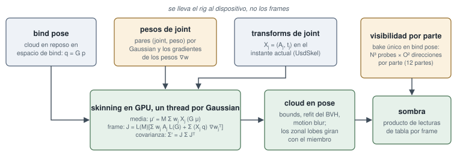

# Preparar un stage USD para athenea

Esta página cubre lo que un stage USD le dice a athenea y cómo una
aplicación host encuentra el motor: el entorno con el que corre un host como
usdview o Blender, los materiales que leen la conversión y el renderer, las
luces y sus unidades, los render settings `athenea:*` con sus productos y sus
vars, los schemas codeless de API que lleva una nube, y qué ignora el motor y
qué rechaza. Cada nombre de abajo es el que lee el motor; las tablas completas
están en el documento de operaciones enlazado al final.

## Apuntar una aplicación al plugin

`<build>/plugin/usd` tiene el delegate de Hydra `hdAthenea` y los schemas
codeless juntos, así que una variable, `PXR_PLUGINPATH_NAME`, encuentra los
dos. El host ofrece entonces el renderer con su nombre, y los ajustes
declarados aparecen en su panel de render settings.

| Variable | Qué hace |
|---|---|
| `PXR_PLUGINPATH_NAME` | apunta una aplicación USD a `<build>/plugin/usd`. La necesita cualquier host que no sea `athenea`, que registra por su cuenta `<su binario>/../plugin/usd` al arrancar. |
| `ATHENEA_SHADER_DIR` | de dónde se leen los shaders de Slang. Sin ella el motor busca un directorio `shaders` que contenga `athenea/` junto a la imagen desde la que se cargó su código, o hasta tres directorios por encima — `<build>/shaders` para el plugin de Hydra cargado por usdview o Blender —, luego junto al ejecutable, y luego en el directorio con el que se compiló. `athenea info` imprime el que está usando. |
| `ATHENEA_MATERIALX_ROOT` | un directorio que contiene los `libraries/` de MaterialX, que el compilador de materiales de hdAthenea lee en lugar de las bibliotecas que cargó el USD del host. Sin definir por defecto. Para un host cuyo MaterialX es anterior al generador de Slang (Blender 5.3 trae 1.39.4: sin implementaciones `genslang` y con definiciones de nodo anteriores), se apunta a las de 1.39.5. Se lee una vez, cuando compila el primer material; los renderers propios del host conservan las suyas. |

```sh
export PXR_PLUGINPATH_NAME=<build>/plugin/usd
export ATHENEA_SHADER_DIR=<build>/shaders
export ATHENEA_MATERIALX_ROOT=<MaterialX 1.39.5>   # el directorio que contiene libraries/
```

Un host que no ofrece el renderer no ha encontrado el plugin. Un error de
compilación de shader con una ruta significa que los shaders del disco no son
los del binario; `ATHENEA_SHADER_DIR` apuntado al `shaders` de esta
compilación lo resuelve.

## Materiales

El renderer lee `UsdPreviewSurface` 2.6 con los dos `opacityMode`, y grafos
de MaterialX 1.39, OpenPBR entre ellos con sus pesos ceñidos al rango de la
especificación. Los grafos se compilan a módulos de Slang, con el nombre de un
hash de su fuente, así que los materiales que solo difieren en valores
comparten uno.

`athenea mesh2splat` lee los mismos materiales cuando convierte mallas en
gaussianas. Lo que toma de cada modelo:

| Qué | UsdPreviewSurface | standard_surface | OpenPBR | glTF |
|---|---|---|---|---|
| mapa de opacidad sin umbral propio (cortado en `--opacity-cut`, `0.5`) | `opacity` | `opacity` | `geometry_opacity` | `alpha` en BLEND |
| el umbral propio del material, que se usa en su lugar | `opacityThreshold` | | | `alpha_cutoff` en MASK |
| emisión | `emissiveColor` | `emission` por `emission_color` | `emission_luminance` por `emission_color` (nits) | `emissive` por `emissive_strength` |

La altura que desplaza las gaussianas se lee del `displacement` de
UsdPreviewSurface (a través del `scale` y el `bias` de UsdUVTexture, en el
canal conectado), o de un nodo `displacement` de MaterialX
(`ND_displacement_float`, por su `scale`) que nombre el terminal de
displacement del material, en las unidades propias de la malla. Un vidrio de
pared fina es el `geometry_thin_walled` de OpenPBR. El IOR del material de
cristal se escribe como `primvars:athenea:splat:ior`; una nube guarda un solo
índice, y con dos cristales de IOR distinto se queda el primero y la
conversión lo avisa. Un displacement vectorial no se lee, y una capa de coat
de OpenPBR sobre la emisión no se lleva. Una malla cuyos GeomSubsets (familia
`materialBind`) atan materiales propios se convierte subset a subset, cada uno
con su material.

Una textura se lee en el espacio de color que nombra su material — el
`colorspace` de MaterialX, el `sourceColorSpace` de un UsdUVTexture, el
`colorSpace` de USD en la entrada de archivo — y se lleva al espacio de
trabajo (Rec.709 lineal) en el dispositivo. `raw` y `data` leen el archivo
como datos; sin nombre, o con `auto`, una imagen de 8 bits es sRGB y
cualquier otra, lineal.

```usda
def Material "Screen"
{
    token outputs:surface.connect = </World/Looks/Screen/Surface.outputs:surface>

    def Shader "Surface"
    {
        uniform token info:id = "UsdPreviewSurface"
        color3f inputs:emissiveColor.connect = </World/Looks/Screen/Glow.outputs:rgb>
        float inputs:opacityThreshold = 0.5
        token outputs:surface
    }

    def Shader "Glow"
    {
        uniform token info:id = "UsdUVTexture"
        asset inputs:file = @./emission_gradient.png@
        token inputs:sourceColorSpace = "sRGB"
        float2 inputs:st.connect = </World/Looks/Screen/UV.outputs:result>
        float3 outputs:rgb
    }

    def Shader "UV"
    {
        uniform token info:id = "UsdPrimvarReader_float2"
        string inputs:varname = "st"
        float2 outputs:result
    }
}
```

## Las luces y sus unidades

Las luces de UsdLux se leen con `ShadowAPI` (`shadow:color`,
`shadow:distance`, `shadow:falloff`), `DomeLight_1.poleAxis`, light linking y
perfiles IES.

Una `DistantLight` está en las unidades de UsdLux. `intensity` (por
`2^exposure` y `color`) es la radiancia del disco del sol, en nits. Con
`normalize = 1` se divide por el ángulo sólido proyectado del disco,
`pi sin^2(angle / 2)`, y pasa a ser la iluminancia sobre una superficie que
mira a la luz, en lux. Un `angle` de 0 es una luz paralela cuya irradiancia
es la intensidad en ambos casos. Así, un sol escrito sin `normalize` deja
`intensity * pi sin^2(angle / 2)`: el sol por defecto de UsdLux (50000 a 0.53
grados) deja unos 3.4, y uno de intensidad 3 con el ángulo por defecto queda
casi negro.

```usda
def DistantLight "Sun"
{
    float inputs:angle = 0.53
    float inputs:intensity = 3
    bool inputs:normalize = 1
    string athenea:lightGroup = "key"
}
```

Con `normalize = 1`, el sol de arriba deja una iluminancia de 3 lux sobre una
superficie que lo mira. Una `DomeLight` ignora `normalize`, como dice el
esquema. Una nube que pidió ser relit toma el cuerpo de la irradiancia de la
imagen del dome y el reflejo del cielo convolucionado a su roughness; se
preparan cuatro domes, y un quinto se dibuja como su color. `--default-lights`
en `athenea stage` pone un dome y un sol en la capa de sesión para un stage
que no declara ninguna; el sol por defecto está normalizado.

`athenea:lightGroup` (un string en un prim de luz) nombra el grupo bajo el que
se reúne la aportación de una luz; USD no tiene grupos de luz propios.

## Render settings

Los ajustes se autorizan en el namespace `athenea:` de un prim
`UsdRenderSettings`, o los pone un host a través del delegate. Los que declara
el delegate aparecen en el panel de ajustes del host; entre ellos:

| Ajuste | Tipo | Por defecto | Qué significa |
|---|---|---|---|
| `athenea:technique` | token | `raster` | `raster` o `rt` |
| `athenea:visibility` | token | `automatic` | cómo se ven las mallas: `automatic`, `raster`, `rays`, `bvh` |
| `athenea:settleStreams` | bool | `false` | esperar a los assets en streaming antes de dibujar; una imagen fija lo pone |
| `athenea:lightSamples` | int | `1` | muestras por luz |
| `athenea:pathSamples` | int | `1` | rt: caminos por píxel y pasada |
| `athenea:pathBounces` | int | `1` | rt: rebotes tras el primer impacto |
| `athenea:pathTotal` | int | `1` | rt: caminos por píxel hasta converger |
| `athenea:denoise` | bool | `false` | denoise al terminar de reunir |
| `athenea:motionBuckets` | int | `4` | rt: rodajas del obturador, de 1 a 8 |
| `athenea:splatShadows` | bool | `false` | rt: una nube relit se sombrea a sí misma |
| `athenea:cloudShadows` | bool | `true` | el mapa de transmitancia de una nube en cada luz |

El resto del grupo declarado (`athenea:pathAdaptive`, `athenea:pathMis`,
`athenea:cloudShadowTerms` y otros) está en el §4.2 del documento de
operaciones. Se leen donde se encuentren, pero no se declaran:
`athenea:shutter`, `athenea:lens` (en una cámara), `athenea:exrHalf`,
`athenea:disableMotionBlur`, `athenea:disableDepthOfField` y
`athenea:lightGroup` (en una luz).

Cada `UsdRenderProduct` es un EXR cuyos canales son sus render vars. El
`sourceName` de una var decide qué lee: `Ci` es el color, `z` la profundidad,
un `primvar` lee un primvar, y una expresión de camino de luz de la forma
`C.*<L.'NOMBRE'>` lee ese grupo de luz. `CryptoObject00`, `01` y `02` son las
capas Cryptomatte; un producto que las lleve carga además los cuatro atributos
estándar que las nombran, con el manifest. Una capa Cryptomatte se queda en
float diga lo que diga `athenea:exrHalf`.

```usda
def Scope "Render"
{
    def RenderSettings "Settings"
    {
        rel camera = </World/Camera>
        rel products = </Render/Product>
        int2 resolution = (1920, 1080)
        token athenea:technique = "rt"
        int athenea:pathSamples = 8
        int athenea:pathTotal = 512
        bool athenea:denoise = 1
    }

    def RenderProduct "Product"
    {
        token productName = "shot.exr"
        rel orderedVars = [</Render/Vars/beauty>, </Render/Vars/key>, </Render/Vars/CryptoObject00>]
        int2 resolution = (1920, 1080)
    }

    def Scope "Vars"
    {
        def RenderVar "beauty"
        {
            string sourceName = "Ci"
            token dataType = "color3f"
        }
        def RenderVar "key"
        {
            string sourceName = "C.*<L.'key'>"
            token sourceType = "lpe"
        }
        def RenderVar "CryptoObject00"
        {
            string sourceName = "CryptoObject00"
            token dataType = "color4f"
        }
    }
}
```

`athenea stage shot.usda --render-settings /Render/Settings` renderiza los
productos de ese prim, un EXR por producto, y para. Un producto sin resolución
o sin vars se rechaza.

## Los schemas de API que lleva una nube

!!! example "En vivo"
    Una nube que lleva un esqueleto, reiluminada mientras se mueve: [el gorrión en el navegador](https://sparkwebgpu.lucab.co.uk/sparrow.html).

<figure markdown>
  
  <figcaption>Una nube atada a un esqueleto: skinning en el dispositivo, como una malla.</figcaption>
</figure>

Ocho schemas codeless de API, que se aplican a un prim como cualquier otro.
Todos los atributos son primvars, así que heredan hacia abajo.

| Schema | Qué dice | Lo escribe |
|---|---|---|
| `AtheneaSplatLightingAPI` | si a la nube la ilumina el stage (`relight`), si ya lleva la luz sobre su cuerpo (`litBody`), si está en luz lineal (`linear`); su metallic, roughness, transmission, `ior`, los arrays de transfer (`transferDirect`, `transferIndirect`, `shadowBits`), `thinWalled`, la `normal` de sombreado y la `emission` | `athenea mesh2splat`; `ior` a mano en una nube de otro origen |
| `AtheneaSplatSkinningAPI` | los joints que llevan una nube | `athenea mesh2splat --skinned` |
| `AtheneaSplatVisibilityAPI` | lo que proyecta una nube con esqueleto, horneado por partes | `athenea visibility` |
| `AtheneaSplatCryptomatteAPI` | de qué prim vino cada gaussiana (`cryptoObject`, `cryptoManifest`) | la conversión |
| `AtheneaSplatEditAPI` | conservar, quitar o graduar las nubes que cuelgan de un prim, dentro de una caja o una esfera | a mano |
| `AtheneaStreamedAssetAPI` | una nube dibujada desde un `.athc` | a mano |
| `AtheneaPointStyleAPI` | cómo se dibuja un `UsdGeomPoints` | a mano |
| `AtheneaVolumeAPI` | cómo dispersa un Volume cuando no hay Material atado | a mano |

`relight` dice que los colores son un albedo que las luces del stage tienen
que iluminar; `litBody` dice que ya son la luz sobre el cuerpo del material,
que es lo que escribe una conversión horneada; una nube que lleva los dos
arrays de transfer no necesita `litBody`. `linear` dice que los colores son
Rec.709 lineal; sin él se toman por el sRGB de una captura.

En una nube de otro origen, `primvars:athenea:splat:ior` es lo que hace que un
cristal doble el cielo (1.5 es cristal; a 0 la mitad transmitida es
translucidez). Una edición se autoriza en el prim de la nube o en cualquier
prim por encima:

```usda
over "Capture" (
    prepend apiSchemas = ["AtheneaSplatLightingAPI", "AtheneaSplatEditAPI"]
)
{
    float primvars:athenea:splat:ior = 1.5 ( interpolation = "constant" )
    bool primvars:athenea:edit:active = 1 ( interpolation = "constant" )
    token primvars:athenea:edit:shape = "box" ( interpolation = "constant" )
    token primvars:athenea:edit:mode = "remove" ( interpolation = "constant" )
    float3 primvars:athenea:edit:centre = (0, 0, 0) ( interpolation = "constant" )
    float3 primvars:athenea:edit:size = (1, 1, 1) ( interpolation = "constant" )
}
```

`centre` está en el espacio de la nube y `size` guarda los semiejes de la
caja, o el radio de la esfera en x. Un grade (`tint`, `saturation`,
`brightness`) trabaja sobre el color de cada splat en luz lineal.

## Qué ignora el motor, y qué rechaza

El motor **ignora** aquello para lo que no tiene significado: un primvar que
no lee, un render setting fuera del namespace `athenea:`, un schema que no
conoce. No avisa de nada, porque un stage lleva lo que necesitan otros
renderers.

**Rechaza**, con un mensaje, lo que se le pide y no puede hacer:

| Se rechaza | Mensaje o causa |
|---|---|
| un `.spz` en una compilación sin zstd | `this build reads no .spz` |
| un `.sog` sin libwebp, un `.vdb` sin OpenVDB | el fichero se rechaza al leerse |
| la visibilidad de mallas por rayos en un dispositivo sin ray tracing | `mesh visibility by rays: the device has no ray tracing` |
| un `.athc` dibujado sin `--lod` | `a .athc is drawn through its levels of detail: give --lod` |
| un producto de render sin resolución o sin vars | `render product '<path>' has no resolution` / `no vars` |

## Comprobar un stage en el viewer

`athenea view` dibuja por el mismo delegate. `--aov cryptomatte` arranca la
ventana en la Cryptomatte, y `--isolate <prim>` enseña solo la matte de ese
prim, blanco sobre negro:

```sh
athenea view car_gs.usdc --aov cryptomatte
athenea view car_gs.usdc --isolate /root/Kapoot/Object_57 --frames 10 --snapshot matte.exr
```

**Referencia:**
[§1.2 El entorno de ejecución](https://github.com/jesusluque/athenea/blob/main/docs/operations.es.md#12-el-entorno-de-ejecución) ·
[§3.2](https://github.com/jesusluque/athenea/blob/main/docs/operations.es.md) ·
[§3.4 Color](https://github.com/jesusluque/athenea/blob/main/docs/operations.es.md#34-color) ·
[§4.1 Apuntar una aplicación al plugin](https://github.com/jesusluque/athenea/blob/main/docs/operations.es.md#41-apuntar-una-aplicación-al-plugin) ·
[§4.2 Render settings](https://github.com/jesusluque/athenea/blob/main/docs/operations.es.md#42-render-settings) ·
[§4.3 Los schemas de API](https://github.com/jesusluque/athenea/blob/main/docs/operations.es.md#43-los-schemas-de-api) ·
[§4.4 Qué ignora el motor, y qué rechaza](https://github.com/jesusluque/athenea/blob/main/docs/operations.es.md#44-qué-ignora-el-motor-y-qué-rechaza) ·
[§5 El viewer](https://github.com/jesusluque/athenea/blob/main/docs/operations.es.md#5-el-viewer)
