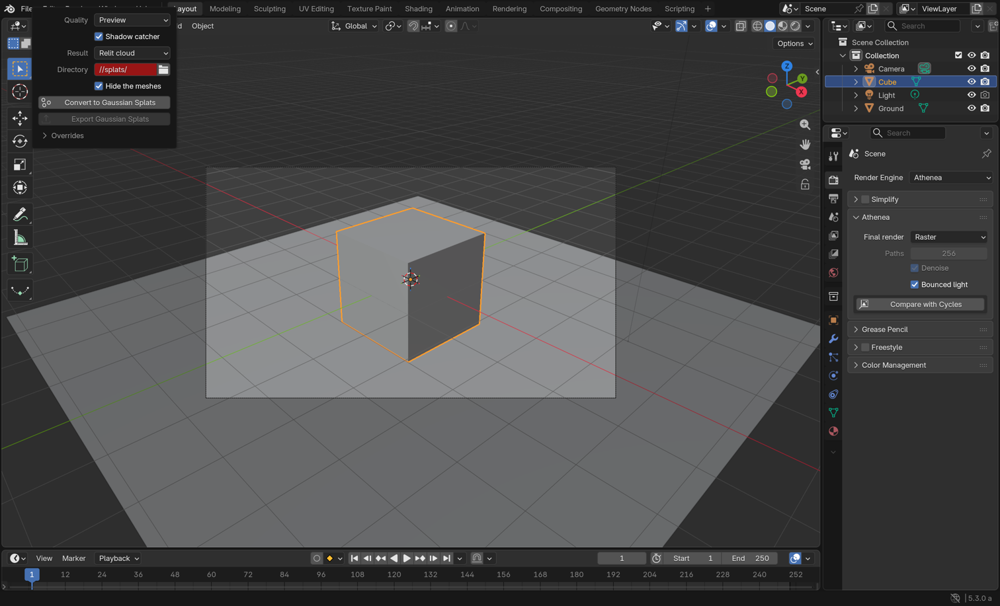
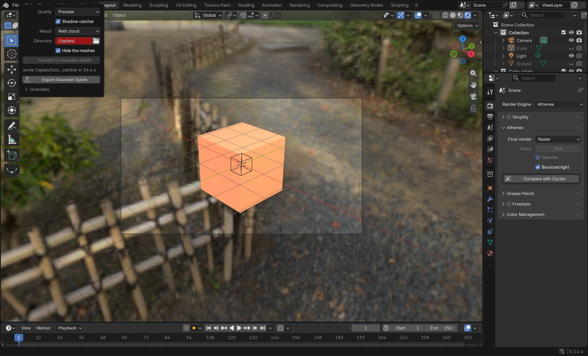
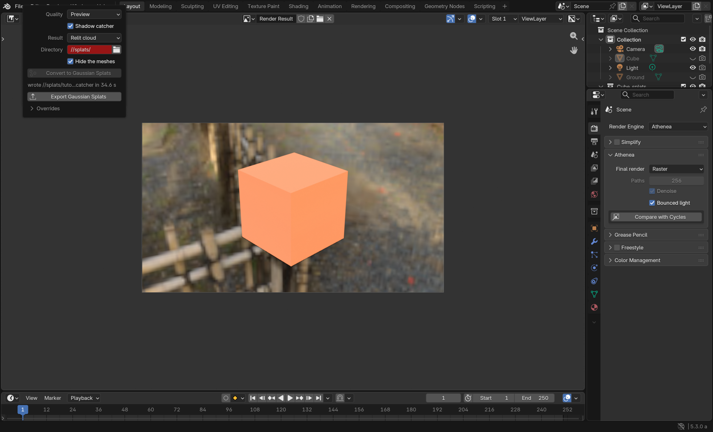

# Gaussian splats in Blender

This tutorial takes a Blender scene from meshes to Gaussian splats with the
Athenea add-on: the default cube on a ground under an HDRI, converted with a
light transfer and a shadow catcher, drawn by the **Athenea** render engine
in the viewport and with F12, and exported as a standard splat file. The
screenshots are of Blender 5.3 alpha on a Mac (Metal).

## What it needs

- Blender's 5.3 development build. The add-on refuses a Blender whose USD
  is not the one hdAthenea was built against, and says which one it wants.
- The add-on package, `athenea_hydra-<version>.zip`, made by
  `scripts/package-blender-addon.sh` from a `macos-arm64-blender` build.
  *Edit > Preferences > Get Extensions > Install from Disk* installs it.
- A saved `.blend`: the conversion writes its files next to it, in
  `//splats/`.

## 1. The scene and the render engine

Any scene with meshes, a camera and a world will do. Here: the default cube
(orange Principled BSDF), a 12 m plane under it as the ground, and the world
an *Environment Texture* with Blender's `forest.exr`. In *Render Properties*
set **Render Engine** to **Athenea**.

The world reaches Athenea as a dome light when it is an *Environment
Texture*; a procedural sky is not translated yet. With *Film > Transparent*
on, the world lights the scene and is not drawn behind it, as in Cycles.

## 2. The conversion panel

Select the meshes to convert (the cube) and open *Sidebar (N) > Athenea >
Gaussian Splats*.

| Setting | What it does |
|---|---|
| Quality | *Preview*: 256 cells across, at most a million gaussians, 64 paths a gaussian. *Final*: each mesh at its own density, 512 cells, at most 8 million, 256 paths. |
| Shadow catcher | also converts the shadow the selection casts on the ground under it, found by itself (the largest flat mesh at its bottom). |
| Result | *Relit cloud*: the cloud as converted, relit live by Athenea under the scene's world and lights. *Blender splats*: flattened under the current world into a standard splat file and imported as Blender's own Gaussian-splat point cloud, which any engine draws, lit once. |
| Directory | where the exported meshes and the clouds are written (`//splats/` by default; shown red until it exists). |
| Hide the meshes | hides the converted meshes, and the ground under a catcher, once the clouds are in. |
| Overrides | the gaussian budget, the surroundings the bake sees, thin and solid glass by material. The conversion decides these by itself; an override is only for when it got one wrong. |

Press **Convert to Gaussian Splats**. The panel shows the progress and Esc
stops it. The cube here took 35 s on an M5 Pro at *Preview*.

## 3. The result in the viewport

The cloud and its catcher come in as Empties in a `Cube_splats` collection
that reference the `.usdc` files; the cube and the ground are hidden.
Switch the viewport to *Rendered* shading: Athenea draws the gaussians,
relit under the world, with the catcher's shadow on the ground.

## 4. The final render

F12 renders the camera's frame with the setting in *Render Properties >
Athenea*:

| Setting | What it does |
|---|---|
| Final render | *Raster* (the gaussians rasterised, as in the viewport) or *Path traced*. |
| Paths | paths a pixel for a path traced render (256). |
| Denoise | OIDN on the path traced frame. |
| Bounced light | the transfer's indirect half (on). |

The passes are Combined, Depth, Normal and DiffCol.

**Compare with Cycles**, in the same panel, renders the frame with Cycles
from the original meshes (the ground as Cycles' shadow catcher) and with
Athenea from the clouds, and measures the difference: relMSE and the 8-bit
p99 in the panel, and the two images and a heatmap in Blender. On this
scene: relMSE 0.036, p99 45.

## 5. Export

*File > Export > Gaussian Splats (Athenea: .spz, .ply, .glb)*, or **Export
Gaussian Splats** in the panel, writes the scene's clouds flattened under the
current world into a standard file that other viewers read: SPZ (1.65 MB for
the cube), PLY or glTF.

## Further reading

- The operations manual, section 4.1.1 *Inside Blender*: every setting,
  variable and pass.
- [From a USD asset to a baked cloud](usd-to-cloud.md): the same conversion
  from the command line.
