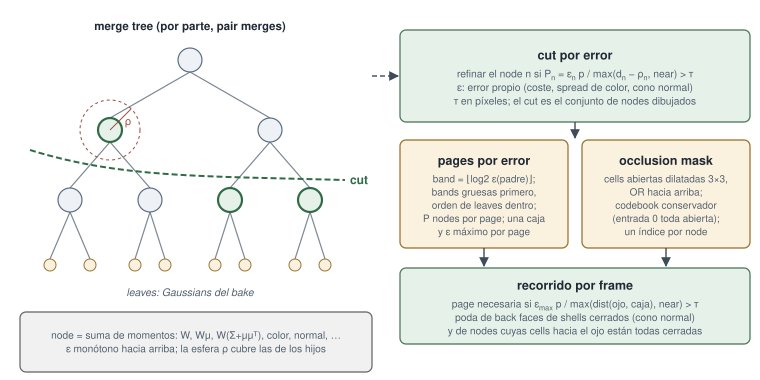

# Nubes grandes: niveles de detalle, diezmado y streaming

Esta página cubre lo que ofrece athenea para una nube demasiado grande para
dibujarla entera en cada frame: el contenedor `.athc`, con niveles de detalle
fundidos que se transmiten chunk a chunk dentro de un presupuesto fijo; los
niveles de detalle hechos convirtiendo un modelo otra vez con celdas más
gruesas (`athenea mesh2splat --lod-levels`), que es la ruta para una nube que
lleva un esqueleto; `athenea decimate`, que se queda para siempre con menos
gaussianas; el presupuesto de memoria de la GPU (`ATHENEA_GPU_BUDGET`) al que
se ciñe el streaming; y qué hace un frame cuando al dispositivo le falta
memoria.

## Dos clases de niveles de detalle

!!! example "En vivo"
    Niveles de detalle en streaming por páginas, en el navegador: el [Corvette entero, 149 M de Gaussians](https://sparkwebgpu.lucab.co.uk/pieces.html?set=car-compact-tx) y una [escena de 6 M de splats](https://sparkwebgpu.lucab.co.uk/lod.html).

<figure markdown>
  
  <figcaption>Niveles de detalle: árboles de fusión por pieza y un corte por error en pantalla.</figcaption>
</figure>

| | Contenedor `.athc` | Conversión con `--lod-levels` |
|---|---|---|
| Lo escribe | `athenea convert`, o `athenea mesh2splat -o <nombre>.athc` | `athenea mesh2splat --lod-levels` |
| Qué es un nivel | gaussianas fundidas sobre una nube en orden de Morton, cada una en representación de un grupo de splats | la conversión otra vez a la mitad de resolución cada vez, un ParticleField propio |
| Qué toma el frame | un corte: una celda fundida se dibuja mientras no abarque más píxeles que el umbral | el nivel más grueso cuya celda no ocupa más píxeles que el umbral |
| Streaming | chunks, dentro de `primvars:athenea:stream:budget` | ninguno: cada nivel es un fichero USD |
| Una nube que lleva un esqueleto | no: una celda fundida no sabría con qué joint moverse | sí: cada nivel tiene su propio rig, y sólo se posa el nivel que se dibuja |

## Un `.athc` a partir de una nube

Un `.athc` guarda una nube ordenada por código de Morton, cortada en chunks,
con niveles fundidos encima: un grupo de splats que a esta distancia no se
distinguen se dibuja como la única gaussiana que los representa. `athenea
convert` lo escribe a partir de `.ply`, `.splat`, `.spz`, `.sog` o
`meta.json`:

| Opción | Valor | Por defecto | Notas |
|---|---|---|---|
| `--chunk-splats` | entero | `65536` | splats por chunk: cuánto viaja de una vez |
| `--max-group-fraction` | número | `0.5` | grupos por splat que puede tener el nivel fundido más fino: cuán agresivo es |
| `--rotate-x` | número | `0` | se rechaza con un `.athc`: el giro pertenece al prim que lo referencia |

```sh
athenea convert capture.ply capture.athc --chunk-splats 131072
```

`athenea mesh2splat -o <nombre>.athc` escribe una conversión directamente en el
contenedor, solo con las gaussianas y sus normales de sombreado (sin
metallic/roughness/transmission, ids Cryptomatte, índice del vidrio, eje
vertical ni unidad); con él se rechazan `--skinned`, `--transfer` y
`--lod-levels`.

Los `flags` de la cabecera dicen qué más guarda el contenedor: el bit 0 las
normales de sombreado (`primvars:athenea:splat:normal`, cuatro bytes por
gaussiana), el bit 1 que los colores son luz lineal
(`primvars:athenea:splat:linear`), el bit 2 la emisión
(`primvars:athenea:splat:emission`, una palabra RGB9E5, cuatro bytes por
gaussiana). La versión 2 del formato se escribe solo donde los `flags` no son
cero. Un bit de los `flags` que esta compilación no conoce (cualquiera pasado
el bit 2) se rechaza, nombrando el fichero:

```
<file>: not a readable .athc (unknown flag bits N; this reads bits 0 (normals), 1 (linear) and 2 (emission))
```

## Dibujar un `.athc`

`athenea render` toma un `.athc` por `--splats`, con dos opciones para él:

| Opción | Valor | Por defecto | Notas |
|---|---|---|---|
| `--lod` | número | `0` | el corte: cuántos píxeles puede abarcar una celda fundida antes de que se tome el nivel más fino; 0 dibuja todos los splats. Más pequeño es más fino y más caro |
| `--stream-budget` | entero | `0` | splats que se quedan en el dispositivo; el resto se leen según los pide la vista; 0 lee el fichero entero |

Un `.athc` necesita `--lod`, y `--lod` necesita `--technique raster` y ningún
punto. Sin `--lod` el fichero se rechaza con
`a .athc is drawn through its levels of detail: give --lod`.

```sh
athenea render --splats capture.athc --lod 1 --stream-budget 4000000 -o shot.exr
```

En un stage esos dos son primvars en el prim que nombra el asset, con
`AtheneaStreamedAssetAPI`:

| Atributo | Tipo | Por defecto |
|---|---|---|
| `primvars:athenea:asset` | asset | — |
| `primvars:athenea:lod:threshold` | float | `1` |
| `primvars:athenea:stream:budget` | int64 | `0`, lee entero |

```usda
def ParticleField3DGaussianSplat "Cloud" (
    prepend apiSchemas = ["AtheneaStreamedAssetAPI"]
)
{
    asset primvars:athenea:asset = @./capture.athc@ ( interpolation = "constant" )
    float primvars:athenea:lod:threshold = 1 ( interpolation = "constant" )
    int64 primvars:athenea:stream:budget = 4000000 ( interpolation = "constant" )
}
```

Un presupuesto corto se ve como una nube roma: los grupos cuyos chunks no han
llegado dibujan su gaussiana fundida, y la nube se afina según aterrizan los
chunks. `athenea stage` espera a que los streams se asienten antes de una
imagen fija, así que un frame renderizado nunca está a medio llegar;
`athenea:settleStreams` en un prim de render settings es la misma espera, y
una imagen fija lo pone.

## Niveles de detalle por conversión

`athenea mesh2splat --lod-levels N` repite la conversión a la mitad de
resolución cada vez. `-o` pasa a ser el stage que dibuja los niveles como una
nube, y cada nivel se escribe como un `<nombre>_lod<n>.usdc` a su lado. Cada
nivel y el stage que los dibuja se escriben enteros o no se escriben.

```sh
athenea mesh2splat bird.usda --skinned --resolution 1100 --lod-levels 3 -o bird_gs.usdc
```

Tres primvars atan los niveles entre sí:

| Atributo | Tipo | Por defecto |
|---|---|---|
| `primvars:athenea:lod:group` | string | —, se dibuja tal cual |
| `primvars:athenea:lod:cell` | float ‹sus propias unidades› | — |
| `primvars:athenea:lod:threshold` | float ‹píxeles› | `1` |

Los prims de un mismo `lod:group` son una nube. Una vista dibuja el nivel más
grueso cuyo `lod:cell` (en sus propias unidades) no ocupa más de
`lod:threshold` píxeles donde la nube está más cerca — el más fino si ninguno
lo cumple —, y sólo ese nivel se posa.

## Menos gaussianas para siempre: `athenea decimate`

`athenea decimate` trabaja sobre la nube misma, la haya hecho quien la haya
hecho — una conversión, una captura. Construye los niveles de detalle y se
queda, para siempre, con la fusión más gruesa que representa lo que tiene
debajo, y con cada splat donde ninguna lo hace. Una fusión representa a sus
splats cuando caen dentro de `--reach` de ella, cuando, si son discos, no es
más gruesa de lo que su superficie permite, y cuando pocos de ellos
(`--outliers`) difieren de ella en color más que `--colour-tolerance`; la cola
de una fusión no puede caer sobre nada de otro color.

| Opción | Valor | Por defecto | Notas |
|---|---|---|---|
| `input` | ruta, obligatoria | — | un stage (su primer ParticleField gaussiano), o `.ply`, `.splat`, `.spz`, `.sog` |
| `output` | ruta, obligatoria | — | `.usda`, `.usdc`, `.usd` |
| `--prim` | ruta | el primero | el ParticleField que leer, donde el stage tiene más de uno |
| `--colour-tolerance` | 0..1 | `0.05` | cuánto puede alejarse el color o la opacidad de una gaussiana de la que la sustituye, en el espacio propio de la nube |
| `--outliers` | 0..1 | `0.05` | la fracción de las gaussianas que representa una fusión que puede ser distinta |
| `--flat-tolerance` | 0..1 | `0.08` | donde las gaussianas son discos, cuánto más gruesa que ellos puede ser una fusión, frente a su anchura |
| `--reach` | 0.1..10 | `1.5` | a cuántas de sus desviaciones típicas puede estar una gaussiana de la fusión que la sustituye |
| `--degree` | 0..3 | `3` | armónicos que se conservan |

```sh
athenea decimate car_gs.usdc car_fewer.usdc
athenea decimate capture.ply capture_fewer.usdc --colour-tolerance 0.1
```

Un stage sale como entró, con menos gaussianas: se copia su capa raíz — el
rig y su animación, las luces, la cámara, el manifiesto Cryptomatte, las
variantes — y cada array de una gaussiana de largo se funde sobre lo que
representa cada gaussiana conservada. Un fichero de splats se escribe como un
stage nuevo, en metros.

Medido en los adoquines convertidos a `--resolution 768` y horneados a 64
caminos, dibujados en raster a 1200 x 800 frente a la nube sin diezmar:

| | Se conserva | RMS de imagen |
|---|---|---|
| por defecto | 82.9 % | 0.0020 |
| `--colour-tolerance 0.1` | 37.9 % | 0.011 |
| horneada a 256 caminos, por defecto | 53.9 % | |
| la misma conversión sin bake, por defecto | 57.8 % | |

Una nube horneada lleva el ruido de su bake, y la tolerancia tiene que
superarlo: a 256 caminos los valores por defecto conservan un 53.9 % donde a
64 conservan un 82.9 %. Tarda segundos: 533 007 gaussianas en 5 s.

## El presupuesto de memoria de la GPU

`ATHENEA_GPU_BUDGET` es la memoria del dispositivo que puede ocupar una
ejecución, en MiB. Sin ella el presupuesto es el working set recomendado de
Metal (`recommendedMaxWorkingSetSize`); en CUDA y Vulkan no hay ninguno salvo
que ella lo ponga. El dispositivo imprime el que usa
(`GPU memory budget: N MiB`).

```sh
ATHENEA_GPU_BUDGET=8192 athenea stage city.usda -o city.exr
```

El streaming se ciñe a él: un stream se abre con como mucho la mitad de lo que
le queda al presupuesto del dispositivo, a 132 bytes por splat, y un asset al
que se pidió leer entero cuyo fichero ocuparía más que esa mitad se lee en
streaming. Ambas cosas se imprimen cuando pasan
(`streaming budget N splats (~M MiB; asked ...)`). Las sombras de splats
también se dimensionan con él: se saltan en una nube cuyos proxies ocuparían
más de la mitad de lo que le queda al presupuesto (unos 1,7 KB por gaussiana).

!!! note
    En Apple silicon una reserva además debe caber en la memoria física que el
    sistema tiene libre menos 1,5 GiB guardados para el resto de la máquina,
    diga lo que diga el presupuesto. La reserva no se configura.

## Cuando al dispositivo le falta memoria

La falta de memoria se atiende antes de informarse. Un frame que falla por
ella devuelve lo que el motor vuelve a hacer cuando se le pide (los buffers
crecidos del rasterizador, las estructuras de los trazadores, el denoiser),
renuncia a una cosa más, y se intenta otra vez, una: primero las sombras de
splats, después un nivel de detalle cada vez — el siguiente nivel más grueso
de un grupo LOD, el corte de un asset en streaming al doble de píxeles y con la
mitad de su presupuesto —, hasta cuatro. Cada paso es un aviso que nombra a qué
renunció. Solo un frame que sigue fallando es el error del comando, y ése
termina con `3`, donde cualquier otro error termina con `1`.

| Qué se imprime | Qué significa |
|---|---|
| `trying again with ...; levels of detail N coarser than asked` | el motor bajó de nivel; los frames siguen, y una ejecución nueva empieza como se pidió |
| `OutOfMemory: ... does not fit in the GPU's memory budget`, código de salida 3 | el frame necesitaba más que el presupuesto, aun después de bajar de nivel |
| `the GPU ran out of memory running ...` | un command buffer falló en el propio dispositivo, sin llegar aún al presupuesto |

Un render más pequeño, un presupuesto menor para un asset en streaming, o un
`ATHENEA_GPU_BUDGET` más bajo devuelven una ejecución a lo que cabe en el
dispositivo.

## En un stage y en el viewer

`athenea stage` y `athenea view` leen del stage los primvars de nivel de
detalle y de streaming; ninguno de los dos tiene un `--lod` propio. Las
opciones que afectan a una nube grande son el tamaño de imagen (`--size`,
`1920x1080` en `stage` y `1600x900` puntos en `view`), `--splat-shadows` en
`stage` (apagado), lo primero a lo que se renuncia cuando falta memoria, y
`--frames`, que en `stage` repite un frame e informa del primero, la mediana y
el más rápido, y en `view` cierra tras tantos frames e imprime sus tiempos.

```sh
athenea stage city.usda --size 3840x2160 --frames 3 -o city.exr
athenea view city.usda --frames 200
```

En el viewer el panel **Gaussians** da el nivel de cada nube (*level 1 of 3 in
'bird'*, o *cut* con sus gaussianas propias y fusionadas) y, para un `.athc` en
streaming, los chunks en el dispositivo, pedidos, ausentes y cargando. Un panel
**GPU memory** aparece cuando al dispositivo le faltó memoria, y nombra a qué
renunció el motor y cuántos niveles más grueso de lo pedido dibuja ahora.

**Referencia:**
[§1.2 El entorno de ejecución](https://github.com/jesusluque/athenea/blob/main/docs/operations.es.md#12-el-entorno-de-ejecución) ·
[§1.5 Códigos de salida](https://github.com/jesusluque/athenea/blob/main/docs/operations.es.md#15-códigos-de-salida-y-dónde-se-imprime-un-error) ·
[§2.2 athenea render](https://github.com/jesusluque/athenea/blob/main/docs/operations.es.md#22-athenea-render--ficheros-de-splats-a-un-exr) ·
[§2.4 athenea convert](https://github.com/jesusluque/athenea/blob/main/docs/operations.es.md#24-athenea-convert--un-fichero-de-splats-a-usd-o-a-un-athc) ·
[§2.4.1 athenea decimate](https://github.com/jesusluque/athenea/blob/main/docs/operations.es.md#241-athenea-decimate--menos-gaussianas-conservadas-donde-importan) ·
[§2.8 athenea mesh2splat](https://github.com/jesusluque/athenea/blob/main/docs/operations.es.md#28-athenea-mesh2splat--un-modelo-en-gaussianas) ·
[§3.1 Un modelo en una nube](https://github.com/jesusluque/athenea/blob/main/docs/operations.es.md#31-un-modelo-en-una-nube) ·
[§3.3 Una nube grande](https://github.com/jesusluque/athenea/blob/main/docs/operations.es.md#33-una-nube-grande-niveles-de-detalle-y-streaming) ·
[§5.2 Los paneles](https://github.com/jesusluque/athenea/blob/main/docs/operations.es.md#52-los-paneles) ·
[§9 Cuando algo falla](https://github.com/jesusluque/athenea/blob/main/docs/operations.es.md#9-cuando-algo-falla)
