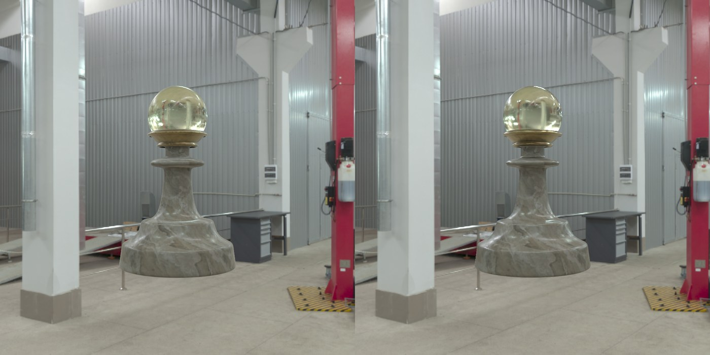

# Rendering and comparing with the path trace

!!! tip "The example pawn"
    The files this tutorial compares, ready to use: [athenea-example-pawn.zip](https://github.com/jesusluque/athenea/releases/download/v0.3.0/athenea-example-pawn.zip). `pawn_gs.usda` is the cloud and `pawn_mesh.usda` the meshes, under the same camera (`/World/Cam`) and sky; at 1024 × 1024 with a 1024-path reference they measure PSNR 35.7 dB.

!!! example "Live"
    The same pawn, relit in a browser: [sparkwebgpu.lucab.co.uk/pawn.html](https://sparkwebgpu.lucab.co.uk/pawn.html).

The cloud from the [previous tutorial](usd-to-cloud.md) is drawn under the stage's dome and sun, and the source meshes are path traced from the same camera under the same light. `athenea compare` then measures the first image against the second on the GPU. The numbers on this page come from one run on an Apple M5 Pro (Metal) with the public `main` branch.

## The relit cloud

```sh
athenea stage gs.usda --camera /World/Camera -o gs.exr
```

`athenea stage` draws through the same Hydra delegate a DCC loads. With the default `--technique raster` the cloud's splats are rasterised; the transfer of every Gaussian is combined with the sky the frame provides (the `DomeLight`) and with the sun. The frame is 1920 × 1080 by default and took **2 s**, shader compilation included. The output is a half-float RGBA EXR with a `Z` channel.

## The reference

```sh
athenea stage mesh.usda --camera /World/Camera --technique rt \
    --path-total 1024 --denoise -o pt.exr
```

`--technique rt` path traces the meshes with their materials; `--path-total 1024` draws until every pixel holds 1024 paths, and `--denoise` runs Open Image Denoise once it does. This frame took **155 s**.

<figure markdown>
  
  <figcaption>Left: the cloud, relit at draw time. Right: the meshes, path traced with 1024 paths a pixel and denoised. Same camera and sky (the workshop), 1024 × 1024: the scene of the <a href="https://github.com/jesusluque/athenea/releases/download/v0.3.0/athenea-example-pawn.zip">example package</a>.</figcaption>
</figure>

## The measurement

```sh
athenea compare gs.exr pt.exr
```

```text
image     mean 0.283718 0.288465 0.266441 1   max 7.66797 8.38281 6.72266 1   (1048576 pixels)
reference mean 0.283444 0.288235 0.266429 1   max 8.14844 11.3281 7.64453 1   (1048576 pixels)
hdr       relMSE 0.00378711   p99 relative 0.3856   max relative 117.4
8-bit     p99 18   max 128   over 2: 223380 of 1048576 pixels
display   PSNR 35.73 dB   SSIM 0.9700
```

| Line | What it says |
|---|---|
| `image`, `reference` | the mean and the largest value of each channel of the cloud's frame and of the path trace |
| `hdr` | the relative HDR error of the first against the second: `relMSE`, its 99th percentile and its largest value |
| `8-bit` | the difference in 8-bit sRGB code values: the 99th percentile, the largest, and the pixels that differ by more than 2 |
| `display` | the PSNR and SSIM of the two images as displayed |

Most of this frame is the workshop behind the pawn, so the means over the whole frame are close. `--window X0 Y0 X1 Y1` restricts the means to a region (rows counted from the bottom); the differences are always over the whole image. `--heatmap` writes the Measure effect's picture of where the two differ:

```sh
athenea compare gs.exr pt.exr --window 230 150 470 470        # the body
athenea compare gs.exr pt.exr --heatmap rel.exr --show relative --gain 4
```

## Reading the comparison

The marble body, its veins, the gold ring, the highlights and the glass head, with the workshop refracted upside down inside it, stand where the path trace has them: relMSE 0.0038, PSNR 35.7 dB and SSIM 0.97 over the whole frame. What is left is at the edges and in the smallest highlights (an 8-bit 99th percentile of 18 codes), where a Gaussian covers a region and the path trace resolves the pixel.

The same four steps apply to any asset: a layer with the camera and the lights, the meshes and the cloud each referenced under it, a conversion with the camera's cell, and the two frames measured against each other region by region.

## Reference

[operations §2.5 `athenea stage`](https://github.com/jesusluque/athenea/blob/main/docs/operations.md#25-athenea-stage--a-usd-stage-through-the-hydra-delegate) · [§2.11 `athenea compare`](https://github.com/jesusluque/athenea/blob/main/docs/operations.md#211-athenea-compare--what-an-image-holds-measured-on-the-gpu) · [§3.2 rendering a stage](https://github.com/jesusluque/athenea/blob/main/docs/operations.md#32-rendering-a-stage)
