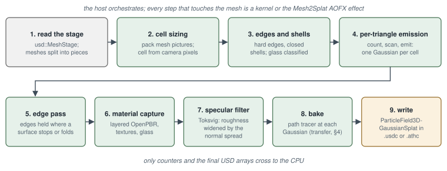

# From a USD asset to a baked cloud

This tutorial converts the pawn of the ASWF Open Chess Set into a cloud of Gaussians with a transfer bake: for every Gaussian, how much of a sky reaches it from each direction. The commands, logs and numbers on this page come from one run on an Apple M5 Pro (Metal) with the public `main` branch. The [next tutorial](render-compare.md) relights the cloud and compares it with a path trace of the meshes.

## The asset

The Open Chess Set is a production USD asset with MaterialX (Autodesk Standard Surface) materials, licensed under CC BY 4.0 by the Academy Software Foundation ([credits](../credits.md)). Only its folder is needed from the `usd-wg/assets` repository, about 37 MB:

```sh
git clone --depth 1 --filter=blob:none --sparse https://github.com/usd-wg/assets.git aswf-assets
git -C aswf-assets sparse-checkout set full_assets/OpenChessSet
```

The pawn is `full_assets/OpenChessSet/assets/Pawn/Pawn.usd`: an `Xform` with two meshes, `Geom_Body/Render` (marble) and `Geom_Top/Render` (a glass head on a gold ring). The stage is in metres with Y up; the pawn is about 4.2 cm wide and 8.1 cm tall.

## Three layers

The conversion and the comparison share one camera and one light, so they live in a layer of their own, `shot.usda`. Two layers sublayer it: `mesh.usda` references the asset's meshes, and `gs.usda` references the cloud the conversion writes.

```usda title="shot.usda"
#usda 1.0
(
    defaultPrim = "World"
    metersPerUnit = 1
    upAxis = "Y"
)

def Xform "World"
{
    def Camera "Camera"
    {
        matrix4d xformOp:transform = ( (0.792624, 0.000000, -0.609711, 0.000000), (-0.091876, 0.988581, -0.119438, 0.000000), (0.602749, 0.150687, 0.783573, 0.000000), (0.200000, 0.095000, 0.260000, 1.000000) )
        uniform token[] xformOpOrder = ["xformOp:transform"]
        float focalLength = 50
        float horizontalAperture = 24.576
        float verticalAperture = 13.824
        float2 clippingRange = (0.01, 100)
    }

    def DomeLight "Sky"
    {
        color3f inputs:color = (0.8, 0.86, 1.0)
        float inputs:intensity = 1
    }

    def DistantLight "Sun"
    {
        float inputs:angle = 1.0
        color3f inputs:color = (1.0, 0.95, 0.88)
        float inputs:intensity = 3
        bool inputs:normalize = 1
        float3 xformOp:rotateXYZ = (-45, 35, 0)
        uniform token[] xformOpOrder = ["xformOp:rotateXYZ"]
    }
}
```

The camera stands at (0.20, 0.095, 0.26) m and looks at the pawn's middle, (0, 0.045, 0). `inputs:normalize = 1` makes the sun's intensity the illuminance on a surface facing it, in lux. Without it, UsdLux reads the intensity as the radiance of the sun's disc, and a sun of intensity 3 at a 1° angle lights almost nothing ([operations §3.2](https://github.com/jesusluque/athenea/blob/main/docs/operations.md#32-rendering-a-stage)).

```usda title="mesh.usda"
#usda 1.0
(
    defaultPrim = "World"
    metersPerUnit = 1
    upAxis = "Y"
    subLayers = [@./shot.usda@]
)

over "World"
{
    def "Pawn" (
        references = @../aswf-assets/full_assets/OpenChessSet/assets/Pawn/Pawn.usd@
    )
    {
    }
}
```

`gs.usda` is the same file with `references = @./pawn_gs.usdc@`.

!!! note "Files"
    The three layers and the four steps of these tutorials: [shot.usda](files/shot.usda), [mesh.usda](files/mesh.usda), [gs.usda](files/gs.usda) and [run.sh](files/run.sh). `run.sh` expects `aswf-assets` in the parent folder.


## The conversion and the bake

<figure markdown>
  
  <figcaption>mesh2splat: each triangle drawn on a lattice, one Gaussian per cell, its material sampled there.</figcaption>
</figure>

```sh
athenea mesh2splat mesh.usda --prim /World/Pawn \
    --cell-from-camera /World/Camera --camera-pixels 1024 \
    --transfer --bake-samples 128 -o pawn_gs.usdc
```

| Option | What it does here |
|---|---|
| `--prim /World/Pawn` | converts only the meshes at or under the pawn |
| `--cell-from-camera /World/Camera` | each mesh's cell is what one pixel of that camera covers where the mesh's box is nearest to it |
| `--camera-pixels 1024` | pixels across the camera's horizontal aperture for that rule |
| `--transfer` | bakes, for every Gaussian, how much of an environment arrives from each direction, instead of the light that arrived |
| `--bake-samples 128` | paths every Gaussian takes first; a transfer adds `--bake-extra` (default 128) on average where the first pass was noisiest |

The log names the cell, the materials each mesh uses, the Gaussians per mesh and the bake:

```text
mesh2splat: the cell is a pixel of /World/Camera, 1024 across
mesh2splat: 4 of 4 textures decoded
mesh2splat: /World/Pawn/Geom_Top/Render uses /World/Pawn/Materials/M_Pawn_Top_B (colour 1.00 1.00 1.00, albedo '', metallic 0.00, roughness 1.00, transmission 1.000, opacity 1.000)
mesh2splat: /World/Pawn/Geom_Top/Render -> 55031 splats of 55031 wanted (2208 triangles, cell 0.0001503)
mesh2splat: /World/Pawn/Geom_Body/Render -> 271234 splats of 271234 wanted (42892 triangles, cell 0.000144)
mesh2splat: transfer baked for 326233 of 326265 gaussians (256 paths each, 3 bounces, with the indirect half) in 98133 ms
mesh2splat: wrote pawn_gs.usdc (326265 splats)
```

| Result | Value |
|---|---|
| Gaussians | 326 265 (55 031 in the glass head, 271 234 in the body) |
| Cell | 0.15 mm on the head, 0.14 mm on the body |
| Bake | 256 paths a Gaussian, 3 bounces, direct and indirect halves, 98 s |
| Whole command | 106 s |
| `pawn_gs.usdc` | 70 MB |

## What the cloud holds

<figure markdown>
  
  <figcaption>The transfer: what the path tracer records in each Gaussian, and how a sky is applied at draw time.</figcaption>
</figure>

The output is a `UsdVolParticleField3DGaussianSplat` under `/World/Pawn/Splats`: positions, orientations, scales, opacities and colours, the material (metallic, roughness, transmission), the shading normals and the transfer. The transfer has no colour and no sky in it: it is geometry, so the same file is correct under any environment the frame provides. The direct half is nine floats a Gaussian; the indirect half, the light that arrived after bouncing off the scene, adds twenty-seven, and `--no-indirect` leaves it out.

The glass head is a solid that transmits fully (`transmission 1.000`). A fully transmitting solid keeps the coverage given by `--glass-opacity` (0.6 by default).

## What changes the result

| Option | Effect |
|---|---|
| `--camera-pixels` | the cell: twice the pixels, half the cell and about four times the Gaussians |
| `--bake-samples`, `--bake-extra` | the bake's grain; the extra paths go where the first pass was noisiest for what its paths cost |
| `--bake-filter` (default 3) | à-trous iterations of the `SplatBakeFilter` bundle over the baked light, between neighbouring Gaussians of one prim; 0 filters nothing |
| `--bake-bounces` (default 3) | bounces after the first hit |
| `--no-indirect` | keeps only the direct half of the transfer |
| `--no-bake` | carries the material to be relit instead of baking |

Every option of the conversion is in [operations §2.8](https://github.com/jesusluque/athenea/blob/main/docs/operations.md#28-athenea-mesh2splat--a-model-into-gaussians) and the decisions behind it in [§3.1](https://github.com/jesusluque/athenea/blob/main/docs/operations.md#31-a-model-into-a-cloud).
